<!-- 필기본: 2026 · 2025 -->
<!-- 단계: 수업 후 -->

# 0. 이 수업을 공부하는 법

**김신우 교수님** 수업(2023·2025·2026 모두 같은 교수님, 2시간). 올해 필기본은 **PPT 127장**(2026년 11월판)이고, 맨 앞 4쪽에 **2022–2025 족보**(정답 표시)가 붙어 있다. 필기한 동기 말: "워드 파일도 있지만 **PPT 파일로 수업해도 괜찮을 것 같다** — 워드 파일은 PPT와 내용이 조금씩 다르지만 큰 틀은 같다."

!!! diff "작년 필기와 다른 점 — 자료 구성"
    작년 필기본은 **워드 본문 38쪽 + PPT 보조 114장**이었다. 올해는 PPT 하나로 수업했고, 워드에만 있던 **바이러스 구조, CDC 병기표, AIDS 지칭 질환, 뇌 침범·폐질환 표, PCP 치료, 첫 진료 검사, IRIS, 치료 변경·내성, 의료인 바늘찔림·PEP 약** 등이 올해 슬라이드에서 빠졌다. **그런데 기출은 이 부분에서 많이 나왔다**(PCP 5문항, PEP·의료인 예방 2문항, gp120/CD4 3문항). 이 자료는 그 내용을 지우지 않고 각 단원 끝에 「(작년 필기)」로 남겨 두었다 — 반드시 같이 본다.

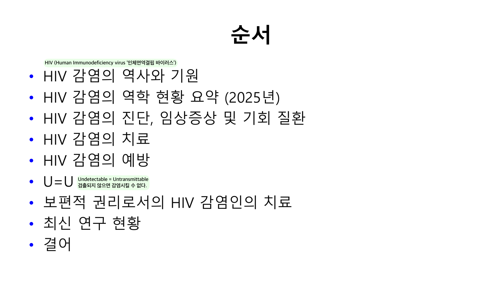{: style="width:62%"}

올해 강의 순서 — 이 자료의 단원도 이 순서를 따른다.

1. HIV 감염의 역사와 기원
2. HIV 감염의 역학 현황 요약(2025년)
3. HIV 감염의 진단, 임상증상 및 기회 질환
4. HIV 감염의 치료
5. HIV 감염의 예방
6. U=U (Undetectable = Untransmittable, 검출되지 않으면 감염시킬 수 없다)
7. 보편적 권리로서의 HIV 감염인의 치료
8. 최신 연구 현황 → 결어

학습성과

1. 사람면역결핍바이러스(HIV)의 전파경로를 설명할 수 있다.
2. HIV 감염의 진단을 설명할 수 있다.
3. 후천성면역결핍증후군(AIDS) 환자에서 흔히 관찰되는 기회감염이나 종양을 열거할 수 있다.
4. HIV 감염의 치료와 그 예후를 설명할 수 있다.
5. AIDS의 예방법을 설명할 수 있다.

## 기출이 묻는 곳 — 한눈에

기출 35문항(2020–2025)이 매년 거의 같은 주제를 돌려 낸다. 올해 필기본 맨 앞 「족보」 4쪽(2022–2025)도 아래 주제 그대로다.

| 주제 | 문항 수 | 2부 번호 |
|---|---|---|
| **U=U의 뜻** | 4 (+3번 사례) | 4, 11, 15, 19 |
| **진단: 선별 = EIA, 확진 = Western blot** | 4 | 2, 7, 21, 28 |
| **PCP: 서서히 오는 호흡곤란 + 양측 간질성 → TMP-SMX (+스테로이드)** · 가장 흔한 사망원인 | 5 | 10, 17, 25, 27, 30 |
| 급성 HIV 증후군에 **없는** 것 고르기 | 3 | 9, 16, 24 |
| **치료 시작 = CD4와 관계없이 모두 즉시** / 치료 목표 = 바이러스 검출한계 미만 | 4 | 3, 5, 8, 26 |
| **90-90-90의 세 번째 90 = 바이러스 억제** | 2 | 12, 23 |
| 전파 위험 비교(모자감염이 가장 큼), 바늘찔림 PEP, 의료인 예방 | 4 | 6, 14, 18, 31 |
| 기회감염 영상·사진(CMV 망막염, PML, 모상백반증, 좁쌀결핵) | 5 | 1, 13, 20, 32, 33 |
| 바이러스학(gp120/CD4, retrovirus 유전자) | 4 | 22, 29, 34, 35 |

!!! exam "기출 포인트 — 올해 족보에만 있는 2문항"
    올해 필기본 족보에는 **2025년 72번**(73세 남성, 체중감소 8 kg/2개월·호흡곤란, 흉부 CT → **파종성 결핵**)과 **2022년 6번**(24세 남자, 1달간 열, 흉부 사진·CT → **Miliary TB**)도 HIV 수업 문제로 실려 있다. 이 두 문항은 저장소에서 **CP-A2(11강)**로 분류돼 있어 2부에는 없다 — 4단원 「결핵」에서 같이 정리했다.

!!! key "핵심 — 이 수업의 메시지"
    교수님: "**치료받은 사람은 감염력이 없어진다 — U=U.**" 올해 결어도 같다: "**U=U, 바이러스 미검출은 전파할 수 없다는 뜻이다**", "**치료가 예방(TasP)**".
    그래서 **진단되면 CD4와 상관없이 바로 ART**(Treat All) → 개인·파트너·사회를 지킨다. "원래 사망률 100%의 질병이었으나 이제는 **약만 잘 먹으면 당뇨보다 훨씬 안전한 질병**이다."

# 1. HIV 감염의 역사와 기원

!!! new "올해 필기에서 추가"
    작년에는 역사가 강의 끝(인권 단원)에 몇 줄로만 있었는데, 올해는 **강의 첫머리에 연표 5장 + 한국 연표 2장**으로 크게 늘었다. 연도 자체를 묻는 기출은 없었지만, 각 연도가 **진단·치료·예방의 이정표**라서 뒤 단원과 이어진다.

{: style="width:70%"}

## 기원 — 언제, 어디서 사람에게 왔나
- **1920년경 콩고(Congo) 공화국의 킨샤사(Kinshasa)**에서 시작한 것으로 추정한다. 아프리카 밀림에서 **침팬지를 사냥하는 과정에서 침팬지의 SIV(원숭이 면역결핍 바이러스)가 사람에게 옮겨진 것**으로 본다(피·고기 접촉).
- HIV가 확인된 **가장 오래된 사람은 1959년에 채취해 보관한 피**(콩고 민주 공화국의 Bantu 성인)다. 실제 처음 전파된 것은 그보다 이른 1920년대로 본다.
- 이 질환은 전 세계로 늘어나 보건뿐 아니라 정치·경제 등 모든 분야에 영향을 미쳤다.
- HIV에는 HIV-1과 HIV-2가 있는데 **대부분 HIV-1**이다(작년 필기).

## 세계 연표 — 진단·치료·예방의 이정표

| 연도 | 사건 | 왜 중요한가 |
|---|---|---|
| 1981 | 미국 CDC가 **남성 동성애자들 사이의 폐포자충 폐렴(PCP)과 카포시 육종 집단 발생** 보고 | AIDS의 첫 사례. PCP는 원래 **면역저하자**가 걸리던 병인데 젊은 남성에게 나타나서 이상하다고 본 것이 시작 |
| 1982 | **AIDS(후천성 면역결핍증)**라는 이름, CDC가 임상 증상으로 정의 | |
| 1983 | 파스퇴르 연구소 **Luc Montagnier** — LAV(림프절병증 관련 바이러스) 분리 | 원인 바이러스 발견 |
| 1984 | 미국 국립암연구소 **Robert Gallo** — HTLV-III 분리(나중에 LAV와 같은 바이러스로 확인), AIDS의 원인이라 발표 | |
| 1985 | **혈액 내 HIV 항체 검사** 첫 허가 | 혈액 공급 선별, 개인 진단이 가능해짐 |
| 1986 | 국제 바이러스 분류 위원회가 **HIV**로 공식 명명 | |
| 1987 | **AZT(zidovudine, 지도부딘)** FDA 승인 — 첫 HIV 약 | 항레트로바이러스 치료 시대의 시작 |
| 1988 | **12월 1일 = 세계 에이즈의 날** | |
| 1990 | 수혈로 감염된 10대 **라이언 화이트** 사망 → Ryan White CARE 법(치료 자금 지원) | |
| 1991 | **빨간 리본** — AIDS 인식의 국제 상징 | |
| 1994 | 미국 공중보건국이 **산모→아이 전파를 줄이기 위해 AZT 권장** | 모자감염 예방의 출발 |
| 1995 | 첫 **프로테아제 억제제** 승인 → **HAART(고활성 항레트로바이러스 요법)**의 시작 | |
| 1996 | UNAIDS 출범, **3제 병합요법** | |
| 2000 | **더반 선언** — HIV가 AIDS의 원인임을 확인 | 「AIDS 부정주의」에 대한 반박 |
| 2002–03 | 세계기금(에이즈·결핵·말라리아), 미국 PEPFAR | 치료 자금 |
| 2008 | **CCR5 돌연변이 기증자의 줄기세포 이식 → 첫 완치(Timothy Ray Brown, 베를린 환자)** | CCR5가 감염에 중요한데, 돌연변이가 오히려 도움이 됨 |
| 2010 | CAPRISA 004 — 살균제(microbicide) 젤의 예방 효과 | |
| 2012 | **Truvada(TDF/FTC) — 첫 노출 전 예방(PrEP) 약** FDA 승인 | |
| 2014 | UNAIDS **90-90-90** 목표 | 90% 진단, 90% 치료, 90% 억제 |
| 2016 | **U=U 선언** | |
| 2019 | **런던 환자** — 두 번째 완치(역시 줄기세포 이식) | "대부분의 완치자는 CCR5 돌연변이를 가지고 있었다" |
| 2020 | 코로나19 속에서도 치료 유지, **지속형 주사 ART** 도입 | "주사는 **두 달에 한 번**" |
| 2021–22 | UN 「2030년 AIDS 종식」 재약속, 장기 지속형 PrEP 주사 | |
| 2023– | 유전자 편집 등 완치 연구 | |
| 2025 | **6개월 예방 주사**(lenacapavir) | "아직 한국에 도입되진 않았다" |

- **HAART**(Highly Active Anti-Retroviral Therapy): 세 가지 정도 약을 섞는 요법. 일반인에게는 「**칵테일 요법**」으로 알려졌고 요즘은 줄여서 **ART**라 한다.
- **AIDS 부정주의**: "에이즈는 가상의 질병이며 존재하지 않는다"는 주장. 이 때문에 치료를 거부한 사람이 많았다(작년 필기: Christine Maggiore 이야기).
- 약이 없던 시절에는 유명인도 HIV로 사망했다 — 1985년 영화배우 **록 허드슨**, 1991년 퀸의 보컬 **프레디 머큐리**. "건강한 유명인도 예외가 아니다"라는 사실에 「죽음의 병」이라는 인식이 퍼졌다.
- 지금까지 **누적 감염 약 9,200만 명, 누적 사망 약 4,420만 명**(13쪽 그림). "치료는 병을 바꾸었고, 이제 남은 것은 도달과 편견이다."
- 필기: "**AIDS라는 말은 '다 죽는다'는 부정적 뜻을 품고 있어서 HIV infection(HIV 감염)이라 하는 것이 좋다.**" "아직 mRNA 백신은 개발돼 있지 않다."
- 원래 사망률 100%의 병이었지만 치료법이 매우 빠르게 개발되어, 이제는 약만 잘 먹으면 당뇨보다 안전하다.

## 한국 연표

| 시기 | 사건 |
|---|---|
| 1985 | **한국 최초 HIV 감염자 확인** |
| 1987 | HIV 항체 검사 도입 |
| 1988 | AZT 등 초기 ART 도입 |
| 1995 | 국내 최초 HIV/AIDS 치료센터 |
| 1996 | HAART 도입 → 사망률 감소 |
| 2000 | 모성-아동 전파 예방 프로그램 (필기: **수직감염은 한국에서는 드문 편**) |
| 2004–05 | 국가 예방·관리 전략, 국립암센터 HIV/AIDS 연구센터 |
| 2006 | **무료 HIV 검사 확대** — "보건소에 가면 무료로 검사해 준다" |
| 2007 | 치료 기준 완화: **CD4 350/µL 이상에서도 치료 권고** |
| 2012 | **1일 1회 복용제 도입** — STR(Single Tablet Regimen, 단일정 요법), 즉 **하루 한 알** |
| 2015 | 치료 목표 **U=U** 제시 |
| 2016 | 신규 감염 감소세 |
| 2018 | **PrEP 도입** |
| 2020 | 장기 작용 치료제 도입 |
| 2022 | 국내 누적 감염자 1만 5천 명 돌파 |

- 필기: "현재 한국의 HIV 감염자는 **17,000여 명**. **희귀 질환이라서 환자 본인 부담금이 없다.**" 한국의 HIV 고위험군은 **MSM(Men who have Sex with Men, 남성 간 성접촉자)**. HIV 감염인은 스스로를 **PL(People Living with HIV)**이라 부른다.
- (곁가지) 한때 "홍삼이 예방에 도움이 된다"는 이상한 소문이 돌기도 했다.

# 2. 역학 현황 (2025년)

## 진단되지 않은 감염인 — 빙산

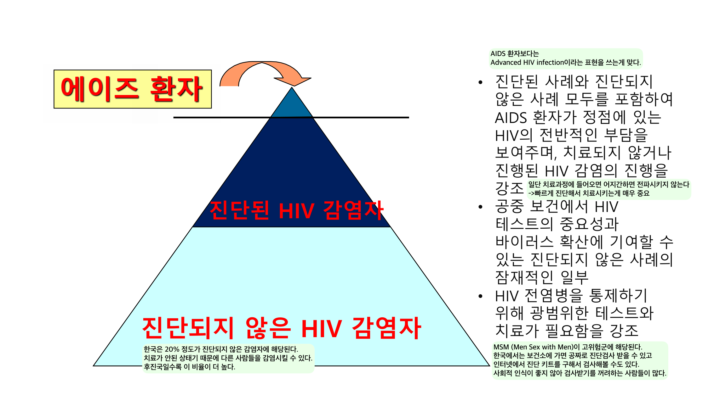{: style="width:66%"}

- 맨 위 꼭짓점이 **에이즈 환자**, 그 아래가 **진단된 HIV 감염인**, 수면 아래 가장 큰 부분이 **진단되지 않은 감염인**이다. 진단되지 않은 사람은 치료를 받지 않으니 **다른 사람을 감염시킬 수 있다** → 광범위한 검사와 치료가 필요하다.
- 필기: "**한국은 20% 정도가 진단되지 않은 감염인**이다. 후진국일수록 이 비율이 더 높다." 한국에서는 보건소에서 공짜로 검사받을 수 있고 인터넷에서 진단 키트를 사서 해 볼 수도 있지만, **사회적 인식이 좋지 않아 검사를 꺼리는 사람이 많다.**
- "**일단 치료 과정에 들어오면 어지간하면 전파시키지 않는다 → 빠르게 진단해서 치료하는 게 매우 중요하다.**"
- 용어: "AIDS 환자보다는 **Advanced HIV infection(진행된 HIV 감염)**이라는 표현을 쓰는 게 맞다."

## HIV 감염의 단계

| 단계 | CD4 수(cells/µL) | 바이러스 양 | 임상 특징 |
|---|---|---|---|
| 급성 HIV 감염 | 변동적 | **매우 높음** | 독감 유사 증상 |
| 만성 HIV 감염 | **>500** | 낮음–중간 | 대개 무증상 |
| 에이즈 | **<200** | 높음 | **기회감염** 발생 |

- HIV는 **CD4(+) T 세포**를 공격해 그 수를 줄인다. 필기: 정상인은 **700–1,200**, **500 이하로 떨어지면 면역이 저하됐다고 본다.**

!!! diff "작년 필기와 다른 점"
    작년 필기는 정상 CD4를 **500–1,200/µL**(6세 이상)로 적었다. 올해 필기는 **700–1,200**. 「500 아래 = 면역 저하」, 「200 아래 = AIDS」라는 기준은 같다.

## 국내 신고 추이와 2025년 현황

{: style="width:72%"}

- **한국의 HIV 유병률은 약 0.035%**로 낮다. 가장 많을 때는 **한 해 1,000명씩** 늘었고(2013–2019), 2020년 이후 줄어 2025년 **927명**.
- **4명 중 1명 정도는 외국인**이다. 예전에는 외국인 감염인을 추방했지만 **인권 문제로 지금은 추방하지 않는다.**
- 1980–90년대에는 에이즈를 죽을병으로 취급했고 그 인식이 지금 세대에도 남아 있다. 교수님: "**병자를 차별해서는 안 되며, 에이즈도 치료할 수 있는 병이라는 것을 반드시 인식했으면 좋겠다.**"
- **TasP(Treatment as Prevention)** — 치료가 곧 예방이다. 치료하면 바이러스가 없어져 감염시키지 못한다.

{: style="width:70%"}

| 2025년 국내 신규 신고 | |
|---|---|
| 전체 | **927명** (전년 975명보다 4.9% 감소) |
| 내국인 / 외국인 | 659명(71.1%) / **268명(28.9%)** |
| 나이 | **20–30대가 66.0%** (30–34세 최다). 65세 이상도 13.1% |
| 감염 경로(응답자) | **성접촉 99.1%**, 그중 **동성 간 62.6%** |
| 생존 감염인 | **17,557명** |
| 신고 기관 | 병·의원 61.0% |

- **남성 환자가 10배가량** 더 많다. **MSM 남성이 여성과 관계를 맺으면 여성이 감염된다.**
- 어디서 발견되나: **성병을 진단하는 항문외과·비뇨기과**, 또는 **전신마취 전 검사**·응급의학과에서 HIV 검사를 하다가 발견된다.
- 젊은 사람이 많다. 교수님은 10대 환자도 보셨다(집을 나갔다가 낯선 성인에게 피해를 입은 경우).
- 슬라이드 결론: "**숫자는 줄었지만, 감염인은 나이 들어 가고 검사는 여전히 늦다.**"

!!! diff "작년 필기와 다른 점"
    - 국내 유병률: 작년 **약 0.027%** → 올해 **약 0.035%**. 성비: 작년 **약 15:1** → 올해 「**약 10배**」.
    - 작년에는 **전 세계 현황(2024, UNAIDS)** 표가 있었다 — 감염인 약 **4,080만 명**(여성·소녀 53%), 신규 130만/년, AIDS 관련 사망 63만/년, ART 3,160만 명, 본인 감염 인지율 87%, 치료 접근률 77%(**아동 55%로 낮음**, 여성 83% > 남성 73%). 추세: 감염인으로 사는 사람은 늘고(오래 산다) 신규 감염·사망은 준다. 사하라 이남 아프리카에 집중, 아프리카는 **남녀 1:1**.
    - 작년 필기의 국내 설명: 2020·21년 감소는 진단 감소·접촉 감소·TasP 효과로 추정, 최근 생존자가 늘어 70–80대 감염인도 있다.

## 진단까지 걸리는 시간 — 4.2년
- 국내 연구(ECDC 모델): **감염에서 진단까지 평균 4.2년** — 진단이 늦다. 원인은 인식 부족, 낙인, 검사·치료 서비스 접근 제한.
- 필기: "우리나라는 진단까지의 기간이 긴 편이다. **기간이 길어지면 역학조사 하기가 힘들어진다.**" (올해 필기본에서는 진단 단원 끝 34쪽에 있다.)

# 3. 진단과 급성 HIV 감염

!!! key "핵심"
    HIV 진단은 **전적으로 실험실 검사**로 한다 — 증상만으로는 감염 여부를 알 수 없다(초기엔 증상이 없거나 감기 몸살 같다).
    **선별 = 4세대 항원/항체 EIA(ELISA) 또는 신속검사 → 양성이면 확진 = Western blot(또는 RNA)**. **급성기는 항체가 아직 없으니 RNA(핵산검사, NAT)**.

## 급성 감염기에 몸 안에서 — 바이러스, CD4, CD8

{: style="width:72%"}

- **HIV 바이러스혈증(분홍)**: 감염 직후 급격히 치솟아 최고조에 이른다 → 이때 **증상**(파란 영역)이 생기고 **전염성이 매우 높다** → 조기 진단·개입이 중요하다.
- **CD4+ T 세포(빨강)**: 감염 후 **크게 감소**했다가 약간 회복하지만 여전히 낮다.
- **CD8+ T 세포(보라)**: 바이러스에 대한 반응으로 **증가**(면역 활성화). 필기: "**CD4가 적어지고 CD8이 더 많아진다**" → **CD4/CD8 비율 역전**(작년 필기: 회복돼도 역전은 남는다).
- 이 변화는 감염 후 몇 주에서 몇 달에 걸쳐 일어난다.

## 검사가 양성이 되는 시기

{: style="width:74%"}

| 검사 | 무엇을 보나 | 양성이 되는 때(감염 후) |
|---|---|---|
| **NAT(핵산검사, HIV RNA)** | 바이러스 유전자 | **약 10일 — 가장 빠름** |
| **4세대 p24 항원 + 항체 EIA** | p24 항원과 항체를 **동시에** | p24 항원 시기부터(3세대보다 1–2주 빠름) |
| p24 항원 EIA | 바이러스 단백 | 약 20일 |
| 3세대 항체 EIA | 항체 | 약 30일 |
| **Western blot** | 여러 바이러스 단백에 대한 항체 밴드 | 가장 늦게 — **확진 검사** |

- 기억법: **RNA → p24 → 항체 → Western blot** 순. 4세대 검사는 p24와 항체를 함께 잡아 **민감도를 높이고 창문기를 줄인다.**
- 필기: "HIV RNA를 찾는 것이 가장 빠른 방법이고 **1주 정도** 걸린다." 조기 진단을 위해서는 시기에 맞는 검사법을 골라야 한다.

## 창문기 (Window Period)
- **감염된 시점부터 검사로 바이러스(또는 그 흔적)를 확실히 잡을 수 있는 시점까지의 기간.** 혈액엔 바이러스가 있지만 항체가 아직 측정되지 않는 시기라서 **검사가 음성인데 전염력은 있다.** 쓰는 검사 종류에 따라 길이가 다르다(RNA가 가장 짧다).
- 창문기 혈액을 수혈받아 감염될 확률은 "**굉장히 굉장히 드물다. 그러니 안심해도 된다.**" (작년 필기: 우리나라 혈액은 **RNA 검사로 거르므로** 안전. 외국은 만성 빈혈 수혈 기준을 Hb 10 → 7로 낮췄다.)
- ※ 확인 필요: 필기 메모에 창문기가 "보통 한 주 정도"라고 적혀 있는데, 1주는 **RNA 검사**가 양성이 되는 시기이고, **항체 검사의 창문기는 보통 3–4주**(4세대 약 2–3주)다. 시험에서는 「검사 종류에 따라 다르고, RNA가 가장 짧다」로 기억한다.

## 노출 후 검사 시기 — 4주

{: style="width:72%"}

| 기관 | 초기 검사 | 후속 검사 |
|---|---|---|
| **한국** | **4주**(2019년 11월 29일, **12주에서 당김**) | 6주(EIA인 경우), 12주(기타) |
| CDC(미국) | 즉시 | 6주, 3개월, 6개월 (4세대 검사 사용) |
| WHO | 노출 후 가능한 한 빨리 | 간격보다 **PEP를 빨리 시작**하는 것을 강조 |
| EACS(유럽) | 가능한 한 빨리 | 4주(4세대), 3개월(3세대·신속검사, 고위험 노출) |

- 필기: "**노출 후 4주 뒤에 검사해서 음성이 뜨면 안심해도 된다.**"
- 작년 필기: 모르는 사람과 성관계 → baseline 검사 후 추적. "12주가 넘었는데 계속 검사하려 하면 '이제 그만하시죠'."

## 급성 HIV 감염의 임상상

1. **발열과 인플루엔자 유사 증상**: 발열, 피로, 두통, 근육통.
2. **림프절 부종**: 붓거나 아프다. **특히 목 림프절**이 잘 커진다.
3. **피부 발진**: 감염 초기 단계에 나타날 수 있다 — 필기: "**환자의 절반 가량에서 피부 발진이 나타난다.**"
4. **설사와 소화 문제**.
5. **일시적인 증상**: 보통 **2–4주**에 걸쳐 저절로 좋아진다.

- 감기와 증상이 비슷해서 **놓치기 쉽다** — "드물고 찾아내기 힘들다."
- **발진이 단서**다. 필기: "다른 감염에서는 발진이 주로 **아이들**에게 생기는데, HIV에서는 **나이를 막론하고 주요 증상**이다." 작년 교수님: "**어른이 응급실에 왔는데 발진이 있다(어른은 발진이 잘 안 생긴다), 근데 젊은 남자다 → HIV 검사를 해야 한다.**" 올해 결어 메모도 같다: "20대인데 타투했고 발진 있고 하면 의심해 볼 수 있지 않을까?" — 급성 감염은 **의심하는 것이 진단의 시작**이다.

| 계통 | 급성 HIV 증후군에서 생길 수 있는 것 (작년 필기 표) |
|---|---|
| 전신 | **발열, 인두염, 림프절병증**(특히 목), 두통/안와 뒤 통증, 관절통·근육통, 무기력, 식욕부진·체중감소, 오심·구토·설사 |
| 신경 | **(무균성) 수막염**(드묾), 뇌염, 말초신경병증, 척수병증 |
| 피부 | **홍반성 반구진 발진**, 점막피부 궤양 |

!!! exam "기출 포인트"
    「급성 HIV 감염에서 가능성이 **가장 낮은** 것」이 3번 — 정답은 늘 **진행된 HIV(낮은 CD4)의 기회감염**: **양측 폐렴(9번)**, **식도 칸디다증(16번)**, **PML(24번)**. 발열·발진·인두염·경부 림프절병증·**무균성 수막염**은 급성기에 있을 수 있다(24번의 함정). 21번 「가. 감염 2–4주 후 독감 증상, 발진 동반 가능」도 맞는 말.

## 급성기와 만성기 비교

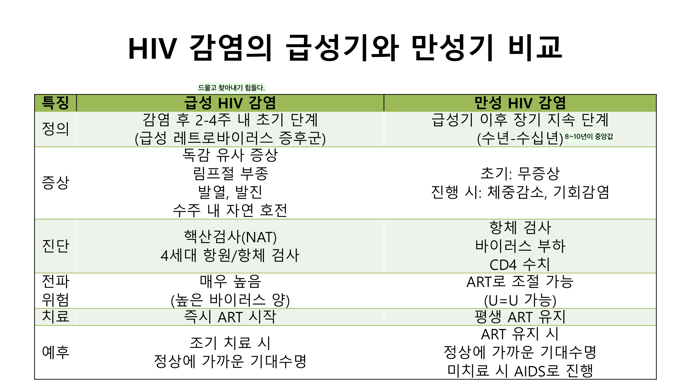{: style="width:72%"}

| | 급성 HIV 감염 | 만성 HIV 감염 |
|---|---|---|
| 정의 | 감염 후 **2–4주** 내 초기 단계(**급성 레트로바이러스 증후군**) | 급성기 이후 오래 지속(수년–수십 년). AIDS까지 **중앙값 8–10년** |
| 증상 | 독감 유사, 림프절 부종, 발열, 발진 → 수주 내 저절로 호전 | 초기 무증상 → 진행하면 체중감소, 기회감염 |
| 진단 | **핵산검사(NAT)**, 4세대 항원/항체 | **항체 검사**, 바이러스 부하, CD4 |
| 전파 위험 | **매우 높음**(바이러스 양이 많다) | ART로 조절 가능(**U=U 가능**) |
| 치료 | **즉시 ART** | **평생 ART** |
| 예후 | 조기 치료 시 정상에 가까운 기대수명 | ART 유지 시 정상에 가까운 수명, 미치료 시 AIDS로 진행 |

!!! diff "작년 필기와 다른 점"
    작년 필기는 급성기를 「**2–6주 잠복기** 후 **50–70%**에서 증상, 항체가 생기면서 **1주–3개월(평균 1–2주)** 안에 저절로 사라진다」로 적었다. 올해 슬라이드는 「**감염 후 2–4주**, 증상은 **2–4주**」로 단순하게 쓴다. 시험 보기에서는 「2–4주 후 독감 증상」이 맞는 말로 나왔다(21번).

## 신속검사 (Rapid test) — 오라퀵(OraQuick)
- **잇몸을 납작한 패드로 문질러(구강액) 현상액에 넣고 20분 뒤 읽는다**(40분 넘으면 안 됨). 손가락 피(전혈)로도 한다. 필기: "**코로나 검사처럼 두 줄 뜨면 양성.**"
- 정확도가 매우 높다 — FDA 승인 신속검사의 민감도 **99.3–100%**, 특이도 **99.1–100%**(OraQuick 구강액 99.3 / 99.8). 보통 **20분–1시간 이내** 결과.
- 그래도 필기: "**민감도·특이도 모두 좋지만 확진검사로는 쓰지 않는다. 확진에는 Western blot, RNA 검사.**"
- **약국·온라인으로 살 수 있다** → 검사 접근성(특히 익명 검사)을 넓히는 것이 목적.

| FDA 승인 신속검사 | 검체 | 민감도(%) | 특이도(%) |
|---|---|---|---|
| OraQuick Advance | 전혈 / 구강액 / 혈장 | 99.6 / 99.3 / 99.6 | 100 / 99.8 / 99.9 |
| Uni-Gold Recombigen | 전혈 / 혈청·혈장 | 100 / 100 | 99.7 / 99.8 |
| Reveal G2 | 혈청·혈장 | 99.8 | 99.1 |
| Multispot HIV-1/HIV-2 | 혈장 / 혈청 | 100 / 100 | 99.93 / 99.91 |

- 작년 필기의 장단점: 장점 — 접근성(VCT, 모자감염 예방), 당일 진단·상담, 30분 이내, 냉장·장비·기술 거의 불필요. 단점 — 한 번에 적은 수, 여러 장소의 질 관리, 제품 간 성능 차이, 판독자 차이.

## 확인검사 — Western blot

{: style="width:66%"}

- 바이러스 단백질을 크기별로 늘어놓고 환자 혈청의 항체가 어느 밴드에 붙는지 본다(**항체 검사의 한 방법**).
- 유전자별 밴드: **env** — gp160, gp120, gp41 / **gag** — p55, p18, **p24** / **pol** — p65, p51, p31.
- **판정: 3개 핵심 밴드(p24, gp41, gp120/160) 중 2개 이상이면 양성**(필기 형광펜, 메모 「₃C₂」). 밴드가 없으면 음성, 밴드가 있지만 기준에 못 미치면 **미결정(indeterminate)**.
- 작년 필기: 해석 기준이 여러 개이고 비싸다. 최신 알고리즘은 HIV-1/2 감별 항체검사 + NAT를 쓴다.

!!! exam "기출 포인트"
    「확진검사로 적절한 것」→ **Western blot**(2번, 28번 — ELISA 양성 다음 단계), 「가장 기본적인 선별검사」→ **HIV 항체 선별검사(EIA)**(7번). 오답: **rapid test(선별용)**, p24 단독·CD4·CD8·viral load·flow cytometry(확진 아님). 21번 「다. 진단검사로 항체검사, 확진은 western blot」 맞음. 2024·2025 족보에서 그대로 다시 나왔다.

## (작년 필기) 진단에서 더 알아 둘 것

!!! diff "작년 필기와 다른 점 — 올해 슬라이드에서 빠진 진단 내용"
    아래는 작년 워드 필기에만 있던 내용이다. 기출 보기(선별·확진, 신생아 진단)와 이어지니 그대로 둔다.

{: style="width:64%"}

- **4세대 항원/항체 복합검사(HIV-1/2 Ag/Ab combo)**: 현재 표준 선별검사. 감염 후 **2–3주**에 검출, 민감도·특이도 >99%. 그러나 **양성예측도는 유병률에 따라 다르다** — 고위험군(유병률 10%) 91%, **일반인구(0.1%) 50%** → 위양성이 많다(바이러스 감염, 류마티스 질환, 임신 등). 위양성을 설명할 때는 "몸에 HIV와 비슷한 물질이 있다"고 하면 된다.
- 항체는 **감염 후 2주부터**, 거의 대부분 **8주 이내** 양전, **12주(3개월) 이후 양전은 사실상 없다**. 혈청전환기에 가장 먼저 나오는 항체는 **p24**와 막단백(gp160, gp41)에 대한 것.
- **HIV RNA 정량**: 쓰임새 (a) 초기·급성기 진단, (b) **신생아 진단**, (c) **치료 반응 모니터링**(실제로는 대부분 이것). **CD4 수**: 예후, 치료 모니터링.
- **신생아**: 엄마의 IgG 항체가 태반을 넘어오므로 태어나서 항체검사를 하면 **무조건 양성**. 그래서 **RNA 검사**로 보고, 엄마 항체가 사라지는 **1년 6개월 뒤에도 항체 양성이면 감염**이다(올해 필기 91쪽 메모에도 같은 내용).

{: style="width:62%"}

| 단계 | RNA | p24 | 3세대 항체 | Western blot | |
|---|---|---|---|---|---|
| 1–2 | + / +++ | − / + | − | − | 급성 감염 |
| 3–5 | +++ | +/− | + | − → 중간 → + | 혈청전환 |
| 6 | +~+++ | +/− | + | + (모든 밴드) | 만성 감염 |

**첫 진료 때 하는 검사 (Initial evaluation)**

| 범주 | 항목 |
|---|---|
| 기본 진료 | 병력·신체검사, **간이정신상태검사(MMSE — 뇌를 침범하니까)** |
| 혈액 | 일반 화학·혈액, 간기능, 지질·공복혈당, **CD4 수, 혈장 HIV RNA, HIV 내성검사** |
| 감염 관련 | **매독(RPR/VDRL)**, 톡소포자충 항체, 소변검사, **PPD 또는 IGRA(결핵)**, **B·C형 간염** |
| 예방접종 | **폐렴구균, 인플루엔자**(사백신), HPV, A·B형 간염(음성이면) |
| 상담·지원 | 자연경과·전파 상담, 접촉자 연락, 보험·기초수급 연결 |

# 4. 기회감염과 종양 — CD4로 읽는다

## CD4 수와 기회감염 예방

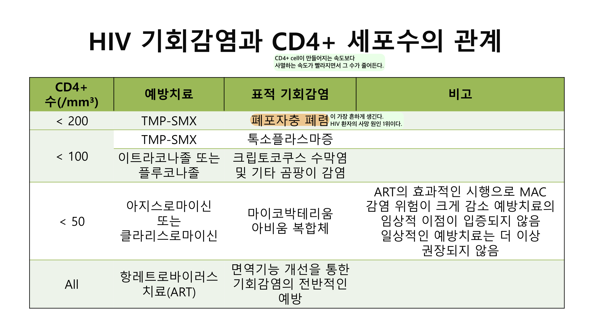{: style="width:72%"}

| CD4+ (/µL) | 예방 치료 | 표적 기회감염 | 비고 |
|---|---|---|---|
| **<200** | **TMP-SMX** | **폐포자충 폐렴(PCP)** | "**가장 흔하게 생긴다. HIV 환자 사망 원인 1위**" |
| **<100** | **TMP-SMX** | **톡소플라스마증** | PCP와 같은 약 |
| <100 | 이트라코나졸 또는 플루코나졸 | 크립토콕쿠스 수막염 및 기타 곰팡이 감염 | |
| **<50** | 아지스로마이신 또는 클래리스로마이신 | **MAC(마이코박테리움 아비움 복합체)** | ART를 잘 하면서 MAC 위험이 크게 줄어 **일상적인 예방은 더 이상 권장하지 않음** |
| 모두 | **ART** | 면역기능 개선 → 기회감염 전반 예방 | |

- 왜 CD4가 줄어드나 — 필기: "**CD4+ 세포가 만들어지는 속도보다 사멸하는 속도가 빨라지면서** 그 수가 줄어든다."

{: style="width:70%"}

!!! memo "암기 — CD4 계단 (36쪽)"
    **<500 결핵·세균성 폐렴** → **<200 PCP** → **<100 톡소플라스마 뇌염·크립토콕쿠스 수막염** → **<50 CMV 망막염·파종성 MAC**.
    예방: **PCP·톡소 = TMP-SMX**, **잠복결핵 = CD4 수와 관계없이 치료**, **MAC = 즉시 ART면 1차 예방 불필요**. 「**가장 좋은 기회감염 예방은 빠른 항레트로바이러스 치료다.**」
    필기: "**미국에서는 결핵이 있으면 바로 HIV를 의심해 본다.**"

!!! diff "작년 필기와 다른 점 — 기회감염 예방"
    - **MAC**: 작년 「CD4 <50 + ART 시작이 늦어질 때 azithromycin 1,200 mg 주 1회」 → 올해 「**일상적 예방은 더 이상 권장하지 않음**」(조기 ART면 불필요한 것은 작년도 같음).
    - **크립토콕쿠스**: 작년 「1차 예방은 아프리카 등 고위험 지역만(국내 비권장), 치료 후 2차 예방 fluconazole」 → 올해 표에는 「CD4 <100, itraconazole 또는 fluconazole」이 들어 있다.
    - 작년에만 있던 것: PCP 예방은 **CD4 <200 (또는 <14%, 아구창 병력)**에서 **TMP-SMX 1정 매일**(대안 dapsone, atovaquone, 흡입 pentamidine), **CD4가 200 위로 두 번 올라오면 끊는다**. 톡소는 **CD4 <100 + IgG 양성**에서 TMP-SMX DS. 잠복결핵은 **isoniazid 9개월 + pyridoxine**(rifampin은 HIV 약과 상호작용이 많아서). CMV 망막염·크립토콕쿠스는 치료 후 **2차 예방(유지요법)**.

## 슬라이드 사진으로 보는 기회감염 — 「이걸 보면 HIV 검사」

올해 필기본 37–56쪽은 사진 모음이다. 각 사진의 메모는 거의 모두 **「이런 환자가 오면 HIV 검사를 해야 한다」**로 끝난다.

### 폐포자충 폐렴 (PCP, Pneumocystis jirovecii pneumonia)

{: style="width:62%"}

- 필기: "**서서히 진행되는 호흡곤란이 주요 증상**, 치료약은 **Bactrim(TMP-SMX)**." 흉부 X선·CT에서 **양측 미만성 간질성(간유리) 음영**.
- CD4 <200에서 생기고 **가장 흔하며 HIV 환자 사망 원인 1위**(올해 35쪽 메모). 1981년 첫 AIDS 보고도 PCP였다.
- 작년 필기: 일반 폐렴처럼 기침·객담·고열로 오지 않고 **마른기침 + 서서히 진행하는 호흡곤란**. 적응돼서 **산소포화도가 낮아도 숨찬 걸 모르기도** 한다. PCR이 음성이어도 **양측 폐렴 + 기저 HIV면 PCP로 진단할 만큼** 중요하다. Bactrim을 써도 70%만 낫고 30%는 사망, 치료 안 하면 다 사망.

!!! exam "기출 포인트 — PCP (5문항)"
    「젊은 남자, **1달(4주)간 서서히 진행하는 호흡곤란**, 영상」 → 경험적 1차 약 **TMP-SMX**(17·25번), 「효과를 기대하기 **어려운** 약」 → **doxycycline**(30번 — TMP-SMX·dapsone·atovaquone·pentamidine은 효과 있음), 「**동맥혈 산소분압 55 mmHg**」 → **TMP-SMX + glucocorticoid**(27번 — **PaO2 <70이면 스테로이드**를 더한다), 10번 「HIV의 가장 흔한 사망원인」 → **PCP**(필기·족보 기준. 전 세계적으로는 결핵이라는 자료도 있으니 보기에 둘 다 있으면 필기를 따른다).

### 결핵 — 폐포자충 다음 두 번째

{: style="width:62%"}

- **진행된 폐결핵**(38쪽): "**폐포자충 다음으로 두 번째로 많음.** **위쪽(폐 상엽)**에 많이 생긴다."
- **파종성 결핵(Miliary TB, 좁쌀결핵)**(39쪽): 양폐 전체에 좁쌀 같은 작은 결절. "**투석 환자, 이식 환자 등 면역력이 떨어지는 환자에게 생기는 결핵이다. 이런 환자가 오면 HIV 검사부터 바로 실시해야 한다.**"
- **결핵성 경부 림프절염**(40쪽): 감별진단은 **림프종, 기쿠치병(Kikuchi disease)** 등. "HIV가 없는지 확인해 봐야 한다."
- 작년 필기: 잠복결핵이 많은데 HIV로 면역이 떨어지며 깨어난다. HIV에 특이한 것이 좁쌀결핵. 결핵은 보통 폐첨부에 오지만 HIV에서는 아닌 경우도 있다. 결핵은 항결핵제로 일반 환자처럼 잘 치료된다.

!!! exam "기출 포인트"
    20번: 인도네시아(결핵 유행 지역) 출장이 잦은 HIV 환자 + 발열·흉막성 통증 + 좁쌀 결절 → **M. tuberculosis**(MAC·M. abscessus·나병균·크립토콕쿠스 오답). 올해 족보에 실린 **2022년 6번**(24세 남자, 1달간 열, 흉부 사진·CT → **Miliary TB**; 오답 CMV 폐렴·PCP·COVID-19·카포시)과 **2025년 72번**(73세, 체중감소·호흡곤란, 흉부 CT → **파종성 결핵**; 오답 폐암 전이·진폐증·전이성 육아종·기회감염성 폐포자충폐렴)도 같은 그림 문제다(저장소 분류는 CP-A2).

### 입·식도·피부·항문 — 눈으로 보이는 단서

{: style="width:60%"}

| 병변 (쪽) | 필기 메모 | 정리 |
|---|---|---|
| **입인두·식도 칸디다증** (41) | "**백태가 있으면 영양결핍으로 단정 지어서는 안 된다.** 면역결핍 상태이니 HIV 검사. **성인이 돼서 면역결핍이 심하게 오면 이식 환자 아니면 HIV 감염자다.**" | 긁으면 벗겨지는 흰 막. 식도까지 가면 AIDS 지칭 질환 |
| **단순포진(HSV)** (42) | "Herpes는 HIV와 **전염 경로가 같다**. 특히 **Herpes 2형이라면 반드시 HIV 검사**." | 입술·생식기·항문 주위 |
| **항문 주변의 만성 herpes** (43) | "세포를 뭉치게 하는 경향이 있다." | 세포 검사에서 **다핵 거대세포**(뭉친 세포). 한 달 넘게 안 낫는 HSV 궤양은 AIDS 지칭 질환 |
| **입(안)의 papilloma** (44) | "HBV 바이러스가 이렇게 혀에 증식하기도 한다." | ※ 확인 필요: 유두종(papilloma)의 원인은 **HPV(사람유두종바이러스)**다. 메모의 「HBV」는 HPV를 잘못 적은 것으로 보인다 |
| **항문 곤지름(condyloma)** (45) | "**위생관리가 힘들다**는 것이 큰 문제. 이런 경우 **항문외과에서 HIV 검사**를 해 본다." | HPV. 항문성교의 단서 |
| **대상포진(VZV)** (46) | "**부위를 가리지 않고** 다 발생한다." 사진의 할머니는 **V1(안신경)** 침범, "V3(하악신경)를 침범하는 경우가 많다." | 작년: **젊은 사람 대상포진 → HIV 검사**(CD4 >500에서도) |
| **모상 백반증(hairy leukoplakia)** (47) | "**혀 옆에 EBV가 복제되어 증식**한다." | 혀 옆면의 털 같은 흰 줄무늬, **긁어도 안 벗겨진다**(칸디다와 차이) |
| **아프타 궤양** (48) | "상염색체 우성 질환이다. 혀 또는 입술 부위가 헐어서 문제가 된다." | Minor(입술·혀), Major. ※ 확인 필요: 재발성 아프타 궤양은 상염색체 우성 유전병이 아니다(가족력이 흔할 뿐) — 메모를 그대로 외우지 말 것 |

{: style="width:52%"}

!!! exam "기출 포인트"
    32번: 처음 진단된 HIV 환자의 **혀 옆면 흰 병변** → **EBV**(모상백반증). 오답 **Candida**(긁으면 벗겨지는 흰 반점), HSV·VZV·CMV(궤양성). 「AIDS를 지칭하는 질환이 **아닌** 것 → **구강 칸디다증**(식도·기관지 칸디다증만 지칭 질환)」은 작년 필기에 「시험에 가끔 나왔다」고 적혀 있다.

### 뇌와 눈 — 크립토콕쿠스, 톡소, PML, CMV

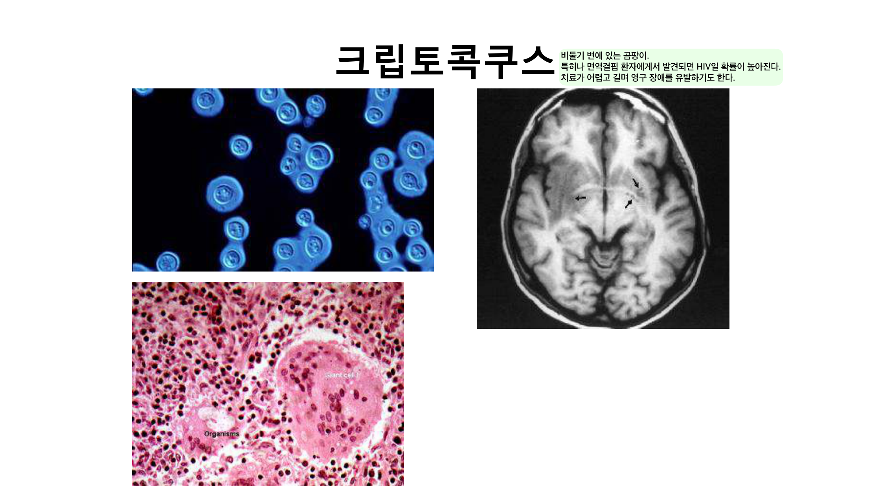{: style="width:52%"}

- **크립토콕쿠스**(49쪽): "**비둘기 변**에 있는 곰팡이. 면역결핍 환자에게서 발견되면 HIV일 확률이 높아진다. **치료가 어렵고 길며 영구 장애를 남기기도** 한다." 주로 **수막염**(CD4 <100). 작년 필기: "머리를 좋아한다." 크립토콕쿠스 수막염이 있으면 **ART를 4–6주 늦춘다**(IRIS — 5단원 diff).

{: style="width:58%"}

- **톡소플라스마증**(50쪽): "**고양이 변**에 있는 원충 기생충. **눈, 머리**에 대한 친화성(tropism). 치료는 **Bactrim(TMP-SMX)**." 뇌 MRI에서 **조영증강되는 고리 모양 병변**, 안저에서 맥락망막염.

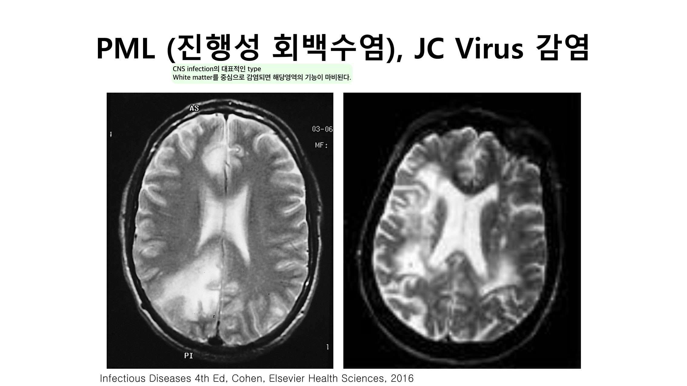{: style="width:62%"}

- **PML(진행성 다초점 백질뇌증)**, **JC virus**(51쪽): "**CNS 감염의 대표적인 type.** **백질(white matter)**을 중심으로 감염되면 그 영역의 기능이 마비된다." MRI T2에서 조영증강·부종이 없는 **백질 고신호 병변**. 작년: "PML = 뇌를 침범하는 넘버원", JC virus를 깨우면 생긴다.
- (슬라이드 제목의 「진행성 회백수염」은 PML의 옛 번역이다. 정식 이름은 진행성 다초점 백질뇌증.)

{: style="width:52%"}

- **CMV 망막염**(52쪽): 안저에서 **혈관 주위 출혈과 삼출물**("피자 모양"). 필기: "CMV는 **눈, 폐, 대장**에 친화성. **눈은 신경조직이라 실명까지** 올 수 있다." CD4 <50.

!!! exam "기출 포인트"
    1번(2025): 치료 안 받은 HIV 45세, 시야 흐림·시력저하, 안저 → **CMV**(톡소·크립토콕쿠스·칸디다·HSV-2 오답). 33번: 말이 어둔하고 보행장애, MRI 백질 병변, ELISA 양성 → **JC virus(PML)**. 오답 짝: **톡소 = 조영증강 고리 병변, EBV = 원발성 CNS 림프종, CMV = 뇌실염**. 13번: 「HIV를 기저질환으로 조사해야 할 질환」 → **PML**(신우신염·세균성 폐렴·심내막염·구강 단순포진은 정상인에게도 흔함) — 2022년 족보에 그대로 실림.

### 종양 — 림프종, 항문암, 카포시 육종

- **세균성 혈관종증(bacillary angiomatosis)**(53쪽): 피부의 붉은 혈관성 결절(사진: 손바닥). Bartonella 감염.
- **HIV 연관 림프종**(54쪽): "**암 중에서는 림프종이 가장 많다.** 일반 조직과 구별이 잘 안 되어 감별이 힘들다." 사진은 종격동 림프종(흉부 X선에 동그라미). 작년: EBV 관련으로 보인다.
- **항문암**(55쪽): "아무래도 항문 성교가 이루어지기 때문에 **항문암 비율이 매우 높다**." (HPV)
- **카포시 육종**(56쪽): 피부·입안의 **보라·검은색 반점/결절**. "**한국인에게서는 조금 드물고 흑인에서 비율이 높다.**" (HHV-8)
    - **Carcinoma = 상피세포(epithelial cell) 기원** 악성종양, **Sarcoma = 중간엽(mesenchymal) 기원** 악성종양.

{: style="width:56%"}

!!! key "핵심 — 결론적으로 HIV는 (56쪽 메모)"
    ① **감염**을 유발하고(기회감염) ② **뇌를 침범**하여 치매를 유발하며 ③ **암**을 유발한다.

## (작년 필기) AIDS의 정의·병기와 지칭 질환

!!! diff "작년 필기와 다른 점 — 올해 슬라이드에서 빠진 임상 내용"
    아래(병기표, 임상 단계, CD4 구간별 질환표, AIDS 지칭 질환, 뇌 침범·폐질환 표)는 작년 필기에만 있다. 13·24·33번(PML), 9·16번(양측 폐렴·식도 칸디다), 27·30번(PCP 치료)이 여기서 나왔다.

{: style="width:70%"}

- **AIDS의 정의**: HIV 양성자가 **CD4 <200/µL (또는 <14%)**이거나 **AIDS 지칭 질환**을 가진 경우. Stage 1 ≥500(≥26%), Stage 2 200–499(14–25%), **Stage 3(AIDS) <200(<14%)**. 기준은 CD4 **수**이고 %는 보조. 어릴수록 기준이 높다(<1세는 <750이 Stage 3).
- **진행 속도**: 약 **20%는 5년 안에** AIDS, **<5%는 10년 넘게** 무증상·CD4 >500. 20년 동안 면역저하가 없으면 **elite controller**. 진행을 늦추는 요인: **바이러스 nef 유전자 돌연변이**, **숙주 CCR5 돌연변이**.
- **무증상기**: 8–10년 정상 생활, 그러나 면역은 계속 떨어지고 **이 시기에도 전파**한다. 일부는 **지속성 전신 림프절병증**(서혜부 제외 두 군데 이상, 1 cm 이상, 3개월 이상).
- **AIDS 관련 증후군(CD4 <500)**: **구강 병변이 매우 흔함**(아구창, 모상백반증, 아프타 궤양, 치주염), 칸디다 질염, **지루성 피부염**, 단순포진·대상포진, **전염성 물렁종**.
- **만성 염증 상태**: ART로 억제돼도 지속적 면역 활성화로 **가속 노화, 골 취약성, 암, 심혈관질환, 당뇨, 신장·간 질환, 신경인지 장애**가 는다.

{: style="width:70%"}

| CD4 (/µL) | 생기는 질환 (작년 표) |
|---|---|
| **>500** | 대상포진(여러 피부분절) — **젊은 사람 대상포진 → HIV 검사** |
| **200–500** | **결핵**, 구강 모상백반증, **칸디다 인두염(아구창)**, 카포시 육종(점막피부형), 재발성 세균성 폐렴, 자궁경부 신생물 |
| **100–200** | **PCP**, 히스토플라스마 전신감염, 카포시 육종(내장형), **PML**, 비호지킨 림프종 |
| **<100** | **칸디다 식도염**, **CMV 망막염**, **MAC 전신감염**, **톡소포자충 뇌염**, 크립토스포리디움 장염, **크립토콕쿠스 수막염**, 만성 HSV 궤양, CMV 식도염·대장염, **중추신경계 림프종** |

{: style="width:64%"}

**AIDS 지칭 질환** — 칸디다(**기관지·기관·폐, 식도** ← **구강은 아니다**), 침윤성 자궁경부암, 파종성/폐외 콕시디오이데스·히스토플라스마증, 폐외 크립토콕쿠스증, 만성(>1개월) 크립토스포리디움·이소스포라 장염, CMV 질환(간·비장·림프절 외)·**CMV 망막염**, HIV 뇌병증, **HSV 만성 궤양(>1개월)**, **카포시 육종**, 림프종(**버킷**, 면역모세포성, **원발성 뇌 림프종**), **MAC·M. kansasii 파종성**, **결핵(모든 부위)**, **PCP**, **재발성 폐렴**, **PML**, **재발성 살모넬라 패혈증**, **뇌 톡소포자충증**, HIV 소모증후군, (소아 <6세) 다발·재발성 세균감염.

**뇌 침범** — "온몸을 다 가는데 특히 기회감염, 기회종양, 뇌 침범."

| 범주 | 질환 |
|---|---|
| 수막염·두통 | 무균성 수막염, **크립토콕쿠스 수막염**, 결핵성 수막염 |
| 미만성 뇌질환 | 의식 보존: **AIDS 치매 복합증** / 의식 저하: 톡소플라스마 뇌염, CMV 뇌염 |
| 국소 뇌질환 | **뇌 톡소포자충증**, **원발성 CNS 림프종**, **PML**, 결핵성 뇌농양 |
| 척수·말초신경·근육 | 공포성 척수병증, CMV 척수병증 / 감각 다발신경병증, 약물 독성(zalcitabine·didanosine·stavudine), CMV 다발신경근병증 / **zidovudine 근병증** |

- **AIDS 치매 복합증**: 초기 — 집중력 저하·건망, 동작 느림·운동실조, 무관심·성격 변화 → 후기 — 전반적 치매, 하반신 마비, 무언증. 증상만으로 구별이 어려워 **영상·뇌척수액을 종합**한다.

**폐 질환**

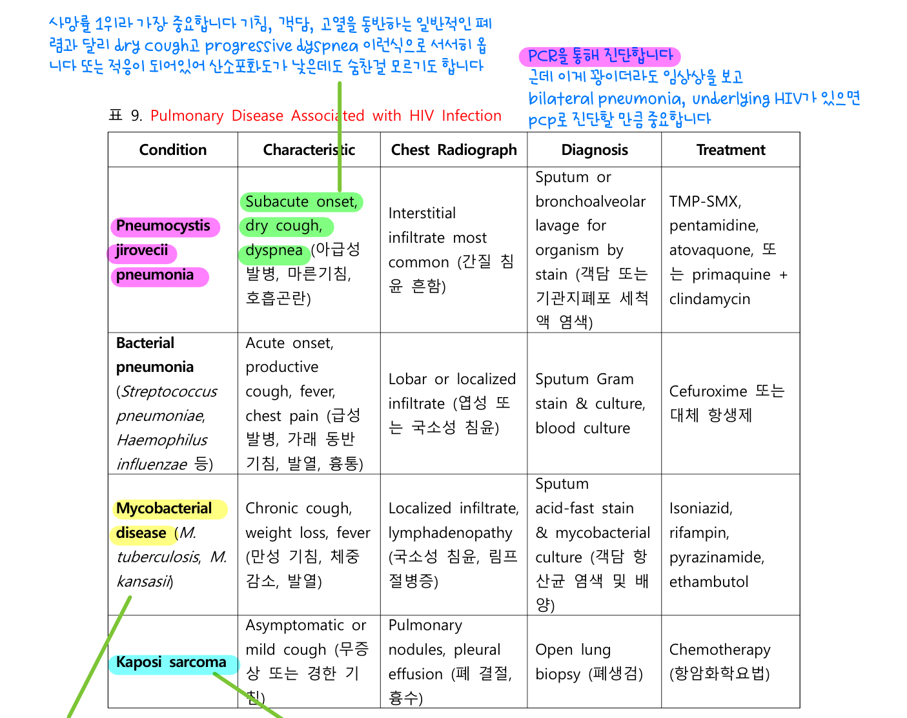{: style="width:70%"}

| | PCP | 세균성 폐렴 | 결핵 | 카포시 육종 |
|---|---|---|---|---|
| 양상 | **아급성, 마른기침, 호흡곤란** | 급성, 가래·발열·흉통 | 만성 기침, 체중감소, 발열 | 무증상·경한 기침 |
| 흉부 X선 | **간질성 침윤(양측 미만성)** | 엽성·국소 침윤 | 국소 침윤, 림프절병증 | 폐 결절, 흉수 |
| 진단 | 객담·**기관지폐포세척액 염색**(PCR) | 객담 그람염색·배양, 혈액배양 | 객담 항산균 염색·배양 | 개흉 폐생검 |
| 치료 | **TMP-SMX**, pentamidine, atovaquone, primaquine+clindamycin (**+ 스테로이드: PaO2 <70**) | cefuroxime 등 | INH, RIF, PZA, EMB | 항암치료 |

# 5. HIV 감염의 치료

!!! key "핵심"
    **진단되면 CD4와 관계없이 즉시 ART**(Treat All, 2015 WHO). 요즘 약은 **INSTI(인테그라제 억제제) 1 + NRTI 2**를 **하루 한 알**로 먹고, 2제(돌루테그라비르/라미부딘)·**2개월마다 주사**(카보테그라비르 + 릴피비린)도 있다.
    **치료 목표 = 혈중 바이러스를 검출한계 미만으로** → 정상에 가까운 수명 + 전파 차단(U=U).

## 성공적 치료를 위한 모델 — 진단에서 끝나지 않는다

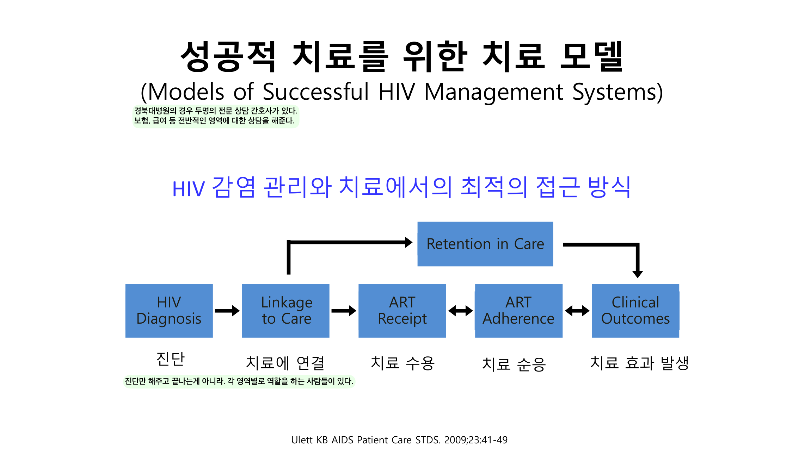{: style="width:70%"}

- 순서: **진단(HIV Diagnosis) → 치료에 연결(Linkage to Care) → 치료 수용(ART Receipt) ↔ 치료 순응(ART Adherence) ↔ 치료 효과(Clinical Outcomes)**, 전 과정에 걸쳐 **치료 유지(Retention in Care)**.
- 필기: "**진단만 해 주고 끝나는 게 아니라 각 영역별로 역할을 하는 사람들이 있다.**" 경북대병원에는 **전문 상담 간호사 두 명**이 있어 보험·급여 등 전반을 상담해 준다.

## HIV 치료의 연속성 (HIV Care Continuum)

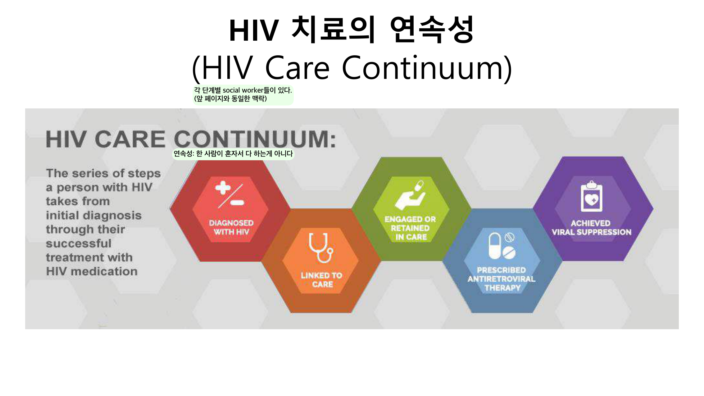{: style="width:66%"}

| 단계 | 하는 일 |
|---|---|
| **HIV 검사·진단** | 여러 검사 방법으로 감염된 사람을 찾아낸다 |
| **돌봄과의 연계** | HIV 관리 서비스에 연결하고 관리 팀과 관계를 만든다 |
| **관리 유지** | 정기적으로 의료진을 방문하며 치료에 계속 참여하게 한다 |
| **ART 시작** | 바이러스 억제·면역 회복을 위해 항레트로바이러스 요법을 시작한다 |
| **ART 준수** | 처방대로 꾸준히 먹게 한다 |
| **바이러스 억제** | 검출되지 않는 바이러스 양을 달성·유지 → 전파 위험↓, 건강↑ |

- 필기: "**연속성 — 한 사람이 혼자서 다 하는 게 아니다.** 각 단계별로 social worker들이 있다." 연속체는 관리 체계의 **빈틈(어느 단계에서 사람이 빠져나가는지)**을 찾는 도구다.
- 결어에도 같은 말: "**HIV 치료는 지속 모델(continuum)의 유지가 중요하다.**"

!!! diff "작년 필기와 다른 점"
    작년 필기: 선진국도 진단 안 된 채 사는 사람이 20–25%. 진단된 사람의 25%만 제대로 치료받는다는 자료도 있지만, **우리나라는 진단만 되면 공짜로 치료**해 줘서 60–70%는 확보한다.

## 90-90-90 → 95-95-95

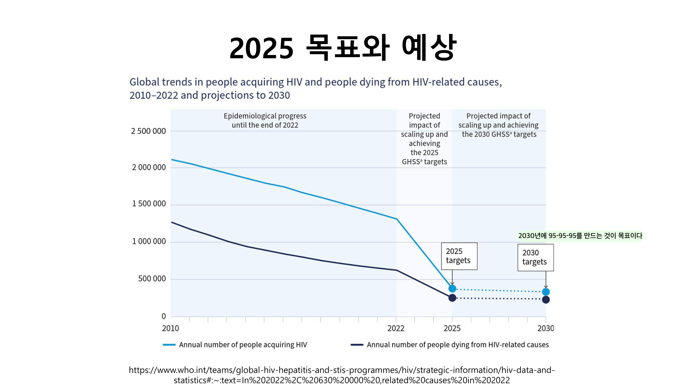{: style="width:62%"}

- 60쪽 그래프: 전 세계 신규 감염(하늘색)과 HIV 관련 사망(남색)은 2010년부터 줄고 있고, 목표를 이루면 2025–2030년에 더 크게 줄 것으로 예상한다. 필기: "**2030년에 95-95-95를 만드는 것이 목표.**"

| | 2020년 목표 (90-90-90) | 2030년 목표 (95-95-95) |
|---|---|---|
| 첫째 | 감염인의 90%가 **자신의 HIV 상태를 안다**(진단) | 95% |
| 둘째 | 진단받은 사람의 90%가 **지속적인 ART**를 받는다 | 95% |
| **셋째** | **ART 받는 사람의 90%가 바이러스 억제** | 95% |

- 2030 목표를 위해 강조하는 것: 신규 감염·AIDS 관련 사망을 더 줄이기, **검사·치료 접근·치료 유지 노력 강화**, 사회·경제적 장벽 해결, 인구 집단에 맞춘 접근.

!!! exam "기출 포인트"
    「세 번째(마지막) 90은?」 → **ART 받는 사람의 90%에서 바이러스 억제**(12번, 23번). 오답: 90%가 자기 상태를 안다(첫째), 진단자의 90% 치료(둘째), CD4 >500, MSM 연 1회 검사. 세 숫자는 **진단 → 치료 → 억제** 순서로 외운다.

## 언제 시작하나 — 더 빨리, 모두

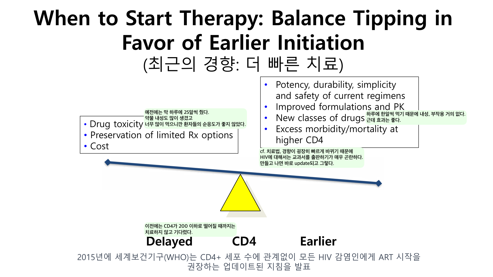{: style="width:66%"}

- 시소 그림: 왼쪽(늦게 시작할 이유) — **약 독성**, 제한된 약을 아껴 두기, 비용. 오른쪽(빨리 시작할 이유) — 요즘 약의 **효력·지속성·단순성·안전성**, 제형·약동학 개선, **새 계열 약**, **CD4가 높을 때도 치료 안 하면 생기는 질병·사망**. 지금은 오른쪽(Earlier)으로 기울었다.
- **2015년 WHO: CD4+ 세포 수에 관계없이 모든 HIV 감염인에게 ART 시작 권장.**
- 필기: "**이전에는 CD4가 200 이하로 떨어질 때까지 치료하지 않고 기다렸다.** 예전에는 **하루에 25알씩** 줬다 — 약물 내성도 많이 생겼고 너무 많이 먹으니 **순응도가 좋지 않았다**." "지금은 **하루에 한 알씩** 먹기 때문에 **내성·부작용이 거의 없다. 그런데 효과는 좋다.**"
- 필기: "치료법·경향이 굉장히 빠르게 바뀌어서 **HIV는 교과서를 출판하기가 매우 곤란하다** — 만들고 나면 바로 update된다."

!!! exam "기출 포인트"
    「현재 권고」 → **모든 감염자에게 즉시 치료**(8번), 「치료 대상 CD4」 → **CD4 수에 관계없이 모두**(26번 — 「<200」, 「<350」, 「<500」은 옛 기준이라 함정).

!!! diff "작년 필기와 다른 점 — 시작 시점의 예외와 IRIS (올해 슬라이드에서 빠짐)"
    | 상황 | 시작 시점 |
    |---|---|
    | 모든 감염인, 임산부, 급성 HIV, B·C형 간염 동반, 소아·청소년 | **즉시**(Same Day ART) |
    | 결핵 동반 | 결핵 치료 시작 후 **2–8주 이내**(CD4 <50이면 2주 이내) |
    | **크립토콕쿠스 수막염** 동반 | 항진균 치료 후 **4–6주 늦춤** — 일찍 시작하면 IRIS로 사망 ↑ |

    - **면역재구성 염증증후군(IRIS)**: 치료하는데 오히려 나빠지는 것. 예: 결핵성 림프절염에 ART를 시작하면 면역이 살아나 균에 대한 염증이 세져 고름이 고이고 터진다.
    - 시작 전 고려: 환자의 **치료 의지·준비**, **순응 가능성**(상담이 중요 — 약 받아 가서 안 먹으면 그만), 알약 수·음식, 병의 중증도, 부작용, 동반질환(결핵·간질환·우울증·임신), 약물상호작용. 외래는 처음 2·4·8주, 억제되면 3–6개월 간격.

## HIV의 전형적 경과 — 치료하지 않으면

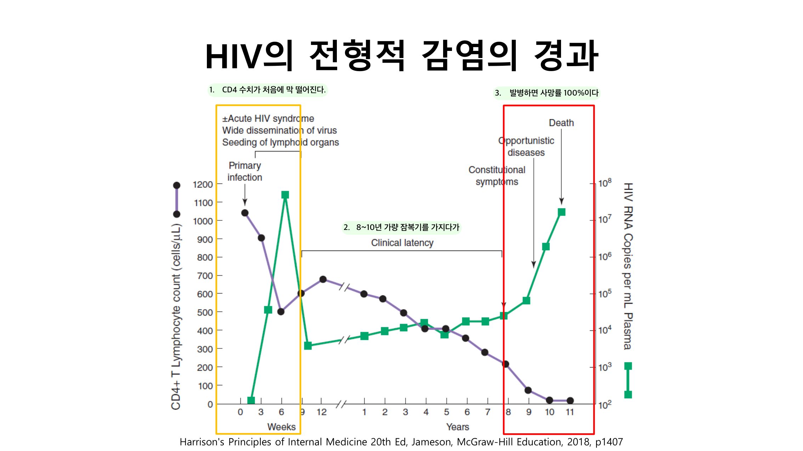{: style="width:70%"}

필기의 세 번호를 따라 읽는다.

1. **CD4 수치가 처음에 확 떨어진다**(노란 상자 — 일차 감염: 급성 HIV 증후군, 바이러스가 퍼지고 림프 기관에 자리 잡음). 바이러스(초록)는 107 가까이 치솟았다가 내려온다.
2. **8–10년가량 임상적 잠복기**(Clinical latency) — 증상은 없지만 CD4가 해마다 서서히 떨어진다.
3. **발병하면(빨간 상자) 사망률 100%** — 전신 증상 → 기회감염 → 사망. 이때 바이러스는 다시 치솟는다.

- 작년 필기: 잠복기에도 **성관계로 다른 사람에게 조금씩 전파한다**. 진행 속도는 사람마다 달라 **약 20%는 5년 안에** AIDS, **<5%는 10년 넘게** CD4 >500 유지(20년 동안 면역저하가 없으면 **elite controller**). 진행을 늦추는 요인 — **바이러스 nef 유전자 돌연변이**, **숙주 CCR5 돌연변이**.

## 처음 감염의 시작과 진행

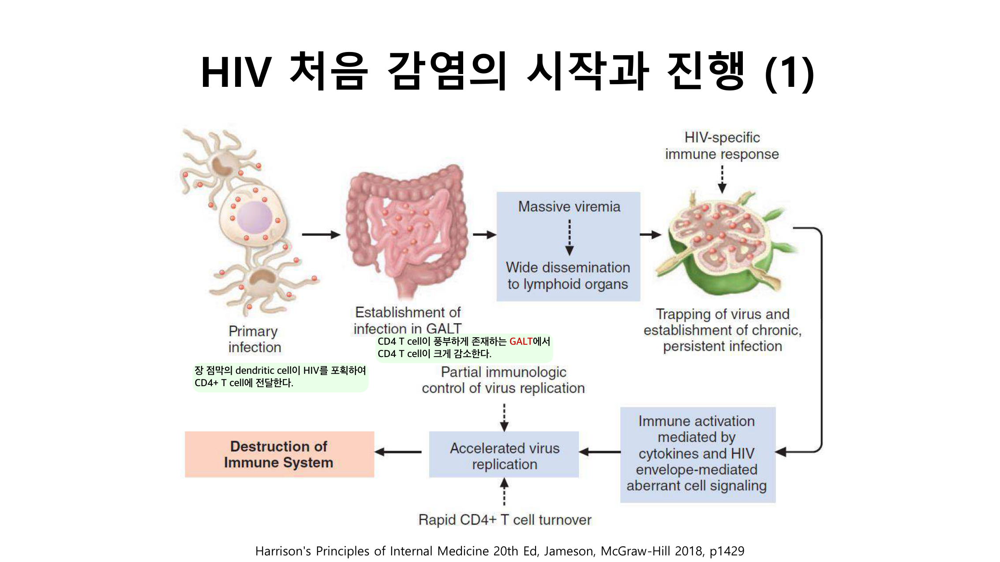{: style="width:70%"}

- 필기: "**장 점막의 수지상세포(dendritic cell)가 HIV를 포획해 CD4+ T 세포에 전달**한다. **CD4 T 세포가 풍부한 GALT(장관련 림프조직)에서 CD4 T 세포가 크게 감소**한다."

| 단계 | 현상 | 결과 |
|---|---|---|
| 일차 감염 | 바이러스가 몸에 들어옴 | 초기 감염 시작 |
| **GALT 감염** | 장관련 림프조직 감염 | 초기 바이러스 증식, **CD4 대량 소실** |
| 바이러스혈증 | 대량 바이러스 출현 | 림프계 전반으로 확산 |
| 만성화 | 바이러스 포집, HIV 특이 면역반응(일부 조절) | **지속 감염 확립** |
| 면역 활성화 | 사이토카인 활성화, CD4+ T 세포 소실 | 바이러스 복제 가속 |
| 최종 | 면역체계 파괴 | AIDS로 진행 |

- 65쪽 표는 "**설명하지 않고 넘어가셨다**"(필기). 그림 64쪽의 흐름(수지상세포 → GALT → 바이러스혈증 → 지속 감염 → 면역 활성화 → 면역 파괴)만 잡아 두면 된다.
- 작년 필기: HIV는 CD4 세포를 좋아하는데 **안 가는 장기가 없다** → 몸 곳곳의 **잠복 저장소** 때문에 완치가 어렵다(9단원 완치 연구와 이어짐).

!!! diff "작년 필기와 다른 점 — 바이러스 구조 (올해 슬라이드에서 빠짐, 기출 4문항)"
    - HIV는 **레트로바이러스(retrovirus)**, 그중 렌티바이러스(lentivirus). 유전체 양끝에 **LTR**(long terminal repeat — 프로모터·엔핸서·전사인자 결합 부위).
    - 단순 레트로바이러스의 기본 유전자 3개: **gag**(구조 단백 — p24 등), **pol**(효소 — **역전사효소, integrase, protease**), **env**(외피 — gp120, gp41). HIV 같은 복합 레트로바이러스는 **tat, rev, nef** 등 추가 유전자를 가진다.
    - 세포에 붙는 법: **부착 단백질 = gp120**, **1차 수용체 = CD4**, 공동수용체 = **CCR5 또는 CXCR4**, 막융합 = **gp41**. (CCR5가 고장 난 사람이 잘 안 걸리는 이유 — 9단원 완치 사례.)

!!! exam "기출 포인트 — 바이러스학"
    「HIV의 viral attachment protein과 숙주세포의 1차 수용체를 쓰시오」가 **주관식으로 3번**(22, 29, 35번) — 답 **gp120 / CD4**(둘 다 맞아야 점수). 34번은 레트로바이러스 기본 구조(LTR, gag·pol·env, pol에 RT·integrase·protease) 설명으로 **보기 전부 맞음**.

## 항바이러스 치료의 목표

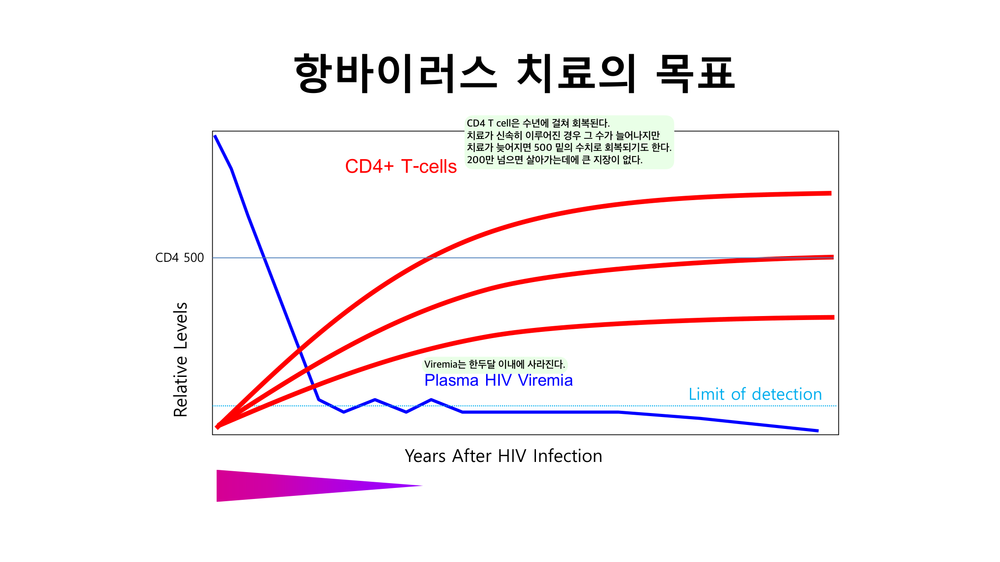{: style="width:66%"}

- 그림: ART를 시작하면 **혈장 바이러스(파랑)는 금방 검출한계(Limit of detection) 아래로** 떨어지고, **CD4(빨강)는 천천히** 올라온다. 빨간 선 세 개 = 치료를 언제 시작했느냐에 따라 회복되는 높이가 다르다.
- 필기: "**Viremia는 한두 달 이내에 사라진다. CD4 T 세포는 수년에 걸쳐 회복된다.** 치료가 신속히 이루어지면 그 수가 늘어나지만, **치료가 늦어지면 500 밑의 수치로만 회복되기도** 한다. **200만 넘으면 살아가는 데 큰 지장이 없다.**" → 빨리 시작해야 하는 또 하나의 이유.
- 아래 분홍 삼각형은 바이러스 양이 줄어드는 것을 나타낸다.

!!! exam "기출 포인트"
    「치료의 목표」 → **혈중 바이러스를 검출한계 미만으로**(5번 — 「CD4 50 이상 유지」「급성 증상 호전」은 오답). 3번: ART 1개월 후 **CD4 상승 + RNA <20 copies/mL** → **성공적인 바이러스 억제**(66쪽 그림 그대로: 바이러스는 한두 달에 사라짐). CD4가 아직 정상이 아니어도 실패가 아니다.

!!! diff "작년 필기와 다른 점 — 치료의 원칙·변경·내성 (올해 슬라이드에서 빠짐)"
    - 목표 네 가지: **임상**(수명·삶의 질), **바이러스**(viral load를 최대한 낮게 — **가급적 <20 copies/mL**, 내성 방지), **면역**(CD4 회복), **역학**(전파 감소).
    - 원칙: RNA는 복제 정도, CD4는 현재 면역 능력 / 억제가 강할수록 내성이 적다 / **복약 순응도(adherence)가 핵심 — 요법이 단순할수록 순응도가 높다**("이 말을 기억하셔야").
    - 반응: 약을 먹으면 **4주쯤 바이러스가 거의 안 보이고, 8주면 전파가 안 된다** → same day treatment.
    - **평생 치료**. 치료 실패의 가장 큰 원인은 **약을 잘 안 먹는 것** → 먹다 안 먹다 하면 **내성**. 내성검사(유전자형)는 치료 시작 전 모든 신규 환자, 치료 실패(RNA >200 지속) 때.
    - 치료 변경 지표: 시작 **4주 내 RNA가 1-log 이상 안 떨어짐**, 최저치에서 **3배 이상 재상승**, CD4 지속 감소, 임상 악화, 심한 부작용.
    - 옛 약의 부작용 **lipodystrophy**(지방 분포 이상)는 지금은 거의 없다.

{: style="width:56%"}

## 검사하고 치료하자 (Test and Treat)

- 사진: 미국 대통령이 공개적으로 HIV 신속검사(구강액)를 받는 모습. 필기: "**유명인들이 모범을 보여 검사하는 것이 좋다.**"
- 진단 → 바로 치료(Test and Treat)가 개인 치료이자 예방(TasP)이다. 예방 단원의 「ABC-Plus」에도 들어간다.

## 항레트로바이러스제 — 생활주기의 길목을 막는다

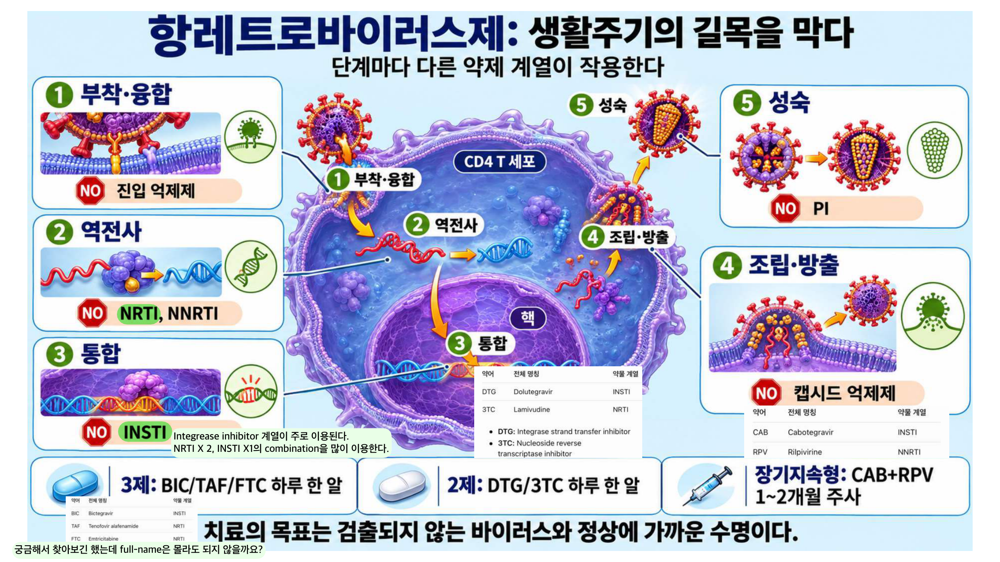{: style="width:76%"}

HIV가 CD4 T 세포 안에서 늘어나는 5단계마다 막는 약 계열이 다르다.

| 생활주기 단계 | 막는 약 계열 | 예 (이 강의에 나온 약) |
|---|---|---|
| ① 부착·융합 | 진입 억제제 (CCR5 길항제, 융합 억제제) | (작년: maraviroc, enfuvirtide) |
| ② 역전사 | **NRTI**(뉴클레오시드 역전사효소 억제제), **NNRTI**(비뉴클레오시드) | NRTI: **TAF·TDF(테노포비르), FTC(엠트리시타빈), 3TC(라미부딘)** / NNRTI: **릴피비린, 도라비린** |
| ③ 통합(인테그레이션) | **INSTI**(인테그라제 억제제) | **빅테그라비르(BIC), 돌루테그라비르(DTG), 카보테그라비르(CAB)** |
| ④ 조립·방출 | **캡시드 억제제** | **레나카파비르(LEN)** — 6개월 주사(PrEP) |
| ⑤ 성숙 | **PI**(프로테아제 억제제) | (작년: darunavir 등) |

- 필기: "**Integrase inhibitor 계열이 주로 이용된다. NRTI ×2 + INSTI ×1 조합을 많이 쓴다.**" NRTI 두 개를 **backbone(기본 골격)**이라 부른다.
- 슬라이드 아래 세 가지 요법: **3제 = BIC/TAF/FTC 하루 한 알**, **2제 = DTG/3TC 하루 한 알**, **장기지속형 = CAB + RPV 1–2개월 주사**. 그림 한가운데 문장: 「**치료의 목표는 검출되지 않는 바이러스와 정상에 가까운 수명이다.**」
- 필기 메모: "약 full-name은 몰라도 되지 않을까요?" — 이름보다 **어느 계열이 어느 단계를 막는지**와 **3제·2제·주사의 조합**을 기억한다.
- 왜 섞어 쓰나(작년 필기): 1987년 **AZT(지도부딘)** 단독, 2제 요법은 **내성**으로 실패 → 1996년 **계열이 다른 약 3가지**를 섞은 **HAART(칵테일 요법)**가 성공. 지금은 약이 강해져 2제도 된다.

### 하루 한 알 3제 — 빅타비 (Biktarvy)

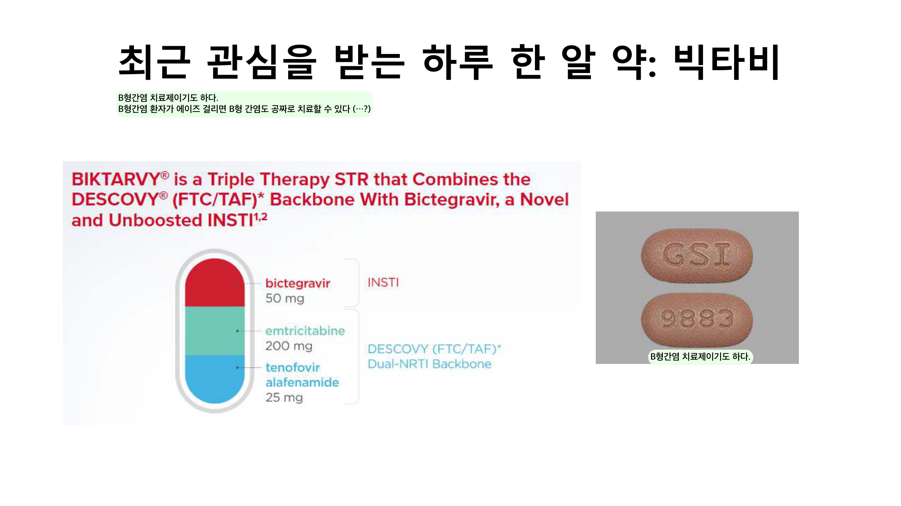{: style="width:62%"}

- **빅테그라비르 50 mg(INSTI) + 엠트리시타빈 200 mg + 테노포비르 알라페나마이드(TAF) 25 mg**(이 둘이 NRTI backbone, 「데스코비」). 부스터(cobicistat)가 필요 없는 INSTI.
- 필기: "**B형간염 치료제이기도 하다.** B형간염 환자가 에이즈에 걸리면 B형간염도 같이 치료할 수 있다." — 테노포비르·엠트리시타빈이 HBV에도 듣기 때문.
- 작년 필기: 1일 1회, 효능 높고 부작용·상호작용 적어 신기능 정상이면 1차 — 환자의 **약 70%**가 이것.

### 2제 요법 — 도바토 (Dovato)

- **돌루테그라비르(INSTI) 50 mg + 라미부딘(NRTI) 300 mg**, 하루 한 알. "이제는 2제로" — 몸에 들어가는 약 수를 줄인다(광고 문구 「HIV 약은 내 일부일 뿐」).
- 작년 필기: 기저 RNA <500,000이고 **HBV 음성**일 때(라미부딘 하나로는 B형간염을 제대로 못 막고 내성이 생기므로). 신독성·골밀도 영향 없음. 약 20%.

### 주사 — 카베뉴바 (Cabenuva)

- **카보테그라비르(INSTI — 인테그라제를 막음) + 릴피비린(NNRTI — 역전사효소에 붙어 막음)**, **2개월마다 한 번 근육주사**(2개월 간격이 표준).
- 필기: "**양측 엉덩이에 3 cc씩** 맞는다. **주기가 길어서 이걸 선호하는 환자분들도 있다.**"
- 작년 필기: 경구약으로 **3개월 이상 억제를 확인한 뒤** 바꾼다. 매일 약을 먹는 부담·약 봉투가 남에게 보이는 프라이버시 문제를 해결.

!!! new "올해 필기에서 추가"
    **델스트리고(Delstrigo) = 도라비린 + 라미부딘 + TDF**(복합제), **피펠트로(Pifeltro) = 도라비린 단일제** — **도라비린은 새 NNRTI**(72쪽). 그리고 73쪽 「**하루 한 알, 평범한 일상**」: 현재 HIV 치료는 **하루 단 한 알** 수준까지 발전했고, 바이러스가 검출되지 않는 수준에 이르면 성관계로도 전파 확률이 **0%에 가깝다(U=U)**. **조기 발견과 꾸준한 치료만 있으면 비감염인과 거의 같은 기대수명**.

!!! memo "암기 — 요법 세 가지"
    **3제 = BIC/TAF/FTC(빅타비, HBV도 치료)** · **2제 = DTG/3TC(도바토, HBV 음성일 때)** · **주사 = CAB + RPV(카베뉴바, 2개월마다 엉덩이 근주)**. 공통점: **INSTI가 중심**. 기출 18번의 「cabotegravir 주사 1회」는 **PEP가 아니다**(6단원).

!!! diff "작년 필기와 다른 점 — 치료의 다른 구성 요소 (올해 슬라이드에서 빠짐)"
    AIDS 환자 치료 = ① ART ② **기회감염 예방 항생제**(CD4 <200이면 PCP 예방 Bactrim, 200 위로 두 번 올라오면 끊는다) ③ 기회감염 조사·치료(**PCP가 가장 중요, 그다음 결핵** — 결핵은 일반 환자처럼 잘 낫는다) ④ 동반 질환(매독 등 성병, B·C형 간염) ⑤ 치료 중 합병증(지질대사 이상, 당뇨 등).
    기회감염이 나아도 재발을 막으려고 계속 먹는 **2차 예방(유지요법)** — **PCP, CMV 망막염, 크립토콕쿠스 수막염**. 오래 쓰면 fluconazole·ganciclovir 내성.

# 6. HIV 감염의 예방

## 무엇으로 옮나 — 체액별 전파 위험

| 전파 가능성 | 체액 |
|---|---|
| **큼** | **정액, 질분비액, 육안으로 혈액에 오염된 체액** (필기 형광펜) |
| 중등도 | 뇌척수액, 윤활액(관절액), 흉수, 복수, 심장막액, 양수 |
| **없음** | **콧물, 타액(침), 객담, 땀, 눈물, 소변, 대변, 구토물** |

- **모유**: HIV가 있을 수 있어 **모유 수유로 아기에게 전파**될 수 있다(모자감염 단원).
- 필기: "**HIV 환자와 국물 같이 먹어도 되고, 변기 같이 써도 되고, 수건 같이 써도 문제없다.**"
- 중등도 체액들은 몸속 깊은 곳(무균 체강)의 체액이라 일상에선 닿을 일이 없고, 주로 **의료행위 중 노출**에서 의미가 있다.

## 노출 종류별 위험도

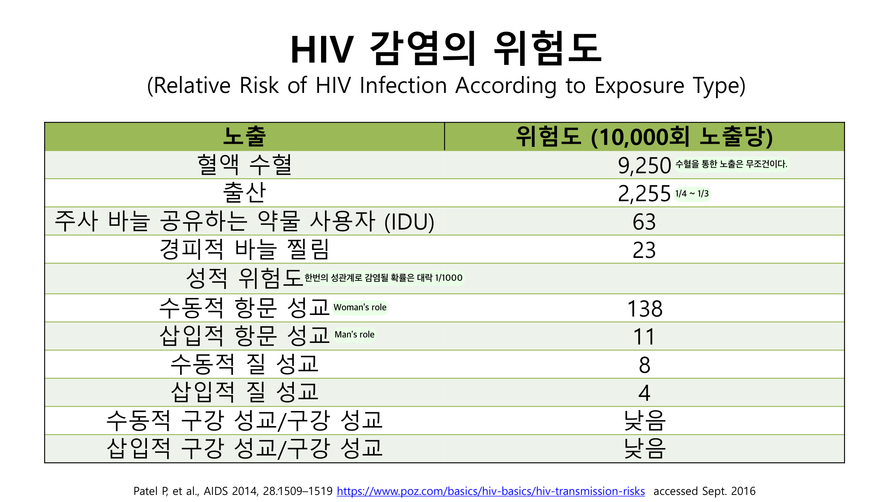{: style="width:66%"}

| 노출 | 10,000회 노출당 | 1회당 확률로 바꾸면 |
|---|---|---|
| **혈액 수혈** | **9,250** | **92.5%** — 필기: "**수혈을 통한 노출은 무조건이다**" |
| **출산**(치료 안 한 감염 산모) | **2,255** | 약 23% — 필기: "**1/4–1/3**" |
| 주사 바늘 공유(IDU, 주사 약물 사용자) | 63 | 0.63% |
| **경피적 바늘 찔림** | **23** | **0.23%**(흔히 「0.3%」로 외움) |
| **수동적(수용) 항문 성교** | **138** | 1.38% — 필기: "Woman's role" |
| 삽입적 항문 성교 | 11 | 0.11% — "Man's role" |
| 수동적 질 성교 / 삽입적 질 성교 | 8 / 4 | 0.08% / 0.04% |
| 구강 성교 | 낮음 | |

- 필기: "**한 번의 성관계로 감염될 확률은 대략 1/1,000.**" 성관계 중에서는 **수용 항문 성교**가 가장 높다(점막이 얇고 상처가 잘 나서).

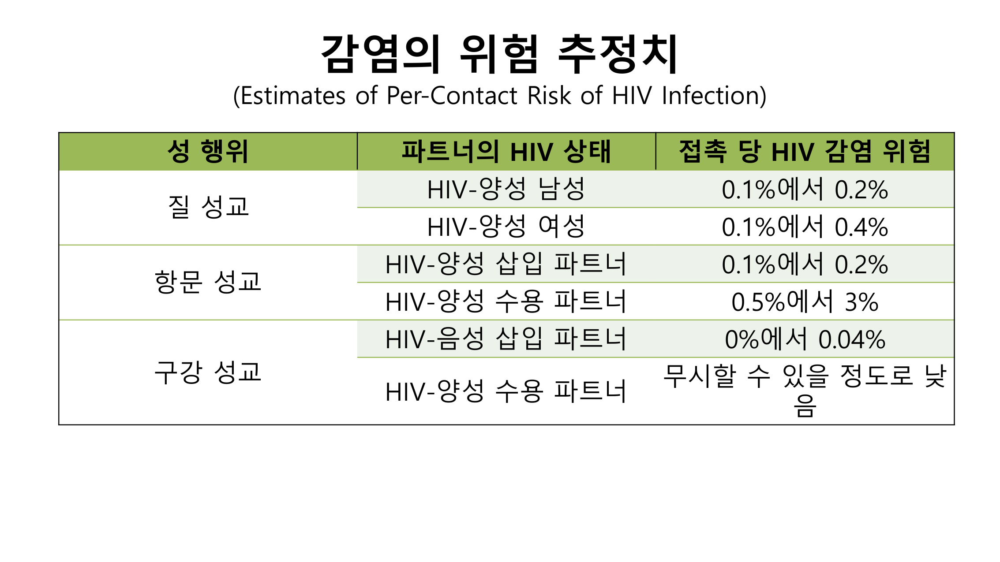{: style="width:60%"}

| 성 행위 | 파트너의 HIV 상태 | 접촉당 감염 위험 |
|---|---|---|
| 질 성교 | HIV 양성 남성 / HIV 양성 여성 | 0.1–0.2% / 0.1–0.4% |
| 항문 성교 | 양성인 **삽입** 파트너 / 양성인 **수용** 파트너 | **0.5–3%**(내가 수용 쪽일 때) / 0.1–0.2% |
| 구강 성교 | | 0–0.04%, 무시할 정도 |

※ 확인 필요: 76쪽 표의 항문 성교 두 줄은 「삽입 파트너 0.1–0.2%, 수용 파트너 0.5–3%」로 적혀 있어 누가 HIV 양성인지 헷갈리게 쓰여 있다. 75쪽과 같은 뜻으로 읽으면 **HIV 음성인 사람이 수용(받는) 쪽일 때 0.5–3%로 가장 높다**.

## 전파 효율을 바꾸는 요인

| 요인 | 설명 |
|---|---|
| **다른 성병** | 있으면 전파 위험 ↑ (궤양·염증으로 점막이 뚫리고 표적 세포가 몰림) |
| **바이러스 양** | 혈액·생식기 체액의 HIV가 많을수록 ↑ (급성기, 치료 안 함) |
| **포경수술** | 이성애 성교에서 **남성의 감염 위험 ↓** |
| **콘돔** | 일관되고 올바르게 쓰면 크게 ↓ |
| **PrEP** | 노출 전에 약을 먹으면 예방 |
| **PEP** | 노출 뒤 시작하는 단기 치료로 위험 ↓ |
| 주사 약물 | 바늘·도구 공유 → ↑ |

- 포경수술 필기: "**표면 노출량이 줄어서 유리한 점이 많다**(분비물이 많아져서)." — 포피 안쪽 점막에는 HIV가 잘 붙는 세포가 많고, 포피 밑에 분비물이 고여 감염이 쉬워진다.

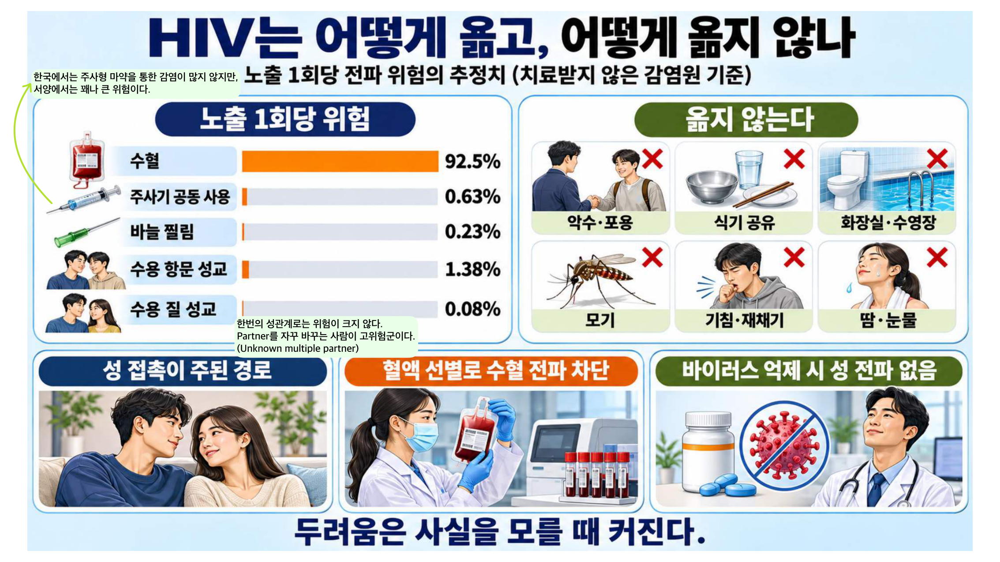{: style="width:66%"}

- 78쪽 그림(노출 1회당, 치료받지 않은 감염원 기준): **수혈 92.5%**, 주사기 공동 사용 0.63%, 바늘 찔림 0.23%, **수용 항문 성교 1.38%**, 수용 질 성교 0.08%. **옮지 않는다** — 악수·포옹, 식기 공유, 화장실·수영장, **모기**, 기침·재채기, 땀·눈물. 성 접촉이 주된 경로, 혈액은 선별로 수혈 전파 차단, **바이러스가 억제되면 성 전파 없음**. 「두려움은 사실을 모를 때 커진다.」
- 필기: "**한 번의 성관계로는 위험이 크지 않다. 파트너를 자꾸 바꾸는 사람이 고위험군**이다(unknown multiple partner)." "**한국에서는 주사형 마약을 통한 감염이 많지 않지만, 서양에서는 꽤 큰 위험**이다."

!!! exam "기출 포인트 — 전파 위험"
    「감염 위험이 가장 큰 것」이 2번 — 둘 다 **치료받지 않은 감염 산모에게서 자연(질식)분만으로 태어난 신생아**(14번, 31번 — 1/4–1/3). 오답: 바늘찔림(0.3%), 수용 항문성교 1회(~1.4%), 주사기 공유(~0.6%). 31번 함정: **바이러스가 검출되지 않는 환자**의 피에 찔림, **PrEP 중**인 사람의 성관계는 위험이 매우 낮다. 「수혈」이 보기에 있으면 수혈이 가장 크다(9,250) — 보기를 끝까지 본다.

!!! diff "작년 필기와 다른 점 — 의료행위 중 노출과 PEP (올해 슬라이드에서 빠짐, 기출 2문항)"
    - 직업적 노출: 감염인 혈액 **바늘찔림 0.3%**, **점막 0.09%**, **손상 없는 피부는 위험 없음**. 혈액량·원천 환자의 viral load·바늘이 굵고 깊을수록 위험.

    | 바늘찔림 시 전파 위험 | |
    |---|---|
    | HBV(미접종), 원천 HBeAg+ | 37–62% |
    | HBV, HBeAg− | 23–37% |
    | **HCV** | **1.8%**(예방약 없음, 치료약 있음) |
    | **HIV** | **0.3%**(예방약을 먹는다) |

    - 필기: 「외워야 합니다」 — **B > C > HIV**.
    - **일반주의(Universal precaution)**: 모든 환자의 혈액·체액을 감염 가능한 것으로 보고 손씻기, 장갑, 튈 때 가운·마스크·보호안경, **사용한 바늘은 뚜껑을 다시 씌우지 말고 바로 버리는 통에**.
    - 찔렸을 때: **짜지 말고** 비누와 흐르는 물로 씻기 → 원천 환자 HIV 상태 확인, 본인 baseline 검사(추적 중 양성이면 산업재해).
    - **PEP 약: TDF/FTC + dolutegravir(또는 raltegravir), 28일(4주)**, **가능한 빨리(2시간 이내, 늦어도 72시간)**. 올해 87쪽 그림에도 「**PEP — 72시간 내 시작, 28일 복용**」. 추적검사 6주·3개월·6개월.

!!! exam "기출 포인트 — 의료인"
    18번: 인턴이 HIV 신환(RNA 120,000)에게 ABGA 중 바늘찔림 → **TDF/emtricitabine + dolutegravir 4주**. 오답: zidovudine 단독, **lamivudine 단독 4주**, **cabotegravir 주사 1회(= PrEP·치료용)**, 「위험이 낮아 불필요」. 6번: 의료인 HIV 예방의 기본 → **Universal precaution**(매일 예방약 = PrEP, 매월 검사, 감염인 격리는 오답).

## 예방에 대한 접근 — 사회에서 개인까지

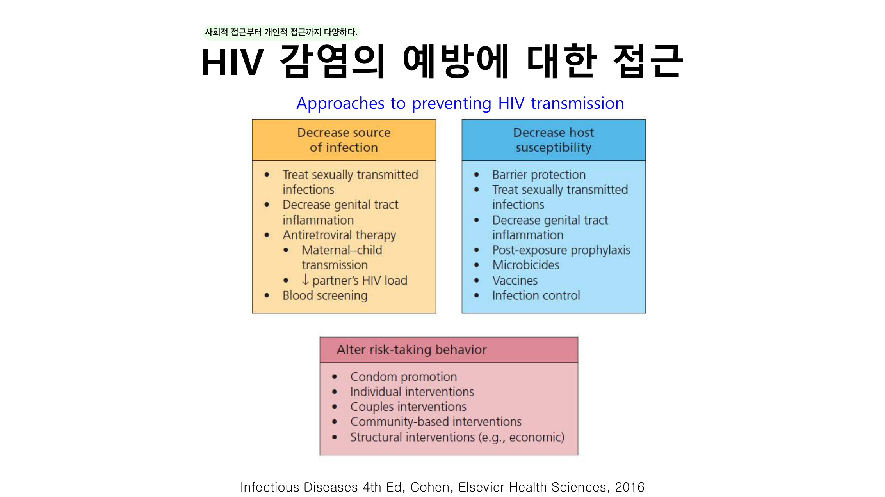{: style="width:56%"}

- 세 방향(Cohen 교과서): **감염원 줄이기**(성병 치료, 생식기 염증 줄이기, **ART** — 모자감염 예방·파트너 바이러스 양 ↓, **혈액 선별**) / **숙주의 감수성 줄이기**(차단 — 콘돔, 성병 치료, **PEP**, 살균제, 백신, 감염 관리) / **위험 행동 바꾸기**(콘돔 홍보, 개인·커플·지역사회·구조적 개입). 필기: "**사회적 접근부터 개인적 접근까지 다양하다.**"

예방과 관계된 분야 18가지 (80–82쪽)

| | |
|---|---|
| 1) 공중 매체 캠페인 | 10) 대중적 콘돔 사용 향상·배부 |
| 2) **자원자 상담 및 검사(VCT)** — "보건소 가면 상담 공짜" | 11) **성매개감염(STI) 치료** |
| 3) 콘돔의 사회적 판매 전략 | 12) 직업적 노출 사고 예방 프로그램 |
| 4) 학교를 통한 AIDS 교육 | 13) **모자감염 예방** |
| 5) 학교 밖 청소년 또래 교육 | 14) **노출 후 예방(PEP)** |
| 6) 성매매 종사자와 그 고객 대상 프로그램 | 15) **노출 전 예방(PrEP)** |
| 7) **MSM 대상 프로그램** — "가장 주요한 target" | 16) 안전한 주사 |
| 8) 주사 마약 사용자 위해 감소(harm reduction) | 17) 병원의 **일반 주의(Universal precautions)** |
| 9) **안전한 혈액 공급** | 18) 정책·옹호·행정·연구 |

- 필기: "**HIV 공익광고는 본 적이 없다.**" 81쪽 메모는 모자감염 내용(→ 아래 「모자감염」).

## 예방 전략 — 양성자에게, 음성자에게

| HIV **양성자**에게 | HIV **음성자**에게 |
|---|---|
| 행동 변화: 금욕, 콘돔 지속 사용, 배우자(파트너) 줄이기 | **검사 접근성 개선**(신속검사, 검사와 상담) — 자기 상태를 알게 한다 |
| **법적 책임 교육** | 행동 변화: 금욕, 콘돔, 파트너 줄이기 |
| **빠른 치료** | 감염 산모로부터 태어나는 아이 예방 |
| 교육, 상담 | **포경수술** |
| **매독 등 성병 발견·치료** | **PEP**, **PrEP** |
| 기저 질환 치료 | 교육, 매춘 관리 |
| 사회적 차별·낙인 줄이기 | |

- 필기(양성자): "**HIV 양성임을 숨기고 성관계를 하면 형사처벌 대상이 된다.**"
- 필기(음성자): "**파트너가 계속 바뀌는 사람이라면 PrEP**을 해 볼 수 있다. **성 접촉자가 HIV 양성이라면 본인은 PEP**을 해 볼 수 있다." — PrEP = 노출 **전**에 계속, PEP = 노출 **후** 72시간 안에 28일.

## 에이즈 예방의 ABC → ABC-Plus

- **A — Abstinence(금욕)**, **B — Be faithful(배우자에게 충실)** — **다수의 파트너가 가장 위험한 요소**, **C — A나 B가 안 되면 Condom**. 동남아에서 성공. 국내 조사(19세 이상 1,510명)에서 **콘돔 사용률 25% 미만** — 의식이 부족하다.
- 필기: "**B + C가 가장 효과적이다.** A, B가 안 된다면 C를 필수적으로 하라." (같은 슬라이드에 「PrEP에 해당된다」는 메모도 있다 — 콘돔과 PrEP이 같이 쓰는 차단 수단이라는 뜻으로 읽는다.)
- 그 밖에: 에이즈 바이러스 차단 연고(PSC-RANTES, CCR5를 막는 살균제 후보), **사회적 백신 = 에이즈에 대한 교육과 인식 제고**.
- **ABC-Plus** = A, B, C + **포경수술**, **마약 사용 위험 홍보**, **산전진찰과 모자감염 예방**, **성병 치료**, **Test and Treat**.

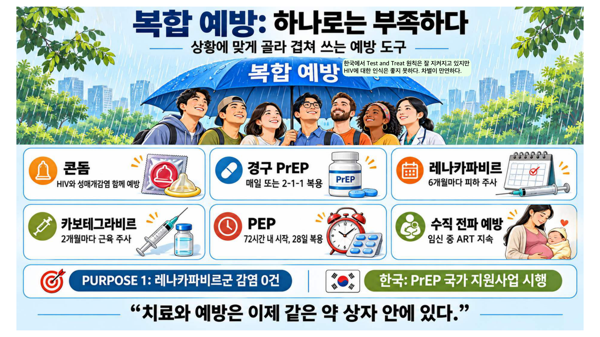{: style="width:66%"}

- **복합 예방** — 상황에 맞게 골라 겹쳐 쓰는 도구: **콘돔**(HIV와 성매개감염 함께 예방), **경구 PrEP**(매일 또는 2-1-1 복용), **레나카파비르**(6개월마다 피하주사), **카보테그라비르**(2개월마다 근육주사), **PEP**(**72시간 내 시작, 28일 복용**), **수직 전파 예방**(임신 중 ART 지속). PURPOSE 1 연구 — 레나카파비르군 **감염 0건**. **한국: PrEP 국가 지원사업 시행**. 「치료와 예방은 이제 같은 약 상자 안에 있다.」
- 필기: "**한국에서 Test and Treat 원칙은 잘 지켜지고 있지만 HIV에 대한 인식은 좋지 못하다. 차별이 만연하다.**"

## 이런 경우엔 감염되지 않는다

- **악수, 가벼운 포옹, 목욕탕, 욕조 공동 사용, 공동 식사, 모기 물림** — 일상생활에서 사람과 사람 사이에는 감염되지 않는다.
- 모기: HIV는 모기 몸 안에서 늘지 못하고, 모기는 피를 다음 사람에게 주입하지 않는다(침만 넣는다).

## 문신(tattoo)과 피어싱은 위험한가?

- 증례 보고는 **있지만 많지 않다**. 그러나 과정을 보면 **B형 간염, C형 간염, HIV와 연관될 충분한 개연성**이 있다 — ① **비멸균 장비** ② **교차 오염** ③ **비전문적인 환경**.
- 필기: "**위험 요인은 맞지만 빈도가 낮다. 그렇지만 굳이 하는 걸 권장하지는 않는다.**" (결어 메모: 「20대인데 타투했고 발진 있으면 의심」.)

## 모자감염(수직감염)의 예방

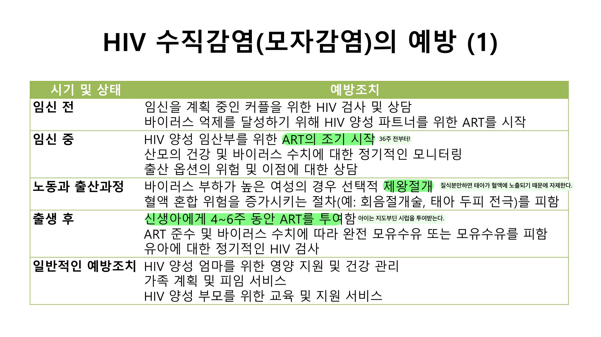{: style="width:68%"}

| 시기 | 예방 조치 |
|---|---|
| 임신 전 | 임신 계획 커플의 HIV 검사·상담, **HIV 양성 파트너는 ART로 바이러스 억제** |
| 임신 중 | **HIV 양성 임산부의 ART 조기 시작**(필기 「**36주 전부터!**」), 산모 건강·바이러스 수치 정기 모니터링, 출산 방법 상담 |
| 진통·분만 | **바이러스 부하가 높으면 선택적 제왕절개**, 혈액 혼합 위험을 늘리는 시술(**회음절개, 태아 두피 전극**) 피함 |
| 출생 후 | **신생아에게 4–6주 ART**(필기: 「**아이는 지도부딘 시럽**」), ART 준수·바이러스 수치에 따라 모유 수유 결정(또는 피함), 유아 정기 HIV 검사 |
| 일반 | 영양·건강 관리, 가족계획·피임, 부모 교육·지원 |

- 필기: "**질식분만하면 태아가 (엄마의) 혈액에 노출되기 때문에 자제한다** → 질식분만보다 **제왕절개**." "산모는 36주 전에 치료해서 **바이러스가 안 나오게** 한다. 태아에게는 지도부딘."
- 언제 옮나(91쪽): **모유를 먹이지 않는 산모** — **30–50%**는 임신 말기, 특히 **진통 시작 직전부터 태반이 분리될 때까지**, **약 30%**는 **태반 박리 후 산도를 통과할 때**. **모유 수유 산모** — **약 40%가 수유 과정**에서.
- 예방 효과: **출산 전후 예방적 화학요법 + 진통 시작 전 제왕절개 + 모유 안 먹이기 → 수직감염 1–2% 이하**.
- **신생아 진단**(91쪽 메모): 엄마의 **IgG가 태반을 넘어가서 아기 항체검사는 무조건 양성**이다. 그래서 **RNA 검사**가 음성이면 괜찮은 것이고, 엄마 IgG는 **1년 반** 안에 사라지므로 **1년 반 뒤에도 항체 양성이면 감염**된 것이다.

!!! diff "작년 필기와 다른 점"
    - 작년: 자연 전파 확률 **30–50%**(젖으로도 전파), 산모 바이러스를 **<50(최소 <1,000) copies/mL**로 억제, 분만 때 **산모에게 zidovudine 정주**, 결과 「**5% 이하**」. 올해: 「**1–2% 이하**」, 신생아 ART **4–6주**.
    - 작년: 치료 안 하면 산모가 먼저 사망하고 남은 아이를 **AIDS orphan**이라 한다. 올해 한국 연표 메모: **수직감염은 한국에서는 드문 편**.

## 위험 집단 스크리닝과 사회 계몽

- **조기 진단이 중요 → 접근성을 쉽게**: 자원자·고위험군 대상, 위험 집단 특성에 맞춘 홍보물, **Quick Test(익명검사제도 활성화) — VCT(Voluntary Counselling and Testing, 자발적 상담·검사)**.
- 필기: "**한국은 대부분이 MSM group이다. 진단받은 모든 사람이 치료받을 수 있게 하는 것 또한 중요하다.**"
- 사회 계몽: 일반인 계몽, 청소년·대학생(학교 프로그램), 공익광고, **의료인 교육 — 성매개감염 환자, 대상포진, 칸디다증, 결핵 환자에게 HIV 검사가 필요하다는 인식**(4단원 「이걸 보면 HIV 검사」와 같은 목록).
- **콘돔 사용이 가장 중요**(94쪽) — "성교육을 통해 **사용법을 정확히** 숙지하는 것이 중요하다."
- 질병관리청 자료(98–102쪽): 「에이즈, **검색은 답답, 검사는 답!**」 — **전국 보건소 무료 익명검사**, 「에이즈 바로 알기」(치료하면 오래 살 수 있는 만성질환), 감염 경로·올바른 콘돔 사용법, 「웃으세요! / 울지 마세요!」 캠페인. 필기: "질병관리청은 **검사의 중요성**을 강조한다."
- 101쪽 「**모든 것의 시작: HIV 검사**」 — 자기 감염 여부를 아는 것이 나·파트너·공동체를 지키는 첫걸음이다. **증상만으로는 알 수 없다**(초기엔 무증상이거나 감기 몸살 같다). HIV 검사는 정기 건강검진처럼 **적극적인 건강 관리**다.
- 청소년(103–104쪽): 게임 교육, 연예인, 광고 공모전, 영화제, 교육 뮤지컬. 필기: "**청소년도 경계해야 한다.**" 감염된 젊은이들의 흔한 반응 — 「**설마 내가?**」, 「**감염 위험을 잘 몰랐음**」.

## 백신 — 아직 없다

| 도전 과제 | 설명 | 그래서 |
|---|---|---|
| **높은 돌연변이율** | 유전적 다양성 | 한 백신으로 모든 변이 대응이 어렵다 |
| **숙주 DNA 통합** | 바이러스 DNA가 숙주 유전체에 들어감 | 백신 표적 설정이 어렵다 |
| **잠복 저장소** | 휴면 상태로 오래 지속 | 완전 제거 불가 |
| 면역 회피 | 에피토프 변이 | 효과적인 면역반응 유도가 어렵다 |
| **자연 면역력 부족** | **자연 완치 사례가 없다** | 모방할 면역반응 모델이 없다 |
| 불분명한 보호 기전 | 필요한 면역반응을 잘 모름 | 설계가 어렵다 |
| 연구 방법 제한 | 윤리적 제약, 장기 추적 필요 | 효능 평가가 복잡하다 |

- 필기: "**백신은 아직 개발되지 않았다.** 백신을 맞으면 **항체가 나와서 진짜 환자인지 가짜 환자인지 모른다.** 따라서 백신 실험자가 되길 꺼리는 사람이 많다." (항체 검사가 선별검사이기 때문 — 3단원.)

## 포경수술의 예방 효과

- 남아프리카 전향적 무작위 연구(ANRS 1265, 3,274명): 포경수술이 **HIV 감염 위험을 60%까지 줄였다**. WHO도 예방법으로 권고(2018), 케냐에서 2008–2013년 포경수술이 크게 늘었다(97쪽 그래프).
- 작년 필기: "HIV 백신보다 낫다" — 아프리카는 약보다 포경을 강조.

## 예방 방법별 효과

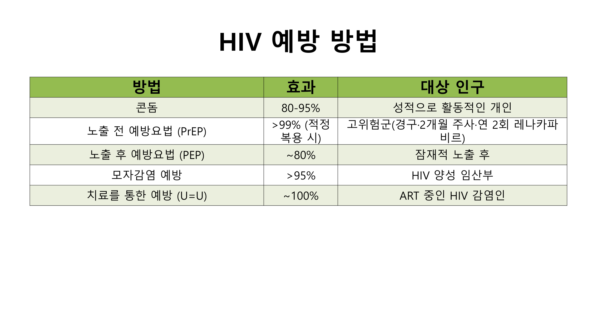{: style="width:62%"}

| 방법 | 효과 | 대상 |
|---|---|---|
| 콘돔 | 80–95% | 성적으로 활동적인 사람 |
| **PrEP** | **>99%(제대로 복용 시)** | 고위험군 — **경구 · 2개월 주사 · 연 2회 레나카파비르** |
| **PEP** | **~80%** | 잠재적 노출 후 |
| 모자감염 예방 | >95% | HIV 양성 임산부 |
| **치료를 통한 예방(U=U)** | **~100%** | ART 중인 HIV 감염인 |

!!! diff "작년 필기와 다른 점"
    PrEP 효과: 작년 「**>90%**」 → 올해 「**>99%(적정 복용 시)**」, 대상에 주사형(2개월 카보테그라비르, 연 2회 레나카파비르)이 더해졌다.

## 노출 전 예방 (PrEP, Pre-Exposure Prophylaxis)

- 106쪽 「PrEP과 다른 예방 요법의 관계」: **노출 전 — 전파의 순간 — 노출 후**의 시간축에서 **PrEP은 노출 전부터 전파의 순간까지**, **PEP은 노출 후**, **모자감염 예방은 전 구간**, **감염된 파트너 치료**(TasP)는 노출 전, 예방약을 바른 질 링·겔(질·직장 살균제)은 전파의 순간 근처를 맡는다.
- 효과(107–109쪽): 임상시험 — iPrEx(MSM, 순응도 보정 92%), Partners PrEP(이성 불일치 커플 86–90%), PROUD·IPERGAY(MSM 86%), 실제 진료(Kaiser·SF Strut Clinic) **100% 예방**. 반면 **FEM-PrEP·VOICE(여성)는 효과 없음 — 약을 안 먹어서(순응도 <30–40%)**. 필기: "**효과적인가? 거의 100% 효과적이다.**"
- 홍보(110쪽): 뉴욕시 PrEP 포스터(「We share everything but HIV」). 필기: "**우리나라는 이런 포스터가 잘 없다 — 공개적이지 못하다.** 뉴욕·대만은 catch phrase가 상당히 공격적이다."

### 복용법 — 매일 vs 간헐적(2-1-1)

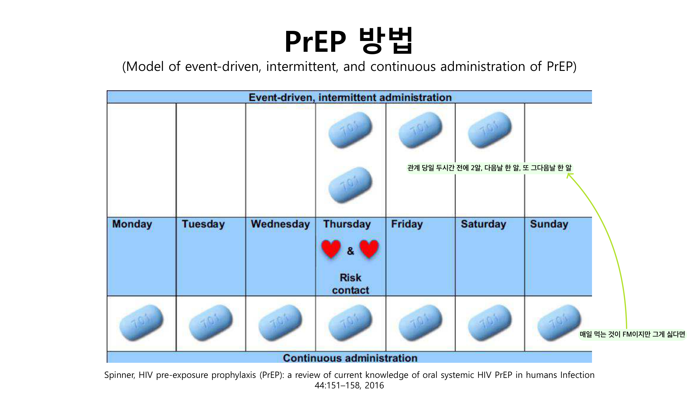{: style="width:62%"}

- 필기: "**매일 먹는 것이 원칙(FM)**이지만, 그게 싫다면 **관계 2시간 전(2–24시간 전)에 2알, 다음 날 1알, 또 그다음 날 1알**." → **2-1-1 요법(event-driven)**.

| | 지속적 PrEP | 간헐적 PrEP |
|---|---|---|
| 복용 | 성행위와 관계없이 **매일** | 성행위 **전후에만** |
| 효과 | 꾸준히 먹으면 매우 효과적(90% 이상 감소) | 올바르게 쓰면 효과적이지만 **타이밍·일정 준수에 더 의존** |
| 맞는 사람 | 성관계가 잦거나 불규칙, 매일 먹는 게 편한 사람 | 성관계가 드물거나 계획할 수 있는 사람 |
| 장점 | 지속적 보호, 단순 | 비용 효율, 부작용 적을 수 있음 |
| 단점 | 매일 먹어야, 부작용 더 있을 수 있음 | 계획되지 않은 성관계가 잦으면 효과 없음 |

- 공통: **효과는 순응도에 좌우**되고, **PrEP은 다른 성병을 막지 못하므로 콘돔도 같이**. 필기: "**제대로 복용하면 굉장히 효과적이다.**"

### PrEP 약 비교

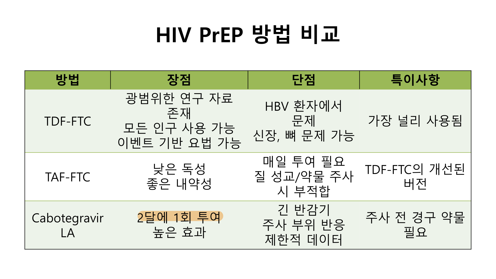{: style="width:62%"}

| 약 | 장점 | 단점 | 특이사항 |
|---|---|---|---|
| **TDF-FTC**(트루바다) | 연구 자료가 가장 많음, **모든 인구**, **간헐적(2-1-1) 가능** | **HBV 환자에서 문제**(끊으면 간염 악화), **신장·뼈** 문제 가능 | **가장 널리 사용** |
| TAF-FTC | 독성 낮고 내약성 좋음 | **매일** 먹어야, **질 성교·주사 약물 사용자에겐 부적합**(근거 부족) | TDF-FTC의 개선판 |
| **카보테그라비르 LA** | **2개월에 1회**, 효과 높음, 긴 반감기 | 주사 부위 반응, 자료 제한, **주사 전 경구약 필요** | |

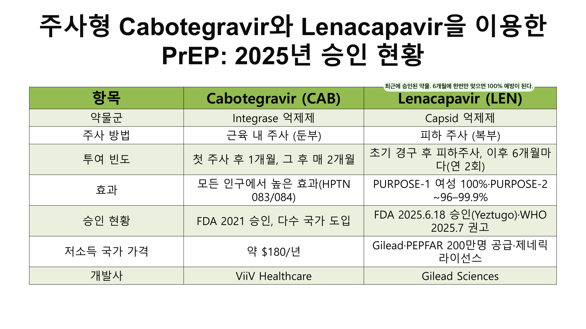{: style="width:66%"}

| | 카보테그라비르(CAB) | **레나카파비르(LEN)** |
|---|---|---|
| 계열 | **인테그라제 억제제** | **캡시드 억제제** |
| 주사 | **근육주사(엉덩이)** | **피하주사(배)** |
| 간격 | 첫 주사 1개월 후, 그다음 **매 2개월** | 처음 경구 후 피하주사, 이후 **6개월마다(연 2회)** |
| 효과 | 모든 인구에서 높음(HPTN 083/084) | **PURPOSE-1 여성 100%**, PURPOSE-2 약 96–99.9% |
| 승인 | FDA 2021, 여러 나라 도입 | **FDA 2025.6.18(Yeztugo)**, WHO 2025.7 권고 |
| 개발사 | ViiV | Gilead (저소득국 200만 명 공급, 제네릭 라이선스) |

- 필기: "**최근에 승인된 약물. 6개월에 한 번만 맞으면 100% 예방이 된다.**" 역사 단원 메모: "**아직 한국에 도입되진 않았다.**"

!!! new "올해 필기에서 추가"
    작년에는 PrEP이 「경구 TDF/FTC 1일 1회, 국내는 이것만 허가, 한 달 4만 원 정도」 위주였다. 올해는 **간헐적 2-1-1 요법 표, TDF/TAF/카보테그라비르 비교표, 레나카파비르(연 2회, FDA 2025.6) 승인 현황, 한국 PrEP 국가 지원사업**이 새로 들어왔다.

!!! diff "작년 필기와 다른 점 — PrEP 모니터링"
    작년 필기: "피임약 생각하면 된다" — 몸에 HIV 약이 떠 있으면 바이러스가 자리를 못 잡는다. 대상 = **MSM, 혈청 불일치 커플, 고위험 이성애자**. 시작 전 **HIV·HBV·신기능·성병 검사**, **3개월마다 HIV 검사**, 6개월마다 신기능. 카보테그라비르는 경구 대비 66% 추가 감소.

!!! memo "암기 — PrEP vs PEP"
    **PrEP = 노출 전, 고위험군(파트너가 자주 바뀌는 사람), TDF/FTC 매일 또는 2-1-1, 주사 CAB 2개월·LEN 6개월** — 효과 >99%.
    **PEP = 노출 후 72시간 안(빠를수록), TDF/FTC + DTG 28일** — 효과 ~80%. 기출은 이 둘을 바꿔치기한다(18번 「cabotegravir 주사 1회」, 6번 「매일 예방약」).

## HIV 완치 보고들

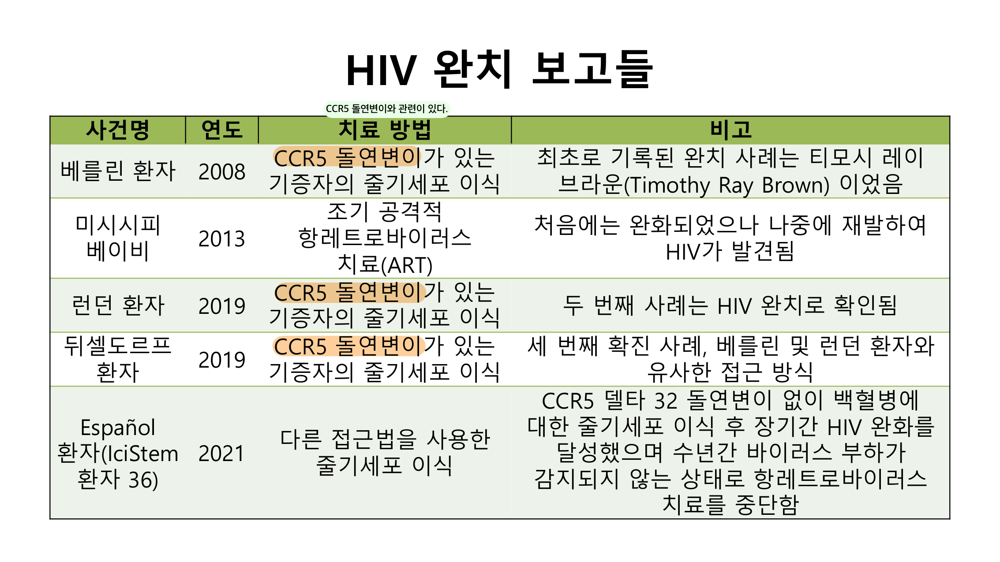{: style="width:66%"}

| 사례 | 연도 | 방법 | 비고 |
|---|---|---|---|
| **베를린 환자** | 2008 | **CCR5 돌연변이 기증자의 줄기세포 이식** | **첫 완치** — 티모시 레이 브라운 |
| 미시시피 베이비 | 2013 | 조기 공격적 ART | 처음엔 관해 → **나중에 재발**(완치 아님) |
| **런던 환자** | 2019 | CCR5 돌연변이 기증자 줄기세포 이식 | 두 번째 완치 |
| 뒤셀도르프 환자 | 2019 | 같은 방법 | 세 번째 |
| 에스파뇰 환자(IciStem 36) | 2021 | 다른 방법의 줄기세포 이식 | **CCR5 Δ32 돌연변이 없이** 백혈병 이식 후 장기 관해, ART 끊고도 바이러스 미검출 |

- 필기: "**CCR5 돌연변이와 관련이 있다.**" — CCR5는 HIV가 CD4 다음에 붙는 **공동수용체**라, 이것이 없는(Δ32) 면역세포로 갈아 끼우면 HIV가 들어갈 문이 없다.

# 7. U=U — 검출되지 않으면 전파되지 않는다

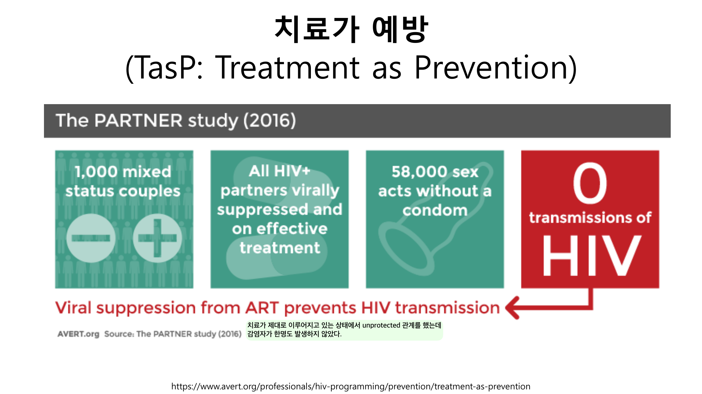{: style="width:62%"}

- **TasP(Treatment as Prevention, 치료가 예방)**: PARTNER 연구(2016) — **혈청 불일치 커플 1,000쌍**, HIV 양성 파트너는 모두 **치료로 바이러스가 억제**된 상태, **콘돔 없는 성관계 58,000회** → **HIV 전파 0건**. 필기: "**치료가 제대로 이루어지고 있는 상태에서 unprotected 관계를 했는데 감염자가 한 명도 발생하지 않았다.**"
- PARTNERS-2 근거(117쪽): 이성 커플(HPTN 052 2011, PARTNER-1 2016), 남성 동성 커플(2018) → **바이러스 억제 시 전파 위험 0 — PARTNER-2 76,088건 중 0**. 필기: "**바이러스만 억제해 주면 7만 건의 성관계 중에 단 한 번도 전파되지 않았다.**"

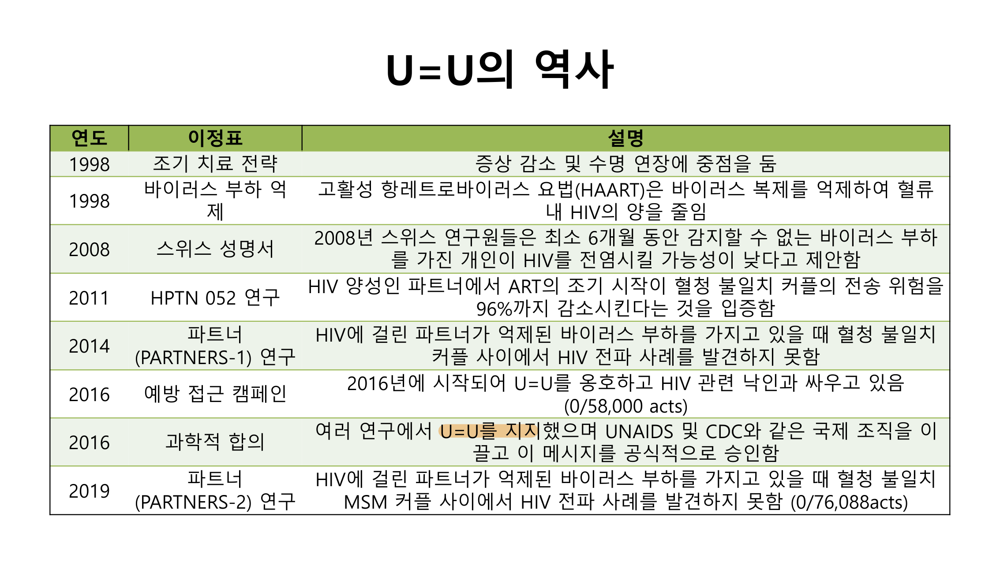{: style="width:66%"}

| 연도 | 이정표 | 내용 |
|---|---|---|
| 1998 | 조기 치료 전략, HAART로 바이러스 부하 억제 | 증상 감소·수명 연장 / 혈중 HIV 양 감소 |
| **2008** | **스위스 성명** | **최소 6개월 동안 바이러스가 검출되지 않으면** 전염 가능성이 낮다 |
| **2011** | **HPTN 052** | 양성 파트너가 ART를 일찍 시작하면 불일치 커플의 전파 **96% 감소** |
| 2014 | PARTNER-1 | 억제된 경우 전파 0건(0/58,000회) |
| 2016 | **U=U 캠페인**, 과학적 합의 | 낙인과 싸움, **UNAIDS·CDC가 공식 승인** |
| **2019** | **PARTNER-2** | MSM 불일치 커플 **0/76,088회** |

!!! key "핵심 — U=U"
    **ART로 혈중 HIV가 검출되지 않을 정도로(작년 필기: <50 copies/mL, 6개월 이상) 억제되면 성관계로 다른 사람에게 전파되지 않는다.**
    결어: 「**U=U, 바이러스 미검출은 전파할 수 없다는 뜻이다.**」 그래서 **치료받을 권리를 보장하는 것이 비감염인을 지키는 방법**(TasP).
    U=U는 **완치가 아니다**(약을 끊으면 다시 증식 — 9단원 「약을 끊으면 다시 증식」), **항체는 계속 양성**, **백신도 아니다**.

!!! exam "기출 포인트 — 가장 많이 나온 문제"
    U=U의 뜻 → **「혈중 바이러스가 검출되지 않을 정도로 억제되면 타인에게 전파되지 않는다」**(4, 11, 15, 19번, 사례형 3번). 오답은 늘 인권·장애인·국가 지원·「모든 양성자는 치료 대상」·「만성 질환일 뿐」, 2025년엔 「**완전히 제거되어 재발하지 않는다**」「**ART를 받으면 감염이 예방된다**」「**항체 음성이 되면**」「**백신**」.

!!! diff "작년 필기와 다른 점"
    작년 필기에는 임상 적용이 더 있었다 — **RNA <50 최소 6개월 유지**, **3–6개월마다 바이러스 확인**, **성병에 걸리면 일시적으로 전파 위험이 늘 수 있다**. 근거 합계 약 **148,000회 무콘돔 성관계에서 0건**(PARTNER 1·2, Opposites Attract, HPTN 052). 사회적 의의 — 낙인 해소, 치료 동기 강화, 공중보건 예방.

# 8. 보편적 권리로서의 HIV 감염인의 치료

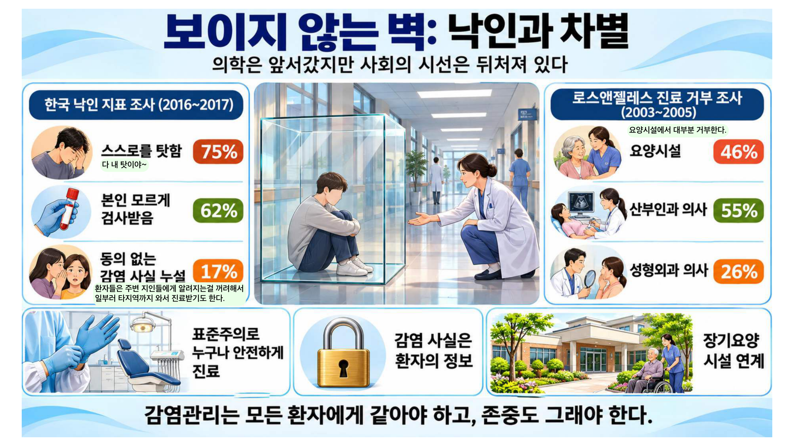{: style="width:66%"}

- **한국 낙인 지표 조사(2016–2017)**: **스스로를 탓함 75%**(필기 「다 내 탓이야~」), **본인 모르게 검사받음 62%**, **동의 없는 감염 사실 누설 17%**. 로스앤젤레스 진료 거부 조사(2003–2005): **요양시설 46%**, 산부인과 의사 55%, 성형외과 의사 26%.
- 필기: "**요양시설에서 대부분 거부한다.** 환자들은 주변 지인에게 알려지는 걸 꺼려 **일부러 타 지역까지 와서 진료받기도** 한다."
- 그림 아래: **표준주의로 누구나 안전하게 진료**, **감염 사실은 환자의 정보(비밀)**, **장기요양 시설 연계**. 「감염관리는 모든 환자에게 같아야 하고, 존중도 그래야 한다.」

## 감염인의 인권과 가져야 할 태도

- **인간으로서의 존엄성은 어떤 질환을 가져도 있다.**
- 일반인에게: 우리나라 극우의 「**에이즈 = 동성애**」 접근은 부정적 결과를 낳는다 — **누구나 감염될 수 있고, 감염자는 약자**다.
- 환자·위험군에게: 더 요청되는 **책임의식**, **상대방 동의**, 위험군은 **최소 1년에 1회 주기적 검사**.
- 필기: "**치료받을 권리가 있다. 의사는 도덕적 판단을 하면 안 되며 치료받을 권리를 존중해야 한다. 타당한 사유 없이 의료인이 의료행위를 거부하면 법 위반이다.**" (메모에는 「의료보호법」이라 적혀 있다. ※ 확인 필요: 진료 거부 금지는 **의료법** 조항이다.)

## 장기요양이 특히 필요한 환자

- **뇌 질환으로 거동이 어려운 환자** — 종양(림프종 등), 감염(**뇌매독, PML, 톡소플라스마증**), **HIV 뇌증**, 퇴행성 질환.
- **정신질환 동반** — 자기 관리가 안 되는 우울·조현병, 술·약물 의존.
- 필기: "**조현병, 우울증, 알코올 중독 환자는 순응도가 낮다 — 약 복용을 거부한다.** 인권 문제 때문에 어디에 가둬 둘 수도 없다."

## 다른 과의 차별

- 감염내과 외 임상 각 과의 차별은 **무지와 자기 보호 본능**에서 온다 → **진료과 협조는 감염내과 의사를 통해** 하는 것이 효과적, 치료 지원 단체 연결.
- **차별 때문에 감염 사실을 밝히지 않고 시술·수술을 받는 경우가 많다** — 그래서 **모든 환자에게 표준주의(Universal precaution)**가 필요하다(6번 기출).
- 필기: "**우리나라는 의료비를 100% 지원해 준다.**"(희귀 질환 — 1단원 「본인 부담금 없음」.)

!!! diff "작년 필기와 다른 점"
    작년 필기에만: **비밀유지의무** — 후천성면역결핍증예방법의 비밀누설 금지(**3년 이하 징역 또는 1,000만 원 이하 벌금**). 낙인의 유형 — **내재화된**(자존감 저하·우울), **인지된**(검사·치료 회피), **실행된**(실제 차별). 감염인 일자리 창출.

# 9. 최신 연구 현황과 결어

| 연구 분야 | 내용 | 기대 |
|---|---|---|
| 백신 개발 | 효과적인 HIV 백신 | 새 감염 예방 |
| 완치 연구 | 몸속 HIV 제거 전략 | 근절 가능성 |
| 새 약물 | 새 항레트로바이러스제 | 더 나은 치료 |
| 행동 중재 | 위험 행동 감소 | 전파 감소 |

- 필기: "**mRNA 백신, 체내 CCR5 제거, 지속성 있는 중화항체 개발** 등 다양한 연구가 이루어지고 있다."

| 완치 전략 | 접근법 | 현재 |
|---|---|---|
| **Shock and Kill** | 잠복 HIV를 **깨워서(재활성화)** 감염 세포를 제거 | 임상시험 중 |
| 유전자 편집 | 숙주 세포를 HIV에 저항하도록 변형(CCR5 제거 등) | 초기 연구 |
| 면역 조절 | HIV에 대한 면역반응 강화 | 진행 중 |
| 줄기세포 이식 | 감수성 세포를 저항성 세포로 대체 | **희귀 사례에서 개념 증명** |

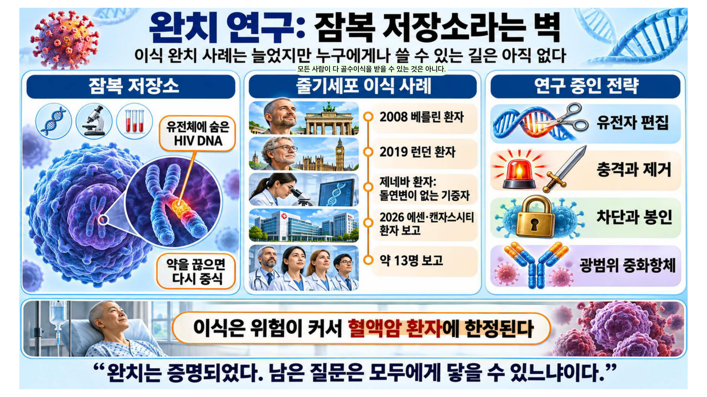{: style="width:66%"}

- **잠복 저장소**: 유전체에 숨은 HIV DNA → **약을 끊으면 다시 증식**. 그래서 ART는 평생이다.
- 줄기세포 이식 사례: 2008 베를린, 2019 런던, 제네바 환자(돌연변이 없는 기증자), **2026년 에센(독일)·캔자스시티 환자 보고**, **약 13명 보고**. 그러나 「**이식은 위험이 커서 혈액암 환자에 한정된다**」 — 필기: "**모든 사람이 다 골수이식을 받을 수 있는 것은 아니다.**"
- 연구 중 전략: 유전자 편집, 충격과 제거(shock and kill), 차단과 봉인(block and lock — 잠복 상태로 묶어 두기), 광범위 중화항체.
- 「**완치는 증명되었다. 남은 질문은 모두에게 닿을 수 있느냐이다.**」

!!! diff "작년 필기와 다른 점"
    작년에는 완치 사례가 「베를린(2008)·런던(2019)·뒤셀도르프 — 모두 CCR5 Δ32 공여자 이식, 이걸 유도할 기술은 아직 없다」 정도였다. 올해는 **CCR5 돌연변이 없는 공여자 사례(에스파뇰·제네바)**, **약 13명**, 연구 전략 표가 더해졌다. 백신은 작년에도 「mRNA 백신(Moderna, IAVI)·광범위 중화항체 연구 중」.

## 결어 (127쪽)

1. HIV의 역사를 보면 **발전**이 보이고 전문가들의 지속적 노력이 있다.
2. **2020년 90-90-90 → 2030년 95-95-95**로 강화.
3. **빠른 진단의 보급**이 더 필요하고, **급성 감염은 의심이 진단에 중요**하다. — 메모: "**20대인데 타투했고 발진 있고 하면 의심해 볼 수 있지 않을까?**"
4. 만성 감염의 기회감염은 **폐포자충 폐렴, 결핵** 등이 중요하며 **치료 가능**하다.
5. 치료는 매우 효과적으로 수명을 늘렸다. **하루 한 알**로 치료 중이고, 더 간편한 치료가 개발될 것이다. — 메모: "치료가 아주 빠르게 개발되었다. 부작용도 없다."
6. **HIV 치료는 지속 모델(continuum)의 유지가 중요**하다. — 메모: "많은 단계별 social worker의 도움이 필요하다."
7. 예방은 **각 위험 행위를 알고 피하는 것**이 중요하고, 그 외 **빠른 진단, PrEP** 등이 강조된다.
8. **치료받을 권리를 보장하는 것이 중요** — 이것이 비감염자를 보호하는 방법이기도 하다: **치료가 예방(TasP)**. — 메모: "환자는 약자이고 보호해 줘야 한다."
9. **U=U, 바이러스 미검출은 전파할 수 없다는 뜻**이다. 많은 사람이 치료받을 수 있게 한다. — 메모: "의료 불평등 때문에 적절한 치료를 못 받는 사람이 많다."

!!! key "핵심 — 시험 직전 한 장"
    **진단**: 선별 = EIA(4세대 항원/항체), 확진 = **Western blot**(p24·gp41·gp120/160 중 2개), 급성기 = **RNA**, 신생아 = RNA(엄마 IgG 때문).
    **급성 HIV**: 2–4주, 발열·인두염·경부 림프절·**발진**·무균성 수막염 — 기회감염(양측 폐렴·식도 칸디다·PML)은 **아니다**.
    **기회감염**: <200 **PCP**(서서히 오는 호흡곤란, **TMP-SMX**, PaO2 <70이면 **+스테로이드**, 사망 원인 1위) · <100 톡소·크립토콕쿠스 · <50 **CMV 망막염**·MAC · **PML = JC virus 백질** · 혀 옆 흰 줄 = **EBV**.
    **치료**: **CD4와 관계없이 즉시**, 목표 = **검출한계 미만**, 세 번째 90 = **바이러스 억제**, 바이러스학 = **gp120 / CD4**.
    **예방**: 위험 최대 = **수혈 > 모자(질식분만) > 수용 항문성교 > 주사기 > 바늘(0.3%)**, 의료인 = **Universal precaution**, 바늘찔림 PEP = **TDF/FTC + DTG 28일(72시간 안)**, **U=U = 억제되면 전파 안 됨**.
