<!-- 필기본: 2026 · 2025 -->
<!-- 단계: 수업 후 -->

# 0. 이 수업을 공부하는 법

**김신우 교수님** 수업(2023·2025·2026 모두 같은 교수님, 2시간). 올해 필기본은 **PPT 127장**(2026년 11월판)이고, 맨 앞 4쪽에 **2022–2025 족보**(정답 표시)가 붙어 있다. 필기한 동기 말: "워드 파일도 있지만 **PPT 파일로 수업해도 괜찮을 것 같다** — 워드 파일은 PPT와 내용이 조금씩 다르지만 큰 틀은 같다."

!!! diff "작년 필기와 다른 점 — 자료 구성"
    작년 필기본은 **워드 본문 38쪽 + PPT 보조 114장**이었다. 올해는 PPT 하나로 수업했고, 워드에만 있던 **바이러스 구조, CDC 병기표, AIDS 지칭 질환, 뇌 침범·폐질환 표, PCP 치료, 첫 진료 검사, IRIS, 치료 변경·내성, 의료인 바늘찔림·PEP 약** 등이 올해 슬라이드에서 빠졌다. **그런데 기출은 이 부분에서 많이 나왔다**(PCP 5문항, PEP·의료인 예방 2문항, gp120/CD4 3문항). 이 자료는 그 내용을 지우지 않고 각 단원 끝에 「(작년 필기)」로 남겨 두었다 — 반드시 같이 본다.

{: style="width:62%"}

올해 강의 순서 — 이 자료의 단원도 이 순서를 따른다.

1. HIV 감염의 역사와 기원
2. HIV 감염의 역학 현황 요약(2025년)
3. HIV 감염의 진단, 임상증상 및 기회 질환
4. HIV 감염의 치료
5. HIV 감염의 예방
6. U=U (Undetectable = Untransmittable, 검출되지 않으면 감염시킬 수 없다)
7. 보편적 권리로서의 HIV 감염인의 치료
8. 최신 연구 현황 → 결어

학습성과

1. 사람면역결핍바이러스(HIV)의 전파경로를 설명할 수 있다.
2. HIV 감염의 진단을 설명할 수 있다.
3. 후천성면역결핍증후군(AIDS) 환자에서 흔히 관찰되는 기회감염이나 종양을 열거할 수 있다.
4. HIV 감염의 치료와 그 예후를 설명할 수 있다.
5. AIDS의 예방법을 설명할 수 있다.

## 기출이 묻는 곳 — 한눈에

기출 35문항(2020–2025)이 매년 거의 같은 주제를 돌려 낸다. 올해 필기본 맨 앞 「족보」 4쪽(2022–2025)도 아래 주제 그대로다.

| 주제 | 문항 수 | 2부 번호 |
|---|---|---|
| **U=U의 뜻** | 4 (+3번 사례) | 4, 11, 15, 19 |
| **진단: 선별 = EIA, 확진 = Western blot** | 4 | 2, 7, 21, 28 |
| **PCP: 서서히 오는 호흡곤란 + 양측 간질성 → TMP-SMX (+스테로이드)** · 가장 흔한 사망원인 | 5 | 10, 17, 25, 27, 30 |
| 급성 HIV 증후군에 **없는** 것 고르기 | 3 | 9, 16, 24 |
| **치료 시작 = CD4와 관계없이 모두 즉시** / 치료 목표 = 바이러스 검출한계 미만 | 4 | 3, 5, 8, 26 |
| **90-90-90의 세 번째 90 = 바이러스 억제** | 2 | 12, 23 |
| 전파 위험 비교(모자감염이 가장 큼), 바늘찔림 PEP, 의료인 예방 | 4 | 6, 14, 18, 31 |
| 기회감염 영상·사진(CMV 망막염, PML, 모상백반증, 좁쌀결핵) | 5 | 1, 13, 20, 32, 33 |
| 바이러스학(gp120/CD4, retrovirus 유전자) | 4 | 22, 29, 34, 35 |

!!! exam "기출 포인트 — 올해 족보에만 있는 2문항"
    올해 필기본 족보에는 **2025년 72번**(73세 남성, 체중감소 8 kg/2개월·호흡곤란, 흉부 CT → **파종성 결핵**)과 **2022년 6번**(24세 남자, 1달간 열, 흉부 사진·CT → **Miliary TB**)도 HIV 수업 문제로 실려 있다. 이 두 문항은 저장소에서 **CP-A2(11강)**로 분류돼 있어 2부에는 없다 — 4단원 「결핵」에서 같이 정리했다.

!!! key "핵심 — 이 수업의 메시지"
    교수님: "**치료받은 사람은 감염력이 없어진다 — U=U.**" 올해 결어도 같다: "**U=U, 바이러스 미검출은 전파할 수 없다는 뜻이다**", "**치료가 예방(TasP)**".
    그래서 **진단되면 CD4와 상관없이 바로 ART**(Treat All) → 개인·파트너·사회를 지킨다. "원래 사망률 100%의 질병이었으나 이제는 **약만 잘 먹으면 당뇨보다 훨씬 안전한 질병**이다."

# 1. HIV 감염의 역사와 기원

!!! new "올해 필기에서 추가"
    작년에는 역사가 강의 끝(인권 단원)에 몇 줄로만 있었는데, 올해는 **강의 첫머리에 연표 5장 + 한국 연표 2장**으로 크게 늘었다. 연도 자체를 묻는 기출은 없었지만, 각 연도가 **진단·치료·예방의 이정표**라서 뒤 단원과 이어진다.

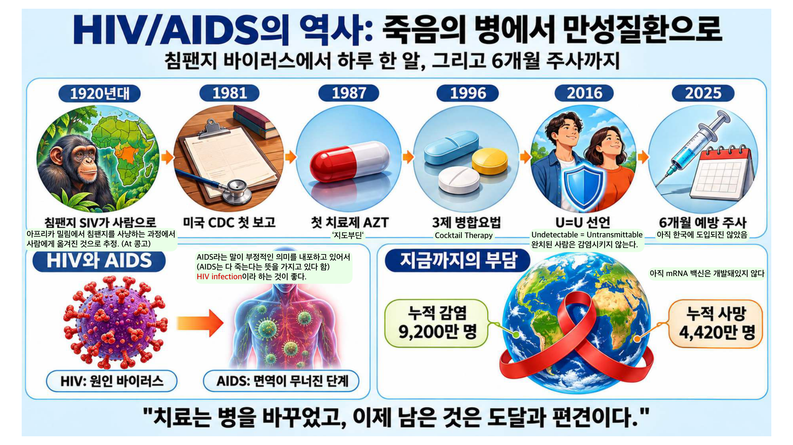{: style="width:70%"}

## 기원 — 언제, 어디서 사람에게 왔나
- **1920년경 콩고(Congo) 공화국의 킨샤사(Kinshasa)**에서 시작한 것으로 추정한다. 아프리카 밀림에서 **침팬지를 사냥하는 과정에서 침팬지의 SIV(원숭이 면역결핍 바이러스)가 사람에게 옮겨진 것**으로 본다(피·고기 접촉).
- HIV가 확인된 **가장 오래된 사람은 1959년에 채취해 보관한 피**(콩고 민주 공화국의 Bantu 성인)다. 실제 처음 전파된 것은 그보다 이른 1920년대로 본다.
- 이 질환은 전 세계로 늘어나 보건뿐 아니라 정치·경제 등 모든 분야에 영향을 미쳤다.
- HIV에는 HIV-1과 HIV-2가 있는데 **대부분 HIV-1**이다(작년 필기).

## 세계 연표 — 진단·치료·예방의 이정표

| 연도 | 사건 | 왜 중요한가 |
|---|---|---|
| 1981 | 미국 CDC가 **남성 동성애자들 사이의 폐포자충 폐렴(PCP)과 카포시 육종 집단 발생** 보고 | AIDS의 첫 사례. PCP는 원래 **면역저하자**가 걸리던 병인데 젊은 남성에게 나타나서 이상하다고 본 것이 시작 |
| 1982 | **AIDS(후천성 면역결핍증)**라는 이름, CDC가 임상 증상으로 정의 | |
| 1983 | 파스퇴르 연구소 **Luc Montagnier** — LAV(림프절병증 관련 바이러스) 분리 | 원인 바이러스 발견 |
| 1984 | 미국 국립암연구소 **Robert Gallo** — HTLV-III 분리(나중에 LAV와 같은 바이러스로 확인), AIDS의 원인이라 발표 | |
| 1985 | **혈액 내 HIV 항체 검사** 첫 허가 | 혈액 공급 선별, 개인 진단이 가능해짐 |
| 1986 | 국제 바이러스 분류 위원회가 **HIV**로 공식 명명 | |
| 1987 | **AZT(zidovudine, 지도부딘)** FDA 승인 — 첫 HIV 약 | 항레트로바이러스 치료 시대의 시작 |
| 1988 | **12월 1일 = 세계 에이즈의 날** | |
| 1990 | 수혈로 감염된 10대 **라이언 화이트** 사망 → Ryan White CARE 법(치료 자금 지원) | |
| 1991 | **빨간 리본** — AIDS 인식의 국제 상징 | |
| 1994 | 미국 공중보건국이 **산모→아이 전파를 줄이기 위해 AZT 권장** | 모자감염 예방의 출발 |
| 1995 | 첫 **프로테아제 억제제** 승인 → **HAART(고활성 항레트로바이러스 요법)**의 시작 | |
| 1996 | UNAIDS 출범, **3제 병합요법** | |
| 2000 | **더반 선언** — HIV가 AIDS의 원인임을 확인 | 「AIDS 부정주의」에 대한 반박 |
| 2002–03 | 세계기금(에이즈·결핵·말라리아), 미국 PEPFAR | 치료 자금 |
| 2008 | **CCR5 돌연변이 기증자의 줄기세포 이식 → 첫 완치(Timothy Ray Brown, 베를린 환자)** | CCR5가 감염에 중요한데, 돌연변이가 오히려 도움이 됨 |
| 2010 | CAPRISA 004 — 살균제(microbicide) 젤의 예방 효과 | |
| 2012 | **Truvada(TDF/FTC) — 첫 노출 전 예방(PrEP) 약** FDA 승인 | |
| 2014 | UNAIDS **90-90-90** 목표 | 90% 진단, 90% 치료, 90% 억제 |
| 2016 | **U=U 선언** | |
| 2019 | **런던 환자** — 두 번째 완치(역시 줄기세포 이식) | "대부분의 완치자는 CCR5 돌연변이를 가지고 있었다" |
| 2020 | 코로나19 속에서도 치료 유지, **지속형 주사 ART** 도입 | "주사는 **두 달에 한 번**" |
| 2021–22 | UN 「2030년 AIDS 종식」 재약속, 장기 지속형 PrEP 주사 | |
| 2023– | 유전자 편집 등 완치 연구 | |
| 2025 | **6개월 예방 주사**(lenacapavir) | "아직 한국에 도입되진 않았다" |

- **HAART**(Highly Active Anti-Retroviral Therapy): 세 가지 정도 약을 섞는 요법. 일반인에게는 「**칵테일 요법**」으로 알려졌고 요즘은 줄여서 **ART**라 한다.
- **AIDS 부정주의**: "에이즈는 가상의 질병이며 존재하지 않는다"는 주장. 이 때문에 치료를 거부한 사람이 많았다(작년 필기: Christine Maggiore 이야기).
- 약이 없던 시절에는 유명인도 HIV로 사망했다 — 1985년 영화배우 **록 허드슨**, 1991년 퀸의 보컬 **프레디 머큐리**. "건강한 유명인도 예외가 아니다"라는 사실에 「죽음의 병」이라는 인식이 퍼졌다.
- 지금까지 **누적 감염 약 9,200만 명, 누적 사망 약 4,420만 명**(13쪽 그림). "치료는 병을 바꾸었고, 이제 남은 것은 도달과 편견이다."
- 필기: "**AIDS라는 말은 '다 죽는다'는 부정적 뜻을 품고 있어서 HIV infection(HIV 감염)이라 하는 것이 좋다.**" "아직 mRNA 백신은 개발돼 있지 않다."
- 원래 사망률 100%의 병이었지만 치료법이 매우 빠르게 개발되어, 이제는 약만 잘 먹으면 당뇨보다 안전하다.

## 한국 연표

| 시기 | 사건 |
|---|---|
| 1985 | **한국 최초 HIV 감염자 확인** |
| 1987 | HIV 항체 검사 도입 |
| 1988 | AZT 등 초기 ART 도입 |
| 1995 | 국내 최초 HIV/AIDS 치료센터 |
| 1996 | HAART 도입 → 사망률 감소 |
| 2000 | 모성-아동 전파 예방 프로그램 (필기: **수직감염은 한국에서는 드문 편**) |
| 2004–05 | 국가 예방·관리 전략, 국립암센터 HIV/AIDS 연구센터 |
| 2006 | **무료 HIV 검사 확대** — "보건소에 가면 무료로 검사해 준다" |
| 2007 | 치료 기준 완화: **CD4 350/µL 이상에서도 치료 권고** |
| 2012 | **1일 1회 복용제 도입** — STR(Single Tablet Regimen, 단일정 요법), 즉 **하루 한 알** |
| 2015 | 치료 목표 **U=U** 제시 |
| 2016 | 신규 감염 감소세 |
| 2018 | **PrEP 도입** |
| 2020 | 장기 작용 치료제 도입 |
| 2022 | 국내 누적 감염자 1만 5천 명 돌파 |

- 필기: "현재 한국의 HIV 감염자는 **17,000여 명**. **희귀 질환이라서 환자 본인 부담금이 없다.**" 한국의 HIV 고위험군은 **MSM(Men who have Sex with Men, 남성 간 성접촉자)**. HIV 감염인은 스스로를 **PL(People Living with HIV)**이라 부른다.
- (곁가지) 한때 "홍삼이 예방에 도움이 된다"는 이상한 소문이 돌기도 했다.

# 2. 역학 현황 (2025년)

## 진단되지 않은 감염인 — 빙산

{: style="width:66%"}

- 맨 위 꼭짓점이 **에이즈 환자**, 그 아래가 **진단된 HIV 감염인**, 수면 아래 가장 큰 부분이 **진단되지 않은 감염인**이다. 진단되지 않은 사람은 치료를 받지 않으니 **다른 사람을 감염시킬 수 있다** → 광범위한 검사와 치료가 필요하다.
- 필기: "**한국은 20% 정도가 진단되지 않은 감염인**이다. 후진국일수록 이 비율이 더 높다." 한국에서는 보건소에서 공짜로 검사받을 수 있고 인터넷에서 진단 키트를 사서 해 볼 수도 있지만, **사회적 인식이 좋지 않아 검사를 꺼리는 사람이 많다.**
- "**일단 치료 과정에 들어오면 어지간하면 전파시키지 않는다 → 빠르게 진단해서 치료하는 게 매우 중요하다.**"
- 용어: "AIDS 환자보다는 **Advanced HIV infection(진행된 HIV 감염)**이라는 표현을 쓰는 게 맞다."

## HIV 감염의 단계

| 단계 | CD4 수(cells/µL) | 바이러스 양 | 임상 특징 |
|---|---|---|---|
| 급성 HIV 감염 | 변동적 | **매우 높음** | 독감 유사 증상 |
| 만성 HIV 감염 | **>500** | 낮음–중간 | 대개 무증상 |
| 에이즈 | **<200** | 높음 | **기회감염** 발생 |

- HIV는 **CD4(+) T 세포**를 공격해 그 수를 줄인다. 필기: 정상인은 **700–1,200**, **500 이하로 떨어지면 면역이 저하됐다고 본다.**

!!! diff "작년 필기와 다른 점"
    작년 필기는 정상 CD4를 **500–1,200/µL**(6세 이상)로 적었다. 올해 필기는 **700–1,200**. 「500 아래 = 면역 저하」, 「200 아래 = AIDS」라는 기준은 같다.

## 국내 신고 추이와 2025년 현황

{: style="width:72%"}

- **한국의 HIV 유병률은 약 0.035%**로 낮다. 가장 많을 때는 **한 해 1,000명씩** 늘었고(2013–2019), 2020년 이후 줄어 2025년 **927명**.
- **4명 중 1명 정도는 외국인**이다. 예전에는 외국인 감염인을 추방했지만 **인권 문제로 지금은 추방하지 않는다.**
- 1980–90년대에는 에이즈를 죽을병으로 취급했고 그 인식이 지금 세대에도 남아 있다. 교수님: "**병자를 차별해서는 안 되며, 에이즈도 치료할 수 있는 병이라는 것을 반드시 인식했으면 좋겠다.**"
- **TasP(Treatment as Prevention)** — 치료가 곧 예방이다. 치료하면 바이러스가 없어져 감염시키지 못한다.

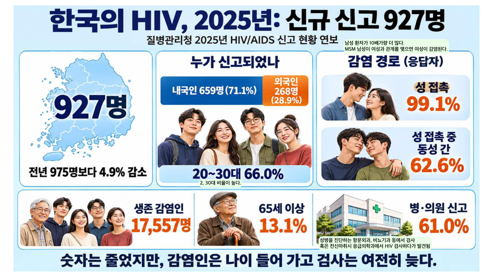{: style="width:70%"}

| 2025년 국내 신규 신고 | |
|---|---|
| 전체 | **927명** (전년 975명보다 4.9% 감소) |
| 내국인 / 외국인 | 659명(71.1%) / **268명(28.9%)** |
| 나이 | **20–30대가 66.0%** (30–34세 최다). 65세 이상도 13.1% |
| 감염 경로(응답자) | **성접촉 99.1%**, 그중 **동성 간 62.6%** |
| 생존 감염인 | **17,557명** |
| 신고 기관 | 병·의원 61.0% |

- **남성 환자가 10배가량** 더 많다. **MSM 남성이 여성과 관계를 맺으면 여성이 감염된다.**
- 어디서 발견되나: **성병을 진단하는 항문외과·비뇨기과**, 또는 **전신마취 전 검사**·응급의학과에서 HIV 검사를 하다가 발견된다.
- 젊은 사람이 많다. 교수님은 10대 환자도 보셨다(집을 나갔다가 낯선 성인에게 피해를 입은 경우).
- 슬라이드 결론: "**숫자는 줄었지만, 감염인은 나이 들어 가고 검사는 여전히 늦다.**"

!!! diff "작년 필기와 다른 점"
    - 국내 유병률: 작년 **약 0.027%** → 올해 **약 0.035%**. 성비: 작년 **약 15:1** → 올해 「**약 10배**」.
    - 작년에는 **전 세계 현황(2024, UNAIDS)** 표가 있었다 — 감염인 약 **4,080만 명**(여성·소녀 53%), 신규 130만/년, AIDS 관련 사망 63만/년, ART 3,160만 명, 본인 감염 인지율 87%, 치료 접근률 77%(**아동 55%로 낮음**, 여성 83% > 남성 73%). 추세: 감염인으로 사는 사람은 늘고(오래 산다) 신규 감염·사망은 준다. 사하라 이남 아프리카에 집중, 아프리카는 **남녀 1:1**.
    - 작년 필기의 국내 설명: 2020·21년 감소는 진단 감소·접촉 감소·TasP 효과로 추정, 최근 생존자가 늘어 70–80대 감염인도 있다.

## 진단까지 걸리는 시간 — 4.2년
- 국내 연구(ECDC 모델): **감염에서 진단까지 평균 4.2년** — 진단이 늦다. 원인은 인식 부족, 낙인, 검사·치료 서비스 접근 제한.
- 필기: "우리나라는 진단까지의 기간이 긴 편이다. **기간이 길어지면 역학조사 하기가 힘들어진다.**" (올해 필기본에서는 진단 단원 끝 34쪽에 있다.)

# 3. 진단과 급성 HIV 감염

!!! key "핵심"
    HIV 진단은 **전적으로 실험실 검사**로 한다 — 증상만으로는 감염 여부를 알 수 없다(초기엔 증상이 없거나 감기 몸살 같다).
    **선별 = 4세대 항원/항체 EIA(ELISA) 또는 신속검사 → 양성이면 확진 = Western blot(또는 RNA)**. **급성기는 항체가 아직 없으니 RNA(핵산검사, NAT)**.

## 급성 감염기에 몸 안에서 — 바이러스, CD4, CD8

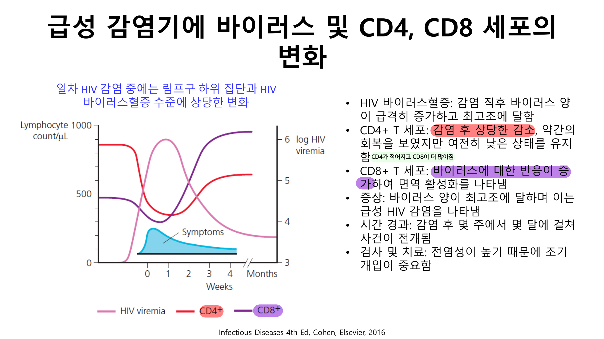{: style="width:72%"}

- **HIV 바이러스혈증(분홍)**: 감염 직후 급격히 치솟아 최고조에 이른다 → 이때 **증상**(파란 영역)이 생기고 **전염성이 매우 높다** → 조기 진단·개입이 중요하다.
- **CD4+ T 세포(빨강)**: 감염 후 **크게 감소**했다가 약간 회복하지만 여전히 낮다.
- **CD8+ T 세포(보라)**: 바이러스에 대한 반응으로 **증가**(면역 활성화). 필기: "**CD4가 적어지고 CD8이 더 많아진다**" → **CD4/CD8 비율 역전**(작년 필기: 회복돼도 역전은 남는다).
- 이 변화는 감염 후 몇 주에서 몇 달에 걸쳐 일어난다.

## 검사가 양성이 되는 시기

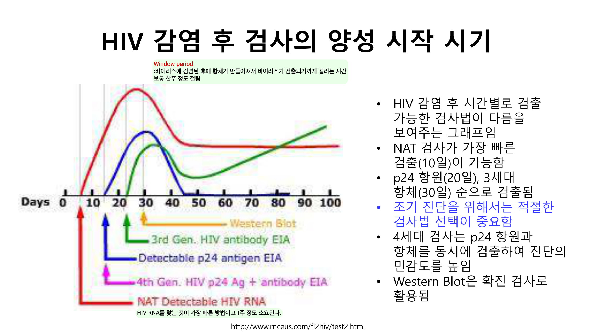{: style="width:74%"}

| 검사 | 무엇을 보나 | 양성이 되는 때(감염 후) |
|---|---|---|
| **NAT(핵산검사, HIV RNA)** | 바이러스 유전자 | **약 10일 — 가장 빠름** |
| **4세대 p24 항원 + 항체 EIA** | p24 항원과 항체를 **동시에** | p24 항원 시기부터(3세대보다 1–2주 빠름) |
| p24 항원 EIA | 바이러스 단백 | 약 20일 |
| 3세대 항체 EIA | 항체 | 약 30일 |
| **Western blot** | 여러 바이러스 단백에 대한 항체 밴드 | 가장 늦게 — **확진 검사** |

- 기억법: **RNA → p24 → 항체 → Western blot** 순. 4세대 검사는 p24와 항체를 함께 잡아 **민감도를 높이고 창문기를 줄인다.**
- 필기: "HIV RNA를 찾는 것이 가장 빠른 방법이고 **1주 정도** 걸린다." 조기 진단을 위해서는 시기에 맞는 검사법을 골라야 한다.

## 창문기 (Window Period)
- **감염된 시점부터 검사로 바이러스(또는 그 흔적)를 확실히 잡을 수 있는 시점까지의 기간.** 혈액엔 바이러스가 있지만 항체가 아직 측정되지 않는 시기라서 **검사가 음성인데 전염력은 있다.** 쓰는 검사 종류에 따라 길이가 다르다(RNA가 가장 짧다).
- 창문기 혈액을 수혈받아 감염될 확률은 "**굉장히 굉장히 드물다. 그러니 안심해도 된다.**" (작년 필기: 우리나라 혈액은 **RNA 검사로 거르므로** 안전. 외국은 만성 빈혈 수혈 기준을 Hb 10 → 7로 낮췄다.)
- ※ 확인 필요: 필기 메모에 창문기가 "보통 한 주 정도"라고 적혀 있는데, 1주는 **RNA 검사**가 양성이 되는 시기이고, **항체 검사의 창문기는 보통 3–4주**(4세대 약 2–3주)다. 시험에서는 「검사 종류에 따라 다르고, RNA가 가장 짧다」로 기억한다.

## 노출 후 검사 시기 — 4주

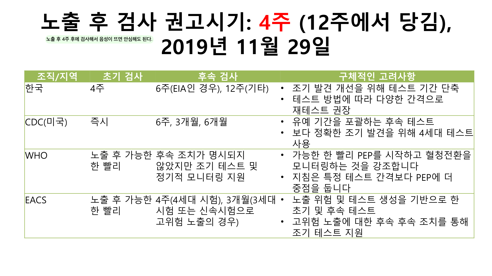{: style="width:72%"}

| 기관 | 초기 검사 | 후속 검사 |
|---|---|---|
| **한국** | **4주**(2019년 11월 29일, **12주에서 당김**) | 6주(EIA인 경우), 12주(기타) |
| CDC(미국) | 즉시 | 6주, 3개월, 6개월 (4세대 검사 사용) |
| WHO | 노출 후 가능한 한 빨리 | 간격보다 **PEP를 빨리 시작**하는 것을 강조 |
| EACS(유럽) | 가능한 한 빨리 | 4주(4세대), 3개월(3세대·신속검사, 고위험 노출) |

- 필기: "**노출 후 4주 뒤에 검사해서 음성이 뜨면 안심해도 된다.**"
- 작년 필기: 모르는 사람과 성관계 → baseline 검사 후 추적. "12주가 넘었는데 계속 검사하려 하면 '이제 그만하시죠'."

## 급성 HIV 감염의 임상상

1. **발열과 인플루엔자 유사 증상**: 발열, 피로, 두통, 근육통.
2. **림프절 부종**: 붓거나 아프다. **특히 목 림프절**이 잘 커진다.
3. **피부 발진**: 감염 초기 단계에 나타날 수 있다 — 필기: "**환자의 절반 가량에서 피부 발진이 나타난다.**"
4. **설사와 소화 문제**.
5. **일시적인 증상**: 보통 **2–4주**에 걸쳐 저절로 좋아진다.

- 감기와 증상이 비슷해서 **놓치기 쉽다** — "드물고 찾아내기 힘들다."
- **발진이 단서**다. 필기: "다른 감염에서는 발진이 주로 **아이들**에게 생기는데, HIV에서는 **나이를 막론하고 주요 증상**이다." 작년 교수님: "**어른이 응급실에 왔는데 발진이 있다(어른은 발진이 잘 안 생긴다), 근데 젊은 남자다 → HIV 검사를 해야 한다.**" 올해 결어 메모도 같다: "20대인데 타투했고 발진 있고 하면 의심해 볼 수 있지 않을까?" — 급성 감염은 **의심하는 것이 진단의 시작**이다.

| 계통 | 급성 HIV 증후군에서 생길 수 있는 것 (작년 필기 표) |
|---|---|
| 전신 | **발열, 인두염, 림프절병증**(특히 목), 두통/안와 뒤 통증, 관절통·근육통, 무기력, 식욕부진·체중감소, 오심·구토·설사 |
| 신경 | **(무균성) 수막염**(드묾), 뇌염, 말초신경병증, 척수병증 |
| 피부 | **홍반성 반구진 발진**, 점막피부 궤양 |

!!! exam "기출 포인트"
    「급성 HIV 감염에서 가능성이 **가장 낮은** 것」이 3번 — 정답은 늘 **진행된 HIV(낮은 CD4)의 기회감염**: **양측 폐렴(9번)**, **식도 칸디다증(16번)**, **PML(24번)**. 발열·발진·인두염·경부 림프절병증·**무균성 수막염**은 급성기에 있을 수 있다(24번의 함정). 21번 「가. 감염 2–4주 후 독감 증상, 발진 동반 가능」도 맞는 말.

## 급성기와 만성기 비교

{: style="width:72%"}

| | 급성 HIV 감염 | 만성 HIV 감염 |
|---|---|---|
| 정의 | 감염 후 **2–4주** 내 초기 단계(**급성 레트로바이러스 증후군**) | 급성기 이후 오래 지속(수년–수십 년). AIDS까지 **중앙값 8–10년** |
| 증상 | 독감 유사, 림프절 부종, 발열, 발진 → 수주 내 저절로 호전 | 초기 무증상 → 진행하면 체중감소, 기회감염 |
| 진단 | **핵산검사(NAT)**, 4세대 항원/항체 | **항체 검사**, 바이러스 부하, CD4 |
| 전파 위험 | **매우 높음**(바이러스 양이 많다) | ART로 조절 가능(**U=U 가능**) |
| 치료 | **즉시 ART** | **평생 ART** |
| 예후 | 조기 치료 시 정상에 가까운 기대수명 | ART 유지 시 정상에 가까운 수명, 미치료 시 AIDS로 진행 |

!!! diff "작년 필기와 다른 점"
    작년 필기는 급성기를 「**2–6주 잠복기** 후 **50–70%**에서 증상, 항체가 생기면서 **1주–3개월(평균 1–2주)** 안에 저절로 사라진다」로 적었다. 올해 슬라이드는 「**감염 후 2–4주**, 증상은 **2–4주**」로 단순하게 쓴다. 시험 보기에서는 「2–4주 후 독감 증상」이 맞는 말로 나왔다(21번).

## 신속검사 (Rapid test) — 오라퀵(OraQuick)
- **잇몸을 납작한 패드로 문질러(구강액) 현상액에 넣고 20분 뒤 읽는다**(40분 넘으면 안 됨). 손가락 피(전혈)로도 한다. 필기: "**코로나 검사처럼 두 줄 뜨면 양성.**"
- 정확도가 매우 높다 — FDA 승인 신속검사의 민감도 **99.3–100%**, 특이도 **99.1–100%**(OraQuick 구강액 99.3 / 99.8). 보통 **20분–1시간 이내** 결과.
- 그래도 필기: "**민감도·특이도 모두 좋지만 확진검사로는 쓰지 않는다. 확진에는 Western blot, RNA 검사.**"
- **약국·온라인으로 살 수 있다** → 검사 접근성(특히 익명 검사)을 넓히는 것이 목적.

| FDA 승인 신속검사 | 검체 | 민감도(%) | 특이도(%) |
|---|---|---|---|
| OraQuick Advance | 전혈 / 구강액 / 혈장 | 99.6 / 99.3 / 99.6 | 100 / 99.8 / 99.9 |
| Uni-Gold Recombigen | 전혈 / 혈청·혈장 | 100 / 100 | 99.7 / 99.8 |
| Reveal G2 | 혈청·혈장 | 99.8 | 99.1 |
| Multispot HIV-1/HIV-2 | 혈장 / 혈청 | 100 / 100 | 99.93 / 99.91 |

- 작년 필기의 장단점: 장점 — 접근성(VCT, 모자감염 예방), 당일 진단·상담, 30분 이내, 냉장·장비·기술 거의 불필요. 단점 — 한 번에 적은 수, 여러 장소의 질 관리, 제품 간 성능 차이, 판독자 차이.

## 확인검사 — Western blot

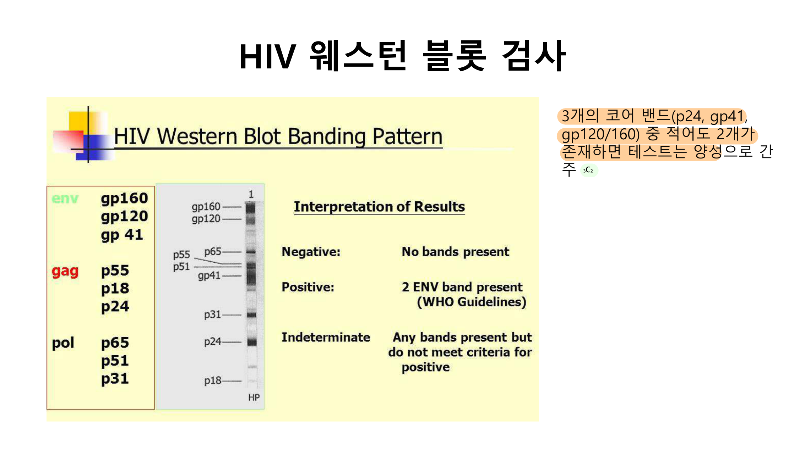{: style="width:66%"}

- 바이러스 단백질을 크기별로 늘어놓고 환자 혈청의 항체가 어느 밴드에 붙는지 본다(**항체 검사의 한 방법**).
- 유전자별 밴드: **env** — gp160, gp120, gp41 / **gag** — p55, p18, **p24** / **pol** — p65, p51, p31.
- **판정: 3개 핵심 밴드(p24, gp41, gp120/160) 중 2개 이상이면 양성**(필기 형광펜, 메모 「₃C₂」). 밴드가 없으면 음성, 밴드가 있지만 기준에 못 미치면 **미결정(indeterminate)**.
- 작년 필기: 해석 기준이 여러 개이고 비싸다. 최신 알고리즘은 HIV-1/2 감별 항체검사 + NAT를 쓴다.

!!! exam "기출 포인트"
    「확진검사로 적절한 것」→ **Western blot**(2번, 28번 — ELISA 양성 다음 단계), 「가장 기본적인 선별검사」→ **HIV 항체 선별검사(EIA)**(7번). 오답: **rapid test(선별용)**, p24 단독·CD4·CD8·viral load·flow cytometry(확진 아님). 21번 「다. 진단검사로 항체검사, 확진은 western blot」 맞음. 2024·2025 족보에서 그대로 다시 나왔다.

## (작년 필기) 진단에서 더 알아 둘 것

!!! diff "작년 필기와 다른 점 — 올해 슬라이드에서 빠진 진단 내용"
    아래는 작년 워드 필기에만 있던 내용이다. 기출 보기(선별·확진, 신생아 진단)와 이어지니 그대로 둔다.

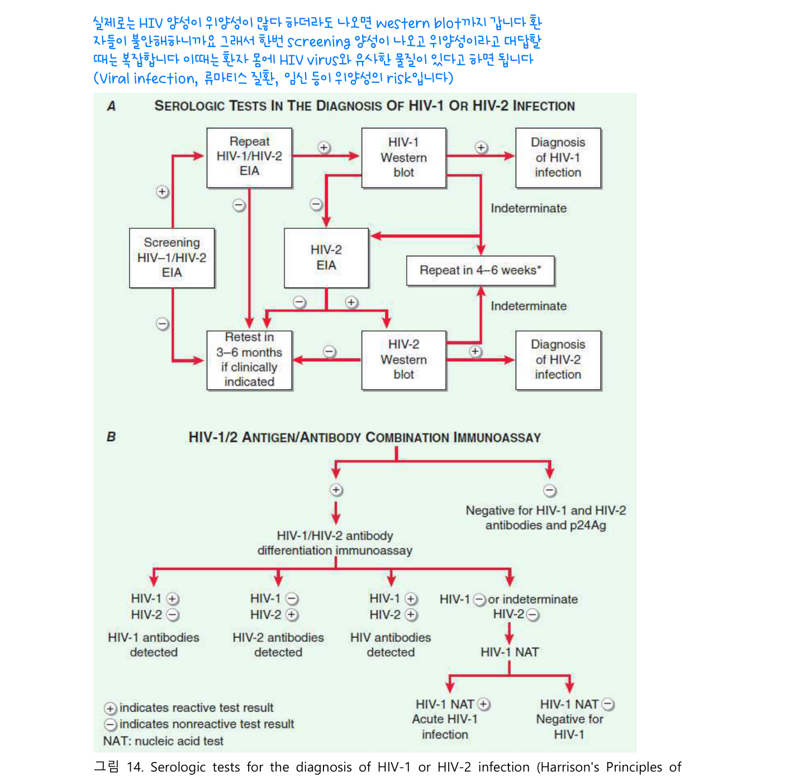{: style="width:64%"}

- **4세대 항원/항체 복합검사(HIV-1/2 Ag/Ab combo)**: 현재 표준 선별검사. 감염 후 **2–3주**에 검출, 민감도·특이도 >99%. 그러나 **양성예측도는 유병률에 따라 다르다** — 고위험군(유병률 10%) 91%, **일반인구(0.1%) 50%** → 위양성이 많다(바이러스 감염, 류마티스 질환, 임신 등). 위양성을 설명할 때는 "몸에 HIV와 비슷한 물질이 있다"고 하면 된다.
- 항체는 **감염 후 2주부터**, 거의 대부분 **8주 이내** 양전, **12주(3개월) 이후 양전은 사실상 없다**. 혈청전환기에 가장 먼저 나오는 항체는 **p24**와 막단백(gp160, gp41)에 대한 것.
- **HIV RNA 정량**: 쓰임새 (a) 초기·급성기 진단, (b) **신생아 진단**, (c) **치료 반응 모니터링**(실제로는 대부분 이것). **CD4 수**: 예후, 치료 모니터링.
- **신생아**: 엄마의 IgG 항체가 태반을 넘어오므로 태어나서 항체검사를 하면 **무조건 양성**. 그래서 **RNA 검사**로 보고, 엄마 항체가 사라지는 **1년 6개월 뒤에도 항체 양성이면 감염**이다(올해 필기 91쪽 메모에도 같은 내용).

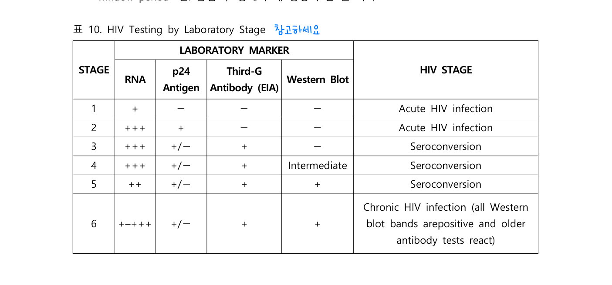{: style="width:62%"}

| 단계 | RNA | p24 | 3세대 항체 | Western blot | |
|---|---|---|---|---|---|
| 1–2 | + / +++ | − / + | − | − | 급성 감염 |
| 3–5 | +++ | +/− | + | − → 중간 → + | 혈청전환 |
| 6 | +~+++ | +/− | + | + (모든 밴드) | 만성 감염 |

**첫 진료 때 하는 검사 (Initial evaluation)**

| 범주 | 항목 |
|---|---|
| 기본 진료 | 병력·신체검사, **간이정신상태검사(MMSE — 뇌를 침범하니까)** |
| 혈액 | 일반 화학·혈액, 간기능, 지질·공복혈당, **CD4 수, 혈장 HIV RNA, HIV 내성검사** |
| 감염 관련 | **매독(RPR/VDRL)**, 톡소포자충 항체, 소변검사, **PPD 또는 IGRA(결핵)**, **B·C형 간염** |
| 예방접종 | **폐렴구균, 인플루엔자**(사백신), HPV, A·B형 간염(음성이면) |
| 상담·지원 | 자연경과·전파 상담, 접촉자 연락, 보험·기초수급 연결 |

# 4. 기회감염과 종양 — CD4로 읽는다

## CD4 수와 기회감염 예방

{: style="width:72%"}

| CD4+ (/µL) | 예방 치료 | 표적 기회감염 | 비고 |
|---|---|---|---|
| **<200** | **TMP-SMX** | **폐포자충 폐렴(PCP)** | "**가장 흔하게 생긴다. HIV 환자 사망 원인 1위**" |
| **<100** | **TMP-SMX** | **톡소플라스마증** | PCP와 같은 약 |
| <100 | 이트라코나졸 또는 플루코나졸 | 크립토콕쿠스 수막염 및 기타 곰팡이 감염 | |
| **<50** | 아지스로마이신 또는 클래리스로마이신 | **MAC(마이코박테리움 아비움 복합체)** | ART를 잘 하면서 MAC 위험이 크게 줄어 **일상적인 예방은 더 이상 권장하지 않음** |
| 모두 | **ART** | 면역기능 개선 → 기회감염 전반 예방 | |

- 왜 CD4가 줄어드나 — 필기: "**CD4+ 세포가 만들어지는 속도보다 사멸하는 속도가 빨라지면서** 그 수가 줄어든다."

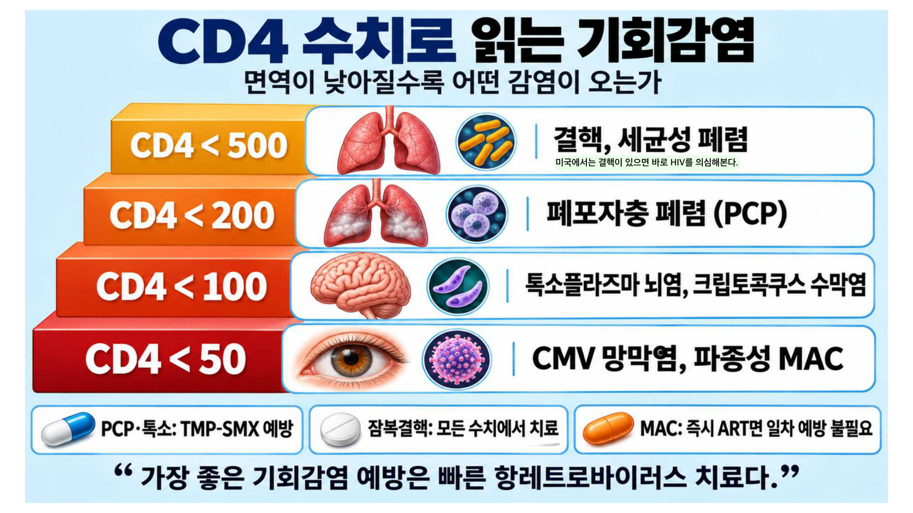{: style="width:70%"}

!!! memo "암기 — CD4 계단 (36쪽)"
    **<500 결핵·세균성 폐렴** → **<200 PCP** → **<100 톡소플라스마 뇌염·크립토콕쿠스 수막염** → **<50 CMV 망막염·파종성 MAC**.
    예방: **PCP·톡소 = TMP-SMX**, **잠복결핵 = CD4 수와 관계없이 치료**, **MAC = 즉시 ART면 1차 예방 불필요**. 「**가장 좋은 기회감염 예방은 빠른 항레트로바이러스 치료다.**」
    필기: "**미국에서는 결핵이 있으면 바로 HIV를 의심해 본다.**"

!!! diff "작년 필기와 다른 점 — 기회감염 예방"
    - **MAC**: 작년 「CD4 <50 + ART 시작이 늦어질 때 azithromycin 1,200 mg 주 1회」 → 올해 「**일상적 예방은 더 이상 권장하지 않음**」(조기 ART면 불필요한 것은 작년도 같음).
    - **크립토콕쿠스**: 작년 「1차 예방은 아프리카 등 고위험 지역만(국내 비권장), 치료 후 2차 예방 fluconazole」 → 올해 표에는 「CD4 <100, itraconazole 또는 fluconazole」이 들어 있다.
    - 작년에만 있던 것: PCP 예방은 **CD4 <200 (또는 <14%, 아구창 병력)**에서 **TMP-SMX 1정 매일**(대안 dapsone, atovaquone, 흡입 pentamidine), **CD4가 200 위로 두 번 올라오면 끊는다**. 톡소는 **CD4 <100 + IgG 양성**에서 TMP-SMX DS. 잠복결핵은 **isoniazid 9개월 + pyridoxine**(rifampin은 HIV 약과 상호작용이 많아서). CMV 망막염·크립토콕쿠스는 치료 후 **2차 예방(유지요법)**.

## 슬라이드 사진으로 보는 기회감염 — 「이걸 보면 HIV 검사」

올해 필기본 37–56쪽은 사진 모음이다. 각 사진의 메모는 거의 모두 **「이런 환자가 오면 HIV 검사를 해야 한다」**로 끝난다.

### 폐포자충 폐렴 (PCP, Pneumocystis jirovecii pneumonia)

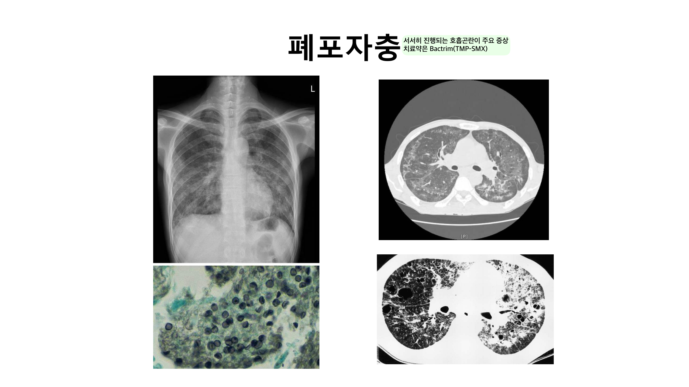{: style="width:62%"}

- 필기: "**서서히 진행되는 호흡곤란이 주요 증상**, 치료약은 **Bactrim(TMP-SMX)**." 흉부 X선·CT에서 **양측 미만성 간질성(간유리) 음영**.
- CD4 <200에서 생기고 **가장 흔하며 HIV 환자 사망 원인 1위**(올해 35쪽 메모). 1981년 첫 AIDS 보고도 PCP였다.
- 작년 필기: 일반 폐렴처럼 기침·객담·고열로 오지 않고 **마른기침 + 서서히 진행하는 호흡곤란**. 적응돼서 **산소포화도가 낮아도 숨찬 걸 모르기도** 한다. PCR이 음성이어도 **양측 폐렴 + 기저 HIV면 PCP로 진단할 만큼** 중요하다. Bactrim을 써도 70%만 낫고 30%는 사망, 치료 안 하면 다 사망.

!!! exam "기출 포인트 — PCP (5문항)"
    「젊은 남자, **1달(4주)간 서서히 진행하는 호흡곤란**, 영상」 → 경험적 1차 약 **TMP-SMX**(17·25번), 「효과를 기대하기 **어려운** 약」 → **doxycycline**(30번 — TMP-SMX·dapsone·atovaquone·pentamidine은 효과 있음), 「**동맥혈 산소분압 55 mmHg**」 → **TMP-SMX + glucocorticoid**(27번 — **PaO2 <70이면 스테로이드**를 더한다), 10번 「HIV의 가장 흔한 사망원인」 → **PCP**(필기·족보 기준. 전 세계적으로는 결핵이라는 자료도 있으니 보기에 둘 다 있으면 필기를 따른다).

### 결핵 — 폐포자충 다음 두 번째

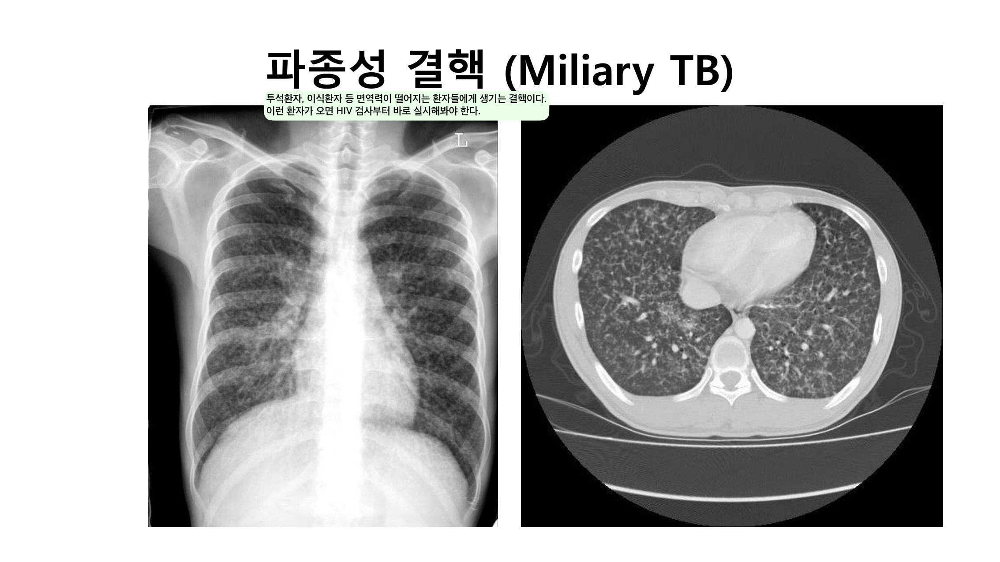{: style="width:62%"}

- **진행된 폐결핵**(38쪽): "**폐포자충 다음으로 두 번째로 많음.** **위쪽(폐 상엽)**에 많이 생긴다."
- **파종성 결핵(Miliary TB, 좁쌀결핵)**(39쪽): 양폐 전체에 좁쌀 같은 작은 결절. "**투석 환자, 이식 환자 등 면역력이 떨어지는 환자에게 생기는 결핵이다. 이런 환자가 오면 HIV 검사부터 바로 실시해야 한다.**"
- **결핵성 경부 림프절염**(40쪽): 감별진단은 **림프종, 기쿠치병(Kikuchi disease)** 등. "HIV가 없는지 확인해 봐야 한다."
- 작년 필기: 잠복결핵이 많은데 HIV로 면역이 떨어지며 깨어난다. HIV에 특이한 것이 좁쌀결핵. 결핵은 보통 폐첨부에 오지만 HIV에서는 아닌 경우도 있다. 결핵은 항결핵제로 일반 환자처럼 잘 치료된다.

!!! exam "기출 포인트"
    20번: 인도네시아(결핵 유행 지역) 출장이 잦은 HIV 환자 + 발열·흉막성 통증 + 좁쌀 결절 → **M. tuberculosis**(MAC·M. abscessus·나병균·크립토콕쿠스 오답). 올해 족보에 실린 **2022년 6번**(24세 남자, 1달간 열, 흉부 사진·CT → **Miliary TB**; 오답 CMV 폐렴·PCP·COVID-19·카포시)과 **2025년 72번**(73세, 체중감소·호흡곤란, 흉부 CT → **파종성 결핵**; 오답 폐암 전이·진폐증·전이성 육아종·기회감염성 폐포자충폐렴)도 같은 그림 문제다(저장소 분류는 CP-A2).

### 입·식도·피부·항문 — 눈으로 보이는 단서

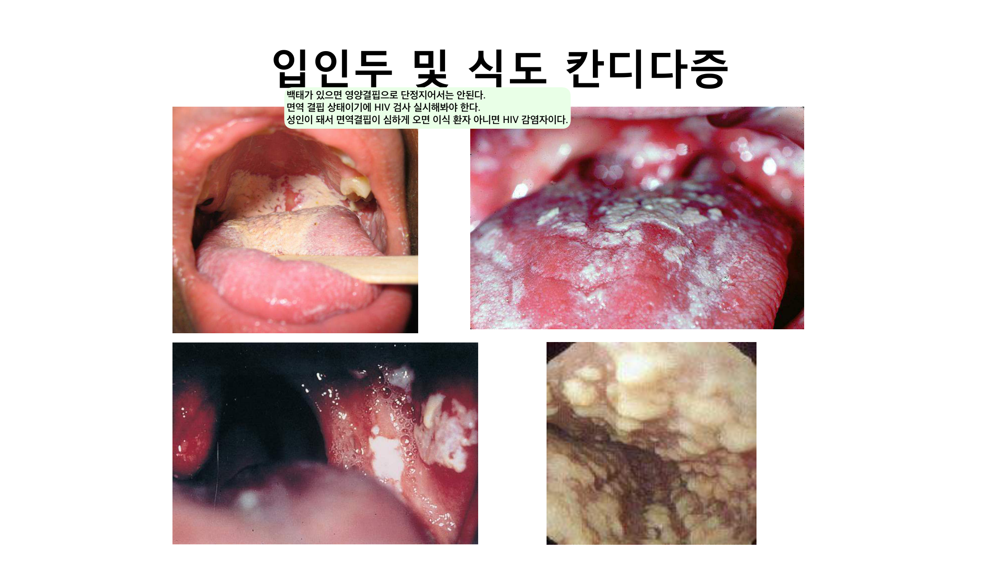{: style="width:60%"}

| 병변 (쪽) | 필기 메모 | 정리 |
|---|---|---|
| **입인두·식도 칸디다증** (41) | "**백태가 있으면 영양결핍으로 단정 지어서는 안 된다.** 면역결핍 상태이니 HIV 검사. **성인이 돼서 면역결핍이 심하게 오면 이식 환자 아니면 HIV 감염자다.**" | 긁으면 벗겨지는 흰 막. 식도까지 가면 AIDS 지칭 질환 |
| **단순포진(HSV)** (42) | "Herpes는 HIV와 **전염 경로가 같다**. 특히 **Herpes 2형이라면 반드시 HIV 검사**." | 입술·생식기·항문 주위 |
| **항문 주변의 만성 herpes** (43) | "세포를 뭉치게 하는 경향이 있다." | 세포 검사에서 **다핵 거대세포**(뭉친 세포). 한 달 넘게 안 낫는 HSV 궤양은 AIDS 지칭 질환 |
| **입(안)의 papilloma** (44) | "HBV 바이러스가 이렇게 혀에 증식하기도 한다." | ※ 확인 필요: 유두종(papilloma)의 원인은 **HPV(사람유두종바이러스)**다. 메모의 「HBV」는 HPV를 잘못 적은 것으로 보인다 |
| **항문 곤지름(condyloma)** (45) | "**위생관리가 힘들다**는 것이 큰 문제. 이런 경우 **항문외과에서 HIV 검사**를 해 본다." | HPV. 항문성교의 단서 |
| **대상포진(VZV)** (46) | "**부위를 가리지 않고** 다 발생한다." 사진의 할머니는 **V1(안신경)** 침범, "V3(하악신경)를 침범하는 경우가 많다." | 작년: **젊은 사람 대상포진 → HIV 검사**(CD4 >500에서도) |
| **모상 백반증(hairy leukoplakia)** (47) | "**혀 옆에 EBV가 복제되어 증식**한다." | 혀 옆면의 털 같은 흰 줄무늬, **긁어도 안 벗겨진다**(칸디다와 차이) |
| **아프타 궤양** (48) | "상염색체 우성 질환이다. 혀 또는 입술 부위가 헐어서 문제가 된다." | Minor(입술·혀), Major. ※ 확인 필요: 재발성 아프타 궤양은 상염색체 우성 유전병이 아니다(가족력이 흔할 뿐) — 메모를 그대로 외우지 말 것 |

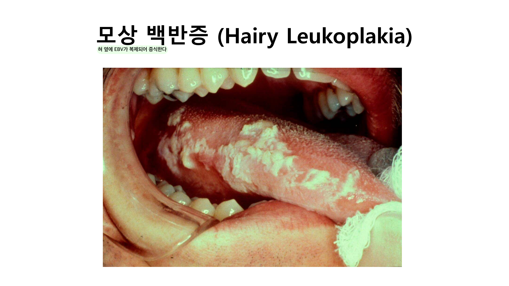{: style="width:52%"}

!!! exam "기출 포인트"
    32번: 처음 진단된 HIV 환자의 **혀 옆면 흰 병변** → **EBV**(모상백반증). 오답 **Candida**(긁으면 벗겨지는 흰 반점), HSV·VZV·CMV(궤양성). 「AIDS를 지칭하는 질환이 **아닌** 것 → **구강 칸디다증**(식도·기관지 칸디다증만 지칭 질환)」은 작년 필기에 「시험에 가끔 나왔다」고 적혀 있다.

### 뇌와 눈 — 크립토콕쿠스, 톡소, PML, CMV

{: style="width:52%"}

- **크립토콕쿠스**(49쪽): "**비둘기 변**에 있는 곰팡이. 면역결핍 환자에게서 발견되면 HIV일 확률이 높아진다. **치료가 어렵고 길며 영구 장애를 남기기도** 한다." 주로 **수막염**(CD4 <100). 작년 필기: "머리를 좋아한다." 크립토콕쿠스 수막염이 있으면 **ART를 4–6주 늦춘다**(IRIS — 5단원 diff).

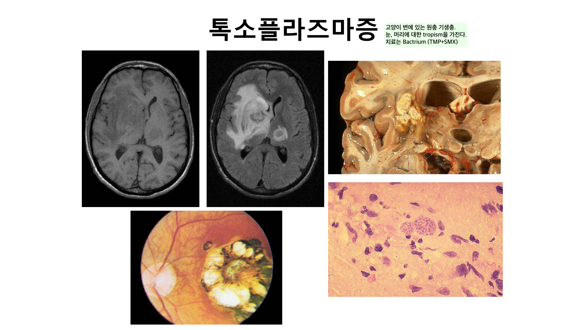{: style="width:58%"}

- **톡소플라스마증**(50쪽): "**고양이 변**에 있는 원충 기생충. **눈, 머리**에 대한 친화성(tropism). 치료는 **Bactrim(TMP-SMX)**." 뇌 MRI에서 **조영증강되는 고리 모양 병변**, 안저에서 맥락망막염.

{: style="width:62%"}

- **PML(진행성 다초점 백질뇌증)**, **JC virus**(51쪽): "**CNS 감염의 대표적인 type.** **백질(white matter)**을 중심으로 감염되면 그 영역의 기능이 마비된다." MRI T2에서 조영증강·부종이 없는 **백질 고신호 병변**. 작년: "PML = 뇌를 침범하는 넘버원", JC virus를 깨우면 생긴다.
- (슬라이드 제목의 「진행성 회백수염」은 PML의 옛 번역이다. 정식 이름은 진행성 다초점 백질뇌증.)

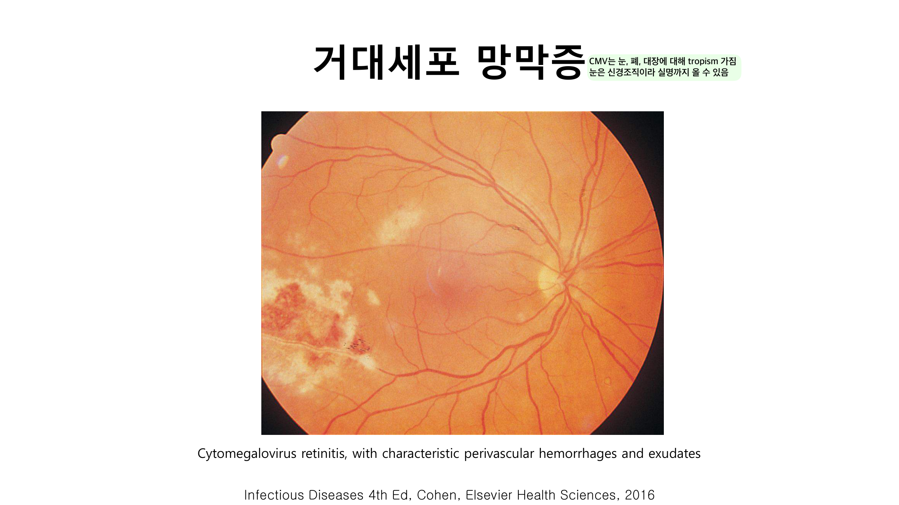{: style="width:52%"}

- **CMV 망막염**(52쪽): 안저에서 **혈관 주위 출혈과 삼출물**("피자 모양"). 필기: "CMV는 **눈, 폐, 대장**에 친화성. **눈은 신경조직이라 실명까지** 올 수 있다." CD4 <50.

!!! exam "기출 포인트"
    1번(2025): 치료 안 받은 HIV 45세, 시야 흐림·시력저하, 안저 → **CMV**(톡소·크립토콕쿠스·칸디다·HSV-2 오답). 33번: 말이 어둔하고 보행장애, MRI 백질 병변, ELISA 양성 → **JC virus(PML)**. 오답 짝: **톡소 = 조영증강 고리 병변, EBV = 원발성 CNS 림프종, CMV = 뇌실염**. 13번: 「HIV를 기저질환으로 조사해야 할 질환」 → **PML**(신우신염·세균성 폐렴·심내막염·구강 단순포진은 정상인에게도 흔함) — 2022년 족보에 그대로 실림.

### 종양 — 림프종, 항문암, 카포시 육종

- **세균성 혈관종증(bacillary angiomatosis)**(53쪽): 피부의 붉은 혈관성 결절(사진: 손바닥). Bartonella 감염.
- **HIV 연관 림프종**(54쪽): "**암 중에서는 림프종이 가장 많다.** 일반 조직과 구별이 잘 안 되어 감별이 힘들다." 사진은 종격동 림프종(흉부 X선에 동그라미). 작년: EBV 관련으로 보인다.
- **항문암**(55쪽): "아무래도 항문 성교가 이루어지기 때문에 **항문암 비율이 매우 높다**." (HPV)
- **카포시 육종**(56쪽): 피부·입안의 **보라·검은색 반점/결절**. "**한국인에게서는 조금 드물고 흑인에서 비율이 높다.**" (HHV-8)
    - **Carcinoma = 상피세포(epithelial cell) 기원** 악성종양, **Sarcoma = 중간엽(mesenchymal) 기원** 악성종양.

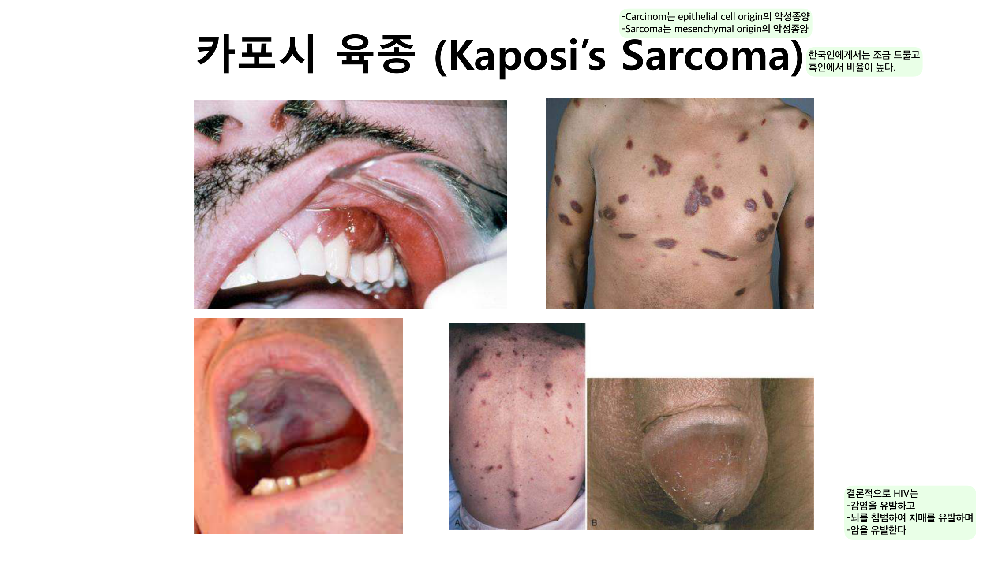{: style="width:56%"}

!!! key "핵심 — 결론적으로 HIV는 (56쪽 메모)"
    ① **감염**을 유발하고(기회감염) ② **뇌를 침범**하여 치매를 유발하며 ③ **암**을 유발한다.

## (작년 필기) AIDS의 정의·병기와 지칭 질환

!!! diff "작년 필기와 다른 점 — 올해 슬라이드에서 빠진 임상 내용"
    아래(병기표, 임상 단계, CD4 구간별 질환표, AIDS 지칭 질환, 뇌 침범·폐질환 표)는 작년 필기에만 있다. 13·24·33번(PML), 9·16번(양측 폐렴·식도 칸디다), 27·30번(PCP 치료)이 여기서 나왔다.

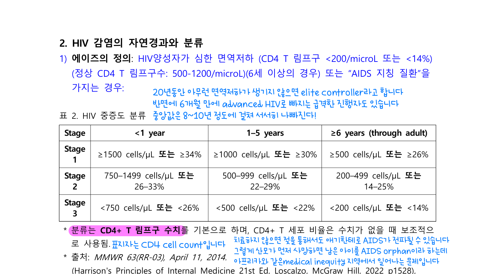{: style="width:70%"}

- **AIDS의 정의**: HIV 양성자가 **CD4 <200/µL (또는 <14%)**이거나 **AIDS 지칭 질환**을 가진 경우. Stage 1 ≥500(≥26%), Stage 2 200–499(14–25%), **Stage 3(AIDS) <200(<14%)**. 기준은 CD4 **수**이고 %는 보조. 어릴수록 기준이 높다(<1세는 <750이 Stage 3).
- **진행 속도**: 약 **20%는 5년 안에** AIDS, **<5%는 10년 넘게** 무증상·CD4 >500. 20년 동안 면역저하가 없으면 **elite controller**. 진행을 늦추는 요인: **바이러스 nef 유전자 돌연변이**, **숙주 CCR5 돌연변이**.
- **무증상기**: 8–10년 정상 생활, 그러나 면역은 계속 떨어지고 **이 시기에도 전파**한다. 일부는 **지속성 전신 림프절병증**(서혜부 제외 두 군데 이상, 1 cm 이상, 3개월 이상).
- **AIDS 관련 증후군(CD4 <500)**: **구강 병변이 매우 흔함**(아구창, 모상백반증, 아프타 궤양, 치주염), 칸디다 질염, **지루성 피부염**, 단순포진·대상포진, **전염성 물렁종**.
- **만성 염증 상태**: ART로 억제돼도 지속적 면역 활성화로 **가속 노화, 골 취약성, 암, 심혈관질환, 당뇨, 신장·간 질환, 신경인지 장애**가 는다.

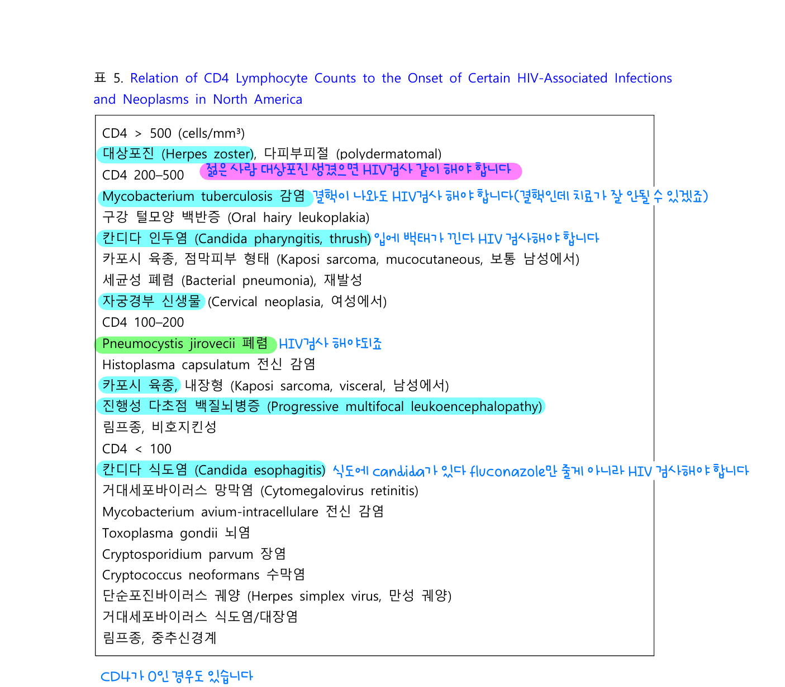{: style="width:70%"}

| CD4 (/µL) | 생기는 질환 (작년 표) |
|---|---|
| **>500** | 대상포진(여러 피부분절) — **젊은 사람 대상포진 → HIV 검사** |
| **200–500** | **결핵**, 구강 모상백반증, **칸디다 인두염(아구창)**, 카포시 육종(점막피부형), 재발성 세균성 폐렴, 자궁경부 신생물 |
| **100–200** | **PCP**, 히스토플라스마 전신감염, 카포시 육종(내장형), **PML**, 비호지킨 림프종 |
| **<100** | **칸디다 식도염**, **CMV 망막염**, **MAC 전신감염**, **톡소포자충 뇌염**, 크립토스포리디움 장염, **크립토콕쿠스 수막염**, 만성 HSV 궤양, CMV 식도염·대장염, **중추신경계 림프종** |

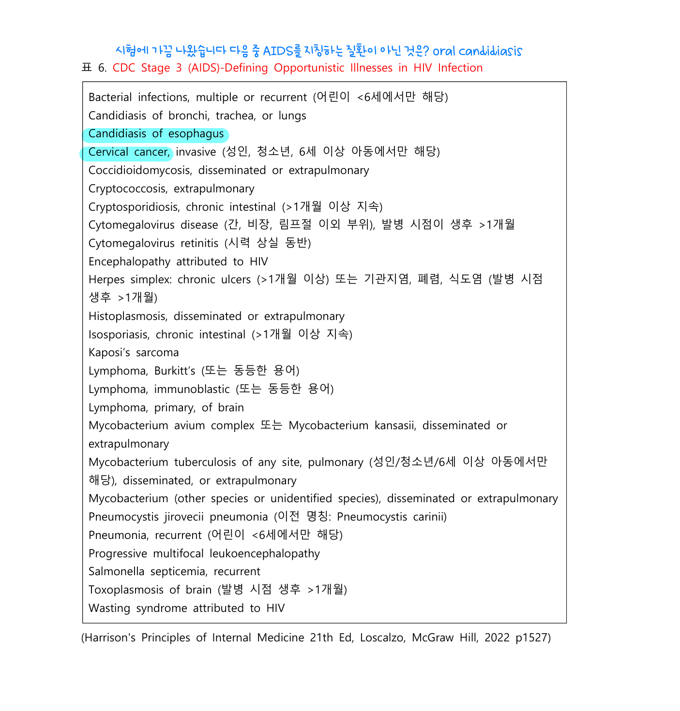{: style="width:64%"}

**AIDS 지칭 질환** — 칸디다(**기관지·기관·폐, 식도** ← **구강은 아니다**), 침윤성 자궁경부암, 파종성/폐외 콕시디오이데스·히스토플라스마증, 폐외 크립토콕쿠스증, 만성(>1개월) 크립토스포리디움·이소스포라 장염, CMV 질환(간·비장·림프절 외)·**CMV 망막염**, HIV 뇌병증, **HSV 만성 궤양(>1개월)**, **카포시 육종**, 림프종(**버킷**, 면역모세포성, **원발성 뇌 림프종**), **MAC·M. kansasii 파종성**, **결핵(모든 부위)**, **PCP**, **재발성 폐렴**, **PML**, **재발성 살모넬라 패혈증**, **뇌 톡소포자충증**, HIV 소모증후군, (소아 <6세) 다발·재발성 세균감염.

**뇌 침범** — "온몸을 다 가는데 특히 기회감염, 기회종양, 뇌 침범."

| 범주 | 질환 |
|---|---|
| 수막염·두통 | 무균성 수막염, **크립토콕쿠스 수막염**, 결핵성 수막염 |
| 미만성 뇌질환 | 의식 보존: **AIDS 치매 복합증** / 의식 저하: 톡소플라스마 뇌염, CMV 뇌염 |
| 국소 뇌질환 | **뇌 톡소포자충증**, **원발성 CNS 림프종**, **PML**, 결핵성 뇌농양 |
| 척수·말초신경·근육 | 공포성 척수병증, CMV 척수병증 / 감각 다발신경병증, 약물 독성(zalcitabine·didanosine·stavudine), CMV 다발신경근병증 / **zidovudine 근병증** |

- **AIDS 치매 복합증**: 초기 — 집중력 저하·건망, 동작 느림·운동실조, 무관심·성격 변화 → 후기 — 전반적 치매, 하반신 마비, 무언증. 증상만으로 구별이 어려워 **영상·뇌척수액을 종합**한다.

**폐 질환**

{: style="width:70%"}

| | PCP | 세균성 폐렴 | 결핵 | 카포시 육종 |
|---|---|---|---|---|
| 양상 | **아급성, 마른기침, 호흡곤란** | 급성, 가래·발열·흉통 | 만성 기침, 체중감소, 발열 | 무증상·경한 기침 |
| 흉부 X선 | **간질성 침윤(양측 미만성)** | 엽성·국소 침윤 | 국소 침윤, 림프절병증 | 폐 결절, 흉수 |
| 진단 | 객담·**기관지폐포세척액 염색**(PCR) | 객담 그람염색·배양, 혈액배양 | 객담 항산균 염색·배양 | 개흉 폐생검 |
| 치료 | **TMP-SMX**, pentamidine, atovaquone, primaquine+clindamycin (**+ 스테로이드: PaO2 <70**) | cefuroxime 등 | INH, RIF, PZA, EMB | 항암치료 |
