<!-- 필기본: 2026 · 2025 -->
<!-- 단계: 수업 후 -->

# 0. 이 수업을 공부하는 법

**감염병학 증례토의 CP-2**(감염내과 **김신우 교수님**, 2026년). CP-A1(3강)에 이어 **증례 11~20**을 다룬다. 올해는 진행 방식이 바뀌어, 증례마다 질문 ①②③이 주어지고 → **학생 조가 답 슬라이드**(「증례 n / 문항 n 답」)를 발표한 뒤 → **교수님 슬라이드**(증례 해석, 총론, 진단 표, 치료 표, 한 장 그림 요약)로 정리하셨다.

필기한 선배의 표시 방법(필기본 1쪽):

- **분홍 상자** = 교수님 말씀(중요), **회색 상자** = 덜 중요한 말씀, **노란 형광** = 교수님이 언급하신 곳, **분홍 별표(☆·「대대로 야마」)** = 강조·기출.
- 필기본 2~4쪽과 증례마다 선배가 그 증례로 나온 **2022~2025년 기출**을 붙여 두었다.

{: style="width:78%"}

| 증례 | 환자 | 진단 | 치료 핵심 |
|---|---|---|---|
| 11 | 62세, VP shunt 1년, 우하복부 통증·열, Cr 1.8 | **VP 단락관 감염**(가성낭종) | 단락 제거 + 뇌실외배액(EVD) + 정주 항생제 |
| 12 | 16세, 어릴 때부터 왼팔이 굵음, 반복 감염 | **일차성 림프부종 + 재발성 연조직염** | 경구 cephalexin 등, 연 3~4회면 예방 항생제 |
| 13 | 58세, 오래 쓴 IUD, 오른쪽 복부 종괴 | **복부·골반 방선균증** | IUD 제거 + **penicillin G 정주 → 경구 amoxicillin** |
| 14 | 50세, 쇼크 + 일광화상 발진 → 14일째 손바닥 박리 | **독성쇼크증후군(TSS)** | 소생술·감염원 제거 + **clindamycin**(± 면역글로불린) |
| 15 | 15세, 입안 통증·손바닥 수포, 같은 반 학생 | **수족구병** | 대증 치료·**수분 공급**, 아스피린 금지 |
| 16 | 67세, 당뇨 방치, 6개월 된 발 궤양, 38.5℃·맥박 115 | **중증 당뇨발 감염** | 변연절제·배농 + 광범위 항생제 + 혈류 평가 |
| 17 | 69세, 바느질, 입이 안 벌어짐 | **전신 파상풍** | **TIG 500 IU** + **metronidazole** + benzodiazepine, 회복 후 백신 |
| 18 | 45세, 신장이식 2년, 호흡곤란 | **폐포자충폐렴(PJP)** | **TMP-SMX**, PaO2 < 70이면 스테로이드 |
| 19 | 63세, 눈을 부딪힌 뒤 실명, 38.6℃ | ***Klebsiella* 간농양 + 내인성 안내염** | 유리체 내 **vancomycin + ceftazidime**, ceftriaxone + 배액 |
| 20 | 41세, 망막혈관염 + VDRL 1:64 + 두통 | **안매독**(신경매독에 준함) | **수용성 penicillin G 정주 10~14일**, 대안 ceftriaxone |

!!! diff "작년 필기와 다른 점 — 증례 구성"
    - 작년 CP-2(Case 11~20)와 **겹치는 증례는 4개뿐**: 파상풍·폐포자충폐렴·*Klebsiella* 간농양/안내염·안매독(올해 17~20).
    - **올해 새로 들어온 증례**(11~16): VP 단락관 감염, 림프부종 연조직염, 방선균증, 독성쇼크증후군, 수족구병, 당뇨발. 작년에는 **CP-A1**에서 다룬 증례라 그 기출은 **3강(CP-A1)으로 분류**되어 있다 — 이 문서에서는 `exam` 상자로 「3강 2부 n번」이라고 연결한다. 작년 교수님 말씀은 3강 학습자료 11~20단원에도 있다.
    - **올해 빠진 작년 증례**: 좁쌀결핵, 관절결핵, 파종성 대상포진, 반복되는 종기(*S. aureus* 탈집락화), 화농성 척추염, COVID-19. 이 수업 2부 기출 23문항 중 **15문항이 이 증례들에서** 나왔으므로 지우지 않고 맨 뒤 **11단원**에 그대로 두었다(좁쌀결핵·대상포진·화농성 척추염은 올해 CP-A1에서 다룬다).

!!! key "핵심"
    - **이물(단락관·IUD·탐폰·상처)**이 있으면 → 생물막 때문에 항생제만으로는 안 낫는다 → **제거**가 치료의 절반.
    - **TSS**: 혈액배양 음성이어도 배제하지 않는다. 치료의 특이점은 **clindamycin과 면역글로불린**.
    - **방선균증·매독**은 penicillin, **파상풍**은 penicillin 대신 **metronidazole**, ***Klebsiella* 간농양**은 metronidazole 없이 **ceftriaxone 단독**.
    - **파상풍은 앓아도 면역이 생기지 않는다** → 회복 후 반드시 백신(「대대로 야마」).
    - **안매독 = 신경매독 치료**. CSF가 정상이어도 배제할 수 없다.

# 1. 증례 11 — VP 단락관 감염

!!! new "올해 필기에서 추가"
    올해 CP-2에 새로 들어온 증례다(작년엔 CP-A1 Case 1). 관련 기출은 **3강 2부 1번(shunt 신염)·7번(shunt 제거 + 항생제)**.

> 62세 남자. 뇌졸중 후 수두증으로 1년 전 **뇌실복강 단락술(VP shunt)**. 1주간 **우하복부 통증**, 같은 부위 압통, **38.5℃**. 혈청 creatinine **1.8 mg/dL**, 소변량 약 500 mL/일, 요검사에서 **혈뇨·단백뇨**.

질문: ① 복부 CT에서 액체 저류와 단락관 말단의 관계, 의심되는 합병증 ② 단락관 감염을 확인할 검체, 신경외과와 논의할 처치, 흔한 병원체 ③ 혈뇨·단백뇨를 동반한 급성 신손상의 감별

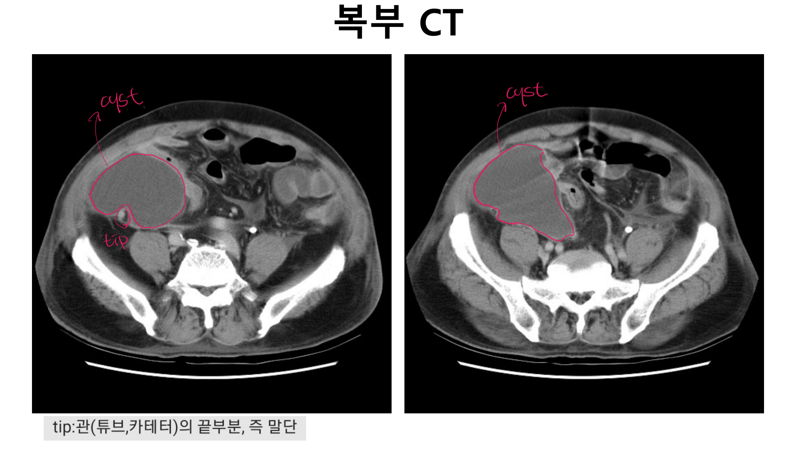{: style="width:72%"}

### VP 단락관이란

{: style="width:72%"}

- 단락관(shunt)은 **뇌실의 뇌척수액(CSF)을 복강으로 보내 복막에서 흡수**되게 하는 관이다. 필기(분홍): "지주막하출혈(SAH)이 생기면 핏덩이가 뇌실 출구를 막아 뇌가 물에 빠지는 수두증이 된다. 그래서 뇌실의 CSF를 복막(peritoneum)으로 빼는 길을 만드는 것이 VP shunt(ventriculoperitoneal shunt)."
- 뇌실 쪽 끝(근위부)과 복강 쪽 끝(원위부·말단) 사이에 피부 밑으로 관이 지나가고, 머리 쪽에 **저장소(reservoir)**가 있어 여기서 CSF를 뽑을 수 있다.

## ① 영상 — CSF 가성낭종

- 우하복부에 경계가 뚜렷한 **큰 피막성 액체 저류**, 그 안쪽 벽의 작은 고음영 점이 **단락관 말단**이다.
- 감염·염증이나 복막 흡수 장애가 생기면 단락 말단 주변에 CSF가 국한되어 **복강 내 가성낭종(pseudocyst)**이 생긴다. **발열 + 국소 압통 → 감염성 가성낭종**. 벽 조영증강이 있으면 말단 감염·복막 농양도 감별.

## ② 검체·처치·원인균

- **검체**: 항생제 전에 신경외과가 **단락관 저장소를 무균 천자**해 CSF 배양. **요추천자 검체로는 단락 감염을 놓칠 수 있고**, CSF 배양이 음성이어도 말단(복강 쪽) 감염은 가능하다. 초음파 유도 가성낭종 흡인액, 제거한 단락관·카테터 배양, 균혈증이 의심되면 말초 혈액배양.
- **원인균**: **CoNS(특히 *S. epidermidis*)**, ***S. aureus***, ***Cutibacterium acnes***, 그람음성 막대균(*E. coli*, *Klebsiella*, *P. aeruginosa*). 필기(회색): "이물질이 들어가니까 CoNS·*S. aureus*. *Cutibacterium*은 천천히 자라는 피부 오염균." → *C. acnes*가 의심되면 **배양을 10일 보존**하도록 검사실과 논의한다.
- **처치**: 감염되면 **생물막(biofilm)** 때문에 항생제 단독 치료가 어렵다 → **전체 단락 제거 + 임시 뇌실외배액(EVD)** → 항생제 치료 후 CSF 배양 음전·임상 호전을 보고 **재삽입**.

## ③ 혈뇨·단백뇨를 동반한 급성 신손상

| 원인 | 기전 | 확인할 것 |
|---|---|---|
| **단락관 신염(shunt nephritis)** | 만성 단락 감염 → **면역복합체가 사구체에 침착** | 요침사 이형적혈구·적혈구 원주, **C3/C4 저하**, 한랭글로불린. **VA 단락에서 흔하고 VP에서는 드물다** |
| 패혈증·신전성 | 혈관확장·저관류 → 허혈성 급성세뇨관괴사 | 활력징후, 소변량, FENa, 과립원주 |
| 약물·조영제 | **vancomycin** 등 신독성, 요오드 조영제 | 투약력, vancomycin 혈중농도 |
| 신후성 | 가성낭종이 요관을 압박 | CT·신장 초음파(수신증) |

- 감염을 조절해도 신기능 이상이 지속되거나 원인이 불명확하면 **신장생검** 고려.
- 손글씨 「**ARF 가능성☆**」 — 필기(회색): "이렇게 신기능에 문제가 있을 때 조영제를 써서 CT를 찍으면 **조영제 신독성**이 우려된다. 의사 선택의 문제 — 당시 creatinine 수치를 고려." 핵심요약의 ★: **조영 CT 전에 기저 Cr·신기능과 검사 이득을 따지고, vancomycin 같은 신독성 약물·조영제 노출도 확인**.

## 교수님 정리 — VP 단락관 감염

- **빈도 4~17%**, 대부분 **수술 후 수개월 이내**. 경로는 **수술 중 피부균 오염**이 가장 흔하고, 장천공·복막염으로 말단이 감염되기도 한다.
- 증상: 발열·두통·의식변화, 복통·**가성낭종**. 증상이 경미할 수 있고, 원위부(복강 쪽) 감염은 복부 증상으로 온다.
- 진단: 저장소 천자 CSF 배양. **정상 CSF도 감염을 배제하지 못한다**.

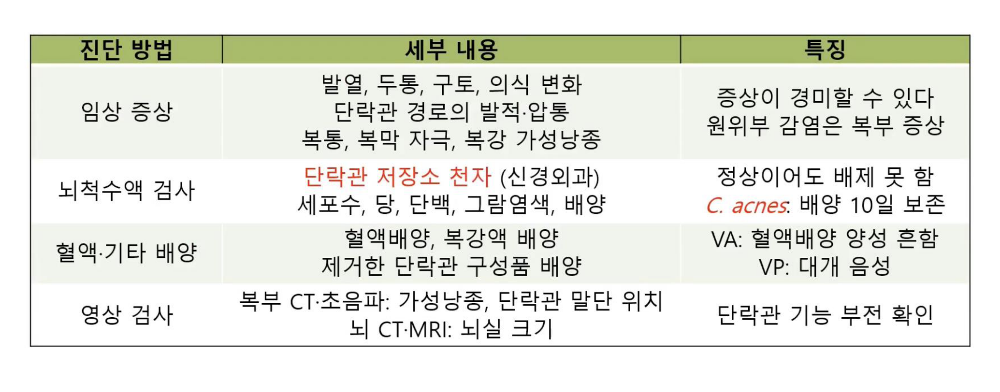{: style="width:78%"}

| 진단 방법 | 내용 | 특징 |
|---|---|---|
| 임상 증상 | 발열·두통·구토·의식변화, 단락관 경로의 발적·압통, 복통·복막자극·복강 가성낭종 | 증상이 경미할 수 있다. 원위부 감염은 복부 증상 |
| 뇌척수액 | **단락관 저장소 천자**(신경외과): 세포수·당·단백·그람염색·배양 | 정상이어도 배제 못 함, ***C. acnes* 배양 10일 보존** |
| 혈액·기타 배양 | 혈액배양, 복강액, 제거한 단락관 구성품 | **VA 단락: 혈액배양 양성 흔함, VP: 대개 음성** |
| 영상 | 복부 CT·초음파(가성낭종, 말단 위치), 뇌 CT·MRI(뇌실 크기) | 단락관 기능부전 확인 |

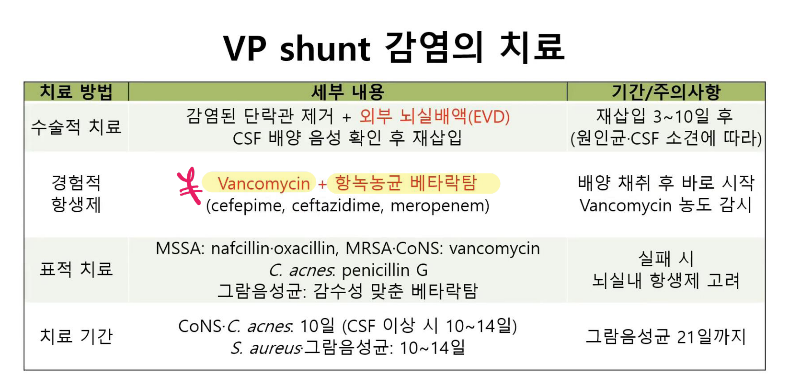{: style="width:78%"}

| 치료 | 내용 | 기간·주의 |
|---|---|---|
| 수술 | 감염된 단락관 제거 + **외부 뇌실배액(EVD)**, CSF 배양 음성 확인 후 재삽입 | 재삽입은 **3~10일 후**(원인균·CSF 소견에 따라) |
| **경험적 항생제**☆ | **vancomycin + 항녹농균 β-lactam**(cefepime, ceftazidime, meropenem) | 배양 채취 후 바로 시작, vancomycin 농도 감시 |
| 표적 | MSSA nafcillin·oxacillin, MRSA·CoNS vancomycin, *C. acnes* penicillin G, 그람음성은 감수성 맞춘 β-lactam | 실패하면 뇌실 내 항생제 고려 |
| 기간 | CoNS·*C. acnes* **10일**(CSF 이상 시 10~14일), *S. aureus*·그람음성 **10~14일** | 그람음성은 21일까지 |

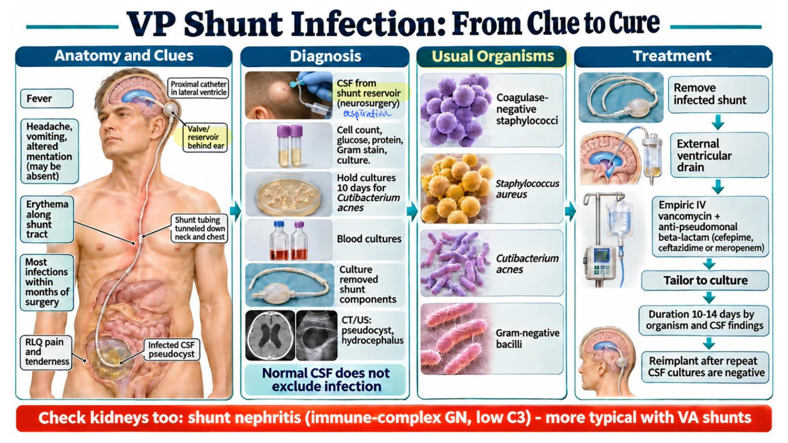{: style="width:80%"}

### 배양은 「확률」이다 (교수님 말씀, 회색)

"균을 키우면 양성이 나온다고 생각하는데 확률 문제다." 감염별 배양 양성률:

| 감염 | 배양 양성률 |
|---|---|
| 감염성 심내막염(혈액배양) | 약 90% |
| 패혈쇼크(혈액배양) | 절반 정도 |
| 폐구균 폐렴(균 증명) | 약 30% |
| 결핵성 뇌수막염 | 10% 미만 |
| 연조직염(흡인 배양) | 5% 미만 |

→ 그래서 **교과서에서 배운 흔한 균을 먼저 생각해 경험적으로 겨냥**하고, 배양은 함께 하되 결과만 기다리지 않는다.

!!! exam "기출 포인트"
    - **3강 2부 1번**(2025): VP shunt 1년 후 우하복부 통증·발열 + 단백뇨·혈뇨·Cr 1.8, shunt 끝 주변 농양 → **감염 후 사구체신염(PIGN) = shunt 신염**. 신우신염·IgA 신병증이 함정.
    - **3강 2부 7번**(2024): VP shunt 감염 치료 = **shunt 제거 + 항생제**("항생제만"은 오답).
    - 필기본에 실린 2022년 기출: 뇌실 단락 환자의 CSF 백혈구 1,200 → 경험적 항생제로 **ampicillin + ceftazidime + vancomycin** 조합을 골랐다(올해 교수님 표는 vancomycin + 항녹농균 β-lactam).

# 2. 증례 12 — 일차성 림프부종과 재발성 연조직염

!!! new "올해 필기에서 추가"
    작년 CP-A1 Case 2였던 증례. 이 증례로 분류된 기출은 아직 없다(3강 학습자료 12단원에 작년 말씀).

> 16세 여자. **어릴 때부터 왼팔 전체가 오른팔보다 굵었다.** 최근 약 1년간 왼손 감염이 반복되어 지난해 **세 차례 항생제 주사**. 37.8℃.

{: style="width:55%"}

## ① 진단

- 기저질환: **선천성 일차성 림프부종** — 어린 시절부터 지속된 한쪽 팔 부종, 손가락 침범, 피부 비후·만성 피부 변화가 근거.
- 기전: 림프관 형성 이상·기능 장애로 림프액이 조직에 쌓이면 **배액과 국소 면역 방어가 떨어져** 피부·연부조직 감염이 반복된다.
- 급성 감염: **재발성 봉와직염**(손글씨: 봉와직염 = **연조직염**). 표적은 **β-용혈 연쇄상구균**, 임상 양상에 따라 *S. aureus*도.
- 다른 가능성: 감염 없는 시기의 부종 정도를 확인. 비전형 경과면 정맥폐쇄·혈관·림프관 기형, 급성 관절통이 두드러지면 관절 감염.
- 필기(회색): "일차성 림프부종 치료는 도수치료, 스타킹 등 여러 가지. 림프부종은 **발(하지)**에 많고 손은 드물다. 혈관 anomaly가 동반되기도, 림프 anomaly만 있기도 하다."

## ② 급성기 치료와 입원 판단

- 경증·전신증상 없음: **경구 cephalexin, amoxicillin/clavulanate** 또는 항포도알균 페니실린. 중등도·전신증상: **IV cefazolin** 등.
- 기간: 일반 경증 봉와직염은 **5일**, 반응에 따라 연장. 림프부종을 동반하면 BLS 2025 기준 총 14일(학생 조 자료).
- 보조: 환측 팔 거상, 휴식, 진통·소염. **농양은 절개·배농**(+배양, MRSA 위험에 따라 항생제).
- **입원·정맥 치료**: SIRS·패혈증 소견(고열/저체온, 오한, 빈맥, 빈호흡, 저혈압, 의식변화), 빠르게 퍼지는 홍반·부종, 출혈성 수포, 심한 통증, 피부 괴사·심부 감염·**괴사성 근막염 의심**, 경구 치료 48시간 무반응·악화, 복용 불가, 탈수, 면역저하.

## ③ 부종 관리와 재발 예방

- 급성 염증이 가라앉으면 **복합 림프부종 치료(CDT)**: 압박붕대·스타킹·소매·장갑, 도수 림프배액, 규칙적 운동, 피부 관리.
- 손가락 사이 청결·보습, **무좀·습진 등 침입 경로 치료**, 환측 팔 채혈·주사 피하기.
- **예방적 항생제**: 위험요인을 관리해도 반복되면 — **IDSA 2014: 연 3~4회 재발**(BLS/LSN 2025는 연 2회 이상). 지난해 정맥 항생제 3회 → 적극 검토 대상. 소아·청소년은 개별화.
- 필기(회색): "치료가 어렵다. 잠깐 좋아졌다가 다시 악화된다. 림프부종은 **늘어난 빤스(고무줄)**에 비유 — 더 늘어날 순 있어도 다시 줄어들지 않는다. 탄력을 잃었다. 스타킹은 답답해서 못 신는다. 재발성 감염에 해당하고 예방요법이 필요하다."

## 교수님 정리 — 재발성 연조직염

- **원인균**: 주로 **β-용혈 연쇄구균(A·C·G군)**, 다음이 *S. aureus*. 필기(분홍): 슬라이드의 「Group B」를 손글씨로 **A, C, G**로 고쳐 쓰고 "**베타 hemolytic streptococcus를 타겟팅**합니다."
- 위험인자: **림프부종**, 피부 균열, 무좀, 비만, 정맥부전.
- 일차성 림프부종: 출생~청소년기 발병(**Milroy, Meige 질환**).
- 증상: 경계가 불분명한 홍반·열감·부종, 림프관염, 발열.
- 진단: **임상 진단**, 혈액배양은 전신 독성·면역저하 때만.
- 필기(회색): "*Streptococcus*와 *Staphylococcus*의 차이 — 연쇄구균은 **diffuse**하게 퍼지고, 포도알균은 **고름이 잡힌다**. 대부분 피부 cellulitis는 *S. pyogenes*."

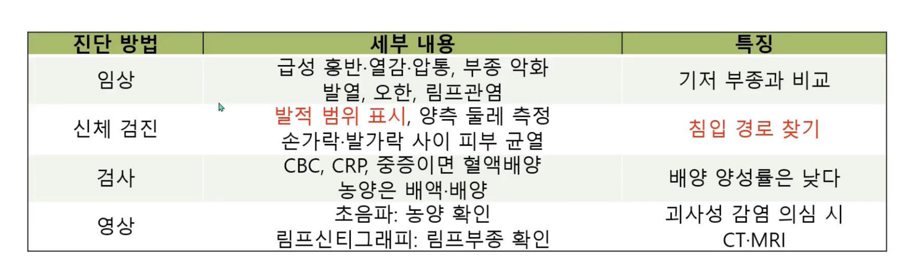{: style="width:78%"}

| 진단 | 내용 | 특징 |
|---|---|---|
| 임상 | 급성 홍반·열감·압통, 부종 악화, 발열·오한, 림프관염 | 기저 부종과 비교 |
| 신체검진 | **발적 범위 표시**, 양측 둘레 측정, 손가락·발가락 사이 피부 균열 | **침입 경로 찾기** |
| 검사 | CBC, CRP, 중증이면 혈액배양, 농양은 배액·배양 | **배양 양성률은 낮다** |
| 영상 | 초음파(농양), 림프신티그래피(림프부종 확인) | 괴사성 감염 의심 시 CT·MRI |

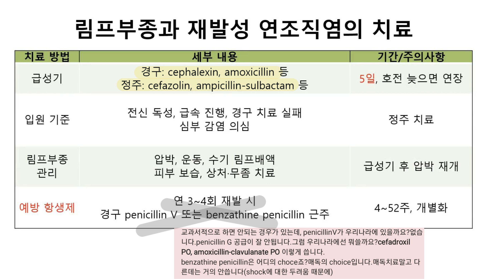{: style="width:78%"}

| 치료 | 내용 | 기간·주의 |
|---|---|---|
| 급성기 | 경구 **cephalexin, amoxicillin** / 정주 **cefazolin, ampicillin-sulbactam** | **5일**, 호전 늦으면 연장 |
| 입원 기준 | 전신 독성, 급속 진행, 경구 치료 실패, 심부 감염 의심 | 정주 치료 |
| 림프부종 관리 | 압박, 운동, 수기 림프배액, 피부 보습, 상처·무좀 치료 | 급성기 후 압박 재개 |
| 예방 항생제 | 연 3~4회 재발 시 (교과서) 경구 penicillin V 또는 benzathine penicillin 근주 | 4~52주, 개별화 |

!!! diff "교과서와 우리나라 현실 (교수님, 분홍)"
    "교과서적으로 하면 안 되는 경우가 있다. **penicillin V가 우리나라에 없다.** penicillin G도 공급이 잘 안 된다. 그럼 우리나라에서는? **cefadroxil PO, amoxicillin-clavulanate PO** 이렇게 쓴다. **benzathine penicillin은 매독의 choice** — 매독 치료 말고 다른 데는 거의 안 쓴다(shock에 대한 두려움 때문에)." → 표의 예방 항생제 줄에 선배가 X를 그었다.

{: style="width:80%"}

!!! memo "암기"
    재발성 연조직염 = **β-용혈 연쇄구균(A·C·G)** → β-lactam **5일**. 예방 항생제는 **연 3~4회 재발**(IDSA). 우리나라는 penicillin V 대신 **cefadroxil·amoxicillin-clavulanate**.

# 3. 증례 13 — 복부·골반 방선균증

!!! new "올해 필기에서 추가"
    작년 CP-A1 Case 3. 기출이 가장 많이 나온 증례 중 하나 — **3강 2부 2·5·14·21·22번**(5문항, 전부 penicillin 계열이 정답).

> 58세 여자. **2개월간 오른쪽 복부 불편감.** 젊을 때부터 **자궁 내 피임기구(IUD)** 사용. 뚜렷한 체중감소·결핵 과거력 없음. 37.6℃.

{: style="width:70%"}

{: style="width:62%"}

교수님(분홍): "**IUD가 있고 mass가 있고 IUD가 오래됐고 → 90% 정도는 pelvic actinomycosis**겠구나 이렇게 머리에 생각하고 TB, malignancy를 감별할게. 근데 산부인과 의사들은 malignancy를 워낙 많이 봐서 이런 상황에서 malignancy를 먼저 생각하더라. 이 환자는 **수술을 거부**했다. 암이라면 벌써 다 번졌을 텐데… 그럼 **페니실린 계통 주사를 2주 맞고 PO로 먹어 봅시다** 해서 쭉 갔더니 확 좋아졌다!"

## ① 진단과 감별

- 장기 IUD + 아급성 경과 + **조직 경계를 넘어 침윤하는 종괴** → **복부·골반 방선균증**. 골반 감염이 인접 복강으로 퍼진 것.
- 감별: **대장암·난소암 등 악성종양**(침윤성 종괴를 모방 → 조직에서 악성세포 확인), **복부·골반·복막 결핵**, 복강 내 농양·복잡성 장질환(충수·대장·소장).
- **IUD 배양이나 자궁경부 Pap 검사에서만 균이 나오면** 무증상 집락일 수 있다 — 그것만으로 침습성 감염을 확정하기 어렵다.

## ② 검사와 영상 호전의 의미

- 영상 유도 생검 또는 수술·배액으로 **깊은 조직·농양 검체**.
- H&E: 화농성·섬유화 염증과 **유황과립(sulfur granule)**, Gram 염색: **분지하는 사상형 그람양성균**. 병리에서 종양도 함께 평가.
- 방선균은 **혐기 조건·장기 배양(2~3주 보존)**이 필요하므로 채취 단계부터 **검사실에 알린다**. 배양 음성이면 조직 결과·분자검사를 종합.
- 결핵 감별: 조직 AFB 염색, 결핵 PCR·배양.
- **항생제 후 영상 호전 = 감염성·염증성 병변을 지지하는 보조 근거**일 뿐, 원인균을 확정하지는 못한다 → 잔존 병변·재발 확인.

## ③ 치료와 IUD 제거

- 침습 감염이 확인되거나 강하게 의심되면 **IUD 제거**를 부인과와 협의 — 감염된 이물 표면의 **생물막**이 항생제·면역세포 침투를 막아 지속·재발의 원인이 된다.
- 섬유화된 심부 병변에 닿도록 **고용량 정맥 penicillin G(또는 ampicillin) 2~6주 → 경구 amoxicillin**, 총 **6~12개월**(또는 그 이상). 큰 농양·폐쇄·누공은 배액·수술.

## 교수님 정리 — 방선균증

- 원인균: ***Actinomyces israelii*** 등 **혐기성 그람양성 분지 막대균**.
- 위험인자: **장기 IUD**, 복부 수술, 충수염, 장 천공. 필기(회색): "피임을 많이 하던 시절 IUD를 넣었는데, 문제는 **피임 기간이 끝나면 빼야 하는데 그대로 갖고 있는 경우**. 그러면 pelvic actinomycosis 위험이 생긴다. 자궁에서 시작해 골반, **대장을 먹어 버린다** — 인공항문(colostomy)을 해야 하는 경우도 있다."
- 특징: **조직 경계를 넘는 침윤성 종괴, 누공, 동관(sinus tract)**. 악성종양·결핵·염증성 장질환으로 **오진이 흔하다**(The Great Mimicker).

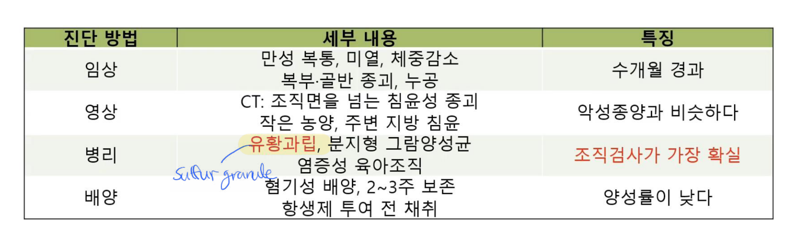{: style="width:78%"}

| 진단 | 내용 | 특징 |
|---|---|---|
| 임상 | 만성 복통, 미열, 체중감소, 복부·골반 종괴, 누공 | 수개월 경과 |
| 영상 | CT: 조직면을 넘는 침윤성 종괴, 작은 농양, 주변 지방 침윤 | 악성종양과 비슷하다 |
| 병리 | **유황과립**, 분지형 그람양성균, 염증성 육아조직 | **조직검사가 가장 확실** |
| 배양 | 혐기성 배양, **2~3주 보존**, 항생제 투여 전 채취 | 양성률이 낮다 |

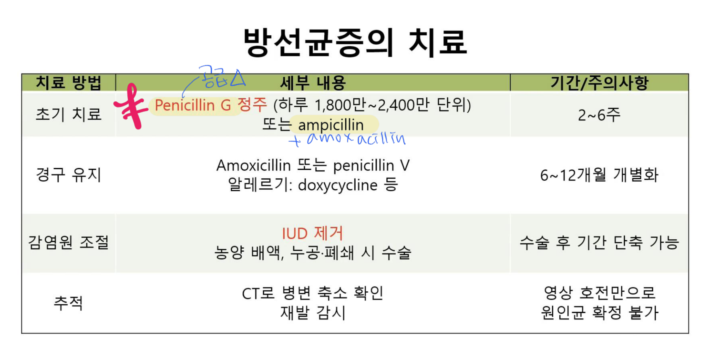{: style="width:78%"}

| 치료 | 내용 | 기간·주의 |
|---|---|---|
| 초기☆ | **penicillin G 정주(하루 1,800만~2,400만 단위)** 또는 ampicillin | **2~6주** |
| 경구 유지 | **amoxicillin** 또는 penicillin V, 알레르기면 doxycycline | **6~12개월**, 개별화 |
| 감염원 조절 | **IUD 제거**, 농양 배액, 누공·폐쇄 시 수술 | 수술 후 기간 단축 가능 |
| 추적 | CT로 병변 축소 확인, 재발 감시 | 영상 호전만으로 원인균 확정 불가 |

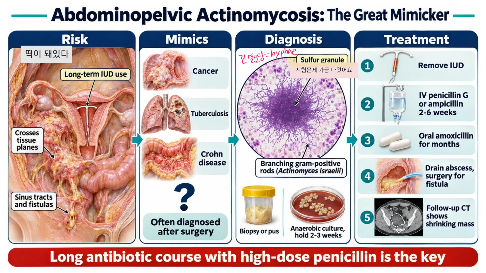{: style="width:80%"}

!!! exam "기출 포인트 (3강 2부)"
    - **2번**(2025): IUD + 골반 농양 + 현미경 사진(유황과립) → **penicillin 계 정주 2~6주 후 경구 amoxicillin 6~12개월**. Clindamycin 2주·metronidazole·ertapenem·ciprofloxacin이 함정.
    - **5번**(2024): 1차 약 = **penicillin G 또는 ampicillin**. **Metronidazole은 혐기균 약이지만 방선균에 듣지 않는다** — 가장 흔한 함정.
    - **14번**(2022): IUD 주변 종괴 → **ampicillin**. **21번**: 치료 전후 CT → 주로 쓴 약 **amoxicillin**. **22번**(2020): **ampicillin/sulbactam**(HPV 양성은 함정).

# 4. 증례 14 — 독성쇼크증후군(TSS)

!!! new "올해 필기에서 추가"
    작년 CP-A1 Case 6. 관련 기출 **3강 2부 10번**(기전 = 초항원). 필기본에 2024년 기출(가장 특징적 피부 소견 = **미만성 반점 홍피증**)도 붙어 있다.

> 50세 남자. 3일 전부터 발열·오심·구토·설사, **의식 변화**로 내원. **저혈압**, 38.1℃. AST/ALT 65/80, BUN/Cr 39/2.1. **혈액·소변배양 음성**.

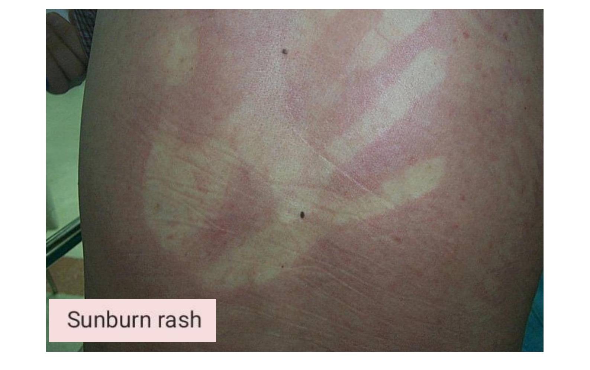{: style="width:55%"}

{: style="width:55%"}

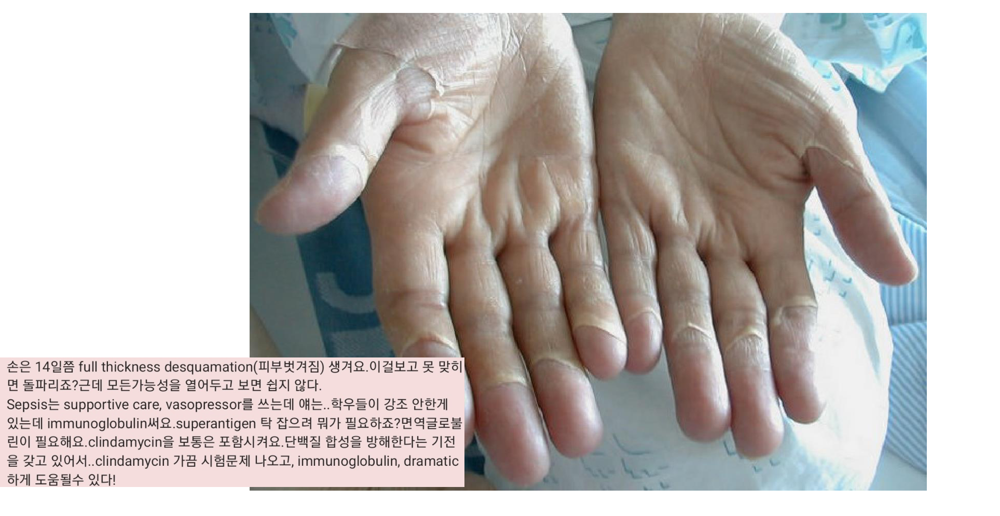{: style="width:62%"}

교수님(분홍): "손은 **14일쯤 full thickness desquamation**(피부 벗겨짐)이 생긴다. 이걸 보고 못 맞히면 돌팔이죠? 근데 모든 가능성을 열어 두고 보면 쉽지 않다. 패혈증은 supportive care, vasopressor를 쓰는데 얘는 — 학우들이 강조 안 했는데 — **immunoglobulin을 써요.** superantigen을 잡으려면 면역글로불린이 필요하다. **clindamycin을 보통 포함시켜요. 단백질 합성을 방해한다는 기전** 때문에. **clindamycin 가끔 시험문제 나오고**, immunoglobulin은 dramatic하게 도움이 될 수 있다!"

## ① 증후군 — 독성쇼크증후군

- 저혈압성 쇼크 + 발진 후 **1~2주 사이의 탈설** + 위장관·신장·중추신경계 등 **다장기 침범** → **TSS**, 임상적으로 **황색포도알균 TSS**가 가장 의심.
- CDC 감시기준: 발열(≥38.9℃), 저혈압, 미만성 홍반, **14일째 손바닥 박리**, **3개 이상 장기계 침범**. 이 증례의 38.1℃는 발열 기준 미만이고 혈압 수치·장기계 수가 다 제시되지 않아 「감시기준상 확진」은 유보 — 그래도 **임상적으로 TSS로 치료**한다.

## ② 원인균·독소·배양 음성의 의미

- **초항원(superantigen)**☆: *S. aureus*의 **TSST-1**·일부 장독소, *S. pyogenes*의 **발열성 외독소(SpeA 등)**가 **MHC II와 T세포 수용체를 비특이적으로 연결** → T세포 과활성화 → **사이토카인 폭발** → 전신 염증, 혈관확장, 쇼크, 다장기 손상.

| | 포도알균 TSS | 연쇄구균 TSS (침습성 A군) |
|---|---|---|
| 감염원 | 생리용품(탐폰), 상처, 수술 부위, 이물 — **상처가 없을 수 있다** | 깊은 피부·연부조직·근막 감염 — **상처가 있다** |
| 혈액배양 | **음성이 흔하다**(국소 병소의 독소만 혈류로) | **양성이 더 흔하다** |
| 피부 | 넓은 발진, 후기 손발바닥 박리 뚜렷 | 발진·박리 덜 뚜렷, **괴사성 근막염** 동반 |

- 교수님(분홍, ☆): "**wound가 있으면 streptococcal toxic shock, wound가 없으면 staphylococcus shock**일 경우가 다분히 많죠. 젊은 여자가 sunburn rash, 얼굴에 desquamation이 생겼다 — 그럼 뭘 봐야 할까요? **hyperabsorbent 탐폰**, vaginal colonization(질내 집락화) — 질 점막에서 toxin을 흡수해서 shock이 오는 거예요. 이게 제일 처음 알려진 **릴라이(Rely) 탐폰 사건**."
- 검체: 치료 전 혈액배양 재확인, 창상·농양·수술 부위·이물 검체, 괴사성 감염이 의심되면 깊은 조직. 혈구·혈소판, 신장·간기능, 응고, 젖산, CK로 장기 손상 평가.

## ③ 소생술 → 감염원 조절 → 항균 치료

- 기도·호흡·산소화·의식·혈압 즉시 평가 → 정질액 소생, 저혈압이 지속되면 승압제(중환자 치료).
- 항균제 전 배양을 채취하되 **배양·감염원 확인 때문에 쇼크 처치를 지연하지 않는다**(SSC 원칙: 소생 시작과 동시에 경험적 항균제와 감염원 조절).
- **감염원 조절**: 상처, 수술 부위, 삽입물, 심부 연조직 감염. 교수님(분홍): "**wound가 있으면 wound를 제거해라. 탐폰이 있으면 탐폰을 빼 줘라.**" 괴사성 감염이 의심되면 즉시 외과 탐색·절제(영상 때문에 지연하지 않는다).
- **항균**: 초기에는 MRSA와 연쇄구균을 포함(**vancomycin + 광범위 β-lactam + clindamycin**), **A군 연쇄구균 확정 시 penicillin + clindamycin**. **clindamycin = 단백질 합성 억제 → 독소 생성 억제**.

{: style="width:78%"}

| 진단 | 내용 | 특징 |
|---|---|---|
| 임상 기준 | 발열, 저혈압, 미만성 홍반, **3개 이상 장기 침범** | CDC 진단 기준 |
| 피부☆ | 초기: **미만성 홍반, 점막 충혈** / 1~2주 뒤: **손발바닥 박리** | 박리는 회복기 |
| 검사 | 혈액·상처·질 배양, creatinine, 간기능, 혈소판, CK | **포도알균은 혈액배양 음성이 흔하다** |
| 감염원 탐색 | 생리용품, 수술 상처, 화상, 연조직 괴사(소견보다 심한 통증) | 괴사성 감염 배제 |

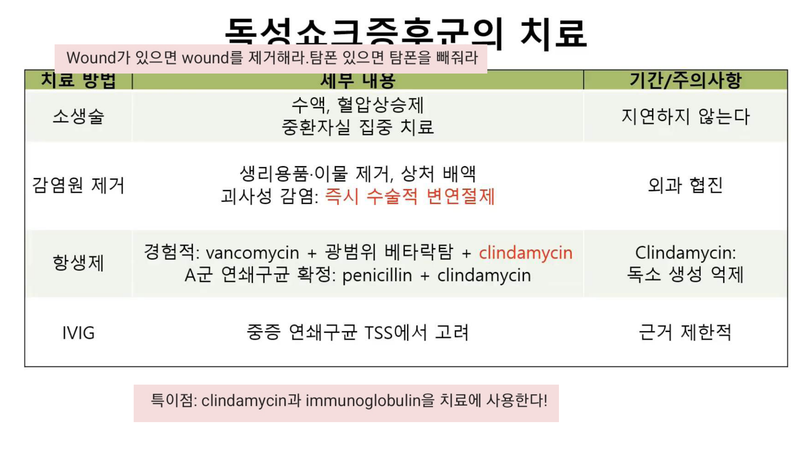{: style="width:78%"}

| 치료 | 내용 | 기간·주의 |
|---|---|---|
| 소생술 | 수액, 혈압상승제, 중환자실 집중 치료 | **지연하지 않는다** |
| 감염원 제거 | 생리용품·이물 제거, 상처 배액, 괴사성 감염은 **즉시 수술적 변연절제** | 외과 협진 |
| 항생제 | 경험적: vancomycin + 광범위 β-lactam + **clindamycin** / A군 확정: **penicillin + clindamycin** | clindamycin: **독소 생성 억제** |
| IVIG | 중증 연쇄구균 TSS에서 고려 | 근거 제한적 |

{: style="width:80%"}

!!! exam "기출 포인트"
    - **3강 2부 10번**(2023): 이 증례 그대로(구토·설사·저혈압·간신기능 상승·배양 음성, 2주 뒤 손바닥 사진) → 기전 = **초항원(superantigen)**. 내독소(endotoxin)·사이토카인 폭풍·IL-6가 함정(사이토카인 폭풍은 결과이지 원인 독소가 아니다).
    - 필기본 수록 2024년 기출: TSS의 가장 특징적 피부 소견 = **미만성 반점 홍피증(diffuse macular erythroderma)** — 수포·점상·괴사·자반이 아니다.
    - 교수님: **clindamycin은 가끔 시험에 나온다**(단백질 합성 억제 → 독소 억제).

# 5. 증례 15 — 수족구병

!!! new "올해 필기에서 추가"
    작년 CP-A1 Case 8. 기출 **3강 2부 8번(수분 공급)·16번(신경계 합병증)·19번(콕사키바이러스)**. 필기(분홍): "수족구병. 아이가 많지만 **청소년기에도** 옵니다."

> 15세 남자. 2일 전부터 **입안 병변과 통증**, 발열·전신 쇠약. **7일 전 같은 반에서 비슷한 증상의 학생**을 보았다. 38.8℃.

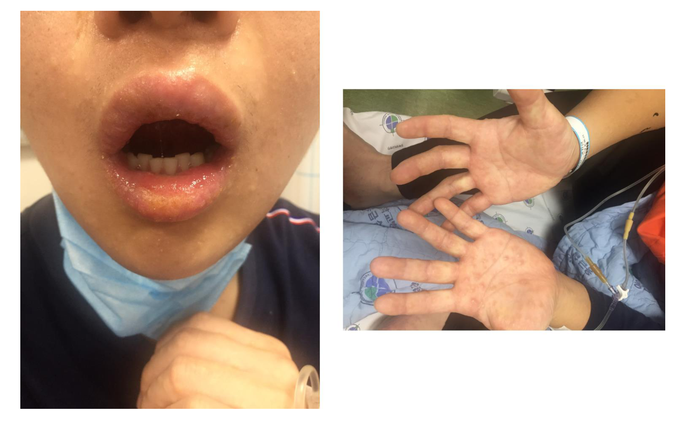{: style="width:62%"}

{: style="width:52%"}

## ① 진단과 감별

- 발열 + 통증성 구강 수포·궤양 + 손바닥 수포 + 교실 접촉력·**3~7일 잠복기**(노출 후 약 5일) → **수족구병**. 원인은 *Picornaviridae*의 **엔테로바이러스**: 흔히 **Coxsackievirus A16**, 그 외 **A6·A10·EV-A71**.
- 주로 **5세 미만**이지만 청소년·성인도 걸린다. **입 주위 침범과 뚜렷한 전신증상은 Coxsackievirus A6의 비전형 양상**. 회복기에 손발 탈피·손발톱 탈락이 생길 수 있다.

| 감별 | 구별점 |
|---|---|
| **헤르판지나** | 같은 엔테로바이러스지만 **구강 뒤쪽**(연구개·편도) 수포·궤양, 손발 병변은 전형적이지 않다 |
| HSV-1 치은구내염 | **잇몸 부종·출혈**, 구강 앞쪽·입술 주위 **군집 수포**. 손끝 herpetic whitlow는 가능 |
| 수두 | 두피·몸통 중심의 **소양성** 병변, 구진·수포·딱지 여러 단계 공존, 손발바닥은 드물다 |
| 다형홍반·SJS | 손발바닥 **표적 병변**, 구강·입술 미란·결막 침범, **약물 노출** |
| 2기 매독 | 손발바닥 구릿빛 인설성 구진, **수포 없음**, 학급 내 집단발생과 맞지 않음 |
| 가와사키병 | 5세 미만, 5일 이상 발열, 입술 홍조·균열, 딸기혀, 결막충혈, **수포 없음** |
| 엠폭스 | 손발바닥 침범 가능, 비슷한 크기·단계의 **깊은 농포**, 림프절 비대, 밀접·성접촉 |

## ② 검사와 입원 판단

- **전형적인 경증이면 임상 진단으로 충분**. 교수님(분홍): "임상적으로 진단한다 = **문맥을 읽고 각각의 가능한 원인균에 대해 몇 %의 가능성이 있는지 판단**하는 것."
- 비전형 발진, 집단유행 역학조사, 중증이면 인후도말·수포 검체·대변 **엔테로바이러스 RT-PCR**(보건당국·검사실과 협의).
- **EV-A71** → **뇌간뇌염**, 무균성 수막염, 급성 이완성 마비, **신경원성 폐부종**. 교수님(분홍, ☆): "가끔 **encephalitis(뇌염)**를 일으켜요."
- 추가 검사·입원: 수분 섭취 불가·소변량 감소(**탈수**), 지속 고열·심한 무기력·반복 구토, 심한 두통·목 경직·의식 변화·경련·**근간대 경련**, 빈맥·호흡 이상.

## ③ 대증 치료와 전파 예방

- 해열·진통: **acetaminophen 또는 ibuprofen**. **소아·청소년에게 aspirin 금지**(Reye 증후군).
- **수분 공급**☆: 물·경구수분보충액을 **소량씩 자주**, 섭취량·**소변량**·점막 건조 평가, 탈수면 수액. 차갑고 부드러운 음식, 맵거나 산성인 음식은 피함.
- 대부분 **7~10일 내 호전**. 특이 항바이러스제 없이 대증 치료가 중심, **항생제는 세균성 동반감염이 있을 때만**.
- 전파: **호흡기 분비물·수포액·대변-경구**. 손 씻기(화장실 후·식전), 컵·수저·수건 공유 금지, 표면 소독(염소), 기침 예절. 국내는 **증상이 회복될 때까지 등교·등원 자제**(질병관리청). 호전돼도 **대변으로 수주간 배출** → 손 위생 지속.

!!! memo "Reye 증후군 (필기 회색 메모)"
    소아·청소년의 바이러스 감염(대표: **인플루엔자·수두**) 중 aspirin을 먹으면 생기는 **급성 뇌병증 + 간 지방변성**. aspirin이 미토콘드리아 기능을 방해하는 것으로 생각된다. 그래서 해열제는 **acetaminophen**을 쓴다.

{: style="width:78%"}

| 진단 | 내용 | 특징 |
|---|---|---|
| **임상 진단** | 발열, 구강 궤양, 손바닥·발바닥·엉덩이 수포·구진 | 전형적이면 검사 불필요 |
| 감별 | 헤르판지나(구강 뒤쪽), 단순포진 치은구내염, 수두 | 병변 분포로 구분 |
| 병원체 검사 | 인후·대변·수포액 엔테로바이러스 PCR — 중증·비전형·집단발생 | 보건당국과 협의 |
| 위험 징후 | 고열 지속, 구토, 근간대 경련, 의식 변화, 빈맥·호흡곤란 | ☆ **신경계 합병증 평가** |

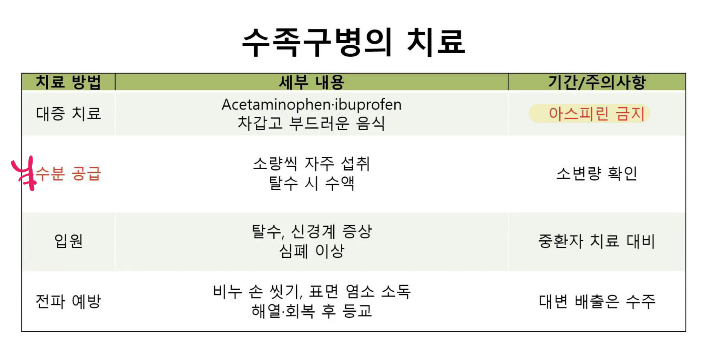{: style="width:78%"}

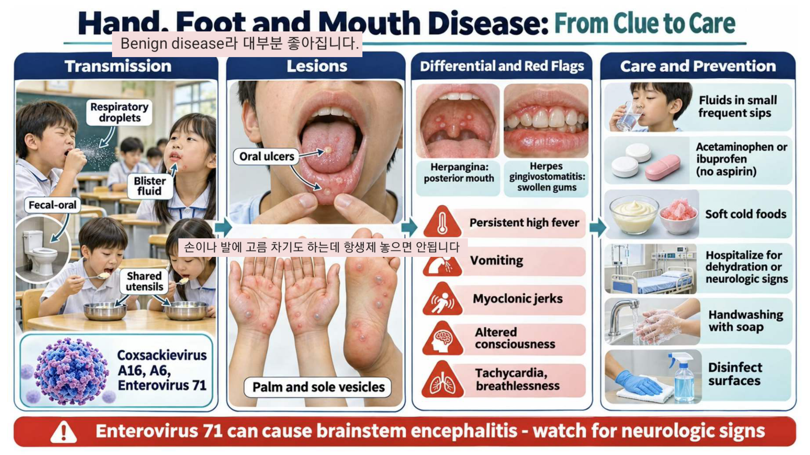{: style="width:80%"}

!!! exam "기출 포인트 (3강 2부)"
    - **8번**(2024): 수족구병 치료에서 가장 중요한 것 = **충분한 수분 공급**(항생제·스테로이드·항바이러스제·수술 아님).
    - **16번**(2022): 이 증례 그대로 → 드물지만 가장 위험한 합병증 = **신경계 침범(뇌염 등)**.
    - **19번**(2022): 흔한 원인체 = **Coxsackievirus**(Adenovirus·RSV 아님).
