<!-- 필기본: 2026 · 2025 -->
<!-- 단계: 수업 후 -->

# 0. 이 수업을 공부하는 법

**감염병학 증례토의 CP-2**(감염내과 **김신우 교수님**, 2026년). CP-A1(3강)에 이어 **증례 11~20**을 다룬다. 올해는 진행 방식이 바뀌어, 증례마다 질문 ①②③이 주어지고 → **학생 조가 답 슬라이드**(「증례 n / 문항 n 답」)를 발표한 뒤 → **교수님 슬라이드**(증례 해석, 총론, 진단 표, 치료 표, 한 장 그림 요약)로 정리하셨다.

필기한 선배의 표시 방법(필기본 1쪽):

- **분홍 상자** = 교수님 말씀(중요), **회색 상자** = 덜 중요한 말씀, **노란 형광** = 교수님이 언급하신 곳, **분홍 별표(☆·「대대로 야마」)** = 강조·기출.
- 필기본 2~4쪽과 증례마다 선배가 그 증례로 나온 **2022~2025년 기출**을 붙여 두었다.

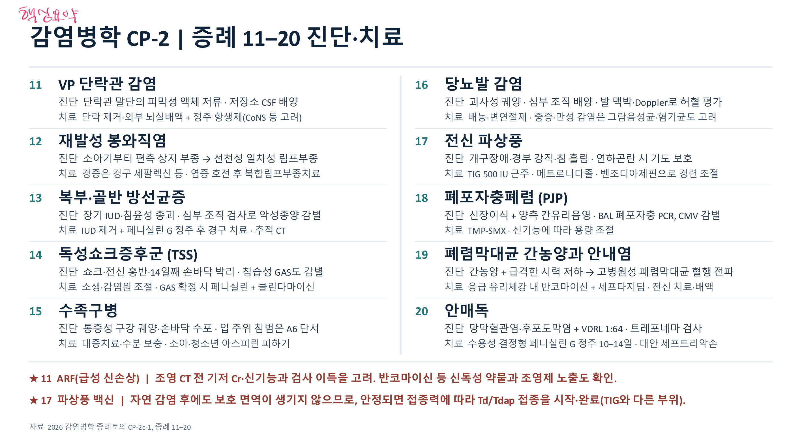{: style="width:78%"}

| 증례 | 환자 | 진단 | 치료 핵심 |
|---|---|---|---|
| 11 | 62세, VP shunt 1년, 우하복부 통증·열, Cr 1.8 | **VP 단락관 감염**(가성낭종) | 단락 제거 + 뇌실외배액(EVD) + 정주 항생제 |
| 12 | 16세, 어릴 때부터 왼팔이 굵음, 반복 감염 | **일차성 림프부종 + 재발성 연조직염** | 경구 cephalexin 등, 연 3~4회면 예방 항생제 |
| 13 | 58세, 오래 쓴 IUD, 오른쪽 복부 종괴 | **복부·골반 방선균증** | IUD 제거 + **penicillin G 정주 → 경구 amoxicillin** |
| 14 | 50세, 쇼크 + 일광화상 발진 → 14일째 손바닥 박리 | **독성쇼크증후군(TSS)** | 소생술·감염원 제거 + **clindamycin**(± 면역글로불린) |
| 15 | 15세, 입안 통증·손바닥 수포, 같은 반 학생 | **수족구병** | 대증 치료·**수분 공급**, 아스피린 금지 |
| 16 | 67세, 당뇨 방치, 6개월 된 발 궤양, 38.5℃·맥박 115 | **중증 당뇨발 감염** | 변연절제·배농 + 광범위 항생제 + 혈류 평가 |
| 17 | 69세, 바느질, 입이 안 벌어짐 | **전신 파상풍** | **TIG 500 IU** + **metronidazole** + benzodiazepine, 회복 후 백신 |
| 18 | 45세, 신장이식 2년, 호흡곤란 | **폐포자충폐렴(PJP)** | **TMP-SMX**, PaO2 < 70이면 스테로이드 |
| 19 | 63세, 눈을 부딪힌 뒤 실명, 38.6℃ | ***Klebsiella* 간농양 + 내인성 안내염** | 유리체 내 **vancomycin + ceftazidime**, ceftriaxone + 배액 |
| 20 | 41세, 망막혈관염 + VDRL 1:64 + 두통 | **안매독**(신경매독에 준함) | **수용성 penicillin G 정주 10~14일**, 대안 ceftriaxone |

!!! diff "작년 필기와 다른 점 — 증례 구성"
    - 작년 CP-2(Case 11~20)와 **겹치는 증례는 4개뿐**: 파상풍·폐포자충폐렴·*Klebsiella* 간농양/안내염·안매독(올해 17~20).
    - **올해 새로 들어온 증례**(11~16): VP 단락관 감염, 림프부종 연조직염, 방선균증, 독성쇼크증후군, 수족구병, 당뇨발. 작년에는 **CP-A1**에서 다룬 증례라 그 기출은 **3강(CP-A1)으로 분류**되어 있다 — 이 문서에서는 `exam` 상자로 「3강 2부 n번」이라고 연결한다. 작년 교수님 말씀은 3강 학습자료 11~20단원에도 있다.
    - **올해 빠진 작년 증례**: 좁쌀결핵, 관절결핵, 파종성 대상포진, 반복되는 종기(*S. aureus* 탈집락화), 화농성 척추염, COVID-19. 이 수업 2부 기출 23문항 중 **12문항이 이 증례들에서** 나왔으므로 지우지 않고 맨 뒤 **11단원**에 그대로 두었다(좁쌀결핵·대상포진·화농성 척추염은 올해 CP-A1에서 다룬다).

!!! key "핵심"
    - **이물(단락관·IUD·탐폰·상처)**이 있으면 → 생물막 때문에 항생제만으로는 안 낫는다 → **제거**가 치료의 절반.
    - **TSS**: 혈액배양 음성이어도 배제하지 않는다. 치료의 특이점은 **clindamycin과 면역글로불린**.
    - **방선균증·매독**은 penicillin, **파상풍**은 penicillin 대신 **metronidazole**, ***Klebsiella* 간농양**은 metronidazole 없이 **ceftriaxone 단독**.
    - **파상풍은 앓아도 면역이 생기지 않는다** → 회복 후 반드시 백신(「대대로 야마」).
    - **안매독 = 신경매독 치료**. CSF가 정상이어도 배제할 수 없다.

# 1. 증례 11 — VP 단락관 감염

!!! new "올해 필기에서 추가"
    올해 CP-2에 새로 들어온 증례다(작년엔 CP-A1 Case 1). 관련 기출은 **3강 2부 1번(shunt 신염)·7번(shunt 제거 + 항생제)**.

> 62세 남자. 뇌졸중 후 수두증으로 1년 전 **뇌실복강 단락술(VP shunt)**. 1주간 **우하복부 통증**, 같은 부위 압통, **38.5℃**. 혈청 creatinine **1.8 mg/dL**, 소변량 약 500 mL/일, 요검사에서 **혈뇨·단백뇨**.

질문: ① 복부 CT에서 액체 저류와 단락관 말단의 관계, 의심되는 합병증 ② 단락관 감염을 확인할 검체, 신경외과와 논의할 처치, 흔한 병원체 ③ 혈뇨·단백뇨를 동반한 급성 신손상의 감별

{: style="width:72%"}

### VP 단락관이란

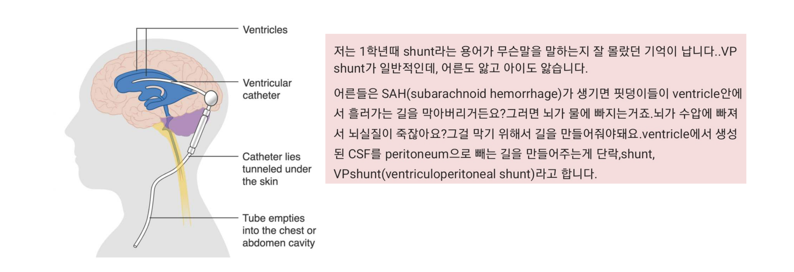{: style="width:72%"}

- 단락관(shunt)은 **뇌실의 뇌척수액(CSF)을 복강으로 보내 복막에서 흡수**되게 하는 관이다. 필기(분홍): "지주막하출혈(SAH)이 생기면 핏덩이가 뇌실 출구를 막아 뇌가 물에 빠지는 수두증이 된다. 그래서 뇌실의 CSF를 복막(peritoneum)으로 빼는 길을 만드는 것이 VP shunt(ventriculoperitoneal shunt)."
- 뇌실 쪽 끝(근위부)과 복강 쪽 끝(원위부·말단) 사이에 피부 밑으로 관이 지나가고, 머리 쪽에 **저장소(reservoir)**가 있어 여기서 CSF를 뽑을 수 있다.

## ① 영상 — CSF 가성낭종

- 우하복부에 경계가 뚜렷한 **큰 피막성 액체 저류**, 그 안쪽 벽의 작은 고음영 점이 **단락관 말단**이다.
- 감염·염증이나 복막 흡수 장애가 생기면 단락 말단 주변에 CSF가 국한되어 **복강 내 가성낭종(pseudocyst)**이 생긴다. **발열 + 국소 압통 → 감염성 가성낭종**. 벽 조영증강이 있으면 말단 감염·복막 농양도 감별.

## ② 검체·처치·원인균

- **검체**: 항생제 전에 신경외과가 **단락관 저장소를 무균 천자**해 CSF 배양. **요추천자 검체로는 단락 감염을 놓칠 수 있고**, CSF 배양이 음성이어도 말단(복강 쪽) 감염은 가능하다. 초음파 유도 가성낭종 흡인액, 제거한 단락관·카테터 배양, 균혈증이 의심되면 말초 혈액배양.
- **원인균**: **CoNS(특히 *S. epidermidis*)**, ***S. aureus***, ***Cutibacterium acnes***, 그람음성 막대균(*E. coli*, *Klebsiella*, *P. aeruginosa*). 필기(회색): "이물질이 들어가니까 CoNS·*S. aureus*. *Cutibacterium*은 천천히 자라는 피부 오염균." → *C. acnes*가 의심되면 **배양을 10일 보존**하도록 검사실과 논의한다.
- **처치**: 감염되면 **생물막(biofilm)** 때문에 항생제 단독 치료가 어렵다 → **전체 단락 제거 + 임시 뇌실외배액(EVD)** → 항생제 치료 후 CSF 배양 음전·임상 호전을 보고 **재삽입**.

## ③ 혈뇨·단백뇨를 동반한 급성 신손상

| 원인 | 기전 | 확인할 것 |
|---|---|---|
| **단락관 신염(shunt nephritis)** | 만성 단락 감염 → **면역복합체가 사구체에 침착** | 요침사 이형적혈구·적혈구 원주, **C3/C4 저하**, 한랭글로불린. **VA 단락에서 흔하고 VP에서는 드물다** |
| 패혈증·신전성 | 혈관확장·저관류 → 허혈성 급성세뇨관괴사 | 활력징후, 소변량, FENa, 과립원주 |
| 약물·조영제 | **vancomycin** 등 신독성, 요오드 조영제 | 투약력, vancomycin 혈중농도 |
| 신후성 | 가성낭종이 요관을 압박 | CT·신장 초음파(수신증) |

- 감염을 조절해도 신기능 이상이 지속되거나 원인이 불명확하면 **신장생검** 고려.
- 손글씨 「**ARF 가능성☆**」 — 필기(회색): "이렇게 신기능에 문제가 있을 때 조영제를 써서 CT를 찍으면 **조영제 신독성**이 우려된다. 의사 선택의 문제 — 당시 creatinine 수치를 고려." 핵심요약의 ★: **조영 CT 전에 기저 Cr·신기능과 검사 이득을 따지고, vancomycin 같은 신독성 약물·조영제 노출도 확인**.

## 교수님 정리 — VP 단락관 감염

- **빈도 4~17%**, 대부분 **수술 후 수개월 이내**. 경로는 **수술 중 피부균 오염**이 가장 흔하고, 장천공·복막염으로 말단이 감염되기도 한다.
- 증상: 발열·두통·의식변화, 복통·**가성낭종**. 증상이 경미할 수 있고, 원위부(복강 쪽) 감염은 복부 증상으로 온다.
- 진단: 저장소 천자 CSF 배양. **정상 CSF도 감염을 배제하지 못한다**.

{: style="width:78%"}

| 진단 방법 | 내용 | 특징 |
|---|---|---|
| 임상 증상 | 발열·두통·구토·의식변화, 단락관 경로의 발적·압통, 복통·복막자극·복강 가성낭종 | 증상이 경미할 수 있다. 원위부 감염은 복부 증상 |
| 뇌척수액 | **단락관 저장소 천자**(신경외과): 세포수·당·단백·그람염색·배양 | 정상이어도 배제 못 함, ***C. acnes* 배양 10일 보존** |
| 혈액·기타 배양 | 혈액배양, 복강액, 제거한 단락관 구성품 | **VA 단락: 혈액배양 양성 흔함, VP: 대개 음성** |
| 영상 | 복부 CT·초음파(가성낭종, 말단 위치), 뇌 CT·MRI(뇌실 크기) | 단락관 기능부전 확인 |

{: style="width:78%"}

| 치료 | 내용 | 기간·주의 |
|---|---|---|
| 수술 | 감염된 단락관 제거 + **외부 뇌실배액(EVD)**, CSF 배양 음성 확인 후 재삽입 | 재삽입은 **3~10일 후**(원인균·CSF 소견에 따라) |
| **경험적 항생제**☆ | **vancomycin + 항녹농균 β-lactam**(cefepime, ceftazidime, meropenem) | 배양 채취 후 바로 시작, vancomycin 농도 감시 |
| 표적 | MSSA nafcillin·oxacillin, MRSA·CoNS vancomycin, *C. acnes* penicillin G, 그람음성은 감수성 맞춘 β-lactam | 실패하면 뇌실 내 항생제 고려 |
| 기간 | CoNS·*C. acnes* **10일**(CSF 이상 시 10~14일), *S. aureus*·그람음성 **10~14일** | 그람음성은 21일까지 |

{: style="width:80%"}

### 배양은 「확률」이다 (교수님 말씀, 회색)

"균을 키우면 양성이 나온다고 생각하는데 확률 문제다." 감염별 배양 양성률:

| 감염 | 배양 양성률 |
|---|---|
| 감염성 심내막염(혈액배양) | 약 90% |
| 패혈쇼크(혈액배양) | 절반 정도 |
| 폐구균 폐렴(균 증명) | 약 30% |
| 결핵성 뇌수막염 | 10% 미만 |
| 연조직염(흡인 배양) | 5% 미만 |

→ 그래서 **교과서에서 배운 흔한 균을 먼저 생각해 경험적으로 겨냥**하고, 배양은 함께 하되 결과만 기다리지 않는다.

!!! exam "기출 포인트"
    - **3강 2부 1번**(2025): VP shunt 1년 후 우하복부 통증·발열 + 단백뇨·혈뇨·Cr 1.8, shunt 끝 주변 농양 → **감염 후 사구체신염(PIGN) = shunt 신염**. 신우신염·IgA 신병증이 함정.
    - **3강 2부 7번**(2024): VP shunt 감염 치료 = **shunt 제거 + 항생제**("항생제만"은 오답).
    - 필기본에 실린 2022년 기출: 뇌실 단락 환자의 CSF 백혈구 1,200 → 경험적 항생제로 **ampicillin + ceftazidime + vancomycin** 조합을 골랐다(올해 교수님 표는 vancomycin + 항녹농균 β-lactam).

# 2. 증례 12 — 일차성 림프부종과 재발성 연조직염

!!! new "올해 필기에서 추가"
    작년 CP-A1 Case 2였던 증례. 이 증례로 분류된 기출은 아직 없다(3강 학습자료 12단원에 작년 말씀).

> 16세 여자. **어릴 때부터 왼팔 전체가 오른팔보다 굵었다.** 최근 약 1년간 왼손 감염이 반복되어 지난해 **세 차례 항생제 주사**. 37.8℃.

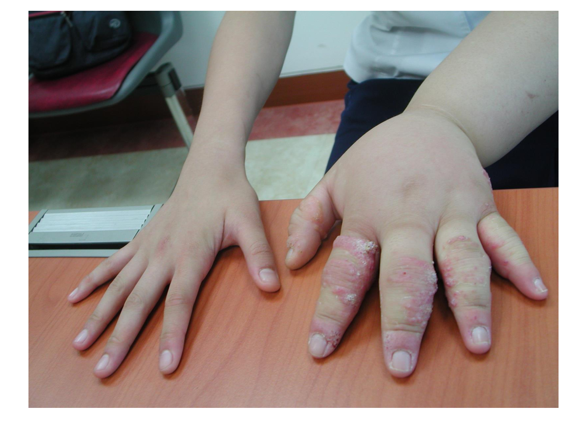{: style="width:55%"}

## ① 진단

- 기저질환: **선천성 일차성 림프부종** — 어린 시절부터 지속된 한쪽 팔 부종, 손가락 침범, 피부 비후·만성 피부 변화가 근거.
- 기전: 림프관 형성 이상·기능 장애로 림프액이 조직에 쌓이면 **배액과 국소 면역 방어가 떨어져** 피부·연부조직 감염이 반복된다.
- 급성 감염: **재발성 봉와직염**(손글씨: 봉와직염 = **연조직염**). 표적은 **β-용혈 연쇄상구균**, 임상 양상에 따라 *S. aureus*도.
- 다른 가능성: 감염 없는 시기의 부종 정도를 확인. 비전형 경과면 정맥폐쇄·혈관·림프관 기형, 급성 관절통이 두드러지면 관절 감염.
- 필기(회색): "일차성 림프부종 치료는 도수치료, 스타킹 등 여러 가지. 림프부종은 **발(하지)**에 많고 손은 드물다. 혈관 anomaly가 동반되기도, 림프 anomaly만 있기도 하다."

## ② 급성기 치료와 입원 판단

- 경증·전신증상 없음: **경구 cephalexin, amoxicillin/clavulanate** 또는 항포도알균 페니실린. 중등도·전신증상: **IV cefazolin** 등.
- 기간: 일반 경증 봉와직염은 **5일**, 반응에 따라 연장. 림프부종을 동반하면 BLS 2025 기준 총 14일(학생 조 자료).
- 보조: 환측 팔 거상, 휴식, 진통·소염. **농양은 절개·배농**(+배양, MRSA 위험에 따라 항생제).
- **입원·정맥 치료**: SIRS·패혈증 소견(고열/저체온, 오한, 빈맥, 빈호흡, 저혈압, 의식변화), 빠르게 퍼지는 홍반·부종, 출혈성 수포, 심한 통증, 피부 괴사·심부 감염·**괴사성 근막염 의심**, 경구 치료 48시간 무반응·악화, 복용 불가, 탈수, 면역저하.

## ③ 부종 관리와 재발 예방

- 급성 염증이 가라앉으면 **복합 림프부종 치료(CDT)**: 압박붕대·스타킹·소매·장갑, 도수 림프배액, 규칙적 운동, 피부 관리.
- 손가락 사이 청결·보습, **무좀·습진 등 침입 경로 치료**, 환측 팔 채혈·주사 피하기.
- **예방적 항생제**: 위험요인을 관리해도 반복되면 — **IDSA 2014: 연 3~4회 재발**(BLS/LSN 2025는 연 2회 이상). 지난해 정맥 항생제 3회 → 적극 검토 대상. 소아·청소년은 개별화.
- 필기(회색): "치료가 어렵다. 잠깐 좋아졌다가 다시 악화된다. 림프부종은 **늘어난 빤스(고무줄)**에 비유 — 더 늘어날 순 있어도 다시 줄어들지 않는다. 탄력을 잃었다. 스타킹은 답답해서 못 신는다. 재발성 감염에 해당하고 예방요법이 필요하다."

## 교수님 정리 — 재발성 연조직염

- **원인균**: 주로 **β-용혈 연쇄구균(A·C·G군)**, 다음이 *S. aureus*. 필기(분홍): 슬라이드의 「Group B」를 손글씨로 **A, C, G**로 고쳐 쓰고 "**베타 hemolytic streptococcus를 타겟팅**합니다."
- 위험인자: **림프부종**, 피부 균열, 무좀, 비만, 정맥부전.
- 일차성 림프부종: 출생~청소년기 발병(**Milroy, Meige 질환**).
- 증상: 경계가 불분명한 홍반·열감·부종, 림프관염, 발열.
- 진단: **임상 진단**, 혈액배양은 전신 독성·면역저하 때만.
- 필기(회색): "*Streptococcus*와 *Staphylococcus*의 차이 — 연쇄구균은 **diffuse**하게 퍼지고, 포도알균은 **고름이 잡힌다**. 대부분 피부 cellulitis는 *S. pyogenes*."

{: style="width:78%"}

| 진단 | 내용 | 특징 |
|---|---|---|
| 임상 | 급성 홍반·열감·압통, 부종 악화, 발열·오한, 림프관염 | 기저 부종과 비교 |
| 신체검진 | **발적 범위 표시**, 양측 둘레 측정, 손가락·발가락 사이 피부 균열 | **침입 경로 찾기** |
| 검사 | CBC, CRP, 중증이면 혈액배양, 농양은 배액·배양 | **배양 양성률은 낮다** |
| 영상 | 초음파(농양), 림프신티그래피(림프부종 확인) | 괴사성 감염 의심 시 CT·MRI |

{: style="width:78%"}

| 치료 | 내용 | 기간·주의 |
|---|---|---|
| 급성기 | 경구 **cephalexin, amoxicillin** / 정주 **cefazolin, ampicillin-sulbactam** | **5일**, 호전 늦으면 연장 |
| 입원 기준 | 전신 독성, 급속 진행, 경구 치료 실패, 심부 감염 의심 | 정주 치료 |
| 림프부종 관리 | 압박, 운동, 수기 림프배액, 피부 보습, 상처·무좀 치료 | 급성기 후 압박 재개 |
| 예방 항생제 | 연 3~4회 재발 시 (교과서) 경구 penicillin V 또는 benzathine penicillin 근주 | 4~52주, 개별화 |

!!! diff "교과서와 우리나라 현실 (교수님, 분홍)"
    "교과서적으로 하면 안 되는 경우가 있다. **penicillin V가 우리나라에 없다.** penicillin G도 공급이 잘 안 된다. 그럼 우리나라에서는? **cefadroxil PO, amoxicillin-clavulanate PO** 이렇게 쓴다. **benzathine penicillin은 매독의 choice** — 매독 치료 말고 다른 데는 거의 안 쓴다(shock에 대한 두려움 때문에)." → 표의 예방 항생제 줄에 선배가 X를 그었다.

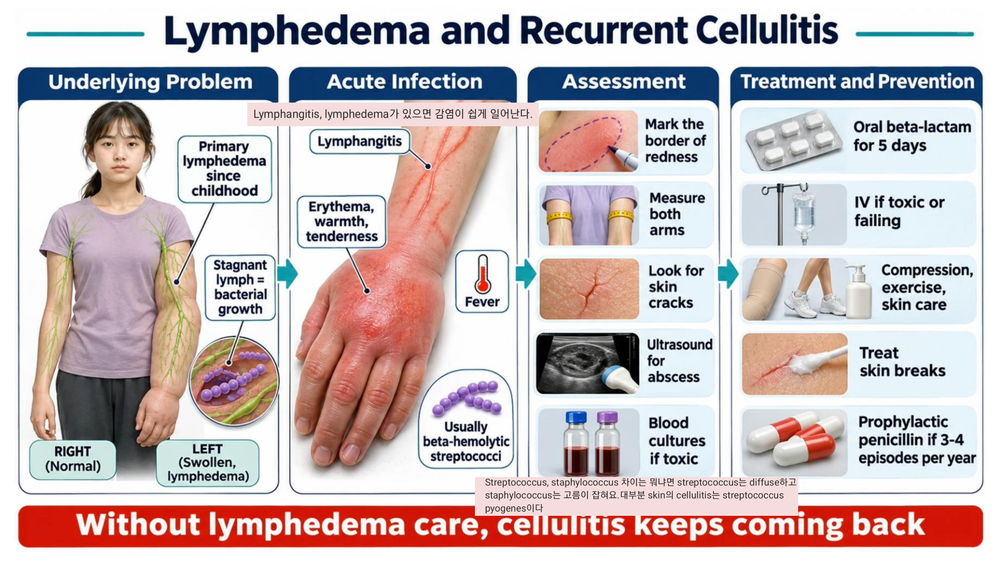{: style="width:80%"}

!!! memo "암기"
    재발성 연조직염 = **β-용혈 연쇄구균(A·C·G)** → β-lactam **5일**. 예방 항생제는 **연 3~4회 재발**(IDSA). 우리나라는 penicillin V 대신 **cefadroxil·amoxicillin-clavulanate**.

# 3. 증례 13 — 복부·골반 방선균증

!!! new "올해 필기에서 추가"
    작년 CP-A1 Case 3. 기출이 가장 많이 나온 증례 중 하나 — **3강 2부 2·5·14·21·22번**(5문항, 전부 penicillin 계열이 정답).

> 58세 여자. **2개월간 오른쪽 복부 불편감.** 젊을 때부터 **자궁 내 피임기구(IUD)** 사용. 뚜렷한 체중감소·결핵 과거력 없음. 37.6℃.

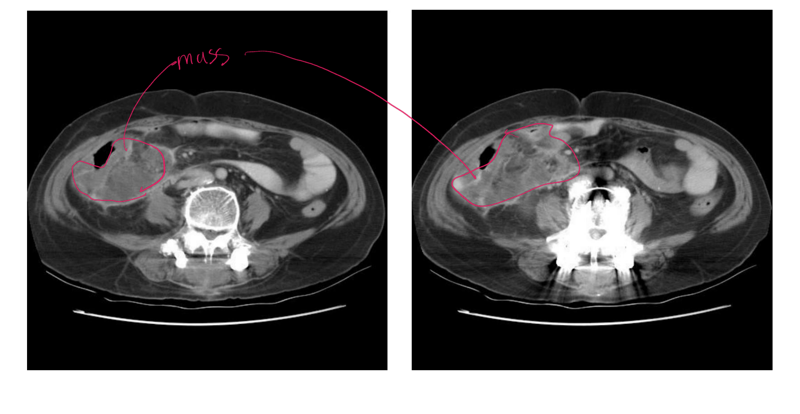{: style="width:70%"}

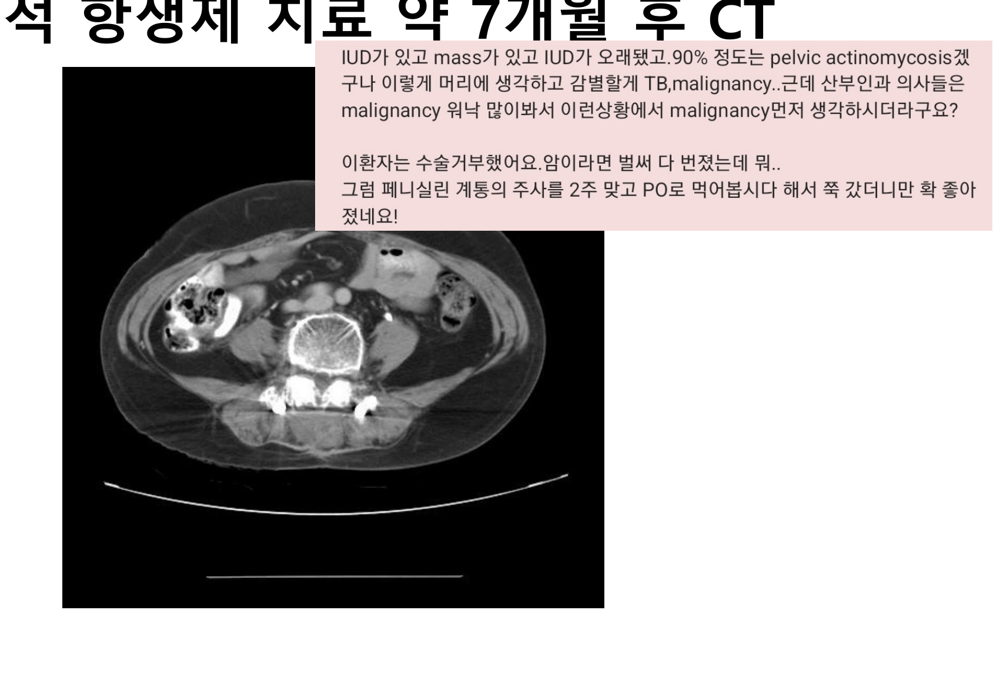{: style="width:62%"}

교수님(분홍): "**IUD가 있고 mass가 있고 IUD가 오래됐고 → 90% 정도는 pelvic actinomycosis**겠구나 이렇게 머리에 생각하고 TB, malignancy를 감별할게. 근데 산부인과 의사들은 malignancy를 워낙 많이 봐서 이런 상황에서 malignancy를 먼저 생각하더라. 이 환자는 **수술을 거부**했다. 암이라면 벌써 다 번졌을 텐데… 그럼 **페니실린 계통 주사를 2주 맞고 PO로 먹어 봅시다** 해서 쭉 갔더니 확 좋아졌다!"

## ① 진단과 감별

- 장기 IUD + 아급성 경과 + **조직 경계를 넘어 침윤하는 종괴** → **복부·골반 방선균증**. 골반 감염이 인접 복강으로 퍼진 것.
- 감별: **대장암·난소암 등 악성종양**(침윤성 종괴를 모방 → 조직에서 악성세포 확인), **복부·골반·복막 결핵**, 복강 내 농양·복잡성 장질환(충수·대장·소장).
- **IUD 배양이나 자궁경부 Pap 검사에서만 균이 나오면** 무증상 집락일 수 있다 — 그것만으로 침습성 감염을 확정하기 어렵다.

## ② 검사와 영상 호전의 의미

- 영상 유도 생검 또는 수술·배액으로 **깊은 조직·농양 검체**.
- H&E: 화농성·섬유화 염증과 **유황과립(sulfur granule)**, Gram 염색: **분지하는 사상형 그람양성균**. 병리에서 종양도 함께 평가.
- 방선균은 **혐기 조건·장기 배양(2~3주 보존)**이 필요하므로 채취 단계부터 **검사실에 알린다**. 배양 음성이면 조직 결과·분자검사를 종합.
- 결핵 감별: 조직 AFB 염색, 결핵 PCR·배양.
- **항생제 후 영상 호전 = 감염성·염증성 병변을 지지하는 보조 근거**일 뿐, 원인균을 확정하지는 못한다 → 잔존 병변·재발 확인.

## ③ 치료와 IUD 제거

- 침습 감염이 확인되거나 강하게 의심되면 **IUD 제거**를 부인과와 협의 — 감염된 이물 표면의 **생물막**이 항생제·면역세포 침투를 막아 지속·재발의 원인이 된다.
- 섬유화된 심부 병변에 닿도록 **고용량 정맥 penicillin G(또는 ampicillin) 2~6주 → 경구 amoxicillin**, 총 **6~12개월**(또는 그 이상). 큰 농양·폐쇄·누공은 배액·수술.

## 교수님 정리 — 방선균증

- 원인균: ***Actinomyces israelii*** 등 **혐기성 그람양성 분지 막대균**.
- 위험인자: **장기 IUD**, 복부 수술, 충수염, 장 천공. 필기(회색): "피임을 많이 하던 시절 IUD를 넣었는데, 문제는 **피임 기간이 끝나면 빼야 하는데 그대로 갖고 있는 경우**. 그러면 pelvic actinomycosis 위험이 생긴다. 자궁에서 시작해 골반, **대장을 먹어 버린다** — 인공항문(colostomy)을 해야 하는 경우도 있다."
- 특징: **조직 경계를 넘는 침윤성 종괴, 누공, 동관(sinus tract)**. 악성종양·결핵·염증성 장질환으로 **오진이 흔하다**(The Great Mimicker).

{: style="width:78%"}

| 진단 | 내용 | 특징 |
|---|---|---|
| 임상 | 만성 복통, 미열, 체중감소, 복부·골반 종괴, 누공 | 수개월 경과 |
| 영상 | CT: 조직면을 넘는 침윤성 종괴, 작은 농양, 주변 지방 침윤 | 악성종양과 비슷하다 |
| 병리 | **유황과립**, 분지형 그람양성균, 염증성 육아조직 | **조직검사가 가장 확실** |
| 배양 | 혐기성 배양, **2~3주 보존**, 항생제 투여 전 채취 | 양성률이 낮다 |

{: style="width:78%"}

| 치료 | 내용 | 기간·주의 |
|---|---|---|
| 초기☆ | **penicillin G 정주(하루 1,800만~2,400만 단위)** 또는 ampicillin | **2~6주** |
| 경구 유지 | **amoxicillin** 또는 penicillin V, 알레르기면 doxycycline | **6~12개월**, 개별화 |
| 감염원 조절 | **IUD 제거**, 농양 배액, 누공·폐쇄 시 수술 | 수술 후 기간 단축 가능 |
| 추적 | CT로 병변 축소 확인, 재발 감시 | 영상 호전만으로 원인균 확정 불가 |

{: style="width:80%"}

!!! exam "기출 포인트 (3강 2부)"
    - **2번**(2025): IUD + 골반 농양 + 현미경 사진(유황과립) → **penicillin 계 정주 2~6주 후 경구 amoxicillin 6~12개월**. Clindamycin 2주·metronidazole·ertapenem·ciprofloxacin이 함정.
    - **5번**(2024): 1차 약 = **penicillin G 또는 ampicillin**. **Metronidazole은 혐기균 약이지만 방선균에 듣지 않는다** — 가장 흔한 함정.
    - **14번**(2022): IUD 주변 종괴 → **ampicillin**. **21번**: 치료 전후 CT → 주로 쓴 약 **amoxicillin**. **22번**(2020): **ampicillin/sulbactam**(HPV 양성은 함정).

# 4. 증례 14 — 독성쇼크증후군(TSS)

!!! new "올해 필기에서 추가"
    작년 CP-A1 Case 6. 관련 기출 **3강 2부 10번**(기전 = 초항원). 필기본에 2024년 기출(가장 특징적 피부 소견 = **미만성 반점 홍피증**)도 붙어 있다.

> 50세 남자. 3일 전부터 발열·오심·구토·설사, **의식 변화**로 내원. **저혈압**, 38.1℃. AST/ALT 65/80, BUN/Cr 39/2.1. **혈액·소변배양 음성**.

{: style="width:55%"}

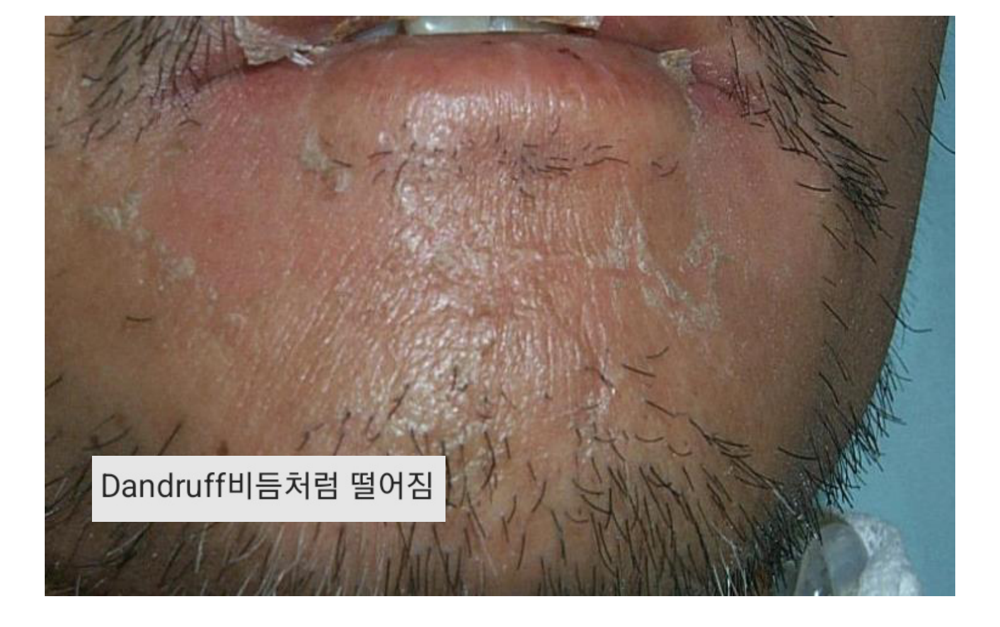{: style="width:55%"}

{: style="width:62%"}

교수님(분홍): "손은 **14일쯤 full thickness desquamation**(피부 벗겨짐)이 생긴다. 이걸 보고 못 맞히면 돌팔이죠? 근데 모든 가능성을 열어 두고 보면 쉽지 않다. 패혈증은 supportive care, vasopressor를 쓰는데 얘는 — 학우들이 강조 안 했는데 — **immunoglobulin을 써요.** superantigen을 잡으려면 면역글로불린이 필요하다. **clindamycin을 보통 포함시켜요. 단백질 합성을 방해한다는 기전** 때문에. **clindamycin 가끔 시험문제 나오고**, immunoglobulin은 dramatic하게 도움이 될 수 있다!"

## ① 증후군 — 독성쇼크증후군

- 저혈압성 쇼크 + 발진 후 **1~2주 사이의 탈설** + 위장관·신장·중추신경계 등 **다장기 침범** → **TSS**, 임상적으로 **황색포도알균 TSS**가 가장 의심.
- CDC 감시기준: 발열(≥38.9℃), 저혈압, 미만성 홍반, **14일째 손바닥 박리**, **3개 이상 장기계 침범**. 이 증례의 38.1℃는 발열 기준 미만이고 혈압 수치·장기계 수가 다 제시되지 않아 「감시기준상 확진」은 유보 — 그래도 **임상적으로 TSS로 치료**한다.

## ② 원인균·독소·배양 음성의 의미

- **초항원(superantigen)**☆: *S. aureus*의 **TSST-1**·일부 장독소, *S. pyogenes*의 **발열성 외독소(SpeA 등)**가 **MHC II와 T세포 수용체를 비특이적으로 연결** → T세포 과활성화 → **사이토카인 폭발** → 전신 염증, 혈관확장, 쇼크, 다장기 손상.

| | 포도알균 TSS | 연쇄구균 TSS (침습성 A군) |
|---|---|---|
| 감염원 | 생리용품(탐폰), 상처, 수술 부위, 이물 — **상처가 없을 수 있다** | 깊은 피부·연부조직·근막 감염 — **상처가 있다** |
| 혈액배양 | **음성이 흔하다**(국소 병소의 독소만 혈류로) | **양성이 더 흔하다** |
| 피부 | 넓은 발진, 후기 손발바닥 박리 뚜렷 | 발진·박리 덜 뚜렷, **괴사성 근막염** 동반 |

- 교수님(분홍, ☆): "**wound가 있으면 streptococcal toxic shock, wound가 없으면 staphylococcus shock**일 경우가 다분히 많죠. 젊은 여자가 sunburn rash, 얼굴에 desquamation이 생겼다 — 그럼 뭘 봐야 할까요? **hyperabsorbent 탐폰**, vaginal colonization(질내 집락화) — 질 점막에서 toxin을 흡수해서 shock이 오는 거예요. 이게 제일 처음 알려진 **릴라이(Rely) 탐폰 사건**."
- 검체: 치료 전 혈액배양 재확인, 창상·농양·수술 부위·이물 검체, 괴사성 감염이 의심되면 깊은 조직. 혈구·혈소판, 신장·간기능, 응고, 젖산, CK로 장기 손상 평가.

## ③ 소생술 → 감염원 조절 → 항균 치료

- 기도·호흡·산소화·의식·혈압 즉시 평가 → 정질액 소생, 저혈압이 지속되면 승압제(중환자 치료).
- 항균제 전 배양을 채취하되 **배양·감염원 확인 때문에 쇼크 처치를 지연하지 않는다**(SSC 원칙: 소생 시작과 동시에 경험적 항균제와 감염원 조절).
- **감염원 조절**: 상처, 수술 부위, 삽입물, 심부 연조직 감염. 교수님(분홍): "**wound가 있으면 wound를 제거해라. 탐폰이 있으면 탐폰을 빼 줘라.**" 괴사성 감염이 의심되면 즉시 외과 탐색·절제(영상 때문에 지연하지 않는다).
- **항균**: 초기에는 MRSA와 연쇄구균을 포함(**vancomycin + 광범위 β-lactam + clindamycin**), **A군 연쇄구균 확정 시 penicillin + clindamycin**. **clindamycin = 단백질 합성 억제 → 독소 생성 억제**.

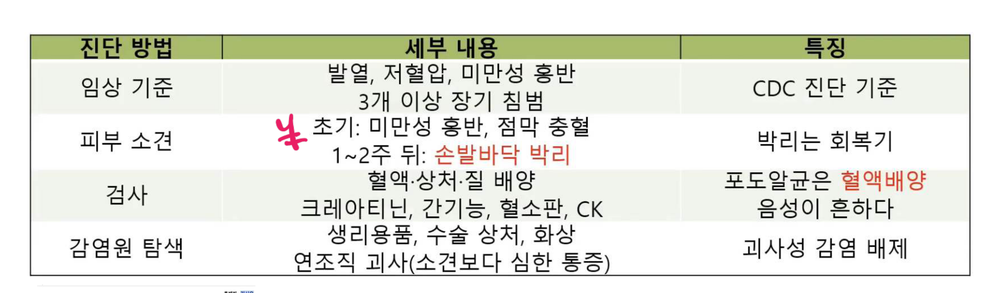{: style="width:78%"}

| 진단 | 내용 | 특징 |
|---|---|---|
| 임상 기준 | 발열, 저혈압, 미만성 홍반, **3개 이상 장기 침범** | CDC 진단 기준 |
| 피부☆ | 초기: **미만성 홍반, 점막 충혈** / 1~2주 뒤: **손발바닥 박리** | 박리는 회복기 |
| 검사 | 혈액·상처·질 배양, creatinine, 간기능, 혈소판, CK | **포도알균은 혈액배양 음성이 흔하다** |
| 감염원 탐색 | 생리용품, 수술 상처, 화상, 연조직 괴사(소견보다 심한 통증) | 괴사성 감염 배제 |

{: style="width:78%"}

| 치료 | 내용 | 기간·주의 |
|---|---|---|
| 소생술 | 수액, 혈압상승제, 중환자실 집중 치료 | **지연하지 않는다** |
| 감염원 제거 | 생리용품·이물 제거, 상처 배액, 괴사성 감염은 **즉시 수술적 변연절제** | 외과 협진 |
| 항생제 | 경험적: vancomycin + 광범위 β-lactam + **clindamycin** / A군 확정: **penicillin + clindamycin** | clindamycin: **독소 생성 억제** |
| IVIG | 중증 연쇄구균 TSS에서 고려 | 근거 제한적 |

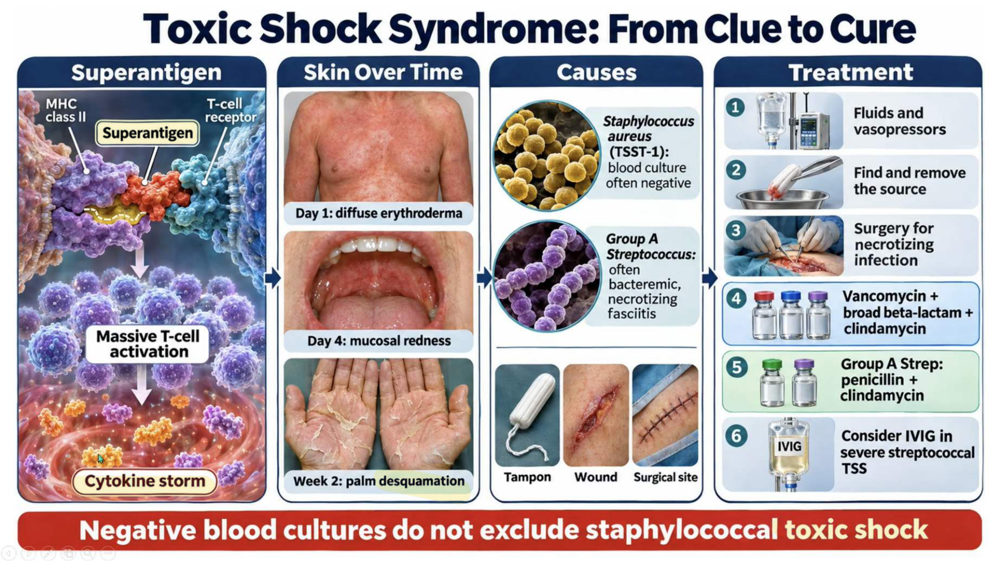{: style="width:80%"}

!!! exam "기출 포인트"
    - **3강 2부 10번**(2023): 이 증례 그대로(구토·설사·저혈압·간신기능 상승·배양 음성, 2주 뒤 손바닥 사진) → 기전 = **초항원(superantigen)**. 내독소(endotoxin)·사이토카인 폭풍·IL-6가 함정(사이토카인 폭풍은 결과이지 원인 독소가 아니다).
    - 필기본 수록 2024년 기출: TSS의 가장 특징적 피부 소견 = **미만성 반점 홍피증(diffuse macular erythroderma)** — 수포·점상·괴사·자반이 아니다.
    - 교수님: **clindamycin은 가끔 시험에 나온다**(단백질 합성 억제 → 독소 억제).

# 5. 증례 15 — 수족구병

!!! new "올해 필기에서 추가"
    작년 CP-A1 Case 8. 기출 **3강 2부 8번(수분 공급)·16번(신경계 합병증)·19번(콕사키바이러스)**. 필기(분홍): "수족구병. 아이가 많지만 **청소년기에도** 옵니다."

> 15세 남자. 2일 전부터 **입안 병변과 통증**, 발열·전신 쇠약. **7일 전 같은 반에서 비슷한 증상의 학생**을 보았다. 38.8℃.

{: style="width:62%"}

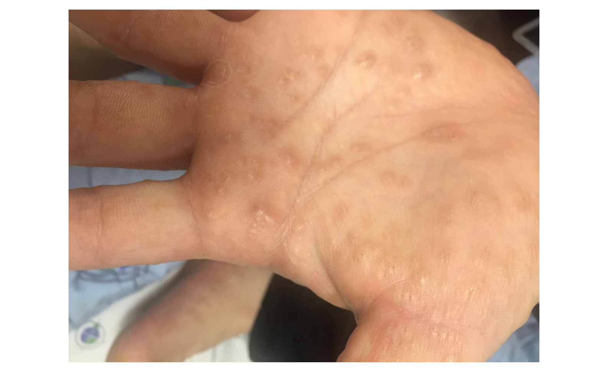{: style="width:52%"}

## ① 진단과 감별

- 발열 + 통증성 구강 수포·궤양 + 손바닥 수포 + 교실 접촉력·**3~7일 잠복기**(노출 후 약 5일) → **수족구병**. 원인은 *Picornaviridae*의 **엔테로바이러스**: 흔히 **Coxsackievirus A16**, 그 외 **A6·A10·EV-A71**.
- 주로 **5세 미만**이지만 청소년·성인도 걸린다. **입 주위 침범과 뚜렷한 전신증상은 Coxsackievirus A6의 비전형 양상**. 회복기에 손발 탈피·손발톱 탈락이 생길 수 있다.

| 감별 | 구별점 |
|---|---|
| **헤르판지나** | 같은 엔테로바이러스지만 **구강 뒤쪽**(연구개·편도) 수포·궤양, 손발 병변은 전형적이지 않다 |
| HSV-1 치은구내염 | **잇몸 부종·출혈**, 구강 앞쪽·입술 주위 **군집 수포**. 손끝 herpetic whitlow는 가능 |
| 수두 | 두피·몸통 중심의 **소양성** 병변, 구진·수포·딱지 여러 단계 공존, 손발바닥은 드물다 |
| 다형홍반·SJS | 손발바닥 **표적 병변**, 구강·입술 미란·결막 침범, **약물 노출** |
| 2기 매독 | 손발바닥 구릿빛 인설성 구진, **수포 없음**, 학급 내 집단발생과 맞지 않음 |
| 가와사키병 | 5세 미만, 5일 이상 발열, 입술 홍조·균열, 딸기혀, 결막충혈, **수포 없음** |
| 엠폭스 | 손발바닥 침범 가능, 비슷한 크기·단계의 **깊은 농포**, 림프절 비대, 밀접·성접촉 |

## ② 검사와 입원 판단

- **전형적인 경증이면 임상 진단으로 충분**. 교수님(분홍): "임상적으로 진단한다 = **문맥을 읽고 각각의 가능한 원인균에 대해 몇 %의 가능성이 있는지 판단**하는 것."
- 비전형 발진, 집단유행 역학조사, 중증이면 인후도말·수포 검체·대변 **엔테로바이러스 RT-PCR**(보건당국·검사실과 협의).
- **EV-A71** → **뇌간뇌염**, 무균성 수막염, 급성 이완성 마비, **신경원성 폐부종**. 교수님(분홍, ☆): "가끔 **encephalitis(뇌염)**를 일으켜요."
- 추가 검사·입원: 수분 섭취 불가·소변량 감소(**탈수**), 지속 고열·심한 무기력·반복 구토, 심한 두통·목 경직·의식 변화·경련·**근간대 경련**, 빈맥·호흡 이상.

## ③ 대증 치료와 전파 예방

- 해열·진통: **acetaminophen 또는 ibuprofen**. **소아·청소년에게 aspirin 금지**(Reye 증후군).
- **수분 공급**☆: 물·경구수분보충액을 **소량씩 자주**, 섭취량·**소변량**·점막 건조 평가, 탈수면 수액. 차갑고 부드러운 음식, 맵거나 산성인 음식은 피함.
- 대부분 **7~10일 내 호전**. 특이 항바이러스제 없이 대증 치료가 중심, **항생제는 세균성 동반감염이 있을 때만**.
- 전파: **호흡기 분비물·수포액·대변-경구**. 손 씻기(화장실 후·식전), 컵·수저·수건 공유 금지, 표면 소독(염소), 기침 예절. 국내는 **증상이 회복될 때까지 등교·등원 자제**(질병관리청). 호전돼도 **대변으로 수주간 배출** → 손 위생 지속.

!!! memo "Reye 증후군 (필기 회색 메모)"
    소아·청소년의 바이러스 감염(대표: **인플루엔자·수두**) 중 aspirin을 먹으면 생기는 **급성 뇌병증 + 간 지방변성**. aspirin이 미토콘드리아 기능을 방해하는 것으로 생각된다. 그래서 해열제는 **acetaminophen**을 쓴다.

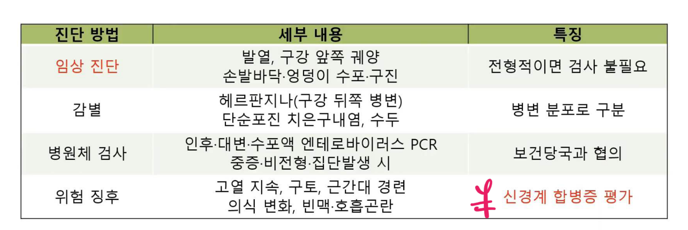{: style="width:78%"}

| 진단 | 내용 | 특징 |
|---|---|---|
| **임상 진단** | 발열, 구강 궤양, 손바닥·발바닥·엉덩이 수포·구진 | 전형적이면 검사 불필요 |
| 감별 | 헤르판지나(구강 뒤쪽), 단순포진 치은구내염, 수두 | 병변 분포로 구분 |
| 병원체 검사 | 인후·대변·수포액 엔테로바이러스 PCR — 중증·비전형·집단발생 | 보건당국과 협의 |
| 위험 징후 | 고열 지속, 구토, 근간대 경련, 의식 변화, 빈맥·호흡곤란 | ☆ **신경계 합병증 평가** |

{: style="width:78%"}

{: style="width:80%"}

!!! exam "기출 포인트 (3강 2부)"
    - **8번**(2024): 수족구병 치료에서 가장 중요한 것 = **충분한 수분 공급**(항생제·스테로이드·항바이러스제·수술 아님).
    - **16번**(2022): 이 증례 그대로 → 드물지만 가장 위험한 합병증 = **신경계 침범(뇌염 등)**.
    - **19번**(2022): 흔한 원인체 = **Coxsackievirus**(Adenovirus·RSV 아님).

# 6. 증례 16 — 당뇨발 감염

!!! new "올해 필기에서 추가"
    작년 CP-A1 Case 10. 기출 **3강 2부 6번(치료 원칙)·12번(이 증례의 틀린 설명 고르기)**.

> 67세 남자. 2년 전 당뇨병을 진단받았으나 **약을 복용하지 않았다.** 6개월 전부터 발에 궤양, 최근 2주 악화로 전원. **BP 160/125, 맥박 115, 호흡 20, 38.5℃**, SpO2 97%.

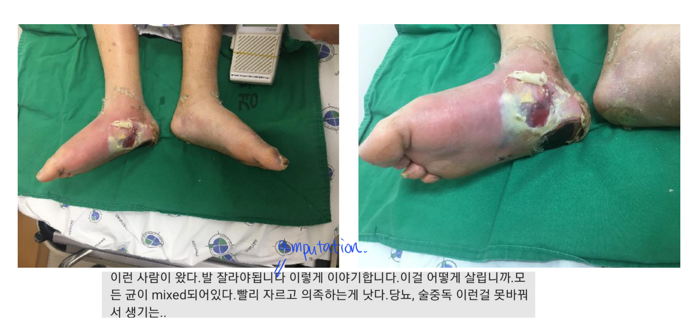{: style="width:72%"}

교수님(회색): "이런 사람이 왔다. 발 잘라야 됩니다 이렇게 이야기한다. 이걸 어떻게 살립니까. **모든 균이 mixed되어 있다.** 빨리 자르고 의족하는 게 낫다. 당뇨, 술중독 이런 걸 못 바꿔서 생기는…"

## ① 중증도·골수염·하지 허혈

- **IWGDF/IDSA 분류**: 경증(2등급) = 피부·피하 국한 / 중등도(3등급) = 깊은 조직 침범 또는 **홍반 ≥ 2 cm** / **중증(4등급) = 전신염증반응(SIRS) 기준 ≥ 2개**. 이 환자는 **발열 > 38℃ + 맥박 > 90** → SIRS 2개 → **중증** → 입원·정주·긴급 외과 협진.
- 고혈압은 통증·감염·고혈당 등으로 평가하고, 케톤산증·고삼투압 고혈당 상태도 확인.
- **골수염**: 뼈 노출과 **probe-to-bone(PTB)**, 단순 X선(골 파괴·가스·이물), ESR/CRP를 먼저 종합 → 불확실하거나 범위 평가가 필요하면 **MRI** → 가능하면 **골생검으로 배양·조직검사(표준)**.
    - 필기(회색): PTB는 골수염이 있는지 확인하는 **신체검사**. 탐침 끝으로 **뼈가 만져지거나 닿으면(양성) → 골수염 가능성 증가**, 닿지 않으면(음성) → 감소.
- **허혈**: **족배·후경골동맥 맥박**, 피부색·온도, ABI·발가락 압력/TBI, **Doppler 파형**. **당뇨의 동맥 석회화는 ABI(발목상완지수)를 높게(정상처럼) 만든다** → 발가락 압력·TcPO2로 보완. 상처·허혈·감염은 **WIfI**로 종합. 사진만으로는 골수염·허혈을 확정할 수 없다.
    - 교수님(분홍): "혈관에 때가 많이 끼었을 거예요. 그러니까 피부 탄력도 없고…"

## ② 검체와 경험적 항생제

- **세척·괴사조직 제거 뒤 심부 조직(또는 수술 검체)**을 배양. **표면 면봉은 오염·집락균을 반영** → 피한다. 항생제 전 혈액배양 2세트(중증 치료를 지연하지 않는 범위에서).
- 원인균: **급성·경증은 *S. aureus*·연쇄구균**, **중증·만성 궤양은 다균성** — 그람음성균·**혐기균** 비중이 커진다(괴사·허혈이 있으면 혐기균 포함). MRSA는 중증도·위험인자, *Pseudomonas*는 위험인자·지역 역학을 반영. 교수님(분홍): "**발은 혐기균, G+, G− mixed다!**"
- 국내 3차병원 자료: 그람음성균 **54.7%**, MRSA 14.3%, 다제내성 그람음성균 12.6%(만성 신질환·말초동맥질환 동반 시 더 많다).
- 예시: **vancomycin + piperacillin/tazobactam**, 대안 vancomycin + cefepime + metronidazole, MRSA 약 linezolid, ESBL 위험이 높으면 carbapenem.
- 기간: **연부조직 1~2주, 골수염 3~6주**(절제와 잔존 감염에 따라; 교수님 표는 골수염 6주, 절제 후 잔존 시 3주).

## ③ 응급 수술·혈관 평가와 감염원 조절

- **긴급 수술 평가**: 심부 농양·구획증후군, 가스·염발음, 괴사성 근막염·가스괴저, 광범위·진행성 괴사, 적절한 항생제에도 악화하는 패혈증 → 배농, 괴사조직·감염골 절제(부분 종골절제 포함), 범위가 넓으면 절단. 중등도~중증은 24~48시간 내 조기 수술.
- **혈관 평가 단서**: 약한 맥박, 차고 창백한 발, 비정상 Doppler, **ABI < 0.9, 발가락 압력 < 30 mmHg, TcPO2 < 25 mmHg**, 괴사·괴저, 적절한 치료에도 **4~6주간 낫지 않는 궤양**. 변연절제·절단 범위를 정하기 전에 혈류를 평가하고 풍선확장술·우회술 등 **재관류 시점**을 논의.
- 재관류 후 추가 변연절제, 드레싱, 뒤꿈치 압력 분산(off-loading), 음압 상처치료, 피판·피부이식. 당뇨 치료, 매일 발 관찰, 맞춤 신발.

## 교수님 정리 — 당뇨발 감염

- 기전: **신경병증 → 궤양 → 감염**, **말초동맥질환이 치유를 막는다**.
- 치료: **항생제 + 배액·변연절제 + 재혈관화** — 항생제만으로는 실패한다(「Antibiotics fail without surgery and blood flow」).

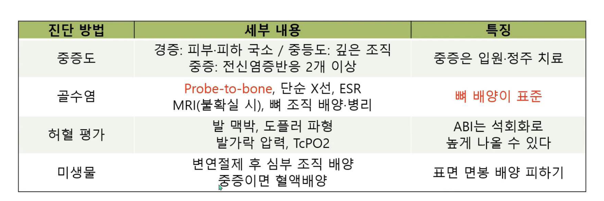{: style="width:78%"}

| 진단 | 내용 | 특징 |
|---|---|---|
| 중증도 | 경증 피부·피하 국소 / 중등도 깊은 조직 / **중증 전신염증반응 2개 이상** | 중증은 입원·정주 |
| 골수염 | **Probe-to-bone**, 단순 X선, ESR, MRI(불확실 시), 뼈 조직 배양·병리 | **뼈 배양이 표준** |
| 허혈 | 발 맥박, 도플러 파형, 발가락 압력, TcPO2 | **ABI는 석회화로 높게 나올 수 있다** |
| 미생물 | 변연절제 후 **심부 조직 배양**, 중증이면 혈액배양 | **표면 면봉 배양 피하기** |

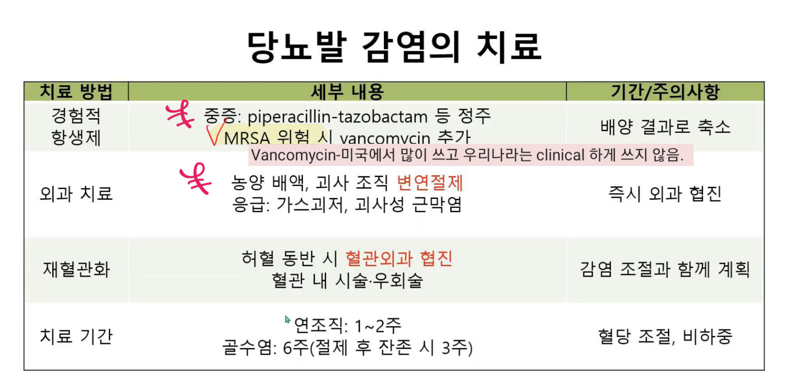{: style="width:78%"}

| 치료 | 내용 | 기간·주의 |
|---|---|---|
| 경험적 항생제☆ | 중증: **piperacillin-tazobactam** 등 정주, MRSA 위험 시 vancomycin 추가 | 배양 결과로 축소 |
| 외과☆ | 농양 배액, 괴사조직 **변연절제**, 응급: 가스괴저·괴사성 근막염 | 즉시 외과 협진 |
| 재혈관화 | 허혈 동반 시 **혈관외과 협진**, 혈관 내 시술·우회술 | 감염 조절과 함께 계획 |
| 기간 | 연조직 1~2주, 골수염 6주(절제 후 잔존 시 3주) | 혈당 조절, 비하중 |

!!! diff "교과서(미국)와 우리나라 — vancomycin"
    교수님(분홍): "Vancomycin은 미국에서 많이 쓰고 **우리나라는 clinical하게(경험적으로) 쓰지 않는다**." 국내 자료에서 그람음성균이 절반을 넘는다는 점과 함께 기억.

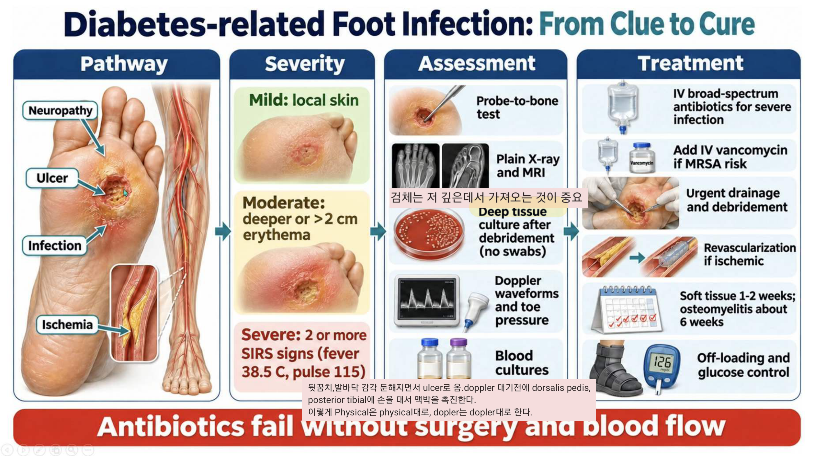{: style="width:80%"}

!!! exam "기출 포인트 (3강 2부)"
    - **6번**(2024): 가장 중요한 치료 원칙 = **적절한 항생제와 괴사조직 제거**(항생제 단독·즉각적 절단·국소 소독만은 오답).
    - **12번**(2023): 이 증례 그대로(파룬궁 수련으로 약 안 먹음, 160/125-115-20-38.5) → 틀린 설명 = 「열린 상처에서 **coagulase 음성 포도알균**이 자라면 대개 원인균으로 간주」. 표면 상재균 오염이다. 다균 혼합·혐기균 관여·혈류 개선·괴사조직 제거는 모두 맞는 설명.

# 7. 증례 17 — 전신 파상풍

> 69세 여자. **수선과 바느질**을 하며 지낸다. 2일 전부터 **입을 벌리기 어렵고 목이 뻣뻣하다.** 발음이 어렵고 말할 때 침이 흐른다. 37.2℃.

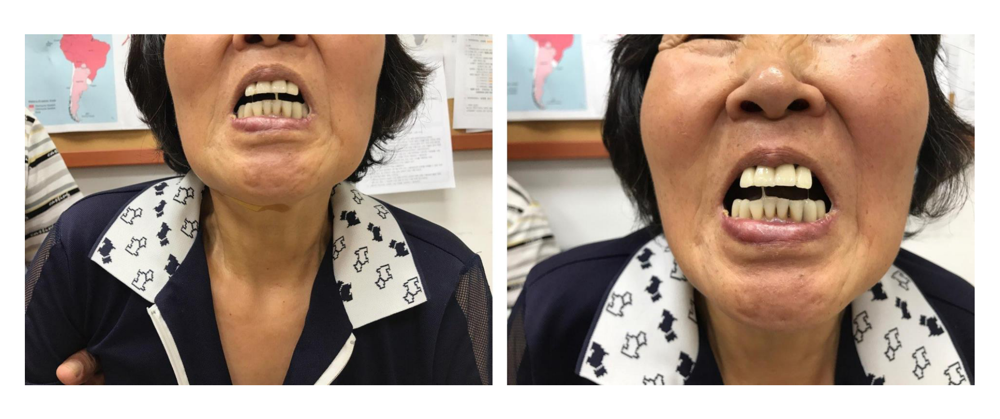{: style="width:70%"}

작년과 같은 환자다. 작년 교수님: "파상풍 환자 중에는 **상처가 없는 경우**도 있다." "**검사 소용없다. 그냥 보고 진단해야 한다.**" 올해 필기(진단 표 회색): "**모양으로 아는 병이지, 검사로 아는 병이 아니지요.**"

## ① 진단 근거와 감별

- **저작근·경부·인두근 침범** → 개구장애(trismus, 아관긴급), 경직, 연하·분비물 조절 장애. **뚜렷한 발열·패혈증 징후가 없어도** 초기 전신 파상풍을 의심하고 전신 경련·자율신경 이상을 확인한다.
- ***Clostridium tetani***(혐기성 **아포** 형성 그람양성 간균)의 **tetanospasmin**이 **억제성 신경의 GABA·glycine 방출을 억제** → 지속적 근긴장 + **자극 유발 경련**. **의식은 명료**.

| 감별 | 구별점 |
|---|---|
| 심부 경부·구강 감염(치성, 편도주위·인두후농양) | 국소 통증·발열·인후통·부종·압통, 영상으로 확인 |
| 턱관절 질환 | 관절통·운동 제한이 주, 전신 경직은 드묾 |
| **약물 유발 급성 근긴장이상** | haloperidol·metoclopramide 등 **도파민 차단제**, 급성, 사경·안구운동발작, **benztropine에 빠른 호전** |
| 스트리크닌 중독 | **glycine 수용체 길항**으로 유사한 전신 강직, 독극물 노출력 |
| 수막염 | 고열·두통·의식 저하·수막자극, 개구장애는 드묾 |
| 광견병 | 동물 교상, 공수증·뇌염 |
| 저칼슘혈증 테타니 | 감각이상·수족경련, **이온화 칼슘** |

- 교수님(회색): "Diazepam을 생각보다 많이 쓰게 된다. **인공호흡기 다는 사람이 많다.** 무서운 병이다. **2달 중환자실에 있는 경우도** 있다. 파상풍 얕게 보면 큰코다친다. 응급실에 오면 파상풍이라고 생각하기보다 중풍, 목 질환, 근육 이상 등 여러 가지 하다가 '혹시 파상풍 아니야?' 하는 볼 줄 아는 사람을 만났을 때 감염내과로 consult가 온다. 의식이 깨끗하고 입이 안 벌어지니 구강안면외과, 신경과, 이비인후과를 돌고 돌아 감염내과로 온다."

## ② 상처·접종력과 기도 보호

- 잠복기 **3~21일**. 최근 수 주간 바늘·가시·못 자상, 흙·녹슨 물체 오염, 화상, 수술·치과 처치·주사·동물 교상을 묻는다. 바느질 중 찔린 시점·깊이를 확인하되 **직업력만으로 경로를 확정할 수 없다.** **약 20%는 상처를 찾지 못한다.**
- 접종력: 소아 DTaP, 마지막 Td/Tdap, 최근 10년 내 추가 접종, 상처 후 백신·TIG. **고령은 항체 소실** 가능.
- **기도 보호를 서두를 소견**: 개구장애의 빠른 진행, **침을 삼키지 못함**·연하곤란, 흡인·분비물 정체, 협착음·**후두경련**, 저산소혈증·무호흡·흉벽/횡격막 경직.
- **ICU 고려**: 첫 증상 후 48시간 내 전신 반사 경련(**잠복기·발병 간격이 짧을수록 불량**), 반복 경련, 혈압 급변·빈맥·부정맥·발한(**자율신경 불안정 = 주요 사망 원인**).

## ③ 독소 중화·감염원·경련·백신

- **사람 파상풍 면역글로불린(TIG) 500 IU 근주 1회**, 조기에. **이미 신경에 결합한 독소에는 효과가 없고**, 결합 전 유리 독소를 중화한다. 교수님(분홍): "학우분이 잘 얘기해 주셨듯이 TIG를 통해서 **이미 결합한 건 어쩔 수 없지만, 피에 떠다니는 건** 중화(chelation)하도록 주고 있다."
- 상처를 찾아 이물·괴사조직 제거, 세척·변연절제.
- **metronidazole 500 mg IV 6~8시간마다 7~10일** — 균 증식과 추가 독소 생성 억제. 교수님(분홍): "**penicillin보다는 metronidazole.** 파상풍에서 penicillin G가 **GABA 길항으로 근경련을 악화**시킬 수 있어서." (penicillin G는 대안)
- 빛·소리·접촉을 줄인 **조용하고 어두운 ICU**에서 **benzodiazepine**(diazepam: 근육 경직·근경련 완화; 중증엔 고용량), 불응하면 신경근차단 + 기계환기. 자율신경 불안정은 **IV labetalol 또는 magnesium sulfate**.
- **백신**: 「Tetanus does not give immunity — vaccinate after recovery」. 안정·회복기에 **Td/Tdap을 TIG와 다른 부위에** 접종해 시작·완료.

!!! memo "대대로 야마 — 파상풍은 앓아도 면역이 생기지 않는다"
    교수님(분홍): "파상풍은 **자연면역은 안 되지만 인공면역은 가능한** 질환. 그래서 태어날 때 파상풍 예방접종을 맞는다." (손글씨 「대대로 야마」) 그리고 회색: "1958년쯤부터 파상풍이 국가접종이 되어서 **나이 많은 사람들은 안 맞은 사람도 많다.** 흙을 만지는 시골 어르신들이 위험하다."

## 교수님 정리 — 파상풍

- 원인: *C. tetani* 포자, 오염된 상처(**사소한 찔림도**). 기전: tetanospasmin이 억제성 신경전달 차단 → 경직·경련.
- 첫 증상: **개구장애**, 목 경직, 연하곤란, **경소(risus sardonicus)**. 진행: 자극 유발 전신 경련, **후궁반장**(목과 등 근육이 심하게 수축해 몸이 활처럼 뒤로 젖혀지는 자세), 후두경련.
- 진단: **임상 진단, 검사 결과를 기다리지 않는다**. 치료: TIG, 상처 처치, metronidazole, 경련 조절, 기도 확보, 백신.

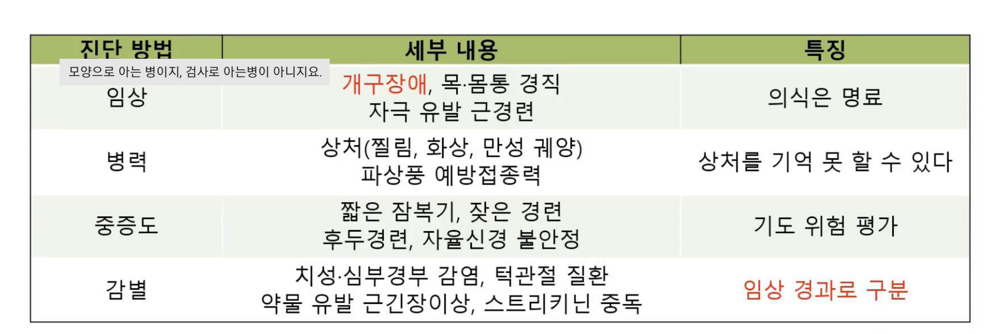{: style="width:78%"}

| 진단 | 내용 | 특징 |
|---|---|---|
| 임상 | **개구장애**, 목·몸통 경직, 자극 유발 근경련 | **의식은 명료** |
| 병력 | 상처(찔림, 화상, 만성 궤양), 파상풍 예방접종력 | **상처를 기억 못 할 수 있다** |
| 중증도 | 짧은 잠복기, 잦은 경련, 후두경련, 자율신경 불안정 | 기도 위험 평가 |
| 감별 | 치성·심부경부 감염, 턱관절, 약물 유발 근긴장이상, 스트리크닌 중독 | **임상 경과로 구분** |

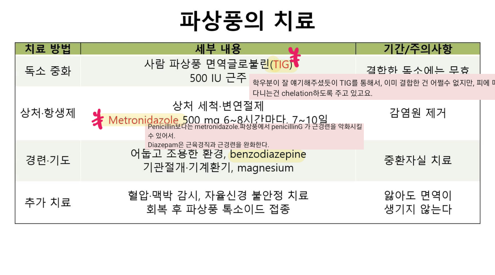{: style="width:78%"}

| 치료 | 내용 | 기간·주의 |
|---|---|---|
| 독소 중화☆ | **사람 파상풍 면역글로불린(TIG) 500 IU 근주** | 결합한 독소에는 무효 |
| 상처·항생제☆ | 상처 세척·변연절제, **metronidazole 500 mg 6~8시간마다 7~10일** | 감염원 제거 |
| 경련·기도 | 어둡고 조용한 환경, **benzodiazepine**, 기관절개·기계환기, magnesium | 중환자실 |
| 추가 | 혈압·맥박 감시, 자율신경 불안정 치료, **회복 후 파상풍 톡소이드** | 앓아도 면역이 생기지 않는다 |

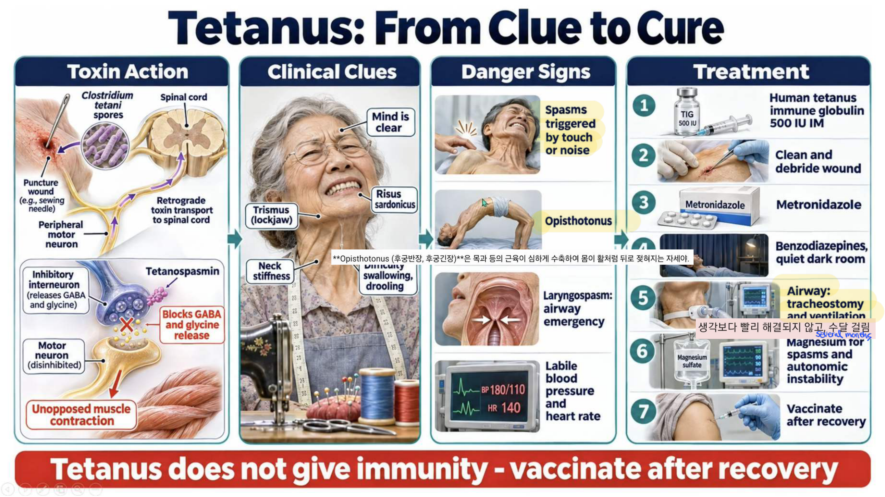{: style="width:80%"}

!!! diff "작년 필기와 다른 점"
    - 올해는 **TIG 용량(500 IU 근주)**과 **metronidazole 용법(500 mg 6~8시간마다 7~10일)**이 표에 명시됐다.
    - 작년 교수님: "입원하면 **한두 달 인공호흡기**", "이걸로 죽진 않고 **2차 폐렴(병원 폐렴)·패혈증**으로 인한 사망이 더 많다", "1년에 전국 20~30명 보고, 어릴 때 DTaP, **10년마다 Td**". 올해 표는 **자율신경 불안정을 주요 사망 원인**으로 적었다.
    - 작년 슬라이드의 Ablett 분류(I~IV, 사망률 < 10% → > 40%)는 올해 없다.

### 독소 기전 — 파상풍 vs 보툴리눔 (주관식 기출)

- 파상풍 독소는 **A-B형 독소**: 단백분해효소로 두 사슬로 나뉜 뒤 **B 사슬이 운동신경 말단 수용체(강글리오시드)에 결합** → 세포 안으로 → **축삭을 따라 역행성 수송**되어 척수의 **억제성 중간뉴런**으로 → **A 사슬(아연 의존성 단백분해효소)이 synaptobrevin(VAMP, SNARE 단백)을 절단** → **glycine·GABA 방출 차단** → 운동뉴런 탈억제 → **강직마비**.
- 보툴리눔 독소는 **신경근접합부**의 운동신경 말단에서 SNARE를 잘라 **acetylcholine 방출 차단** → **이완마비**.

!!! exam "기출 포인트"
    - **4번**(2025): 이 증례 사진 → **사람 파상풍 면역글로불린 + metronidazole + 진정제**. Ceftriaxone + metronidazole·penicillin V 경구가 함정. **17번**(2021): 항생제 선택 = **metronidazole**(이비인후과·내과·응급실을 돌다 온 옷수선하는 여자 — 교수님이 말한 바로 그 경로).
    - **11번**(2022): 파상풍에서 기대하지 않는 것 = **의식 장애**(의식은 보존).
    - **14·18·23번**(주관식): 파상풍 = 척수 억제성 뉴런의 **glycine·GABA 차단 → 강직마비**, 보툴리눔 = **ACh 차단 → 이완마비**.
    - 필기본 수록 2022년 기출: 야생 오소리에 물린 52세, 10년 내 접종 없음 → **공수병 백신 4회 + amoxicillin/clavulanate + 공수병 면역글로불린 + 파상풍 백신·면역글로불린 모두**(가, 나, 다, 라).

# 8. 증례 18 — 폐포자충폐렴(PJP)

> 45세 남자. **2년 전 신장이식.** 2주 전부터 호흡곤란으로 응급실. 37.9℃.

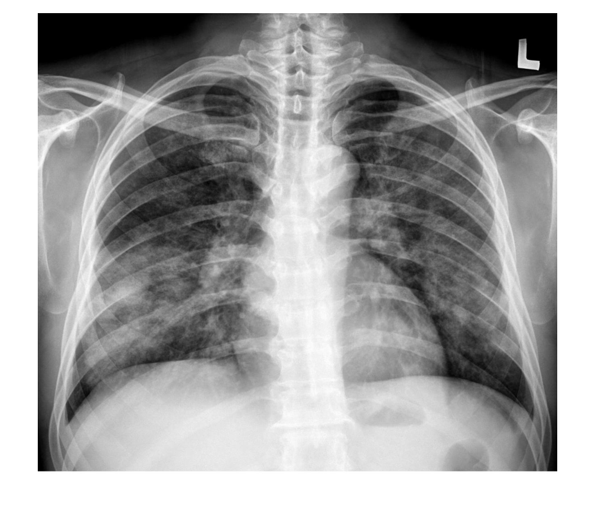{: style="width:45%"}

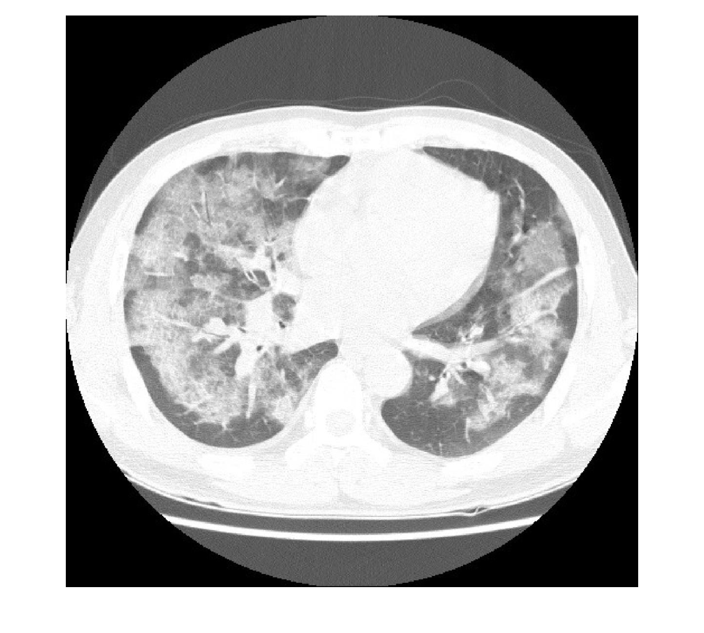{: style="width:45%"}

## ① 진단과 감별

- 신장이식 후 **세포매개면역 저하** + 아급성 호흡곤란 + **양측 GGO** → ***Pneumocystis jirovecii* 폐렴(PJP/PCP)**. 건강한 사람에겐 병을 일으키지 않지만 면역저하자의 폐포에서 증식해 중증 호흡부전.
- 전형: 미열·마른기침, **청진 소견에 비해 심한 저산소혈증**(「Hypoxemia out of proportion to exam: think Pneumocystis」). 영상은 비특이적 — **CT 양상만으로 PJP를 확정할 수 없다.**
- 이름: 필기(회색) "과거에는 원인균을 *Pneumocystis carinii*라 불러 **PCP**라는 명칭을 썼다. 이후 사람에게 감염되는 종이 ***P. jirovecii***로 구분되면서 **PJP**라는 명칭이 쓰이기 시작했다."

| 감별 | 단서 |
|---|---|
| **CMV**·기타 호흡기 바이러스 | 양측 간질 침윤·미세결절, 위장관 증상, 백혈구·혈소판 감소 |
| 침습성 아스페르길루스증·크립토코쿠스증 | 다발 결절·공동·**halo sign** |
| 세균성·비정형 폐렴, 노카르디아증 | 급성 고열, 화농성 객담, 국소 엽성 경화·결절·농양 |
| 비감염성 | sirolimus·everolimus(**mTOR 억제제**)·tacrolimus 관련 간질성 폐질환, 이식신 기능 저하에 따른 체액과다·폐부종 |

## ② 예방약·면역억제 상태와 검체

- **TMP-SMX 예방**(이식 후 **6~12개월**) 시행·기간·순응도·중단 시점, 과거 PJP. 면역억제제(tacrolimus/cyclosporine, mycophenolate, steroid) 종류·용량·농도, **최근 거부반응 치료(스테로이드 펄스·ATG)**, 림프구 감소, 이식신 기능. 이식 2년 후에도 예방약 중단·추가 면역억제가 있으면 위험.
- 검체: **유도객담 또는 BAL**의 *P. jirovecii* **(정량) PCR**, 직접형광항체, Giemsa 염색. **비HIV 면역저하자는 균량이 적어 위음성**에 주의.
- 교수님(분홍): "**PCR이 제일 중요**한데, induced sputum(유도객담) PCR이 있고 BAL(기관지폐포세척) PCR이 있다. 이 중 **BAL PCR은 얻기가 어렵다** — 기관지내시경을 해야 돼서."
- 혈청 **(1→3)-β-D-glucan** = 민감한 **보조** 검사(원인 특이성은 낮다). LDH·ABGA로 중증도. BAL·혈액 CMV 정량 PCR, 세균·진균 배양, 다중 PCR로 감별. PCR 양성은 균량과 임상·영상을 종합해 **집락**과 구분.

## ③ 초기 치료

- 임상적으로 강하게 의심되면 **검사 결과를 기다리지 않고** 검체 확보 후 TMP-SMX 시작(치료 뒤에도 수일간 BAL/PCR 양성이 유지될 수 있다).
- **TMP-SMX: TMP 기준 15~20 mg/kg/일, 하루 3~4회 분할 IV, 21일**(학생 조 자료는 14~21일). **신기능에 맞춰 감량**, 칼륨·creatinine·혈구 수·상호작용 감시.
- **보조 스테로이드**: **PaO2 < 70 mmHg**면 고려, **prednisone 40 mg 하루 2회**부터 감량. 교수님(분홍): "**산소가 부족한 경우가 많고 이때는 스테로이드를 같이 넣어야 살립니다.**" 단, 비HIV 환자는 근거가 제한적 → 저산소혈증과 동반감염 위험을 고려해 개별 판단.
- 대체: **primaquine + clindamycin**(G6PD 확인), **atovaquone**(경증), **정주 pentamidine**(신독성·저혈당 주의). 치료 후 **2차 예방**, 면역억제 조정 검토.

## 교수님 정리 — 이식 후 PJP

- 원인: *P. jirovecii*, 공기 전파 또는 재활성화. **위험**: 이식 후 첫 6개월, 거부반응 치료·스테로이드, **CMV**, 림프구 감소, TMP-SMX 예방 중단.
- 증상: 수일~수주 진행하는 호흡곤란, 저산소혈증, 마른기침. 영상: 양측 미만성 GGO, **초기 X선은 정상일 수 있다**, 드물게 낭종·기흉.

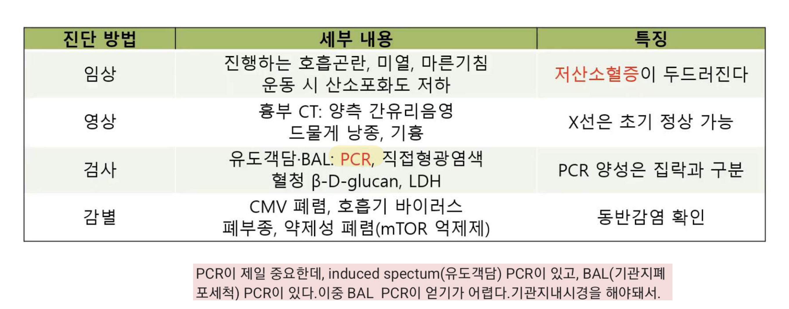{: style="width:78%"}

| 진단 | 내용 | 특징 |
|---|---|---|
| 임상 | 진행하는 호흡곤란, 미열, 마른기침, 운동 시 산소포화도 저하 | **저산소혈증이 두드러진다** |
| 영상 | 흉부 CT 양측 GGO, 드물게 낭종·기흉 | X선은 초기 정상 가능 |
| 검사 | 유도객담·BAL **PCR**, 직접형광염색, 혈청 β-D-glucan, LDH | PCR 양성은 집락과 구분 |
| 감별 | CMV 폐렴, 호흡기 바이러스, 폐부종, 약제성 폐렴(mTOR 억제제) | 동반감염 확인 |

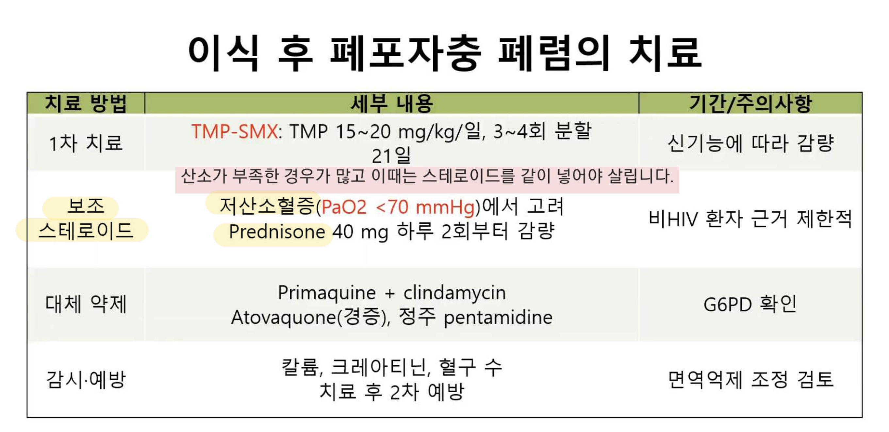{: style="width:78%"}

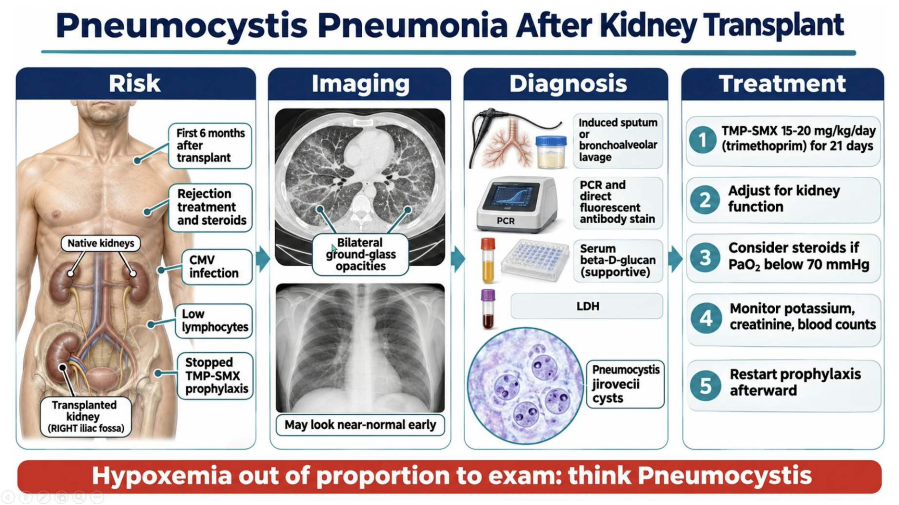{: style="width:80%"}

!!! diff "작년 필기와 다른 점"
    - 작년엔 **PCP**, 올해는 **PJP**로 부른다(같은 병).
    - 작년 교수님: "**시험 문제는 GMS stain이 많이 나온다** — 근데 이걸로는 거의 진단하지 않는다. 이 사진이 나오면 PCP란 걸 알아야 한다." 「제일 sensitive한 건 PCR」, 「HIV로 배웠지만 **PCP, CMV 두 가지**를 생각」, TMP-SMX 주사가 품절이라 경구로 시작. 올해는 **유도객담 PCR vs BAL PCR**을 강조.
    - 작년 예방 기준(HIV): **CD4 < 200이면 TMP-SMX 1차 예방, CD4 > 200이 6개월 유지되면 중단**. 올해는 이식 환자 기준(**이식 후 6~12개월**).

    {: style="width:32%"}

# 9. 증례 19 — *Klebsiella* 간농양과 내인성 안내염

> 63세 남자. 1주 전 **좌안을 철제 대문에 부딪혔다.** 다음 날부터 안구 통증, 이후 시력 급격히 저하 — 수상 2일째 광각(빛 인지)은 있었으나 3일째부터 빛도 감지하지 못함. **38.6℃**, 복부 CT에서 간 병변.

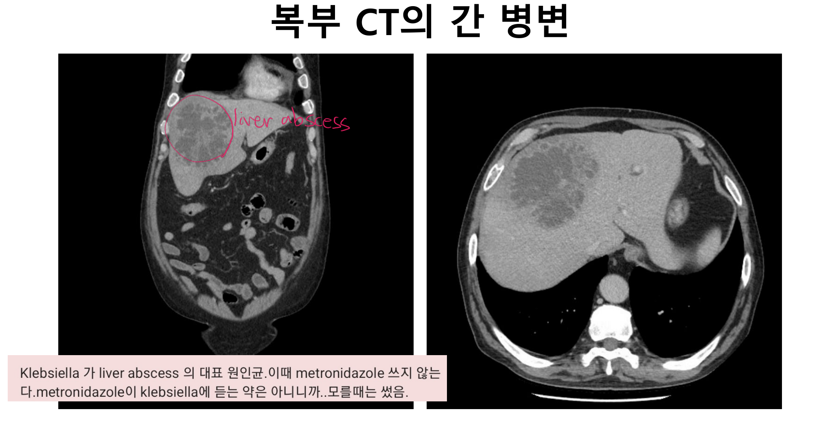{: style="width:70%"}

교수님(분홍): "**Klebsiella가 liver abscess의 대표 원인균.** 이때 **metronidazole 쓰지 않는다.** metronidazole이 Klebsiella에 듣는 약이 아니니까. 모를 때는 썼음." → 학생 조 답의 「ceftriaxone + metronidazole」에 선배가 X를 그었다.

## ① 외인성 vs 내인성 안내염

- 감염성 안내염 = 유리체·방수 감염, **수 시간~수일 사이 실명**할 수 있는 안과 응급.

| | 외인성 | **내인성** |
|---|---|---|
| 경로 | 개방성 안구손상·각막 파열·안구 내 이물로 **직접 침입** | 간농양 등 원격 감염에서 **혈행 전파** |
| 시작 부위 | 전안부 | 혈류가 풍부한 **망막·맥락막** |
| 단서 | 전신 발열은 흔하지 않다 | **발열, 혈액배양 양성, 양안 침범** |
| 원인균 | *Bacillus cereus*, 포도알균 | 국내: **간농양 동반 *K. pneumoniae*** |

- 이 환자는 **발열 + 간 병변 → 내인성이 우선**. 둔상 병력은 함정이지만, 관통상·안구 파열 여부는 별도로 확인한다.

## ② 침습성 간농양 증후군과 검체

- **고병원성 *K. pneumoniae*(hvKp)** 간농양 → 균혈증 → 혈행성 안내염. 아시아·태평양의 지역사회획득 간농양에서 *E. coli*를 대신해 흔한 원인균, **당뇨**와 연관, **담도질환 없는 단일균 농양**이 특징.
- 교수님(분홍, ☆): "**Hypervirulent Klebsiella가 요즘 유행**입니다. 과거 교과서엔 간농양의 가장 common한 균이 *E. coli*였는데 현재는 Klebsiella로 바뀌었습니다."
- 간농양 환자의 **약 2%**에서 안내염 동반. 위험 단서: *Klebsiella*, 다른 전신 감염, **간 우상엽 농양**. 폐·수막·뇌·비장·장요근으로도 전이(괴사성 근막염도).
- 교수님(분홍): "**Prostate abscess → liver abscess → UTI → 눈으로 넘어감.**" — 모든 병소를 찾는다.
- 검체: **항생제 전 혈액배양 2세트, 간농양 흡인액**(Gram·호기/혐기 배양), **유리체(± 전방수) 천자**, 소변배양. 혈당·HbA1c, 최근 30일 ampicillin/amoxicillin 사용(위험 증가 단서), 반대쪽 눈, 두통·의식 변화가 있으면 뇌 영상.

## ③ 응급 안과 처치·전신 항생제·배액

- **응급 안과 협진 → 유리체 천자 후 즉시 유리체강 내 항생제: vancomycin 1 mg + ceftazidime 2.25 mg**. 중증·빠른 진행이면 조기 **유리체절제술**. 광각이 없으면 시력 회복 가능성이 낮아 **안구 보존·감염 조절**도 목표.
- 전신: **ceftriaxone 2 g IV 하루 1회**(배양·감수성에 따라 조정, **ESBL이면 carbapenem**) + **경피 카테터 배액**. 4~7일 뒤 반응이 없으면 수술 배액 검토(큰 다방성·고점도 농양은 경피 배액 실패 위험). 총 **4~6주**. 혈당 조절.
- 교수님(분홍): "Klebsiella가 있을 때는 **metronidazole 안 쓰고 ceftriaxone 단독**으로 씁니다." "**Vancomycin은 Klebsiella에 효과 없구요.** 안과에선 이 둘(vancomycin + ceftazidime)을 **protocol처럼** 씁니다." (그람양성·음성을 다 덮기 위해)

## 교수님 정리 — *Klebsiella* 간농양과 내인성 안내염

- 원인균☆: **고병원성 *K. pneumoniae*(K1·K2 협막, 과점성)**. 위험인자: **당뇨병**, 동아시아. 특징: 담도질환 없이 생기는 간농양, 균혈증이 흔하다. 전이성 감염: 내인성 안내염·수막염·폐 색전·괴사성 근막염.
- 치료: **정주 항생제 + 경피 배액 + 유리체강 내 항생제**.

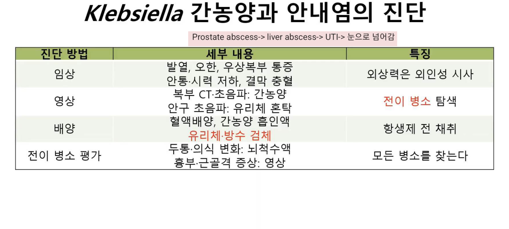{: style="width:78%"}

| 진단 | 내용 | 특징 |
|---|---|---|
| 임상 | 발열·오한·우상복부 통증, 안통·시력 저하·결막 충혈 | 외상력은 외인성 시사 |
| 영상 | 복부 CT·초음파: 간농양 / 안구 초음파: 유리체 혼탁 | **전이 병소 탐색** |
| 배양 | 혈액배양, 간농양 흡인액, **유리체·방수 검체** | 항생제 전 채취 |
| 전이 병소 | 두통·의식 변화 → 뇌척수액, 흉부·근골격 증상 → 영상 | 모든 병소를 찾는다 |

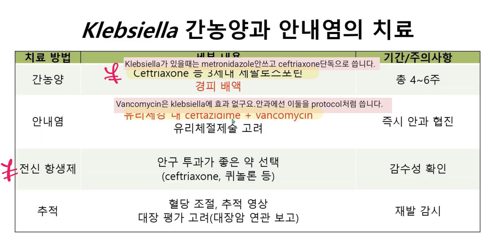{: style="width:78%"}

| 치료 | 내용 | 기간·주의 |
|---|---|---|
| 간농양☆ | **ceftriaxone 등 3세대 세팔로스포린 + 경피 배액** | 총 4~6주 |
| 안내염 | **유리체강 내 ceftazidime + vancomycin**, 유리체절제술 고려 | 즉시 안과 협진 |
| 전신 항생제☆ | **안구 투과가 좋은 약**(ceftriaxone, 퀴놀론 등) | 감수성 확인 |
| 추적 | 혈당 조절, 추적 영상, **대장 평가 고려(대장암 연관 보고)** | 재발 감시 |

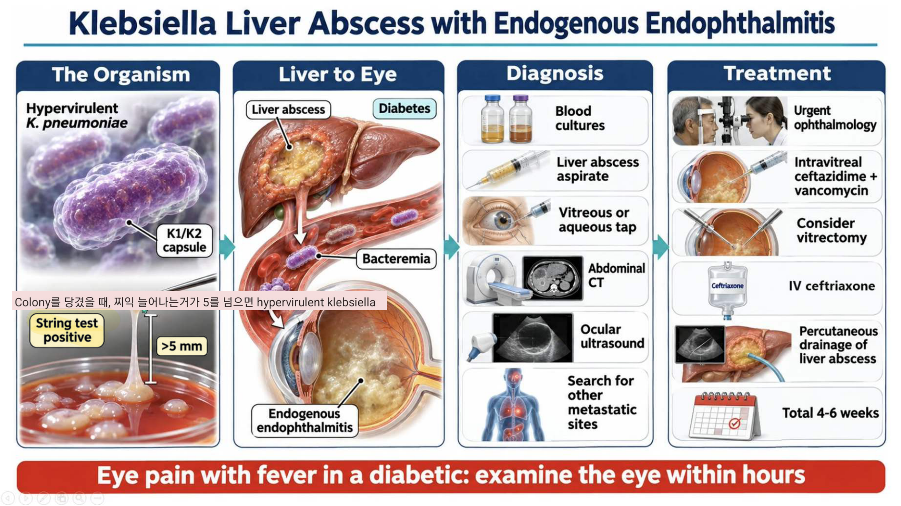{: style="width:80%"}

!!! diff "작년 필기와 다른 점"
    - 작년 교수님: "화농성 간농양은 ceftriaxone + metronidazole을 쓰는데 Klebsiella라면 ceftriaxone 단독으로 써도 된다." 올해는 더 분명히 **"metronidazole 쓰지 않는다"**.
    - 배액 기준 — 작년 교수님 "**2 cm 넘으면 보통 drain**(돼지꼬리 카테터, 10 cc 미만이면 뺀다)", 작년 슬라이드 5 cm 초과·다발성·약물 불응. 올해는 **경피 카테터 배액을 항생제와 병행, 4~7일 무반응이면 수술 배액**.
    - 작년 교수님 말씀: "간은 통증을 못 느낀다 — **복부 CT를 찍는 가장 큰 이유가 간농양·비장농양 발견**." "**간농양이 있으면 눈을 봐야 하고, 눈에 문제가 있으면 간을 봐야 한다.**" "Klebsiella는 **간, 신장, 눈**을 좋아한다." "항생제가 잘 도달하지 않는 곳 — **뇌, 전립선, 안구**." 내안구염의 **전방축농(hypopyon)**.

    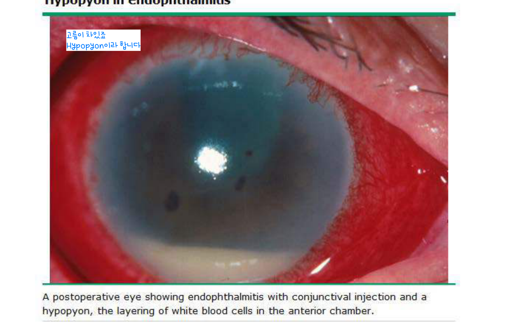{: style="width:40%"}

!!! exam "기출 포인트"
    - **7번**(2023)·**19번**(2020): 이 증례 그대로 → 원인균 ***Klebsiella pneumoniae***. *E. coli*·*Entamoeba*·*Staphylococcus*(외상 → 외인성 함정)가 오답.
    - **16번**(2021): 외상 없이 조절 안 되는 당뇨 + 눈 부종·충혈·안구 혼탁 + 발열·CRP 상승 → **내인성 내안구염**(안와 봉와직염 아님).
    - 필기본 수록 2024년 기출: 감수성 좋은 *Klebsiella* 간농양의 초기 치료 = **ceftriaxone과 배농**. 2022년 기출: 간농양 패혈쇼크에서 틀린 것 = 「항생제를 먼저 투여한 뒤 혈액배양」(**배양 먼저, 그러나 1시간 내 항생제**).

# 10. 증례 20 — 안매독

> 41세 남자. 1주간 **좌안 시력 감소**로 전원, 안과에서 **망막혈관염** 의심. **혈청 VDRL 1:64.** 시력 저하가 지속되며 **하루 종일 두통**. 37.0℃.

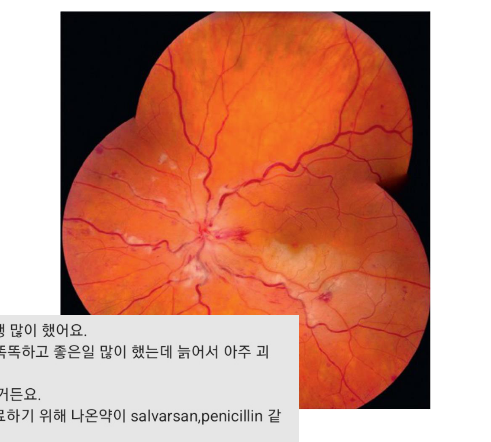{: style="width:42%"}

교수님(회색): "매독은 우리나라에 **2024, 2025년에 유행** 많이 했다. (교수님의 음모론) 위인들 중 젊었을 때 똑똑하고 좋은 일 많이 했는데 늙어서 아주 괴팍해진 사람들… 매독이 아니었을까? 매독은 **10~20년 지나면 뇌를 침범**하거든요. 매독은 중세~근대의 아주 큰 적. 매독을 치료하기 위해 나온 약이 **salvarsan, penicillin** 같은 약들."

## ① 진단과 동반감염 검사

- **망막혈관염·후포도막염 + 높은 혈청 VDRL(1:64)** → **안매독**. 지속 두통 → 신경매독 동반 평가.
- **혈청 VDRL = 비트레포네마 검사**: 정량 역가를 **치료 전 기준값**으로 기록하고, 추적 때 **같은 검사법**으로 비교.
- **트레포네마 검사(TPHA/TPPA, FTA-ABS, EIA)**로 확인 — **두 종류 모두** 확인. 트레포네마 검사가 음성이면 VDRL 위양성(대개 **1:8 이하**)을 재평가.
- **HIV 검사**(필수), B·C형 간염, 임질·클라미디아, **성 파트너 검사·치료**, 매독 신고(**제3급, 24시간 내**).

## ② 뇌척수액 — 목적과 한계

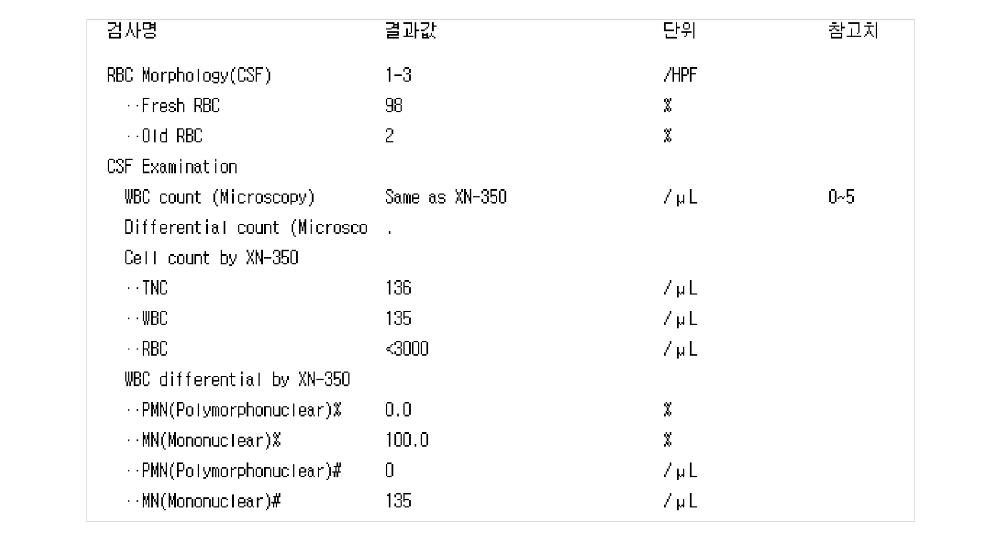{: style="width:55%"}

- 목적: 지속 두통에서 **중추신경계 침범·수막염 동반** 평가, 치료 전 기준값, 다른 수막염 감별. 신경학적 증상이 있으면 세포수·단백·**CSF-VDRL**.
- 결과: 백혈구 **135/µL(단핵구 100%)** — 기준(예: 5/µL)을 넘는 **단핵구성 세포증가 = 염증**. 단, 천자 시 혈액 혼입 영향 가능, 단백·포도당·CSF-VDRL은 자료에 없다, CSF 백혈구·단백 증가는 비특이적(HIV 자체도 가능).
- **CSF-VDRL은 특이도가 높고 민감도가 낮다** → **음성이어도 신경매독을 배제하기 어렵다**(혈액 오염은 위양성 원인).
- 교수님 슬라이드(빨강): "**CSF-VDRL 음성이나 정상 CSF로 안구 매독을 배제할 수 없다.**" → **안매독 치료는 CSF 결과와 무관하게 신경매독에 준한다.** 교수님(분홍): "진단은 CSF-VDRL 양성. **안구매독은 내매독(신경매독)에 해당**."

## ③ 치료와 추적

- 실명 위험 → **신속한 치료**. 국내 성매개감염 진료지침(2023): **결정형(수용성) penicillin G 1,800만~2,400만 단위/일 IV(300만~400만 단위씩 4시간마다 또는 지속주입), 10~14일**.
- 대안: **ceftriaxone 1~2 g IV 하루 1회, 10~14일**. 2020년 국내 증례는 penicillin G를 **한국희귀·필수의약품센터**로 확보하기 전 ceftriaxone 2 g IV를 썼다. 이 증례의 계획 예시: 치료 지연 없이 **ceftriaxone 2 g IV로 시작**하고 penicillin G 확보 여부에 따라 총 10~14일.
- 교수님(분홍): "Aqueous crystalline penicillin 써도 안 되면 ceftriaxone을 쓴다. **실제로 최근 환자들은 aqueous crystalline penicillin을 잘 못 써서 ceftriaxone을 쓰고 있는데, 괜찮더라구요?**"
- **야리시-헤르크스하이머 반응**: 치료 시작 직후 발열·두통·몸살. 교수님(분홍): "치료 안 하다가 갑자기 cephalosporin 들어가면 몸살·발열이 일어나는 걸 Jarisch-Herxheimer reaction이라고 한다. 가끔 온다." → 미리 설명하고 대증 치료.
- 추적: 시력·안저 반복 평가, 치료 후 **6·12·24개월** 같은 VDRL 검사법으로 비교, **4배 감소(1:64 → 1:16 이하)**를 반응으로 본다. 역가 미감소·재상승·증상 지속이면 HIV 재확인, 재평가·재치료. **CSF 세포 수는 민감한 반응 지표**이며, 임상·혈청 반응이 적절하면 **반복 요추천자가 항상 필요하지는 않다**.

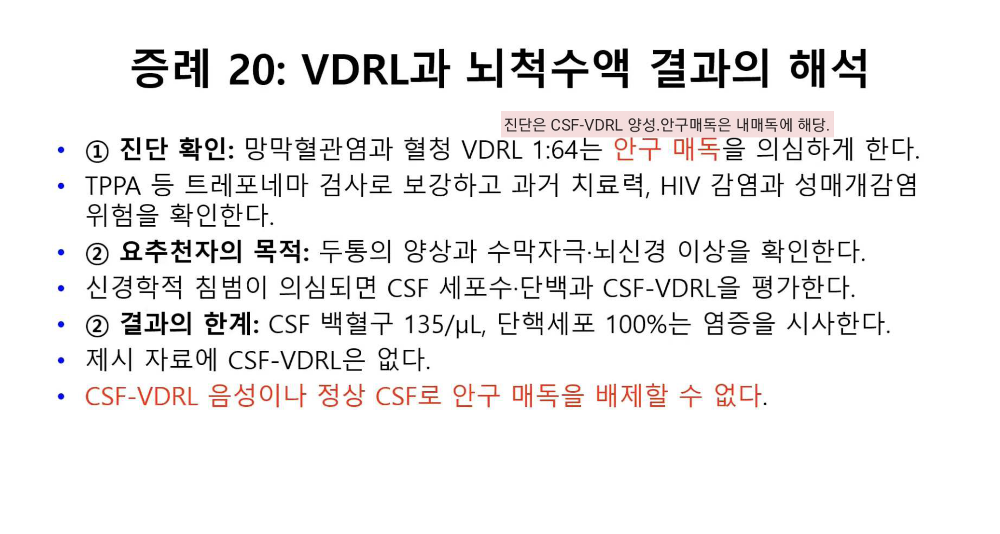{: style="width:72%"}

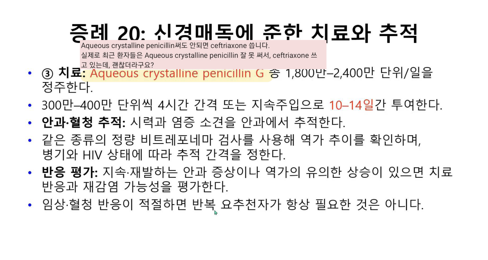{: style="width:72%"}

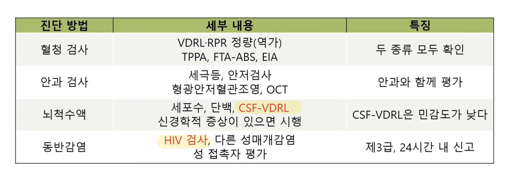{: style="width:78%"}

| 진단 | 내용 | 특징 |
|---|---|---|
| 혈청 검사 | VDRL·RPR 정량(역가), TPPA, FTA-ABS, EIA | **두 종류 모두 확인** |
| 안과 검사 | 세극등, 안저검사, 형광안저혈관조영, OCT | 안과와 함께 평가 |
| 뇌척수액 | 세포수, 단백, **CSF-VDRL** — 신경학적 증상이 있으면 | **CSF-VDRL은 민감도가 낮다** |
| 동반감염 | **HIV 검사**, 다른 성매개감염, 성 접촉자 평가 | **제3급, 24시간 내 신고** |

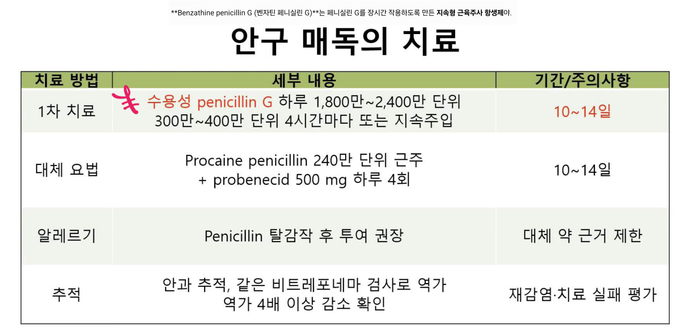{: style="width:78%"}

| 치료 | 내용 | 기간·주의 |
|---|---|---|
| 1차☆ | **수용성 penicillin G 하루 1,800만~2,400만 단위**, 300만~400만 단위 4시간마다 또는 지속주입 | **10~14일** |
| 대체 | **procaine penicillin 240만 단위 근주 + probenecid 500 mg 하루 4회** | 10~14일 |
| 알레르기 | **penicillin 탈감작 후 투여** 권장 | 대체 약 근거 제한 |
| 추적 | 안과 추적, 같은 비트레포네마 검사로 역가, **4배 이상 감소** 확인 | 재감염·치료 실패 평가 |

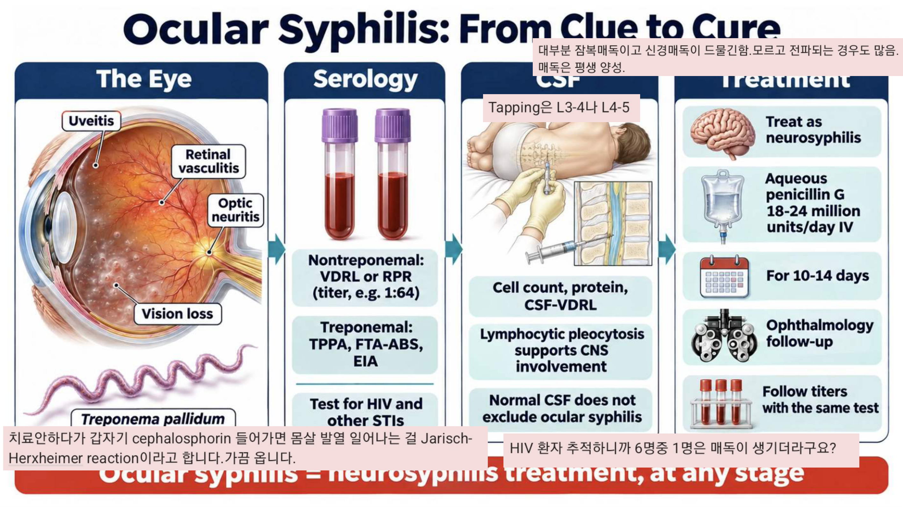{: style="width:80%"}

인포그래픽의 메모: "**대부분 잠복매독**이고 신경매독은 드물긴 함. 모르고 전파되는 경우도 많음. **매독(트레포네마 검사)은 평생 양성.**" "Tapping(요추천자)은 **L3-4나 L4-5**." "**HIV 환자를 추적하니까 6명 중 1명은 매독이 생기더라.**"

!!! diff "작년 필기와 다른 점 — 매독 전체 → 안매독 중심"
    올해는 **안매독 치료**에 집중했다. 작년 필기의 매독 일반 내용(기출이 많으니 기억):

    - 교수님: "**손바닥, 발바닥에 병변**을 주면 매독이다. 시험 문제에 잘 나온다(손만 보통 나온다)."
    - 1기: 무통성 **chancre**(귀두와 음경 몸통 사이, 입에도), 2기: 전신 발진·**condyloma lata**(→ HIV도 검사), 잠복 매독(건강검진 중 발견).
    - 검사 순서: 선별(VDRL·RPR) → 확진(TPHA 등)인 traditional과, **확진을 먼저 하고 VDRL로 활동성을 보는 reverse**(요즘 선호). VDRL 역가가 높을수록 활동성↑.
    - **1·2기(조기): benzathine penicillin G 240만 단위 근주 1회**, 오래됐거나 기간을 모르면 **1주 간격 3회**. 교수님: "penicillin G 주사용은 없지만 **benzathine penicillin G는 공급**이 된다." 1형 과민반응 약력 기록.
    - 뇌척수액 검사 적응: 3기 매독이 머리로 간 것이 의심될 때, **눈에 병변**이 있을 때, **VDRL 1:8~1:16을 넘을 때**.
    - 치료 성공(VDRL): 1기 6개월 4배·12개월 8배 감소, 2기 6개월 8배·12개월 16배, 3기 12개월 4배.

    {: style="width:42%"}

!!! exam "기출 포인트"
    - **22번**(2020): VDRL 1:64 + 망막혈관염 + 두통 + CSF 세포 증가의 원인 = **신경매독**(결핵·톡소플라즈마·CMV·HIV 치매 아님).
    - **15번**(2021): 우울증 환자의 한쪽 시력장애 + CSF 이상 → **국내에서 가장 적절한 약 = ceftriaxone 2 g q24h IV 14일**. **Benzathine penicillin은 중추신경계 농도가 부족해 신경·안매독에 쓰지 않는다**(1회·3회 모두 오답) — 올해 교수님 "ceftriaxone 쓰는데 괜찮더라"와 같은 결론.
    - 필기본 수록 2023년 기출: 「매독 치료제로 가장 권장되는 것」·「손발바닥 발진의 35세 남자」 → **benzathine penicillin G**(조기 매독). 안매독·신경매독과 구별할 것.

# 11. 작년(2025) CP-A2에만 있던 증례

!!! diff "작년 필기와 다른 점 — 올해 빠진 증례"
    아래 6개 증례(작년 Case 11~16, 20)는 **올해 CP-A2에 없다**. 그러나 이 수업 2부 기출 **1·2·3·5·6·8·9·10·12·13·20·21번**이 여기서 나왔고, 교수님은 같은 증례를 해마다 반복해서 출제하신다. 작년 필기 그대로 둔다. (좁쌀결핵·대상포진·화농성 척추염은 올해 **CP-A1**에서 다뤘다 — 3강 학습자료 참고.)

## 11-1. 좁쌀결핵(miliary TB) + 결핵성 흉막염 — 작년 Case 11

> 73세 남자, 1주간의 호흡곤란. 2~3개월 전부터 식욕부진, **체중 8 kg 감소**, 1주 전부터 발열과 호흡곤란. 37.8℃. 흉부 X선 **흉수**, CT 양측 좁쌀 결절.

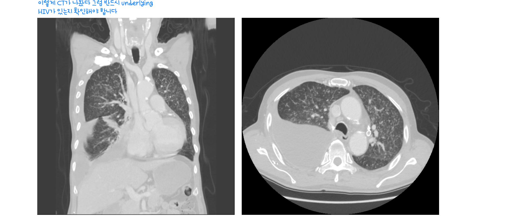{: style="width:55%"}

- 결핵균의 **혈행성 파종** — 좁쌀(millet seed) 크기 결절이 **양측 폐에 무작위로**. 교수님: "림프절 같은 데서 caseous necrosis가 **blood stream으로 확 퍼진** 것." "이렇게 CT가 나왔다 그럼 **반드시 underlying HIV가 있는지 확인**해야 한다."
- 전체 결핵의 1~2%. 면역저하(HIV — CD4 < 200, 장기이식, 면역억제제), 소아·노인, 악성종양, 당뇨, 만성신부전. 교수님: "평생 발병 위험은 교과서상 5~10%지만 요즘은 오래 살아 **20%**로 생각한다. **고령은 늘 결핵을 생각**해야 한다."
- 침범: 폐 100%, 간·비장 50~80%, 골수 25~75%, **중추신경계 10~30%**(두통이 있으면 tapping), 척추(cold abscess). 교수님: "**객담에서 양성률이 낮다** — blood stream을 타고 폐 병변을 만들었기 때문." 일반 폐결핵은 산소 농도가 높은 **폐첨부**를 좋아한다.
- 진단: **AFB 도말은 확진이 아니다**(다른 항산균도 양성). **배양(액체 > 고체) 또는 PCR 양성이 확진**. 교수님: "**PCR이 가장 핵심** — TB PCR 3번 음성이면 결핵이 아니겠다 할 만큼." **PCR + rifampin 내성 유전자(Xpert)**. 격리 환자는 객담 **PCR 3번 음성**이면 일반 병실로.
- **육아종(caseous necrosis)**: "이게 보이면 결핵. 근데 **99%이지 확진은 아니다**(1%는 브루셀라, 사르코이드증)."

{: style="width:45%"}

- 치료: 결핵성 흉막염 **HRZE 2개월 + HR 4개월**(6~9개월), **좁쌀·파종성 결핵 HRZE 2개월 + HR 7~10개월 = 9~12개월**. "airway를 누르면 스테로이드." 교수님: "결핵 진단·치료는 **한국 지침을 우선** — 우리나라 유통 약인지, 내성 빈도, 보험 적용."
- 결핵성 흉수: 림프구 우세, **ADA > 40 U/L**.

!!! exam "기출 포인트"
    **1·5·10·20번**: 좁쌀결핵 영상 = **양측 폐 전체의 1~3 mm 균일한 미세결절**(공동은 재활성화 폐결핵, 간유리음영은 PCP·CMV). 20번은 **좁쌀결핵 + 결핵성 늑막염**. 10번: 24세 남자 → HIV 확인.

## 11-2. 관절결핵 — 작년 Case 12

> 67세 여자. 1년 전 손을 짚은 뒤 **손목 부종이 계속**. 36.7℃. MRI에서 조영 증강되는 농양 주머니, 수술 부위에서 **rice body**.

{: style="width:45%"}

- 전체 결핵의 1~2%, 폐외결핵의 10~15%. **척추 50%** > 고관절 20% > 무릎 15%. 교수님: "**놓치는 경우가 많다** — 이것저것 하다 6개월 지나간다." "**손톱, 발톱, 머리카락 빼고 결핵은 어디든 다 간다.**"
- **Rice body**: 관절결핵의 70%, RA에도 있어 **비특이적**. **Phemister triad**(X선): 관절주위 골감소증, 경계부 골미란, 관절간격 협착.
- 확진: 수술 검체 AFB 도말·배양·TB-PCR, 조직(caseous necrosis with granuloma). 치료 **HRZE 2개월 → HR 7~10개월(9개월 이상)**. 감별: 화농성 관절염, 진균, **브루셀라**("소 키우는 사람"), RA, 통풍.

## 11-3. 파종성 대상포진 — 작년 Case 14

> 75세 여자, **당뇨 20년**. 오른 다리 피부분절 병변 + 진찰 중 **배**에도 병변.

{: style="width:50%"}

{: style="width:36%"}

- 교수님: "**local lesion과 떨어진 곳**에 병변이 있으면 **disseminated**." 대상포진 = 감각신경절에 잠복한 **VZV 재활성화**. 안면신경마비·내이 증상 → **Ramsay Hunt 증후군**. 가장 흔한 합병증 **포진후신경통**. "신경통이 안 오게 하는 게 목적 — **지금 당장** 치료."
- 파종성: 입원, **acyclovir 정맥 10 mg/kg 8시간마다** 7~10일(신기능 조절) — "집에 PO 약 주면 신경통이 생길 가능성이 높아진다." 격리: **공기·접촉주의**(1인실).
- 백신: **Shingrix(사백신)** — 10년 이상, 95~98%, 면역저하자도 가능, **50세 이상 2회**(예전 Zostavax 생백신은 2/3, 5년).

!!! exam "기출 포인트"
    **3번**: 파종성 대상포진 = **acyclovir 정맥 10 mg/kg 8시간마다**(valacyclovir 1 g 하루 1회는 용법이 틀림). **6번**: 1인실 이유 = **공기전파**. **12번**: 귀 통증·외이도 수포·안면마비(Ramsay Hunt) = **VZV**. **13번**: famciclovir(72시간 이내).

## 11-4. 반복되는 *S. aureus* 피부농양 — 작년 Case 15

> 45세 남자, 3달간 얼굴·엉덩이·겨드랑이·목에 **반복되는 종기**.

{: style="width:40%"}

- 원인: ***S. aureus*의 비강 집락**("정확하게는 nasopharynx, 빈도는 코 안이 제일 많다"). 일반인 20~30%가 비강 보균. 모낭염은 *S. aureus*와 *Pseudomonas*(습한 욕조·수영장).
- 급성기: **절개·배농** + 항생제(MSSA 1세대 cephalosporin, MRSA TMP-SMX·doxycycline·clindamycin). **탈집락화: 비강 mupirocin 하루 2회 5일 + chlorhexidine 목욕**, 가족 동시 치료.

| 제균 방법 | 제균 성공 | 재감염 감소 |
|---|---|---|
| Mupirocin 단독 | 60~70% | 30~40% |
| **Mupirocin + chlorhexidine** | 75~85% | 50~60% |
| + 전신 항생제(rifampin + Bactrim 등) | 85~90% | 60~70% |

!!! exam "기출 포인트"
    **2·8번**: 재발을 줄이는 방법 = **비강 mupirocin(+ chlorhexidine 세정)**. 장기 경구 항생제·amoxicillin·azithromycin은 오답.

## 11-5. 화농성 척추염 — 작년 Case 16

> 78세 남자, 4일간 악화된 하지 무력, **2주 전 허리에 침술**, **39.1℃**, CRP 9. MRI: 척추염 + 척추주위 농양.

- 교수님: "침으로 이렇게 깊은 곳을 찌르기는 어렵다 — **침이 원인이라고 단정 짓지 말자.**" "**고령화와 함께 많아지는** 질환." **MRI = gold standard**, 혈액배양(30% 정도), CT 유도 생검.

{: style="width:62%"}

| | 화농성 | 결핵성 |
|---|---|---|
| 경과 | 고열, 짧음 | 간헐열, **indolent·길다** |
| CRP·ESR | **현저히 상승** | 약간 상승 |
| 부위 | **요추** | **흉추**("TL 사이면 TB") |
| 농양·디스크 | 디스크 파괴 | 척추 주위 농양, 디스크 비교적 보존 |

- 교수님: "**CRP가 높다가 항생제를 썼을 때 뚝 떨어지면 pyogenic**." 경험적으로 MSSA 중심, **6~12주**. 수술: 진행하는 신경학적 결손, 척수·마미 압박.

## 11-6. COVID-19 폐렴 — 작년 Case 20

> 68세 여자, 모임 후 호흡곤란, 남편이 코로나19 진단, **산소 4 L/min**.

{: style="width:42%"}

- 교수님: "폐의 **peripheral**로 간다(center면 폐부종)." "요즘은 **항원검사**만 한다." "제일 잘 듣는 약은 **remdesivir**(초기), **산소를 써야 하면 스테로이드(dexamethasone)**도 같이."

!!! exam "기출 포인트"
    **9번**: 산소 4 L/min이 필요한 환자의 예후에 가장 도움 = **dexamethasone**(사망률 감소). **21번**: 보존적 치료의 핵심 = **저산소증 치료**.

# 암기 — CP-A2(2026) 요점

| 증례 | 한 줄 요점 |
|---|---|
| 11 VP 단락관 감염 | 가성낭종. **저장소 천자 CSF**(요추천자 ×), CoNS·*S. aureus*·*C. acnes*(10일 보존). **단락 제거 + EVD + vancomycin + 항녹농균 β-lactam**. shunt 신염(C3↓, VA에서 흔함). 조영 CT 전 Cr |
| 12 림프부종 연조직염 | **β-용혈 연쇄구균 A·C·G** → cephalexin·cefazolin **5일**. 예방 항생제 **연 3~4회 재발**. 국내는 cefadroxil·amox/clav(penicillin V 없음) |
| 13 방선균증 | 장기 IUD + 침윤성 종괴 + **유황과립**. **penicillin G 정주 2~6주 → amoxicillin 6~12개월** + IUD 제거. metronidazole 무효 |
| 14 TSS | 초항원(TSST-1, SpeA). 혈액배양 **음성이어도**(포도알균). 1~2주 손발바닥 박리. 소생 + 탐폰·상처 제거 + **clindamycin**(독소 억제) ± **IVIG** |
| 15 수족구병 | Coxsackie A16·A6, EV71(**뇌간뇌염**). 임상 진단. **수분 공급**, **aspirin 금지**, 항생제 × |
| 16 당뇨발 | SIRS 2개 = 중증. **PTB**, 뼈 배양이 표준, **ABI는 석회화로 높게**. **심부 조직 배양**(면봉 ×). 항생제 + **변연절제** + 재혈관화 |
| 17 파상풍 | 보고 진단, 의식 명료. **TIG 500 IU + metronidazole**(penicillin은 경련 악화) + benzodiazepine. **회복 후 백신** |
| 18 PJP | 이식 후, 양측 GGO, 진찰보다 심한 저산소. **유도객담·BAL PCR**, β-D-glucan 보조. **TMP-SMX 21일**, **PaO2 < 70이면 스테로이드** |
| 19 *Klebsiella* | 당뇨 + 간농양 ↔ 내인성 안내염(발열). string test. **ceftriaxone 단독**(metronidazole ×) + 배액 4~6주, 유리체 **vancomycin + ceftazidime** |
| 20 안매독 | VDRL 1:64 + 망막혈관염. **신경매독에 준해** 수용성 penicillin G IV 10~14일(국내 ceftriaxone). 정상 CSF로 배제 ×. HIV 검사 |
