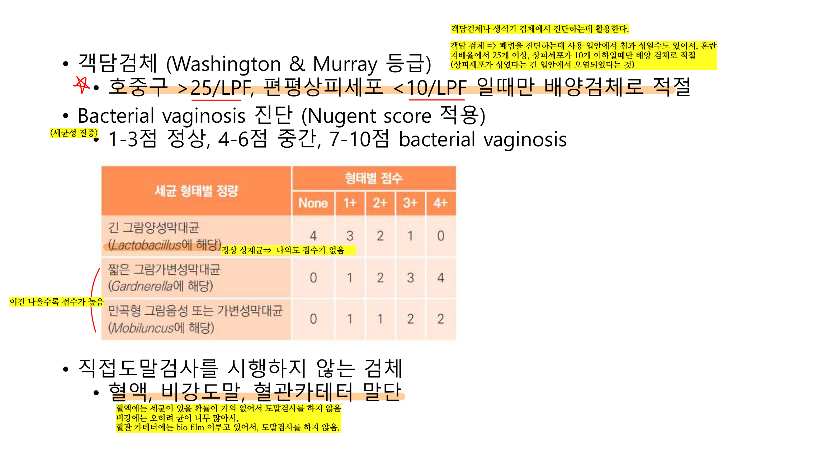
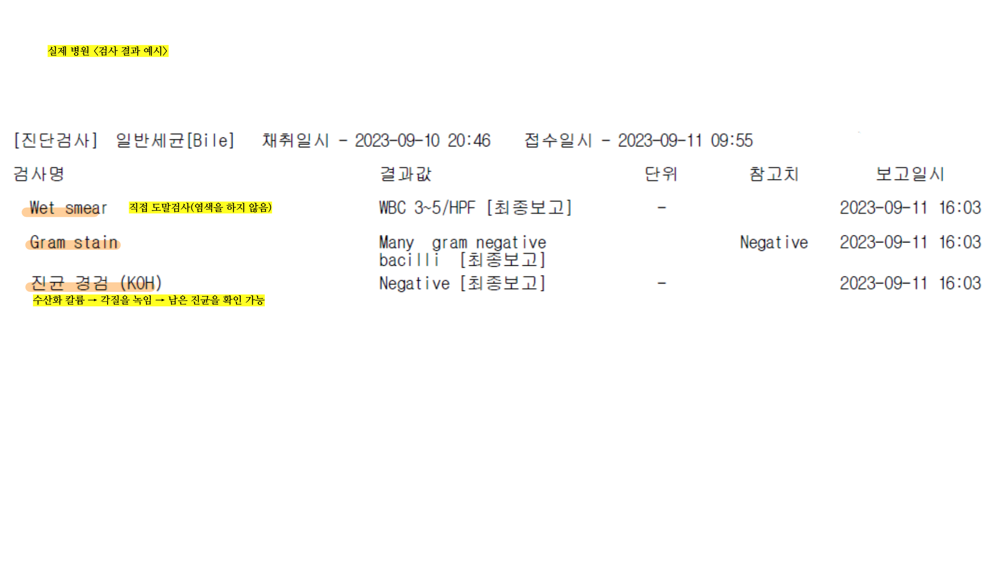

<!-- 필기본: 2026 · 2025 -->
<!-- 단계: 수업 후 -->

# 0. 이 수업을 공부하는 법

**김유경 교수님**(진단검사의학과) 수업(2023·2025·2026 같은 교수님, 2시간). 올해 필기본은 슬라이드 50쪽 + 교수님 말씀 필기(노란 상자) + 실제 경북대병원 **검사 결과지** 여러 장. 교수님 말씀: *"오늘은 질병을 진단하기 위한 검사. 어떤 검사들이 있는지, 검사 과정은 어떤지 맛을 보여드리고자 합니다."*

- 오늘 범위: **세균과 일부 진균, 배양으로 하는 검사 위주**. 혈청학적 진단·분자진단은 안 한다.
- 실제로 2025 시험에는 **강의 슬라이드·결과지 그대로의 사례형**(객담 감수성 결과 해석, BAL 정량배양 계산, 혈액배양 후 조치)이 나왔다. 결과지를 읽는 연습이 곧 시험 공부다.

!!! new "올해 필기에서 추가"
    - 필기본 2쪽에 **2022–2025 기출(「족보」)을 슬라이드 위에 붙여** 두었다 — 22·23·24·25 표시. 붙인 문제: 객담 결과 해석(2025), BAL 0.001 mL 계산(2025), 그람양성알균 다음 예비동정 = catalase(2025), 「가장 정밀한 검사법」(2025), 객담 편평상피 28개(2023), 40℃ 배양기 고장(2023), MIC를 재지 않는 검사(2022), 장티푸스 대변에 초콜릿 배지(2022). 해당 슬라이드에도 다시 붙여 놓았다 → 아래 `기출 포인트` 상자와 같은 자리.
    - 24쪽 Campylobacter 배양 환경 옆에 빨간 **「족」** 표시(족보 단골).
    - 결과지(혈액·객담·BAL·소변·대변·뇌척수액·카테터 팁)가 새로 많이 들어왔다 → 각 단원에 그림으로 넣었다.

!!! diff "작년 필기와 다른 점"
    작년 필기는 자연내성 표의 **보라색 ★ 3개를 「무조건 외우라」**고 했는데, 올해 47쪽에는 **"아래 표 외우는 건 출제하지 않았습니다"**라고 적혀 있다. 대신 **「자연내성인데 S가 나오면 재검」이라는 원리**는 작년 기출(2025 1번)로 나왔다고 교수님이 직접 짚었다(50쪽). → 표 전체를 외우기보다 원리 + 대표 예(K. pneumoniae–ampicillin)를 확실히.

기출 29문항(2020–2025)의 주제

| 주제 | 2부 번호 |
|---|---|
| **항균제감수성검사: 「가장 정밀한 방법」= 경도확산법(E test)** — 같은 문제 3번 | 4, 18, 28 |
| 디스크확산법은 MIC를 재지 않는다 | 16, 21 |
| 감수성 결과 해석(S의 의미, 자연내성 → 재검) | 1, 12 |
| 객담 적합성(편평상피세포), BAL 정량배양 계산 | 10, 3 |
| 그람염색(사프라닌 빼먹으면), 예비동정(catalase, oxidase) | 15, 17, 8, 19, 26 |
| Campylobacter 배양 조건(5% O2, 10% CO2, 85% N2, 42℃) | 6, 11, 24 |
| 위성현상(H. influenzae, X·V 인자) | 20, 25, 29 |
| 배지(CNA, SS), 검체 채취·운송, 혈액배양 후 조치 | 7, 14, 27, 2 |
| 광학현미경으로 안 보이는 균(Mycoplasma) | 5 |
| (지금 강의에 없는) 생물안전·소독제·협막팽화 | 9, 13, 22, 23 |

!!! key "핵심 — 미생물 검사의 흐름"
    **검체 → 직접도말(바로) → 배양 → 균종동정(예비 → 확정) → 항균제감수성검사**.
    매 단계의 질문은 하나다: **「이 결과가 진짜 원인균인가, 상재균·오염균인가?」** — 검체가 상재균에 노출되는 곳인지(객담·상처·대변·생식기) 무균 부위인지(혈액·뇌척수액·체액·BAL)에 따라 기준이 달라진다.

# 1. 미생물 검사의 종류

임상에서 중요한 것은 세균·바이러스·곰팡이. 전통적인 미생물 검사는 **직접 배양**이지만 **바이러스는 배양이 어렵다** → 배양이 불가능하면 도말하거나 아래의 다른 방식(혈청학·분자진단)으로 한다.

1. **직접도말검사**
2. **배양검사**
3. **균종동정**
4. 혈청학적 진단(항원·항체 — 오늘은 안 함)
5. 감염분자진단(오늘은 안 함)
6. **항균제감수성검사**

올해 필기는 1–4번(직접도말 → 배양 → 동정 → 감수성)에 번호를 매겨 이 순서로 진행했다. 이 학습자료도 같은 순서다.

# 2. 직접도말검사

## 무엇을, 왜
- 세균·진균·기생충을 **배양하지 않고** 환자 검체 그대로 **신속하게** 검출. 배양은 1–2일 걸리지만 도말은 바로 → **배양결과가 나오기 전에** 치료·경과관찰에 중요한 정보를 준다.
- **염증반응과 배양검체의 질**을 평가: 호중구, 적혈구, 상피세포의 분포. 예: 객담을 도말했는데 **상피세포가 너무 많으면** 검체를 얻는 과정에서 **입안 상재균에 오염**됐다고 본다.
- 그람염색 도말은 **저배율(100배, LPF)**에서 보이는 세포를 **정량적으로**(숫자를 직접 세어) 보고, 균의 모양은 **1,000배 유침(OIF)**으로 본다. 400배 = HPF.

{: style="width:78%"}

| 세포 | 검체 | 시야 | 보고(10개 시야 이상 평균) |
|---|---|---|---|
| **호중구** | 모든 검체 | LPF | None, Few <10, Moderate 10–25, **Many >25** |
| 〃 | 생식기 | HPF | ≤10, >10 |
| **편평상피세포** | 호흡기·창상 | LPF | None, **Few <10**, Moderate 10–25, Many >25 |
| 〃 | 생식기 | HPF | ≤10, >10 |
| 세균 | 모든 검체 | OIF | None 0, Rare(1+) <1, Few(2+) 1–5, Moderate(3+) 6–30, Many(4+) >30 |

## 객담 검체의 적합성 (Washington & Murray 등급) ★

!!! memo "암기 (필기에 ★)"
    **호중구 >25/LPF, 편평상피세포 <10/LPF일 때만 배양검체로 적절.**
    객담은 폐렴 진단용인데 뱉는 과정에서 침과 섞일 수 있다. 상피세포가 섞였다 = 입안에서 오염됐다는 것. 편평상피세포가 10개 이상이면 **호중구가 아무리 많아도 부적절** → 다시 받는다.

## 세균질증 — Nugent score

{: style="width:78%"}

- **세균질증(bacterial vaginosis)**은 질 분비물 그람염색에서 세 가지 형태 균의 양으로 점수: **1–3 정상, 4–6 중간, 7–10 세균질증**.
- **긴 그람양성 막대균(Lactobacillus)** = 정상 상재균 → **많을수록 점수가 낮다**(4+면 0점, 없으면 4점).
- **짧은 그람가변 막대균(Gardnerella)**, **만곡형 그람음성/가변 막대균(Mobiluncus)** → **나올수록 점수가 높다**.
- 즉 「유산균은 줄고 Gardnerella·Mobiluncus가 늘면 세균질증」.

## 직접도말을 하지 않는 검체

| 검체 | 이유 |
|---|---|
| **혈액** | 세균이 있을 확률이 거의 없어(양이 너무 적어) 도말로 볼 수 없다 |
| **비강도말** | 오히려 정상균이 너무 많아 의미가 없다 |
| **혈관카테터 말단** | 바이오필름(bio film)을 이루고 있어 직접 평가할 수 없다 |

## 염색하지 않는 직접 검경
- **KOH(수산화칼륨) 표본**: KOH가 **각질(사람 조직)을 녹이면 진균만 남는다** → 진균 확인. 염색법은 아니다.
- **India ink(묵즙) 표본**: 엄밀히 말하면 염색은 아니고, 뇌척수액에 떨어뜨리면 배경이 까매지고 **두꺼운 협막** 때문에 동그란 균 주위가 비어 보인다 → **Cryptococcus**. 손쉽게 중요한 균을 볼 수 있어 루틴으로 한다(7단원 뇌척수액 결과지에도 나옴).

{: style="width:70%"}

결과지 읽기: **Wet smear** = 염색하지 않은 직접 도말(WBC 3–5/HPF), **Gram stain** = Many gram negative bacilli, **진균 경검(KOH)** = Negative. 모두 [최종보고] — 도말은 당일 바로 끝난다.

!!! exam "기출 포인트"
    10번(2023, 필기본 2쪽에 붙어 있음): 객담 LPF당 편평상피세포 28개, 호중구·대식세포 50개 → **편평상피세포가 많으므로 부적절**(④). 「호중구가 25개 이상이니 적절」(①)이 함정. 23번(2021): 폐렴사슬알균을 검체에서 직접 확인하는 방법 → **Neufeld 협막팽화시험**(오답 짝: 암시야 = 매독, India ink = 크립토콕쿠스, KOH = 진균).

# 3. 배양검사 — 혈액

## 균혈증
- 혈액은 정상적으로 **무균** → 어떤 종류의 세균이라도 나오면 임상적으로 큰 의미.
- **균혈증**: 혈액에서 세균·진균·바이러스·기생충 검출. **세균혈증**이 생기는 경로는 둘: ① **혈관내 감염**(직접), ② **다른 부위 감염**에서 혈관으로 들어옴.
- 균혈증을 일으키는 다른 부위 감염: **비뇨생식기계 25%**(주로 요로감염), **하부기도 20%**(폐렴), 농양 10%, 원인불명 25%.
- 흔히 분리되는 세균: **Staphylococcus, Enterococcus, Enterobacterales, Pseudomonas aeruginosa, Acinetobacter**.
    - **S. pneumoniae(폐렴구균)** — 주로 **지역사회감염(CAP)**: 일반 의원 수준에서 항생제로 치료하는 경우가 많다.
    - **응고효소음성 포도알균(CNS)** — 피부 정상균무리라 혈액에서 많이 자라기도 하지만(오염), **정맥내 카테터, 인공심장판막** 환자에서는 진짜 원인균일 수 있어 중요.
    - **E. coli** — 지역사회·의료기관 모두 흔함.
    - **의료관련감염** — S. aureus, Enterococcus, Serratia marcescens, Enterobacter, Acinetobacter.
- **피부유래 오염균**: **CNS, viridans streptococci, Aerococcus, Micrococcus, Bacillus(B. anthracis 제외), diphtheroid(C. diphtheriae를 제외한 Corynebacterium), Cutibacterium**. 소독을 제대로 안 하면 묻어 나온다.

!!! key "핵심 — 오염균인지 원인균인지"
    **38℃ 이상 발열, 오한, 저혈압 중 1개 이상** + **2쌍 이상의 혈액배양에서 분리** → 균혈증의 원인균으로 간주. 2쌍 = **서로 다른 부위나 시간 간격을 두고** 뽑은 두 쌍. 둘 중 하나에서만 나오면 오염일 수 있다 → **증상도 있어야 하고 혈액배양 2쌍 이상에서 나와야 한다.** 그래서 최소 2쌍 이상 채혈한다.

## 채혈 시기·횟수·양
- **심내막염**: 혈관내 감염 → 심장에서 균을 계속 내보내는 **지속적 균혈증** → **언제라도 채혈하면 된다**.
- 다른 부위 감염: **간헐적**일 수 있어 채혈 시기가 중요 → **발열이 있을 때 2세트 이상(서로 다른 부위)을 동시에**.
- **1세트 = 한 번의 정맥천자로 얻은 혈액배양**(호기·혐기 병에 나눠 담아도 1세트). 2세트 = 두 군데에서 천자.
- **채혈량이 많을수록 양성률이 높다** — 성인은 혈액 **1 mL당 세균이 1마리 이하**(정상인 혈액엔 세균이 거의 없다는 것).
- **1회 권장량: 성인 20–30 mL**, 영아·소아는 **전체 혈액량의 1% 이하**(많이 뽑으면 빈혈), **12세 이상은 성인과 비슷하게**.

!!! new "올해 필기에서 추가"
    OSCE에서 연습하듯 **20 cc 뽑아 호기·혐기 병에 10 cc씩** 채운다. 채혈이 어려우면 **최소 5 cc씩은 병에 넣어라.**

## 피부소독
- 클로르헥시딘 팅크(요즘 많이 씀), 요오드 팅크, 포비돈 요오드(착색되고 마를 때까지 기다려야 해서 환자들이 싫어함), 알코올.
- **생후 2개월 미만 영아는 클로르헥시딘 사용 불가**: 피부장벽 미성숙 → 전신독성, chemical burn → 이때는 **아이오딘(요오드)**을 쓴다.
- **오염률이 3%를 넘으면 피부소독 방법을 개선**해야 한다. 오염률 = 피부유래 오염균이 자라 **가짜 양성(위양성)**으로 나온 비율이라고 보면 된다.
- **혈관단락(shunt)·정맥유치카테터에서 채혈하지 않는다**: 바이오필름에 세균이 집락화(병원성은 아니어도 군락을 이룸) → 채혈할 때마다 계속 나와 **실제 원인균이 아닐 가능성이 높다**.

## 혈액배양병과 자동혈액배양기
- 혈액 속 균은 너무 적어 **액체배지(배양병)**에 넣어 증폭한다. 배양병에 든 것:
    - 영양성분: **tryptic soy broth, brain heart infusion broth**
    - **항응고제 SPS**(sodium polyanethol sulfonate) — 혈액배양용 채혈에는 SPS를 써야 한다(혈액이 굳으면 균이 갇힘)
    - **항생제 중화제·보조제**(resin, charcoal, β-lactamase, activated charcoal, polymeric adsorbents) — 이미 항생제를 맞은 환자도 균이 자라게
    - **지시제(CO2 측정용 indicator)**, 혐기성 배양병엔 **산소제거 성분·환원제**
- **자동혈액배양기**: 병을 **흔들면서** 배양해 증식이 빠르고, 세균 대사산물(CO2)을 **10분 주기**로 측정해 자동으로 알람(눈으로 탁도를 보지 않는다).

## 결과 보고와 질관리
- **음성**: **No growth after 2 days(중간보고), No growth after 5 days(최종보고)** — 무한정 키우지 않는다. 5일 뒤에도 없으면 음성으로 보고하고 병을 폐기.
- **양성**: "growth" → **그람염색** → **분리배양**, 예비보고 → **동정검사, 항균제감수성검사**. 시간이 상당히 걸린다.

!!! new "올해 필기에서 추가"
    **자라는 데 몇 달 걸리는 균**은? → 5일 규칙으로는 놓치므로 **의사가 의심되는 균이 있으면 검사실에 미리 알려(커뮤니케이션)** 배양 기간·방법을 바꾸게 한다.

- **검사실 획득감염** = 검사실 직원이 검체를 다루다가 감염되는 것. 주의할 균: **Brucella, Francisella tularensis, Histoplasma capsulatum** 등 **절대인체병원균** — 기회감염균(정상 면역이면 안 걸림)과 달리 **조금만 노출돼도 감염**되며 법정감염병 등으로 관리.
- **혈액배양 질관리지표**(채혈을 잘하고 있는가):
    - **오염률 2–3% 이하**로 유지
    - **접종 혈액량 병당 10 mL** 권장 — 이것도 모니터링
    - **양성률 급성기 병원 8–10%** — 너무 낮으면 배양이 잘 되고 있는지, 너무 높으면 소독을 잘하고 있는지(오염) 확인

{: style="width:70%"}

결과지 읽기: 말초혈액 **호기 1·2, 혐기 1·2**(한 세트씩 2번 뽑음). 9월 6일(채혈 2일째) 「No growth 2 days」 중간보고 → 9월 9일(5일째) 「No growth 5 days」 최종보고 = 5일간 배양했다.

!!! exam "기출 포인트"
    2번(2025, 필기본 34쪽에 붙어 있음): 정맥유치카테터 환자 발열·오한, 혈액배양에서 분리된 균의 그람염색·간이검사 결과 → 다음 조치는 **생화학검사나 질량분석으로 확정 동정**(②). 오답: 2회 중 1회만 자랐으니 더 안 함 / 바로 오염균 간주 / 소독법 개선 / **카테터를 통해 채혈**(권장하지 않음). 27번(2020): 혈액은 **배양병**에 넣어야지 혈액배지·MacConkey 평판에 바로 접종하는 게 아니다.
