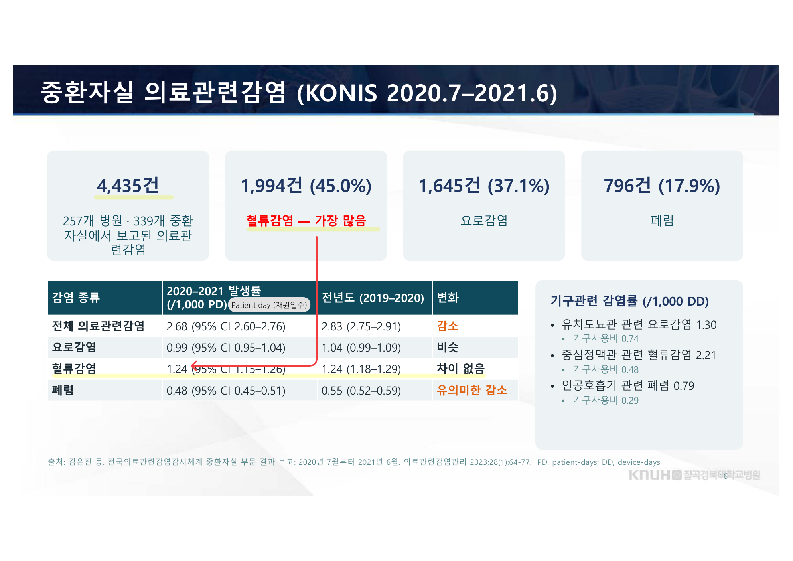
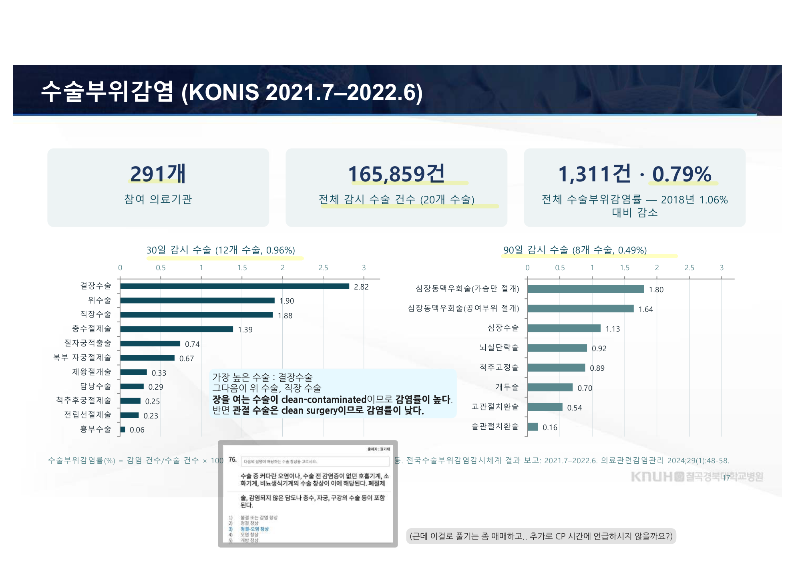
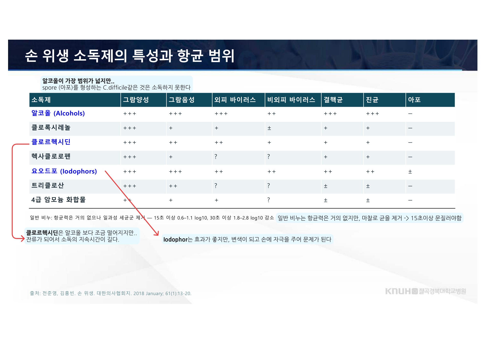
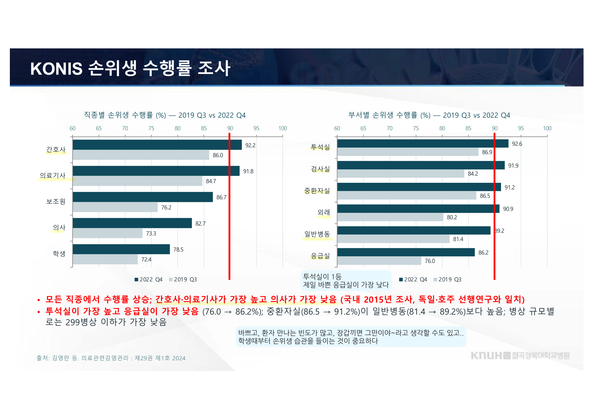

<!-- 필기본: 2026 · 2025 -->
<!-- 단계: 수업 후 -->

# 0. 이 수업을 공부하는 법

감염내과 **권기태 교수님** 수업(2026. 11. 19). 올해 강의는 목차 9장 + 조별발표로 다시 짜였다. 작년에는 요로·폐렴·수술부위·중심정맥관 감염을 강의 본문에서 하나씩 길게 다뤘는데, 올해는 그 네 감염을 **CP-B1 조별발표**(14번 수업)로 넘기고, 강의는 **감염관리 체계·무균술·손위생·격리·예방 번들·직원감염·항생제 내성**을 다뤘다.

!!! new "올해 필기에서 추가"
    **교수님이 대놓고 찍어 준 부분** (필기본 1쪽)

    1. 의료관련감염의 **정의** — 시기·기간 숫자(48시간 / 14일 / 30일·90일) 외우기
    2. **격리주의의 종류** — 그중 **공기주의 질환(홍역·결핵·수두)** 과 예방 방법
    3. **손씻기 순서**와 손위생을 해야 하는 상황
    4. 각 조가 발표한 **의료감염 예방 방법** — "올해 매뉴얼 2쪽 + 발표자료에서 예방법에 집중해서 보라". **CP 조별발표 내용으로 각 1문제씩** 낸다고 하셨다("예방 bundle과 발표에 대해서 case로 한 문제씩").
    5. 직원감염관리의 **HBV 노출 후 알고리즘**

    "여기서부터는 시험에 나오지 않습니다" — **9장(항생제 내성·ASP)** 은 시험 범위 밖이라고 하셨다. 다만 예전 기출에 항생제 고르기 문제가 있었으니 9장 끝의 항생제 표는 한 번 훑어 둔다.

- 기출 **59문항(2020–2025)** — 인체감염학에서 가장 많다. 크게 네 덩어리로 반복된다.
    - **4대 의료관련감염의 예방 번들**(요로·VAP·수술부위·중심정맥관) — 그림을 주고 "이 술기가 막으려는 감염의 예방법"을 2–3개 고르게 한다. 보기를 서로 섞는다(머리 올리기 ↔ 폐쇄배뇨 ↔ chlorhexidine 피부소독).
    - **수술창상 분류**(청결/청결-오염/오염/불결) — 설명 문장을 주고 이름 고르기. 거의 매년.
    - **격리(표준주의 + 접촉·비말·공기)** 와 **손위생**(5가지 시점, 6단계 순서 그림) — "거의 매년 1문제씩 무조건".
    - **원인균·항생제** — VAP 원인균, 의료관련감염 경험적 항생제(pip/tazo), CLABSI 원인균(CoNS), CRE·*Acinetobacter*·*Burkholderia*, 주사침 사고(HBV·HIV).
- 필기 앞쪽(2–5쪽)에 2020–2025 기출이 붙어 있다. 2022년 3월 이전 시험은 이전 교육과정이라 다른 수업 범위가 섞여 있다.

!!! key "핵심"
    **48시간(입원 후) · 14일(퇴원 후) · 30일/90일(수술 후, 인공물 있으면 90일)** 이 의료관련감염의 시간 기준.
    **예방 번들의 공통 원칙 = 꼭 필요할 때만 · 무균적으로 · 매일 재평가해서 빨리 뺀다.** 예방적 항생제는 **수술 예방 하나만** 쓴다.
    **손위생이 가장 중요하고 기본적인 예방법**, 표준주의는 **모든 환자**, 전파경로별 주의는 그 위에 **추가**.

# 1. 의료관련감염(HAI)의 개요

## 정의 (healthcare-associated infection, HAI)
- **입원 및 외래진료를 포함해** 의료기관 안에서 이루어지는 의료행위와 관련된 감염을 통칭한다. **환자뿐 아니라 병원 근무자·병원 출입자**의 감염까지 포함한다.
- 용어의 변천: 예전에는 **병원감염**(hospital-acquired infection)·**원내감염**(nosocomial infection)이라 불렀다. 의료행위 관련 감염이 퇴원 후 **요양시설·다른 의료 관련 기관·지역사회**까지 퍼질 수 있어 더 넓은 이름으로 바꿨다. 그래서 감염관리의 대상도 **병원 + 관련 기관 + 지역사회**.
- **정의: 입원 당시에 없었고 잠복(incubation)하고 있지도 않던 감염이 입원 기간 중 생긴 것.** 원인 병원체의 잠복기에 따라 판정 기준이 달라질 수 있다.

### 판정 기준 — "이 세 가지 숫자는 꼭 외우자"
| 기준 | 숫자 |
|---|---|
| 통상 입원 후 발생 | **48시간 후** |
| 퇴원 후 발생 | **14일 이내** |
| 수술부위감염 | 수술 후 **30일(인공물 있으면 90일)** 이내 |

- 왜 48시간인가: 입원하고 48시간이 지나면 몸에 **집락하는 균이 병원 균으로 바뀐다**. 48시간 안에 생기는 폐렴은 지역사회 균, 그 뒤는 병원 균이 원인이 된다.
- 필기: "이 항목에 직접 해당하는 족보 문항은 없음" — 그래도 교수님이 첫 번째로 찍은 부분이다. 다른 문제(VAP 48–72시간, CLABSI 48시간, SSI 30·90일)의 바탕이 된다.

## 발생 현황과 증가 요인
- **입원환자의 5–10%** 에서 HAI가 생긴다고 추정. 중환자실의 대표적 HAI는 **요로·혈류·폐렴**. 손글씨: "**혈류감염이 최근 통계에서는 가장 흔한 의료감염**"(3장 KONIS 참고).
- 교육·감시·프로토콜 개선으로 **35–55% 감소**시킨 사례가 보고됨 → 손글씨 "예방이 가능하다".
- 발생 빈도 증가 요인: 중증 질환자의 생존율 증가, **노령 인구 증가**, 해외 유입 질환·신종감염병 전파, 만성 퇴행성 질환 증가, **항암제·면역억제제의 광범위한 사용**, **항생제 내성균 증가**, **침습적 의료기술 발전**.
- 일반인의 관심 증가 → 의료기관의 책임 강조(의료법 개정, 인증평가·임상 질 지표에서 감염관리 비중 증가). **HAI는 "불가피한 것"이 아니라 "예방 가능한 대상"** 으로 개념이 바뀌었다.

!!! diff "작년 필기와 다른 점"
    작년 강의에서는 대표적 HAI를 **요로감염, 창상감염(수술부위), 폐렴, 혈류감염** 네 가지로 들었다. 교수님 말씀(작년): 고령 환자 척추에 인공물을 넣었다가 감염되면 다 빼야 하고, 뼈 감염은 2–3개월 치료해도 1년 뒤 재발하기도 한다 — 그래서 요즘은 내시경적 수술로 위험을 줄이기도 한다.

## 의료관련감염으로 생기는 문제
| 영역 | 내용 |
|---|---|
| 임상적 문제(의료의 질 저하) | 이환율 추가 증가, 주요 병원균의 **높은 항생제 내성률** → 항생제 선택이 어려움, 심하면 사망률 증가 |
| 경제적 손실 | **재원기간 연장**, 추가 항생제 비용 → 막대한 의료비 손실 |
| 윤리적 문제 | 현대의학으로도 **100% 예방은 불가능**. 그래도 최선을 다할 의무가 있는 의료인에게 윤리적 책임감 |
| 법적·사회적 문제 | 일반인은 의료진의 부주의·과실로 오인 → **소송**, 병원 이미지 실추, 의료진–환자 불신 |

- 교수님 말씀(작년): **사망 환자 직접사인의 50%가 감염**(선행사인은 암이 1위). 의료관련감염은 항생제·소독제에서 살아남은 **독한 균**이 일으켜 치료가 어렵다.

## 의료관련감염관리의 역사

| 시기 | 사건 |
|---|---|
| 1840년대 | **Semmelweis**(오스트리아 빈) — **손위생으로 산후 패혈증 격감** = 의료관련감염관리의 기원 |
| 19세기 말 | 감염질환이 세균 등 병원체로 매개된다는 이론 정립 → 감염의 중요성 대두 (Lister의 소독법도 이 무렵) |
| 2차 대전 후 | **항생제 도입 → 오히려 황색포도알균 감염 증가** → HAI가 중요 주제로, 이어 그람음성균 감염·항생제 내성 |
| 2002년 | 우리나라 의료법에 '병원감염의 예방' 조문 신설 → 감염관리 시스템의 근거 |
| 2012년 | 감염관리위원회·감염관리실 운영 의료기관 확대 |
| 2015 / 2020년 | **메르스·코로나19** → 국내 감염관리 환경 개편 가속 |

- 손글씨: "Penicillin이 도입되었는데, 역설적으로 *S. aureus* 감염이 증가하였다." "**결정적인 것이 메르스 유행** — 의료기관을 통해 메르스가 전파되었다. 메르스 이후 구축된 감염관리 체계가 COVID-19에 잘 대응하는 초석이 되었다."
- Semmelweis 이야기(작년 필기·1조 발표): 동료가 산모 부검 중 칼에 찔려 사망했는데 사인이 산욕열과 같았던 데서 "의사 손이 시체 입자를 옮긴다"고 생각했다. 1847년 **염소 손소독**을 시켜 사망률을 크게 낮췄지만 세균설 이전이라 외면당했고, 패혈증으로 사망했다. (1조 발표 주제였지만 손글씨: "**시험에 내지 않았다**".)

!!! diff "작년 필기와 다른 점"
    작년 역사 슬라이드는 국내를 **1980년대 초 시작 → 1990년대 대학병원 전담조직 → 2006년 KONIS → 2010년 인증평가에 감염관리 비중 확대 → 2016년 감염관리료 수가 신설**로 정리했다. 올해 슬라이드는 **2002년 의료법 조문 신설 · 2012년 위원회·감염관리실 확대 · 2015 메르스 / 2020 코로나19**를 이정표로 든다(KONIS·수가는 2장으로 옮겨 감). 1860년대 Joseph Lister의 antisepsis 도입도 작년에만 따로 나왔다. 작년 교수님: 감염관리는 **교통질서**처럼 사소하지만 병원의 모두(실습 학생 포함)가 지켜야 한다.

!!! exam "기출 포인트"
    51번(2020): Semmelweis의 책 표지 그림 → 그 예방법(손위생)은 "**의료관련감염 예방에 가장 효과적인 방법**". 상체 30–45도(VAP), 매일 중단 여부 확인(기구)은 오답.

# 2. 전파경로와 감염관리 체계

## 의료관련감염의 기전과 전파경로
| 경로 | 핵심 |
|---|---|
| **공기전파(airborne)** | 침방울 크기 **5 μm 미만** — **결핵, 홍역, 수두** |
| **비말전파(droplet)** | 침방울 크기 **5 μm 이상** — 그 외 호흡기질환 병원체 |
| **접촉전파(contact)** | **공기·비말 전파의 최종 경로도 결국 접촉** → 거의 모든 전파의 필요충분조건 = **손위생의 근거** |
| 환경·무생물 매개물(fomite) | 침대 난간·이불·옷감, 청진기·혈압계·근무복, 병실 바닥·수도관 → 숨어 있는 발원지, 환경관리 강화 필요 |

- 손글씨: "호흡기에서 호흡기로 직접 전파되기보다, **호흡기에서 환경이나 손에 묻어서** 전파가 됨." 그래서 감염관리의 출발점이 손위생이다(5장).

## 감염관리위원회와 감염관리실
- 체계적 조직 필수 → 병원은 **감염관리위원회(심의)** 와 **감염관리실(실행)** 을 운영.
- 법적 근거: 「의료법 시행규칙」(보건복지부령 제910호, 2022. 9. 14. 시행) — 제43조 위원회·감염관리실 설치, 제44조 구성, 제45조 운영, 제46조 감염관리실 운영.
- 최근 개정으로 '병원감염' 용어가 **'의료관련감염'** 으로 완전히 변경.
- **전담인력 기준 개정**: 종전 **150병상 이상** 병원 등에 전담인력 → 개정 **종합병원은 병상 수와 관계없이** 전담인력 배치.
- 감염관리실의 실무: 의료관련감염 발생 감시, 감염관리 실적 분석·평가, 직원 감염관리 교육·직원 건강관리, **항생제 사용관리·내성률 모니터링**, 감염관리 검사, 규정·업무지침 개발, 환경관리, 물품·기기 평가.

## 감시체계와 자문 네트워크
- **KONIS**(Korean National Healthcare-associated Infections Surveillance System, 전국의료관련감염감시체계): 대한의료관련감염관리학회가 **2006년부터 질병관리청과 함께** 운영. 전국 종합·대학병원이 **자발적 참여**, KONIS 매뉴얼 기준으로 정기 감시해 질병보건통합관리시스템에 등록, 매년 연간 보고서 발표. 참여 규모 **2006년 44개 병원(76개 ICU) → 2022년 400여 개 병원**.
- 중소병원은 전담자가 부족해 연중 같은 수준의 감시가 어렵다 → **ICCON**(Infection Control COnsulting Network, 중소병원 감염관리 자문시스템): **2012년부터** 질병관리청 중심, 기술적 자문·지역 네트워크.

## 감염관리 건강보험 수가 — 감염예방관리료
- 2009년 감염전문관리 수가 최초 반영(입원 30일에 1회 — 보상 미흡) → **2015년 메르스**로 인프라 부족 실감 → **2016년 9월 감염예방관리료 신설·지급**. 청구기관 2016년 123 → 2020년 332곳.
- 급여 인정 기준: **감염관리실 설치, 전담인력, KONIS 참여, 의료기관평가인증 결과, 감염관리 활동 시행**.
- 등급: 병상 수 대비 전담인력 수·전담간호사 자격에 따라 1·2등급 → 2019년 1월 3등급 신설. 과제: 수가 적정성 재평가, 지급 방식 개선, 실제 감염관리 비용으로 쓰이는지 모니터링.
- 손글씨: "**감염관리를 제대로 하려면 사람과 돈이 필요하다**", "병원 감염관리 인적 역량을 확충하는 계기", "수가 지급 체계: 환자 1인당 얼마씩 — 모든 입원환자에 적용."

## 감염관리 체계의 개념과 목적
- 감염관리 체계 = 의료기관을 감염으로부터 보호하기 위해 구성요소가 상호작용하는 집합체(규정의 집합체).
- 목적: 환자·종사자·보호자·방문객 등 **모든 사람과 의료기관 환경**의 보호(병원체 특성상 환경도 보호 대상).
- **한순간의 총동원이 아니라 자원 배분과 체계적 관리 = 지속가능성의 핵심**(교수님 강조 표시). 전체 종사자의 일관된 수행이 중요. 손글씨: "**교통사고 예방 체계와 비슷하다**."
- 구성: **감염관리 프로그램**(규정, 교육·훈련, 감염감시(모니터링·피드백)) + **전담조직**(감염관리위원회(심의), 감염관리실(실행), 감염관리 전문인력).

### 감염관리 프로그램의 흐름
**① 규정**(일관된 수행의 기준) → **② 교육·훈련**(규정을 알고 실천) → **③ 감염감시**(수행 여부·정확성 모니터링과 피드백) → **④ 수행도 증진 → 의료관련감염률 감소**.

- 규정: 관련 법과 권위 있는 가이드라인 기반으로 만들고 주기적으로 개정. 시간·자원이 부족해도 준수는 의무. 프로토콜·절차(procedure)는 특정 작업의 단계별 과정이라 규정보다 영향이 제한적.
- **교육만으로 수행도가 바로 오르지 않는다 → 모니터링과 피드백**이 필요.

## 감염관리 업무의 근거 — 법·수가·인증
| | 내용 |
|---|---|
| ① 법적 기준: 「의료법 시행규칙」 제43조 | **100병상 이상 병원급 의료기관: 감염관리위원회·감염관리실 설치**. 최소 의무 업무: 감염 발생 감시, 실적 분석·평가, 직원 교육·건강관리, 그 밖에 필요한 사항 |
| ② 수가 기준: 감염예방관리료(2016~) | 조건: 등급별 인력·교육 이수, 인증원 '인증/조건부 인증', KONIS 참여. 활동: 위원회 운영, 전 직원 교육 연 1회 이상, 지침 + 주 1회 순회, 환경·물·음용수 관리 |
| ③ 평가 기준: 의료기관평가인증(11개 기준) | 감염예방관리체계·감염감시 및 개선·교육·의료기구·세척/소독/멸균 및 세탁물·환자 치료영역 환경·급식·감염성 질환과 면역저하 환자·**손위생**·직원 안전·유행성 감염병 대응 |

- 손글씨: 이런 기준은 **상급종합병원·수련병원 인증에서도 필수**.

!!! exam "기출 포인트"
    28번: 감염관리위원회·감염관리실 설치 의무 규모 → **100병상 이상 병원급**(150은 예전 전담인력 기준과 헷갈리게 낸 오답). 16번: 매달 질병관리청에 보고하는 것 → **중심정맥관 관련 혈류감염 + 손위생**(2가지).

# 3. 국내 의료관련감염 현황 (KONIS)

## 중환자실 감염 (2020.7–2021.6)

{: style="width:76%"}

- 257개 병원·339개 ICU에서 **4,435건**: **혈류감염 1,994건(45.0%) — 가장 많음 > 요로감염 1,645건(37.1%) > 폐렴 796건(17.9%)**.
- 발생률(재원일수 1,000일당, patient-days): 전체 **2.68**(전년 2.83, 감소), 요로 0.99(비슷), 혈류 1.24(차이 없음), 폐렴 0.48(0.55에서 **유의하게 감소**).
- 기구 관련 감염률(기구 사용 1,000일당, device-days): 유치도뇨관 관련 요로감염 1.30(기구사용비 0.74), **중심정맥관 관련 혈류감염 2.21**(0.48), 인공호흡기 관련 폐렴 0.79(0.29).
- 예전에는 요로감염이 1위였다 — 도뇨관을 한 달 넣으면 무증상 세균뇨가 거의 다 생기기 때문. **무증상 세균뇨가 감시에서 빠지면서**(미국 NHSN 2009년, 국내 2011–2012년부터) 순위가 내려갔다(작년 필기).

## 수술부위감염 (2021.7–2022.6)

{: style="width:80%"}

- 291개 기관, 165,859건(20개 수술) 중 1,311건 → **전체 0.79%**(2018년 1.06%보다 감소). 30일 감시 12개 수술 0.96%, 90일 감시 8개 수술 0.49%.
- 30일 감시: **결장 2.82% > 위 1.90% > 직장 1.88% > 충수절제 1.39%** > 질자궁적출 0.74 > 복부자궁절제 0.67 > 제왕절개 0.33 > 담낭 0.29 > 척추후궁절제 0.25 > 전립선 0.23 > 흉부 0.06.
- 90일 감시: 심장동맥우회술(가슴만 절개) 1.80 > 공여부위 절개 1.64 > 심장 1.13 > 뇌실단락 0.92 > 척추고정 0.89 > 개두술 0.70 > **고관절치환 0.54 > 슬관절치환 0.16**.
- 손글씨: "가장 높은 수술 = **결장**, 그다음 위·직장. **장을 여는 수술이 clean-contaminated**라 감염률이 높다. 반면 **관절 수술은 clean surgery**라 낮다."

!!! exam "기출 포인트"
    순서 문제가 반복된다. ICU 감염은 **혈류 – 요로 – 폐렴**(43번), 수술부위감염은 **결장 – 충수절제 – 고관절치환**(32번), **결장 – 위 – 담낭**(44번). 문제의 자료 연도(2018–2019)는 달라도 "소화기(특히 결장)가 높고 관절치환은 낮다"로 고를 수 있다.

# 4. 무균술(Aseptic technique)과 ANTT

!!! new "올해 필기에서 추가"
    무균술·ANTT 단원은 올해 새로 생겼다(2017 질병관리본부 「의료관련감염 표준예방지침」 근거). 작년에는 소독·멸균(7장 끝)만 있었다.

## 개요 — 내과적/외과적 무균술에서 ANTT로
- **무균술(aseptic technique)**: 잠재적 병원균이 없는 상태를 유지하는 방법. 정의: 감염관리로 병원성 미생물을 최소화해 **침습적 시술 동안 환자를 보호하는 기술**.
- 전통적 분류
    - **내과적 무균술**: 미생물 전파 예방과 오염 최소화 → 격리의 표준주의 개념을 상당 부분 포함.
    - **외과적 무균술(= 멸균술, sterile technique)**: **아포를 포함한 모든 미생물 제거** → 수술·시술 때.
- 문제: 멸균술·무균술·청결술 개념이 모호하게 쓰였다. **'멸균'은 공기 중 미생물 때문에 의료기관에서 일반적으로 달성할 수 없고**, '청결'은 침습적 시술의 기준으로 부족하다.
- → **ANTT(Aseptic Non-Touch Technique, 무균적 비접촉 술기)** 도입: "병원성 미생물이 없는 것"이라는 정확하고 **달성 가능한** 기준. 의료종사자가 인지한 감염 위험에 기초해 시술 중 의료인·기구·환경 → 환자로 가는 전파를 막는다. 영국·호주 지침에서 쓰고 국내 지침도 채택.

## 핵심 용어
| 용어 | 뜻 |
|---|---|
| **표준 무균술(standard ANTT)** | 무균부위가 적고 비교적 간단한 **20분 미만** 시술. **저위험 무균영역**. 상황에 따라 **청결장갑** |
| **외과적 무균술(surgical ANTT)** | 무균부위가 넓거나 복잡하고 **20분 이상**. **고위험 무균영역**. **멸균장갑** + 필요하면 모자·마스크·멸균가운·멸균포 |
| **인체 무균부위(key site)** | 창상, 정맥주사 부위 등 미생물로부터 반드시 지켜야 할 **환자 몸 부위** |
| **물품 무균부위(key part)** | 주사기 허브처럼 무균부위끼리만 닿아야 하고 멸균을 유지해야 하는 **기구의 한 부분** |
| **무균영역(aseptic field)** | 시술 동안 key part·key site를 지키는 작업 공간. **고위험(critical)**: 무균을 '확신' — 멸균물품만, 멸균장갑, 필요하면 full sterile barrier(중심정맥관·도뇨관 삽입, 복잡한 창상, 수술). **고위험 미세범위(critical micro)**: key part가 뚜껑·덮개·포장으로 보호될 때. **저위험(general)**: 무균 '유지·증진'이 목적, 비접촉술로 보호, 청결장갑 가능 |

- 손글씨: "**사람 쪽이 key site, 물품 쪽이 key part.**"

## 시술별 적용 예
| 시술 | 무균술 | 이유 |
|---|---|---|
| 정맥요법 | 표준 | key part를 고위험 미세범위·비접촉으로 보호 가능, key site 좁음, 20분 미만 |
| 단순 상처 드레싱 | 표준 | 같은 이유 |
| 복잡하거나 큰 상처 드레싱 | **외과적** | 고위험 무균영역 필요 |
| **도뇨관 삽입** | **외과적** | 고위험 무균영역 필요 |
| 말초정맥 삽관(cannulation) | 표준/외과적 | 손이 삽입부위·key part 근처에 닿을 수 있어 역량에 따라 멸균장갑 |
| **중심정맥관/PICC 삽입** | **외과적** | 카테터 크기·침습 정도·다수 무균부위·시간 → 고위험 무균영역 + **최대멸균차단(maximum barrier precaution)** |
| 수술 | 외과적 | 넓고 깊은 창상 노출, 장시간 |

## 무균술 권고 사항 (2017 지침, 9가지)
1. 적용 부위를 확인하고 오염되지 않게 — 무균부위는 다른 무균부위만 접촉
2. 무균술 **전에 손위생** — 가장 간단하고 효과적인 전파 예방
3. 장갑: 외과적 = 멸균장갑, 표준 = 일회용 청결장갑. 손위생·멸균장갑으로도 모든 미생물을 없앨 수 없으니 **가능한 한 비접촉**
4. 무균이 유지되도록 충분한 공간 — 넓으면 멸균포, 멸균세트는 적절한 높이의 안전한 곳에
5. 고위험 무균영역: 멸균물품만, 멸균장갑, 필요시 full sterile barrier
6. 저위험 무균영역: 청결장갑으로 오염 최소화
7. 방해되는 환경은 미리 정리
8. 가능한 한 **비접촉술(non-touch technique)**
9. 의료종사자 무균술 교육(유치도뇨관·중심정맥관 삽입 교육에 기본 개념 포함)

# 5. 손위생 — "이 파트 중요합니다!"

## 손위생의 중요성
- 의료관련감염: 선진국 입원환자의 **5–15%**, 중환자실 환자의 **9–37%**(WHO).
- **손위생은 의료관련감염을 줄이는 가장 손쉽고 비용효과적인 방법.** 손위생만 잘해도 감염 감소 → 재원일수 단축, 사망률·의료비 감소, **다제내성균 전파 차단과 광범위 항생제 사용 감소**.
- 2005년 WHO 손위생 캠페인 **'Clean Care is Safer Care'**.
- Semmelweis(빈 일반병원, 1846년): 의사 병동이 조산사 병동보다 산욕열 사망률이 높음 → 부검 후 냄새나는 손으로 산과 진료 → 물·비누로 안 지워지는 냄새를 없애려 **염소 손씻기** 권유 → 사망률 현저히 감소. 손소독제로 원내감염을 줄인 첫 사례.
- 캠페인 효과: 제네바 대학병원(Pittet 등) 전체 HAI(MRSA 포함) **16.9% → 9.9%**, 국내 3차 병원 원내 MRSA 균혈증 **33% 감소**. 손글씨: 의료기관 인증평가에서도 중요한 항목.

## 손위생이 필요한 이유
- 피부 상재균의 두 종류
    - **정주균총(resident flora)**: 응고효소음성포도알균, 디프테리아균(類) 등 — 주로 비병원성.
    - **일과성 세균군(transient flora)**: 표피에 있고 **손씻기로 비교적 쉽게 제거** — 환자·환자 주변 접촉 때 묻는다.
- 병원균(*S. aureus*, 그람음성간균, 진균)에 오래 노출되면 **영구 집락화** → 원내감염의 주요 원인.
- 병원균은 감염 상처에서만 나오지 않는다. 상재균은 **회음부·서혜부**에 가장 많지만 액와·몸통·손에도 흔해 **환자 몸을 만지면 곧 상재균 노출**. 매일 약 106개의 인설이 살아 있는 균을 품고 떨어져 환의·침구·침대도 오염된다.
- Pittet 등: 환자를 만진 의료진 손 배양 → 0–300 CFU, 그람음성간균 15%, 황색포도알균 11%.
- **손이 전파 매개체임을 보인 실험(1991, 플로리다)**: 그람음성간균 집락 환자의 서혜부(대퇴동맥 맥박)를 15초 이상 만진 뒤 손위생 → 도뇨관 조작 → 도뇨관 배양. **물과 비누: 92%에서 전파 / 알코올 손위생: 17%만 전파 → 손소독제가 물·비누보다 효과적**(교수님 ppt 파란 볼드).

## 손위생 소독제의 특성과 항균 범위

{: style="width:76%"}

| 소독제 | 그람양성 | 그람음성 | 외피 바이러스 | 비외피 바이러스 | 결핵균 | 진균 | 아포 |
|---|---|---|---|---|---|---|---|
| **알코올** | +++ | +++ | +++ | ++ | +++ | +++ | **−** |
| 클로록시레놀 | +++ | + | + | ± | + | + | − |
| **클로르헥시딘** | +++ | ++ | ++ | + | + | + | **−** |
| 헥사클로로펜 | +++ | + | ? | ? | + | + | − |
| **요오드포** | +++ | +++ | ++ | ++ | ++ | ++ | **±** |
| 트리클로산 | +++ | ++ | ? | ? | ± | ± | − |
| 4급 암모늄 | ++ | + | + | ? | ± | ± | − |

- **일반 비누**: 항균력은 거의 없지만 **마찰로 일과성 균 제거** — 15초 이상 0.6–1.1 log10, 30초 이상 1.8–2.8 log10 감소 → "15초 이상 문질러야 함".
- 손글씨: **알코올이 범위가 가장 넓지만 아포(*C. difficile*)는 못 죽인다.** 클로르헥시딘은 알코올보다 조금 떨어지지만 **피부에 남아 지속시간이 길다.** 요오드포는 효과가 좋지만 **변색·피부 자극**이 문제.

## 주요 손소독제의 작용과 특징
| | 알코올 | 클로르헥시딘 | 요오드·요오드포 |
|---|---|---|---|
| 종류·기전 | 아이소프로판올·에탄올·n-프로판올. **단백질 변성** | 양전하 비스비구아나이드 → 음전하 세균막에 결합 | 1800년대부터. 자극이 심해 **포비돈요오드** 개발. 세포벽을 빠르게 통과해 아미노산·불포화지방산과 결합 |
| 특징 | 단백질 변성에 **물이 필요 → 60–95% 함유**. **마르면 지속 효과 거의 없음** | 그람양성에 뛰어나고 그람음성·진균·결핵균에 떨어짐, 포자 무효. 살균은 느리지만 **피부에 남아 지속**. **0.5–1.0% 클로르헥시딘 + 60–70% 알코올** 혼합으로 사용 | 그람양성·음성, 일부 포자 포함 항산균·진균·바이러스 모두. **얼룩·피부 자극**으로 일상 손위생엔 제한적 |
| 효과 | 그람양성·음성 영양형 세균, MRSA·VRE, 결핵균, 진균, **외피형 바이러스(influenza, SARS-CoV-2)** | | |
| 약한 것 | **아포(*C. difficile*)**, 원생동물 접합자, 일부 **비외피형 바이러스(norovirus, rotavirus)** → 이때는 **물과 비누** | | |

- 손글씨: "95% 알코올보다 **70% 알코올이 효과적**"(물이 있어야 단백질이 변성되므로). "알코올과 클로르헥시딘을 섞어서 소독제로 쓰고 있다."

## KONIS 손위생 수행률 조사 (2019 Q3 → 2022 Q4)

{: style="width:76%"}

- **모든 직종에서 상승. 간호사·의료기사가 가장 높고 의사가 낮고, 학생이 가장 낮다(78.5%).** 간호사 92.2, 의료기사 91.8, 보조원 86.7, 의사 82.7, 학생 78.5(2022 Q4).
- 부서: **투석실이 가장 높고(92.6) 응급실이 가장 낮음(76.0 → 86.2%)**. 중환자실(86.5 → 91.2)이 일반병동(81.4 → 89.2)보다 높다. 병상 규모로는 299병상 이하가 가장 낮다.
- 손글씨: 응급실이 낮은 이유 — 바쁘고, 환자 만나는 빈도가 많고, "장갑 끼면 그만"이라 생각할 수도. **학생 때부터 손위생 습관을 들이는 것이 중요.** (결론 슬라이드: 감염관리는 학생 때부터의 습관.)

## 2017 질병관리본부 손위생 지침
WHO·SHEA 지침을 참고해 국내 실정에 맞춤(근거수준 HICPAC modified GRADE).

### ① 손위생이 필요한 상황
- **물과 비누로 씻는 경우**: 손에 **혈액·체액이 묻거나 눈에 보이는 오염**(IB), **화장실 이용 후**(IB), ***C. difficile* 등 아포형성 세균** 오염 가능성(IB).
- **눈에 보이는 오염이 없으면 손소독제로 가능**(IA) — 손글씨: "**일상적인 상황에서는 손소독제가 기본**, 특수 상황에서만 물과 비누."
- 간과하기 쉬운 때: 한 환자의 오염 부위 → 다른 부위 접촉 전, 투약·음식 준비 전. 상황이 겹치면(환자 접촉 후 → 다음 환자 진료 전) 한 번으로 충분.

{: style="width:62%"}

**5 Moments (IB)** — WHO와 질병청이 공통으로 정한, 반드시 해야 하는 다섯 경우

1. **환자와 접촉하기 전**
2. **청결·무균 시술 전**
3. **체액 노출 행위 후**
4. **환자와 접촉한 후**
5. **환자 주변 환경 접촉 후**
- + **장갑을 벗은 후 매번**

### ② 손위생 방법

{: style="width:66%"}

손씻기 6단계 순서(시험은 사진 순서를 바꿔 배열하게 한다 — "**중요하다**")

1. **손바닥과 손바닥**을 마주 대고 문지르기
2. **손등과 손바닥**을 마주 대고 문지르기
3. **손바닥을 마주 대고 손깍지** 끼고 문지르기
4. **손가락을 마주 잡고**(두 손 모아) 손가락 등 문지르기
5. **엄지손가락**을 다른 손바닥으로 돌려 주며 문지르기
6. **손가락(손톱 밑)** 을 반대 손바닥에 놓고 문지르기

- 필기 암기법 "**바등깍가엄톱**" = 손**바**닥 → 손**등** → **깍**지 → 손**가**락(등) → **엄**지 → 손**톱**.

| 방법 | 요점 |
|---|---|
| 물과 비누(IB) | 흐르는 물에 적신 뒤 비누 충분히, **뜨거운 물은 피부염 → 미지근한 물**, 모든 표면에 **15초 이상** 문지름, 일회용 타월로 말리고 **수도꼭지는 타월로 잠금**(타월 재사용·공용 금지), 고형비누는 건조하게(II) |
| 손소독제(IB) | **마른 손**에 모든 표면을 덮을 만큼, **다 마를 때까지** 문지름. 물·비누로 씻은 직후 소독제 추가는 불필요(II) |
| 외과적 손위생(IB) | 인공손톱·반지·시계 제거, **솔 사용 권고 안 함**, 항균비누 또는 알코올 소독제, 보통 **2–5분**(10분처럼 길 필요 없음), 장갑 끼기 전 손·아래팔 완전히 건조 |

- 손글씨: "마찰로 균을 제거하므로 **15초 이상**이 중요하다."

### ③ 물품·피부관리·장갑
- 물품: 살균력 좋고 자극 적은 제품(IB), 제품 오염·핸드크림/항균비누와의 상호영향 고려(IB), **액체비누·알코올젤은 남은 통에 보충(리필)하지 않고 다 쓰면 폐기**(IB).
- 피부관리: 접촉성 피부염 줄이는 관리법 제공(IB), **로션·크림 사용**(IA), 환자와 직접 접촉하는 직원은 **손톱 짧게, 인조손톱 금지**(IA).
- **장갑은 손위생을 대체할 수 없다**(IB) — 착용해도 필요한 시점에 손위생. 혈액·체액·점막·손상 피부 접촉 가능 시 장갑(IB). **사용 직후 벗고 매 환자마다 교체**(IB). 같은 환자라도 오염 부위 → 다른 부위(손상 피부·점막·의료기구) 접촉 시 교체(II).
- 교수님 ppt에만 있는 내용(☆): 장갑을 끼고 있어도 손위생 시점이 되면 **장갑을 벗고 손위생 후 필요하면 새 장갑**.

!!! exam "기출 포인트"
    4번(2025): 손위생 시점이 **아닌** 것 → "**개인보호구(PPE) 착용 후**"(PPE는 착용 전·벗은 후). 13번 그림 → "**환자 주변 기구·물건과 접촉한 후에도 반드시 수행**", 36번 → "**환자와 접촉하기 전에 반드시 수행**"(⑤ "주변 기구 접촉 후에는 시행하지 않는다"가 함정). 11·24번은 그림 순서 맞추기 — **시험 그림의 가~바 배치가 매번 달라** 동작으로 외워야 한다. 46번: 두 그림의 사례를 막는 가장 효과적인 방법 → **손위생**(예방접종·비말·공기주의·최대멸균차단 X).

!!! diff "작년 필기와 다른 점"
    작년 강의는 손위생을 5시점과 6단계 위주로 짧게 다뤘고, 손위생 지침·소독제 표·수행률·1991년 실험은 올해 새로 들어왔다. 작년 손씻기 그림의 동작 이름은 "가 손바닥 → 나 손등과 손바닥 → 다 깍지 → 라 두 손 모아 손가락 등 → 마 엄지 → 바 손톱 밑"으로 같다(오스키 때 순서를 지키는지 본다).
