<!-- 필기본: 2026 · 2025 -->
<!-- 단계: 수업 후 -->

# 0. 이 수업을 공부하는 법

감염내과 **권기태 교수님** 수업(2026. 11. 19). 올해 강의는 목차 9장 + 조별발표로 다시 짜였다. 작년에는 요로·폐렴·수술부위·중심정맥관 감염을 강의 본문에서 하나씩 길게 다뤘는데, 올해는 그 네 감염을 **CP-B1 조별발표**(14번 수업)로 넘기고, 강의는 **감염관리 체계·무균술·손위생·격리·예방 번들·직원감염·항생제 내성**을 다뤘다.

!!! new "올해 필기에서 추가"
    **교수님이 대놓고 찍어 준 부분** (필기본 1쪽)

    1. 의료관련감염의 **정의** — 시기·기간 숫자(48시간 / 14일 / 30일·90일) 외우기
    2. **격리주의의 종류** — 그중 **공기주의 질환(홍역·결핵·수두)** 과 예방 방법
    3. **손씻기 순서**와 손위생을 해야 하는 상황
    4. 각 조가 발표한 **의료감염 예방 방법** — "올해 매뉴얼 2쪽 + 발표자료에서 예방법에 집중해서 보라". **CP 조별발표 내용으로 각 1문제씩** 낸다고 하셨다("예방 bundle과 발표에 대해서 case로 한 문제씩").
    5. 직원감염관리의 **HBV 노출 후 알고리즘**

    "여기서부터는 시험에 나오지 않습니다" — **9장(항생제 내성·ASP)** 은 시험 범위 밖이라고 하셨다. 다만 예전 기출에 항생제 고르기 문제가 있었으니 9장 끝의 항생제 표는 한 번 훑어 둔다.

- 기출 **59문항(2020–2025)** — 인체감염학에서 가장 많다. 크게 네 덩어리로 반복된다.
    - **4대 의료관련감염의 예방 번들**(요로·VAP·수술부위·중심정맥관) — 그림을 주고 "이 술기가 막으려는 감염의 예방법"을 2–3개 고르게 한다. 보기를 서로 섞는다(머리 올리기 ↔ 폐쇄배뇨 ↔ chlorhexidine 피부소독).
    - **수술창상 분류**(청결/청결-오염/오염/불결) — 설명 문장을 주고 이름 고르기. 거의 매년.
    - **격리(표준주의 + 접촉·비말·공기)** 와 **손위생**(5가지 시점, 6단계 순서 그림) — "거의 매년 1문제씩 무조건".
    - **원인균·항생제** — VAP 원인균, 의료관련감염 경험적 항생제(pip/tazo), CLABSI 원인균(CoNS), CRE·*Acinetobacter*·*Burkholderia*, 주사침 사고(HBV·HIV).
- 필기 앞쪽(2–5쪽)에 2020–2025 기출이 붙어 있다. 2022년 3월 이전 시험은 이전 교육과정이라 다른 수업 범위가 섞여 있다.

!!! key "핵심"
    **48시간(입원 후) · 14일(퇴원 후) · 30일/90일(수술 후, 인공물 있으면 90일)** 이 의료관련감염의 시간 기준.
    **예방 번들의 공통 원칙 = 꼭 필요할 때만 · 무균적으로 · 매일 재평가해서 빨리 뺀다.** 예방적 항생제는 **수술 예방 하나만** 쓴다.
    **손위생이 가장 중요하고 기본적인 예방법**, 표준주의는 **모든 환자**, 전파경로별 주의는 그 위에 **추가**.

# 1. 의료관련감염(HAI)의 개요

## 정의 (healthcare-associated infection, HAI)
- **입원 및 외래진료를 포함해** 의료기관 안에서 이루어지는 의료행위와 관련된 감염을 통칭한다. **환자뿐 아니라 병원 근무자·병원 출입자**의 감염까지 포함한다.
- 용어의 변천: 예전에는 **병원감염**(hospital-acquired infection)·**원내감염**(nosocomial infection)이라 불렀다. 의료행위 관련 감염이 퇴원 후 **요양시설·다른 의료 관련 기관·지역사회**까지 퍼질 수 있어 더 넓은 이름으로 바꿨다. 그래서 감염관리의 대상도 **병원 + 관련 기관 + 지역사회**.
- **정의: 입원 당시에 없었고 잠복(incubation)하고 있지도 않던 감염이 입원 기간 중 생긴 것.** 원인 병원체의 잠복기에 따라 판정 기준이 달라질 수 있다.

### 판정 기준 — "이 세 가지 숫자는 꼭 외우자"
| 기준 | 숫자 |
|---|---|
| 통상 입원 후 발생 | **48시간 후** |
| 퇴원 후 발생 | **14일 이내** |
| 수술부위감염 | 수술 후 **30일(인공물 있으면 90일)** 이내 |

- 왜 48시간인가: 입원하고 48시간이 지나면 몸에 **집락하는 균이 병원 균으로 바뀐다**. 48시간 안에 생기는 폐렴은 지역사회 균, 그 뒤는 병원 균이 원인이 된다.
- 필기: "이 항목에 직접 해당하는 족보 문항은 없음" — 그래도 교수님이 첫 번째로 찍은 부분이다. 다른 문제(VAP 48–72시간, CLABSI 48시간, SSI 30·90일)의 바탕이 된다.

## 발생 현황과 증가 요인
- **입원환자의 5–10%** 에서 HAI가 생긴다고 추정. 중환자실의 대표적 HAI는 **요로·혈류·폐렴**. 손글씨: "**혈류감염이 최근 통계에서는 가장 흔한 의료감염**"(3장 KONIS 참고).
- 교육·감시·프로토콜 개선으로 **35–55% 감소**시킨 사례가 보고됨 → 손글씨 "예방이 가능하다".
- 발생 빈도 증가 요인: 중증 질환자의 생존율 증가, **노령 인구 증가**, 해외 유입 질환·신종감염병 전파, 만성 퇴행성 질환 증가, **항암제·면역억제제의 광범위한 사용**, **항생제 내성균 증가**, **침습적 의료기술 발전**.
- 일반인의 관심 증가 → 의료기관의 책임 강조(의료법 개정, 인증평가·임상 질 지표에서 감염관리 비중 증가). **HAI는 "불가피한 것"이 아니라 "예방 가능한 대상"** 으로 개념이 바뀌었다.

!!! diff "작년 필기와 다른 점"
    작년 강의에서는 대표적 HAI를 **요로감염, 창상감염(수술부위), 폐렴, 혈류감염** 네 가지로 들었다. 교수님 말씀(작년): 고령 환자 척추에 인공물을 넣었다가 감염되면 다 빼야 하고, 뼈 감염은 2–3개월 치료해도 1년 뒤 재발하기도 한다 — 그래서 요즘은 내시경적 수술로 위험을 줄이기도 한다.

## 의료관련감염으로 생기는 문제
| 영역 | 내용 |
|---|---|
| 임상적 문제(의료의 질 저하) | 이환율 추가 증가, 주요 병원균의 **높은 항생제 내성률** → 항생제 선택이 어려움, 심하면 사망률 증가 |
| 경제적 손실 | **재원기간 연장**, 추가 항생제 비용 → 막대한 의료비 손실 |
| 윤리적 문제 | 현대의학으로도 **100% 예방은 불가능**. 그래도 최선을 다할 의무가 있는 의료인에게 윤리적 책임감 |
| 법적·사회적 문제 | 일반인은 의료진의 부주의·과실로 오인 → **소송**, 병원 이미지 실추, 의료진–환자 불신 |

- 교수님 말씀(작년): **사망 환자 직접사인의 50%가 감염**(선행사인은 암이 1위). 의료관련감염은 항생제·소독제에서 살아남은 **독한 균**이 일으켜 치료가 어렵다.

## 의료관련감염관리의 역사

| 시기 | 사건 |
|---|---|
| 1840년대 | **Semmelweis**(오스트리아 빈) — **손위생으로 산후 패혈증 격감** = 의료관련감염관리의 기원 |
| 19세기 말 | 감염질환이 세균 등 병원체로 매개된다는 이론 정립 → 감염의 중요성 대두 (Lister의 소독법도 이 무렵) |
| 2차 대전 후 | **항생제 도입 → 오히려 황색포도알균 감염 증가** → HAI가 중요 주제로, 이어 그람음성균 감염·항생제 내성 |
| 2002년 | 우리나라 의료법에 '병원감염의 예방' 조문 신설 → 감염관리 시스템의 근거 |
| 2012년 | 감염관리위원회·감염관리실 운영 의료기관 확대 |
| 2015 / 2020년 | **메르스·코로나19** → 국내 감염관리 환경 개편 가속 |

- 손글씨: "Penicillin이 도입되었는데, 역설적으로 *S. aureus* 감염이 증가하였다." "**결정적인 것이 메르스 유행** — 의료기관을 통해 메르스가 전파되었다. 메르스 이후 구축된 감염관리 체계가 COVID-19에 잘 대응하는 초석이 되었다."
- Semmelweis 이야기(작년 필기·1조 발표): 동료가 산모 부검 중 칼에 찔려 사망했는데 사인이 산욕열과 같았던 데서 "의사 손이 시체 입자를 옮긴다"고 생각했다. 1847년 **염소 손소독**을 시켜 사망률을 크게 낮췄지만 세균설 이전이라 외면당했고, 패혈증으로 사망했다. (1조 발표 주제였지만 손글씨: "**시험에 내지 않았다**".)

!!! diff "작년 필기와 다른 점"
    작년 역사 슬라이드는 국내를 **1980년대 초 시작 → 1990년대 대학병원 전담조직 → 2006년 KONIS → 2010년 인증평가에 감염관리 비중 확대 → 2016년 감염관리료 수가 신설**로 정리했다. 올해 슬라이드는 **2002년 의료법 조문 신설 · 2012년 위원회·감염관리실 확대 · 2015 메르스 / 2020 코로나19**를 이정표로 든다(KONIS·수가는 2장으로 옮겨 감). 1860년대 Joseph Lister의 antisepsis 도입도 작년에만 따로 나왔다. 작년 교수님: 감염관리는 **교통질서**처럼 사소하지만 병원의 모두(실습 학생 포함)가 지켜야 한다.

!!! exam "기출 포인트"
    51번(2020): Semmelweis의 책 표지 그림 → 그 예방법(손위생)은 "**의료관련감염 예방에 가장 효과적인 방법**". 상체 30–45도(VAP), 매일 중단 여부 확인(기구)은 오답.

# 2. 전파경로와 감염관리 체계

## 의료관련감염의 기전과 전파경로
| 경로 | 핵심 |
|---|---|
| **공기전파(airborne)** | 침방울 크기 **5 μm 미만** — **결핵, 홍역, 수두** |
| **비말전파(droplet)** | 침방울 크기 **5 μm 이상** — 그 외 호흡기질환 병원체 |
| **접촉전파(contact)** | **공기·비말 전파의 최종 경로도 결국 접촉** → 거의 모든 전파의 필요충분조건 = **손위생의 근거** |
| 환경·무생물 매개물(fomite) | 침대 난간·이불·옷감, 청진기·혈압계·근무복, 병실 바닥·수도관 → 숨어 있는 발원지, 환경관리 강화 필요 |

- 손글씨: "호흡기에서 호흡기로 직접 전파되기보다, **호흡기에서 환경이나 손에 묻어서** 전파가 됨." 그래서 감염관리의 출발점이 손위생이다(5장).

## 감염관리위원회와 감염관리실
- 체계적 조직 필수 → 병원은 **감염관리위원회(심의)** 와 **감염관리실(실행)** 을 운영.
- 법적 근거: 「의료법 시행규칙」(보건복지부령 제910호, 2022. 9. 14. 시행) — 제43조 위원회·감염관리실 설치, 제44조 구성, 제45조 운영, 제46조 감염관리실 운영.
- 최근 개정으로 '병원감염' 용어가 **'의료관련감염'** 으로 완전히 변경.
- **전담인력 기준 개정**: 종전 **150병상 이상** 병원 등에 전담인력 → 개정 **종합병원은 병상 수와 관계없이** 전담인력 배치.
- 감염관리실의 실무: 의료관련감염 발생 감시, 감염관리 실적 분석·평가, 직원 감염관리 교육·직원 건강관리, **항생제 사용관리·내성률 모니터링**, 감염관리 검사, 규정·업무지침 개발, 환경관리, 물품·기기 평가.

## 감시체계와 자문 네트워크
- **KONIS**(Korean National Healthcare-associated Infections Surveillance System, 전국의료관련감염감시체계): 대한의료관련감염관리학회가 **2006년부터 질병관리청과 함께** 운영. 전국 종합·대학병원이 **자발적 참여**, KONIS 매뉴얼 기준으로 정기 감시해 질병보건통합관리시스템에 등록, 매년 연간 보고서 발표. 참여 규모 **2006년 44개 병원(76개 ICU) → 2022년 400여 개 병원**.
- 중소병원은 전담자가 부족해 연중 같은 수준의 감시가 어렵다 → **ICCON**(Infection Control COnsulting Network, 중소병원 감염관리 자문시스템): **2012년부터** 질병관리청 중심, 기술적 자문·지역 네트워크.

## 감염관리 건강보험 수가 — 감염예방관리료
- 2009년 감염전문관리 수가 최초 반영(입원 30일에 1회 — 보상 미흡) → **2015년 메르스**로 인프라 부족 실감 → **2016년 9월 감염예방관리료 신설·지급**. 청구기관 2016년 123 → 2020년 332곳.
- 급여 인정 기준: **감염관리실 설치, 전담인력, KONIS 참여, 의료기관평가인증 결과, 감염관리 활동 시행**.
- 등급: 병상 수 대비 전담인력 수·전담간호사 자격에 따라 1·2등급 → 2019년 1월 3등급 신설. 과제: 수가 적정성 재평가, 지급 방식 개선, 실제 감염관리 비용으로 쓰이는지 모니터링.
- 손글씨: "**감염관리를 제대로 하려면 사람과 돈이 필요하다**", "병원 감염관리 인적 역량을 확충하는 계기", "수가 지급 체계: 환자 1인당 얼마씩 — 모든 입원환자에 적용."

## 감염관리 체계의 개념과 목적
- 감염관리 체계 = 의료기관을 감염으로부터 보호하기 위해 구성요소가 상호작용하는 집합체(규정의 집합체).
- 목적: 환자·종사자·보호자·방문객 등 **모든 사람과 의료기관 환경**의 보호(병원체 특성상 환경도 보호 대상).
- **한순간의 총동원이 아니라 자원 배분과 체계적 관리 = 지속가능성의 핵심**(교수님 강조 표시). 전체 종사자의 일관된 수행이 중요. 손글씨: "**교통사고 예방 체계와 비슷하다**."
- 구성: **감염관리 프로그램**(규정, 교육·훈련, 감염감시(모니터링·피드백)) + **전담조직**(감염관리위원회(심의), 감염관리실(실행), 감염관리 전문인력).

### 감염관리 프로그램의 흐름
**① 규정**(일관된 수행의 기준) → **② 교육·훈련**(규정을 알고 실천) → **③ 감염감시**(수행 여부·정확성 모니터링과 피드백) → **④ 수행도 증진 → 의료관련감염률 감소**.

- 규정: 관련 법과 권위 있는 가이드라인 기반으로 만들고 주기적으로 개정. 시간·자원이 부족해도 준수는 의무. 프로토콜·절차(procedure)는 특정 작업의 단계별 과정이라 규정보다 영향이 제한적.
- **교육만으로 수행도가 바로 오르지 않는다 → 모니터링과 피드백**이 필요.

## 감염관리 업무의 근거 — 법·수가·인증
| | 내용 |
|---|---|
| ① 법적 기준: 「의료법 시행규칙」 제43조 | **100병상 이상 병원급 의료기관: 감염관리위원회·감염관리실 설치**. 최소 의무 업무: 감염 발생 감시, 실적 분석·평가, 직원 교육·건강관리, 그 밖에 필요한 사항 |
| ② 수가 기준: 감염예방관리료(2016~) | 조건: 등급별 인력·교육 이수, 인증원 '인증/조건부 인증', KONIS 참여. 활동: 위원회 운영, 전 직원 교육 연 1회 이상, 지침 + 주 1회 순회, 환경·물·음용수 관리 |
| ③ 평가 기준: 의료기관평가인증(11개 기준) | 감염예방관리체계·감염감시 및 개선·교육·의료기구·세척/소독/멸균 및 세탁물·환자 치료영역 환경·급식·감염성 질환과 면역저하 환자·**손위생**·직원 안전·유행성 감염병 대응 |

- 손글씨: 이런 기준은 **상급종합병원·수련병원 인증에서도 필수**.

!!! exam "기출 포인트"
    28번: 감염관리위원회·감염관리실 설치 의무 규모 → **100병상 이상 병원급**(150은 예전 전담인력 기준과 헷갈리게 낸 오답). 16번: 매달 질병관리청에 보고하는 것 → **중심정맥관 관련 혈류감염 + 손위생**(2가지).

# 3. 국내 의료관련감염 현황 (KONIS)

## 중환자실 감염 (2020.7–2021.6)

{: style="width:76%"}

- 257개 병원·339개 ICU에서 **4,435건**: **혈류감염 1,994건(45.0%) — 가장 많음 > 요로감염 1,645건(37.1%) > 폐렴 796건(17.9%)**.
- 발생률(재원일수 1,000일당, patient-days): 전체 **2.68**(전년 2.83, 감소), 요로 0.99(비슷), 혈류 1.24(차이 없음), 폐렴 0.48(0.55에서 **유의하게 감소**).
- 기구 관련 감염률(기구 사용 1,000일당, device-days): 유치도뇨관 관련 요로감염 1.30(기구사용비 0.74), **중심정맥관 관련 혈류감염 2.21**(0.48), 인공호흡기 관련 폐렴 0.79(0.29).
- 예전에는 요로감염이 1위였다 — 도뇨관을 한 달 넣으면 무증상 세균뇨가 거의 다 생기기 때문. **무증상 세균뇨가 감시에서 빠지면서**(미국 NHSN 2009년, 국내 2011–2012년부터) 순위가 내려갔다(작년 필기).

## 수술부위감염 (2021.7–2022.6)

{: style="width:80%"}

- 291개 기관, 165,859건(20개 수술) 중 1,311건 → **전체 0.79%**(2018년 1.06%보다 감소). 30일 감시 12개 수술 0.96%, 90일 감시 8개 수술 0.49%.
- 30일 감시: **결장 2.82% > 위 1.90% > 직장 1.88% > 충수절제 1.39%** > 질자궁적출 0.74 > 복부자궁절제 0.67 > 제왕절개 0.33 > 담낭 0.29 > 척추후궁절제 0.25 > 전립선 0.23 > 흉부 0.06.
- 90일 감시: 심장동맥우회술(가슴만 절개) 1.80 > 공여부위 절개 1.64 > 심장 1.13 > 뇌실단락 0.92 > 척추고정 0.89 > 개두술 0.70 > **고관절치환 0.54 > 슬관절치환 0.16**.
- 손글씨: "가장 높은 수술 = **결장**, 그다음 위·직장. **장을 여는 수술이 clean-contaminated**라 감염률이 높다. 반면 **관절 수술은 clean surgery**라 낮다."

!!! exam "기출 포인트"
    순서 문제가 반복된다. ICU 감염은 **혈류 – 요로 – 폐렴**(43번), 수술부위감염은 **결장 – 충수절제 – 고관절치환**(32번), **결장 – 위 – 담낭**(44번). 문제의 자료 연도(2018–2019)는 달라도 "소화기(특히 결장)가 높고 관절치환은 낮다"로 고를 수 있다.

# 4. 무균술(Aseptic technique)과 ANTT

!!! new "올해 필기에서 추가"
    무균술·ANTT 단원은 올해 새로 생겼다(2017 질병관리본부 「의료관련감염 표준예방지침」 근거). 작년에는 소독·멸균(7장 끝)만 있었다.

## 개요 — 내과적/외과적 무균술에서 ANTT로
- **무균술(aseptic technique)**: 잠재적 병원균이 없는 상태를 유지하는 방법. 정의: 감염관리로 병원성 미생물을 최소화해 **침습적 시술 동안 환자를 보호하는 기술**.
- 전통적 분류
    - **내과적 무균술**: 미생물 전파 예방과 오염 최소화 → 격리의 표준주의 개념을 상당 부분 포함.
    - **외과적 무균술(= 멸균술, sterile technique)**: **아포를 포함한 모든 미생물 제거** → 수술·시술 때.
- 문제: 멸균술·무균술·청결술 개념이 모호하게 쓰였다. **'멸균'은 공기 중 미생물 때문에 의료기관에서 일반적으로 달성할 수 없고**, '청결'은 침습적 시술의 기준으로 부족하다.
- → **ANTT(Aseptic Non-Touch Technique, 무균적 비접촉 술기)** 도입: "병원성 미생물이 없는 것"이라는 정확하고 **달성 가능한** 기준. 의료종사자가 인지한 감염 위험에 기초해 시술 중 의료인·기구·환경 → 환자로 가는 전파를 막는다. 영국·호주 지침에서 쓰고 국내 지침도 채택.

## 핵심 용어
| 용어 | 뜻 |
|---|---|
| **표준 무균술(standard ANTT)** | 무균부위가 적고 비교적 간단한 **20분 미만** 시술. **저위험 무균영역**. 상황에 따라 **청결장갑** |
| **외과적 무균술(surgical ANTT)** | 무균부위가 넓거나 복잡하고 **20분 이상**. **고위험 무균영역**. **멸균장갑** + 필요하면 모자·마스크·멸균가운·멸균포 |
| **인체 무균부위(key site)** | 창상, 정맥주사 부위 등 미생물로부터 반드시 지켜야 할 **환자 몸 부위** |
| **물품 무균부위(key part)** | 주사기 허브처럼 무균부위끼리만 닿아야 하고 멸균을 유지해야 하는 **기구의 한 부분** |
| **무균영역(aseptic field)** | 시술 동안 key part·key site를 지키는 작업 공간. **고위험(critical)**: 무균을 '확신' — 멸균물품만, 멸균장갑, 필요하면 full sterile barrier(중심정맥관·도뇨관 삽입, 복잡한 창상, 수술). **고위험 미세범위(critical micro)**: key part가 뚜껑·덮개·포장으로 보호될 때. **저위험(general)**: 무균 '유지·증진'이 목적, 비접촉술로 보호, 청결장갑 가능 |

- 손글씨: "**사람 쪽이 key site, 물품 쪽이 key part.**"

## 시술별 적용 예
| 시술 | 무균술 | 이유 |
|---|---|---|
| 정맥요법 | 표준 | key part를 고위험 미세범위·비접촉으로 보호 가능, key site 좁음, 20분 미만 |
| 단순 상처 드레싱 | 표준 | 같은 이유 |
| 복잡하거나 큰 상처 드레싱 | **외과적** | 고위험 무균영역 필요 |
| **도뇨관 삽입** | **외과적** | 고위험 무균영역 필요 |
| 말초정맥 삽관(cannulation) | 표준/외과적 | 손이 삽입부위·key part 근처에 닿을 수 있어 역량에 따라 멸균장갑 |
| **중심정맥관/PICC 삽입** | **외과적** | 카테터 크기·침습 정도·다수 무균부위·시간 → 고위험 무균영역 + **최대멸균차단(maximum barrier precaution)** |
| 수술 | 외과적 | 넓고 깊은 창상 노출, 장시간 |

## 무균술 권고 사항 (2017 지침, 9가지)
1. 적용 부위를 확인하고 오염되지 않게 — 무균부위는 다른 무균부위만 접촉
2. 무균술 **전에 손위생** — 가장 간단하고 효과적인 전파 예방
3. 장갑: 외과적 = 멸균장갑, 표준 = 일회용 청결장갑. 손위생·멸균장갑으로도 모든 미생물을 없앨 수 없으니 **가능한 한 비접촉**
4. 무균이 유지되도록 충분한 공간 — 넓으면 멸균포, 멸균세트는 적절한 높이의 안전한 곳에
5. 고위험 무균영역: 멸균물품만, 멸균장갑, 필요시 full sterile barrier
6. 저위험 무균영역: 청결장갑으로 오염 최소화
7. 방해되는 환경은 미리 정리
8. 가능한 한 **비접촉술(non-touch technique)**
9. 의료종사자 무균술 교육(유치도뇨관·중심정맥관 삽입 교육에 기본 개념 포함)

# 5. 손위생 — "이 파트 중요합니다!"

## 손위생의 중요성
- 의료관련감염: 선진국 입원환자의 **5–15%**, 중환자실 환자의 **9–37%**(WHO).
- **손위생은 의료관련감염을 줄이는 가장 손쉽고 비용효과적인 방법.** 손위생만 잘해도 감염 감소 → 재원일수 단축, 사망률·의료비 감소, **다제내성균 전파 차단과 광범위 항생제 사용 감소**.
- 2005년 WHO 손위생 캠페인 **'Clean Care is Safer Care'**.
- Semmelweis(빈 일반병원, 1846년): 의사 병동이 조산사 병동보다 산욕열 사망률이 높음 → 부검 후 냄새나는 손으로 산과 진료 → 물·비누로 안 지워지는 냄새를 없애려 **염소 손씻기** 권유 → 사망률 현저히 감소. 손소독제로 원내감염을 줄인 첫 사례.
- 캠페인 효과: 제네바 대학병원(Pittet 등) 전체 HAI(MRSA 포함) **16.9% → 9.9%**, 국내 3차 병원 원내 MRSA 균혈증 **33% 감소**. 손글씨: 의료기관 인증평가에서도 중요한 항목.

## 손위생이 필요한 이유
- 피부 상재균의 두 종류
    - **정주균총(resident flora)**: 응고효소음성포도알균, 디프테리아균(類) 등 — 주로 비병원성.
    - **일과성 세균군(transient flora)**: 표피에 있고 **손씻기로 비교적 쉽게 제거** — 환자·환자 주변 접촉 때 묻는다.
- 병원균(*S. aureus*, 그람음성간균, 진균)에 오래 노출되면 **영구 집락화** → 원내감염의 주요 원인.
- 병원균은 감염 상처에서만 나오지 않는다. 상재균은 **회음부·서혜부**에 가장 많지만 액와·몸통·손에도 흔해 **환자 몸을 만지면 곧 상재균 노출**. 매일 약 106개의 인설이 살아 있는 균을 품고 떨어져 환의·침구·침대도 오염된다.
- Pittet 등: 환자를 만진 의료진 손 배양 → 0–300 CFU, 그람음성간균 15%, 황색포도알균 11%.
- **손이 전파 매개체임을 보인 실험(1991, 플로리다)**: 그람음성간균 집락 환자의 서혜부(대퇴동맥 맥박)를 15초 이상 만진 뒤 손위생 → 도뇨관 조작 → 도뇨관 배양. **물과 비누: 92%에서 전파 / 알코올 손위생: 17%만 전파 → 손소독제가 물·비누보다 효과적**(교수님 ppt 파란 볼드).

## 손위생 소독제의 특성과 항균 범위

{: style="width:76%"}

| 소독제 | 그람양성 | 그람음성 | 외피 바이러스 | 비외피 바이러스 | 결핵균 | 진균 | 아포 |
|---|---|---|---|---|---|---|---|
| **알코올** | +++ | +++ | +++ | ++ | +++ | +++ | **−** |
| 클로록시레놀 | +++ | + | + | ± | + | + | − |
| **클로르헥시딘** | +++ | ++ | ++ | + | + | + | **−** |
| 헥사클로로펜 | +++ | + | ? | ? | + | + | − |
| **요오드포** | +++ | +++ | ++ | ++ | ++ | ++ | **±** |
| 트리클로산 | +++ | ++ | ? | ? | ± | ± | − |
| 4급 암모늄 | ++ | + | + | ? | ± | ± | − |

- **일반 비누**: 항균력은 거의 없지만 **마찰로 일과성 균 제거** — 15초 이상 0.6–1.1 log10, 30초 이상 1.8–2.8 log10 감소 → "15초 이상 문질러야 함".
- 손글씨: **알코올이 범위가 가장 넓지만 아포(*C. difficile*)는 못 죽인다.** 클로르헥시딘은 알코올보다 조금 떨어지지만 **피부에 남아 지속시간이 길다.** 요오드포는 효과가 좋지만 **변색·피부 자극**이 문제.

## 주요 손소독제의 작용과 특징
| | 알코올 | 클로르헥시딘 | 요오드·요오드포 |
|---|---|---|---|
| 종류·기전 | 아이소프로판올·에탄올·n-프로판올. **단백질 변성** | 양전하 비스비구아나이드 → 음전하 세균막에 결합 | 1800년대부터. 자극이 심해 **포비돈요오드** 개발. 세포벽을 빠르게 통과해 아미노산·불포화지방산과 결합 |
| 특징 | 단백질 변성에 **물이 필요 → 60–95% 함유**. **마르면 지속 효과 거의 없음** | 그람양성에 뛰어나고 그람음성·진균·결핵균에 떨어짐, 포자 무효. 살균은 느리지만 **피부에 남아 지속**. **0.5–1.0% 클로르헥시딘 + 60–70% 알코올** 혼합으로 사용 | 그람양성·음성, 일부 포자 포함 항산균·진균·바이러스 모두. **얼룩·피부 자극**으로 일상 손위생엔 제한적 |
| 효과 | 그람양성·음성 영양형 세균, MRSA·VRE, 결핵균, 진균, **외피형 바이러스(influenza, SARS-CoV-2)** | | |
| 약한 것 | **아포(*C. difficile*)**, 원생동물 접합자, 일부 **비외피형 바이러스(norovirus, rotavirus)** → 이때는 **물과 비누** | | |

- 손글씨: "95% 알코올보다 **70% 알코올이 효과적**"(물이 있어야 단백질이 변성되므로). "알코올과 클로르헥시딘을 섞어서 소독제로 쓰고 있다."

## KONIS 손위생 수행률 조사 (2019 Q3 → 2022 Q4)

{: style="width:76%"}

- **모든 직종에서 상승. 간호사·의료기사가 가장 높고 의사가 낮고, 학생이 가장 낮다(78.5%).** 간호사 92.2, 의료기사 91.8, 보조원 86.7, 의사 82.7, 학생 78.5(2022 Q4).
- 부서: **투석실이 가장 높고(92.6) 응급실이 가장 낮음(76.0 → 86.2%)**. 중환자실(86.5 → 91.2)이 일반병동(81.4 → 89.2)보다 높다. 병상 규모로는 299병상 이하가 가장 낮다.
- 손글씨: 응급실이 낮은 이유 — 바쁘고, 환자 만나는 빈도가 많고, "장갑 끼면 그만"이라 생각할 수도. **학생 때부터 손위생 습관을 들이는 것이 중요.** (결론 슬라이드: 감염관리는 학생 때부터의 습관.)

## 2017 질병관리본부 손위생 지침
WHO·SHEA 지침을 참고해 국내 실정에 맞춤(근거수준 HICPAC modified GRADE).

### ① 손위생이 필요한 상황
- **물과 비누로 씻는 경우**: 손에 **혈액·체액이 묻거나 눈에 보이는 오염**(IB), **화장실 이용 후**(IB), ***C. difficile* 등 아포형성 세균** 오염 가능성(IB).
- **눈에 보이는 오염이 없으면 손소독제로 가능**(IA) — 손글씨: "**일상적인 상황에서는 손소독제가 기본**, 특수 상황에서만 물과 비누."
- 간과하기 쉬운 때: 한 환자의 오염 부위 → 다른 부위 접촉 전, 투약·음식 준비 전. 상황이 겹치면(환자 접촉 후 → 다음 환자 진료 전) 한 번으로 충분.

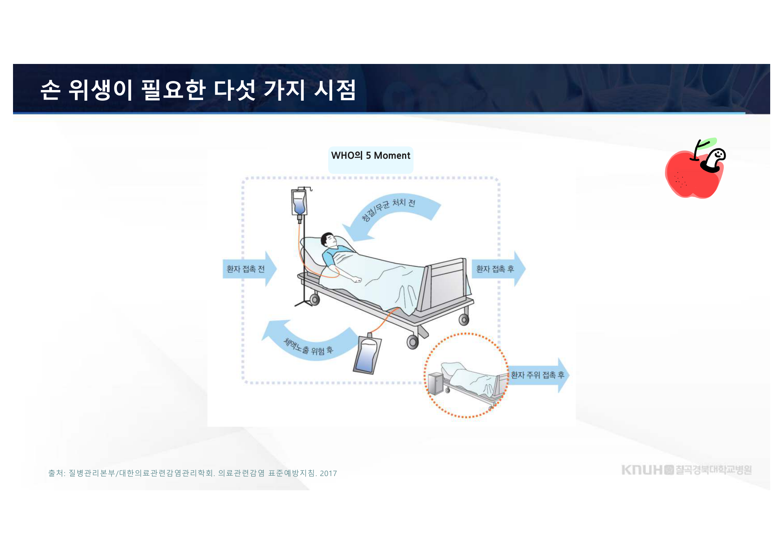{: style="width:62%"}

**5 Moments (IB)** — WHO와 질병청이 공통으로 정한, 반드시 해야 하는 다섯 경우

1. **환자와 접촉하기 전**
2. **청결·무균 시술 전**
3. **체액 노출 행위 후**
4. **환자와 접촉한 후**
5. **환자 주변 환경 접촉 후**
- + **장갑을 벗은 후 매번**

### ② 손위생 방법

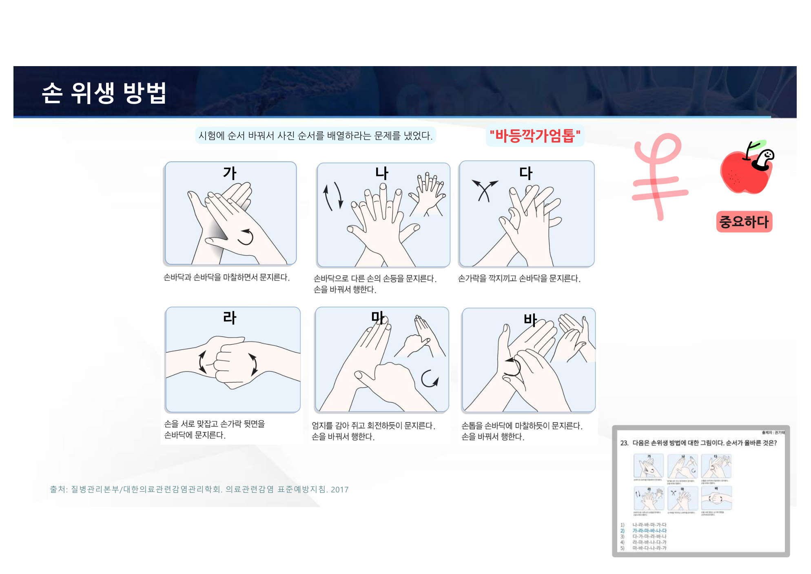{: style="width:66%"}

손씻기 6단계 순서(시험은 사진 순서를 바꿔 배열하게 한다 — "**중요하다**")

1. **손바닥과 손바닥**을 마주 대고 문지르기
2. **손등과 손바닥**을 마주 대고 문지르기
3. **손바닥을 마주 대고 손깍지** 끼고 문지르기
4. **손가락을 마주 잡고**(두 손 모아) 손가락 등 문지르기
5. **엄지손가락**을 다른 손바닥으로 돌려 주며 문지르기
6. **손가락(손톱 밑)** 을 반대 손바닥에 놓고 문지르기

- 필기 암기법 "**바등깍가엄톱**" = 손**바**닥 → 손**등** → **깍**지 → 손**가**락(등) → **엄**지 → 손**톱**.

| 방법 | 요점 |
|---|---|
| 물과 비누(IB) | 흐르는 물에 적신 뒤 비누 충분히, **뜨거운 물은 피부염 → 미지근한 물**, 모든 표면에 **15초 이상** 문지름, 일회용 타월로 말리고 **수도꼭지는 타월로 잠금**(타월 재사용·공용 금지), 고형비누는 건조하게(II) |
| 손소독제(IB) | **마른 손**에 모든 표면을 덮을 만큼, **다 마를 때까지** 문지름. 물·비누로 씻은 직후 소독제 추가는 불필요(II) |
| 외과적 손위생(IB) | 인공손톱·반지·시계 제거, **솔 사용 권고 안 함**, 항균비누 또는 알코올 소독제, 보통 **2–5분**(10분처럼 길 필요 없음), 장갑 끼기 전 손·아래팔 완전히 건조 |

- 손글씨: "마찰로 균을 제거하므로 **15초 이상**이 중요하다."

### ③ 물품·피부관리·장갑
- 물품: 살균력 좋고 자극 적은 제품(IB), 제품 오염·핸드크림/항균비누와의 상호영향 고려(IB), **액체비누·알코올젤은 남은 통에 보충(리필)하지 않고 다 쓰면 폐기**(IB).
- 피부관리: 접촉성 피부염 줄이는 관리법 제공(IB), **로션·크림 사용**(IA), 환자와 직접 접촉하는 직원은 **손톱 짧게, 인조손톱 금지**(IA).
- **장갑은 손위생을 대체할 수 없다**(IB) — 착용해도 필요한 시점에 손위생. 혈액·체액·점막·손상 피부 접촉 가능 시 장갑(IB). **사용 직후 벗고 매 환자마다 교체**(IB). 같은 환자라도 오염 부위 → 다른 부위(손상 피부·점막·의료기구) 접촉 시 교체(II).
- 교수님 ppt에만 있는 내용(☆): 장갑을 끼고 있어도 손위생 시점이 되면 **장갑을 벗고 손위생 후 필요하면 새 장갑**.

!!! exam "기출 포인트"
    4번(2025): 손위생 시점이 **아닌** 것 → "**개인보호구(PPE) 착용 후**"(PPE는 착용 전·벗은 후). 13번 그림 → "**환자 주변 기구·물건과 접촉한 후에도 반드시 수행**", 36번 → "**환자와 접촉하기 전에 반드시 수행**"(⑤ "주변 기구 접촉 후에는 시행하지 않는다"가 함정). 11·24번은 그림 순서 맞추기 — **시험 그림의 가~바 배치가 매번 달라** 동작으로 외워야 한다. 46번: 두 그림의 사례를 막는 가장 효과적인 방법 → **손위생**(예방접종·비말·공기주의·최대멸균차단 X).

!!! diff "작년 필기와 다른 점"
    작년 강의는 손위생을 5시점과 6단계 위주로 짧게 다뤘고, 손위생 지침·소독제 표·수행률·1991년 실험은 올해 새로 들어왔다. 작년 손씻기 그림의 동작 이름은 "가 손바닥 → 나 손등과 손바닥 → 다 깍지 → 라 두 손 모아 손가락 등 → 마 엄지 → 바 손톱 밑"으로 같다(오스키 때 순서를 지키는지 본다).

# 6. 격리주의 — "거의 매년 1문제씩 무조건"

## 의료기관의 감염 전파 위험
- 의료기관 = **전파 가능한 감염성 질환자 + 면역저하 취약 환자 + 많은 직원·방문객**이 공존하는 곳(손글씨: "감염원과 취약자가 한 공간에 있다"). 환자·방문객·직원 보호 전략이 매우 중요.
- 대표 원인균: **MRSA, VRE, 녹농균** 같은 내성균 외에도 다양한 세균·진균·바이러스. 근원은 병원 환경·의료진뿐 아니라 **환자 자신의 상재균**까지.
- 국내 현황: 의료기술 발전·고령화로 면역저하·다기저질환 환자의 침습적 치료가 늘어 감염 위험은 오히려 증가. 시설·전문가만으로는 안 되고 **모든 의료인·종사자·환자·가족·국민의 이해와 실천**이 필요.

## 전파 경로

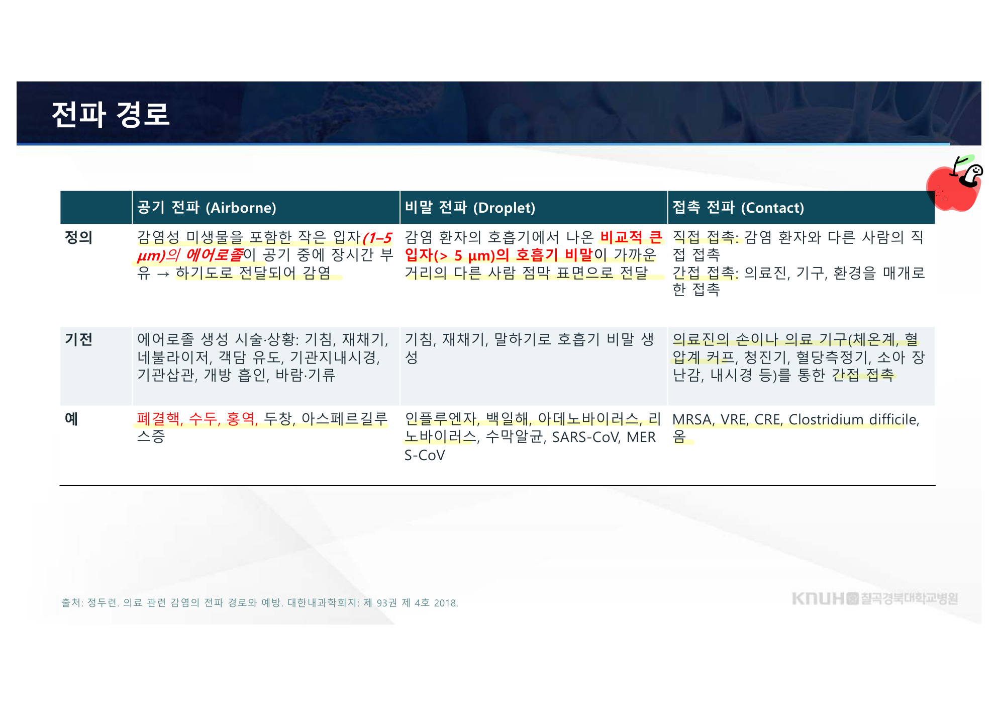{: style="width:78%"}

| | 공기전파(Airborne) | 비말전파(Droplet) | 접촉전파(Contact) |
|---|---|---|---|
| 정의 | 미생물을 품은 **작은 입자(1–5 μm) 에어로졸**이 공기 중에 오래 떠 있다가 하기도로 | 환자 호흡기의 **비교적 큰 입자(> 5 μm)** 가 **가까운 거리**의 다른 사람 점막으로 | **직접**: 환자–다른 사람. **간접**: 의료진·기구·환경을 매개로 |
| 기전 | **에어로졸 생성 시술·상황**: 기침, 재채기, 네불라이저, 객담 유도, 기관지내시경, 기관삽관, 개방 흡인, 바람·기류 | 기침, 재채기, 말하기 | 의료진 손이나 기구(체온계, 혈압계 커프, 청진기, 혈당측정기, 소아 장난감, 내시경 등) |
| 예 | **폐결핵, 수두, 홍역**, 두창, 아스페르길루스증 | **인플루엔자, 백일해**, 아데노·리노바이러스, **수막알균**, SARS-CoV, MERS-CoV | **MRSA, VRE, CRE, *C. difficile*, 옴** |

## 전파 차단 (격리 주의)
- **격리 주의**: 감염자·보균자 또는 감염이 의심되는 환자로부터 직원이 감염되거나 미생물이 퍼지는 것을 막아 환자·보호자·직원·방문객과 환경을 보호하는 개념.
- **표준주의(Standard Precautions)**: 감염 여부와 상관없이 **모든 환자**에게, 혈액·체액·분비물·배설물·손상된 피부·점막을 **오염원으로 간주**.
- **전파경로별 주의(Transmission-based Precautions)**: 전염력이 강하거나 역학적으로 중요한 병원체에 감염·집락이 확인 또는 **의심**되는 환자에게, **표준주의와 함께** 경로에 따라 적용.
- ★ **환자 선별 단계부터** 모든 환자에 표준주의 + 임상 증상·징후로 의심하는 감염원에 따라 경로별 주의 **추가**. 손글씨: "**확진을 기다렸다가 격리하는 것이 아니라, 의심되는 시점부터 격리**해야 한다."

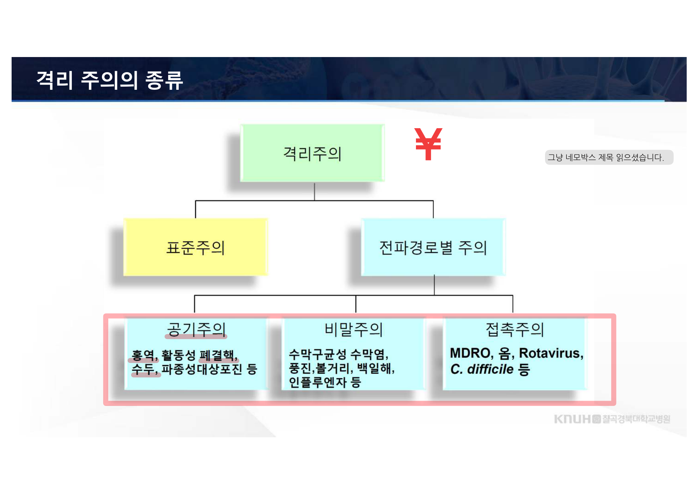{: style="width:60%"}

- 격리주의 = **표준주의** + **전파경로별 주의**(공기 / 비말 / 접촉). 그림의 예: 공기 — **홍역, 활동성 폐결핵, 수두, 파종성 대상포진** / 비말 — **수막구균 수막염, 풍진, 볼거리, 백일해, 인플루엔자** / 접촉 — **MDRO, 옴, Rotavirus, *C. difficile***. (교수님은 "그냥 네모 박스 제목만 읽으셨다".)

## 표준주의 — 가장 기본적인 수단
- 감염·보균 여부와 관계없이 **의료기관 내 모든 환자**에게. 숨은 무증상 보균자를 다 찾을 수 없으니 표준주의가 강조된다.
- 구성 10가지(인증평가 필수 요소): ① **손위생** ② **개인보호구(PPE)** ③ 호흡기 위생/기침 에티켓 ④ 환자 배치 ⑤ 치료기구·물품 ⑥ 환경 관리 ⑦ 린넨 관리 ⑧ 안전한 주사행위 ⑨ 특수 요추천자 시술 시 감염관리 ⑩ 직원 안전(주사침·날카로운 기구)
- **접촉주의와의 차이**: 표준주의는 **혈액·체액 노출 우려가 있을 때만** 가운·장갑을 쓰지만, 접촉주의는 **병실 입실 전에** 착용(전파 가능한 질환 감염이 확인된 상태).

## 전파경로별 주의 — "공기주의가 중요하다(비말·접촉은 그냥 보시고)"
| | **공기주의** | 비말주의 | 접촉주의 |
|---|---|---|---|
| 병실 | **음압 1인실 + 전실(anteroom)** | 1인실이 바람직, 여의치 않으면 **코호트**. 다인실은 병상 간 충분한 간격 + 커튼 | 1인실 → 여의치 않으면 코호트, 다인실은 간격 + 커튼 |
| 환기·시설 | **시간당 12회 환기(12 ACH, 구형 시설 ≥ 6 ACH)** | 먼 거리로는 전파 안 됨 → **특별한 공기처리·환기 불필요** | 시설·인력·미생물의 예후·면역상태·환자 수에 따라 조정 |
| 보호구 | **N95 호흡기(밀착도 검사)**, 필요시 PAPR | 긴밀한 접촉 시 의료진 **마스크** | **병실 입실 전 가운·장갑** |
| 환자 이동 | 환자 **마스크** | 외출 시 환자 마스크 | 탈의 시 **오염된 바깥 면이 안쪽으로 말리게** → 감염성 폐기물 용기 |
| 예 | **결핵, 홍역, 수두** | 인플루엔자, 코로나19, 백일해, 볼거리, 수막알균 | ***C. difficile*, MRSA, VRE**, 옴, 로타 |

- 손글씨: "1시간에 12번 환기(Air change/hour)", "**음압이 되어야 밖으로 안 나간다**", "**KF94도 N95랑 비슷하지만 공식 가이드라인에는 올라가 있지 않다.**"
- 비말 ≥5 μm는 1–2 m 안에서 떨어지고, 비말핵 <5 μm는 공기 중에 떠다닌다 — 그래서 공기주의만 음압·N95가 필요하다.

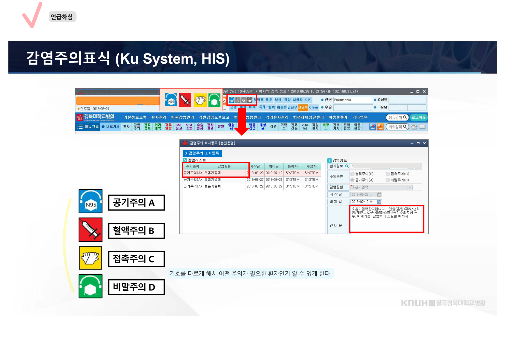{: style="width:58%"}

- **감염주의 표식(병원정보시스템)**: 공기주의 **A**, 혈액주의 **B**, 접촉주의 **C**, 비말주의 **D** — 기호를 달리해 어떤 주의가 필요한 환자인지 바로 알게 한다("언급하심").

!!! exam "기출 포인트"
    3번(2025): 두 주의의 관계 → "**전파경로별 주의는 표준주의를 보완하여 추가로 적용**"(표준주의는 감염환자에 한정되지 않음, 둘은 병용). 짝짓기 — **표준주의 – 손위생**(14번), **표준주의 – 소변백 비우기**(22번). 오답: 비말 – MRSA, 공기 – 볼거리, 비말 – *C. difficile*, 접촉 – 결핵, 접촉 – 볼거리, 공기 – 백일해, 접촉 – 홍역. **N95**(6번)·**음압격리병실**(37번) → **결핵**(독감·코로나19·볼거리·손발입병, VRE·*C. difficile*·백일해·인플루엔자 X). 52번: 역학조사 그림의 원인균과 격리 지침이 같은 것 → ***C. difficile***(접촉주의).

!!! diff "작년 필기와 다른 점"
    작년 격리표는 접촉주의 예에 **옴**, 비말주의 예에 **코로나19·볼거리**를 들었고, 공기주의는 "1인실 음압격리 + N95, 이동 시 환자 수술용 마스크"로만 정리했다. 올해는 **전실·12 ACH·밀착도 검사·PAPR**, 감염주의 표식(A·B·C·D)이 새로 들어왔다.

# 7. 예방 번들 (Bundle) — "case로 한 문제씩 내겠다"

- **번들 = 근거가 확립된 몇 가지 중재를 묶어 모두 함께 수행**하는 것. 하나씩 따로 할 때보다 효과가 크다. 손글씨: "요즘은 다 bundle — 예방수칙 하나만 지킨다고 예방되는 게 아니라 교정 가능한 위험인자를 한꺼번에 같이 해야 효과가 크다."
- 필기: "**예방번들에 관한 문제는 여기서부터 나오는 10페이지(필기본 61–70쪽)에서만** 나오니 보시면 될 것 같습니다." 교수님: "이 표 기억하면 도움이 된다. 기출문제 보면 여기서 조합해서 문제를 많이 냈다"(작년).

## 7-1. 번들 표 — Harrison 22판 Table 142-1

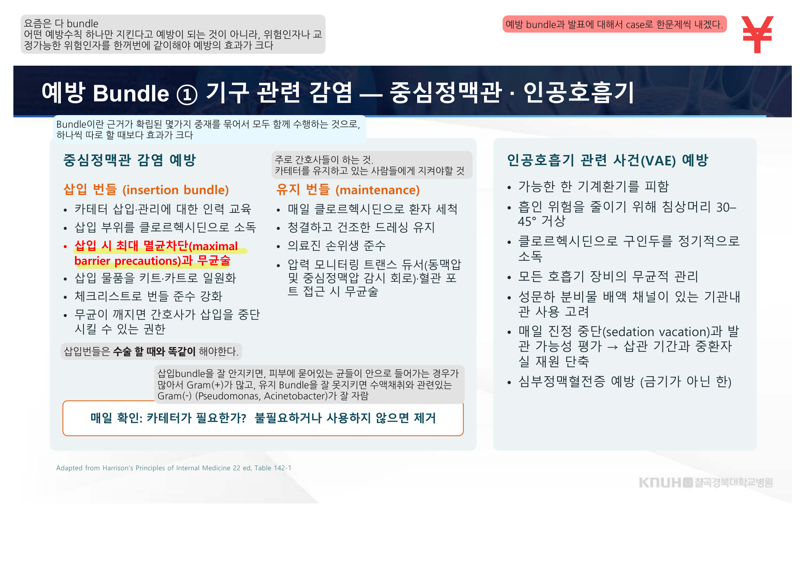{: style="width:80%"}

| 감염 | 번들 |
|---|---|
| **중심정맥관 — 삽입 번들** | 삽입·관리 인력 **교육** / 삽입부위 **클로르헥시딘 소독** / **최대멸균차단(maximal barrier precautions)과 무균술** / 물품을 **키트·카트**로 일원화 / **체크리스트** / **무균이 깨지면 간호사가 삽입을 중단시킬 권한** |
| **중심정맥관 — 유지 번들** | **매일 클로르헥시딘으로 환자 세척** / **청결·건조한 드레싱** / 의료진 **손위생** / 압력 모니터링 트랜스듀서(동맥압·중심정맥압 회로)·혈관포트 접근 시 무균술 / **매일 확인: 카테터가 필요한가? 불필요하면 제거** |
| **인공호흡기 관련 사건(VAE)** | 가능한 한 기계환기를 피함 / **침상 머리 30–45°** / **클로르헥시딘으로 구인두 정기 소독** / 호흡기 장비 무균 관리 / 성문하 분비물 배액 채널 기관내관 고려 / **매일 진정 중단(sedation vacation)과 발관 평가** → 삽관기간·ICU 재원 단축 / **심부정맥혈전 예방**(금기 아니면) |

- 손글씨: "**삽입 번들은 수술할 때와 똑같이** 해야 한다." 유지 번들은 "주로 간호사들이, 카테터를 유지하는 사람들이 지켜야 할 것."
- 손글씨(중요): **삽입 번들을 안 지키면 피부 균이 안으로 들어가 그람양성**이 많고, **유지 번들을 못 지키면 수액·채취와 관련된 그람음성(*Pseudomonas, Acinetobacter*)** 이 잘 자란다.

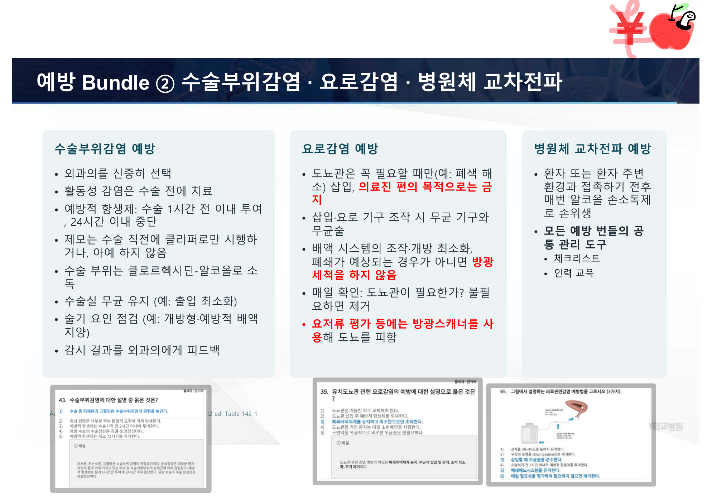{: style="width:80%"}

| 감염 | 번들 |
|---|---|
| **수술부위감염** | **외과의를 신중히 선택** / 활동성 감염은 수술 전에 치료 / **예방적 항생제: 수술 1시간 전 이내 투여, 24시간 이내 중단** / 제모는 **수술 직전 클리퍼로만** 하거나 아예 안 함 / **클로르헥시딘-알코올** 소독 / 수술실 무균(출입 최소화) / 술기 요인 점검(개방형·예방적 배액 지양) / 감시 결과를 외과의에게 피드백 |
| **요로감염** | 도뇨관은 **꼭 필요할 때만**(예: 폐색 해소), **의료진 편의 목적 금지** / 삽입·조작 시 무균 기구·무균술 / 배액 시스템 조작·개방 최소화, **폐쇄가 예상되지 않으면 방광 세척 안 함** / **매일 확인: 필요한가? 불필요하면 제거** / **요저류 평가 등은 방광 스캐너**로 도뇨를 피함 |
| **병원체 교차전파** | 환자 또는 환자 주변 환경 접촉 **전후 매번 알코올 손소독제** |
| 모든 번들의 공통 도구 | **체크리스트, 인력 교육** |

## 7-2. 올해 매뉴얼 — 근거기반 예방번들 (Harrison 22판 Table 147-1, 1–10쪽)

!!! new "올해 필기에서 추가"
    교수님 **올해 매뉴얼**(필기본 61–70쪽, 앞쪽 요약 9–13쪽에 기출과 함께 다시 실림)이 새로 생겼다. 같은 네 번들을 "넣기 전–넣을 때–넣은 뒤", "환자 준비–수술팀–수술실 환경" 같은 틀로 다시 정리했고, VAP는 「의료관련감염관리」(2023) 표 18-3의 권고 등급까지 붙였다. **바뀐 내용이 있다 — 아래 diff 상자 확인.**

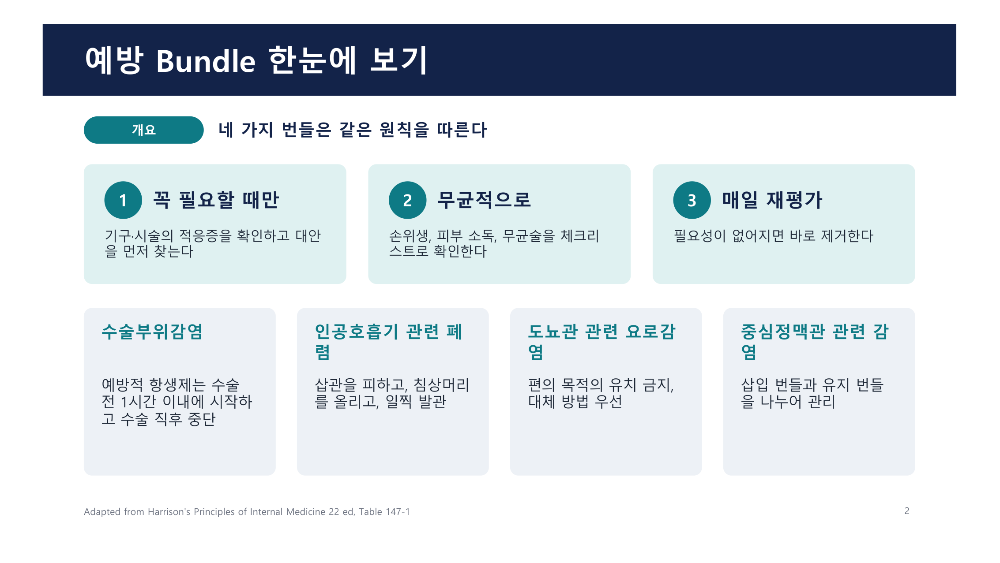{: style="width:72%"}

**네 가지 번들은 같은 원칙을 따른다**: ① **꼭 필요할 때만**(적응증 확인, 대안 먼저) ② **무균적으로**(손위생·피부소독·무균술을 체크리스트로) ③ **매일 재평가**(필요 없어지면 바로 제거).

| 번들 | 한 줄 요약 |
|---|---|
| 수술부위감염 | 예방적 항생제는 **수술 전 1시간 이내 시작, 수술 직후 중단** |
| 인공호흡기 관련 폐렴 | **삽관을 피하고, 침상 머리를 올리고, 일찍 발관** |
| 도뇨관 관련 요로감염 | **편의 목적의 유치 금지, 대체 방법 우선** |
| 중심정맥관 관련 감염 | **삽입 번들과 유지 번들을 나누어 관리** |

### ① 수술부위감염 — 환자 준비, 수술팀, 수술실 환경을 함께

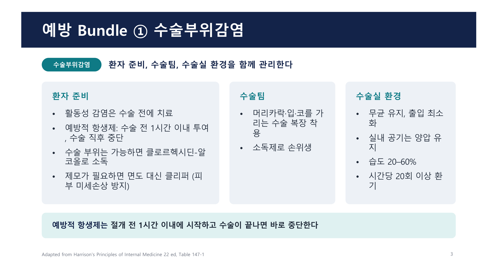{: style="width:72%"}

| 환자 준비 | 수술팀 | 수술실 환경 |
|---|---|---|
| 활동성 감염은 수술 전에 치료 / **예방적 항생제: 수술 전 1시간 이내 투여, 수술 직후 중단** / 수술 부위는 가능하면 **클로르헥시딘-알코올** / 제모가 필요하면 **면도 대신 클리퍼**(피부 미세손상 방지) | **머리카락·입·코를 가리는 수술복** / 소독제로 손위생 | 무균 유지, **출입 최소화** / 실내 공기 **양압** / **습도 20–60%** / **시간당 20회 이상 환기** |

!!! diff "작년 필기와 다른 점"
    예방적 항생제 중단 시점: 작년(Table 142-1)·59–60쪽 번들은 "**24시간 이내 중단**", 올해 매뉴얼(Table 147-1)은 "**수술이 끝나면 바로(수술 직후) 중단**". 방향은 같다(짧을수록 좋음) — 보기에 "최소 72시간 유지", "3일간 지속"이 나오면 오답. 9장의 수술별 기간표(청결 수술 단회, 청결-오염 24시간 이내, 심장 48시간 이내)도 함께 본다. 수술실 양압·습도·환기 횟수, 수술팀 복장은 올해 새로 나왔다.

### ② 인공호흡기 관련 폐렴 — 삽관을 피하고, 흡인을 줄이고, 일찍 발관

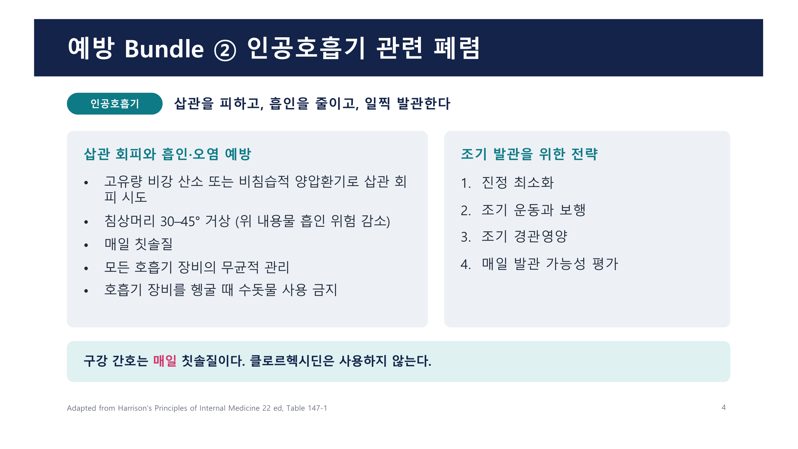{: style="width:72%"}

- 삽관 회피와 흡인·오염 예방: **고유량 비강 산소 또는 비침습적 양압환기**로 삽관 회피, **침상 머리 30–45°**(위 내용물 흡인 감소), **매일 칫솔질**, 호흡기 장비 무균 관리, **호흡기 장비를 헹굴 때 수돗물 금지**.
- 조기 발관 전략: 1. **진정 최소화** 2. **조기 운동과 보행** 3. **조기 경관영양** 4. **매일 발관 가능성 평가**.
- **구강 간호는 매일 칫솔질이다. 클로르헥시딘은 사용하지 않는다.**

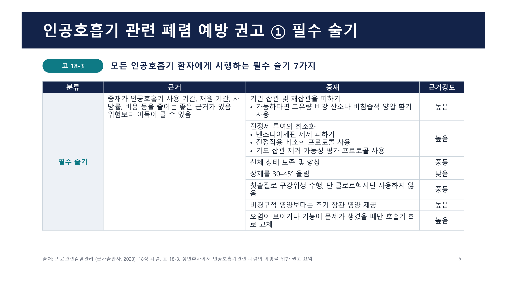{: style="width:72%"}

| 필수 술기(모든 인공호흡기 환자) | 근거강도 |
|---|---|
| 기관삽관·재삽관 피하기(가능하면 고유량 비강 산소·비침습적 양압환기) | 높음 |
| 진정제 최소화(**벤조디아제핀 피하기**, 진정 최소화 프로토콜, 발관 가능성 평가 프로토콜) | 높음 |
| 신체 상태 보존·향상 | 중등 |
| 상체 30–45° | 낮음 |
| **칫솔질로 구강위생, 단 클로르헥시딘 사용하지 않음** | 중등 |
| 비경구 영양보다 **조기 장관영양** | 높음 |
| **오염이 보이거나 기능 문제가 있을 때만 호흡기 회로 교체** | 높음 |

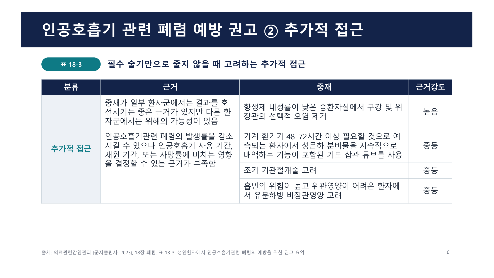{: style="width:70%"}

- **추가적 접근**(필수 술기로 줄지 않을 때): 항생제 내성률이 낮은 ICU에서 **구강·위장관의 선택적 오염 제거**(일부 환자군엔 좋지만 다른 군엔 해가 될 수 있음, 근거 높음) / 기계환기가 **48–72시간 이상** 필요할 것으로 보이는 환자에서 **성문하 분비물 지속 배액 기관내관**(중등) / 조기 기관절개술 고려(중등) / 흡인 위험이 높고 위관영양이 어려우면 유문하방 비장관영양(중등). 뒤의 셋은 VAP 발생률은 줄일 수 있지만 인공호흡기 기간·재원·사망률에 대한 근거는 부족.

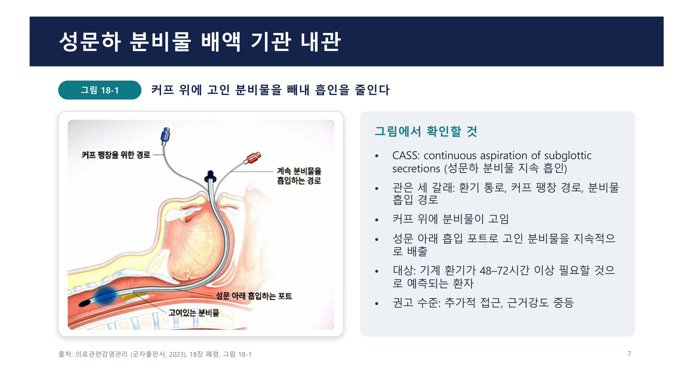{: style="width:62%"}

- **CASS**(continuous aspiration of subglottic secretions, 성문하 분비물 지속흡인): 관이 세 갈래(**환기 통로, 커프 팽창 경로, 분비물 흡입 경로**). **커프 위에 고인 분비물**을 성문 아래 흡입 포트로 계속 빼내 흡인을 줄인다. 대상: 기계환기 48–72시간 이상 예상 환자. 권고: 추가적 접근, 근거 중등.

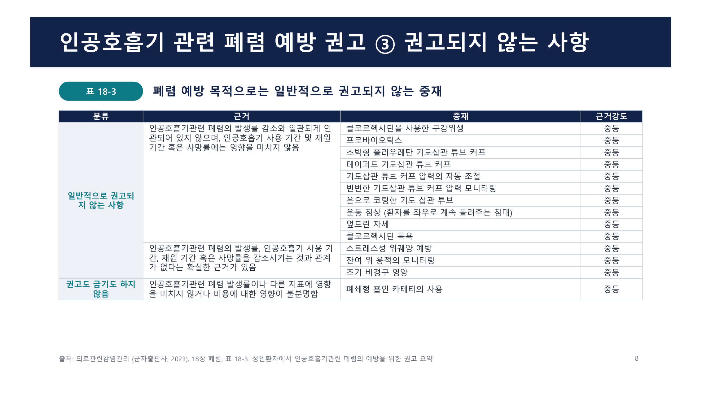{: style="width:72%"}

| 분류 | 중재 |
|---|---|
| **일반적으로 권고되지 않음**(VAP 감소와 일관된 관련이 없고 기간·사망률에 영향 없음) | **클로르헥시딘 구강위생**, 프로바이오틱스, 초박형 폴리우레탄 커프, 테이퍼드 커프, 커프압 자동조절, 빈번한 커프압 모니터링, 은 코팅 기도삽관 튜브, 운동 침상(좌우로 계속 돌리는 침대), **엎드린 자세**, **클로르헥시딘 목욕** |
| 일반적으로 권고되지 않음(감소시키지 않는다는 확실한 근거) | **스트레스성 위궤양 예방**, 잔여 위용적 모니터링, 조기 비경구영양 |
| 권고도 금기도 아님 | 폐쇄형 흡인 카테터 |

!!! diff "작년 필기와 다른 점"
    **구강 클로르헥시딘이 바뀌었다.** 작년 강의(Table 142-1)와 59쪽 번들은 "**클로르헥시딘으로 구인두 오염 제거(oral care)**"가 VAP 번들이었지만, 올해 매뉴얼(Table 147-1·표 18-3)과 3조 발표(SHEA/IDSA/APIC 2022)는 **"매일 칫솔질, 클로르헥시딘은 사용하지 않는다"** — 사망률 증가 우려로 권고에서 빠졌다. 기출 25·34·42번 보기 "구강의 오염을 chlorhexidine으로 제거한다"는 **VAP 예방법이라 오답**이었는데(그림이 중심정맥관·도뇨관이었기 때문), 올해 기준으로는 VAP에서도 권고되지 않는다. 그 밖에 작년 VAP 번들의 **DVT 예방**은 올해 매뉴얼에 없고, **고유량 비강 산소·조기 운동·조기 경관영양·수돗물 금지**가 새로 들어왔다.

### ③ 도뇨관 관련 요로감염 — 넣지 않는 것이 가장 좋은 예방

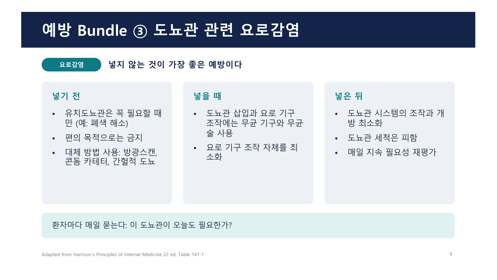{: style="width:72%"}

| 넣기 전 | 넣을 때 | 넣은 뒤 |
|---|---|---|
| 유치도뇨관은 **꼭 필요할 때만**(예: 폐색 해소) / **편의 목적 금지** / **대체 방법: 방광 스캔, 콘돔 카테터, 간헐적 도뇨** | 삽입·요로기구 조작에 **무균 기구·무균술** / 요로기구 조작 자체를 최소화 | 도뇨관 시스템의 **조작과 개방 최소화**(= 폐쇄배뇨 유지) / **도뇨관 세척은 피함** / **매일 지속 필요성 재평가** |

- "환자마다 매일 묻는다: **이 도뇨관이 오늘도 필요한가?**"

### ④ 중심정맥관 관련 감염 — 삽입 번들과 유지 번들

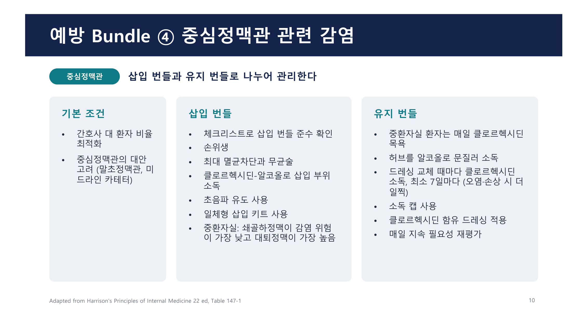{: style="width:72%"}

| 기본 조건 | 삽입 번들 | 유지 번들 |
|---|---|---|
| **간호사 대 환자 비율** 최적화 / 중심정맥관의 **대안**(말초정맥관, 미드라인 카테터) 고려 | **체크리스트**로 준수 확인 / **손위생** / **최대멸균차단과 무균술** / **클로르헥시딘-알코올**로 삽입부위 소독 / **초음파 유도** / **일체형 삽입 키트** / 중환자실: **쇄골하정맥이 감염 위험 가장 낮고 대퇴정맥이 가장 높음** | ICU 환자는 **매일 클로르헥시딘 목욕** / **허브를 알코올로 문질러 소독** / 드레싱 교체 때마다 클로르헥시딘 소독, **최소 7일마다**(오염·손상 시 더 일찍) / **소독 캡** / **클로르헥시딘 함유 드레싱** / 매일 지속 필요성 재평가 |

!!! diff "작년 필기와 다른 점"
    올해 매뉴얼에서 새로 나온 것: 간호사 대 환자 비율·대안 카테터(기본 조건), **초음파 유도**, 허브 알코올 소독·소독 캡·클로르헥시딘 함유 드레싱, 드레싱 최소 7일. 작년 삽입 번들의 "교육", "무균이 깨지면 간호사가 중단시킬 권한"은 59쪽 표(Table 142-1)에 그대로 남아 있다 — 기출 13·36번에서 "간호사의 권한을 강화한다"는 **손위생 그림 문제의 오답**이었다.

!!! exam "기출 포인트"
    예방법 고르기에서 보기는 네 번들에서 섞여 나온다 — **그림이 무슨 기구인지 먼저** 본다.
    도뇨관 그림(34번, 3개) → **삽입 시 무균술 + 폐쇄배뇨 유지 + 매일 필요성 평가**. 1번(2025) → "**폐쇄배액체계를 유지하고 최소한으로만 조작**"(자주 교체·예방적 항생제·매일 소변배양·"소변백 비울 때 무균술 불필요"는 오답).
    중심정맥관 그림 → **삽입부위 chlorhexidine 소독 + 매일 필요성 평가**(25번, 2개), 여기에 **손위생 강화**(42번, 3개). 8번 → "**최대 무균술식**"(일상적 교체·항생제 연고·매일 드레싱 교환·정기 헤파린 세척 X). 30번: 부적절한 것 → "**드레싱은 2% chlorhexidine보다 povidone iodine을 가능한 이용**"(반대). 쇄골하 > 내경정맥, 최대멸균차단, 사용기간 최소화는 옳다.
    VAP(12번, 2개) → **상체 30–45도 + 매일 진정 중단·인공호흡기 필요 여부 확인**. 예방적 항생제(안 씀), **최대멸균방어술(중심정맥관)**, 매일 몸을 chlorhexidine으로 소독(중심정맥관 유지 번들)은 함정.
    SSI → 2번(2025) "**수술 중 저체온과 고혈당은 SSI 위험을 높인다**"(오답: 대부분 외부 오염, 2시간 이내 투여, 유방 = 청결-오염, 최소 72시간), 53번 "**수술 부위 chlorhexidine-alcohol 소독**"(오답: 1시간 이내 + 최소 3일, 상체 30–45도, 면도기 제모, 구강 chlorhexidine).

## 7-3. 감염별 자세히 — 작년 강의 본문 (올해는 CP-B1 조별발표)

!!! diff "작년 필기와 다른 점"
    아래 7-3 전체는 **작년(2025) 강의 본문**이다. 올해는 이 내용을 강의에서 빼고 **CP-B1 조별발표**(2조 요로, 3조 HAP/VAP, 4조 SSI, 5조 CLABSI)와 교수님 매뉴얼로 넘겼다(자세한 발표 내용은 14번 CP-B1 학습자료). 기출 대부분이 작년 강의에서 나왔으므로 그대로 남긴다.

### 요로감염 (CAUTI)
- 입원 성인에서 **가장 흔한 감염**: 전체 의료관련감염의 30–40%, 발생률 1–10%. 병원 요로감염의 **95% 이상이 유치도뇨관 관련**, 대부분 무증상 세균뇨.
- 폐쇄배뇨를 유지해도 세균뇨가 **매일 3–8%** 생겨 1개월 이상 유치하면 대부분 세균뇨·진균뇨. **간헐적 도뇨** 시 세균뇨 3%, 도뇨관 없는 입원 환자 1.4% → **유치도뇨관 삽입 최소화**가 가장 효과적.

| 용어 | 정의 |
|---|---|
| 무증상 세균뇨(ASB) | 증상·징후 없이 적절히 채취한 소변에서 **2종류 이하 균이 105 CFU/mL 이상** |
| 급성 단순요로감염 | 비뇨생식기 이상이 없는 **여성**의 방광 감염(빈뇨·절박뇨·배뇨곤란·치골상부 압통) |
| 급성 비폐쇄성 신우신염 | CVA 통증·압통, 발열을 동반한 신장 염증 |
| 복잡요로감염 | 비뇨생식기 **기능적·구조적 결함** — 재발·내성균 흔함, **막힌 곳을 푸는 게 항생제보다 중요** |
| 농뇨 / 요로패혈증 | 소변 다형핵백혈구 증가 / 상부 요로 염증 → 균혈증(혈액·소변배양 **같은 균**) |
| 도뇨관 관련 세균뇨 | 증상 없으면 **CA-ASB**, 있으면 **CA-UTI** |

- 무증상 세균뇨는 **치료하지 않는다**(임신, 비뇨기과 시술 전 제외) — 다시 생기고, 그때 앞서 쓴 항생제에 **내성**이 생긴다.
- 경로: 도뇨관 **내부**(폐쇄배뇨가 깨지거나 소변백 오염 → 역류) / **외부 표면**(삽입 시 무균술 미준수, 장·회음부 상재균이 외벽을 타고 올라감). **가장 중요한 위험인자 = 삽입기간**, 그 외 관리 부실, 폐쇄배뇨 미유지, **여성, 고령, 신경계 기저질환, 당뇨, 중증도**.
- 원인균: 단기 유치는 대부분 **단일균**(장알균·그람음성 막대균, 가장 흔한 것은 *E. coli*). **진균뇨**(대개 칸디다)는 국내 ICU 요로감염 분리균의 **30–35%**. 장기 유치는 **혼합균**, *Proteus, Providencia, Morganella*. 장기 유치 도뇨관엔 **생체막**이 생겨 배양은 **새로 넣은 도뇨관**에서.
- ICU 소변의 *Candida*는 집락인 경우가 많아 **도뇨관 제거·교환만으로 40%에서 칸디다뇨가 사라진다.**
- 예방: 꼭 필요한 환자에게만 / 무균적 조작 / **폐쇄배액 유지, 최소 조작**, 꼬이거나 역류하지 않게 / **가능하면 빨리 제거** / **예방적 항생제는 권장하지 않음** — 교수님: 오늘 배우는 네 감염 중 **수술 예방적 항생제를 빼고는 예방적 항생제를 쓰지 않는다.**

### 병원획득폐렴(HAP)·인공호흡기 관련 폐렴(VAP)
- 주요 의료관련감염, **사망률 약 30%**. 고위험군: 영유아·**65세 이상**, 기저질환, 면역저하, **의식저하**, 심폐질환, **흉부·복부 수술**, **인공호흡기**.
- **HAP**: 입원 당시 잠복 상태가 아니며 **입원 48시간 이후** 폐렴. **VAP**: 기도삽관·인공호흡기 **48–72시간 이후** 폐렴. 기전: 상기도 집락균이 하기도로 **흡인(aspiration)**.
- 위험인자: 집락화 조장(이전 항생제, 오염된 회로, **위산 감소**) / 흡인 조장(기관내 삽관, **의식저하**, 비위관) / 숙주 방어 약화(COPD, 고령, 흉부·상복부 수술).
- 원인균: 지역사회 폐렴과 **완전히 다르다** — 호기성 그람음성균(*E. coli, K. pneumoniae, Enterobacter, P. aeruginosa, Acinetobacter*)과 *S. aureus*(MRSA). **KONIS 2020–2021: *A. baumannii* 26.7% > *P. aeruginosa* 17.4% > *K. pneumoniae* 16.6% > *S. aureus* 15.0% > *S. maltophilia* 6.1%**.
- **다제내성균 위험요인**: **90일 이내 주사 항생제**, VAP 당시 패혈성 쇼크, 선행 ARDS, VAP 전 **5일 이상 입원**, VAP 전 급성 신부전으로 신대체요법.
- 경험적 치료: 다제내성 위험이 없으면 **pip/tazo·cefepime·levofloxacin·imipenem·meropenem 중 하나**, 있으면 **β-lactam 하나 + 다른 계열(aminoglycoside 또는 cipro·levofloxacin)**, MRSA 위험이면 **vancomycin 또는 linezolid** 추가. Colistin·polymyxin B는 마지막 약(독성).

{: style="width:66%"}

!!! exam "기출 포인트"
    26번: 인공호흡기 14일째 VAP 원인균 4개 → ***S. aureus, P. aeruginosa, A. baumannii, K. pneumoniae***(폐렴구균·*Mycoplasma*·*Coxiella*·결핵균 X). 19번: 뇌출혈로 의식저하된 환자의 아래쪽(dependent) 폐 경화 → **흡인성 폐렴**(인공호흡기를 안 했으니 VAP 아님).

### 수술부위감염 (SSI)
- 개발도상국에선 수술 환자 약 1/3에서 감염, 고소득 국가에서도 **두 번째**로 많은 HAI. **근거중심 지침을 지키면 약 60% 예방**.
- 대부분 **환자 자신의 피부·수술 부위 상재균** → **피부절개부터 봉합까지** 열려 있는 동안 위험. 원인균은 보통 **그람양성 알균(*S. aureus*, *S. epidermidis*)**, 복강 수술은 그람음성 막대균(*E. coli, Klebsiella*).
- 위험인자: 연령, **조절 안 되는 당뇨**, 비만, 흡연, 면역억제제, 영양, **수술 전 긴 재원** / **긴 수술시간**, 기구 삽입, 혈종·괴사조직, **수술 중 저체온·저산소증·고혈당**. 청결 창상 5% 미만, 응급 오염 창상 20%까지.

{: style="width:76%"}

| 분류 | 정의 | 예 | 감염률 |
|---|---|---|---|
| **청결(clean)** | 염증·감염 없고 **호흡기·소화기·비뇨생식기를 열지 않는** 수술. 일차 봉합, 필요하면 폐쇄 배액. 비관통성 둔상 수술도 | **유방, 중추신경계, 관절** | 1–2% |
| **청결-오염** | 큰 오염이나 수술 전 감염 없이 **호흡기·소화기·비뇨생식기를 연** 수술 | **폐절제, 감염 안 된 담도·충수·자궁·구강, 대장 수술** | 2–4% |
| **오염** | **개방·신선한 외상 창상**, 무균술 유지 어려움(**개흉 심폐소생술**), **위장관 내용물이 크게 샌** 경우, **농 없는 급성 염증**, 감염된 비뇨기·담도 수술 | | 7–10% |
| **불결-감염** | **오래된 외상** 창상, 괴사조직, **이미 감염·천공** | | 10–40% |

- 교수님: **청결과 청결-오염의 구분이 중요.** 대장 수술이 청결-오염의 대표.
- 위험도: **ASA 분류**(1 정상 / 2 경미한 전신질환 / 3 중증 전신질환 / 4 생명을 계속 위협 / 5 수술 없이는 생존 불가 / 6 장기기증 뇌사자). **NNIS 위험지수** = 각 1점(0–3점): ① 창상 **오염·불결** ② 수술시간 > **T시간(75 백분위수)** ③ **ASA 3·4·5**. 교수님: 항목과 "높을수록 나쁘다"만.
- SSI 정의는 **기간·깊이·감염 증거** 세 가지: **표재성**(30일, 피부·피하) / **심부**(30 또는 90일, 근막·근육) / **기관·강**(30 또는 90일, 더 깊은 곳). **인공물이 들어가면 90일**.

{: style="width:66%"}

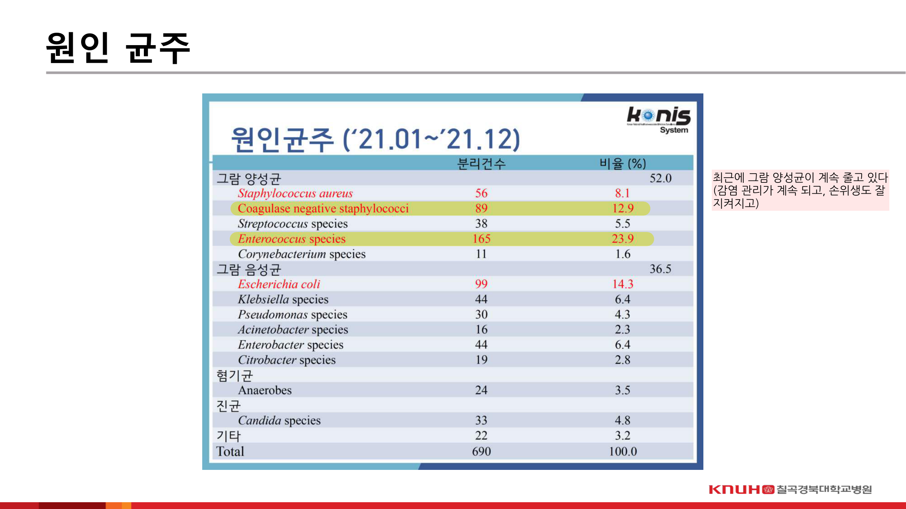{: style="width:58%"}

- 원인균: WHO 자료 1위 ***S. aureus***, 그다음 CoNS. 국내 KONIS 2021: 그람양성 52%(장알균 23.9%, CoNS 12.9%, *S. aureus* 8.1%), 그람음성 36.5%(*E. coli* 14.3%).
- 예방: **Choose a surgeon wisely** / 수술 전 다른 감염 치료 / **절개 전 1시간 이내 항생제, 24시간 이내 중단** / 제모는 **clipper 또는 안 함(면도칼 X)** / **chlorhexidine-alcohol** / 수술실 **양압**, 문 자주 열지 않기 / 수술 기술, 감시 결과 환류.
- 예방적 항생제 목적은 **내인성 상재균 수를 낮추는 것**. **불결 창상은 치료** 목적. **청결 수술엔 일반적으로 권고 안 함 — 인공장치를 넣는 청결 수술은 권고**. 대부분 **cefazolin**, 결장·충수는 **cefoxitin 단독 또는 cefazolin + metronidazole**. 교수님: **항생제 종류보다 언제 넣고 언제 끊느냐가 더 중요하다.**

!!! exam "기출 포인트"
    설명 문장 → 이름: "호흡기·소화기·비뇨생식기를 포함하지 않는" → **청결**(35번), "수술 전 감염 없던 호흡기·소화기·비뇨생식기, 폐절제·담도·충수·자궁·구강" → **청결-오염**(9, 45번), "개방창상·개흉 소생술·위장관 파열 대량 오염·농 없는 급성 감염" → **오염**(15번). 2번(2025)에서 "유방 수술 = 청결-오염"이 오답(**유방은 청결**). 55번: SSI의 가장 흔한 원인균(2016 WHO) → ***S. aureus***.

### 중심정맥관 관련 혈류감염 (CLABSI)
- **CLABSI**: **감시 목적** — 중심정맥관 48시간 이후, 다른 감염원 없이 혈액에서 균. **CRBSI**: **진단·치료 목적** — 카테터 팁에서 자라거나 중심정맥관 혈액이 말초보다 **2시간 먼저** 자라거나 균량이 많을 때.

{: style="width:62%"}

- **단기간**: **삽입부위 피부 상재균**이 관 바깥을 따라(그람양성). **장기간**: **허브(hub) 오염** → 내강. 드물게 혈행성, **오염된 수액**(그람음성). 핵심 = 오염 최소화 + **불필요하면 빨리 제거**.
- 진단: 삽입 **2일 후**, 발열·오한·저혈압 + 다른 감염원 없음 + 의미 있는 균혈증. 병원체는 **검체 1개**, **흔한 피부 오염균은 2개 이상**(*Corynebacterium*, *Bacillus*, *Cutibacterium*, **CoNS**, viridans 연쇄알균, *Aerococcus*, *Micrococcus*).
- 최대 멸균 차단 = 수술 복장(모자·마스크·멸균 가운·멸균 장갑·전신 멸균포). 삽입 위치는 **쇄골하정맥 > 내경정맥**(대퇴 피함).

!!! exam "기출 포인트"
    33번: 중심정맥관 관련 균혈증의 가장 흔한 원인 → **CoNS**. 38번: 투석 중 1시간 만에 40℃ → ***S. aureus***. 50번: ICU 치료 중 균혈증에서 보기 어려운 균 → ***Listeria***. 27번: chemoport 환자의 호중구감소 패혈성 쇼크에 가장 부적절한 초기 항생제 → **ceftriaxone**(녹농균 X).

### 기타 의료관련감염 (작년에만)
- ***Clostridioides difficile***: 항생제 투여 환자 설사의 **주 원인**, 항생제 관련 설사의 20–30%, **병원 설사의 가장 흔한 원인**, 미국에선 가장 흔한 HAI. 관련 항생제 **clindamycin, cephalosporin, fluoroquinolone**. 전파는 의료인 손 → 분변-경구 → **접촉주의**, 1인실·코호트, 환경 소독. **아포 때문에 알코올 손소독 X → 물과 비누.**
- 그 밖에 다제내성균, 수막알균, 결핵, 레지오넬라, 백일해, 호흡기 바이러스, 수두, A형 간염, 로타, 아스페르길루스, 칸디다. **요양시설에선 옴·이**.

!!! exam "기출 포인트"
    5번(2024): 수술 후 상처감염으로 2주 항생제 중 하루 10회 설사·발열 → ***C. difficile***. 18번: 요양병원 뇌졸중 노인의 심한 가려움 → 옴, 치료제가 **아닌** 것 → **metronidazole**(permethrin, lindane, crotamiton, ivermectin은 치료제).

### 기출에 자주 나온 병원 내성균 (필기 밖)
- **CRE**: 대표 균종 ***K. pneumoniae*, *E. coli***(39번). *Klebsiella*는 **젖당 발효, 비운동성, 두꺼운 협막**, 카바페넴 내성(47번).
- ***Acinetobacter baumannii***: WHO 2017 슈퍼버그 **1순위**, 국내 3차병원 카바페넴 내성 50% 이상(58번)·요양병원 80% 이상(48번).
- ***P. aeruginosa***: 호기성 그람음성, **낭성섬유증**, ICU에 더 많음, 3세대 cephalosporin을 감수성과 무관하게 쓰는 건 틀림(40번). 화상 고름의 **방향족(포도) 냄새·갈녹색 색소**(49번).
- ***Burkholderia cepacia***: **chlorhexidine·포비돈 소독제 안에서도 살아** 집단 균혈증(41, 59번).
- ***Citrobacter freundii***: 2017년 이대목동병원 신생아중환자실 사망 사건(오염된 지질영양제)(17번).

# 8. 직원감염관리

## 필요성과 예방접종
- 의료진(HCW)은 일반인보다 병원체 노출이 많고, 걸리면 근무 중 환자·동료·가족에게 퍼뜨린다 → 직원감염관리는 의료관련감염관리 프로그램의 하나.
- 주요 내용: **건강진단·안전교육, 예방접종(B형 간염·인플루엔자 등), 감염된 직원의 근무제한, 노출 직원의 사후 조치·추적**.
- **강력 권장 접종: B형 간염, 인플루엔자, 홍역, 볼거리, 풍진, 수두.** 손글씨: "병원 실습 전에 접종력을 확인한다."
- 교수님 예시(작년): 수두·홍역 아이가 소아 병동에 오면 가임기 간호사가 많다 — **MMR·수두는 생백신이라 임신 시 금기**, 노출되면 면역글로불린밖에 없다 → **미리 예방**. 신규 직원은 항체를 확인하고 없으면 접종.

!!! exam "기출 포인트"
    56번: 의료기관 종사자 권장 접종 → **홍역 백신**(C형 간염 백신은 없고, HPV·폐렴구균·대상포진은 직원 권장 목록이 아님).

## 혈액·체액 노출 사고
- 주로 **날카로운 기구·주사침 사고** — 병원 직원 사고 중 **가장 흔하다**. 주사 후 바늘을 버리다가, **채혈 후 뚜껑을 다시 씌우다가(recapping)**, 물품 정리하다가.
- CDC가 특별 관리를 권고하는 질환: **B형 간염, C형 간염, HIV** → 노출 후 처치(PEP)와 추적검사.
- 손글씨: "사용한 주사침은 **뚜껑을 씌우지 말고 바로 손상성 폐기물통**에 버리라는 이유." "실습 중 찔리면 **보고**해야 한다 — 늦으면 예방요법 시간을 놓친다."
- 직원 안전(작년): 날카로운 기구는 **손으로 직접 건네지 않기**, 불가피하게 다시 씌우면 **one-hand technique**, 폐기 용기 밖으로 튀어나온 것 확인.

## 노출 후 관리 ① B형간염 — "교수님이 찍은 알고리즘"

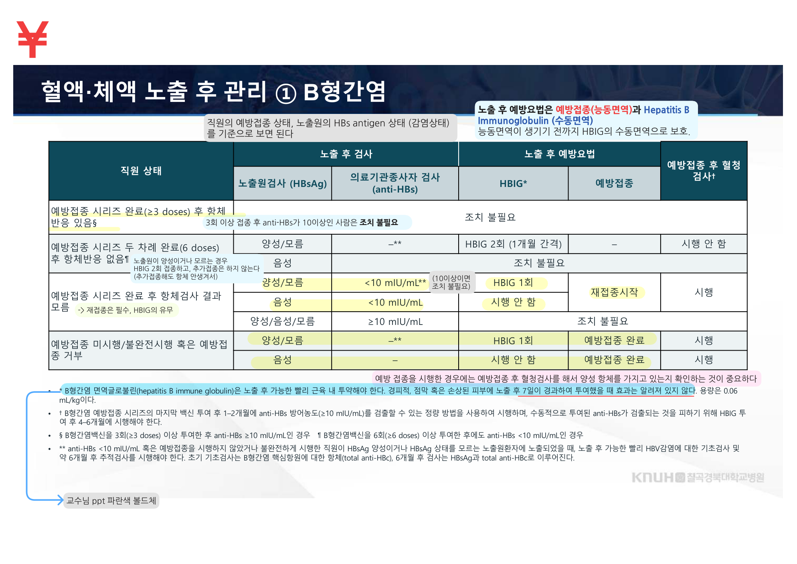{: style="width:84%"}

손글씨: "**직원의 예방접종 상태**와 **노출원의 HBsAg 상태**를 기준으로 보면 된다." 노출 후 예방요법 = **예방접종(능동면역) + HBIG(수동면역)** — 능동면역이 생기기 전까지 HBIG의 수동면역으로 보호.

| 직원 상태 | 노출원 HBsAg | 직원 anti-HBs | HBIG | 예방접종 | 접종 후 혈청검사 |
|---|---|---|---|---|---|
| 접종 완료(≥3회) 후 **항체 반응 있음** | — | — | **조치 불필요** | | |
| 접종 두 차례 완료(6회) 후 **항체 반응 없음** | 양성/모름 | — | **HBIG 2회(1개월 간격)** | 안 함 | 안 함 |
| 〃 | 음성 | | 조치 불필요 | | |
| 접종 완료 후 **항체검사 결과 모름** | 양성/모름 | **<10** | **HBIG 1회** | **재접종 시작** | 시행 |
| 〃 | 음성 | <10 | 안 함 | 재접종 시작 | 시행 |
| 〃 | 양성/음성/모름 | **≥10** | **조치 불필요** | | |
| **미접종·불완전·거부** | 양성/모름 | — | **HBIG 1회** | **예방접종 완료** | 시행 |
| 〃 | 음성 | — | 안 함 | 예방접종 완료 | 시행 |

- **3회 이상 접종 후 anti-HBs ≥ 10 mIU/mL면 조치 불필요.**
- 6회 맞고도 항체가 없는 무반응자: 노출원 양성·모름이면 **HBIG 2회, 추가 접종은 하지 않는다**(손글씨: 추가 접종해도 항체가 안 생겨서).
- 항체 결과를 모르면 검사해서 <10이면 **재접종은 필수**, HBIG는 노출원 상태에 따라.
- 교수님 ppt 파란 볼드: **HBIG는 노출 후 가능한 빨리 근육주사**, 노출 후 **7일이 지나 투여하면 효과는 알려져 있지 않다**(용량 0.06 mL/kg). "예방접종을 한 경우엔 **접종 후 혈청검사로 항체를 확인하는 것이 중요**."
- 접종 후 혈청검사: 마지막 백신 **1–2개월 후** 정량 anti-HBs, HBIG를 맞았으면 수동 항체를 피하려고 **4–6개월 후**.
- anti-HBs <10·미접종 직원이 양성/모름 노출원에 노출되면: 기초검사 **total anti-HBc**, **6개월 후 HBsAg + total anti-HBc**.
- HBV에는 **예방적 항바이러스제를 쓰지 않는다.**

!!! exam "기출 포인트"
    10번(2023): HBsAg 양성 환자 바늘에 찔림, 직원 anti-HBs **20 mIU/mL** → "**전파 위험이 없으므로 조치가 필요하지 않다**"(10 이상 = 면역). HBIG+백신 동시, 예방적 항바이러스제, "효과적인 예방법이 없어 추적검사만"(이건 HCV), 백신 접종 시작은 오답. 필기: "아직 HBV 알고리즘을 깊게 묻는 문제는 안 나왔다" — 교수님이 찍었으니 무반응자(HBIG 2회)·결과 모름(<10이면 HBIG 1회 + 재접종)까지 본다.

!!! diff "작년 필기와 다른 점"
    작년 표는 "미접종이거나 접종했어도 **anti-HBs <10**이고 감염원이 HBsAg 양성이면 → **HBIG + B형간염 백신 동시**, 항체 ≥10이면 조치 불필요"로 한 줄 요약이었다. 올해는 직원 상태 4가지 × 노출원 상태로 나눈 전체 알고리즘(무반응자 HBIG 2회 등)이 나왔다.

## 노출 후 관리 ② HIV 노출 후 예방요법(PEP)

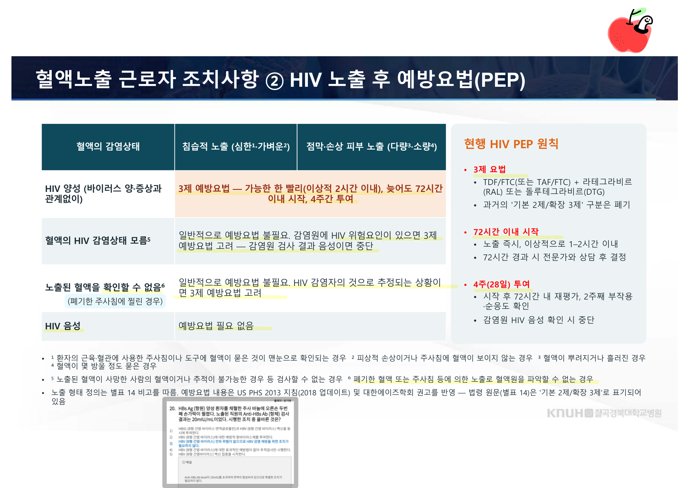{: style="width:80%"}

| 혈액의 감염 상태 | 침습적 노출(심한·가벼운) / 점막·손상피부 노출(다량·소량) |
|---|---|
| **HIV 양성**(바이러스양·증상과 관계없이) | **3제 예방요법 — 가능한 한 빨리(이상적 2시간 이내), 늦어도 72시간 이내 시작, 4주간** |
| HIV 감염 상태 모름(사망자·추적 불가) | 일반적으로 불필요. 감염원에 HIV 위험요인이 있으면 3제 고려 — 검사 음성이면 중단 |
| 노출된 혈액을 확인할 수 없음(폐기한 주사침 등) | 일반적으로 불필요. HIV 감염자 것으로 추정되면 3제 고려 |
| HIV 음성 | 필요 없음 |

- **현행 HIV PEP 원칙**: **3제요법 = TDF/FTC(또는 TAF/FTC) + raltegravir(RAL) 또는 dolutegravir(DTG)**. 과거의 '기본 2제/확장 3제' 구분은 **폐기**(법령 원문 별표14는 아직 그렇게 표기). **72시간 이내 시작**(노출 즉시, 이상적으로 1–2시간), 72시간이 지나면 전문가와 상담 후 결정. **4주(28일)**. 시작 후 72시간 내 재평가, 2주째 부작용·순응도 확인, 감염원 HIV 음성이 확인되면 중단.
- 노출 정의: 심한 = 근육·혈관에 쓴 바늘이나 도구에 **혈액이 맨눈으로 보임**, 가벼운 = 피상적 손상이거나 바늘에 혈액이 안 보임, 다량 = 혈액이 뿌려지거나 흘러짐, 소량 = 몇 방울.

!!! exam "기출 포인트"
    23번: PCP 치료 중인 HIV 환자 바늘에 찔림 → "**예방적 항바이러스제를 투여한다**". HIV 면역글로불린·백신은 없다. "전파 가능성이 낮아 관찰", "추적검사만"은 오답.

!!! diff "작년 필기와 다른 점"
    작년 필기는 HIV PEP를 "노출 경로·정도·원인 환자 바이러스양·내성에 따라 예방약 결정"이라고만 했다. 올해는 **무조건 3제, 72시간 이내, 4주**로 정리되었다.

## 혈액노출 후 추적 관리 (산업안전보건기준 규칙 별표15)

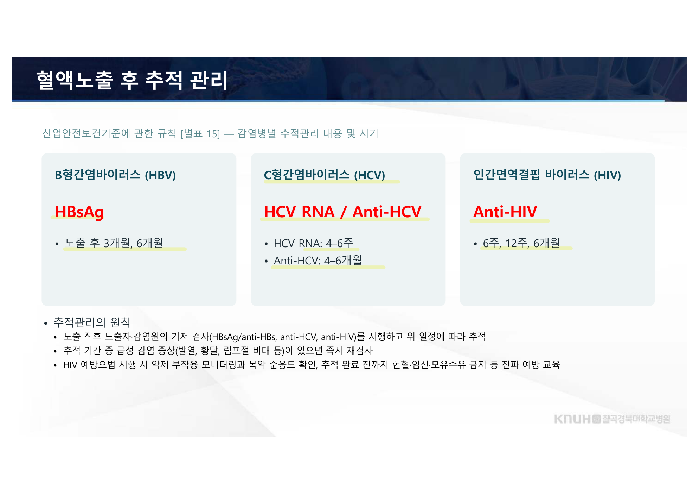{: style="width:70%"}

| 바이러스 | 검사 | 시기 |
|---|---|---|
| **HBV** | HBsAg | 노출 후 **3개월, 6개월** |
| **HCV** | HCV RNA / anti-HCV | **HCV RNA 4–6주**, **anti-HCV 4–6개월** |
| **HIV** | anti-HIV | **6주, 12주, 6개월** |

- 원칙: 노출 직후 **노출자·감염원 기저검사**(HBsAg/anti-HBs, anti-HCV, anti-HIV) → 위 일정으로 추적. 추적 중 급성 감염 증상(발열·황달·림프절비대)이 있으면 즉시 재검. HIV PEP 중엔 부작용·순응도 확인, **추적 완료 전까지 헌혈·임신·모유수유 금지** 등 전파 예방 교육.
- **HCV는 노출 후 예방약이 없다** → 조기 발견이 목적.

!!! diff "작년 필기와 다른 점"
    작년 HIV 추적은 "**최소 6개월(4주·12주·6개월)**, HCV 동시감염자 노출이면 **12개월**까지". 올해 표는 **6주·12주·6개월**이다. HBV 추적(3·6개월)은 올해 새로 나왔다.

# 9. 항생제 내성과 항생제 적정사용관리(ASP) — 시험 범위 밖

!!! new "올해 필기에서 추가"
    필기: "**여기서부터는 시험에 나오지 않습니다!**" 대부분 올해 새로 들어온 슬라이드다. 흐름만 이해하고, 끝의 항생제 표는 예전 기출(pip/tazo 고르기) 대비로 본다.

## 항생제 내성의 부담
- 2019년 한국 사망원인에서 항생제 내성 관련 사망이 상위권(IHME). 손글씨: "내성이 갈수록 심각 — **폐렴 중 내성에 의한 폐렴**이 많아지고 있다." O'Neill 보고서(2014): 대책이 없으면 2050년 내성 사망이 암을 넘는다는 예측.

## 다제내성균 관리 — 감염관리 + 항생제 관리

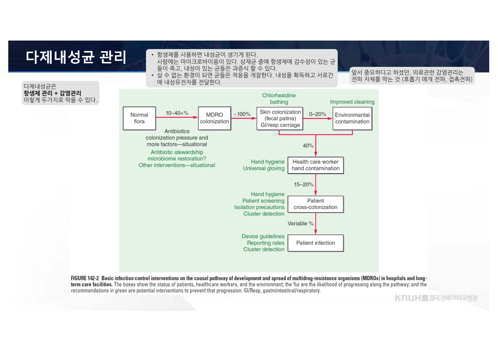{: style="width:74%"}

- 항생제를 쓰면 마이크로바이옴 중 감수성 균은 죽고 **내성균이 과증식**한다. 균은 살 수 없는 환경이 되면 적응해 내성을 얻고 **서로 내성유전자를 전달**한다.
- 그림 왼쪽(정상 균총 → **MDRO 집락**, 10–40% 이상): 항생제 사용 압력 — 이 단계를 막는 것이 **항생제 관리(antibiotic stewardship)**.
- 그림 오른쪽(피부·장 집락, 환경 오염 → **의료진 손 오염** → 다른 환자 교차 집락 → 감염): **감염관리** — chlorhexidine 목욕, 환경 청소 개선, **손위생·보편적 장갑**, 환자 선별검사·격리, 집단발생 감지, 기구 지침·보고.
- 손글씨: 의료관련 감염관리는 **전파 자체를 막는 것**, 다제내성균은 **항생제 관리 + 감염관리** 두 가지로 막는다.

!!! exam "기출 포인트"
    20번: 그림의 "가"(내성균이 생기는 단계) → **antibiotic stewardship**. 21번: "라"와 "마"(손 오염·교차 집락) 모두 → **hand hygiene**. 29번: ASP 핵심 팀(감염 전문 임상의사·항생제 전담 약사·임상미생물 전문가·정보전산 전문가)에서 가장 먼 것 → **병원장**.

## 세계·국가 대응
- **WHO 세계행동계획(2015)** 5대 목표: ① 인식·교육 ② 감시·연구로 근거 강화 ③ **위생·감염예방으로 감염 감소** ④ **인체·동물 항생제 사용 최적화** ⑤ 신약·진단·백신 투자. 손글씨: 제약회사는 항생제 개발을 꺼린다 — 개발하면 금방 내성이 생겨 경제성이 떨어져서. 대신 시장이 큰 백신 개발을 많이 한다.
- **UN 고위급회의 정치선언(2024. 9. 26)** 2030 목표: AMR 사망 **10% 감소**(2019 대비), 인체 항생제의 **≥70%를 WHO Access 군**, 농축산 항균제 30% 감축, 60% 국가가 전용 예산, 95% 국가 TrACSS 참여, 2025년까지 독립과학패널, 2029년 차기 회의.
- 각국 ASP 지침: 영국 2011(Start Smart – Then Focus), WHO 2015, 유럽 2017, 일본 2017, 호주 2020.

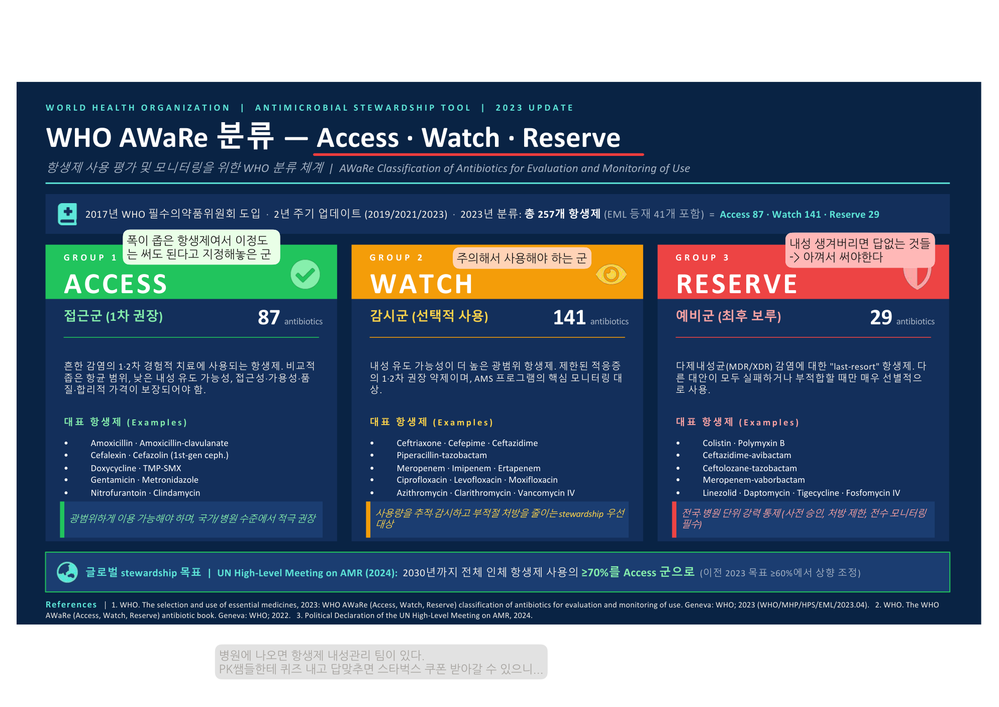{: style="width:76%"}

| 군 | 뜻 | 예 |
|---|---|---|
| **Access**(접근군, 87개) | 흔한 감염의 1·2차 경험적 치료. 좁은 범위, 낮은 내성 유도 → **적극 권장**(손글씨: "이 정도는 써도 된다") | amoxicillin(±clavulanate), cefalexin·**cefazolin**, doxycycline, TMP-SMX, gentamicin, metronidazole, nitrofurantoin, clindamycin |
| **Watch**(감시군, 141개) | 내성 유도 가능성이 큰 광범위 → **stewardship 우선 감시 대상**("주의해서") | **ceftriaxone·cefepime·ceftazidime, pip/tazo, 카바페넴 3종, 퀴놀론 3종, azithro·clarithromycin, IV vancomycin** |
| **Reserve**(예비군, 29개) | MDR/XDR의 **최후 보루** — 사전승인·처방제한("내성 생기면 답 없다 → 아껴서") | **colistin·polymyxin B**, ceftazidime-avibactam, ceftolozane-tazobactam, meropenem-vaborbactam, **linezolid, daptomycin, tigecycline**, IV fosfomycin |

- 2017년 WHO 도입, 2년마다 갱신(2023: 257개). UN 2024 목표 Access ≥70%(2023 목표 ≥60%에서 상향).
- **대한민국 국가 항생제 내성관리대책**: 1차(2016–2020) 사용량 감축 — 사용량 17.7%↓ / 2차(2021–2025) **ASP 인프라** — 78개 병원 ASP 도입 / 3차(2026–2030 예정) 적정 사용 문화의 제도화 — AMR 사망 10%↓, Access ≥70%, One Health. 손글씨: "Access 항생제를 늘리고 Reserve는 줄이자."

## ASP(항생제 적정사용관리 프로그램)
- 정의: 항생제의 **종류·용량·기간·경로**를 포함해 가장 적절한 사용을 촉진하려고 적정성을 측정·개선하는 통합 중재활동. 1996년 McGowan·Gerding이 처음 사용, 성경의 선한 **청지기(steward)** 비유 — 항생제는 재생 불가능한 귀중한 자원.
- 입증된 효과: 항생제 사용 **20–30%↓**, ***C. difficile* 감염 50%↓**, 다제내성균 감염 30–40%↓, 사망률 개선(OR 0.75), 비용 $300–900 절감, 재원 2–4일 단축, 이상반응 40%↓, 급성 신손상 30%↓.
- 「항생제 사용관리 프로그램 통합 운영 지침」(2023, 김신우·권기태 교수 책임연구).
- **ASP 시범사업**(2024.11–2027.12): 300병상 이상 종합·상급종합 78개 기관, 전담팀·위원회·지표 보고·교육. 필수 활동: 감사·피드백, **제한항생제 승인제**, KONAS 참여, CDI 정기 추적, 처방지침·교육, 지표 기반 보고. 성공 요건: 경영진 지원, 다학제 협력.
- 시범사업의 중재 7가지와 손글씨

| 중재 | 손글씨 |
|---|---|
| 1. 병합(중복) 처방 중재 | |
| 2. 장기투여 중재 | 불필요하게 오래 쓰는 것을 짧게 |
| 3. **주사 → 경구 전환** | 먹는 약으로 바꾸자 |
| 4. **하강(de-escalation)** | meropenem처럼 넓은 약을 pip/tazo처럼 좁은 쪽으로 |
| 5. 미생물 검사 기반 처방 | 바이러스로 확진되면 항생제를 쓰지 말자 |
| 6. 가이드라인에 맞는 처방 | EBM 발달로 표준 가이드라인이 나오고 있다 |
| 7. 치료 약물 모니터링 | 예: vancomycin |

- **지능형 ASP**: 보건복지부 과제로 경북대병원·서울성모병원 등이 AI 에이전트(환자 정보 요약 → 중재 행동 분류 → 중재 가이드 → 보고서)를 개발 중. 손글씨: 병원마다 항생제 stewardship 팀이 있다.
- 항생제 표준 사용기간: 최근 추세는 "**짧게 쓰자**"(과거엔 2주까지). 지역사회 폐렴 3–5일 ↔ 7–14일, 원내(VAP 포함) 폐렴 ≤8일 ↔ 10–15일, 신우신염 5–7일 ↔ 10–14일, 복강내 감염 4일 ↔ 10일, 피부감염 5–6일 ↔ 10–14일 — 결과 동등.

## 항생제 고르기 (작년 강의 본문, 올해는 참고 슬라이드)

!!! diff "작년 필기와 다른 점"
    작년엔 이 표들을 강의에서 가장 길게 다뤘다 — 교수님: "이 표를 알고 있으면 시험 칠 때 choice에 도움이 된다." 올해는 시험 범위 밖 부분에 참고로만 남았다(필기자: "하기도 감염 + 항생제 총론 복습하는 느낌").

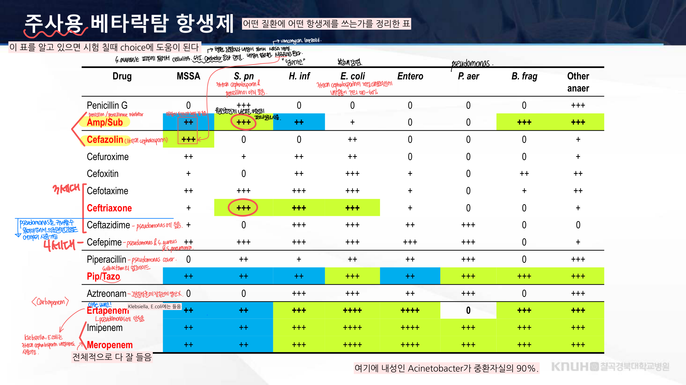{: style="width:78%"}

| 약 | 핵심 |
|---|---|
| Penicillin G | 폐렴구균·혐기균 |
| **Ampicillin/sulbactam** | MSSA·폐렴구균·*H. influenzae*·혐기균. 지역사회용, **녹농균 X** |
| **Cefazolin (1세대)** | **MSSA**(연조직염) — **수술 예방 항생제의 기본** |
| **Cefoxitin (2세대)** | **항혐기균 효과** → 복강 수술 예방에 단독 |
| **Ceftriaxone·cefotaxime (3세대)** | 폐렴구균·*H. influenzae*·*E. coli*. **녹농균 X** |
| **Ceftazidime (3세대)** | **녹농균 O**, 그람양성 약함 |
| **Cefepime (4세대)** | **녹농균 + 그람양성** 모두 |
| **Piperacillin/tazobactam** | 녹농균 + 혐기균 + 거의 전부 — **의료관련감염 경험적 치료의 대표** |
| Aztreonam | 그람음성만, 녹농균 O |
| **Ertapenem** | 카바페넴인데 **녹농균 X** — **ESBL** *E. coli·K. pneumoniae* 요로감염 표적 |
| **Imipenem·meropenem** | 다 듣는다(범위가 너무 넓다) |

- 손글씨(올해): **의료관련 감염에서 그람음성을 막으려면 표에서 ceftazidime 아래쪽 약**(ceftazidime, cefepime, pip/tazo, imipenem, meropenem). 지역사회 폐렴은 *H. influenzae*가 섞이는 경우가 많아(β-lactamase 생성) amp/sub 또는 3세대 cephalosporin. *E. coli*는 요로·복강내 감염의 대표 → 3세대 이상.
- 경구: **amx/clav**(거의 다 + 혐기균, 인두염·폐렴·연조직염), 1세대(*S. aureus*·연쇄알균 → 인두염·연조직염), 3세대(그람음성 → 요로감염).
- Fluoroquinolone: **ciprofloxacin**(그람음성·**녹농균·*Acinetobacter***, 그람양성 X → UTI), **levofloxacin**(폐렴구균 + 녹농균 어느 정도), gemi·moxifloxacin(폐렴구균 강함, **녹농균 X**). levo·gemi·moxi = **respiratory fluoroquinolone**. **결핵에 잘 들어 결핵을 가린다.** 부작용: 경련, torsade de pointes, **아킬레스건 파열**, 망막박리, **대동맥 박리·동맥류**. 녹농균이 의심되는 지역사회 폐렴 → 항폐렴구균·항녹농균 β-lactam + aminoglycoside(또는 cipro·levo) + macrolide.
- 항혐기균: **clindamycin, metronidazole**. amx/clav·pip/tazo·카바페넴처럼 혐기균을 덮는 약을 쓰면 **둘을 같이 쓸 필요가 없다**.

### 수술 전 예방적 항생제 (올해 표)

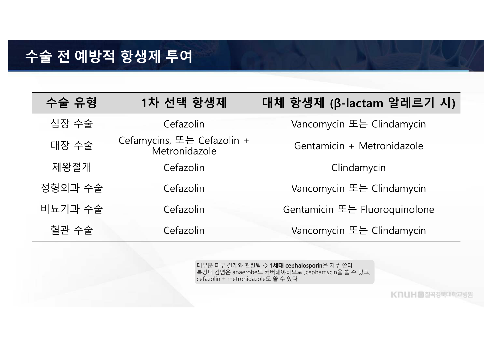{: style="width:66%"}

| 수술 | 1차 | β-lactam 알레르기 |
|---|---|---|
| 심장·정형외과·혈관 | **Cefazolin** | Vancomycin 또는 clindamycin |
| **대장** | **Cephamycin(cefoxitin), 또는 cefazolin + metronidazole** | Gentamicin + metronidazole |
| 제왕절개 | Cefazolin | Clindamycin |
| 비뇨기과 | Cefazolin | Gentamicin 또는 fluoroquinolone |

| 수술 | 권장 기간 |
|---|---|
| 일반 청결 수술 | **단회** |
| 청결-오염(대장 등) | **24시간 이내** |
| 심장 수술 | **48시간 이내**(일부 기관은 24시간) |
| 정형외과(인공관절 포함) | 24시간 이내 |
| 제왕절개 | 단회(**태반 만출 직후**) |
| 혈관(인조혈관) | 24시간 이내 |

- 손글씨: 대부분 피부 절개와 관련 → **1세대 cephalosporin**. 복강 내는 혐기균까지 → cephamycin 또는 cefazolin + metronidazole.

!!! exam "기출 포인트"
    다제내성균 의료관련감염 치료제(7번) · 의료관련감염 경험적 항생제(54번) → **piperacillin/tazobactam**. Amp/sub·amx/clav·ceftriaxone·cefazolin·cefuroxime·azithromycin은 지역사회용.

# 10. 소독과 멸균 (작년 강의, 올해 필기에는 없음)

!!! diff "작년 필기와 다른 점"
    소독·멸균·Spaulding 분류는 **작년 강의에만** 있었다(올해는 4장 무균술로 바뀜). 기출 31·57번이 여기서 나왔으니 남긴다.

- **세척(cleansing)**: 이물질 제거(물·마찰·세제) — **소독·멸균 전에 반드시**.
- **소독(disinfection)**: **세균 아포를 제외한** 미생물을 죽임. 높은 수준(충분한 시간이면 아포까지 거의 모두) / 중간 수준(**결핵균·진균**까지, 아포 X) / 낮은 수준(세균·바이러스·일부 진균).
- **멸균(sterilization)**: **아포까지 모두** — 고압증기, **EO 가스**, 화학멸균제.

{: style="width:62%"}

| Spaulding 분류(1968) | 접촉 | 예 | 방법 |
|---|---|---|---|
| **고위험기구** | 무균 조직·혈관계 | 수술기구, 심장·혈관 카테터, **요로카테터**, 삽입물, 생검겸자 | **멸균** |
| **준위험기구** | 점막 | **내시경**, 호흡·마취기구 | **높은 수준 소독** |
| | | 체온계(구강·직장), 손상 피부 수치료기구 | 중간 수준 |
| **비위험기구** | 손상 없는 피부 | **혈압계 커프, 청진기**, 침대, 린넨 | **낮은 수준** |

!!! exam "기출 포인트"
    57번: "미생물은 죽이지만 포자는 죽이지 않는" WHO 용어 → **disinfection**. 31번: 아포를 제거할 수 있는 방법 → **증기 혹은 고열 공기 30분**(짧은 시간의 고수준 소독제는 아포 X).

!!! memo "암기"
    **48h / 14일 / 30일·90일** · 공기주의 = **결핵·홍역·수두**, 음압 1인실 + 전실, **12 ACH, N95**(KF94는 공식 X) · 손위생 5시점 + 장갑 벗은 후, 6단계 "**바등깍가엄톱**", 일상은 **알코올 손소독제**, 혈액·눈에 보이는 오염·화장실 후·*C. difficile*은 **물과 비누 15초 이상** · 번들 공통 = **필요할 때만 · 무균적으로 · 매일 재평가** · SSI 항생제 **절개 전 1시간, 수술 직후(24시간 내) 중단**, 클리퍼, chlorhexidine-alcohol · VAP = 삽관 회피, **머리 30–45°**, 진정 최소화·매일 발관 평가, **칫솔질(클로르헥시딘 구강간호는 이제 비권고)** · CAUTI = 편의 목적 금지, 방광스캔·간헐적 도뇨, 폐쇄배뇨, 세척 X · CLABSI = 최대멸균차단 + chlorhexidine-alcohol + 초음파 + 쇄골하, 매일 클로르헥시딘 목욕 · **anti-HBs ≥10이면 조치 X**, 무반응자 HBIG 2회, HIV PEP **3제 72시간 이내 4주**, HCV는 예방약 없음 · 추적: HBV 3·6개월, HCV RNA 4–6주·anti-HCV 4–6개월, HIV 6주·12주·6개월.
