<!-- 필기본: 2026 · 2025 -->
<!-- 단계: 수업 후 -->

# 0. 이 수업을 공부하는 법

CP-B1은 **의료관련감염 조별발표** 시간이다(권기태 교수님). 필기본은 13번 강의와 한 파일로 묶여 있고, 이 학습자료는 그중 **조별발표와 교수님 매뉴얼** 부분(이전판 필기본 10–14쪽 요약, 61–105쪽)을 정리한 것이다. 강의 본문(무균술·손위생·격리·번들·직원감염)은 13번 학습자료에 있다.

!!! new "올해 필기에서 추가"
    올해 조별발표는 **5개 조**로 바뀌었다 — **1조 Semmelweis · 2조 요로감염 · 3조 병원획득폐렴/VAP · 4조 수술부위감염 · 5조 중심정맥관 관련 감염**. 조마다 **교수님 매뉴얼**(작년 강의 본문을 정리한 글, 필기본의 분홍 「교수님 메뉴얼」)과 **발표자료**(파란 「발표자료」)가 함께 실려 있다.

    교수님이 찍은 것: "각 조가 발표한 **의료감염 예방 방법** — 페이지 수가 많은데, **올해 매뉴얼 2페이지 + 발표자료에서 예방방법에 집중**해서 보라." "**CP 조별발표 내용에 대해서 시험문제에 각 1문제씩**", "예방 bundle과 발표에 대해서 **case로 한 문제씩** 내겠다." 1조(Semmelweis)는 손글씨로 "**시험에 내지 않았다**".

- **이 수업으로 분류된 기출은 없다**(2부 비어 있음). 같은 내용의 기출 59문항은 **13번 학습자료 2부**에 있다. 아래 `기출 포인트` 상자의 번호는 모두 **13번 2부 번호**다.
- 필기한 사람이 조마다 앞에 교수님이 중요하다고 한 곳 표시(빨간 기호)를 해 두었다 — 거의 전부 **예방법** 슬라이드다. 이 정리도 각 조의 끝을 예방법으로 맺는다.

!!! key "핵심"
    - 네 감염의 예방은 공통으로 **꼭 필요할 때만 넣고 · 무균적으로 넣고 · 매일 필요성을 묻고 빨리 뺀다.** 일상적 정기 교체·예방적 전신 항생제는 하지 않는다(수술 예방 항생제만 예외).
    - **CAUTI**: 편의 목적 삽입 금지, 간헐적 도뇨·방광스캔, **폐쇄배액 유지**, 소변백은 방광보다 낮게, 무증상 세균뇨는 대부분 치료하지 않음.
    - **VAP**: 삽관 회피·조기 발관, **상체 30–45°**, **매일 칫솔질(클로르헥시딘 구강간호는 이제 비권고)**, 조기 경장영양.
    - **SSI**: 창상 4등급, NNIS(ASA ≥3 · 오염/불결 · T시간 초과), 30일/90일, **절개 60분 이내 · 24시간 이내 중단 · cefazolin**, 정상체온·혈당 200 미만, 클리퍼, 클로르헥시딘.
    - **CLABSI**: CLABSI(감시) vs CRBSI(진단), DTP ≥2시간, **최대멸균차단 + 알코올 함유 CHG >0.5% + 대퇴 피함 + 매일 필요성**.

!!! diff "작년 필기와 다른 점"
    작년(2025) CP-B1은 **10개 조**였다: 1조 KONIS 중환자실 감시 · 2조 전국 수술부위감염 감시 · 3조 CAUTI · 4조 HAP/VAP · 5조 SSI · 6조 CLABSI · 7조 제멜바이스와 손 씻기 · 8조 이대목동병원 신생아 사망 사건 · 9조 감염관리 수가 정책과 CLABSI · 10조 표준주의와 전파경로별 격리. 올해 빠진 1·2·8·9·10조의 내용은 6장에 남겼다(KONIS 자료·격리는 올해 13번 강의 본문에 들어갔다).

# 1. 1조 — Ignaz Semmelweis

- 발표 과제: Semmelweis의 생애, 가설, 실험, 논문, 영향. 손글씨: "**시험에 내지 않았다**." 강의(13번 5장)에 같은 내용이 있다.
- 헝가리 출신 산과 의사(1818–1865), 빈 일반병원. 의사·의대생이 일하는 **제1산과의 산욕열 사망률이 조산사의 제2산과보다 훨씬 높은 것**에 주목 → **부검 후 손을 씻지 않은 의사의 손**이 "시체 입자"를 옮긴다는 가설 → 1847년 **염소화 석회 용액 손 씻기** 의무화 → 사망률 18.27% → **1.27%**.
- 세균설 이전이라 당대에는 외면당했다. 이후 리스터(소독법), 파스퇴르(세균설, 산욕열은 연쇄알균), 코흐(결핵균)가 근거를 세웠다. 오늘날 "**감염관리의 아버지**". 새 증거를 통념과 다르다고 거부하는 경향을 **제멜바이스 반사**라 부른다(작년 7조 발표).

!!! exam "기출 포인트"
    13번 2부 51번: Semmelweis 책 표지 그림 → "**의료관련감염 예방에 가장 효과적인 방법**"(손위생).

# 2. 2조 — 의료관련 요로감염 (CAUTI)

발표 과제: 정의 및 분류, 역학, 위험인자, 원인균, **집락균과 병원균의 구분**, **예방법**.

## 2-1. 교수님 매뉴얼 (5-1. 요로감염)
- 입원 성인에서 **가장 흔한 감염** — 전체 의료관련감염의 **30–40%**, 발생률 1–10%.
- 병원 요로감염의 **95% 이상이 유치도뇨관(indwelling urinary catheter) 관련**, **대부분 무증상 세균뇨**.
- **폐쇄배뇨(closed drainage system)를 유지해도 세균뇨가 매일 약 3–8%** 생겨 **1개월 이상** 두면 대부분 세균뇨·진균뇨.
- **간헐적 도뇨**의 세균뇨 발생은 3%, 도뇨관 없는 입원 환자는 1.4% → **유치도뇨관 삽입을 최소화**하는 것이 가장 효과적.

| 정의·분류 | 내용 |
|---|---|
| ① 무증상 세균뇨(ASB) | 요로감염 증상·징후 없이 적절히 채취한 소변에서 **2종류 이하 균이 105 CFU/mL 이상** |
| ② 급성 단순요로감염 | 비뇨생식기 이상 없는 **여성**의 방광 감염(빈뇨·절박뇨·배뇨곤란·치골상부 압통) |
| ③ 급성 비폐쇄성 신우신염 | CVA 통증·압통, 발열을 동반한 신장 염증 |
| ④ 복잡요로감염 | 비뇨생식기 기능적·구조적 결함 → 치료 어렵고 **재발이 잘 되고 내성균 흔함**. 적절한 항생제도 중요하지만 **막힌 곳을 해결하는 것이 더 중요** |
| ⑤ 농뇨 | 소변 다형핵백혈구 증가 = 요로 염증 반응 |
| ⑥ 요로패혈증 | 상부 요로 염증 → 균혈증. 혈액배양에서 **소변과 같은 균** |
| ⑦ 도뇨관 관련 세균뇨 | 증상 없으면 **CA-ASB**, 있으면 **CA-UTI** |

- 역학: 미국 NHSN은 2009년부터 **무증상 세균뇨를 감시에서 제외**, 국내는 2012년부터 → 2011년 10월부터 무증상 요로감염이 정의에서 빠지면서 ICU에서는 **혈류 > 요로 > 폐렴** 순이 되었다.
- 위험인자: 도뇨관 **내부**(폐쇄배뇨가 깨지거나 소변백 소변이 오염) / **외부**(삽입·관리 시 무균술 미준수, 장·회음부 상재균이 외벽을 타고 올라감). **가장 중요한 위험인자 = 삽입기간**. 그 외 관리 부실, 폐쇄배뇨 미유지, 요도구·소변백 집락, **여성, 고령, 신경계 기저질환, 당뇨, 입원 당시 중증도**. → **가장 중요한 예방전략은 꼭 필요한 경우에만 넣고 삽입기간을 최소화하는 것**, 삽입·관리 시 무균술과 폐쇄배뇨 유지.

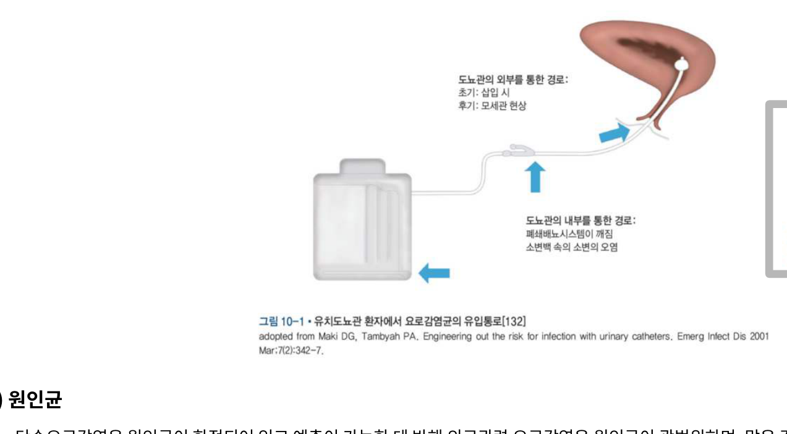{: style="width:62%"}

- 원인균: 단순요로감염은 원인균이 한정적이지만 의료관련 요로감염은 **광범위하고 여러 항생제에 내성**. 단기 유치는 대부분 **단일균**(장알균·그람음성 막대균), **가장 흔한 것은 *E. coli***(단순 UTI보다 비율은 낮음), 그 외 *Klebsiella, Serratia, Citrobacter, Enterobacter*, *P. aeruginosa*, CoNS. **진균뇨는 대부분 칸디다뇨**, 국내 ICU 요로감염 분리균의 **30–35%**. 장기 유치는 대개 **혼합균**, *Proteus mirabilis, Providencia, Morganella*.
- 장기 유치 도뇨관엔 **생체막(biofilm)** 이 생겨 방광 내 세균뇨를 정확히 반영하지 못함 → 배양은 **새로 넣은 도뇨관**에서.
- **단순집락균 vs 병원균**: 장기 유치·요양시설·여성 환자는 도뇨관 집락균이 배양되는 경우가 흔함 → 요로감염이 의심되면 **도뇨관을 교체하고 신선한 소변으로 재배양**. ICU 소변의 *Candida*는 오염·집락이 많아 실제 감염과 구별 필요 — **도뇨관 제거·교환만으로 40%에서 칸디다뇨 소실**.
- **5) 예방법**: ① **꼭 필요한 환자에게만** 삽입, **치료자의 편의만을 위해 삽입하지 말 것** ② 삽입·유지 시 **무균적 조작** ③ **폐쇄배액 유지, 최소한 조작**, 꼬이거나 막히거나 역류하지 않게 ④ **가능하면 빨리 제거** ⑤ **예방적 항생제 투여는 권장되지 않음**.

## 2-2. 발표자료 — 정의·분류·역학
- 요로감염 = 세균 등 병원성 미생물이 요로에 침입·증식해 염증을 일으키는 질환. 대부분 **장내 세균이 요도 주변에 집락한 뒤 요도를 통해 방광으로 올라가는 상행성 감염**.
- 분류 (1) 전통적: **단순**(구조·기능 이상이나 중대한 기저질환 없는 건강한 **비임신 여성**, 대표는 급성 단순 방광염) vs **복잡성**(구조·기능 이상, 폐쇄, 결석, **도뇨관**, 면역저하 등 치료를 어렵게 하는 요인 동반).
- 분류 (2) **EAU 2026**: **국소 요로감염**(전신 증상 없이 방광염 양상 — 배뇨통, 요절박, 빈뇨, 요실금) vs **전신 요로감염**(요로 어디서든 시작, 발열·저체온, 심한 오한, **섬망**, 저혈압, 빈맥, CVA 통증 — 국소 증상이 **없을 수도** 있다).
- 분류 (3) 해부학적: **하부**(방광염·요도염) vs **상부**(신우·신실질, 대표 급성 신우신염 — 발열·오한·옆구리 통증·오심·구토).
- 역학: GBD 2021 연간 약 **4.49억 건**, 사망 약 30만 명(80세 이상에서 증가). 여성은 초기 감염 후 6개월 안에 20–30% 재발. 평생 위험 여성 **50–60%**, 남성 13–15%. 연령표준화 발생률 **여성이 남성의 약 4배**, 사망률은 남성이 약간 높음. 영아기(특히 생후 6개월 미만)는 **남아 우세**(선천 이상·포경), 15–49세는 여성(짧은 요도·성생활·살정제), 65세 이상은 성별 차이가 줄어듦(전립선비대·폐경).
- 원인균 비교: *E. coli*(UPEC) 단순 75% / 복잡성 65%, *K. pneumoniae* 6/8%, ***Enterococcus* 5/11%** (복잡성에서 증가), *S. saprophyticus* 6%(단순), *P. mirabilis* 2/2%, *P. aeruginosa* 1/2%.

## 2-3. 발표자료 — 위험인자·원인균·집락균 구분
- **① 도뇨관 관련(가장 핵심·교정 가능)**: **유치 기간** — 하루 3–8%씩 증가, **30일 이상이면 거의 100%**. 삽입·관리 문제 — 무균술·위생 미흡 → **바이오필름** 형성, 가능하면 **간헐도뇨** 권장.
- ② 환자 요인: **여성**(짧은 요도, 항문·질과 가까움), **고령·당뇨·면역저하**, **신경계 중증 환자**(의식저하·신경인성 방광으로 장기 유치).
- ③ 의료기관 요인(KONIS 2023, 도뇨관 1,000일당): 외과계 ICU(신경외과 2.11) > 내과계 ICU(1.09). 병상 500–699 병원 ICU 1.67로 가장 높고 299병상 이하 0.65로 가장 낮음(규모가 클수록 증가).
- 주요 원인균의 특징: *E. coli*·*K. pneumoniae* — **섬모(부착)·협막(면역회피)**으로 요로상피·도뇨관에 정착 / ***Proteus mirabilis*** — **요소분해효소(urease) → 소변 알칼리화 → 결정성 바이오필름 → 도뇨관 폐색·감염석** / *P. aeruginosa* — 습윤 환경 적응, 강한 바이오필름 / ***Enterococcus*** — 장내 유래, 도뇨관 표면 부착 / *S. saprophyticus* — 젊은 여성의 지역사회 단순 방광염, 의료관련에선 드묾 / ***Candida*** (*C. albicans, glabrata, tropicalis*) — 방광염·상행성 신우신염·드물게 fungal ball 폐색. **소변에서 검출돼도 집락일 수 있어 배양 양성만으로 확진할 수 없다.**
- **집락균 vs 병원균**: 집락균은 요로에 있으나 병을 일으키지 않음 / 오염균은 채취 중 혼입 / 병원균은 실제 원인. **균 수만으로는 감별 불가.** 대장균 ≥102 CFU/mL만으로도 방광 세균뇨 양성예측도 93%(폐경 전 급성 방광염 여성). 항생제 1회 투여 후 첫 검체의 배양 양성률은 99% → **35%** — **배양은 항생제 전에**.

### 무증상 세균뇨(ASB) 감별
- (1) 증상 확인: 새로 생기거나 악화된 국소(배뇨통·빈뇨·절박뇨·치골상부통) 또는 전신(발열·오한·옆구리통·CVA 압통·저혈압) 증상, 질염·요도염 감별. **고령자는 섬망·낙상만으로 감염이라 판단하지 않는다**, 척수손상은 새 경직·실금 변화·자율신경반사 이상, 도뇨관 환자는 다른 감염원 확인. 배뇨통이 없다고 ASB로 단정하지 않는다.
- (2) 검사 기준(CFU/mL): 중간뇨 무증상 **여성 ≥105 동일균 연속 2회**, **남성 ≥105 1회**, 유치도뇨관 무증상 ≥105, **도뇨관 관련 유증상 UTI ≥103**(도뇨 중 또는 제거 후 48시간 이내). 혼합균·상피세포 → 오염 의심. **농뇨·LE·nitrite 양성, 악취·혼탁만으로 확진하지 않는다.**
- (3) 치료 여부: **대부분 선별·치료 불필요**(비임신 여성, 고령, 당뇨, 장기 도뇨관, 재발성 UTI의 무증상기) — 이득 없이 내성·이상반응만 증가. **예외: 임신**(초기 소변배양, ≥105이면 표적 항생제 4–7일) · **요로점막 손상 시술 전**(시술 30–60분 전 시작, 1–2회). 신장이식 첫 1개월·고위험 호중구감소증은 일괄 판단하지 않음.

## 2-4. 예방법 — "여기 집중"

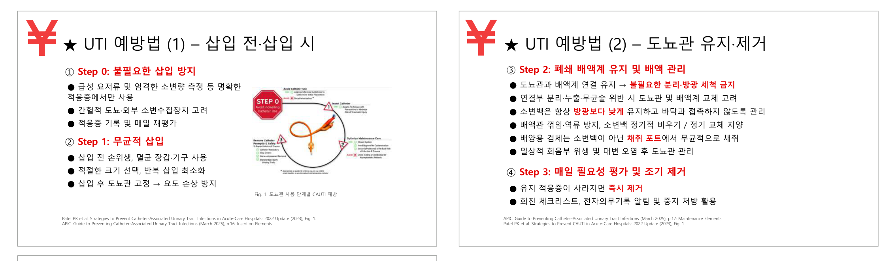{: style="width:84%"}

| 단계 | 할 일 |
|---|---|
| **Step 0 — 불필요한 삽입 방지** | **급성 요저류·엄격한 소변량 측정 등 명확한 적응증**에서만. **간헐적 도뇨·외부 소변 수집장치** 고려. 적응증 기록과 **매일 재평가** |
| **Step 1 — 무균적 삽입** | 삽입 전 **손위생, 멸균장갑·기구**. 적절한 크기, 반복 삽입 최소화. 삽입 후 **고정** → 요도 손상 방지 |
| **Step 2 — 폐쇄배액 유지·배액 관리** | 연결 유지 → **불필요한 분리·방광 세척 금지**. 분리·누출·무균술 위반 시 도뇨관과 배액계 교체 고려. **소변백은 항상 방광보다 낮게, 바닥에 닿지 않게**. 꺾임·역류 방지, 정기적으로 비우기(**정기 교체는 지양**). **배양 검체는 소변백이 아니라 채취 포트에서 무균적으로**. 회음부 위생, 대변 오염 후 관리 |
| **Step 3 — 매일 필요성 평가·조기 제거** | 적응증이 없어지면 **즉시 제거**. 회진 체크리스트, 전자의무기록 알림, 중지 처방 |

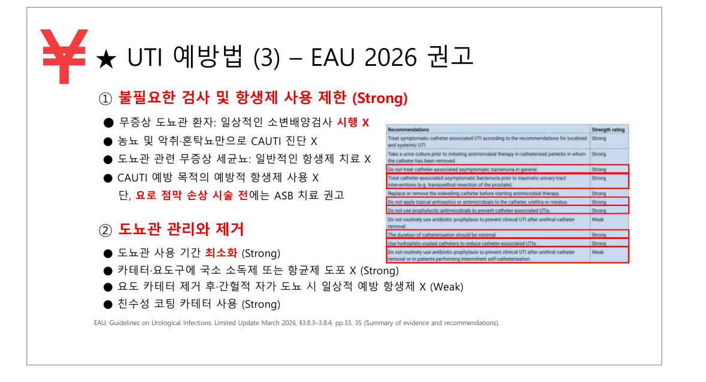{: style="width:62%"}

- **EAU 2026 권고**: 불필요한 검사·항생제 제한(Strong) — 무증상 도뇨관 환자 **일상적 소변배양 X**, **농뇨·악취·혼탁만으로 CAUTI 진단 X**, 도뇨관 관련 ASB **항생제 치료 X**, **CAUTI 예방 목적 예방적 항생제 X**(단, 요로점막 손상 시술 전 ASB는 치료). 도뇨관 관리: **사용기간 최소화**(Strong), **카테터·요도구에 국소 소독제·항균제 도포 X**(Strong), 카테터 제거 후·간헐적 자가도뇨 시 일상적 예방 항생제 X(Weak), **친수성 코팅 카테터**(Strong).
- 교수님 코멘트(작년 3조): "제 강의에서는 **예방**에 집중하고 요로감염 자체는 다른 교수님 강의에서. **폐쇄배뇨시스템**과 **전신 항생제를 사용하지 않는다**는 점 유념."

!!! diff "작년 필기와 다른 점"
    작년 3조 발표에 있던 것: **적응증 표**(급성 요정체·방광출구 폐쇄 / ICU 시간당 소변량 / 비뇨생식기 수술·수술 중 다량 수액·이뇨제·소변량 확인) vs **비적응증**(요양원 거주자의 **실금 처치**, 자발 배뇨 가능 환자의 검사, 이유 없는 수술 후 장기 사용), 수술 후 가능하면 **24시간 이내 제거**, 대안 콘돔 카테터. **권고하지 않는 것**: 항생제·소독제 코팅 도뇨관의 일상 사용, 무증상 세균뇨 스크리닝·치료, 예방 목적 전신 항생제, 정기 교체, 방광 세척, 요도 주변 항균 연고, **제거 전 clamping**. 연결이 분리되면 **전체 교체**, 소변백은 **3/4 이상 채우지 않음**. 진단: 치료 3일 후에도 열이 나면 영상(CT). 세균뇨는 "매일 3–10%, 30일이면 100%"로 적혀 있었다(올해는 3–8%).

!!! exam "기출 포인트"
    13번 2부 1번(2025) → "**폐쇄배액체계를 유지하고 최소한으로만 조작**"(자주 교체, 삽입 후 예방적 항생제, 매일 소변배양, "소변백을 위생적으로 비우면 무균술 불필요"는 오답). 34번(도뇨관 그림, 3개) → **삽입 시 무균술 + 폐쇄배뇨 유지 + 매일 필요성 평가 후 제거**(상체 30–45도·구강 chlorhexidine·시술 전 예방적 항생제는 오답).

# 3. 3조 — 병원획득폐렴(HAP)·인공호흡기 관련 폐렴(VAP)

발표 과제: 정의, 발병기전, 위험인자, 원인균(집락균과 병원균), 항생제 치료, **예방법**.

## 3-1. 교수님 매뉴얼 (5-2. 병원획득폐렴)
- 폐렴은 요로·카테터 관련 감염과 함께 주요 의료관련감염. **사망률 약 30%**, 입원기간·의료비 증가.
- 구강·상기도엔 상재균이 있지만 하기도는 대부분 무균 → 어떤 경로로든 미생물이 들어가 자라면 폐렴. 고위험군: 영유아·소아, **65세 이상**, 심각한 기저질환, 면역저하, **의식저하**, 심폐질환, **흉부·복부 수술**, **인공호흡기**.
- 전통적 예방: 흡인 감소, 손위생, 호흡기 장치의 적절한 소독·멸균, 백신, 교육. 구강·위의 집락을 억제하는 방법은 연구 중.
- 정의: **HAP** = 입원 당시 잠복 상태가 아니며 **입원 48시간 이후** 발생. **VAP** = 기도삽관·인공호흡기 적용 **48–72시간 이후** 발생.
- 발병기전: 환자 자신의 또는 병원에서 얻은 **상기도 집락균이 하기도로 흡인(aspiration)**.
- 위험인자: 집락 조장(이전 항생제, 오염된 인공호흡기 회로·장비, **위산 감소**) / 구강인후부 흡인 조장(**기관내 삽관, 의식저하, 비위관**) / 숙주 방어 약화(COPD, 고령, 흉부·상복부 수술).
- 원인균: 단일 또는 여러 균 동시 감염. **호기성 그람음성균**(*E. coli, K. pneumoniae, Enterobacter, P. aeruginosa, Acinetobacter*)과 **그람양성균**(*S. aureus*·MRSA, *Streptococcus*), 면역저하자는 바이러스·진균. **국내 KONIS 2020–2021: *A. baumannii* 26.7% > *P. aeruginosa* 17.4% > *K. pneumoniae* 16.6% > *S. aureus* 15.0% > *S. maltophilia* 6.1%**.
- **다제내성균 위험요인**: **90일 이내 주사 항생제**, VAP 당시 **패혈성 쇼크**, VAP 전 **ARDS**, VAP 전 **5일 이상 입원**, VAP 전 급성 신부전으로 **신대체요법**.

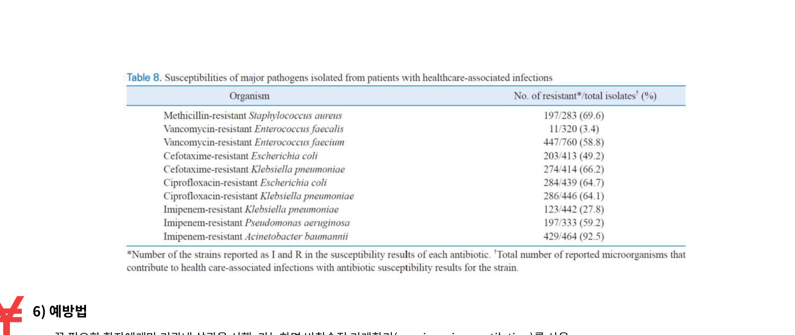{: style="width:70%"}

- 내성률(Table 8): MRSA 69.6%, VRE *faecium* 58.8%(*faecalis* 3.4%), cefotaxime 내성 *E. coli* 49.2%·*K. pneumoniae* 66.2%, ciprofloxacin 내성 *E. coli* 64.7%·*K. pneumoniae* 64.1%, imipenem 내성 *K. pneumoniae* 27.8%·*P. aeruginosa* 59.2%·***A. baumannii* 92.5%**.

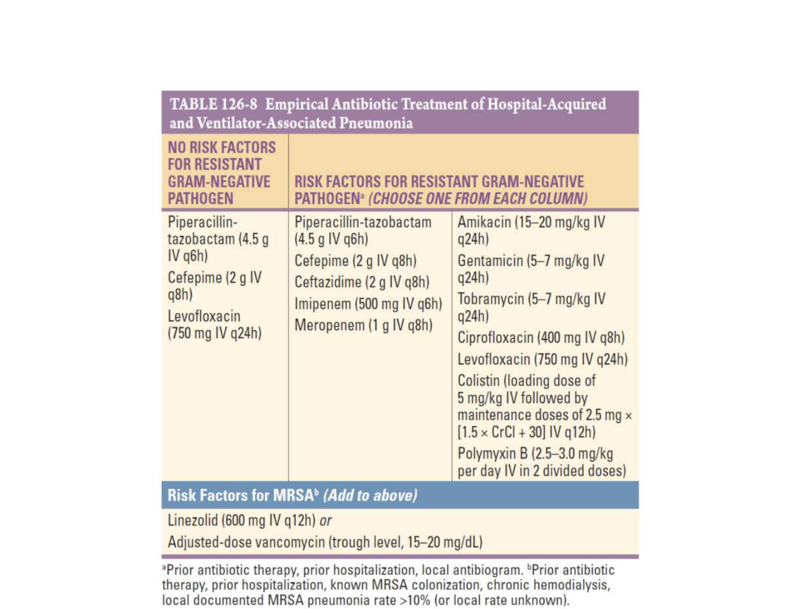{: style="width:60%"}

- 경험적 항생제(Table 126-8): **내성 그람음성균 위험 없음 → pip/tazo, cefepime, levofloxacin 중 하나**. **위험 있음 → 두 칸에서 하나씩**: β-lactam(pip/tazo, cefepime, ceftazidime, imipenem, meropenem) + 다른 계열(amikacin·gentamicin·tobramycin, ciprofloxacin·levofloxacin, colistin, polymyxin B). **MRSA 위험 → linezolid 또는 vancomycin 추가**. 위험인자: 이전 항생제, 이전 입원, MRSA 집락, 만성 혈액투석, 지역 MRSA 폐렴 비율 >10%.
- **6) 예방법**: **꼭 필요한 환자에게만 삽관**, 가능하면 **비침습적 환기** / 기관내 삽관은 가능한 빨리 제거(**"sedation vacation"과 매일 발관 평가**) / **상체 30–45도**로 흡인 방지 / 구인두를 chlorhexidine으로 정기 소독(→ 올해 비권고, 아래 diff) / **심부정맥혈전 예방**(금기 아니면).

## 3-2. 발표자료
- **정의**(IDSA/ATS 2016 · ERS 2017 · NHSN 2026 · 질병관리청 2023): 흉부영상의 **새 폐침윤 + 감염 소견**(발열·화농성 객담·백혈구 증가·산소화 악화). HAP = 입원 48시간 이후(입원 당시 잠복 제외), VAP = **기관내삽관 48시간 이후**. **HCAP 개념은 폐기**(광범위 항생제 남용 방지), **VAT**는 폐침윤 없는 호흡기 감염, 성인 **VAE 감시**는 PEEP·FiO2 악화 기반.
- **국내 역학**(2023, 16개 종합병원 477,734명): **입원 1,000명당 2.5명**, 평균 72세, **초기 항생제 부적절 39.5%**(다제내성균 많아서), **원내 사망률 28.7%**, 임상적 치료 실패 30.0%.
- **발병기전**: 구강인두 집락화(병원 그람음성균 정착) → **하기도 미세흡인** → 숙주방어 실패(기침반사·면역 저하) → 폐실질 염증. 기관내관이 있으면 추가 3대 기전: ① **방어장벽 우회**(성문 폐쇄·기침 차단) ② **커프 주변 흡인**(성문하 분비물 누출) ③ **바이오필름**(관 표면이 내성균 저장소).
- **집락균과 병원균 = 같은 균주의 연속적 이행**: 집락은 조직·면역반응 없는 단순 증식 — **배양 양성이어도 치료 대상 아님**, 내성균이 안 나오면 항생제 축소의 근거. 집락 진행: **구강인두 약 36시간 → 위장관 36–60시간 → 하기도·기관내관 60–96시간 바이오필름**.

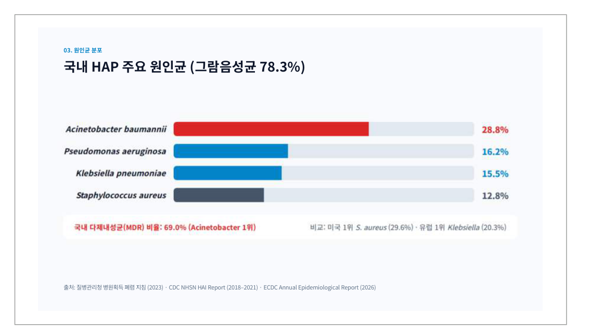{: style="width:62%"}

- 국내 HAP 원인균: **그람음성균 78.3%** — ***A. baumannii* 28.8%** > *P. aeruginosa* 16.2% > *K. pneumoniae* 15.3% > *S. aureus* 12.8%. 확인된 원인균의 **69%가 다제내성**(*A. baumannii* 1위).
- 위험인자: 숙주(고령 72세·기침반사 저하, 고형암 32%·만성폐질환, **연하장애·의식저하**, 앙와위·비위관) / 처치·환경(흉부·상복부 수술 후 무기폐, 장기 재원, 선행 항생제) / **VAP 특이(기관내삽관 = 가장 강력한 단일 인자, 인공호흡 기간에 비례, 재삽관)**.
- MDR 예측인자 지침 비교: 공통 핵심 = **90일 이내 정맥 항생제(OR 12.3)**·이전 항생제·**패혈성 쇼크**. IDSA/ATS는 패혈성 쇼크·ARDS·급성 신대체요법·5일 이상 입원, 국내·유럽은 5일 초과 입원, 조기 발병이라도 쇼크면 고위험. 병합 기준: IDSA는 병동 그람음성 내성률 >10%면 2제, 국내는 MDR·사망 고위험군에 조건부.
- **항생제 치료 — "넓게 시작하고, 배양 결과에 따라 7–8일 단기 치료"**: 국내 지침(2023) 기본은 **MSSA + 녹농균** 커버 — **pip/tazo 또는 cefepime**(혐기균 커버는 불필요), 고위험이면 β-lactam + fluoroquinolone. 미국(IDSA/ATS 2016)은 위험도에 따라 **MRSA(vancomycin·linezolid)·2제(서로 다른 계열 항녹농균)** 추가. **48–72시간에 배양 확인 후 단계적 축소(de-escalation)**, 치료기간 **미국 7일·한국 7–8일**(PCT 참고 가능).
- 교수님 코멘트(작년 4조): "MRSA 감염 위험이 **우리나라는 더 낮다**. 면역저하자나 septic shock처럼 아주 심각하지 않으면 가이드라인처럼 **MRSA 커버를 그렇게 적극적으로 하지는 않는다**."

## 3-3. 예방법 — SHEA/IDSA/APIC 2022

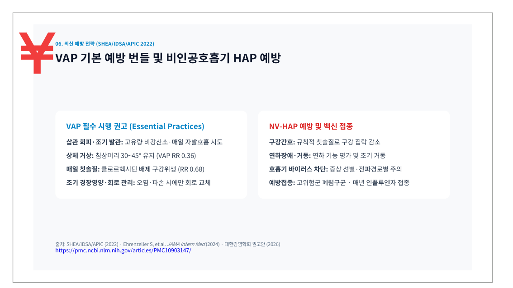{: style="width:62%"}

| VAP 필수 시행(Essential Practices) | 비인공호흡기 HAP 예방·백신 |
|---|---|
| **삽관 회피·조기 발관**: 고유량 비강산소, 매일 자발호흡 시도 | **구강간호**: 규칙적 칫솔질로 구강 집락 감소 |
| **상체 거상 30–45°**(VAP RR 0.36) | **연하장애·거동**: 연하기능 평가, 조기 거동 |
| **매일 칫솔질 — 클로르헥시딘 배제**(RR 0.68) | 호흡기 바이러스 차단: 증상 선별, 전파경로별 주의 |
| **조기 경장영양·회로 관리**: 오염·파손 시에만 회로 교체 | **예방접종**: 고위험군 폐렴구균, 매년 인플루엔자 |

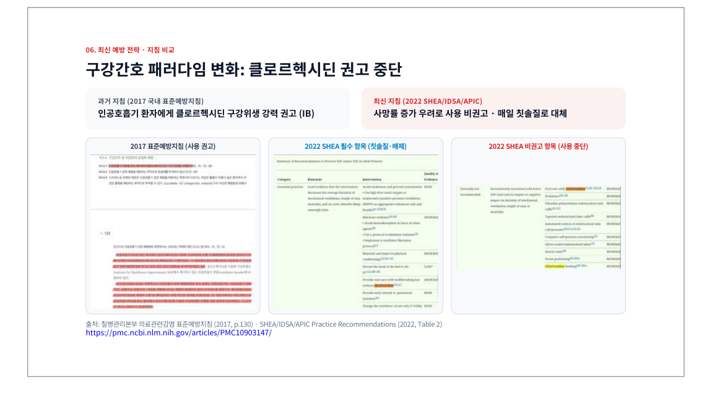{: style="width:62%"}

!!! diff "작년 필기와 다른 점"
    **구강 클로르헥시딘**: 2017 국내 표준예방지침과 교수님 매뉴얼(Table 142-1)은 "인공호흡기 환자 **클로르헥시딘 구강위생 강력 권고(IB)**"였지만, **2022 SHEA/IDSA/APIC는 사망률 증가 우려로 비권고 → 매일 칫솔질로 대체**. 13번 강의의 올해 매뉴얼(표 18-3)도 같은 입장이다. 작년 4조 발표엔 커프압 유지·성문하 분비물 배출·회로 응축수 관리, "**가장 효과적인 예방은 인공호흡기 조기 이탈**"이 있었다.

!!! exam "기출 포인트"
    13번 2부 12번: 인공호흡기 7일째 VAP의 예방법 2개 → **상체 30–45도 + 매일 진정 중단·인공호흡기 필요 여부 확인**(예방적 항생제, 최대멸균방어술(중심정맥관), 매일 몸 chlorhexidine 소독(중심정맥관 유지 번들)은 오답). 26번: 인공호흡기 14일째 VAP 원인균 4개 → ***S. aureus, P. aeruginosa, A. baumannii, K. pneumoniae***. 19번: 뇌출혈로 의식저하된 환자의 dependent 폐 경화 → **흡인성 폐렴**. 7·54번: 의료관련감염 경험적 항생제 → **piperacillin/tazobactam**.

# 4. 4조 — 수술부위감염 (SSI)

발표 과제: 위험인자, **수술창상의 분류**, 수술 전 신체상태(**ASA, NNIS**), 수술 후 창상감염의 정의, 수술별 감시기간·발생률, 원인균, **예방법**, 수술 전 예방적 항생제.

## 4-1. 교수님 매뉴얼 (5-3. 수술부위감염)
- 2010년 국제보건기구 보고: 개발도상국에선 수술 환자의 약 1/3에서 감염, 가장 빈번한 의료관련감염. 미국·유럽 같은 고소득 국가에선 빈도는 낮지만 **여전히 두 번째**로 많다.
- 입원 연장, 이환율·사망률 증가 → 의료비와 사회적 비용. 수술 환경·술기·예방 항생제가 발전해도 완전히 피할 수는 없지만 **근거중심 지침을 지키면 약 60% 예방**. 원인균·기저질환·면역·수술 종류가 복합적이라 **수술 전·중·후 통합 관리**가 필요.
- 위험인자: 대부분 **환자 자신의 몸에 이미 있는 피부·수술 개방 부위의 상재균** → **피부절개부터 봉합까지** 열려 있는 동안 위험이 높다. 외부 오염(수술 환경·기구)도 가능. 원인균은 일반적으로 **피부상재균인 그람양성 알균(*S. aureus, S. epidermidis*)**, **복강 수술은 그람음성 막대균(*E. coli, Klebsiella*)**. 환자 요인: 연령, **조절되지 않는 당뇨**, 비만, 흡연, 면역억제제, 영양상태, **수술 전 긴 재원**. 수술 요인: **긴 수술시간, 기구 삽입, 혈종·괴사조직, 수술 중 저체온·저산소증, 수술 전후 고혈당**. 청결 창상은 5% 미만, 응급 오염 창상은 20%까지.

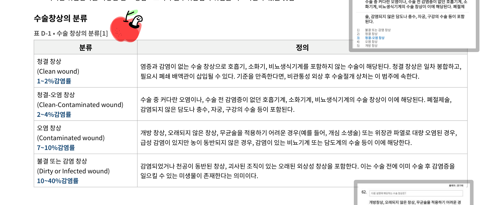{: style="width:84%"}

| 분류 | 정의 | 감염률 |
|---|---|---|
| **청결(clean)** | 염증·감염이 없고 **호흡기·소화기·비뇨생식기를 포함하지 않는** 수술. 일차 봉합, 필요하면 폐쇄 배액. 기준을 만족하면 비관통성 외상 수술도 | **1–2%** |
| **청결-오염(clean-contaminated)** | 수술 중 커다란 오염이나 수술 전 감염이 없던 **호흡기·소화기·비뇨생식기** 수술. **폐절제, 감염되지 않은 담도·충수·자궁·구강** 수술 | **2–4%** |
| **오염(contaminated)** | **개방·신선한 창상**, 무균술을 적용하기 어려운 경우(**개심 소생술**), **위장관 파열로 대량 오염**, **급성 감염이 있지만 농이 없는** 경우, 감염이 있는 비뇨기·담도 수술 | **7–10%** |
| **불결·감염(dirty/infected)** | 감염됐거나 **천공**이 동반된 창상, **괴사 조직이 있는 오래된 외상** — 수술 전에 이미 감염을 일으킬 미생물이 존재 | **10–40%** |

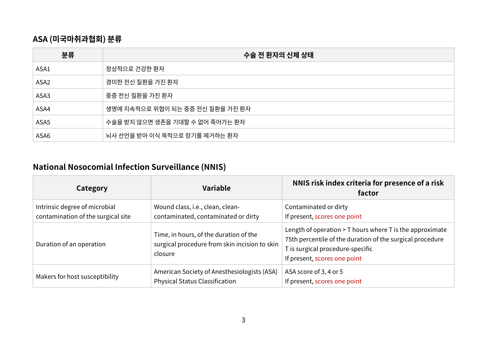{: style="width:70%"}

- **ASA 분류**: 1 정상 건강 / 2 경미한 전신질환 / 3 중증 전신질환 / 4 생명을 지속적으로 위협하는 중증 전신질환 / 5 수술 없이는 생존 기대 불가 / 6 장기 기증 목적의 뇌사자.
- **NNIS 위험지수**(각 1점, 0–3점): ① 창상 **오염 또는 불결** ② 수술시간 > **T시간**(그 수술 소요시간의 **75 백분위수**) ③ **ASA 3·4·5**.

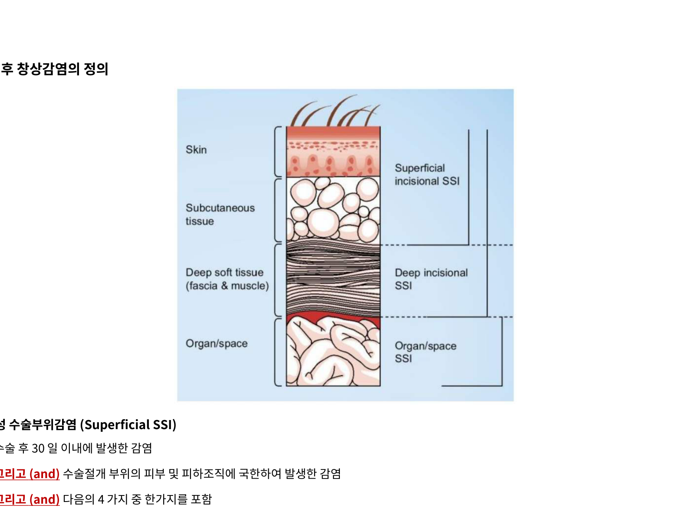{: style="width:56%"}

| 종류 | 기간 | 범위 | 그리고(and) 다음 중 하나 |
|---|---|---|---|
| **표재성 절개부위** | **30일** | 절개 부위 **피부·피하조직** | ① 고름 ② 무균 채취 검체에서 균 ③ 의료진이 의도적으로 열었고(배양 안 함) 통증·압통·부종·발적·열감 중 1개 ④ 의료진이 표재성 SSI로 진단 |
| **심부 절개부위** | **30일 또는 90일** | **근막·근육층** | ① 심부 고름 ② 저절로 벌어지거나 의도적으로 열었고 균 분리(또는 배양 안 함) + **발열 >38℃ 또는 국소 통증·압통** ③ 농양 등이 검사로 확인 |
| **기관/강(organ/space)** | 30일 또는 90일 | 근막·근육보다 **깊은** 부위 | ① 삽입 배관에서 농 ② 무균 채취 체액·조직에서 균 ③ 농양 등 확인 + **특정 부위 감염 진단기준 1개 이상**(골수염 BONE, 유방 BRST, 심내막염 ENDO, 복강내 IAB, 관절 JNT, 종격동 MED, 수막염 MEN, 인공관절 주위 PJI 등) |

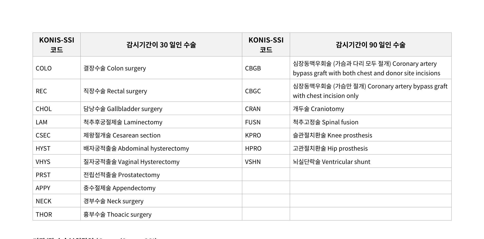{: style="width:76%"}

- **30일 감시**: 위(GAST), 결장(COLO), 직장(REC), 담낭(CHOL), 척추후궁절제(LAM), 제왕절개(CSEC), 복부·질 자궁절제(HYST·VHYS), 전립선(PRST), 충수(APPY), 경부(NECK), 흉부(THOR).
- **90일 감시**: 심장(CARD), 관상동맥우회술(CBGB·CBGC), 개두술(CRAN), 척추고정(FUSN), **슬·고관절 치환(KPRO·HPRO)**, 뇌실단락(VSHN) — **인공물·구조물이 들어가는** 수술.
- **예방법**(매뉴얼, 중요 표시): **절개 전 1시간 이내 예방 항생제, 24시간 이내 중단**(가능하면 한 번) / 제모는 **수술 때만, 클리퍼 또는 안 함** / **chlorhexidine-alcohol** 소독 / 수술실 무균(출입 최소화) / 술기(개방·예방적 배액관 피하기) / 수술 후 창상을 자주 진찰해 초기에 대처.
- **수술 전 예방적 항생제**: 목적은 **절개부위 내인성 상재균 수를 낮추는 것** / **불결·감염 창상은 치료** 목적 / **청결 수술엔 일반적으로 권고하지 않음** / **인공장치를 넣는 청결 수술은 권고**.

## 4-2. 발표자료

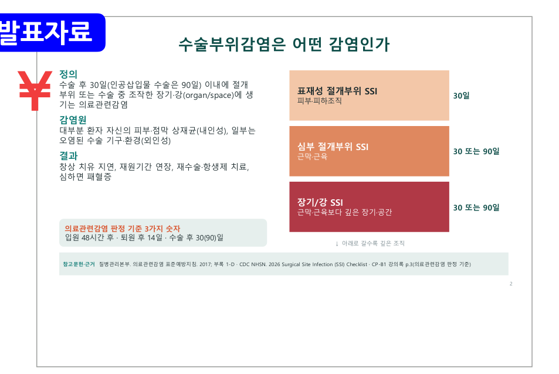{: style="width:60%"}

- 정의: 수술 후 **30일(인공삽입물은 90일)** 이내 절개 부위 또는 수술 중 조작한 장기·강에 생기는 의료관련감염. **감염원은 대부분 환자 자신의 피부·점막 상재균(내인성)**, 일부는 오염된 기구·환경(외인성). 결과: 창상 치유 지연, 재원 연장, 재수술·항생제, 심하면 패혈증. 표재성(피부·피하) 30일 / 심부(근막·근육)·장기/강 30 또는 90일.
- 위험인자: 환자(고령, 조절 안 되는 당뇨, 비만, 흡연, 면역억제제, 영양 불량, 수술 전 장기 입원) / 수술(긴 시간, 인공기구, 혈종, 괴사조직) / **수술 중 생리적 요인(저체온, 저산소증, 수술 전후 고혈당)** — 대부분 교정 가능 → 수술 전 혈당 조절·금연·영양 교정, 수술 중 정상체온·산소화 유지가 곧 예방.
- 창상 4등급 예: 청결 = 예정 슬관절치환 / 청결-오염 = 예정 결장절제(통제된 개방) / 오염 = 수술 중 장 내용물 다량 유출 / 불결 = 천공으로 분변성 복막염, 농양. **같은 결장절제술도 소견에 따라 달라진다**(통제된 개방 II → 도중 다량 유출 III → 수술 전부터 천공 IV).
- ASA: II는 잘 조절되는 고혈압·당뇨, **III는 조절 불량 당뇨·정기 투석 중인 말기신질환**, IV는 쇼크·진행 중 심근허혈, V는 파열된 대동맥류. 응급수술은 'E'를 붙이지만 NNIS 점수는 III 기준.

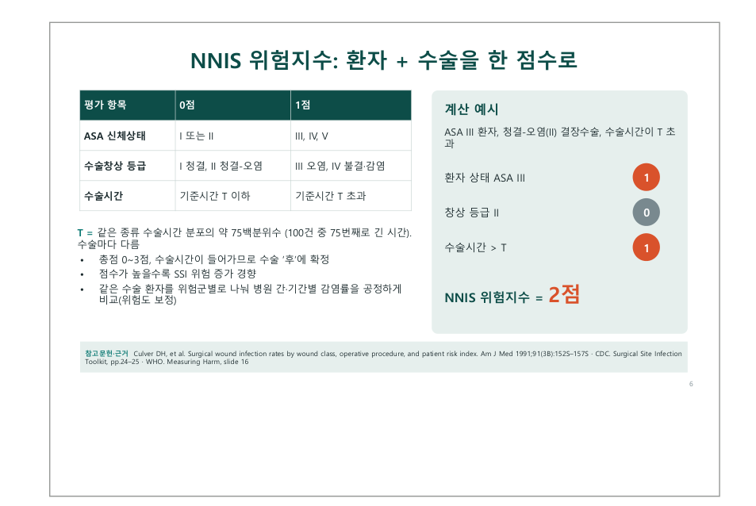{: style="width:56%"}

- NNIS 계산 예: ASA III(1) + 청결-오염 결장수술(0) + 수술시간 > T(1) = **2점**. 점수가 높을수록 SSI 위험 증가, 같은 수술을 위험군별로 나눠 병원·기간 간 감염률을 공정하게 비교(위험도 보정).
- 감시기간: **수술일 = Day 1**, 표재성 SSI는 어떤 수술이든 30일까지, **조기 퇴원이 많아 외래·전화 등 퇴원 후 감시가 필수**. (과거 CDC 1999는 인공삽입물 '1년', 현행 NHSN·KONIS는 '90일'.)

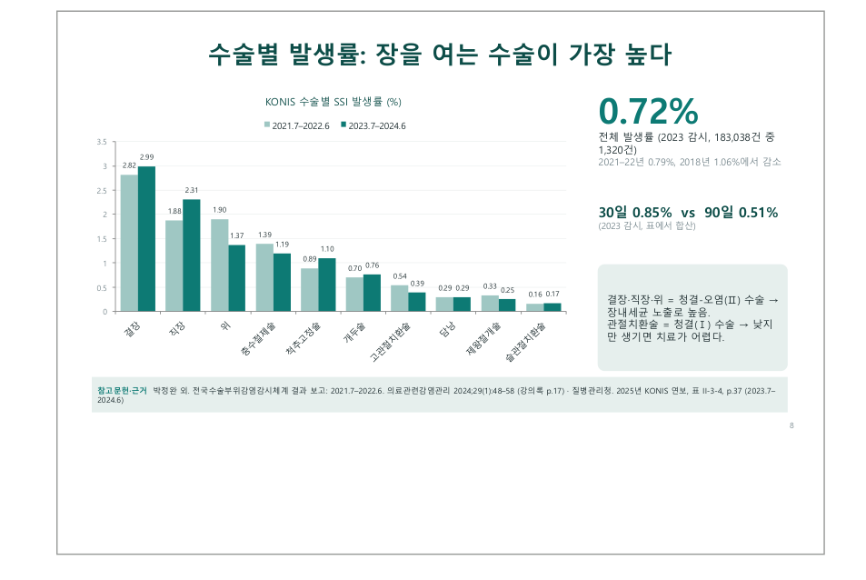{: style="width:56%"}

- 발생률: 2023 감시 **0.72%**(183,038건 중 1,320건 — 2021–22 0.79%, 2018 1.06%에서 감소), **30일 0.85% vs 90일 0.51%**. 결장 2.99%·직장 2.31%·위 1.37% — "**장을 여는 수술이 가장 높다**"(청결-오염 → 장내세균 노출), 관절치환 = 청결이라 낮지만 생기면 치료가 어렵다.

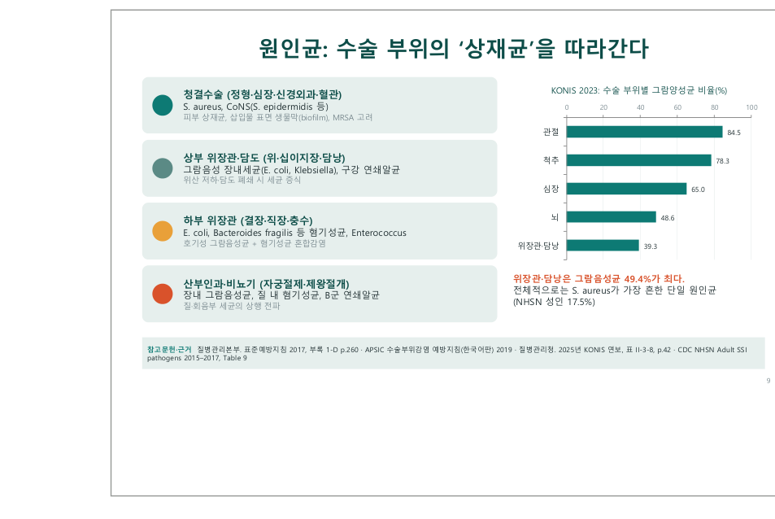{: style="width:56%"}

- 원인균은 **수술 부위의 상재균을 따라간다**: 청결수술(정형·심장·신경외과·혈관) → ***S. aureus*, CoNS** / 상부 위장관·담도 → 그람음성 장내세균, 구강 연쇄알균 / 하부 위장관(결장·직장·충수) → *E. coli*, ***Bacteroides fragilis* 등 혐기균**, *Enterococcus* / 산부인과·비뇨기 → 장내 그람음성균, 질 내 혐기균, B군 연쇄알균. KONIS 2023 그람양성균 비율: 관절 84.5%, 척추 78.3%, 심장 65.0%, 뇌 48.6%, 위장관·담낭 39.3%. 전체적으로는 *S. aureus*가 가장 흔한 단일 원인균(NHSN 17.5%).

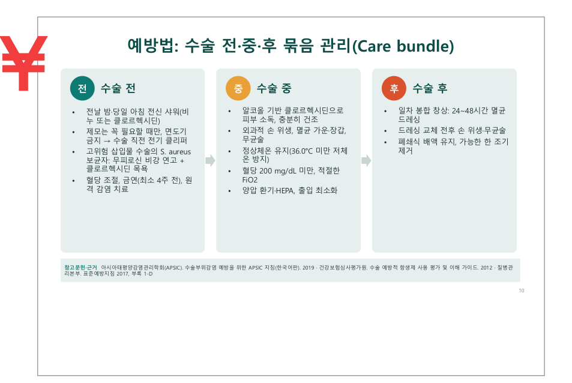{: style="width:60%"}

| 수술 전 | 수술 중 | 수술 후 |
|---|---|---|
| **전날 밤·당일 아침 전신 샤워**(비누 또는 클로르헥시딘) / **제모는 꼭 필요할 때만, 면도기 금지 → 수술 직전 전기 클리퍼** / 고위험 삽입물 수술의 *S. aureus* 보균자: **무피로신 비강 연고 + 클로르헥시딘 목욕** / 혈당 조절, **금연(최소 4주 전)**, 원격 감염 치료 | **알코올 기반 클로르헥시딘**으로 피부 소독, 충분히 건조 / 외과적 손위생, 멸균 가운·장갑, 무균술 / **정상체온 유지(36.0℃ 미만 저체온 방지)** / **혈당 200 mg/dL 미만**, 적절한 FiO2 / 양압 환기·HEPA, 출입 최소화 | 일차 봉합 창상은 **24–48시간 멸균 드레싱** / 드레싱 교체 전후 손위생·무균술 / **폐쇄식 배액** 유지, 가능한 한 조기 제거 |

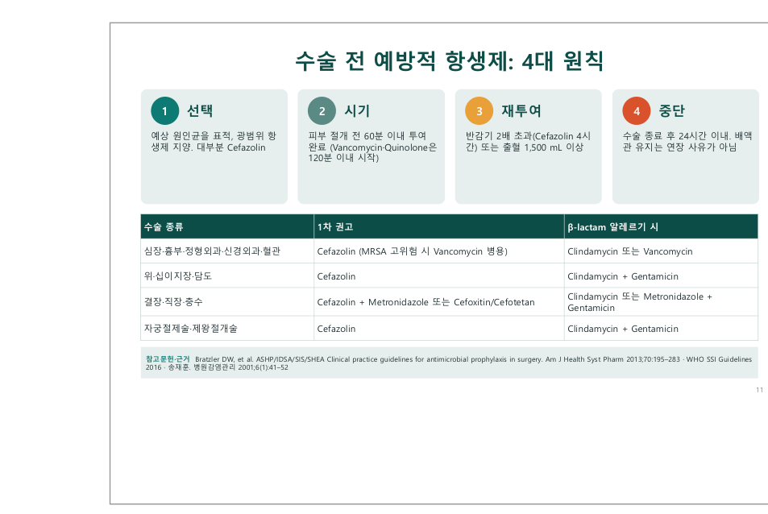{: style="width:60%"}

| 원칙 | 내용 |
|---|---|
| ① **선택** | 예상 원인균을 표적, 광범위 항생제 지양. 대부분 **cefazolin** |
| ② **시기** | **피부 절개 전 60분 이내 투여 완료**(vancomycin·quinolone은 120분 이내 시작) |
| ③ **재투여** | **반감기 2배 초과**(cefazolin 4시간) 또는 **출혈 1,500 mL 이상** |
| ④ **중단** | **수술 종료 후 24시간 이내**. 배액관 유지는 연장 사유가 아님 |

| 수술 | 1차 권고 | β-lactam 알레르기 |
|---|---|---|
| 심장·흉부·정형외과·신경외과·혈관 | Cefazolin(MRSA 고위험 시 vancomycin 병용) | Clindamycin 또는 vancomycin |
| 위·십이지장·담도 | Cefazolin | Clindamycin + gentamicin |
| **결장·직장·충수** | **Cefazolin + metronidazole 또는 cefoxitin/cefotetan** | Clindamycin 또는 metronidazole + gentamicin |
| 자궁절제·제왕절개 | Cefazolin | Clindamycin + gentamicin |

- 정리 슬라이드 "**평가하고, 지켜보고, 막는다**": 평가(위험인자·창상 I–IV·ASA → NNIS 0–3) → 감시(30일/90일, 퇴원 후 감시, 결장·직장·위가 최고 위험) → 원인 이해(청결 = 피부 그람양성, 장 수술 = 장내 그람음성·혐기균) → 예방(전·중·후 묶음 관리 + 예방 항생제 60분·재투여·24시간). **SSI는 '불가피한 합병증'이 아니라 줄일 수 있는 의료관련감염** — 국내 1.06%(2018) → 0.72%(2023).
- 교수님 코멘트(작년 5조): "**중요한 거 다 잘 얘기했다. 이거 그대로 가지고 공부해도 된다.**"

!!! diff "작년 필기와 다른 점"
    작년 5조 발표의 수치: 수술 전후 **혈당 180 mg/dL 이하**(올해 발표는 200 미만), **금연 30일 전**(올해 최소 4주 전), 면역억제제는 중단하지 않음, 비강 *S. aureus* 탈집락에 mupirocin. 작년 2조(전국 SSI 감시)는 **NNIS 0점 1.92% → 3점 7.01%**, **SSI 사례의 배양 시행률 44%**("깜깜이 치료"가 내성의 주범)를 지적했다.

!!! exam "기출 포인트"
    13번 2부 2번(2025) → "**수술 중 저체온과 고혈당은 SSI 위험을 높인다**"(오답: 대부분 외부 환경 오염, 수술 2시간 전 투여, 유방 = 청결-오염, 최소 72시간 유지). 53번 → "**수술 부위를 chlorhexidine-alcohol로 소독**"(오답: 3일간 지속, 상체 30–45도, 면도기 제모, 구강 chlorhexidine). 창상 이름 고르기: **청결**(35번), **청결-오염**(9·45번), **오염**(15번). 순서: 결장 – 충수 – 고관절(32번), 결장 – 위 – 담낭(44번). 55번: SSI 최다 원인균(2016 WHO) → ***S. aureus***.

# 5. 5조 — 중심정맥관 관련 혈류감염 (CLABSI)

발표 과제: 위험인자, 종류, 진단, 원인균, **예방법(MBP)**.

## 5-1. 교수님 매뉴얼 (5-4. CLABSI)
- 중심정맥관은 약물 투여뿐 아니라 투석·영양 공급·혈관 내 시술에 쓰이는 침습적 장비라 여러 문제를 일으킬 수 있다. 그중 하나가 CLABSI이며, 생기면 의료비·재원기간·이환율·사망률이 증가 → 사용 전후 예방 관리 방안을 이해하고 수행, 자주 진찰해 초기에 대처.
- 위험인자: 중심정맥관 종류에 따라 주요 발생 기전이 다르다. **단기 사용 → 삽입부위 피부 상재균이 관을 따라 이동해 끝을 오염**(대부분). **장기 사용 → 연결부위(catheter hub) 오염 → 내강에 정착**. 때로는 다른 부위 감염의 균혈증이 관에 집락, 드물게 **오염된 수액**. 핵심 전략 = **삽입·관리 시 균 오염 최소화 + 불필요하면 빨리 제거**.

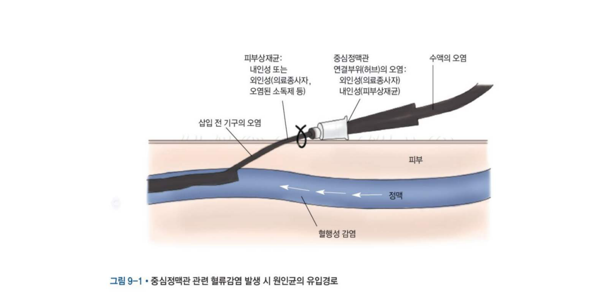{: style="width:64%"}

- 그림: 피부상재균(내인성, 또는 의료종사자·오염된 소독제 등 외인성) → 관 외면 / **중심정맥관 연결부위(허브) 오염**(외인성 = 의료종사자, 내인성 = 피부상재균) → 내강 / **수액 오염** / 삽입 전 기구의 오염 / **혈행성 감염**.
- 진단: 삽입 **2일이 지난 후** 발열·오한·저혈압이 있고 **다른 부위 감염원이 없는** 상태에서 새로 생긴 의미 있는 균혈증. **의미 있는 원인병원체는 검체 1개**, **흔한 피부 오염균은 2개 이상의 검체**에서 동정. 피부상재균: *Corynebacterium*(*C. diphtheriae* 제외), *Bacillus*(*B. anthracis* 제외), *Propionibacterium*, **CoNS(*S. epidermidis* 포함)**, viridans 연쇄알균, *Aerococcus*, *Micrococcus*.

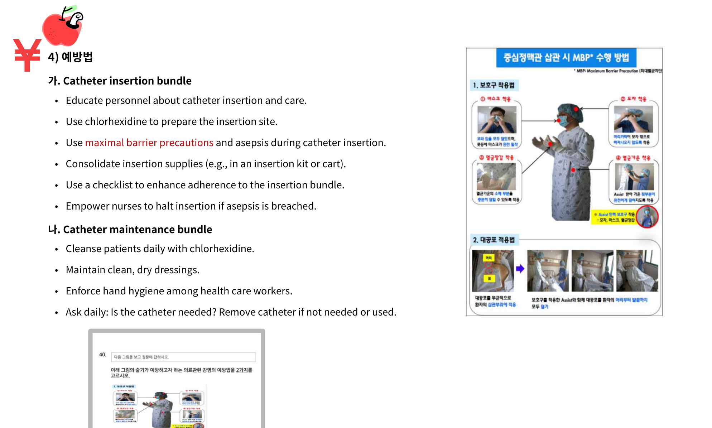{: style="width:76%"}

- **4) 예방법**: **가. Catheter insertion bundle** — 삽입·관리 인력 교육 / **chlorhexidine으로 삽입부위 준비** / **maximal barrier precautions와 무균술** / 물품을 키트·카트로 / **체크리스트** / **무균이 깨지면 간호사가 삽입을 중단할 권한**. **나. Catheter maintenance bundle** — **매일 chlorhexidine으로 환자 세척** / **깨끗하고 건조한 드레싱** / 의료진 손위생 / **매일 "카테터가 필요한가?" 묻고 필요 없으면 제거**. 그림: 중심정맥관 삽관 시 MBP 수행 방법(보호구 착용 → 대방포 적용).

## 5-2. 발표자료

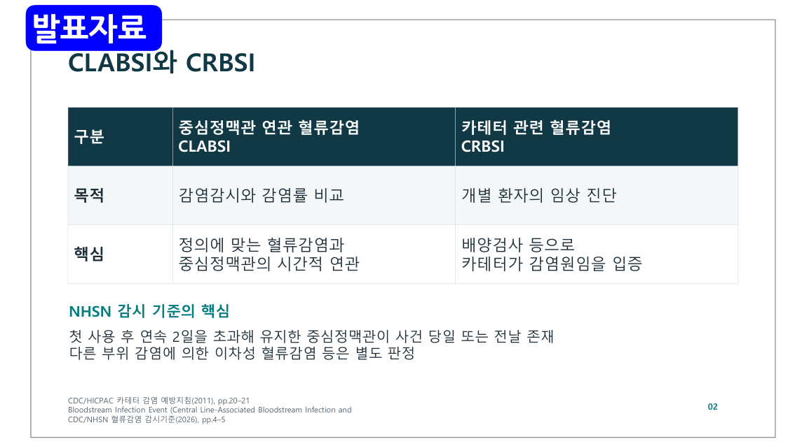{: style="width:58%"}

| | **CLABSI**(중심정맥관 연관 혈류감염) | **CRBSI**(카테터 관련 혈류감염) |
|---|---|---|
| 목적 | **감염감시와 감염률 비교** | **개별 환자의 임상 진단** |
| 핵심 | 정의에 맞는 혈류감염과 중심정맥관의 **시간적 연관** | 배양 등으로 **카테터가 감염원임을 입증** |

- NHSN 감시 기준: **첫 사용 후 연속 2일을 초과해 유지한** 중심정맥관이 사건 당일 또는 전날 존재. 다른 부위 감염에 의한 이차성 혈류감염은 별도 판정.
- 교수님 코멘트(작년 6조): CLABSI와 CRBSI는 다르다. **CRBSI가 더 직접적** — 카테터를 빼서 말초와 중심에서 같은 균을 확인한 경우. 하지만 다 그렇게 하긴 무리라 기준을 완화해 **CLABSI로 약속**한 것 — 중심정맥관에서 생겼을 수도, 안 보이는 다른 곳에서 생겼을 수도 있다. **감시할 때는 CLABSI 기준.**
- 감염의 종류: **출구부 감염**(출구 2 cm 이내 발적·경결·압통, 고름 가능) / **터널 감염**(2 cm를 넘어 피하 터널을 따라) / **포켓 감염**(매립형 포트 주머니) / **혈류감염**(균혈증·진균혈증 + 발열·오한·저혈압, 관련성은 추가 검사로). **집락화만으로 혈류감염을 진단하지 않는다.**

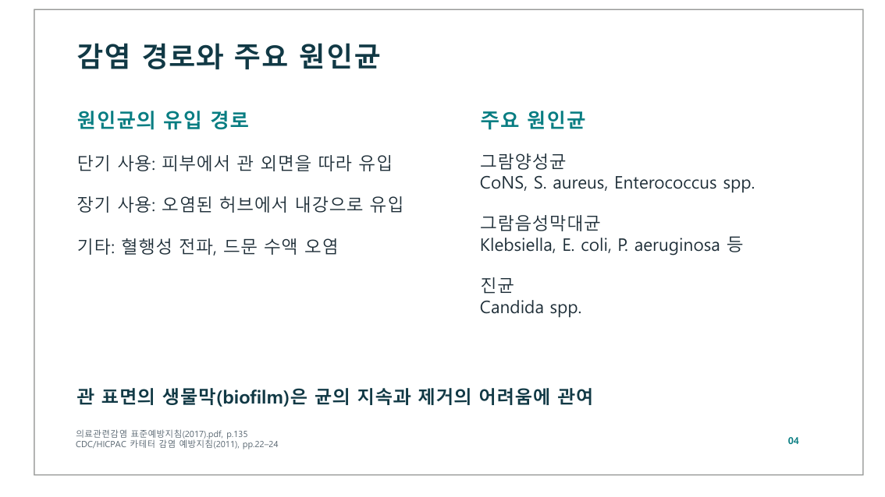{: style="width:58%"}

- 유입 경로: **단기 = 피부에서 관 외면을 따라**, **장기 = 오염된 허브에서 내강으로**, 기타 혈행성·드문 수액 오염. 원인균: 그람양성(**CoNS, *S. aureus*, *Enterococcus***), 그람음성 막대균(*Klebsiella, E. coli, P. aeruginosa*), 진균(***Candida***). **관 표면의 생물막(biofilm)** 이 균의 지속과 제거 어려움에 관여.
- 주요 위험인자: 환자·치료(중증 기저질환, 혈액·**지질유탁액** 주입) / 삽입부위·관(**성인 대퇴정맥**, 필요 이상의 다내강관) / 삽입 과정 오염(손위생·무균술·MBP 미준수, 소독 불충분) / 유지 중 오염(잦은 허브 조작, 드레싱 오염, 불필요한 유치). **예방의 표적: 오염 기회를 줄이고 불필요한 관은 즉시 제거.**

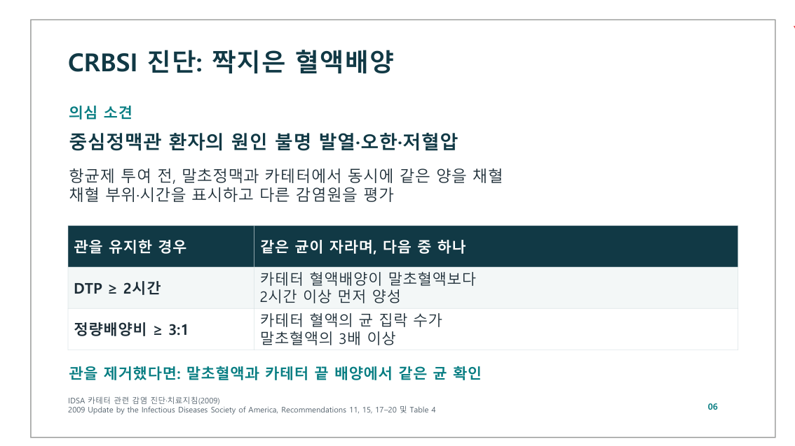{: style="width:58%"}

- **CRBSI 진단(IDSA 2009)**: 원인불명 발열·오한·저혈압 → **항균제 투여 전**, 말초정맥과 카테터에서 **동시에 같은 양**을 채혈, 부위·시간 표시. 관을 유지한 경우 같은 균이 자라고 ① **DTP ≥ 2시간**(카테터 혈액이 말초보다 2시간 이상 먼저 양성) 또는 ② **정량배양비 ≥ 3:1**. 관을 제거했다면 **말초혈액과 카테터 끝 배양에서 같은 균**.

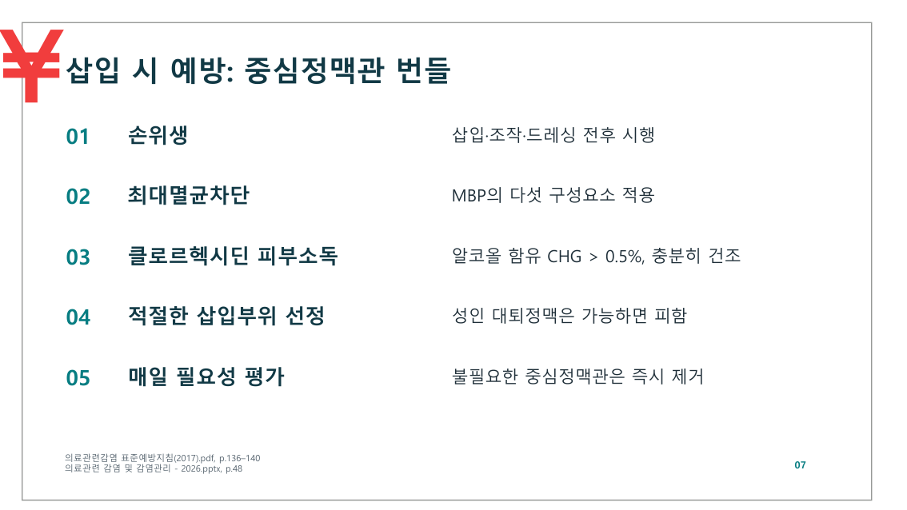{: style="width:58%"}

| 삽입 번들 5가지 | |
|---|---|
| 01 **손위생** | 삽입·조작·드레싱 전후 |
| 02 **최대멸균차단(MBP)** | 시술자 **모자·마스크·멸균가운·멸균장갑** + 환자 **전신을 덮는 멸균방포**(작은 국소 방포만으로는 불충분). 적용: 중심정맥관 삽입(**PICC 포함**), **가이드와이어 교체** 시 |
| 03 **클로르헥시딘 피부소독** | **알코올 함유 CHG > 0.5%**, **충분히 건조** |
| 04 **적절한 삽입부위** | **성인 대퇴정맥은 가능하면 피함** |
| 05 **매일 필요성 평가** | 불필요한 중심정맥관은 즉시 제거 |

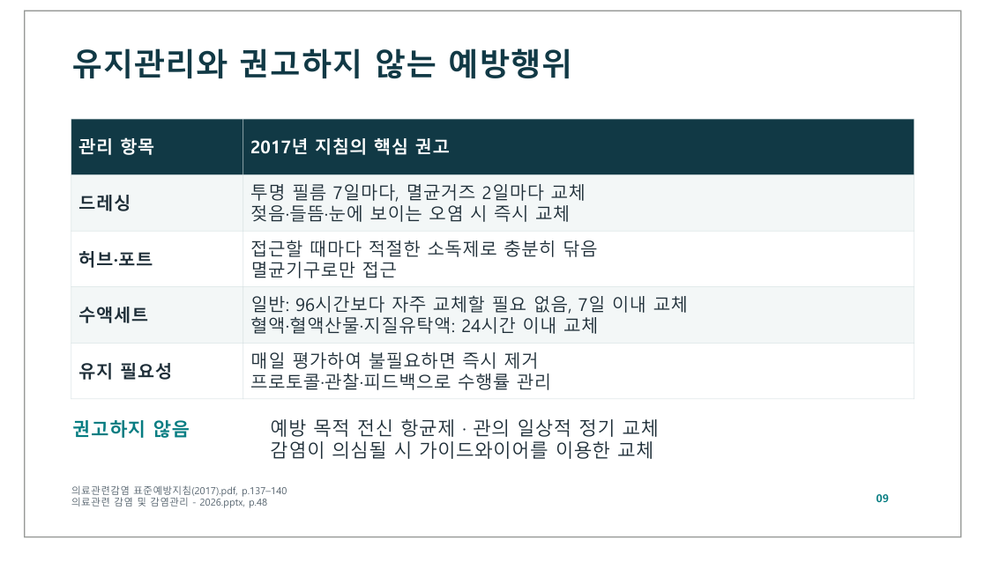{: style="width:58%"}

| 관리 항목 | 2017 지침의 핵심 권고 |
|---|---|
| 드레싱 | **투명필름 7일마다, 멸균거즈 2일마다**. 젖음·들뜸·눈에 보이는 오염이면 즉시 |
| 허브·포트 | 접근할 때마다 적절한 소독제로 충분히 닦음, 멸균 기구로만 접근 |
| 수액세트 | 일반: **96시간보다 자주 바꿀 필요 없음, 7일 이내 교체**. **혈액·혈액산물·지질유탁액: 24시간 이내** |
| 유지 필요성 | 매일 평가해 불필요하면 즉시 제거, 프로토콜·관찰·피드백 |
| **권고하지 않음** | **예방 목적 전신 항균제**, 관의 **일상적 정기 교체**, 감염 의심 시 **가이드와이어를 이용한 교체** |

- 작년 필기 메모: 수액세트 교체 주기를 "3–4일이라고 하셨는데 확인해 보고 알려 주신다고 — 뒷 수업에서 **96시간**이라고 하셨다." 올해 발표의 "96시간보다 자주 바꿀 필요 없음, 7일 이내"와 같은 말이다.

!!! diff "작년 필기와 다른 점"
    작년 6조 발표에는 **치료 표**가 있었다 — CoNS: vancomycin 5–7일 / *S. aureus*: MSSA nafcillin·cefazolin, MRSA vancomycin·daptomycin **14일 이상** / *Enterococcus*: ampicillin 7–14일 / 그람음성: cefepime 등 7–14일 / *Candida*: **echinocandin 14일 이상**. 경험적 치료는 그람양성 vancomycin, 그람음성 cefepime·pip/tazo, TPN·장기 사용이면 echinocandin, 장기 카테터는 **antimicrobial lock**. 초기(7일 이내)는 피부 경로, 장기(10일 이상)는 허브 경로, 국내는 *S. aureus*가 가장 흔하다고 했다. 줄지 않으면 클로르헥시딘 스펀지 드레싱·항균제 코팅 카테터.

!!! exam "기출 포인트"
    13번 2부 25번(중심정맥관 그림, 2개) → **삽입 부위 chlorhexidine 소독 + 매일 필요성 평가 후 제거**, 42번(3개) → 여기에 **손위생 강화**. 8번 → "**최대 무균술식 적용**"(일상적 교체·항생제 연고·매일 드레싱 교환·정기 헤파린 세척 X). 30번: 부적절한 것 → "**드레싱은 2% chlorhexidine보다 povidone iodide를 가능한 이용**". 33번: 가장 흔한 원인 → **CoNS**. 38번: 투석 중 고열 → ***S. aureus***. 50번: ICU 균혈증에서 보기 어려운 균 → ***Listeria***. 16번: 매달 질병관리청 보고 → **CLABSI + 손위생**.

# 6. 작년 발표에만 있던 내용

!!! diff "작년 필기와 다른 점"
    아래는 **작년(2025) CP-B1의 1·2·8·9·10조** 내용이다. 올해 발표 주제에서는 빠졌지만 KONIS 자료와 격리는 13번 강의 본문(3장·6장)으로 옮겨 갔고, 기출 17번(이대목동)·43번(ICU 감염 순서)이 여기서 나왔다.

## KONIS 중환자실 감시 (작년 1조)
- 2020.7–2021.6, 257개 병원·339개 ICU. 감시 대상 요로·혈류·폐렴. **혈류 45% > 요로 37% > 폐렴 18%**. 원인균 그람음성 48%, 그람양성 40%, 진균 9% — 요로 *E. faecium*·*E. coli*, 혈류 *E. faecium*·*Candida*, 폐렴 ***A. baumannii***·*P. aeruginosa*. **imipenem 내성 *A. baumannii* 92.5%**. 코로나19 시기 폐렴 감염률 감소.
- 교수님: "코로나에 의한 감염 감소는 주로 **지역사회감염**에서 많았고, 의료관련감염과 연관시키기에는 조금 무리가 있다."

## 전국 수술부위감염 감시 (작년 2조)
- 2021.7–2022.6, 291개 기관, 165,859건 → 0.79%(2018년 1.06%). 결장 2.82%(고위험) vs 슬관절 0.16%(저위험). NNIS가 높을수록 증가(0점 1.92% → 3점 7.01%). 복부 수술은 장내세균, 정형·심장 수술은 피부 상재균.

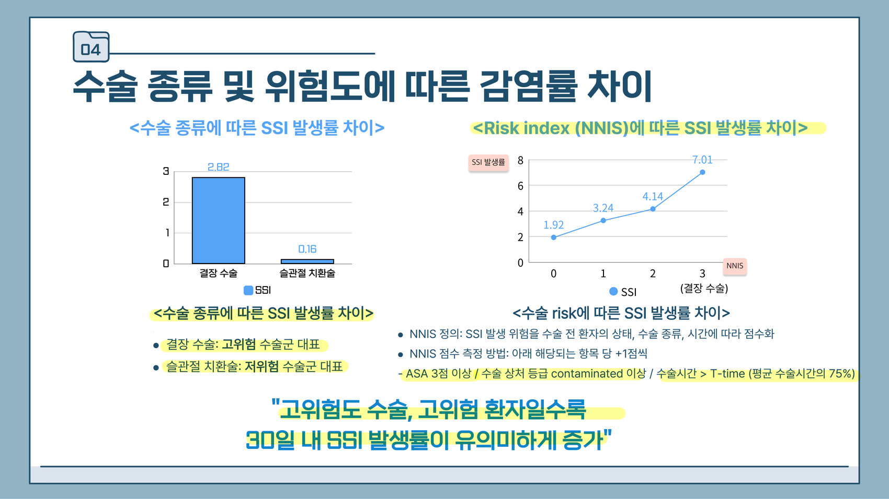{: style="width:62%"}

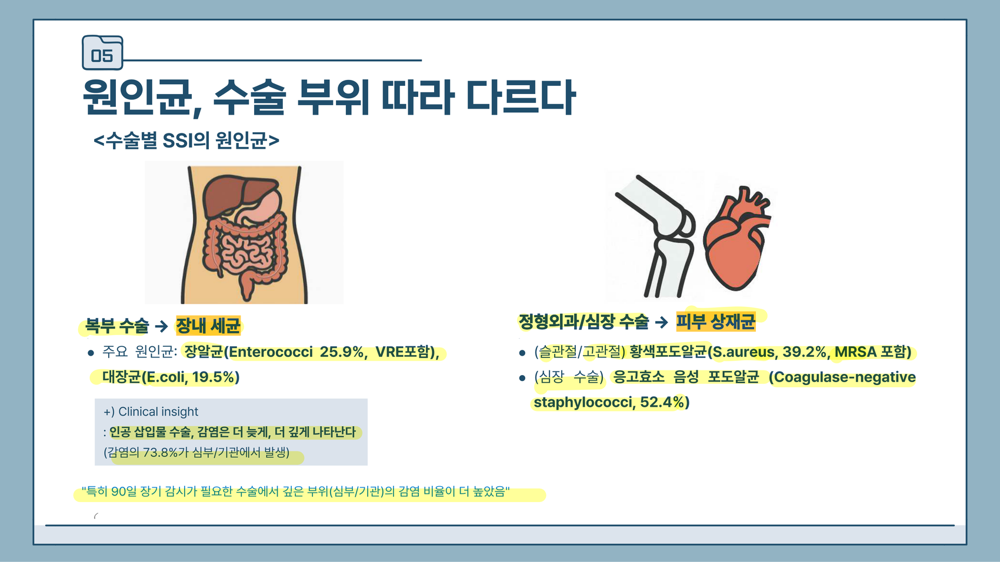{: style="width:56%"}

- 교수님: "**수술 종류에 따른 감염률, 원인균**이 중요하고, 예방은 3, 4교시(13번 강의)에 한다."

## 이대목동병원 신생아 사망 사건 (작년 8조)
- 2017년 12월 16일 신생아중환자실 미숙아 4명이 같은 밤 연달아 사망. 역학조사 결과 ***Citrobacter freundii* 패혈증** — 오염된 **지질영양주사제**(분주 과정의 무균술 위반). 교훈: 주사제 준비의 **무균술**과 감염관리 체계(인력·감시).

## 감염관리 수가 정책과 CLABSI (작년 9조)
- 750병상 병원 ICU 3곳에서 **2016년 감염관리 수가 도입 전후**를 시계열 비교(Park et al., AJIC 2020): 수가 후 인력이 늘고 **최대멸균차단 준수율**이 오르며 **CLABSI가 유의하게 감소**(특히 MICU). 교수님: "**지원이 굉장히 중요하다.** 수가 등등."

## 표준주의와 전파경로별 격리 (작년 10조)
- 교수님: 수칙을 지키기 쉽지 않다 — 병실 출입하는 **모든 사람**(미화·영양팀·영안실·시설팀)이 지켜야 해서. 기억할 것은 **두 주의의 관계, 어떤 질환에 어떤 주의, 각 주의의 차이**.
- 감염 전파 사슬: 병원체 – 감염원 – 전파경로 – 감수성 숙주, 하나라도 끊으면 예방.

| | 접촉주의 | 비말주의 | 공기주의 |
|---|---|---|---|
| 전파 | 직접·간접 접촉 | **≥5 μm** 비말, 1–2 m 이내 | **≤5 μm** 비말핵, 공기 중 부유 |
| 대표 질환 | **MRSA, *C. difficile*, 로타**, 노로 | **인플루엔자, 백일해, 수막구균** | **활동성 결핵, 홍역, 수두** |
| 병실 | 1인실·코호트(병상 간 1 m 이상) | 1인실·코호트, 병상 간 **2 m** | **음압격리실(시간당 12회 이상 환기)** |
| 보호구 | 입실 시 **장갑·가운** | 입실 시 **수술용 마스크** | **N95**(밀착 확인) |

| 질환 | 격리 | 해제 기준 |
|---|---|---|
| 활동성 결핵 | 공기 | 적절한 치료 후 **객담 AFB 도말 3회 연속 음성** |
| 홍역 | 공기 | 발진 시작 후 **4일**까지 |
| 수두 | 공기 + 접촉 | 모든 병변에 **딱지**가 앉을 때까지 |
| 인플루엔자 | 비말 | 증상 발현 후 **5일**까지 |
| *C. difficile* | 접촉 | 설사 멈춘 후 **48시간** |
| 노로바이러스 | 접촉 | 증상 소실 후 **48시간** |

- **보호격리**: 동종조혈모세포이식 환자 — 생화·화분 반입 금지, HEPA, 양압. **PPE 탈의 순서**(오염이 심한 것부터): **장갑 → 가운 → 고글/안면보호구 → 마스크**, 마지막에 손위생.

!!! exam "기출 포인트"
    13번 2부 17번: 이대목동병원 보도자료의 가려진 균 → ***Citrobacter freundii***. 43번: ICU 감염 순서 → **혈류 – 요로 – 폐렴**. 6·37번: N95·음압격리 → **결핵**.

# 암기 — CP-B1 요점

| 주제 | 꼭 기억할 것 |
|---|---|
| CAUTI | 의료관련 UTI의 95% 이상이 도뇨관, 세균뇨 매일 3–8%·30일이면 거의 100%. **최대 위험인자 = 유치 기간**. Step 0 불필요한 삽입 방지 → 1 무균 삽입 → 2 폐쇄배액·소변백 방광 아래·검체는 채취 포트 → 3 매일 평가·조기 제거. 예방 항생제·정기 교체·방광 세척·국소 소독제 도포 ×, ASB는 임신·요로점막 시술 전만 치료 |
| HAP/VAP | 48시간 이후(VAP는 삽관 48(–72)시간). 국내 그람음성 78%, *A. baumannii* 1위, 69% 다제내성. MDR 위험 = 90일 내 정맥 항생제·쇼크·ARDS·5일 이상 입원·신대체요법. pip/tazo 또는 cefepime, 48–72시간 de-escalation, 7–8일. 예방 = 삽관 회피·조기 발관, 30–45°, **칫솔질(CHG 구강 ×)**, 조기 경장영양 |
| SSI | 청결 1–2 / 청결-오염 2–4 / 오염 7–10 / 불결 10–40%. NNIS = ASA ≥3 · 오염 이상 · T시간(75백분위) 초과. 30일 / 인공물 90일. 결장 최고. 예방 = 샤워·클리퍼·무피로신(보균자)·금연 / CHG-알코올·정상체온·혈당 <200 / cefazolin 60분 전·반감기 2배 또는 출혈 1,500 mL 재투여·24시간 내 중단 |
| CLABSI | CLABSI = 감시(시간적 연관), CRBSI = 진단(DTP ≥2시간, 정량비 ≥3:1, 카테터 끝 같은 균). 단기 = 피부, 장기 = 허브. CoNS 최다. 번들 = 손위생·MBP(모자·마스크·가운·장갑·전신 방포)·**CHG >0.5% 알코올, 건조**·대퇴 피함·매일 평가. 투명필름 7일·거즈 2일, 수액세트 96시간–7일·혈액/지질 24시간. 정기 교체·예방 항생제·가이드와이어 교체 × |
| 격리(작년) | 결핵·홍역·수두 공기 / 인플루엔자·백일해·수막구균 비말 / MRSA·*C. difficile*·로타 접촉. 탈의: 장갑 → 가운 → 고글 → 마스크 |
