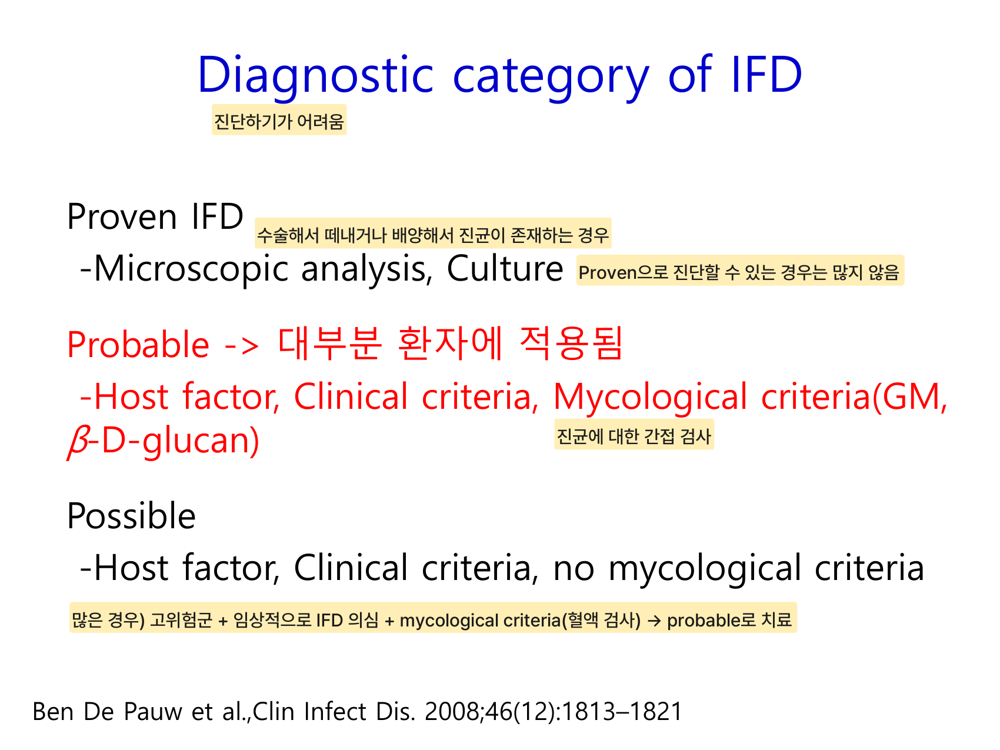
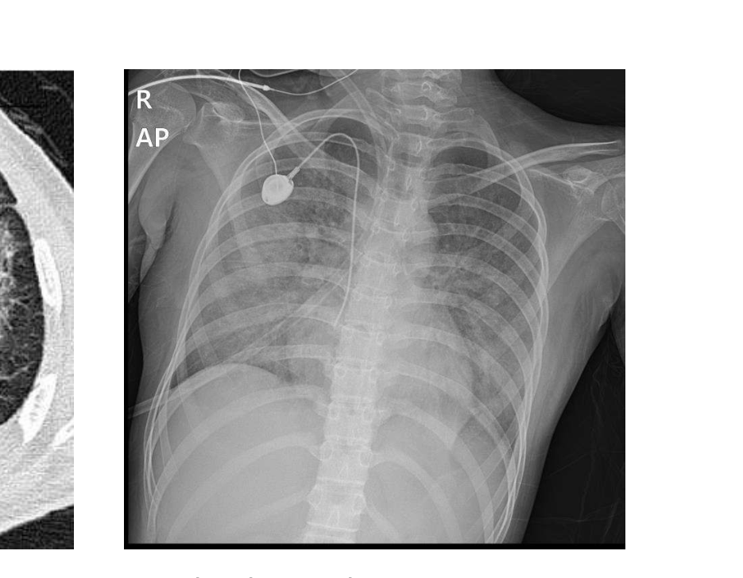
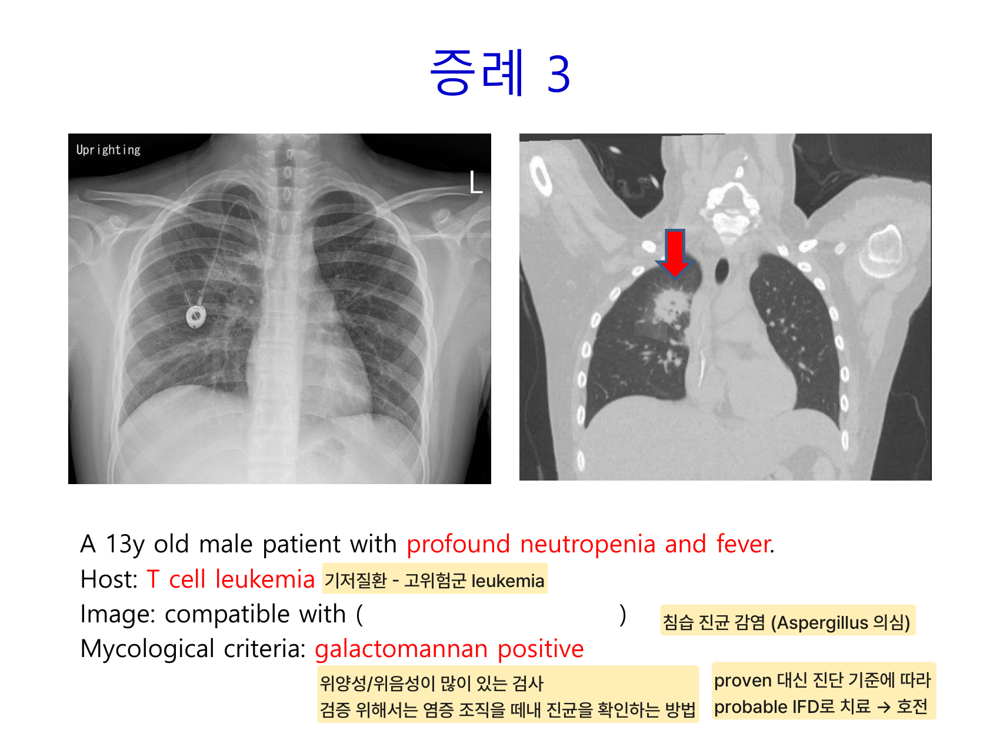

<!-- 필기본: 2026 · 2025 -->
<!-- 단계: 수업 후 -->

# 0. 이 수업을 공부하는 법

소아청소년과 감염 **김동섭 교수님** 수업. 2026년에는 "일차면역결핍질환자의 감염"이라는 한 강의 안에서 두 덩어리를 강의하셨다.

- 1st — 면역결핍증 질환 + 그 환자의 감염 합병증 → **16강(선천성 면역결핍) 학습자료**로 옮겼다(필기본 7–29쪽, 증례 1·2).
- **2nd — 소아 암 환자의 감염 합병증** → **이 학습자료(15강).** 필기본 30–39쪽과 끝의 **증례 3(침습성 아스페르길루스증, 48쪽)**.
    1. 호중구감소 발열(neutropenic fever, NF) — 정의, 배경, 경험적 치료
    2. 침습 진균감염(invasive fungal disease, IFD) — 고위험군, 진단 분류
    3. 주폐포자충(*Pneumocystis jirovecii*) — 예방의 근거, 예방 대상, 예방 중단의 위험, 증상·예후
    4. 증례 3 — 침습성 아스페르길루스증
- 교수님: **감염내과 수업과 많이 겹쳐 간단하게 소개**하셨고, **새 내용 추가는 고민하셨지만 올해는 안 하기로** 하셨다 → 슬라이드는 작년과 같다. 필기 작성자 메모: 교수님이 **슬라이드의 모든 내용을 읽고 설명**하셔서 형광펜은 의미가 없다 — 슬라이드 글자 전부가 범위.

기출 14문항(2020–2025) 중 **11문항이 두 가지 사례형의 반복**이다.

- **PCP 사례**: 항암치료 중 TMP/SMX를 자의로 끊음 + 빈호흡·호흡곤란 + **청진 정상(rale 없음)** → 치료는 **TMP/SMX 정주**(보기에 없으면 **pentamidine 정주**).
- **아스페르길루스 사례**: 발열·흉통 + 흉부 CT 결절 + **galactomannan 양성** → 치료는 **voriconazole**, "직접적 위험인자"는 **호중구 수치를 보고** 정한다(낮으면 호중구감소, 정상이면 스테로이드).
- 나머지: XLA 환자의 예방접종(2025 — 내용은 16강, 이 자료 6단원에 요약), 소아 AML 호중구감소(2021), 항암 중 B형간염 재활성화·수두(2020).

!!! key "핵심"
    **항암 중 소아가 열 나면(ANC < 500 + 38.3 ℃) → 배양 기다리지 말고 곧바로 경험적 항생제(cefepime·pip/tazo 단독).**
    **오래가는 깊은 호중구감소·고용량 스테로이드 → 곰팡이(아스페르길루스 → voriconazole).**
    **TMP/SMX 예방을 끊으면 → PCP(숨찬데 청진 정상) → TMP/SMX 정주, 못 쓰면 pentamidine 정주.**

!!! diff "작년 필기와 다른 점"
    2025년에는 15강 필기본(46쪽) 안에 일차면역결핍 파트(면역 기능 검사, XLA·DiGeorge·SCID·WAS·CGD, 증례 1·2)가 함께 있어 수업 전판 1부에도 그 설명이 다 들어 있었다. 올해는 요청대로 **수업별로 나누어** 그 부분을 **16강 학습자료**에 올해 필기 기준으로 다시 썼다. 15강 기출(2부 3번 XLA 예방접종)에 필요한 요점은 이 자료 **6단원**에 남겨 두었다.

# 1. 호중구감소 발열 (neutropenic fever)

## 정의 — 발열의 정의 @ 암 환자에서 (IDSA, Freifeld 2011)
- **Neutropenia(호중구감소)**: **ANC < 500 cells/mm³**, 또는 **48시간 이내에 ANC < 500 cells/mm³ 이 예상되는 경우.**
    - ANC = absolute neutrophil count(절대호중구수) = 백혈구 수 × (분엽핵 + 띠핵 호중구 %).
    - **ANC가 매우 낮거나 더 낮아질 것으로 예상되는 상황**까지 포함한다 — 항암치료로 골수가 억제되어 앞으로 떨어질 것이 예상되면 지금 500 이상이어도 같은 의미가 있어 따로 넣었다.
- **Profound neutropenia(심한 호중구감소)**: **ANC < 100 cells/mm³.**
- **Fever(발열)**: 구강 체온 1회 측정 **> 38.3 ℃(101 °F)**, 또는 **> 38.0 ℃(100.4 °F)가 1시간 이상 지속.**
- **일반적 상황에서는 발열을 숫자로 단정하기 어렵지만, 암 환자에서는 기준을 정해 둔다** — 기준을 넘으면 바로 치료를 시작해야 하기 때문.

!!! memo "암기"
    **ANC < 500(또는 48시간 내 예상) = 호중구감소**, **< 100 = profound**. **발열 = 38.3 ℃ 1회 또는 38.0 ℃ 1시간 지속.**

## 배경 (Background)
- **고형암의 10–50%, 혈액암의 80%** 에서 항암치료 중 적어도 한 번 NF를 경험한다. **소아는 특히 백혈병 등 혈액암 환자 대부분이 겪는다**(한 번 이상).
- **원인이 밝혀지는 경우는 20–30%** 이며, 대부분은 원인을 알 수 없다.
- **균혈증(bacteremia)은 10–25%** 에서 발생하고, 특히 **장기간의 심한 neutropenia(ANC < 100)** 때 잘 발생한다.
- **Profound NF가 10–15일 이상 지속**되는 경우 **침습 진균감염의 위험이 매우 증가**한다 → 이런 경우 침습 진균감염을 의심해야 한다.
- 필기 요약: **ANC가 낮고(깊이) 오래갈 때(기간) 위험.**

!!! exam "기출 포인트"
    2부 **12번**(2021): 감염 위험이 가장 큰 환자 = **ANC 200의 1세 AML 환자**. 기준은 **깊이 + 기간 + 질환**: AML은 IFD 고위험 질환이고 호중구감소가 길다. 함정 — ANC 100이지만 **7일 이내 회복 예상**(단기), ANC 500(경계값)·점막염, ANC 200의 9세 ALL(고위험·재발 ALL이 아니면 AML보다 위험이 낮다).

## 호중구감소 발열 환자의 경험적 치료 (Lehrnbecher, J Clin Oncol 2023)
- **원인 조사도 하지만, 우선 치료를 시작한다** — 암환자가 열이 나면 **배양 결과를 기다리지 않고 곧바로 경험적 항생제.** 호중구가 없으면 감염이 몇 시간 만에 패혈증 쇼크로 진행할 수 있기 때문.
- **Monotherapy**(단독요법) with an **antipseudomonal β-lactam**(항녹농균 β-lactam: **piperacillin/tazobactam**), a **fourth-generation cephalosporin**(4세대: **cefepime**), or a **carbapenem** — **pediatric high-risk FN**에서.
    - **많은 병원에서 초기 치료는 보통 β-lactam/4세대 cephalosporin으로** 한다 — **이 항생제들로 커버되는 균(녹농균 포함 그람음성균)이 문제를 일으키는 경우가 많기 때문.**
- **두 번째 항그람음성제(second anti-Gram-negative agent)나 glycopeptide(vancomycin) 추가는 아껴 둔다(reserve)** — 다음 경우에만:
    - **임상적으로 불안정한(clinically unstable)** 환자 — 상태가 심각하면 배양 결과를 기다릴 시간이 없어 일단 넓게 쓴다.
    - **내성균 감염이 의심될 때** — 그 환자의 상황을 고려했을 때 내성균주임을 추측하면.
    - **내성균이 많은 병원(centers with a high rate of resistant pathogens).**
- **병원마다 보는 환자군/많이 검출되는 균이 달라 이를 감안해 결정**한다.
    - **병원 측면**: 그 병원에 어떤 균·내성이 많은지.
    - **환자 측면**: 최근 어떤 균에 감염됐고 어떤 내성이 있었는지 — 예) cefepime 내성균이 있었다면 cefepime을 쓰면 안 된다(2025 필기).

| 상황 | 경험적 항생제 |
|---|---|
| 소아 고위험 FN, 안정적 | **단독요법**: piperacillin/tazobactam, cefepime, (carbapenem) |
| 불안정 / 내성균 의심 / 내성균 많은 병원 | 위 약 + **두 번째 항그람음성제** 또는 **vancomycin** |

# 2. 침습 진균감염 (invasive fungal disease, IFD)

## 침습 진균감염의 고위험군 (Lehrnbecher 2023, Fisher 2018)
- **질환 자체가 고위험**: **AML(급성골수성백혈병), high-risk ALL(고위험 급성림프구성백혈병), relapsed acute leukemia(재발 급성백혈병), allogeneic HSCT(동종 조혈모세포이식).**
    - **모든 암 환자에서 해당하는 것은 아니다** — 표준위험 ALL, 대부분의 고형암은 여기 들지 않는다.
- **치료 과정에서 나타나는 특성/약제**: **prolonged neutropenia(오래가는 호중구감소)**, **receiving high-dose corticosteroids(고용량 스테로이드)**, **receiving multiple immune suppressive agents to prevent GVHD**(이식편대숙주병 예방용 여러 면역억제제).
- **All others should be categorized as IFD low risk** — 나머지는 일반적으로 다 저위험군으로 간주한다. 병원 상황에 맞게 대응한다.
- 왜 이 둘인가: 곰팡이 포자를 처음 막는 것은 **호중구**(균사 공격)와 **대식세포**(포자 탐식). 호중구감소가 길거나, 스테로이드가 대식세포·T세포 기능을 누르면 곰팡이가 자란다 — 증례 3·기출 아스페르길루스 사례의 "직접적 위험인자"가 이 두 가지다.

## IFD 진단 분류 (EORTC/MSG, De Pauw 2008)

{: style="width:66%"}

- IFD는 **진단하기가 어렵다.** 많은 경우 **침습성 진균 폐렴(invasive fungal pneumonia)** 이다.

| 분류 | 근거 | 필기 |
|---|---|---|
| **Proven IFD** | **Microscopic analysis, Culture** — 조직에서 곰팡이를 직접 확인 | **수술해서 떼내거나 배양해서 진균이 존재하는 경우.** Proven으로 진단할 수 있는 경우는 **많지 않다**(배양이 잘 안 됨 — 살아 있는 곰팡이를 보기 어렵다) |
| **Probable** | **Host factor(숙주 요인) + Clinical criteria(임상 기준) + Mycological criteria(GM, β-D-glucan)** | **대부분 환자에 적용됨.** Mycological criteria = **진균에 대한 간접 검사**(혈액 검사) |
| **Possible** | Host factor + Clinical criteria, **no mycological criteria** | 진균학적 근거 없음 |

- **많은 경우: 고위험군(host factor) + 임상적으로 IFD 의심(clinical: CT 결절 등) + mycological criteria(혈액 검사) → probable로 치료한다.**
- 곰팡이가 만드는 물질을 보는 검사: **galactomannan(GM, 아스페르길루스 세포벽 다당)**, **β-D-glucan**(여러 곰팡이 세포벽). 단 **위양성(false positive)** 이 나올 수 있다.

!!! memo "암기"
    **Proven = 조직(현미경·배양)**, **Probable = 숙주 + 임상 + 진균학적(GM·β-D-glucan) — 대부분**, **Possible = 숙주 + 임상, 진균학적 없음.**

# 3. 주폐포자충 (*Pneumocystis jirovecii*) 감염

## 왜 예방하나
- **후천성면역결핍증(AIDS) 환자에 높은 사망 원인**이었고, **AIDS 환자에 있어서 예방 효과가 입증**되었다.
- **예방을 시행하지 않은 경우 소아 백혈병 환자의 10–20%에서 주폐포자충 폐렴(PCP) 발생.**
    - 과거 **원인 모를 폐렴으로 사망한 소아 백혈병 환자를 부검·조사**해 보니 많은 수에서 PCP가 확인되었다 — 암환자에게 위험하다는 것을 몰랐던 시절의 이야기.
- **비AIDS 위험군에서도 TMP/SMX 예방 효과가 입증됨.** 필기: **비 AIDS '고'위험군 · TMP/SMX = 1차 예방 약제**(1차 예방약이자 치료약).
- **TMP/SMX를 투약할 수 없는 경우 pentamidine 흡입 또는 정주 예방요법.**
    - TMP/SMX를 못 쓰는 경우(2025 필기): **설폰아마이드 알레르기, 간·신장 기능 장애, 임신 후기, 신생아** 등.

## 주폐포자충 폐렴 예방 대상
- **급성 림프구성 백혈병**(ALL)
- **동종 조혈모세포 이식**
- **일차 면역결핍질환 일부** — 예: **SCID**(16강)
- **고용량 스테로이드 장기 투약** — **류마티스 질환도 약제 용량↑/기간↑ 시 고려**
- **급성 골수성 백혈병**(AML)
- **고형 종양**

!!! new "올해 필기에서 추가"
    "고용량 스테로이드 장기 투약"에 **류마티스 질환**(소아 루푸스·혈관염 등)도 용량이 크거나 기간이 길면 예방을 고려한다는 말을 덧붙이셨다 — 암 환자만의 이야기가 아니다.

!!! diff "작년 필기와 다른 점"
    2025 필기 메모: **TMP/SMX는 생후 2개월 이후 허용**(신생아 핵황달 위험), **그러나 SCID처럼 매우 심각한 경우는 더 어려도** 준다. 올해 필기에는 없다.

## 예방 중단의 위험
- **예방요법 중단 환자의 경우 발병이 유의하게 높다.**
- **국내 1개 기관 발생 환자의 86.7%가 발병 1개월 전부터 예방 투약을 하지 않았다.**
- 필기: **대부분 예방약 섭취를 하지 않아 문제가 생긴다** — 그래서 기출 사례는 늘 "TMP/SMX를 **자의로** 끊었다"로 시작한다.

{: style="width:70%"}

- 영상: **양측 폐 전체에 미만성 간유리 음영(ground-glass opacity)** — X선에서도 양쪽이 뿌옇다. 국소 경화(consolidation)가 있는 세균성 폐렴과 다르다.

## 감염 시 증상 및 예후
- **점진적인 호흡곤란과 마른기침, 미열, 빈호흡, 저산소증, 정상 청진 소견.**
    - **생각보다 사진도 나쁘고 숨도 가쁜데 청진은 정상 → PCP를 의심**해야 한다.
    - **가래가 별로 없는 마른기침, 청진 시 rale이 잘 안 들림 → 암 환자에서 우선 생각하는 폐렴 양상.**
    - 왜 청진이 정상인가: 염증이 폐포 사이 간질과 폐포 벽에 생기고 폐포 안에 고름(삼출물)이 차지 않아, 일반 폐렴의 **수포음(rale, crackle)** 이 들리지 않는다.
- **국내 1개 기관 주폐포자충 감염 이후 사망률 21%, 중환자실 치료를 받은 경우 사망률 63%** — **치료하더라도 사망률이 높다.**

!!! exam "기출 포인트"
    2부 **1, 4, 7, 9, 11번** — 모두 같은 사례: 백혈병·수모세포종 항암 중(스테로이드), **TMP/SMX(주 3일 경구)를 자의로 끊음**, 빈호흡 35회, **rale 없음**.

    - 보기에 **TMP/SMX(정주, 치료 용량)** 가 있으면 정답(1·7·11번). 2025년은 "**TMP 기준 5 mg/kg 8시간마다**"(= 15–20 mg/kg/일 치료 용량).
    - TMP/SMX가 없으면 **pentamidine 정주**(4·9번).
    - 함정: **Pentamidine 4주마다 1회 / 흡입**(= **예방** 용법), **"복용 중이던 용량으로 재시작"**(예방 용량이라 부족), fluconazole·amphotericin B·voriconazole·caspofungin(PCP에 쓰지 않음), dexamethasone(단독 치료 아님 — 중등도 이상 저산소증에서 보조로만), acyclovir.

# 4. 증례 3 — 침습성 아스페르길루스증

{: style="width:76%"}

- **13세 남아, profound neutropenia and fever**(심한 호중구감소와 발열).
- **Host(숙주 요인): T cell leukemia** — 기저질환이 **고위험군 leukemia**(IFD 고위험군).
- **Image: compatible with ( 침습 진균 감염 )** — 빈칸 = **침습 진균 감염(Aspergillus 의심).** 흉통이 있어 CT를 찍었더니 결절(화살표). **흉부 X선은 거의 정상인데 CT에서 결절**이 보인다 — 호중구감소 환자는 X선만으로 놓칠 수 있다.
- **Mycological criteria: galactomannan positive.**
    - galactomannan은 **위양성/위음성이 많이 있는 검사**다.
    - 검증하려면 **염증 조직을 떼내 진균을 확인하는 방법**(= proven)이 있지만,
    - **proven 대신 진단 기준에 따라 probable IFD로 치료 → 호전**되었다.
- 숙주 + 임상(CT) + 진균학적(GM) = 2단원 표의 **probable IFD** 그대로다.
- 아스페르길루스는 면역억제 환자에서 **혈관을 따라 주변 조직으로 계속 파고들어 퍼진다**(2025 필기).
- 치료(기출 해설 기준): **voriconazole**(1차, isavuconazole도 1차). caspofungin은 구제요법.

!!! exam "기출 포인트"
    같은 사례가 매년 나온다(2부 **2, 5, 6, 8, 10번**). 그림은 늘 비슷한 **CT 결절 + galactomannan 양성**.

    - "**적절한 치료는?**" → **voriconazole**(5·6번). 함정: caspofungin, pentamidine·TMP/SMX(PCP 약), acyclovir, dexamethasone.
    - "**CT 소견에 기여한 직접적 위험인자는?**" → **호중구 수치를 먼저 본다.** 호중구 **30/µL처럼 낮으면 → 호중구감소**(8번). 호중구가 **1,300·2,300처럼 정상이면 → 고용량 dexamethasone**(2·10번). **TMP/SMX 중단은 PCP 위험인자**라 함정, **galactomannan 양성은 진단 표지자**일 뿐 위험인자가 아니다. 수모세포종·자가조혈모세포이식 자체도 직접 원인이 아니다(자가 이식은 고위험군 목록에 없음 — 고위험은 **동종** 이식).

# 5. 그 밖에 기출에 나온 것 (필기에 없음)
2020년 기출 2문항은 필기에 직접 나오지 않지만, 항암치료 중인 소아의 감염 관리로 묶인다.

- **B형간염 재활성화**(2부 **13번**): 진단 때 HBsAg 음성 → 항암 중 **HBsAg 양성**으로 바뀜(최근 수혈 없음, 어머니 보균자) → 숨어 있던 HBV가 면역억제로 **재활성화** → **entecavir** 같은 핵산유사체 항바이러스제.
- **수두**(2부 **14번**): 항암 중 소아가 수두 환자(동생)에 노출된 뒤 **수포성 발진 + 발열** → 파종성 수두(폐렴·간염)로 진행할 수 있어 **즉시 acyclovir 정주**.

!!! key "핵심 — 항암 중 소아의 약 짝짓기"
    | 상황 | 약 |
    |---|---|
    | 호중구감소 발열(경험적) | **cefepime, piperacillin/tazobactam 단독**(불안정·내성균 → + 두 번째 항그람음성제 / vancomycin) |
    | PCP 치료 | **TMP/SMX 정주**(2차 **pentamidine 정주**) |
    | PCP 예방 | TMP/SMX 경구(주 3일), 못 쓰면 pentamidine 흡입/정주 |
    | 침습성 아스페르길루스증 | **voriconazole** |
    | 수두 | **acyclovir 정주** |
    | HBV 재활성화 | **entecavir** |

# 6. 16강과 겹치는 내용 — 면역결핍 환자의 감염 요점

!!! diff "작년 필기와 다른 점"
    아래는 2025년 15강 필기에 있었고, 올해는 16강으로 옮긴 일차면역결핍 파트의 요점이다. 자세한 설명(검사, 질환별 특징, 만성 수막뇌염, 증례 1·2)은 **16강 학습자료**를 본다.

- **발생 연령**: **T세포 결함 → 생후 6개월 이내**(기회감염: PCP·CMV·칸디다), **항체 결핍 → 6개월 이후**(모체 IgG 소실 후 폐렴구균·Hib·장바이러스).
- **범저감마글로불린혈증(XLA, *BTK*)**: IgG·IgA·IgM 모두 감소, **B세포 < 1%**, 남아·외삼촌·형 사망. 치료 **3–4주 간격 IVIG 400–500 mg/kg**. 예방접종은 **독감(사백신)만** — 항체는 못 만들지만 요즘은 접종한다. **생백신 금기.**
- **SCID**: T세포 거의 0, 생후 수개월 내 설사·폐렴·기회감염, **생백신(BCG·로타) 절대 금기**. 진단되면 **모유 중단(CMV) + PCP 예방(TMP/SMX) + IVIG + 조혈모세포이식 준비** — PCP 예방 대상 목록의 "일차 면역결핍질환 일부"가 바로 이것.
- **만성육아종질환**: NADPH oxidase 결함, **TMP/SMX + itraconazole 지속 복용** → 조혈모세포이식.

!!! exam "기출 포인트"
    2부 **3번**(2025): 10개월 남아, 반복 폐렴·농흉(*S. aureus*), 형 사망, IgG·IgA·IgM 모두 −2SD 미만 → XLA. **향후 필요한 예방접종 = 인플루엔자 사백신.** BCG·수두는 **생백신이라 금기**, A형·B형간염은 면역글로불린 보충 중이라 반응을 기대하기 어렵다.
