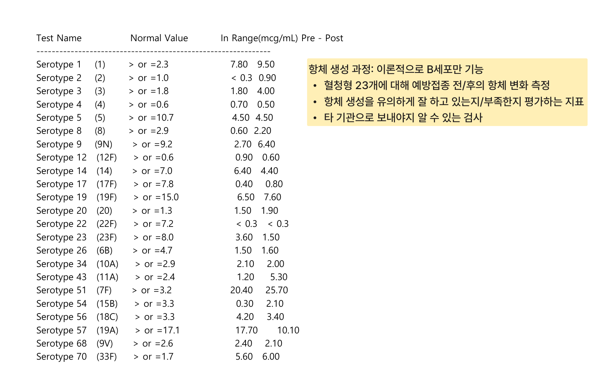
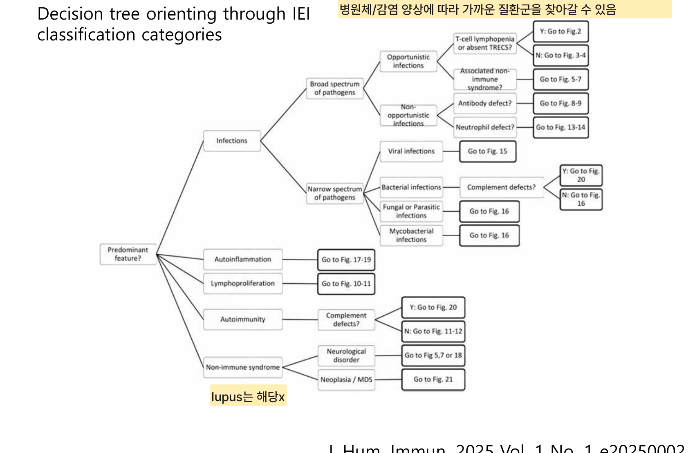
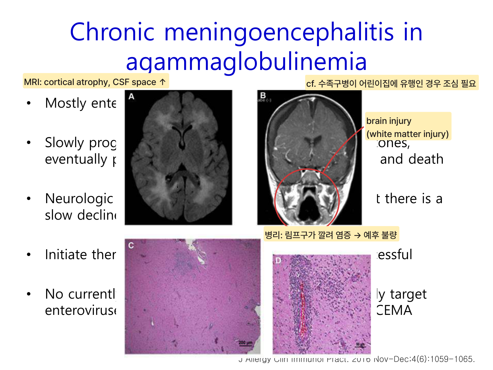
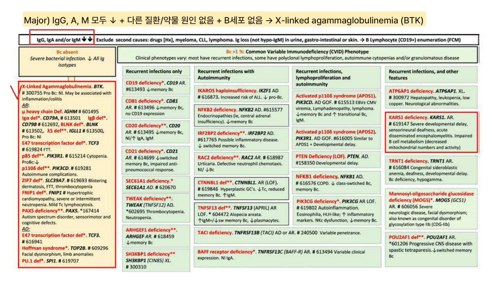
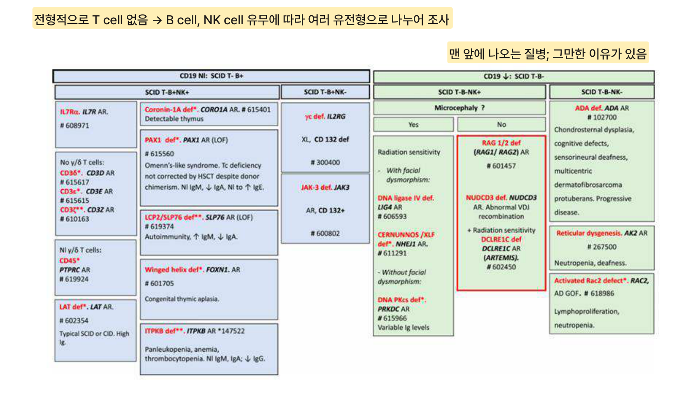
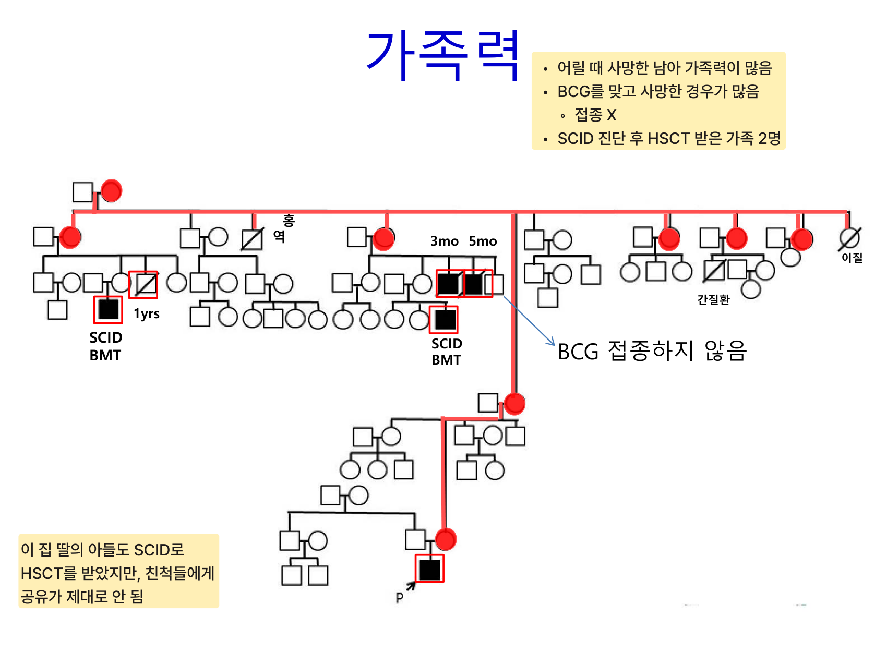

<!-- 필기본: 2026 · 2025 -->
<!-- 단계: 수업 후 -->

# 0. 이 수업을 공부하는 법

소아청소년과 감염 **김동섭 교수님** 수업. 2026 강의 제목은 "일차면역결핍질환자의 감염"이고 한 번에 두 덩어리를 강의하셨다.

- **1st — 면역결핍증 질환 일부 + 그 환자에서 생기는 감염 합병증** → 이 학습자료(16강). 필기본 7–29쪽과 끝의 **증례 1(X-연관 SCID)·증례 2(X-연관 범저감마글로불린혈증)**(40–47쪽).
- 2nd — 소아 암 환자의 감염 합병증(호중구감소 발열, 침습 진균감염, 주폐포자충) → **15강 학습자료**. 증례 3(아스페르길루스)도 15강.
- 필기 작성자 메모: 교수님이 **슬라이드의 모든 내용을 읽고 설명**하셔서 형광펜 표시는 의미가 없다. 즉 **슬라이드 글자 전부가 시험 범위**라고 보고 읽는다.

필기 순서(= 이 자료의 순서)
1. 일차면역결핍증이란 — 의심 증상, 병력
2. 면역 기능 검사 — 체액·세포·식세포·보체, 진단 결정 나무
3. 체액면역결핍 — 범저감마글로불린혈증(XLA) + **올해 새 슬라이드: 범저감마글로불린혈증의 만성 수막뇌염**
4. 세포면역결핍 — DiGeorge 증후군
5. 복합면역결핍 — SCID, Wiskott-Aldrich 등
6. 식세포 이상증, 7. 보체결핍·자가염증
8. **증례 1·2** (올해 16강 필기에 붙음)

기출 14문항(2020–2025)은 **딱 두 가지 사례**가 해마다 숫자만 바뀌어 나온다.

- **XLA 사례**(7문항 + 가족 1문항): 남아, **생후 6개월 이후**부터 반복되는 피부 농양·폐렴(*P. aeruginosa*·*S. aureus*), **외삼촌·형**이 소아기에 폐렴으로 사망, **IgG·IgA·IgM 모두 −2SD 미만**, B세포 0.1% → 진단 **범저감마글로불린혈증**, 치료 **정주 면역글로불린 400 mg/kg**.
- **SCID 사례**(7문항): 남아, **생후 1개월부터** 패혈증·폐렴·장염 반복, 지속 설사, **외삼촌이 영아기에 사망**, 기형 없음, **T세포가 거의 0** → 진단 **SCID**, 할 일 **정주 면역글로불린(면역글로불린 수치가 정상이라도)**, TMP/SMX, 생백신(로타·BCG) **금기**.
- 올해 필기의 증례 1·2가 바로 이 두 사례의 원본이다 → 8단원을 꼭 같이 본다.

!!! key "핵심"
    **언제 시작했나**가 첫 단서: **T세포 결함 → 생후 6개월 이내**(기회감염, 설사, 성장장애), **항체 결함 → 6개월 이후**(모체 IgG 소실 후 피막 세균).
    **외삼촌·형이 어려서 죽은 남아 = X-연관**(XLA: BTK, X-SCID: IL2RG, Wiskott-Aldrich).
    **생백신은 금기, 면역글로불린 정주, 근치는 조혈모세포이식(SCID·CGD·WAS).**

# 1. 일차면역결핍증 — 언제 의심하나

## 일차면역결핍증 (inborn errors of immunity, IEI)
- **면역계의 결함에 의해 발생하는 다양한 질환군.** 예전에는 *primary immunodeficiency*(일차면역결핍증)라고 불렀는데, 요즘은 "면역결핍증"으로 확정 짓지 않고 질환군을 모아 **inborn errors of immunity(면역의 선천 오류)** 라고 부른다.
    - 왜 이름이 바뀌었나: 면역이 "모자라는" 병만이 아니라 **"잘못 작동하는" 병**(자가면역·자가염증·알레르기)도 같은 유전 결함에서 나오기 때문이다.
- **주로 단일 유전자 변이(single gene mutation)** 와 연관성이 확인된다 — 그래서 진단에 유전자 패널 검사를 쓴다(증례 2의 *BTK*).
- **2024년 기준 559개** 질환이 보고되었고, **계속 증가하는 추세**다. 분자·유전 검사가 발전하면서 **같은 병이라고 생각했던 것들 사이에도 차이**가 드러나 하나씩 갈라져 나온다.
- **임상 양상은 질환에 따라 매우 다양**하며, **많은 경우 감염병에 취약**하다. 교수님: "여기서 주로 말씀드릴 부분은 **감염병에 취약한 질환들과 감염의 특성**."
- **자가면역, 자가염증, 알레르기, 악성 질환**과도 연관될 수 있다.

!!! new "올해 필기에서 추가"
    "주로 **single gene mutation**과 연관", "같다고 생각한 질병의 차이도 존재" — 질환 수가 늘어나는 이유를 올해 덧붙이셨다.

## 면역결핍 의심 증상
- **1회 이상의 전신 세균 감염**(패혈증, 수막염 등)
- **1년에 2회 이상 심한 호흡기 또는 다른 부위 세균 감염**(연조직염, 농양, 폐렴, 중이염, 림프절염 등)
- **비전형적 부위의 감염**(간농양, 뇌농양 등)
- **비정형적 병원균에 의한 감염**(*Serratia marcescens*, *Pneumocystis jirovecii* 등)
- **증상이 비정상적으로 심할 때**

교수님 설명
- **숫자는 절대적인 것이 아니다.** 중이염 같은 경우는 정상 아이도 1년에 여러 번 앓기도 한다(어린이집, 젖병).
- 이 목록에 해당한다고 **모두 면역기능 문제는 아니지만, 자세히 들여다볼 필요가 있다.**
- 특히 비정형 병원균(*Serratia*, *Pneumocystis*)은 **보통 건강한 아이가 걸렸을 거라고는 생각하지 않으므로**, 이런 균이 나오면 **면역 기능 평가를 반드시** 해 봐야 한다.
- 왜 이런 균이 단서인가: *Pneumocystis*는 T세포 면역이 없을 때, *Serratia*(catalase 양성균)는 식세포 살균 기능(만성육아종질환)이 없을 때 병을 일으킨다 — 균 종류가 **어느 면역 축이 고장났는지**를 알려 준다.

!!! diff "작년 필기와 다른 점"
    2025 필기에는 **「면역결핍 의심 증상 — 경고 신호 10가지」** 슬라이드가 따로 있었는데 올해 필기에는 없다(기출에는 아직 나온 적 없음). 참고로 남겨 둔다.

    | | |
    |---|---|
    | ① 연간 **4회 이상 중이염** | ⑥ **심부·장기 농양** |
    | ② 연간 **2회 이상 심한 부비동염** | ⑦ **지속되는 아구창**·피부 곰팡이 |
    | ③ **2개월 이상** 항생제 치료 | ⑧ **정주 항생제**를 써야 해결됨 |
    | ④ 연간 **2회 이상 폐렴** | ⑨ **2회 이상 패혈증·뇌수막염** |
    | ⑤ **체중·키 성장 지연** | ⑩ 일차면역결핍의 **가족력** |

    작년 설명: 중이염은 젖병을 빠는 아이에게 흔하다. 그 나이가 지났는데(초등학생) 자주 생기면 생활습관·환경을 먼저 보되 면역결핍도 의심한다.

## 병력
- **가족 중 조기 영아 사망** — **물어보지 않으면 이야기하지 않는다.** 보호자도 모르거나(윗세대의 유산·영아 사망), 말하기 꺼린다. "친척 중 어려서 원인 모르게 죽은 아이, 병원에 계속 다닌 사람이 있나요?"처럼 **구체적으로** 물어야 나온다(증례 1의 가계도가 바로 이 예).
- **발생 연령** — T세포 결함은 **생후 6개월 내** 증상, 항체 결핍 시 **6개월 이후** 발생.
    - **T세포 결함 → 생후 직후부터** 문제가 생길 수 있다. 엄마에게 받은 항체로는 바이러스·진균·기회감염을 막을 수 없기 때문.
    - **항체 결핍 → 모체로부터 태반을 통해 받은 항체(IgG)가 많이 줄어드는 시기인 생후 6개월 이후.** 그 전까지는 엄마 IgG로 버틴다.
- **신체검진** — 동반 기형(DiGeorge의 얼굴·심장), 림프절·편도 크기(체액면역결핍이면 거의 없음), 성장 상태(체중 백분위).

!!! new "올해 필기에서 추가"
    "6개월"은 **절대적인 것이 아니고 이론적인 개월 수**다. **항체 결핍은 더 늦게 발생할 수도 있다**(기출에도 "생후 8개월 이후 시작"한 XLA 사례가 있다 — 2부 7번).

!!! memo "암기"
    **T세포 결함 = 6개월 이내(생후 직후부터)**, **항체 결핍 = 6개월 이후(모체 IgG 소실, 더 늦을 수도)**.

# 2. 면역 기능 검사

## 체액면역 기능 검사 (B세포·항체)
- **면역글로불린 정량**: IgG, IgA, IgM, IgD, IgE, IgG subclass.
    - **2차·개인 병원에서도 시행 가능한 검사**다(그래서 1차로 한다).
    - 다만 **검사실 정상값 제시가 친절하지 않다** — 연령에 따라 보정되지 않은 성인 기준을 주는 경우가 많다. 영아는 정상이어도 성인보다 훨씬 낮으므로 **연령별 정상값**과 비교해야 한다(증례 2).
- **Isohemagglutinin(동종혈구응집소)**: A, B형 혈액형에 대한 항체(자연 IgM). 장내 세균 항원에 노출되며 저절로 생기는 항체라, 없으면 IgM 생성 능력이 떨어졌다는 뜻이다.
- **Schick test**: 디프테리아(diphtheria) 항원에 대한 피부 반응.
- **Lateral pharyngeal X선(측면 인두 X선)**: 아데노이드·편도 림프조직을 본다.
    - **편도선이 부어 있으면 체액면역 기능에 뚜렷한 문제가 있을 가능성은 적다.**
    - 이유: **편도는 대부분 B세포로 이루어져 있어 B세포가 없으면 편도가 클 수 없다.**
- **B세포 측정**(유세포분석 CD19) — **전체 림프구 중 비율**을 조사한다.
- **특정 항체 생성능 검사**: **접종 2–3주 후 항체 생성 여부.** 체액면역 기능 — 즉 **항체를 만들어내는 기능이 잘 작동하는지 보는 지표값**이다. 접종 후 1년쯤 지나면 수치가 떨어질 수 있어 시기가 맞아야 한다.

### 폐구균 다당백신 접종 후 항체 생성 검사

{: style="width:70%"}

- **혈청형 23개에 대해 예방접종 전/후의 항체 변화**를 측정한다.
- **항체 생성 과정에서 이론적으로 B세포만 기능**한다 — 다당 항원은 T세포 도움 없이 B세포 단독으로 반응(T-independent)하므로 **순수한 B세포 항체 생성능**을 볼 수 있다.
- **항체 생성을 유의하게 잘 하고 있는지/부족한지 평가하는 지표.**
- **타 기관으로 보내야 알 수 있는 검사**다(일반 병원에서 바로 안 됨).
- 표 읽기: 혈청형마다 정상 기준(예: 혈청형 14 ≥ 7.0 mcg/mL)이 있고, 접종 전(Pre)→후(Post)로 **얼마나 오르는지**를 본다. 필기 예시는 대부분 혈청형이 기준에 못 미치거나 거의 오르지 않았고(14: 6.4→4.4, 22F: <0.3→<0.3), 몇 개만 정상(7F 20.4→25.7) — 항체 생성 능력 저하.

## 세포면역 검사 (주로 T세포) — 세포면역을 담당하는 세포의 수와 형태를 검사
- cf. 항체 검사는 Ig를 일차적으로 쉽게 볼 수 있지만, 세포면역은 그만큼 쉽지 않다.
- **말초혈액 림프구 수 및 형태** — 연령 대비 충분한가(영아는 성인보다 림프구가 훨씬 많다).
- **지연 피부반응 검사**(delayed-type hypersensitivity)
- **X선 사진으로 흉선 확인**
    - 흉선은 **스트레스 상황이나 심하게 아픈 경우 감소(위축)하는 경향**이 있다.
    - 그래서 **X-ray에서 보이지 않는다고 해서 흉선이 없다고 판단할 수는 없다.**
- **T 림프구 및 subset**(CD3·CD4·CD8)
- **림프구 증식 반응**(mitogen 자극)

## 식세포계 검사 (호중구·대식세포)
- **말초혈 백혈구 수 및 형태** — **PB smear(말초혈액 도말)가 기본적으로 많은 정보를 제공**한다(예: Chediak-Higashi의 거대 과립).
- **부착 인자에 대한 검사** — 백혈구 접합물질 결핍증. **질환에 따라 시행**한다.
- **혈청 IgE 농도** — 식세포 기능만 보는 검사는 아니지만 **특정 질환(Hyper-IgE 증후군)에서는 진단에 도움**을 준다.
- **NBT(nitroblue tetrazolium) test: 만성육아종**
- **DHR(dihydrorhodamine) 검사법: 만성육아종** — 둘 다 NADPH oxidase가 활성산소를 만드는지 본다.
- **탐식 검사**, **살균 기능 검사**
- NBT test, 탐식 검사, 살균 기능 검사 → **식세포가 잘 작용하는지 보는 검사.**
- 질환이 굉장히 많아 **자세한 설명은 다음 기회에** 하신다고 했다.

## 보체계 검사
- **CH50 activity**: 항체가 결합된 적혈구를 **50% 용혈시킬 수 있는 정도**를 측정. **질병 선별 검사** — 고전 경로 전체(C1–C9)가 다 있어야 용혈되므로 하나라도 빠지면 낮게 나온다.
- **혈청 C3, C4 농도 측정** — 중간 pathway 물질로 **일반 병원에서 시행 가능한 검사**.
- 다른 complement/enzyme은 **외부 의뢰가 필요**하다.

## 진단 흐름 — IEI 분류 결정 나무

{: style="width:78%"}

- 출발점은 **주된 양상(predominant feature)**: **감염**(infections) / 자가염증(autoinflammation) / 림프증식(lymphoproliferation) / 자가면역(autoimmunity) / 비면역 증후군(non-immune syndrome).
- **감염이 주된 증상인 질환이 많고**, 여기에 autoinflammation, lymphoproliferation, autoimmunity 등이 더해진다.
- 감염이면 → 병원체 범위가 **넓은지**(broad spectrum: 기회감염이면 T세포 감소·TREC 없음 → SCID 쪽, 비기회감염이면 항체 결함·호중구 결함) **좁은지**(narrow: 바이러스만, 세균만 → 보체 결함, 진균·기생충, 결핵균) 따라 **병원체/감염 양상으로 가까운 질환군을 찾아갈 수 있다.**
- 필기: **lupus는 해당 X** — 자가면역 갈래가 있다고 해서 흔한 루푸스를 여기서 찾는 것은 아니다.
- 일반 병원에서 볼 수 있는 것은 **면역글로불린 정량, 말초혈액 도말, 항체 생성능**까지. 그 뒤는 전문가의 영역이다.

# 3. 체액면역결핍질환

체액 면역(항체)에 문제가 있는 질환들.

- **범저감마글로불린혈증** — **주로 다룰 질환**
- **분류불능형 면역결핍증**(CVID)
- **선택적 IgA 결핍증** — **이 중 가장 흔하지만, 임상적으로 심하게 진행하는 경우가 적다**(증상 없이 우연히 발견되기도).
- **IgG 아군 결핍증**
- **반성유전 림프계 증식 증후군**(XLP)
- **고 IgM 증후군**

## 범저감마글로불린혈증 (agammaglobulinemia, XLA)
- **IgG, IgA, IgM 항체가 선천적으로 생성되지 않는다.** 항체를 만드는 B 림프구가 없거나 매우 적다.
- 유전: **반성 유전(X-linked, Bruton type — *BTK* 유전자)**, 상염색체 열성 또는 산발 발생. X-연관이 대부분이라 **남아**, **모계 쪽 남자(외삼촌)** 나 **형**에게 같은 병력이 있는지 본다.
- **경태반 항체가 소실되는 6–9개월부터 세균 감염.**
    - **어머니한테서 받은 항체가 소실된 시기 이후**에 생기므로 **출생 직후에는 문제가 잘 생기지 않는다.**
    - 출생 직후에는 Ig가 유지되어 **경태반 항체 소실 전에는 검사해도 수치가 별로 안 낮을 수 있다.** 소실 후에 검사하면 **Ig 수치가 매우 떨어져 있다.**
- 감염: **농가진, 중이염, 부비동염, 폐렴, 농흉, 패혈증** — 흔한 병이라 **처음 증상만으로는 알기 어렵다.**
- 원인: ***S. pneumoniae*, *H. influenzae*, 장바이러스 감염** — **항체 결핍 환자에서 문제되는 대표 병원체.**
    - 왜 이 균들인가: 폐렴구균·Hib는 **다당 피막**이 있어 항체가 붙어야(옵소닌화) 식세포가 먹을 수 있다. 장바이러스는 장에서 혈액으로 퍼질 때 **중화항체**가 막는데, 항체가 없으면 뇌까지 간다(아래 만성 수막뇌염).
- 소견: **림프절 결여**(B세포가 없어 2차 림프기관이 발달하지 못함 — 편도·림프절이 거의 안 만져짐), **글로불린 감소**, **순환 B 림프구 결핍**.
- 치료: **3–4주 간격으로 정맥 또는 피하 면역글로불린 400–500 mg/kg**, **심한 만성 호흡기 감염 시 고용량** 투여 요함.
    - **IVIG 400–500 mg/kg, 3–4주 간격 = 교과서적 시작 용량.**
    - **심한 만성 호흡기 감염/폐 합병증**으로 빨리 소모되면 **더 높은 용량, 더 잦은 간격.**
    - **피하 Ig는 국내에서 일반적으로 쓰기 어렵다** → 국내는 정맥(IVIG).

!!! exam "기출 포인트"
    XLA 사례: 진단 → **범저감마글로불린혈증**(2부 **6·13번**, B 림프구 0.1%가 결정적 단서). 치료 → **정주 면역글로불린**(**3·9번**), **면역글로불린 400 mg/kg 정주**(**7번** — 함정 "0.5 mL/kg 근주"는 노출 후 예방용 근주 용량), 고름에서 녹농균이 나온 급성기에는 **정주 ceftazidime**(**11번** — 보기에 IVIG가 없을 때).
    함정 보기: 비장절제, 편도절제, **치료 전 수두·MMR 접종**(생백신 금기), 수두 면역글로불린 근주(노출 후 예방용), 정주 덱사메타손, 혈장교환술.
    **2번**(2025): *BTK* 변이 XLA 환아의 가족 중 유전상담·동일 질환 여부를 가장 시급히 확인할 대상 → **7개월 남동생**(X-연관 열성 → 같은 병은 남자 형제. 어머니·누나·외할머니는 보인자 가능, 아버지는 X를 아들에게 주지 않음).

## 범저감마글로불린혈증의 만성 수막뇌염 (chronic meningoencephalitis in agammaglobulinemia, CEMA)

!!! new "올해 필기에서 추가"
    2026 강의에 새로 들어온 슬라이드 2장(필기본 18–19쪽, J Allergy Clin Immunol Pract 2016). 작년 필기에는 "장바이러스 감염" 한 줄뿐이었다.

- **Mostly enteroviral meningoencephalitis** — 대부분 **장바이러스에 의한 수막뇌염**. 항체 결핍 환자에게 합병증을 일으키는 대표 감염.
- **Slowly progressive loss of motor and cognitive milestones** — 운동·인지 발달이 **서서히** 퇴행하고, 결국 **경직성 사지마비(spastic quadriplegia), 혼수, 사망**에 이른다.
- **Neurologic features can wax and wane** — 신경 증상이 좋아졌다 나빠졌다 하지만 **천천히 악화되어 보통 2년 이내에 사망**한다.
    - 교수님: **항체 결핍증을 모르고 있는 경우 기다리다가 사망**한다. 왜냐하면 **수족구 시즌의 뇌수막염은 보통 치료 없이 지켜보기 때문** — 정상 아이의 장바이러스 수막염은 저절로 낫지만, 항체가 없는 아이는 바이러스를 못 없애 만성화된다.
- **Initiate therapy with high-dose IVIG: not always successful** — **특이적인 항바이러스제가 없어 고용량 IVIG를 투여하고 기다린다(실패하기도 함).**
- **No currently approved antiviral agents** that specifically target enteroviruses — **target할 수 있는 항바이러스 치료제가 마땅치 않다.**

{: style="width:72%"}

- **MRI**: **피질 위축(cortical atrophy), CSF 공간 증가**, 백질 손상(brain injury, white matter injury).
- **병리**: 혈관 주위로 **림프구가 깔려 있는 염증** → 예후 불량.
- **cf. 수족구병이 어린이집에 유행하는 경우 조심이 필요**하다 — XLA 아이는 장바이러스 노출 자체가 위험.

!!! key "핵심"
    XLA + 장바이러스 = **만성 수막뇌염** — 서서히 발달 퇴행 → 사지마비·사망(2년 내). 특이 항바이러스제 없음 → **고용량 IVIG**(실패 가능). 그래서 **일찍 진단해 IVIG를 꾸준히** 맞히는 것이 중요하다.

## 검사 예 — 범저감마글로불린혈증

| 항목 | 결과(%) | 절대수(/µL) | 정상(%) | 정상 절대수 | 판정 |
|---|---|---|---|---|---|
| T (CD3) | 95.3 | 4501 | 43–76 | 900–4500 | |
| Th (CD4) | 67.2 | 3174 | 23–48 | 500–2400 | |
| Tc (CD8) | 24.1 | 1138 | 14–33 | 300–1600 | |
| Th/Tc ratio | 2.79 | | ≥ 1 | | |
| **B (CD19)** | **0.1** | **5** | 14–44 | 200–2100 | **absence** |
| NK (CD16+56+3−) | 4.0 | 189 | 4–23 | 100–1000 | |

- **B 임파구 결핍 및 항체 결핍으로 진단한 범저감마글로불린혈증.**
- **1% 미만이면 "없다"로 판단** — 림프구 수천 개 중 5개 → 있다고 보지 않는다.
- T세포 비율이 오히려 높은 것은 B세포가 빠진 만큼 상대적으로 늘어난 것이다(T세포 자체는 정상).

## XLA로 가는 진단표

{: style="width:80%"}

- 필기: **Major) IgG, A, M 모두 ↓ + 다른 질환/약물 원인 없음 + B세포 없음 → X-linked agammaglobulinemia (*BTK*)**.
- 순서: ① IgG·IgA·IgM 감소 확인 → ② **이차 원인 배제**(약물, 골수종·CLL·림프종, 소변·장·피부로 Ig 소실) → ③ **B 림프구(CD19+) 측정**.
    - **B세포 없음(Bc absent)**: 심한 세균 감염, 모든 Ig 감소 → **XLA(BTK)**, 상염색체 열성 무감마글로불린혈증들.
    - **B세포 > 1%**: **분류불능형 면역결핍증(CVID) 표현형** — 반복 감염 + 자가면역·림프증식 등이 다양하게 섞인다.
- 표 안의 개별 유전자는 외울 필요 없다. **"B세포 없음 → XLA"** 한 줄이 핵심.

!!! diff "작년 필기와 다른 점"
    같은 표에 2025 필기 메모로 "**autoinflammation이나 IBD 같은 대장염(IBD-like colitis)이 동반되는 경우도 있음**", "이 표는 일차적으로 **환자 증상으로** 찾아가는 것"이 적혀 있었다.

# 4. 세포면역결핍질환 — DiGeorge 증후군 (가슴샘 저형성증)

- **가슴샘(흉선)과 부갑상샘의 무형성 또는 형성 저하.**
    - **흉선**은 T세포가 성숙(maturation)하는 곳 → 흉선 문제 = **T세포 성숙 문제 → 세포면역 결핍.**
    - **부갑상선** 문제 → 부갑상선호르몬 부족 → **저칼슘혈증.**
- **대혈관 기형, 식도 폐쇄, 선천 심질환, 짧은 인중, 안구 격리(눈 사이가 넓음), 하부 소악(작은 아래턱)** — 진찰할 때 확인하는 **동반 기형**.
- **흔히 저칼슘혈증 경련이나 테타니 발생**(부갑상선 문제 시).
- **22q11.2 미세결실(microdeletion)이 95% 이상**에서 확인.
- **CATCH 22 증후군** — 동반되는 기형의 앞 글자를 따서 암기: **C**ardiac(심장), **A**bnormal face(얼굴), **T**hymic hypoplasia(흉선), **C**left palate(구개열), **H**ypocalcemia(저칼슘) + 22번 염색체.
- 흉선이 얼마나 형성됐는지에 따라 결핍 정도가 다양하다 — 일부만 있는 부분형이 많지만, **확인되지 않는(흉선이 전혀 없는) 심한 형태**도 있다(이 경우 SCID처럼 치료).

!!! exam "기출 포인트"
    SCID 사례 보기의 "**예방적으로 칼슘·비타민 D 복합제 투여**"(2부 4·10·12·14번)는 **DiGeorge용 함정**이다. 문제에 "**동반된 기형이 없어 보였다**"는 DiGeorge를 배제하라는 단서.

# 5. 복합면역결핍증후군 — 체액 면역도 감소된 상황

## 중증 복합면역결핍증 (severe combined immunodeficiency, SCID)
- **어떤 면역결핍 질환보다도 가장 심한 형태.** **어린 나이에 진단하지 않으면 사망**한다 → 그래서 **screening(선별) 검사가 필요**하다.
- **신생아 선별검사가 가능한 질환**(TREC — T세포가 흉선에서 만들어질 때 생기는 DNA 조각을 측정).
- **T 림프구 수가 저하**. T세포 도움이 없으니 B세포가 있어도 항체를 못 만들어 **체액면역도 결핍** → "복합".
- **출생 수개월 내 설사, 폐렴, 중이염, 피부 감염 발생** — **출생 후 바로** 문제가 될 가능성(모체 항체로는 T세포 기능을 대신할 수 없다).
- ***Pneumocystis jirovecii*, cytomegalovirus(CMV), *Candida albicans* 등의 감염으로 사망.**
    - 이 병원체들은 **일상생활이나 주변에서 쉽게 옮을 수 있으므로, 조심한다고 문제가 안 일어나지는 않는다.**
- **생백신 접종 절대 금기.**
    - **보통 생백신 접종 후 문제가 생겨 진단되는 경우가 많다** — 국내에서 영아에게 맞히는 생백신은 **BCG**(생후 4주 내)와 **로타바이러스**(2개월부터).
- **조혈모세포 이식** — 교수님: SCID는 "**조혈모세포 이식하는 병**".

### 검사 예 — 중증 복합면역결핍증

| 항목 | 결과(%) | 절대수(/µL) | 정상(%) | 정상 절대수 | 판정 |
|---|---|---|---|---|---|
| **T (CD3)** | **0.2** | **3** | 43–76 | 900–4500 | |
| **Th (CD4)** | **0.2** | **3** | 23–48 | 500–2400 | |
| **Tc (CD8)** | **0.0** | **0** | 14–33 | 300–1600 | |
| Th/Tc ratio | INF | | ≥ 1 | | **absence** |
| B (CD19) | 99.1 | 1450 | 14–44 | 200–2100 | |
| **NK** | **0.3** | **4** | 4–23 | 100–1000 | |

- **T 임파구 및 NK 세포 결핍으로 진단된 중증 복합면역결핍증후군** — **세포 면역과 체액 면역 결핍이 모두 동반.** **NK cell도 없다.**
- **B cell 숫자는 많아 보여도(99%) 이 나이에 단독으로 항체 형성이 불가**하다 → **출생 직후 Ig 수치는 괜찮아도(엄마 IgG) 항체를 못 만든다.**
- T−B+NK− 형 = X-연관 SCID(공통 γ사슬 결핍, *IL2RG*)의 전형적 형태. 총 림프구 수 자체가 낮은 경우가 많다(1,450 — 영아 기준으로는 적다).

!!! diff "작년 필기와 다른 점"
    2025 필기 메모: 영아에서 총 림프구가 **3,000 미만이면 유심히** 봐야 한다, 이 환자는 조치했는데도 사망했다.

### SCID 분류표

{: style="width:80%"}

- **표에서 맨 앞에 나오는 질병 — 그만한 이유가 있다**(가장 심하고 급하다).
- **전형적으로 T cell 없음 → B cell, NK cell 유무에 따라 여러 유전형으로 나누어 조사.**

| 형 | 대표 원인 | 비고 |
|---|---|---|
| T−B+NK− | **γc 결핍(*IL2RG*, X-연관)**, JAK3 | 증례 1·기출 SCID 사례(남아·외삼촌 사망) |
| T−B+NK+ | IL7Rα 결핍 등 | |
| T−B−NK+ | **RAG1/2**, Artemis(DCLRE1C) 등 | V(D)J 재조합 실패 |
| T−B−NK− | **ADA 결핍**, 망상 이형성증(AK2) | |

!!! exam "기출 포인트"
    SCID 사례 7문항: 진단 → **SCID**(2부 **1번**, 총 T 림프구 5, 체중 3rd percentile 미만). 할 일 → **정주 면역글로불린**(**4·8·10번**), "**혈중 면역글로불린 수치가 정상이라도 정주 면역글로불린을 정기 투여**"(**14번** — 바로 "B cell이 있어도 항체 형성 불가"), **TMP/SMX 투약**(**5·12번**).
    함정 — **로타바이러스 접종, BCG 접종**(생백신 금기, "설사가 호전되기를 기다려 로타 접종"도 오답), **독감 접종**(6개월부터·사백신이어도 반응 없음), 폐렴구균 접종, 경구 amoxicillin, 칼슘·비타민 D(DiGeorge), **CMV 감염 과거력 엄마의 모유수유 장려**(CMV 전파 위험), **혈소판 수혈**(Wiskott-Aldrich 함정), 비장절제.

## 그 밖의 복합면역결핍증
- **연골-털 형성저하증**(cartilage-hair hypoplasia): 짧은 사지 왜소증 + 가늘고 성긴 머리카락 + 면역결핍.
- **Wiskott-Aldrich 증후군**(WAS): **반성유전**, **피부염(습진), 혈소판감소 자반, 감염 감수성**, **혈소판이 작고 기능이 저하**, **WASP(Wiskott-Aldrich syndrome protein) 유전자 변이**.
    - **WAS triad: eczema, thrombocytopenia, infection.**
    - WAS 혈소판은 **크기도 작고 숫자도 적어 기능이 매우 떨어진다.** (만성 혈소판 감소 환자는 보통 혈소판 **크기가 커져** 기능을 어느 정도 대체하는데, WAS는 그게 안 된다 — ITP와의 차이.)
    - **정도는 다양**: 출혈로 **혈소판 수혈이 필요한 환자** ~ **조심하며 일상생활 가능한 환자**까지. 심하면 조혈모세포이식.
- **모세혈관 확장성 조화운동불능(ataxia-telangiectasia)**: 모세혈관 확장증, 만성 부비동염, 폐렴, **악성 종양**, 체액면역과 세포면역 결핍, **조화운동불능** — **운동조화불능이 동반되는 경우가 많다**(그래서 이름에 들어감).
- **Hyper IgE 증후군**: 잦은 **피부 및 호흡기 감염**, ***S. aureus*, *C. albicans*** 감염. 혈청 IgE가 매우 높다(2단원 식세포 검사의 "혈청 IgE").

| 질환 | 유전 | 기억할 짝 |
|---|---|---|
| Wiskott-Aldrich | X-연관 | **습진 + 작은 혈소판 감소 + 감염**, WASP |
| 모세혈관확장성 운동실조 | 상염색체 열성 | **운동실조 + 모세혈관확장 + 악성종양** |
| Hyper-IgE | (상염색체 우성 등) | **IgE↑ + 포도알균 피부·폐 감염 + 칸디다** |
| DiGeorge | 22q11.2 결실 | **흉선·부갑상선 → T세포↓ + 저칼슘** |

# 6. 식세포 이상증

공통점: 피부 감염·진균 감염이 많고, 탐식 이후 단계가 고장난 경우가 많다.

## 백혈구 접합물질 결핍증 (leukocyte adhesion deficiency, LAD)
- **백혈구 기능 장애, 세균과 진균 감염 반복, 혈액 내 중성구 증가.**
    - 왜 중성구가 늘어나나: 부착분자(integrin)가 없어 백혈구가 혈관벽에 붙어 **혈관 밖으로 못 나가므로** 혈액에 쌓인다. 감염 부위에는 고름이 잘 안 생긴다.
- **피부, 구강, 호흡기, 점막 감염, 배꼽 감염, 탯줄이 늦게 떨어질 수 있음.**
    - **생후 1–2개월에도 탯줄이 안 떨어지면 자세히 볼 필요가 있다**(탯줄 탈락에 중성구가 필요).

## Chediak-Higashi 증후군
- **상염색체 열성 유전, 중성구 탈과립 장애**(거대 과립 — PB smear에서 보임), **반복 감염, 출혈 경향, 백색증**(멜라닌 과립도 이상), **진행성 말초 신경병**.
- ※ 슬라이드 오타: "출형 경향" → 출혈 경향, "말포 신경병" → 말초 신경병(필기에서도 빨간 펜으로 표시).

## 만성 육아종 질환 (chronic granulomatous disease, CGD)
- **탐식은 되지만 균을 물고 살균(killing)하지 못하는 상황.**
- **식세포 NADPH oxidase 유전적 결함** → 활성산소(superoxide)를 못 만들어 **탐식 후 살균 문제**, **세균과 진균 반복 감염**, **육아종 형성**.
    - 육아종: 균을 머금은 대식세포가 뭉쳐 **lung mass, 임파선 덩어리** 등으로 나타난다 — 결핵·비결핵항산균(NTM)이나 종양으로 오인되기도 한다.
- 균: ***S. aureus*, *Serratia marcescens*, *Aspergillus*, *Candida albicans*** 등 — **catalase 양성균**(스스로 만든 H2O2를 분해해 버려 식세포가 빌려 쓸 수 없다).
- 치료: **TMP/SMX, itraconazole 지속 복용** — **예방적 항생제/항진균제 사용**. 감염이 없어도 매일 먹는다.
    - **TMP/SMX**는 PCP 예방약이지만 여기서는 **Staphylococcus에 대한 항생제로** 쓴다.
- **조혈모세포 이식** — **특히 심한 X-linked CGD는 조혈모세포 이식이 목표**다.
- 진단: **NBT·DHR 검사**(2단원).

| 질환 | 고장난 단계 | 특징 |
|---|---|---|
| LAD | **혈관 밖으로 이동** | 혈중 중성구↑, 고름 없음, **탯줄 늦게 떨어짐**, 배꼽 감염 |
| Chediak-Higashi | **탈과립** | 거대 과립, 백색증, 출혈 경향, 말초신경병, AR |
| CGD | **살균(NADPH oxidase)** | catalase 양성균, 육아종, NBT·DHR, TMP/SMX + itraconazole |

# 7. 보체결핍과 자가염증

## 보체결핍질환
- **C2 결핍: 폐구균에 의한 패혈증 호발.**
- **C3 결핍: 박테리아에 대한 옵소닌화 감소.** C3b가 핵심 옵소닌이라 반복 세균 감염.
- 이런 병은 **검사를 시행해야 알 수 있는 질병/증상**이다 — **폐렴구균 패혈증이 심하거나, 비전형적이거나, 반복될 때** 보체 검사(CH50)를 해 본다.
- (교과서 보충: 말단 보체 C5–C9 결핍은 반복 수막알균(*Neisseria*) 감염.)

## 자가염증 질환 (autoinflammatory disorders)
- **감염 양상은 아니지만 IEI 질환군에 포함**된다 — 무균성(sterile) 염증(피부·뼈·관절).
- 예: **골수염 형태지만 감염에 의한 게 아니라 수술/항생제에도 호전이 없다** → **나중에 진단되는 경우가 많다.**
- **반복되는 골수염의 경우 autoinflammatory disease라고 의심**한다(배양에서 세균·곰팡이가 계속 안 나오는 경우).
- 표 안의 개별 질환은 외울 필요 없다.

!!! memo "암기"
    | 결함 | 발병 | 대표 감염 | 대표 질환 | 치료 |
    |---|---|---|---|---|
    | B세포(항체) | **6개월 이후** | 폐렴구균·Hib·**장바이러스(만성 수막뇌염)** | **XLA**(BTK, B세포 <1%) | **IVIG 400–500 mg/kg 3–4주마다** |
    | T세포 | 6개월 이내 | PCP·CMV·칸디다 | DiGeorge(22q11.2, 저칼슘) | 정도에 따라 |
    | T+B | **출생 직후~수개월** | 기회감염·설사·성장장애 | **SCID**(T 거의 0) | IVIG + TMP/SMX → **조혈모세포이식**, 생백신 금기 |
    | 식세포 | 다양 | *S. aureus*·*Serratia*·*Aspergillus* | **CGD**(NADPH oxidase, NBT·DHR) | TMP/SMX + itraconazole 매일 → 이식 |
    | 보체 | | 폐렴구균 패혈증(C2), 옵소닌화↓(C3) | | |

# 8. 증례로 정리

!!! new "올해 필기에서 추가"
    2025년에는 이 증례들이 15강(소아종양) 필기에만 있었고 16강 필기에는 없었다. 올해는 한 강의로 묶여 **면역결핍 파트의 끝**에서 다뤘다. 기출 SCID·XLA 사례의 원본이므로 꼭 본다.

## 증례 1 — X-연관 중증 복합면역결핍증
- **3개월 남아**, **출생 3주경 기침이 시작하여 지속**, **출생 7주경 구강 궤양**, 최근 3주간 경구 항생제를 투여했으나 **중이염 호전이 없어 전원**.
    - **근처 병원에서는 특별한 이야기 없이 감기라고 했다** — "어린 애가 잔병치레가 많다"고 넘기기 쉽다.
- 출생력 **39+5주 / 3.6 kg / NSVD**, 키 10–25%, **체중 5–15%**.
    - 출생 시 3.6 kg(중간~중간 위)이었는데 → **3개월에 연령 대비 체중 증가 부족**(성장 부진의 징후).
- **아버지, 어머니, 남아 3인 가족** — **형제 없음**(형제에게 옮은 감염이라고 설명하기 어렵다).

### 가족력

{: style="width:76%"}

- **어릴 때 사망한 남아 가족력이 많다**(3개월·5개월 사망, 1세 사망, 홍역 사망).
- **BCG를 맞고 사망한 경우가 많다** → 그래서 이 집안은 다음 아이에게 **BCG를 접종하지 않았다.**
- **SCID 진단 후 HSCT를 받은 가족 2명.**
- **이 집 딸의 아들도 SCID로 HSCT를 받았지만, 친척들에게 공유가 제대로 안 됐다** — 정보가 전해졌다면 환아를 출생 직후에 진단할 수 있었다.
- 모계(빨간 선 = 보인자 여성)를 따라 **남자만** 걸리는 → **X-연관 열성** 유전.

### 진단은?
- 검사: **T(CD3) 0.2%(3/µL), CD4 3, CD8 0, NK 0.3%(4), B(CD19) 99.1%** → **T 림프구, NK 세포 결핍 → SCID**(T−B+NK−, X-연관이면 *IL2RG*).
- **조혈모세포이식 대상.**
- 출생 후 **2–3개월 동안 알지 못했다.**

### 진단 후 가장 먼저 할 조치는?
보기 6개를 모두, **동시에** 한다.

| 조치 | 이유 (필기) |
|---|---|
| 1. **모유 수유 중단** | **30–40대 엄마는 대부분 CMV 과거 감염** → 모유로 **CMV가 간헐적으로 나온다.** 모유 검사해서 음성이면 먹이는 방식도 국내에서는 하지 않는다(간헐적이라 한 번 음성이어도 믿을 수 없다) |
| 2. **PCP 예방 투약** | ***Pneumocystis jirovecii* 예방** — TMP/SMX(SCID는 생후 2개월 전이라도) |
| 3. 항진균제 예방 투약 | **상황에 맞춰 투약** |
| 4. 항생제 예방 투약 | **상황에 맞춰 투약** |
| 5. **면역글로불린 정주** | **준비되는 대로 Ig 주입.** **출생 직후 Ig가 정상처럼 보여도(엄마 IgG) 앞으로 작용 못 한다** |
| 6. **조혈모세포 이식 준비** | **T 림프구가 없어 거의 empty marrow** → **이식 거부 반응이 잘 안 일어나 안전한 편**이다. 빨리 할수록 좋다 |

!!! diff "작년 필기와 다른 점"
    - 2025 필기에는 "**생후 3.5개월 내 이식 시 생존율 94%**, 감염 병력이 있으면 성공률이 떨어진다"가 있었다(올해 필기엔 숫자 없음).
    - 2025 16강 필기에는 SCID에 면역글로불린을 준다는 말이 없어 "수업에서는 언급 없었지만 기출을 보면 투여"라고 적혀 있었다. **올해는 "준비되는 대로 Ig 주입", "출생 직후 Ig가 정상처럼 보여도 작용 못 함"으로 명시**되었다 — 기출 14번("수치가 정상이라도 정기 투여")의 근거.
    - 올해 추가된 이유: **empty marrow라 이식 거부가 적다**, 모유는 **검사해서 음성이어도 안 먹인다.**

### 유전상담
- **X 연관 유전 질환.**
- **SCID 환자 출산 가능성 있는 성인 여성 모두 상담** — **주변의 가족들**까지(이모, 외할머니 쪽 여성).
- **동의한 경우 유전자 검사 시행** — **carrier(보인자) 성인 여성을 확인**한다.
- **동의하지 않은 경우 남아 임신/출산 시 내원 설명** — 출산 시 또는 남아 임신을 알게 되면 다시 상담. 이유: 치료하지 않으면 **대부분 돌 이전에 사망**한다.
- **출산을 더 하지 않을 성인 여성, 미성년자는 검사하지 않는다**(결과로 바꿀 수 있는 행동이 없고, 미성년자는 스스로 결정할 나이가 아니다).

## 증례 2 — X-연관 범저감마글로불린혈증
- **13개월 남아**, **7개월 전(생후 6개월)부터 농가진**으로 개인병원 치료력 10여 회. 최근 피부과에서 **피부 배농 수술**. **4개월 전부터 폐렴으로 4차례 입원력.** 최근 입원 때는 **중환자실 입실, 농흉**이 있었으며 **흉수에서 세균이 동정**됨.
    - **일반적인 어린이의 상황이 아니다** — 폐렴은 흔해도 농흉·중환자실·반복은 흔하지 않다.
- 출생력 **38주 / 3.1 kg / NSVD**, **키 25–50%, 체중 25–50%**(성장은 정상 — 증례 1과 차이).
- **아버지, 어머니, 36개월 형, 남아 4인 가족** — 환아는 **둘째 남아**.

### Laboratory findings

| 단백면역 | 결과 | 연령 정상값 |
|---|---|---|
| **IgG** | **72 mg/dL** | 218–610 |
| IgA | 4 mg/dL | 1.3–53 |
| IgM | 10 mg/dL | 11–51 |

- **Ig는 연령에 따른 정상값이 다르다** — 성인 기준(IgG 700–1600)과 비교하면 안 된다.
- **연령을 고려해도 IgG, IgA, IgM 모두 크게 감소.**
- **유전성 일차성 면역결핍증 유전자 패널 검사**: ***BTK* c.1750+5G>T, Hem(반접합 — 남자라 X가 하나), XLA, XLR(X-연관 열성), LPV(likely pathogenic variant)** → **BTK gene mutation이 확인된 상황.**

### 진단은?
- **B(CD19) 0.1%(5/µL) absence**, T·NK 정상 → **X-linked agammaglobulinemia에 해당.**
- 치료: **4주 간격 면역글로불린 주사 치료.**
- 예방접종: **독감만 접종 시행** — 항체는 못 만들지만 **독감 접종은 요새 하고 있다**(사백신이라 안전하고, T세포 반응 등 일부 이득을 기대). 나머지 백신은 IVIG에 이미 항체가 들어 있어 의미가 적고, **생백신은 금기**.
- **형제 진료**: **형도 진료 + 기본 검사 시행.** 형은 잘 지냈다고 해도 넘어가지 않는다.

!!! diff "작년 필기와 다른 점"
    2025 필기에는 "**어머니를 검사했더니 보인자(carrier)였다**"는 결과가 적혀 있었다(올해 필기는 "형제 진료"까지만).

!!! exam "기출 포인트"
    2부 **2번**(2025)이 이 증례 그대로다 — 20개월 남아, 형 4세 사망, *BTK* c.1750+5G>T Hem XLA XLR → **가장 시급한 확인 대상 = 7개월 남동생**(아직 6개월 무렵이라 증상이 막 시작될 시기). 15강 2부 3번(2025)은 같은 사례에서 **향후 필요한 예방접종 = 인플루엔자 사백신**을 물었다.

!!! key "핵심 — 두 증례 비교"
    | | 증례 1: X-SCID | 증례 2: XLA |
    |---|---|---|
    | 시작 | **생후 3주**(6개월 이내) | **생후 6개월**(모체 항체 소실 후) |
    | 감염 | 지속 기침, 구강 궤양, 중이염(기회감염 위험) | 농가진, 폐렴·농흉(세균) |
    | 성장 | **부진**(체중 5–15%) | 정상(25–50%) |
    | 림프구 | **T·NK 없음**, B 있음 | **B 없음**, T 정상 |
    | 치료 | **모유 중단 + PCP 예방 + IVIG + 조혈모세포이식 준비** | **IVIG 4주마다**, 독감 사백신만 |
    | 공통 | **생백신 금기**, X-연관 → 모계 여성 상담·남자 형제 검사 | |
