<!-- 필기본: 2026 · 2025 -->
<!-- 단계: 수업 후 -->

# 0. 이 수업을 공부하는 법

소아청소년과 감염 **김동섭 교수님** 수업("소아청소년의 바이러스 감염"). 교수님 말씀대로 예방접종 같은 특수한 내용도 조금 있지만 **건강한 소아·청소년에게 흔한 바이러스 질환**을 하나씩 훑고, 마지막에 증례 3개(신생아 HSV, 선천 CMV, MMR–자폐 논란)를 다룬다.

필기 순서(올해도 작년과 같다): 홍역 → 풍진 → 볼거리 → 장바이러스(수족구·헤르판지나) → 파르보바이러스 → 단순포진(신생아 HSV) → 수두·대상포진 → CMV(선천 CMV) → EBV → 돌발진 → 인플루엔자 → 기타 호흡기 바이러스 → 일본뇌염 → 코로나19 → 증례 1·2·3

!!! new "올해 필기에서 추가"
    - **예방접종 CP 안내**(1쪽): CP-1은 강의, **CP-2는 슬라이드 한 장당 한 조씩 조별 발표**. 조당 PPT **5장 이내**, 인용한 자료는 **출처를 반드시** 적고, AI를 썼다면 **원래 출처까지 확인**할 것.
    - 올해 필기본 2–7쪽에는 이 수업 기출 12문항(2023–2025)과 풀이가 인쇄돼 있다 — 2부 1–12번과 같은 문제다.
    - 슬라이드 내용은 작년과 거의 같고, **메모(형광 상자)가 크게 늘었다**. 특히 **증례 2(선천 CMV)** — "**청력 이상만 있으면 보통 중등도 이상에 포함되지 않는다**" — 와 **증례 3 정리(두 논문)** 가 새로 생겼다. 아래 `new`·`diff` 상자에 모두 표시했다.

- 기출 53문항(2020–2025). 김동섭 교수님 출제분은 **사례 6종이 해마다 반복**된다.
    1. **아버지의 대상포진 + 증상 없는 아이** → 아이에게 생길 수 있는 병은 **수두**, 조치는 **아이의 면역 상태에 따라** 다르다(이미 수두를 앓았으면 관찰, 접종 안 한 1세면 접종, 6개월 영아는 관찰).
    2. **10개월 영아, 3일 고열 후 열이 떨어지며 발진** → **돌발진**.
    3. **청소년, 2–3주 발열 + 삼출성 편도염 + 비장비대 + 비정형 림프구** → **EBV 전염단핵구증**, 진단은 **바이러스 급성기·회복기 항체 검사**.
    4. **선천 CMV**(작게 태어남·난청·간비종대·혈소판감소) → **valganciclovir**(금식이면 **ganciclovir 정주**), 생후 3개월에 발견되면 **치료 없이 추적**.
    5. **생후 2–3주 발열 + 두피 수포/산모 외음부 궤양** → **혈액·소변·CSF 배양 + CSF HSV PCR + 정주 acyclovir 즉시**.
    6. **해외여행 후 3C + 귀 뒤에서 내려오는 발진 + 구강 흰 반점** → **홍역**.
- 2022년 2월·2021년 2월·2020년 미생물학 문항(피코르나·파라믹소·파르보·두창·아데노 등)도 이 수업으로 분류되어 있다.

!!! key "핵심"
    **발진의 순서와 열의 관계**로 거의 다 가른다 — 홍역은 3C 뒤 **귀 뒤→얼굴→몸통→발**로 내려오며 융합, 풍진은 얼굴에서 **2–3시간 만에** 전신(뒤목 림프절), 돌발진은 **열이 떨어진 뒤** 발진, 수두는 **반점·구진·수포·가피가 동시에**, 대상포진은 **한쪽 피절**.
    **신생아 HSV는 치료 결과를 기다리지 않는다**(acyclovir 즉시), **선천 CMV는 중등도 이상이면 생후 1개월 안에 시작해 6개월**.

# 1. 홍역 (measles)

## 특징
- **무엇**: **Paramyxoviridae(파라믹소바이러스과), RNA 바이러스.** 발열, 기침, 콧물, 결막염과 **홍반성 반점구진이 융합하는 발진**이 특징이다.
    - 올해 메모: 발진이 "**따로따로 생기다가 합쳐져서 커진다**"(융합성). 수두처럼 하나하나 떨어진 수포와 다르고, 풍진 발진보다 진하고 넓게 합쳐진다.
- **전염력**: 감수성 있는 사람(항체가 없거나 면역이 낮은 사람)이 노출되면 **90% 이상**(메모: "대부분") 감염된다.
- **발진 4일 전부터 4일 후까지 공기 전파**가 가능 — 아주 먼 거리까지 퍼진다. 올해 메모: "**공기 전파 / 비말 전파를 명확히 구분하지는 않음**" — 실제로는 전구기에 비인두 분비물 비말로도 많이 퍼진다(다음 쪽).
- **2014년 우리나라는 WHO 홍역 퇴치국가**로 인정. 퇴치는 전혀 발생하지 않는다는 뜻이 아니라 **해외 유입이 있더라도 통제(control)하고 있다**는 뜻. WHO 인증 기준(2013): **토착 바이러스 환자 3년간 없음, 2회 접종률 95% 이상**, 인증 감시체계 가동.

!!! new "올해 필기에서 추가"
    - **퇴치 국가여도 산발적 발생은 있다** — 외국인 유학생이 많은 지역, 유행 지역 방문자 등.
    - **발진 전부터 전파력이 강하다 → 진단받았을 때는 이미 많이 전파된 상태.** 그래서 접촉자 관리(아래 노출 후 예방)가 중요하다.

## 증상 — 세 시기

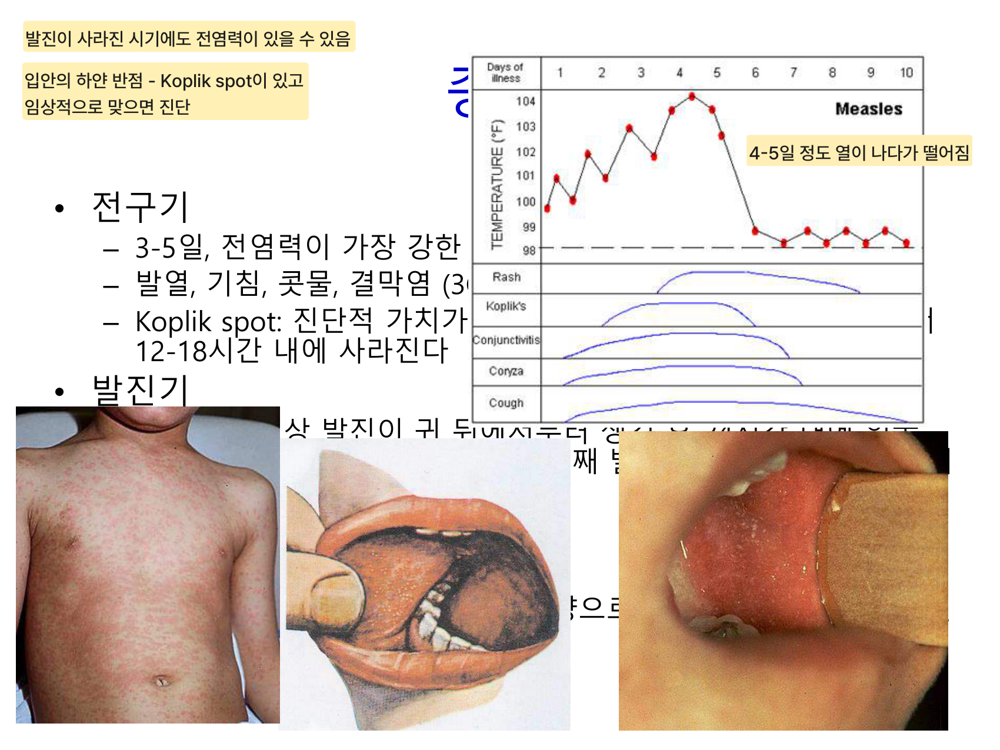{: style="width:74%"}

그래프 읽기: 가로축은 앓은 날수. **열은 4–5일 오르다(최고 104°F, 약 40°C) 발진이 나온 뒤 떨어진다.** 기침·콧물·결막염이 먼저 시작되고, **Koplik 반점은 발진 직전에 잠깐** 나타났다 사라지며, 발진은 4일째쯤 나와 며칠 지속된다.

- **전구기(3–5일)**: **전염력이 가장 강한 시기**, 비인두 분비물 **비말**로 전파가 많다. 증상은 발열 + **3C(cough 기침, coryza 콧물, conjunctivitis 결막염)**.
    - 메모: **3C 증상은 홍역 외 여러 질환에서도 나타난다** — 3C만으로는 감기·아데노바이러스와 구분이 안 된다.
    - **Koplik spot(코플릭 반점)**: 볼 안쪽 점막의 하얀 반점. **진단적 가치**가 있다 — "**확실히 보이면 진단이 가능**", "입안의 하얀 반점(Koplik)이 있고 **임상적으로 맞으면 진단**". 대개 **발진 1–4일 전**에 나타나 **12–18시간 내** 사라진다. 그래서 **금방 사라져 없다고 배제할 수는 없다.**
- **발진기**: 홍반성 구진상 발진이 **귀 뒤에서 시작 → 24시간 내 얼굴·목·팔·몸통 상부 → 2일째 대퇴부 → 3일째 발**까지(위에서 아래로) 퍼진 뒤, **나타난 순서대로 사라진다.** 발진은 **서로 융합**. 급성 복통, 비장비대, SGOT(AST) 상승, 황달도 가능하다. 이 시기부터 증상으로 의심할 수 있다 — **해외여행력, 유학생과 함께 생활**한 병력이 단서.
- **회복기**: 발진이 사라지며 **작은 겨껍질 모양으로 벗겨지고** 7–10일 내 소실. **손·발은 벗겨지지 않는다**(특징). 메모: **발진이 사라진 시기에도 전염력이 있을 수 있다.**

| 비교 | 홍역 | 풍진 | 돌발진 |
|---|---|---|---|
| 열과 발진 | 열이 **4–5일 오른 뒤 발진**, 발진기에도 열 | 미열, 발진과 함께 | **열이 떨어지면서** 발진 |
| 전구증상 | 3C 뚜렷, Koplik | 가볍다, 뒤목 림프절 | 없음(고열만) |
| 발진 진행 | 귀 뒤→아래로 **3일**에 걸쳐, **융합** | 얼굴→**2–3시간 내** 전신 | 몸통 중심 |

!!! exam "기출 포인트"
    14·35·51번: 해외여행(또는 영아) + 4일간 열·기침·콧물 → 결막충혈과 **귀 뒤·목에서 얼굴로 퍼지는 발진** + **구강 흰 반점** → **홍역**. 함정 보기: 풍진(전구증상 가볍고 Koplik 없음), 성홍열(사포 발진·딸기혀), 돌발진(열이 떨어진 뒤 발진), 볼거리, 수족구.

## 합병증

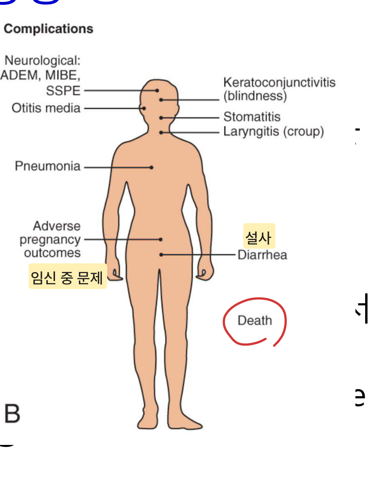{: style="width:52%"}

메모: "**피부 질환인 줄 알기 쉽지만, 홍역은 공기 전파하는 호흡기 질환으로 본다.**" "**결국 합병증이 문제** — 그래서 예방접종의 필요성이 강조된다."

- **호흡기 합병증**(가장 흔함): 기관지염, 세기관지염, **크루프(후두염)**, **폐렴**, 중복 세균 폐렴. 메모: "홍역 앓고 나서 폐가 나빠진 경우들".
- **신경계 합병증**(메모: **드묾**):
    - **뇌염**: 1,000례 중 1–3례, **감염 후 면역반응**으로 생긴다(바이러스가 직접 뇌를 파괴하기보다 면역 반응).
    - **아급성 경화 전뇌염(SSPE)**: 감염 **7–10년 후** 발생, 서서히 진행하며 **3년 이상 생존하지 못함(사망)**. 메모: 7–10년 뒤라 **본인은 홍역을 앓은 것도 기억 못 하는 시기**에 생긴다.
- 그림의 나머지: 눈(**각결막염 → 실명**), 귀(**중이염**), 입(구내염), 후두염(크루프), 장(**설사**), **임신 중 문제**(나쁜 임신 결과), 그리고 **사망**(빨간 동그라미).
- **Measles-induced immune suppression(immune amnesia, 면역 기억 상실)**: 홍역이 기존 면역 기억을 지워 다른 감염에 약해진다는 가능성이 제기되는 중.

## 능동·수동면역 (노출 후 예방)
- **능동면역**(백신으로 스스로 항체를 만들게 함):
    - 예방접종(**MMR**) **2회**. **유행지역에서는 6–12개월**에도 접종할 수 있다.
    - 메모: **2018년 대구 유행 때도 시행**했다. 단 **돌 전 접종은 접종 차수로 인정되지 않는다**(엄마 항체 때문에 반응이 약해 — 돌 이후 2회를 다시 맞는다).
    - **노출자가 면역이 없으면 72시간 이내 접종.**
- **수동면역**(외부 항체를 넣어 줌):
    - 경태반 항체는 생후 **4–6개월 이후 소멸**.
    - 대상 = **6개월 미만 영아, 임신부, 면역저하자** 중 **감수성 있을 때**(메모) — 생백신을 맞을 수 없거나 효과가 없는 사람들이다.
    - **노출 6일 이내 면역글로불린 근육주사 0.5 mL/kg, 정주용은 400 mg/kg.**
    - 메모: "**접종을 못 하는 경우, 노출된 상황을 해결하기 위함**".

| 노출 후 예방 | 무엇 | 언제까지 | 누구 |
|---|---|---|---|
| 능동(MMR) | 생백신 | **72시간** 이내 | 면역 없는 노출자(접종 가능한 사람) |
| 수동(IG) | 면역글로불린 IM 0.5 mL/kg / IV 400 mg/kg | **6일** 이내 | **6개월 미만, 임신부, 면역저하자**(감수성 있을 때) |

!!! diff "작년 필기와 다른 점"
    작년 필기에는 "이 조치들은 **노출된 사람**에게 하는 예방조치다. **건장한 성인이면 통상 추가 조치가 필요 없다**"는 교수님 말씀이 있었다. 올해는 "접종을 못 하는 경우, 노출된 상황을 해결하기 위함"으로 정리됐다 — 같은 뜻.

## 치료
- **대증치료**. 메모: **특별한 항바이러스제로 경과를 바꿀 수 없다.**
- **급성 홍역 환자에게 고용량 비타민 A** — 메모: "**도움이 되었다는 일부 보고가 있음**"(비타민 A 결핍이 있으면 중증·사망이 많다).

!!! memo "암기"
    홍역 숫자: 전구기 **3–5일**, 전염 **발진 ±4일**, Koplik **발진 1–4일 전·12–18시간**, 발진 **귀 뒤 → 1일 얼굴·몸통 → 2일 대퇴 → 3일 발**, 회복 **7–10일**(손발 안 벗겨짐), 뇌염 **1,000명 중 1–3**, SSPE **7–10년 후**, 노출 후 **접종 72시간 / IG 6일**.

# 2. 풍진 (rubella)
- **무엇**: **Togaviridae, RNA 바이러스.** 미열, 홍반성 구진, **림프절 종창**. 홍역과 비슷하지만 가볍다.
- **선천풍진증후군**(메모: "**이 증후군을 우려해 주의**"한다 — 풍진이 중요한 이유):
    - 기전: 임산부 감염 후 **경태반 감염**.
    - 결과: 사망, 발육부전, **백내장, 난청**, 소두증, 간비종대, 혈소판감소, 간염, 황달, 수막염 등 **모든 장기에 영향**.
    - 메모: **태아 초음파에서 소두증·간비종대 등이 보이면 역으로 (엄마의 풍진 감염을) 조사**하기도 한다.
- **전염력: 발진 7일 전부터 7일 후까지.** 메모: **노출된 경우 전염력이 높다**, **발진 전에는 감염 사실을 알기 어렵다**(그래서 임신부 노출을 막기 어렵다).

## 증상

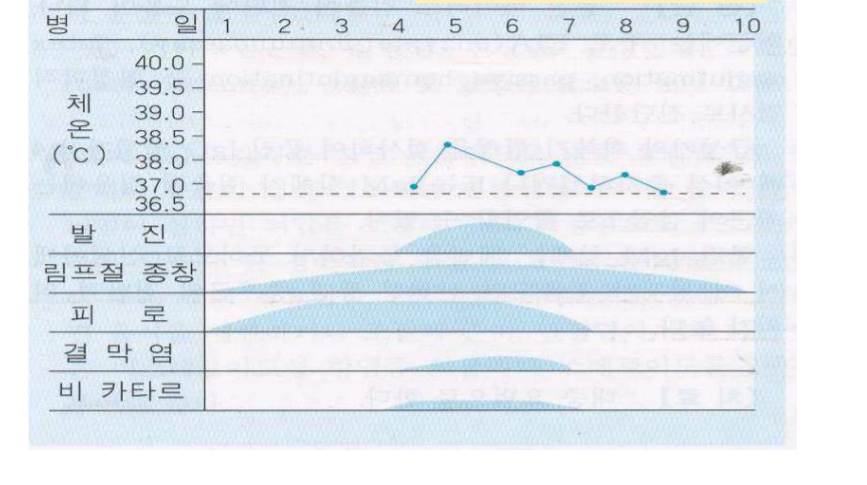{: style="width:58%"}

그래프 읽기: **열은 미열(38°C 안팎)**, **림프절 종창이 발진보다 먼저 시작해 길게** 가고, 발진은 짧다. 결막염·콧물(카타르)은 가볍다.

- 잠복기 **2–3주**.
- **발진 1일 전부터 귀 뒤·목 뒤·후두부 림프절 비대** — 홍역과 가르는 단서.
- 발진은 **얼굴에 처음 나타나 2–3시간 내에 머리·팔·몸통 등 온몸으로 급속히** 퍼진다. **첫날은 홍역과 비슷** — 메모: "**빠르게 진행하는 홍역과 유사**".
- 전파: **구강인두 분비물**을 통한 호흡기 전파.
- 예방: 임신 준비 여성은 **풍진 항체 검사** → 없으면 MMR 접종. **임산부에게는 접종하지 않는다**(생백신).

!!! exam "기출 포인트"
    26번: 풍진 — "**구강인두 분비물로 호흡기 전파**"가 정답. 인수공통 아님, 혈청형 1개, 태아 세포 용해가 아니라 세포 분열 억제·혈관 손상으로 기형, 분류는 Togaviridae > **Rubivirus**(Alphavirus 아님).

# 3. 볼거리 (mumps, 유행성 이하선염)
- **무엇**: **Paramyxoviridae, RNA 바이러스.** 타액·분비물 **비말** 감염.
- **타액선 종창 7일 전부터 후까지** 타액에서 바이러스 검출 — 메모: **침샘이 붓기 전부터 검출(전파)이 가능**하다.

## 증상 및 진단

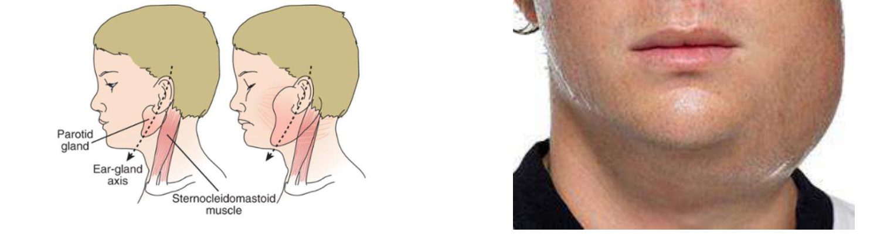{: style="width:62%"}

- 잠복기 **2–3주**.
- 발열·두통·구토 후 **주로 한쪽에서 시작해 양쪽으로** 타액선(이하선) 비대. 그림처럼 **귀 앞·아래가 부어 귓불이 들리고 턱선이 사라진다**(경부 림프절염은 턱 아래·흉쇄유돌근 쪽).
- 진단: **혈청 amylase 증가**(메모: **침샘염의 확인** — 침샘 아밀라아제가 올라간다), **PCR·혈청검사**.
    - 하지만 **음성이어도 배제할 수 없다** — 메모: **위음성의 가능성이 많다.**
    - 메모: 검사는 **특수한 경우에만**(합병증, 역학 조사 등) 시행 — 대부분은 "**이득 적음, 위음성 많음**". 즉 임상적으로 진단한다.

!!! diff "작년 필기와 다른 점"
    작년 필기에는 "**인플루엔자, 장바이러스, 파라인플루엔자도 감염 후 침샘염을 일으킨다** — 독감·수족구 후 볼이 아프다고 오면 볼거리보다 **그 병 원인 바이러스의 침샘염**으로 보는 게 합리적"이라는 말씀이 있었다. 올해 필기에는 빠졌지만 감별에 쓸모 있으니 기억해 둔다.

## 합병증
- **수막뇌염** — 작년 필기: "**흔합니다**", 두통·구토·경부강직이 있으면 의심.
- **고환염·부고환염** — 메모: **생식 기능에는 보통 영향이 적다**(불임은 드묾).
- 난소염.
- **췌장염** — 메모: **볼거리 후 복통이 극심하면 췌장염을 고려**(혈청 amylase가 침샘에서도 오르니 lipase를 함께 본다).
- 청력장애.
- 심근염, 신장염, 관절염 등.

!!! exam "기출 포인트"
    미생물 문항(21·41·22·48번): 홍역과 볼거리 공통점 — **사람이 유일한 숙주**, 비말·호흡기 전파, 생백신(MMR)으로 예방, Paramyxoviridae. 파라믹소바이러스가 일으키는 병을 고르는 문제도 있다(홍역·볼거리·파라인플루엔자·RSV·hMPV). 22번: 볼거리 국내 유행 유전형 I·H형, 파라인플루엔자 4개 혈청형(크룹), RSV는 5세 이하 바이러스 폐렴의 가장 흔한 원인 — 모두 옳음. 47번: **유행성이하선염은 2급 감염병**(24시간 내 신고) — 인플루엔자·RSV·파라인플루엔자는 4급, 신종인플루엔자는 1급.

# 4. 장바이러스 (폴리오 외, non-polio enterovirus)
메모: **우리나라에 환자 발생이 없어 소아마비(폴리오) 바이러스는 강의하지 않는다.** 또 "**장바이러스라고 장염 바이러스라는 뜻은 아니다 — 대표 질환은 수족구병**"이다(장에서 증식해 분변-구강으로 퍼질 뿐, 병은 피부·입·뇌·심장에서 낸다).

장바이러스가 일으키는 병(슬라이드 순서):

- **비특이적 발열**(열만 나는 영아 발열의 흔한 원인)
- **수족구병**, **헤르페스 목구멍염(헤르판지나)**
- 호흡기 질환, 위장관 증세
- 안질환(급성 출혈성 결막염)
- **무균성 수막염**(여름철 소아 수막염의 가장 흔한 원인)
- **심근염, 심낭염**
- 고환염, 부고환염
- **신생아 감염**(엄마에게서 받으면 패혈증 같은 중증 — 신생아 발열에서 HSV·세균과 함께 감별)

작년 필기 예: 형제 둘 중 첫째는 수족구, 둘째는 머리 아프고 열나고 토하면(수막염) 둘 다 장바이러스일 수 있다 — **증상이 달라도 원인이 같을 수 있다.**

## 수족구병 및 포진성 구협염(헤르판지나)

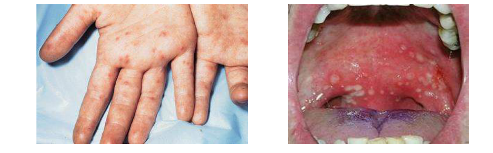{: style="width:62%"}

- **수족구병(hand-foot-mouth disease)**: **궤양성 구내 병소 + 손·발의 수포성 병변**. 원인 **Coxsackievirus A16, Enterovirus 71**(EV71은 뇌간뇌염·폐부종 같은 중증 신경 합병증으로 치명적일 수 있다). **초여름–초가을** 유행, **어린이집·유치원**. 입이 아파 **못 먹는 것(탈수)** 이 문제.
    - 메모: **주의, 격리를 하도록 한다.**
- **헤르페스 목구멍염(herpangina)**: **구인두(입 뒤쪽) 소포·궤양**만 — 메모: "**손발 발진이 없으면 헤르페스 목구멍염**". 이름과 달리 **HSV가 아니라 장바이러스**이고 **전파력은 있다.**
- 메모: **초기에는 구내염만 있다가 나중에 손발 발진이 생기기도** 한다 → **초기 진단이 어렵고**, 그사이 어린이집·유치원에서 유행한다.

| 구분 | 수족구병 | 헤르판지나 | HSV 치은구내염 |
|---|---|---|---|
| 원인 | Coxsackie A16, EV71 | 장바이러스(Coxsackie A) | HSV-1 |
| 입 병변 위치 | 입안 궤양(연구개 뒤쪽 포함) | **연구개·구인두(입 뒤쪽)만** | **입술·혀·잇몸(앞쪽)**, 잇몸이 붓고 피남 |
| 손발 | **수포 있음** | 없음 | 없음 |

!!! exam "기출 포인트"
    49번: 사진(손·발·입 병변) → **수족구병, coxsackievirus**. 19번: EV71이 수족구와 중추신경계 합병증으로 치명적일 수 있다(옳음) — 폴리오는 **이완성** 마비·혈청형 3개, 라이노바이러스는 위산에 **불안정**. 20·39번(피코르나바이러스): 폴리오와 콕사키 공통 — **분변-구강 전파**, 주 방어기전은 **항체**, 대부분 무증상.

# 5. 파르보바이러스 B19 감염증
- **무엇**: **Parvoviridae, DNA 바이러스**(가장 작은 DNA 바이러스, 적혈구 전구세포에 감염).
- **전염성 홍반(제5병, erythema infectiosum)** — 메모: **slapped-cheek appearance**(뺨 맞은 듯한 모양).
    - **뺨에 진한 홍반** → 이후 **몸통·사지 근위부**로 퍼지고, **구진 중심부부터 없어지며 레이스 모양 망상 흔적**을 남긴다.
    - 메모: **건강한 소아**에서 **열이 오래 가고 관절통**이 있으면 **불명열로 조사**하다가 찾기도 한다.
- **면역저하자에서 만성 빈혈, 일시적 골수무형성 위기(transient aplastic crisis)** — 기전: 적혈구 전구세포를 파괴해 적혈구 생성이 멈춘다. 용혈빈혈 환자·이식 환자가 출혈 없이 빈혈이 오면 파르보바이러스를 의심.
- **임신 중 감염 → 태아수종(비면역 태아수종), 자궁내 사망** 가능 — 태아 빈혈 → 심부전 → 수종.
    - 메모: **의료진 중 임산부는 (전염성 홍반 환자) 진료에서 제외**한다.
- **심근염**. (성인에서는 다발관절염.)

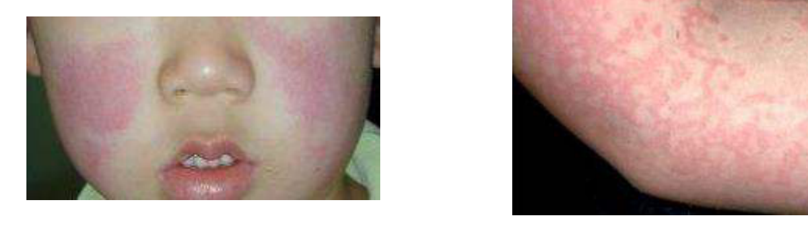{: style="width:62%"}

!!! exam "기출 포인트"
    46번: 뺨 맞은 듯한 발진 → **Parvovirus B19**("Parvovirus"만 쓰면 감점). 25번: Erythroparvovirus에 의한 병이 **아닌** 것 → **돌발진(roseola)** (골무형성위기·감염홍반·태아수종·다발관절염은 맞음).

# 6. 단순포진 바이러스(HSV) 감염 — 이 수업의 중심

## 감염 형태
- **HSV-1, HSV-2(1형과 2형).**
- **원발형(일차) 감염**: 처음 걸린 것. **대부분 불현성** — 메모: **대부분 본인은 모른다**. 단 **신생아·면역저하자는 제외** — 이들은 **양상이 완전히 다르다**(파종·뇌염).
- **비일차 초감염**: 메모: "**한 가지 형만 걸렸던 사람이 다른 형에 처음 감염된 경우**"(예: HSV-1만 앓았다가 HSV-2에 처음). 다른 형의 항체가 일부 교차 방어를 한다.
- **재발성 감염**: 신경절에 잠복했던 같은 형 바이러스의 재활성화.
- 건강한 소아·성인에서는 굳이 구분하지 않지만, **신생아·임산부에서는 구분이 중요**하다(아래 신생아 감염률이 형태마다 다르다).

## 증상
- **급성 구강인두 감염** — 메모: **구내염 형태**(herpetic gingivostomatitis). 메모: "**수족구는 주로 연구개 뒤쪽, HSV 구내염은 입술·혀·잇몸이 잘 붓는다.**"
- **입술 헤르페스**(피곤하면 입술에 물집 — 재활성화).
- **피부 감염**(아토피 등 피부장벽이 무너지면 넓게 — 포진상 습진).
- **생식기 헤르페스**, **눈 병변**(각막염), **중추신경계 감염**(뇌염 — 측두엽), **면역저하자 감염**.
- **출생 전후기 감염**: **피부·눈·입 국소 감염(SEM) / 뇌염 / 파종 감염** 세 가지(아래 치료 기간이 달라진다).
- **헤르페스 병변이 있는 가족과 신생아가 함께 살면** 전파 위험을 상담하고 **병변 부위에 접촉하지 않도록** 한다. 메모: "**입술 물집이 있으면 신생아·어린이와 뽀뽀하지 않기.**"

## 신생아 HSV의 세계 부담

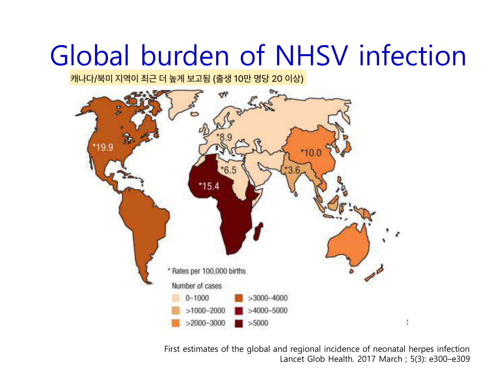{: style="width:60%"}

- 지역별 출생 10만 명당 신생아 HSV: 아메리카 **19.9**, 아프리카 15.4, 서태평양 10.0, 유럽 8.9 …
- 메모: **캐나다·북미 지역이 최근 더 높게 보고된다(출생 10만 명당 20 이상).** 선진국이라고 적지 않다.

## 임산부 초회감염 시 신생아 감염 증가

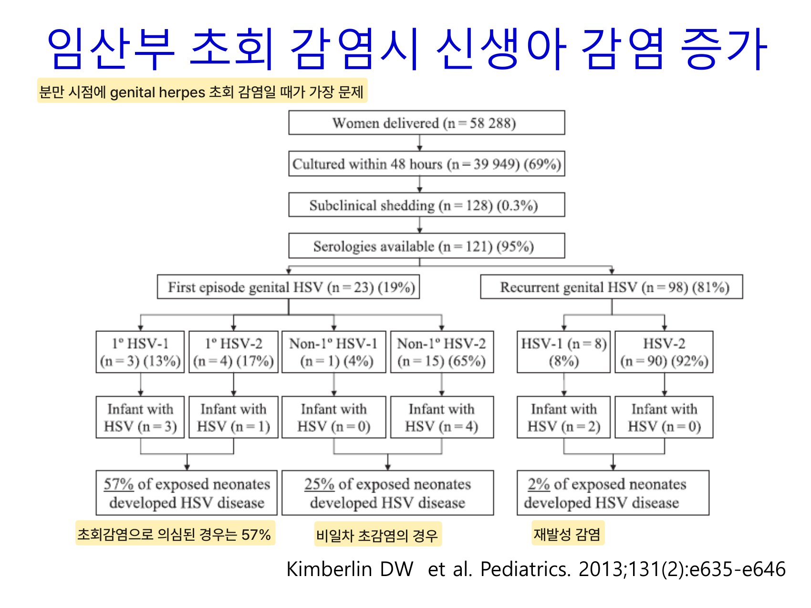{: style="width:66%"}

메모: "**분만 시점에 genital herpes 초회 감염일 때가 가장 문제.**"

도식 읽기(분만한 산모 약 5만 8천 명 → 48시간 내 배양 약 4만 명 → **무증상 배출 128명(0.3%)** → 혈청검사로 형태 구분):

| 산모의 감염 형태(분만 시 배출) | 노출된 신생아 중 HSV 발병 |
|---|---|
| **원발형(초회) 감염** — 1° HSV-1, 1° HSV-2 | **57%** |
| **비일차 초감염** — 다른 형 항체는 있음 | **25%** |
| **재발성 감염** | **2%** |

- 이유: 처음 걸린 산모는 아기에게 넘겨줄 **IgG가 없고** 바이러스 **배출량이 많다.** 재발성이면 엄마 IgG가 태반을 넘어 아기를 어느 정도 지킨다.
- 대부분 **분만 중 산도의 바이러스**로 감염된다(선천 CMV처럼 자궁 안에서 걸리는 게 아니다).

## 신생아 HSV 감염 치료

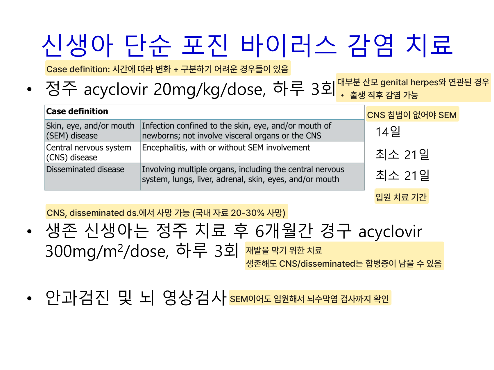{: style="width:70%"}

- **정주 acyclovir 20 mg/kg/dose, 하루 3회**(8시간마다 — 성인 용량보다 매우 높다).
    - 메모: 신생아 HSV는 **대부분 산모 genital herpes와 연관**, **출생 직후 감염**도 가능.
- 감염 범위에 따라 3가지로 나누고 **입원 치료 기간**이 다르다(메모: case definition은 **시간에 따라 변하고 구분하기 어려운 경우도 있다**).

| 분류 | 정의 | 정주 치료 기간 |
|---|---|---|
| **SEM**(skin, eye, mouth) | 피부·눈·입에만 국한, 내부 장기·CNS 침범 없음 | **14일** |
| **CNS** | 뇌염(SEM 동반 여부 무관) | **최소 21일** |
| **파종(disseminated)** | 여러 장기(CNS·폐·간·부신·피부·눈·입) | **최소 21일** |

- 메모: **CNS 침범이 없어야 SEM** — 그래서 "**SEM이어도 입원해서 뇌수막염 검사(CSF HSV PCR)까지 확인**"한다. 피부 병변만 보고 SEM이라고 단정하지 않는다.
- **생존 신생아는 정주 치료 후 6개월간 경구 acyclovir 300 mg/m²/dose, 하루 3회** — 메모: **재발을 막기 위한 치료**. (작년: 발달상의 이득도.)
- **안과 검진 및 뇌 영상 검사.**
- 예후: 메모 "**CNS·disseminated에서 사망 가능(국내 자료 20–30% 사망)**", "**생존해도 CNS/disseminated는 합병증이 남을 수 있다.**"

!!! diff "작년 필기와 다른 점"
    사망률: 작년 필기는 "국내 대학병원 12곳 조사에서 **1/4 사망**, 해외는 10–20%", 올해는 "**CNS·파종형에서 국내 자료 20–30% 사망**"으로 적혀 있다(같은 자료를 범위로 말씀). 작년의 "미국 최근 한 해 40명 정도"는 올해 빠지고, 대신 "북미에서 출생 10만 명당 20 이상"이 들어갔다.

!!! exam "기출 포인트"
    생후 2–3주 발열 + 두피 수포(4·13번) 또는 산모 외음부 궤양(12번) → 할 일 2가지: **혈액·소변·CSF 세균 배양** + **CSF HSV PCR**(4번) / **정주 acyclovir 즉시**(12번). 함정 — "48시간 관찰 후 결정", "어머니가 분만 시 항생제를 맞았으면 관찰", "**경구 valganciclovir**", BCG, 불명열 검사. 9번: 제왕절개로 낳은 아기의 향후 발병에 가장 큰 영향 → **어머니의 HSV IgG 음성**(= 초회감염). 함정은 아버지의 잦은 구순포진(재발성·입술 — 위험 낮음), 손윗 형제, 제왕절개(오히려 위험 감소), 항암 중인 할머니.

# 7. 수두와 대상포진 (VZV)

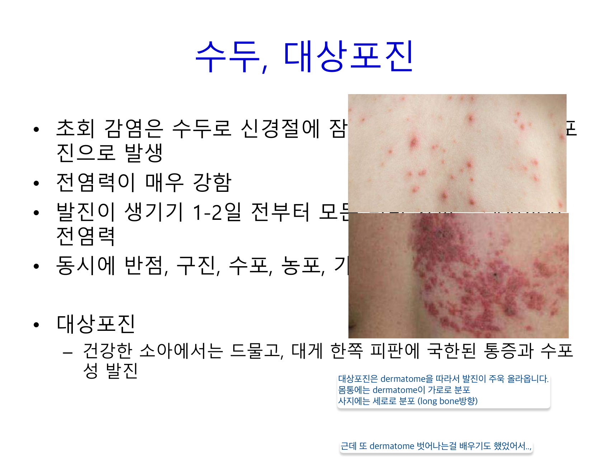{: style="width:42%"}

- **초회 감염 = 수두** → 감각신경절에 잠복 → 재발(재활성화)하면 **대상포진**.
- **전염력이 매우 강하다** — 메모: "**수두; 대상포진도 전염시킬 수 있다**"(대상포진 병변의 바이러스가 수두를 옮긴다).
- **발진이 생기기 1–2일 전부터 모든 병변에 가피가 생길 때까지** 전염 — 메모: **진단 전부터 전염력이 있다**, "**모든 병변에 딱지가 앉으면 전염력 없음.**"
- **반점·구진·수포·농포·가피가 동시에** 관찰된다(시기가 다른 병변이 섞여 있음 — 새 병변이 며칠에 걸쳐 계속 생기기 때문). 두창은 모두 같은 단계.
- **대상포진**:
    - **건강한 소아에서는 드물고**, 대개 **한쪽 피절(dermatome)에 국한된 통증과 수포성 발진**(사진 아래 — 띠 모양으로 몰려 있음).
    - **감수성 있는 자가 밀접 접촉하면 수두 발병 가능** — 메모: "**대상포진 환자와 접촉하면 대상포진이 걸리는 게 아니라 수두가 발병할 수 있다.**" 대상포진은 자기 신경절 바이러스의 재활성화이므로 옮겨지는 병이 아니다.

## 합병증
- **2차 세균감염**(긁어서 생긴 피부 감염 — 포도알균·연쇄알균, 괴사근막염까지).
- **폐렴**, 화농관절염.
- **뇌염**, 신경염(소뇌 운동실조), **Reye 증후군**(아스피린과 함께 — 그래서 해열제로 아스피린 금지).
- 사구체신장염, 심근염, 관절염.
- 메모: "**피부 질환이라 생각하기 쉽지만 호흡기 점막으로 바이러스가 배출되는 호흡기 질환 → 폐렴 동반 가능.**" 그래서 격리도 **공기주의**로 엄격히 한다.

## 능동·수동면역 (노출 후 예방)
- **능동면역**: 예방접종 **1회** — 메모: **돌 이후에 접종**(국내 12–15개월). 맞아야 하는 사람은 노출 후 3–5일 내 맞는다.
- **수동면역**: **고위험군에 한해** 실시.
    - 대상: **면역저하자, 항체 없는 임산부, 감염된 산모의 신생아**(메모: **수두에 걸린 산모가 출산하는 경우**).
    - **10일 이내 VariZIG 근주**(수두 특화 면역글로불린).
- 메모: "**고위험군에 해당 안 되면 추가 조치를 할 필요가 없다** — 예: **할머니가 대상포진에 걸려 아이가 노출된 경우**."

| 노출된 사람 | 조치 |
|---|---|
| 수두를 이미 앓음(확진) 또는 접종 완료 | **관찰**(면역 있음) |
| 건강한 **돌 전** 영아(예: 4–6개월) | **관찰**(접종 연령 전, 고위험군 아님) |
| 건강한 **돌 이후**, 미접종 | **접종**(노출 후 3–5일 내) |
| 면역저하자·항체 없는 임산부·수두 산모의 신생아 | **VariZIG 10일 이내** |

!!! exam "기출 포인트"
    "**아버지 대상포진 + 증상 없는 아이**"는 매년 나온다. 아이에게 생길 수 있는 병 → **수두**(7번). 조치는 아이 상태로 가른다.
    - **이미 수두를 앓았음**(검사로 확진, 또는 2년 전 비슷한 발진) → **조치 없이 관찰**(1·10·15·28번)
    - **6개월** 건강한 영아 → **관찰**(33번 — 접종 연령 전, 고위험군 아님)
    - **1세** 건강한 아이 → **접종 안 했으면 접종**(53번)
    - 함정: VZIG 근주·IVIG(고위험군만), 경구 acyclovir·valacyclovir, PCR 결과로 결정.
    32번: 수두 의심 형 + **항암 중인 백혈병 동생** → 동생에게 먼저 **Varicella IgG 항체 검사**. 18·43번: 성인의 수포성 발진(아들이 비슷한 발진) → **VZV**. 40번: 감염력 시작 → **2차 바이러스혈증 시작 시기**. 45번: 대상포진 환자는 어린이에게 수두를 전파할 수 있다. 38번: 두창은 병소가 **모두 같은 단계**, 수두는 **각각 다른 단계**. 23번: 두창 원인 = **poxvirus**(세포질에서 증식하는 DNA 바이러스).

# 8. 거대세포바이러스(CMV) 감염증
- **선천 바이러스 감염의 (가장) 흔한 원인.** 메모: **선천 감염 = 자궁 내 감염**(HSV는 주로 분만 중 감염 — 둘의 차이).
- **대부분 불현성 감염.** (작년: 출생아의 0.1–1%가 감염되어 태어난다는 보고, 선별검사를 하는 나라도 있다.)
- **선천 CMV 감염**의 소견: **간비장비대, 혈소판감소증, 소두증(슬라이드엔 '소뇌증'), 황달, 출혈성 피부반점(점상출혈), 자궁내 성장지연, 뇌실질 석회화(뇌실 주위), 감각신경 청력손실.** 산전 진찰이나 출생 직후 이런 소견이면 의심.
    - **모체가 임신 중 1차(초회) 감염하면 발병 증가** — HSV와 같은 원리(엄마 항체가 없다).
- **진단**: 바이러스 배양, 항원 검출, **PCR**(출생 **3주 이내** 소변·침에서 검출되어야 선천감염 — 그 뒤면 출생 후 감염과 구분 불가).
- **치료**: 메모 **항바이러스제** — 면역저하자 및 선천감염의 경우 **ganciclovir 정주 또는 valganciclovir 경구**(valganciclovir는 ganciclovir의 경구 전구약물).

## 임산부의 CMV 예방 수칙 (Lancet Infect Dis 2017)
메모: **임산부 초회감염이 문제**가 된다. 어린아이의 침·소변에 바이러스가 많으므로:

- 어린아이가 쓴 **음식·음료·식기를 함께 쓰지 않는다** — 메모: "**아기가 남긴 음식 먹지 않기**"(여기서 아기는 **손위 형제, 조카** 등).
- 아이의 **공갈젖꼭지를 입에 넣지 않는다.**
- 아이에게 뽀뽀할 때 **침에 닿지 않게** 한다.
- **기저귀 교체·수유·코·침 닦은 뒤 비누로 15–20초 손 씻기.**
- 그 밖에 장난감·조리대 등 아이 소변·침이 닿는 곳 닦기, 칫솔 함께 쓰지 않기(효과는 덜함).

## 유증상 선천 CMV 감염 신생아 치료
- **중등도 및 심한 증상 환자에 한해 생후 1개월 이내 치료** 시작.
    - 메모: **생후 2개월쯤 알게 되면 치료 효과를 알기 어렵다.**
    - 메모: "**이득/문제점 비교를 통해 중등도/심한 증상에서 치료를 시작하는 것**" — 6개월 치료는 **골수 억제(호중구감소)·간수치 상승** 부담이 있어 경증·무증상에는 이득이 부작용을 넘지 못한다.
    - 메모: **reference(Lancet Infect Dis 2017)를 보면 중등도/심한 증상을 확인할 수 있다.**
- **6개월간 경구 valganciclovir 16 mg/kg/dose, 하루 2회.**
- **경구 섭취 불가한 경우(+ 메모: 미숙아의 경우), 정주 ganciclovir 6 mg/kg/dose로 치료를 시작** → 먹을 수 있게 되면 경구로 바꾼다.
- **무증상·경한 경우 바로 치료하지 않는다** → 학교 갈 나이까지 **청력·발달을 계속 추적**.

| 선천 CMV | 치료 |
|---|---|
| 중등도·중증, 생후 1개월 이내, 먹을 수 있음 | **경구 valganciclovir 16 mg/kg 하루 2회 × 6개월** |
| 위와 같으나 **금식·미숙아**(경구 불가) | **정주 ganciclovir 6 mg/kg**로 시작 → 경구 전환 |
| 무증상·경증 (올해 메모: **청력 이상'만'** 있으면 보통 중등도 이상에 넣지 않음 — 증례 2) | 바로 치료하지 않고 청력·발달 추적 |
| **생후 1개월 넘어** 발견 | 효과 미미 → 권장하지 않음, 추적 |

!!! exam "기출 포인트"
    선천 CMV 6문항. 작게 태어남 + 점상출혈 + 간비종대 + 혈소판감소 + 출생일 소변 CMV(8·50번) 또는 난청 + 소변·CSF CMV(17번), 산전 뇌실비대 + 출생일 CSF CMV(36번) → **valganciclovir**. **금식·정주영양 중**이면 → **ganciclovir**(3번, 2025). **생후 3개월**에 처음 발견(머리둘레 97%, CSF CMV) → **치료 없이 정기 진료**(30번 — 1개월 이내 시작이 원칙). 함정: acyclovir(CMV에 약함), oseltamivir, ribavirin, tenofovir, nirmatrelvir/ritonavir. 37번 주관식 답 cytomegalovirus.
    ※ 기출의 난청 증례(3·17번)는 **CSF에서도 CMV가 나왔거나(중추신경 침범) 1% 미만으로 작게 태어나** 중등도 이상이었다 — 그래서 치료가 정답. 난청 '하나만' 있는 경우와 구별한다(증례 2).

# 9. Epstein-Barr 바이러스(EBV) 감염 — 전염단핵구증
- **무엇**: **이중가닥 DNA 바이러스**(슬라이드 "Double strained" = double-stranded). 헤르페스바이러스 중 **gammaherpesvirinae**(HHV-8과 같은 아과). B 림프구에 감염한다.
- **전염단핵구증(infectious mononucleosis)**: **림프절 비대, 비장 종대, 발열, 인후염(삼출성 편도염), 피부 발진, 안와주위 부종, 비정형 림프구.**
    - 메모: 환자는 **항생제에도 호전 없는 편도선염, 목 림프절 비대**로 온다(기출 사례 그대로).
- **비정형 림프구**: 메모 "**세포질이 풍부한 모양을 부르는 이름**" — 감염된 B세포를 공격하려고 활성화된 **T세포**다. 세포질이 넓고 주변 적혈구를 감싸듯 가장자리가 물결친다.

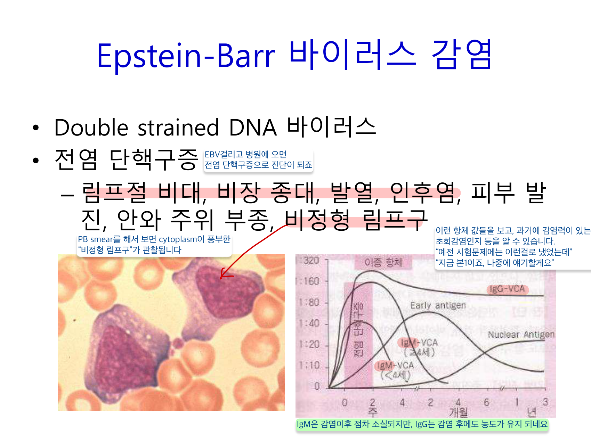{: style="width:74%"}

그래프 읽기(가로축: 주 → 개월 → 년):

- **IgM-VCA**(바이러스 캡시드 항원 IgM): 처음 몇 주에 올랐다가 **몇 달 안에 사라진다** → 있으면 **급성(최근) 감염**.
- **IgG-VCA**: 일찍 올라 **평생 유지**.
- **Early antigen(EA)**: 급성기에 잠깐.
- **Nuclear antigen(EBNA)**: **늦게(수 주–수 개월 뒤) 생겨 평생** → 있으면 **과거 감염**(급성기에는 아직 음성).
- 이종 항체(heterophile, Monospot): 초기 몇 주.
- 메모: "**과거 국시에서는 (각 항체의) 양성/음성의 의미를 물어봤다.**" 예) VCA IgM(+)·EBNA(−) = 급성 초회감염, VCA IgG(+)·EBNA(+)·IgM(−) = 과거 감염.
- 메모: "**아주 초기에는 항체 검사로 알기 어렵고, 대부분 임상적으로 판단**"한다. 그래서 진단 검사로는 **급성기·회복기(만성기) 항체를 짝지어** 본다.

## 치료와 합병증
- 기본은 **보존적 치료**(해열, 수분).
- **기도폐쇄 위험, 심한 비장비대, 심근염, 용혈빈혈, 혈구탐식성 림프조직구증(HLH)** 등 합병증이 동반되면 **전신 스테로이드** 투여.
    - 메모: 기도폐쇄는 **lymphoid tissue hyperplasia(편도·아데노이드 림프조직 과증식) → 기도 폐쇄**.
    - 메모: 스테로이드는 **바이러스를 억제하는 치료가 아니다** — 염증·부종을 줄일 뿐.
- **HLH로 진행하면 사망 위험** — 메모: "**조치해도 사망 위험(혈액 질환에서 자세히)**". 면역세포가 과활성되어 자기 혈구를 잡아먹는 상태.
- (교과서 보충) 비장 파열 위험이 있어 **접촉 운동을 피하고**, ampicillin·amoxicillin을 쓰면 발진이 잘 생긴다.

!!! exam "기출 포인트"
    청소년 + **2–3주 발열·인후통** + **경부 림프절 비대 + 편도 삼출물** + **비장이 갈비뼈 아래 6–12 cm** + 항생제 무반응 + 도말 사진 → 원인 **EBV**(34번), 진단을 위한 추가 검사 → **바이러스(병원체) 급성 및 만성기 항체검사**(6·16·29·52번). 함정: 골수천자, **비장 절제 후 조직검사**, 결핵 피부반응, 디프테리아 독소 피내 검사, 편도 세균 신속항원, 편도 PCR. 24번: HHV-8과 함께 **gammaherpesvirinae** = **EBV**(HSV·VZV는 alpha, CMV·HHV-6·7은 beta).

# 10. 장미진, 돌발진 (roseola, exanthem subitum)
- **원인**: **사람 herpesvirus 6A, 6B, 7**(HHV-6·7, betaherpesvirinae).
- **어린 영아와 소아**(대개 6개월–2세)에서 **장미진의 형태**로 주로 나타난다.
- **갑자기 고열**, **15%에서 열성 경련** — 메모: **고열 시 열성 경련**(열이 빨리 오를 때).
- 이식 환자에서 **재활성화하면 뇌염, 간염, 골수억제, 폐렴** 발생 가능.

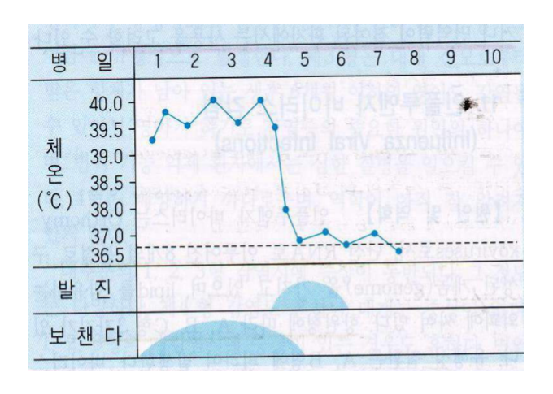{: style="width:44%"}

그래프 읽기: 체온이 **39.5–40°C로 3–4일** 유지되다가 **4–5일째 뚝 떨어지고, 그때 발진**이 나온다. 보채는 것은 열이 있는 동안. 메모: "**3–4일 고열 → 열이 뚝 떨어질 때쯤 발진.**" 이름 그대로 "돌발(갑자기) + 발진", "장미 + 발진".

!!! exam "기출 포인트"
    2·5·11·31번: **8–11개월** 건강한 영아, 39℃ 발열·보챔 **3일 → 열이 자연히 떨어지며 발진** → **돌발진(장미진)**. 보기의 수두·파종 단순포진·풍진·홍역은 함정(보기 순서가 해마다 바뀐다 — 2023년은 ①, 그 외 ②).

# 11. 인플루엔자 바이러스 감염
- **Orthomyxoviruses, 단선(단일가닥) RNA 바이러스.** **A, B형이 사람의 주요 병원체.**
- 잠복기 **12–72시간으로 짧다**(그래서 집단 유행이 빠르다).
- 호흡기: 콧물, 결막염, 인두염, 기침, **크루프, 모세기관지염, 폐렴**. 전신: **발열, 근육통, 두통**.
- 치료: **대증치료, oseltamivir**(경구, 타미플루), **주사 peramivir**, **zanamivir**(흡입) — 모두 뉴라미니다아제 억제제.
- **Reye 증후군 우려로 아스피린 금기** — 메모: (Reye 증후군은) **간염(간기능 이상)·뇌염(뇌증) → 사망까지 가능**.

## 인플루엔자 접종 대상
- **금기가 없는 6개월 이상 모든 사람** — 메모: **대부분의 사람이 해당**.
- 특히 **고위험군과 그 접촉자·보호자**:
    - 소아 **6–59개월**, 성인 **50세 이상** — 메모: **50세 이상과 함께 사는 사람도 적극 권장**.
    - 만성 폐·심혈관(**단순 고혈압 제외**)·신장·간·신경·혈액·대사질환(**당뇨 포함**).
    - **면역저하자**, **임신부**.
    - **아스피린·살리실산을 복용하는 6개월–18세**(독감에 걸리면 Reye 위험).
    - 요양시설 등 장기요양시설 거주자, 고도비만(성인 **BMI ≥40**).

# 12. 기타 호흡기 바이러스 감염
메모: **호흡기 수업에서 자세히 다룰 예정.**

- **파라인플루엔자 바이러스**(크루프의 주원인).
- **Respiratory syncytial virus(RSV)**: **세기관지염과 저산소증으로 입원**, **개발도상국 사망원인**.
- **Human metapneumovirus**(RSV와 비슷한 세기관지염).
- **아데노바이러스**: **눈 감염(유행성 각결막염), 위장관 감염, 출혈성 방광염, 면역억제 환자 감염**(+ 인두결막열·폐렴 등 급성 호흡기 질환).
- **리노바이러스**(감기), **코로나바이러스**.

!!! exam "기출 포인트"
    아데노바이러스 3문항(27·42·44번): 급성 호흡기 질환·결막염·위장관염(장염)·**출혈성 방광염**·(면역저하자) 간염 — **모두 맞다(가·나·다·라)**. 44번은 정이십면체·외피 없는 DNA 바이러스 모식도로 아데노바이러스임을 알아보게 했다.

# 13. 일본뇌염
- **Flaviviridae, RNA 바이러스.**
- **모기(작은빨간집모기) 전파** 급성 질환, **태평양 연안 아시아** 지역에서 주로 발생.
- **감염 250명 중 1명에서 증상**, 그러나 **뇌염이 생기면 사망률이 높다**(생존자도 신경 후유증).
- 메모: **성인에서 종종 발생하기도** 한다(어릴 때 접종했어도 항체가 떨어진 성인).

# 14. 코로나바이러스감염증-19 (COVID-19)
- 소아는 **일반적으로 성인에 비해 경한 경과**.
- 그러나 **국내 소아청소년에서도 위중증 진행 및 사망 보고**가 있다 — 메모: **한창 유행할 때 많이 사망하기도** 했다.
- **MIS-C(Multisystem Inflammatory Syndrome in Children, 소아 다기관 염증증후군)**:
    - 메모: **소아에서 특징적으로 shock이 동반될 수 있는 syndrome** — **갑자기 혈압이 떨어져 중환자실**에 갈 수도 있다.
    - 메모: **가와사키병과 비교**된다(발열·발진·결막충혈·점막 변화가 닮았지만 MIS-C는 쇼크·심근 기능 저하·위장관 증상이 더 두드러지고, 감염 후 수 주 뒤 생긴다).

# 15. 증례

## 증례 1 — 분만 3일 전 genital herpes(HSV-2) 진단받은 28세 첫 임신 산모
메모: **흔한 바이러스, 흔한 상황**이다. "**어떤 것부터 해야 하나?**"

1. **초회 감염 여부 판단이 중요** — **병력만으로는 다 확인할 수 없다**(대부분 불현성이라 본인이 모른다) → 항체(IgG) 검사로 확인.
2. **어머니 치료**: **acyclovir는 임산부에게도 사용 가능**하다.
3. **분만**: **분만 시 genital lesion이 있으면 대부분 제왕절개** → 신생아 감염 위험 감소. **그래도 아기에게 영향이 없다고 할 수는 없다.**
4. **아기 관리**는 엄마의 만성기 항체로 가른다.
    - **만성기 항체 음성 → 초회 감염으로 보고 아기를 입원시켜 검사 + 미리 치료**(정주 acyclovir).
    - **만성기 항체 양성(재발 감염) → 아기는 검사만 해 놓고 결과에 따라 조치.**
- 메모: **초회 감염 시 신생아 감염 50% 이상**(Kimberlin 57%) → **뇌염, 다장기 침범, 사망까지** 가능.
- 메모: **입술 주변 물집은 분만 과정 중 전파 가능성이 낮다**(산도가 아니므로 — 기출 9번의 "아버지 구순포진"이 오답인 이유).
- 메모: **HSV 감염력이 없는 임산부는 배우자·파트너와의 관계도 주의**(임신 말기 초회감염을 막기 위해).
- 메모: **어머니 항체가 아기에게 완전히 protective하지는 않다**(재발성이어도 2%는 감염).

!!! diff "작년 필기와 다른 점"
    - 올해 슬라이드는 진단명을 **genital herpes (HSV type 2)** 로 못 박았다(작년은 형 표시 없음).
    - 작년 필기의 판단 기준은 "**HSV-1 초회감염**이면 제왕절개 + 아기 바로 입원·검사(피부·입안 면봉 PCR, **CSF**)·치료 / **HSV-2 재발**이면 제왕절개 이득은 논란(현실에선 보이는 병변이 있으면 한다), 아기는 검사해 두고 증상 없으면 통원 관찰, 보호자에게 증상·발병 시기 교육"이었다. 올해는 **형이 아니라 엄마의 만성기 항체(초회 vs 재발)** 로 정리했다 — 결론은 같다.

## 증례 2 — 38주 2,100 g 남아, 출생 후 청력검사 이상 → 생후 2주 감각신경난청
- 메모: 38주에 2,100 g은 **매우 작다**(작년 필기: 출생체중 **5–10백분위 미만**). 청력은 **screening(신생아 청력 선별) 검사에서 이상이 발견**됐다.
- 메모: **(난청이) 매우 빠르게 진행된 경우 CMV를 의심.**
- 메모: 동반 가능한 소견 — **주수에 비해 작음, 소두증, 혈소판(PLT) 감소, 간비장 비대**.
- 처리: **CMV 조사 → 중등도 이상인지 확인 후 생후 1개월 이내 치료**(경구 valganciclovir 6개월 + 청력 추적).

!!! new "올해 필기에서 추가"
    - **청력 이상만 있으면 보통 '중등도 이상'에 포함하지 않는다.** **감각신경성 난청만 있을 때 치료하는지 여부는 확실하지 않다.**
    - **1개월 이후의 치료는 효과가 미미 → 권장하지 않는다.**
    - **임산부 초회 감염 시 다른 항바이러스제 예방 투여로 일부 효과가 보고**됐다(valacyclovir 고용량 — 필기에는 약 이름 없음). **ganciclovir·valganciclovir는 임신 중 금기**(최기형성·골수독성).
    - **근거가 쌓이면 권고가 바뀔 수 있다.**

!!! exam "기출 포인트"
    기출(3·17번)은 난청 + **CSF CMV 양성**(중추신경 침범) 또는 **1% 미만 저체중**까지 있어 중등도 이상 → 치료(경구 가능 valganciclovir, 금식이면 ganciclovir)가 정답이었다. 시험에서 "난청 **하나만**, 다른 소견 없음"으로 나오면 올해 메모대로 "치료 여부 불확실 / 추적"을 떠올린다.

## 증례 3 — MMR 백신과 자폐

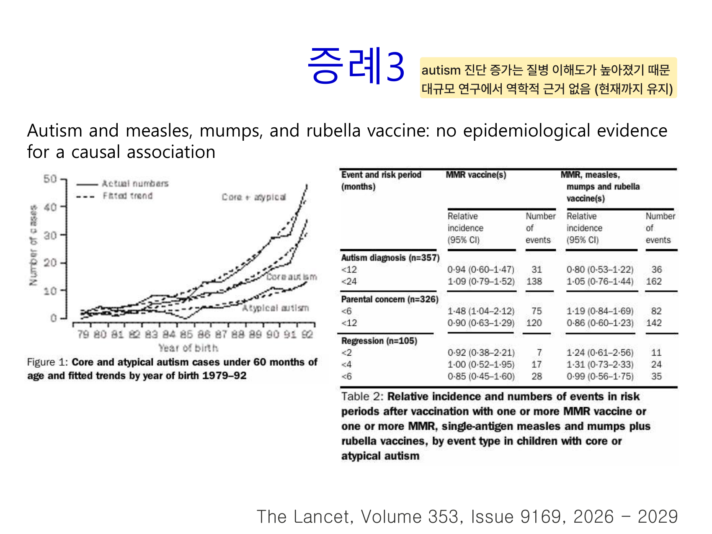{: style="width:70%"}

- **① Wakefield AJ, et al. Lancet 1998** "Ileal-lymphoid-nodular hyperplasia, non-specific colitis, and pervasive developmental disorder in children"
    - **소아 12명 case series**: 장 증상 + 발달 퇴행(autism 등). **12명 중 8명**에서 부모·의사가 증상 시작을 MMR 접종과 연관 지음 → MMR–autism 연관 가능성 제기.
    - 문제: **대조군 없음, 소규모, 부모 기억에 의존** → 인과관계를 말할 수 없는 설계.
    - 결과: **MMR 접종 거부, 접종률 감소, 홍역 재유행.**
    - **2004년 공저자 대부분이 해석 철회 → 2010년 Lancet이 논문 공식 철회**(데이터 조작, 윤리 위반). 메모: 교수님이 **찾아서 읽어보라고** 하셨다(철회돼서 찾기 어려울 수 있음).
- **② Taylor B, et al. Lancet 1999** "Autism and measles, mumps, and rubella vaccine: **no epidemiological evidence for a causal association**"
    - 영국 North Thames, **1979년 이후 출생한 autism 환자 498명** 분석.
    - **1988년 MMR 도입 후 autism 발생률이 갑자기 증가하는 변화 없음**(그림 1 — 추세가 도입 시점에 꺾이지 않는다).
    - **접종 여부·시기와 관계없이 진단 연령 비슷**, 접종 후 일정 기간 내 발병이 몰리지 않음(표 2 — 상대발생률이 1 근처).
    - 결론: **MMR과 autism 사이 역학적 근거 없음.** autism 진단 증가는 **질병 이해도가 높아지고 진단 기준이 바뀐 때문**. 대규모 연구에서 **현재까지 유지**되는 결론.
- 정리: **소규모 case series 하나로 시작된 주장 → 대규모 역학 연구로 반박 → 원 논문 철회.** 그래도 **지금도 예방접종을 거부하는 근거로 언급되는 경우가 있다.**

!!! new "올해 필기에서 추가"
    「증례 3 정리 — 두 논문」 쪽(47쪽)이 새로 생겼다: Wakefield 연구의 설계 한계(대조군 없음·12명·부모 기억), 2004년 해석 철회 → **2010년 공식 철회**, Taylor 연구의 498명 분석 내용. 작년엔 "철회됐다 / 반박 논문이 있다"까지만 있었다.

!!! memo "암기"
    | 질환 | 바이러스 | 발진·특징 | 전염기간 | 노출 후·치료 |
    |---|---|---|---|---|
    | 홍역 | Paramyxo, RNA | 3C → Koplik → **귀 뒤에서 아래로**, 융합, 손발 안 벗겨짐 | 발진 **±4일**, 공기 | 72h 내 접종, 6일 내 IG(영아·임신부·면역저하) |
    | 풍진 | Toga, RNA | 얼굴 → **2–3시간 내 전신**, 뒤목 림프절 | 발진 **±7일** | 선천풍진(백내장·난청) |
    | 볼거리 | Paramyxo, RNA | 한쪽→양쪽 이하선, amylase↑ | 종창 ±7일 | 수막뇌염·고환염·췌장염 |
    | 수족구 | Coxsackie A16, EV71 | 입 궤양 + 손발 수포 | | 탈수, 격리 |
    | 전염성 홍반 | Parvo B19, DNA | 뺨 → 레이스 모양 | | 골수무형성 위기, 태아수종 |
    | 수두 | VZV | 여러 단계 병변 **동시에** | 발진 1–2일 전 ~ 전부 가피 | 돌 이후 접종, 고위험군 **10일 내 VariZIG** |
    | 돌발진 | HHV-6·7 | **열 떨어진 뒤** 발진 | | 열성경련 15% |
    | 신생아 HSV | HSV | 두피·피부 수포, 발열 | 산모 초회감염 57% | **acyclovir 20 mg/kg 하루 3회** 14/21/21일 → 경구 6개월 |
    | 선천 CMV | CMV | 난청·간비종대·혈소판↓·석회화 | 자궁내 감염 | 중등도↑, **1개월 내 valganciclovir 6개월** |
    | 전염단핵구증 | EBV | 삼출성 편도염·비장비대·비정형 림프구 | | 보존적, 합병증엔 스테로이드 |
