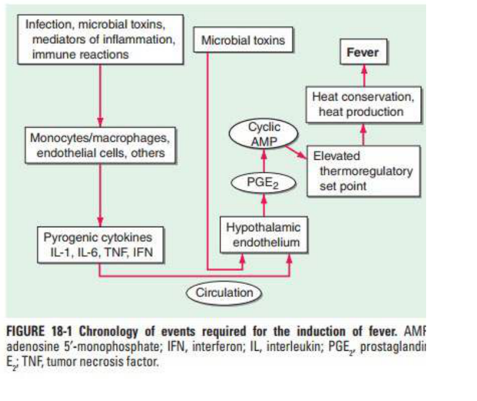
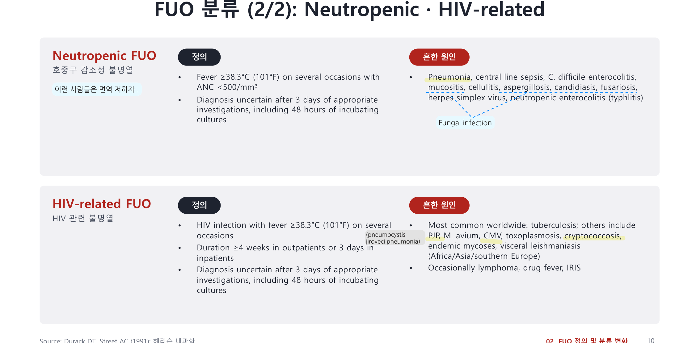
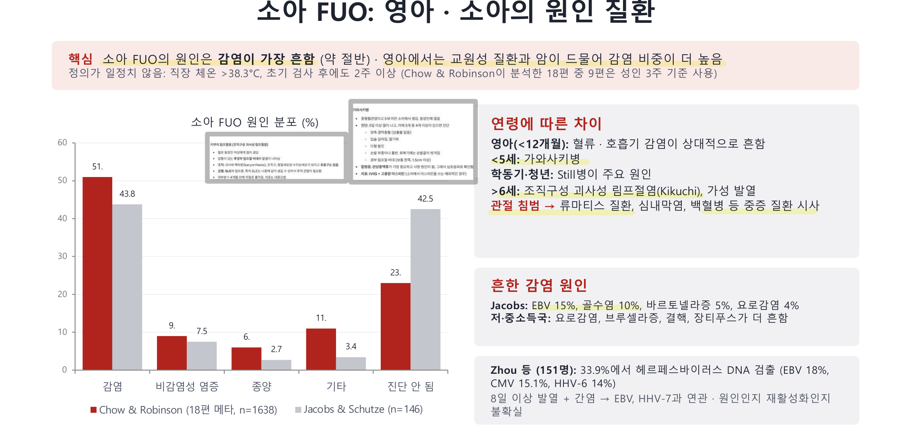
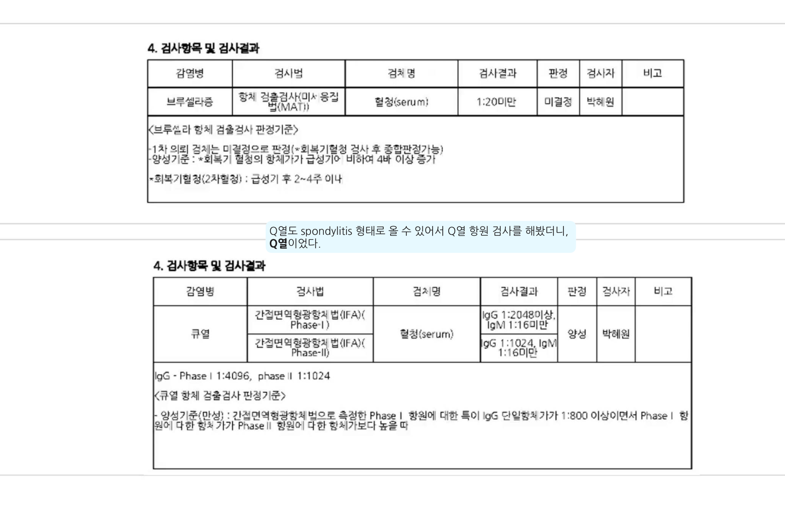
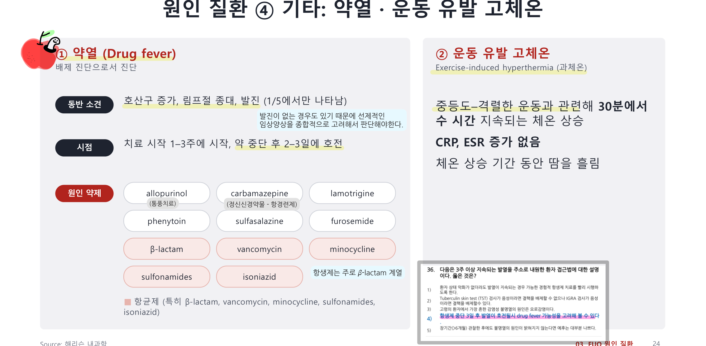
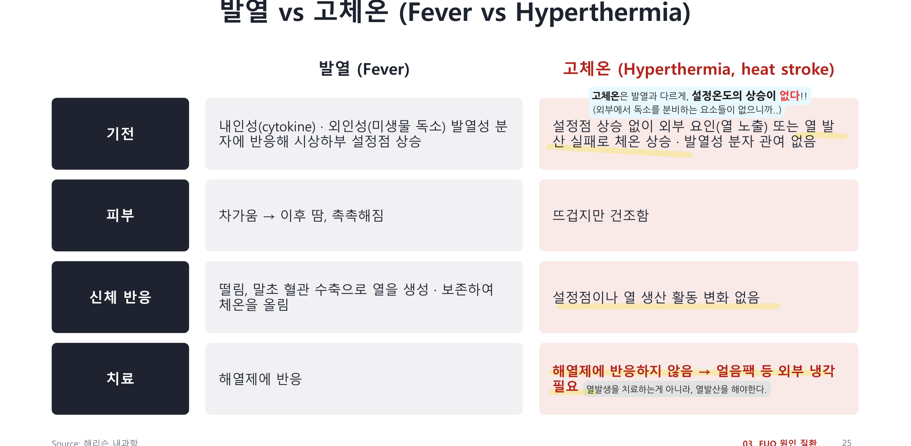
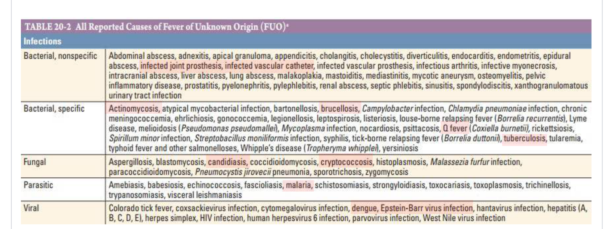
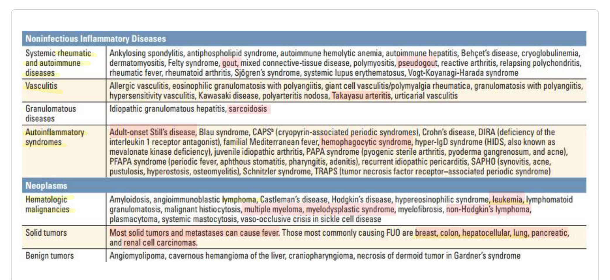
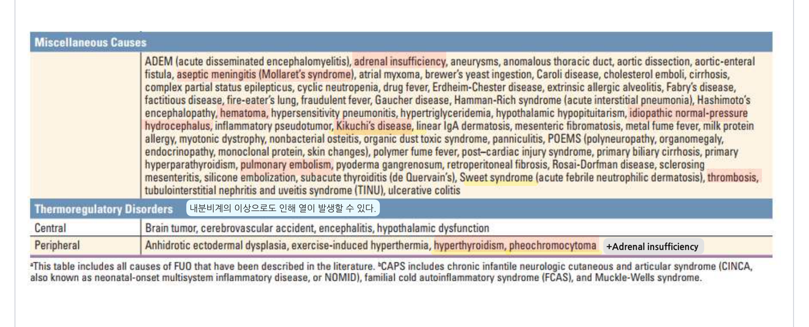

<!-- 필기본: 2026 · 2025 -->
<!-- 단계: 수업 후 -->

# 0. 이 수업을 공부하는 법

경북대병원 감염내과 **김윤정 교수님** 수업(2026). 담당 교수님은 2021–22 미상 → **2023–24 김윤정** → 2025 배소현 → **2026 다시 김윤정**. 기출 20문항 중 2023–24년 문항이 지금 교수님 것이라 그대로 다시 나올 가능성이 크다.

!!! new "올해 필기에서 추가"
    필기 작성자 메모: 교수님이 AI로 만든 PPT를 거의 그대로 읽으셨고 내용이 방대하다. 그 대신 **기출을 조금씩 많이 내신다**("조금씩 많이 태우십니다").
    필기 표시 — **사과** = 이전 기출에 나온 쪽, **¥** = 교수님이 중요하다고 하신 부분, **노란 형광펜** = 교수님이 읽으신 부분.
    교수님이 콕 집어 물어보신 두 덩어리:
    1. **불명열 원인을 찾는 혈액학적 검사**(필수 검사 목록) — "계속해서 물어보셨다"
    2. **FUO 치료 약제 + 진단 알고리즘 전체 흐름 + 경과(예후)**
    올해는 소아·노인·귀국 여행자 FUO(Mandell 교과서), 검사실 검사의 새 정리, 증례 3개(만성 Q열 척추염, AML, 호산구증가 + 림프종 의심)가 새로 들어왔다.

학습성과
1. 불명열을 **정의**한다.
2. 불명열의 **가장 흔한 3가지 원인**과 원인별 흔한 질병을 기술한다.
3. 불명열의 **진단 과정**을 설명한다.

목차(올해 필기 순서): 발열의 정의·특징 → FUO 정의와 분류 변화 → 원인 질환(+ 소아·노인·여행자, Q열 증례 2개) → 진단 접근 → 혈액·영상 검사 → 진단 알고리즘 → 치료 → 예후 → 증례 2개

- 기출 20문항(2020–2025)의 반복 틀
    - "**35세 여자, 한 달 이상 발열 — 초기에 반드시 할 혈액검사가 아닌 것**" → **FSH**(1·7번), **myoglobin**(10번), **cortisol**(14번). 나머지(CRP·ESR·ANA·RF·ferritin·LDH·IGRA)는 필수 목록.
    - "**발열 환자 접근법 — 옳은/틀린 것**" → 정답은 거의 늘 **"IGRA(TST) 음성이라도 결핵을 배제할 수 없다"**, **"6개월 이상 원인 미상이면 예후는 대부분 좋다"**, **"항생제 중단 3일 후 해열되면 약열"**, **"혈종·혈전도 발열"**. 오답은 "경험적 항생제·스테로이드를 빨리", "배양 음성이면 심내막염 배제", "고령 감염성 불명열 1위는 심내막염/요로감염".
    - 입원 중 불명열(nosocomial FUO)의 원인, **central fever**, 성인형 스틸병, 해열제(NSAID vs acetaminophen), CRP, 노인의 발열(섬망).
- 필기 2쪽과 45·52쪽에 2020–2025 기출이 붙어 있다.

!!! key "핵심"
    **불명열 = 38.3℃ 이상이 여러 번, 3주 이상, 면역저하 아님, 기본 검사를 다 했는데도 원인 불명.** 원인은 **감염 · 비감염성 염증(교원성) · 종양 · 기타** — 최근엔 감염이 줄고 교원성 질환과 "원인 미상"이 늘었다.
    **상태가 안정적이면 경험적 항생제·스테로이드는 피하고 관찰과 검사를 계속한다.** 쓸모없는 약은 끊어 본다(약열). **6개월 이상 못 찾으면 대개 예후가 좋다.**

# 1. 발열의 정의와 특징

## 체온은 시상하부가 정한다
- 시상하부(hypothalamus)는 **체온**, 혈압, 배고픔·갈증, 포만감, 기분, 성욕, 수면 등 **내분비대사와 자율신경계**를 조절하고, 감각과 의식 조절에도 관여한다. 필기: "hypothalamus는 자율신경계를 조절 → 여기서 체온조절을 함."
- 체온의 **기준점(set point)** 을 감지·결정하는 곳은 시상하부의 **시각앞핵(preoptic nucleus)**. 발열은 감염·패혈증 등으로 이 **기준점이 높게 다시 설정**되는 것이다.

{: style="width:58%"}

1. **그람음성균의 내독소(endotoxin, LPS)** 같은 외인성 발열물질(미생물 독소), 또는 감염·염증·면역반응으로 단핵구/대식세포·내피세포가 내는 **발열성 사이토카인(IL-1, IL-6, TNF, IFN)** 이 혈류를 타고 간다.
2. 시상하부 혈관내피에서 **prostaglandin E2(PGE2)** 가 만들어진다(→ cAMP).
3. 시상하부 체온조절중추 **preoptic nucleus**에는 PGE2 수용체가 있어 → **기준점 상승**, **교감신경 항진**.
4. 새 기준점에 도달하려고 **말초혈관 수축(열 손실 보존) + 떨림(shivering)으로 열 생산** → 발열.
- 반대로 체온이 기준점보다 높아지면 교감신경 억제 → 혈관 확장 → 땀으로 열 발산.
- 보일러 온도 조절기(필기의 그림)에 비유: 설정 온도를 올리면 그 온도에 도달하려고 보일러를 돌린다. 해열제(NSAID·acetaminophen)는 PGE2 생성을 막아 이 설정 온도를 다시 내리는 약이다.

!!! diff "작년 필기와 다른 점"
    작년(2025) 교수님 설명으로만 있던 내용 — "왜 36.5℃인가: 일부 학자는 40℃ 언저리면 균이 잘 못 버티지 않겠냐고 하지만, 우리 조직도 죽으면 안 되니 적절하게 설정된 것", "열사병은 몸 안 세팅은 그대로인데 외부에서 열이 들어오니 몸이 대응할 방법이 없다 → 아이스 찜질". 올해 슬라이드에는 없지만 아래 '발열 vs 고체온'을 이해하는 데 그대로 쓸 수 있다.

## 정상 체온과 발열의 정의

{: style="width:72%"}

| 숫자 | 의미 |
|---|---|
| **36.5–37.5℃** | 정상 체온 범위. 발열 = 질병에 따른 증상으로 이보다 높아지는 것 |
| **36.6℃** | 평균 구강 체온 (95% CI 35.7–37.3℃) |
| **+0.4℃** | **직장 체온은 구강보다 0.4℃(0.7°F) 높다** — 몸 안 어디서 재느냐에 따라 다르다(필기: core temperature에 가까움) |
| **>37.7℃** (>99.9°F) | 건강한 성인의 발열 기준 |
| **>41.5℃** (>106.7°F) | **고열증(hyperpyrexia)** — 흔치 않고, 대개 **CNS 출혈** 같은 중추 문제 |

- 필기: 건강한 성인도 오전에 재는지 오후 늦게 재는지에 따라 **37.7℃까지** 오르기도 한다 → 한 번 잰 값만으로 판단하지 않는다.

## 체온에 영향을 주는 요인
1. **일중·계절 변동**: **오전 8시·여름에 낮고, 오후 4시·겨울에 높다.**
2. **나이**: 기초 체온은 **10년마다 0.02℃** 낮아진다(대사 감소). 노인은 열이 덜 오른다.
3. **동반질환**: **암은 0.02℃ 높고**(암세포 대사), **갑상샘저하증은 0.01℃ 낮다**.
4. **여성 호르몬**: **배란 2주 전 가장 낮고, 배란기부터 0.6℃(1°F) 올라** 생리 때까지 지속. **임신 초기**에도 체온이 오를 수 있다.

!!! memo "암기"
    임상 포인트 — **젊은 여성이 원인 미상 발열로 오면 urine hCG 검사**(임신 가능성부터 따진다).

!!! exam "기출 포인트"
    16·19번 **central fever(중추성 발열)**: 시상하부를 침범한 뇌병변(19번 — 신경외과 입원 중 **지주막하출혈**, 39.7℃, 땀이 없음)에서 생긴다. **땀이 없음**, **해열제에 잘 반응하지 않음**, 다른 감염 증거 없음, 열에 비해 **심박수가 상대적으로 느림** — 16번은 "**상대적으로 빠른 심박수**"가 관련이 적은 것(정답).
    19번 나머지 보기: vancomycin 2주 사용 중 열(약열), MSSA 심내막염 nafcillin 3일째 열(치료 중 감염열), 조현병 약 + 심한 근육강직(신경이완제 악성증후군), 마라톤 중 열(운동 유발 고체온). Central fever는 해리슨 표의 "체온조절 장애 — 중추"(뇌종양·뇌혈관 사고·뇌염·시상하부 기능장애)에 해당한다(3장 Table 20-2).

# 2. FUO의 정의와 분류

## 정의의 변화
1. **Petersdorf & Beeson (1961)**: **38.3℃(101°F) 이상**, **3주 이상** 지속, **1주간 입원**해 검사해도 원인 불명.
    - 왜 3주? 저절로 낫는 바이러스 질환(감기 열은 2주 조금 넘게 간다)을 배제하고, 초기 평가에 충분한 시간을 두려는 의도.
2. **Durack & Street (1991)**: 입원 1주 대신 **외래 3회 이상 또는 입원 3일** — 진단 기법이 발전해 진단이 빨라졌고, 입원보다 외래 평가가 늘어난 추세를 반영. 그리고 **숙주 상태에 따라 4가지**로 나눴다: Classic, **Nosocomial(감염 50% 이상, 비감염성 25%)**, Neutropenic, HIV-associated.
    - 필기: **입원환자의 불명열은 대부분 감염성 질환**에 의해서다.

{: style="width:80%"}

{: style="width:80%"}

| 종류 | 정의 | 흔한 원인 |
|---|---|---|
| **고전적(classic)** | ≥38.3℃ 여러 번, **3주 이상**, **입원 3일 또는 외래 3회**에도 진단 안 됨 (이전 불명열 정의와 같은 틀) | **감염, 악성종양, 비감염성 염증질환(혈관염·류마티스 = 자가면역), 약열**. 선진국 **노인은 종양**이 흔하고 **젊은 환자는 진단이 안 되는 경우**가 많다 |
| **입원환자(nosocomial)** | 입원 환자에서 ≥38.3℃ 여러 번, **입원 당시 없던(잠복도 아닌)** 열, 배양 48시간 포함 **3일** 적절한 검사에도 불명 | ***C. difficile* 장염**, **폐렴**, **중심정맥관·기구(Foley 카테터 등) 감염**, 칸디다혈증, 요로패혈증, **무결석 담낭염**, **약열**, 수혈, **혈전색전증**, 혈종, 부비동염, **통풍·가성통풍**(비감염성), central fever, **뇌졸중, 심근경색**, Dressler 증후군, 악성 고열 |
| **호중구감소(neutropenic)** | **ANC <500/mm3** + ≥38.3℃ 여러 번, 배양 48시간 포함 3일 검사에도 불명 | 폐렴, **중심정맥관 패혈증**, *C. difficile* 장염, 점막염, 연조직염, **아스페르길루스·칸디다·푸사리움**(곰팡이 — 면역저하자), 단순포진, 호중구감소 장염(typhlitis) |
| **HIV 관련** | HIV + ≥38.3℃ 여러 번, **외래 4주 이상 또는 입원 3일**, 3일 검사에도 불명 | **전 세계 1위 결핵**, PJP(*Pneumocystis jirovecii* 폐렴), ***M. avium***, CMV, 톡소플라스마, 크립토코쿠스, 풍토성 진균, 내장 리슈마니아(아프리카·아시아·남유럽). 가끔 림프종, 약열, IRIS(면역재구성 염증증후군) |

- 입원 불명열은 감염이 제일 많지만, 통풍·가성통풍·혈전·혈종·약열처럼 **감염이 아닌 원인**도 표에 섞여 있다 — 기출이 바로 이걸 묻는다. 굵은 글씨 위주로 기억(빈도상 많다는 것이지 100%는 아니다).
- 호중구감소·HIV 환자는 **면역저하자**라 3주를 기다릴 수 없다 → 진단 기간이 3일·4주로 짧다.

!!! exam "기출 포인트"
    18번: 입원 중 불명열의 원인 → **C. difficile 장염, 폐렴, 약열, 혈전색전증 모두**(가·나·다·라). 3번: 입원 당시 없던 38.3℃ 이상 발열의 원인으로 가장 의심하기 **어려운** 것 → **림프종**(입원 전부터 지속되는 고전적 불명열의 원인). 약열·폐렴·혈전색전증·요로감염은 모두 표에 있다. (필기 10쪽의 사과 표시 = 이 표가 기출에 나왔다는 뜻)

## 현재의 FUO 정의

{: style="width:84%"}

Classic FUO 기준 4가지
1. **38.3℃(≥101°F) 이상, 적어도 2회**
2. **3주 이상** 지속
3. **면역저하 상태가 아닐 것**
4. 아래를 확인한 뒤에도 진단이 불확실: **병력**(예: **여행력** — 풍토병을 놓치지 않게 꼭 묻는다), **신체진찰**(예: **림프절 비대**), **검사**

- 시간이 흐르며 기간·입원 여부보다 **해야 할 검사의 질적 기준**이 더 중요해졌다 — "얼마나 오래 봤나"가 아니라 "꼭 해야 할 검사를 다 했나".

### 진단 불확실 판단 전 시행할 검사 (외우기 — 교수님이 "쭉 다 읽으셨다", 사과 표시)
| 분류 | 검사 | 왜 |
|---|---|---|
| 혈액학 | **ESR, CRP**, 혈소판, 백혈구와 감별계수, Hb | 염증 정도, 혈구 이상 |
| 화학 | 전해질, **creatinine**, 총단백, **ALP**, ALT/AST, **LDH**, **CK(creatine kinase)** | 신기능·간·담도·조직 손상(LDH는 림프종·용혈에서도↑) |
| | **ferritin** | 철분 지표이자 급성기 반응물질 — 스틸병에서 매우 높다 |
| 자가면역 | **ANA, RF** | 자가면역질환 여부 |
| | **PEP(단백전기영동, protein electrophoresis)** | 혈액종양 — **단클론감마병증(monoclonal gammopathy, 다발골수종 등)** 선별 |
| 소변 | **소변검사(urinalysis), 소변배양** | 감염 원인 배제. **좁쌀결핵(miliary TB)** 도 소변으로 확인되기도 한다 |
| 결핵 | **TST(투베르쿨린 피부검사) 또는 IGRA** | 결핵 |
| 배양 | **혈액배양 3쌍** | 심내막염 등 균혈증 |
| 영상 | **흉부 X선, 복부 초음파** | |

- 필기: **복부 초음파는 미국 가이드라인**이다. 우리나라는 의료 접근성이 좋아 흉부 X선을 기본으로 찍고, 복부는 초음파보다 **CT를 먼저** 찍는 경우가 많다(5장 알고리즘 참고).

!!! exam "기출 포인트"
    "35세 여자, 한 달 이상 발열, 초기에 반드시 할 혈액검사가 **아닌** 것" — **FSH**(1·7번), **myoglobin**(10번), **cortisol**(14번). CRP·ESR·ANA·RF·ferritin·LDH·IGRA는 모두 필수 목록에 있다. 올해 교수님이 "불명열의 원인 파악을 위한 혈액학적 검사에 대해 계속해서 물어보셨다"고 필기에 적혀 있다 — **목록에 없는 호르몬·근육 검사(FSH, cortisol, myoglobin, TSH, troponin 등)를 고르는 문제**로 다시 나올 가능성이 높다.
    20번: 간에서 만드는 급성기 반응물질로 임상에서 가장 유용하고 신뢰성 있게 쓰는 것 → **CRP**(procalcitonin은 세균감염 감별 보조 지표).

# 3. 원인 질환

## 개요 — 4가지 큰 분류

{: style="width:80%"}

- 원인은 대개 **① 감염(infection) ② 비감염성 염증질환(noninfectious inflammatory = 자가면역·교원성) ③ 종양(neoplasm) ④ 기타(miscellaneous)** 4가지. 필기: "림프절염 분류와 비슷하다"(권기태 교수님 말씀 — 8번 수업 림프절염의 감염/종양/자가면역 틀).
- 원인 분포는 **연령·시대·국가**에 따라 다르다.
- **시대·국가별 변화**
    1. **2000년대 이후 감염↓, 비감염성 염증(교원성) 질환↑** — 현대로 오면서 감염 원인이 줄고 자가면역질환의 비율이 늘었다.
    2. **개발도상국·아시아는 감염 빈도가 높다**(브루셀라증, 장티푸스).
    3. 광범위 항균제 사용과 새 진단기법 → 감염에 의한 FUO 감소(원인을 금방 알게 되니 불명열에서 빠진다).
    4. 영상(초음파·CT·MRI·PET-CT)·면역학적 검사 발달 → 원인 질환 분포가 바뀜.
- **연령별 특징**
    - **소아**: 감염(EBV 등 바이러스), 악성종양(**윌름스 종양, 신경모세포종**, 림프종 — 악성종양의 형태도 성인과 다르다), 비감염성 염증질환(소아 류마티스 관절염).
    - **노인**: **결핵, 류마티스 다발근통, 거대세포동맥염(측두동맥염), 림프종** 등. 악성종양 비율도 젊은 연령보다 높다. (☆ 표시)

!!! exam "기출 포인트"
    4번 ①: "최근 감염질환에 의한 FUO는 감소하고 있다" — **옳은 문장**. 11번 ①: "불명열의 가장 흔한 원인은 악성 종양이다" — 틀림(시대·지역마다 다르고, 최근엔 비감염성 염증과 원인 미상이 늘었다).

## 소아 FUO
!!! new "올해 필기에서 추가"
    소아·노인·귀국 여행자 FUO 3쪽(필기 13–15쪽)은 올해 새로 들어온 슬라이드(Mandell 교과서 58장). 그래프의 수치보다 **"어느 원인이 가장 많은가"** 를 기억한다.

{: style="width:80%"}

- **소아 FUO의 원인은 감염이 가장 흔하다(약 절반).** 영아는 교원성 질환과 암이 드물어 감염 비중이 더 높다. 그래프: Chow & Robinson 메타분석(18편, 1638명) 감염 51%, 비감염성 염증 9%, 종양 6%, 기타 11%, 진단 안 됨 23% / Jacobs & Schutze(146명) 감염 43.8%, 진단 안 됨 42.5%.
- 정의가 일정하지 않다: 직장 체온 >38.3℃, 초기 검사 후에도 **2주 이상**(18편 중 9편은 성인처럼 3주 기준).
- **연령에 따른 차이**
    - 영아(<12개월): 혈류·호흡기 감염이 상대적으로 흔함
    - **<5세: 가와사키병**
    - 학동기·청년: **Still병**이 주요 원인
    - >6세: **조직구성 괴사성 림프절염(Kikuchi병)**, 가성 발열(fake fever)
    - **관절 침범** → 류마티스 질환, 심내막염, 백혈병 등 **중증 질환**을 시사
- **흔한 감염 원인**: Jacobs 연구 — **EBV 15%**, 골수염 10%, 바르토넬라증 5%, 요로감염 4%. 저·중소득국은 요로감염, 브루셀라증, 결핵, 장티푸스가 더 흔함.
- Zhou 등(151명): 33.9%에서 헤르페스바이러스 DNA 검출(EBV 18%, CMV 15.1%, HHV-6 14%). 8일 이상 발열 + 간염 → EBV, HHV-7과 연관되지만 원인인지 재활성화인지는 불확실.

## 노인 FUO (>65세)

{: style="width:80%"}

- **고소득 국가에서는 비감염성 염증질환이 감염을 넘어 가장 흔한 원인** — **측두동맥염(거대세포동맥염), 류마티스 다발근통**. 아급성·비특이적 증상에 특이 검사가 없어 진단이 자주 누락·지연된다.
- 그래프(국가별): 벨기에(Knockaert) 비감염성 염증 31.9%가 1위 / 중국(Chen) **감염 50.6%** 1위 / 인도(Yadav) 감염 41.1%, 악성종양 31.4%. → 필기: "감염병증도 높긴 하지만 자가면역질환과 악성종양에 의한 것도 높다."
- **감염 원인**: **복강 내 농양, 복잡성 요로감염, 결핵, 심내막염**(+ 척추염).
- **악성종양**: 혈액암 비중이 크다.
- **예후**: 진단이 안 되는 경우는 적지만 **악성종양 빈도가 높아 젊은 환자보다 예후가 나쁘다**. 인위적 열(factitious fever)은 드물다.

!!! exam "기출 포인트"
    "고령 환자에서 가장 흔한 감염성 불명열의 원인은 ___" — 8번 "감염성 심내막염", 11번 "심내막염", 15번 "요로감염"은 모두 **오답 보기**였고, 4번(2024, 김윤정)에서는 "**결핵**이다"가 옳은 문장으로 나왔다(4번의 정답은 ⑤). 필기 15쪽에 이 기출들이 붙어 있다. 고령 FUO에서 감염보다 **비감염성 염증(측두동맥염·PMR)과 종양**이 중요하다는 것까지 함께 기억.

## 귀국 여행자의 발열

{: style="width:80%"}

- 대부분은 **말라리아, 호흡기 감염, 요로감염** 같은 흔한 감염이다. 그래프: 말라리아가 모든 연구에서 가장 흔함(**27–48%**), 그다음 호흡기 감염(14–24%), "진단 안 됨"도 9–22%.
- **FUO 기준(3주)까지 가기 쉬운 질환**: **말라리아**(27–48%), **장티푸스**(2–4%), **급성 HIV**(0.01–4.5%).
- **가끔 FUO가 되는 질환**: 아메바성 간농양(0–1%), 뎅기열(3–8%) — 보통은 FUO 기간에 못 미치지만 유행지역 귀국자에서 가끔 기준을 충족. 기타 결핵, 리케치아증.

## 1) 감염 질환

- **결핵, 특히 폐외결핵** — 굉장히 만성으로 진행하고 검사해도 잘 안 나올 때가 있다. 필기: 폐 이외에 **골반, 비뇨생식기(genitourinary tract)** 에 결핵이 생기는 경우가 있으므로 감별을 잘 해야 한다.
- **EBV에 의한 지연성 단핵구증 증후군**(prolonged mononucleosis syndrome)
- **세균 감염**: **척추 골수염, 감염성 심내막염**, 게실염
    - **배양 음성 심내막염** 가능성 고려. SLE·항인지질항체증후군(APS) 환자에서는 **무균성(sterile) 심내막염**(Libman-Sacks).
- **Q열(Q fever)**: ***Coxiella burnetii***. **동물 또는 동물 산물 노출, 농촌 거주, 심장판막질환·대동맥류·혈관 인공삽입물** 병력이 단서.
    - 필기: 이런 직업력이 없더라도 Q열이 생길 수 있다. 환자가 정말 급성(acute)이 아니고 **완만한(indolent) 상태**로 열이 계속되면 Q열을 한 번쯤 의심. (미생물학에서 가을철 열성질환 중 *C. burnetii* 에 의한 것으로 배웠다.)
    - *C. burnetii* 는 그람음성 세포내 세균이다(작년 필기 작성자 확인).

### 증례 1 — M/41, 2주 발열 (급성 Q열)
- 기저질환 없음, 사무직, 여행력·동물 접촉력 없음. 2주 전 **발열·오한·근육통** → 다른 병원 2주 입원 검사에도 특이 소견 없이 지속 → 전원.
- 식욕부진·소화장애, **우상복부 압통, 간비장종대**, 간효소 경한 상승. 복부 CT는 간비장종대 외 정상.
- **8일째 PET-CT: 간 섭취 증가 → 간 조직검사**. 필기: 원인 미상의 발열 환자가 오면 **PET-CT를 고려**해야 한다.

{: style="width:76%"}

- 조직: **도넛 모양 육아종(doughnut / fibrin-ring granuloma)** — 가운데 지방 공포를 피브린 고리가 둘러싼 모양. "이게 나오면 Q열이라 생각하면 된다."
- ***C. burnetii* phase II 항원** 미세간접면역형광항체법: **IgG <1:16, IgM 1:512** → **급성 Q열**.
- **Doxycycline 200 mg/일, 2주 경구** → 호전되어 퇴원.

### 증례 2 — M/65, 허리 통증 (만성 Q열 척추염)
!!! new "올해 필기에서 추가"
    필기 20–29쪽의 새 증례. **"열이 없는 감염성 척추염"도 FUO처럼 원인을 끝까지 찾아야 하고, Q열은 척추염으로도 온다**는 이야기.

- 병력: **B형간염 관련 간경변**(tenofovir 복용), 척추관협착증으로 다른 병원 추적 중. 내원 **2달 전부터 허리 통증 악화**, 1달 전 꼬리뼈 경막외 주사(caudal block) 2회에도 호전 없음 → 2일 전 L-spine MRI에서 **척추염(spondylitis)** → cefazolin 주사 후 상급병원으로.
- **발열·근육통·오한 없음, 다리 힘 빠짐 없음**, 활력징후 안정. 과거력은 B형간염 외 없음, 수술력 없음.
- MRI: **L4–5 척추염 + 농양**.
- 혈액: CRP 0.11–0.48, procalcitonin 정상에 가깝고 백혈구 정상 — 필기: "일반적인 세균 감염이면 CRP·procalcitonin·백혈구 등 염증 지표가 오르는 게 정상인데, 이 환자는 다 정상이었다."
- **TB IGRA 양성** — 필기: 과거 감염과 구분이 어려워 **참고만 한다**(IGRA 양성 ≠ 활동성 결핵).
- **척추 뼈 조직검사**: osteomyelitis(감염성 척추염은 확인) but **결핵균·비결핵항산균 PCR 음성** → TB 아님. 관절감염 PCR 패널(joint infection panel)에서도 균이 안 나왔다 — 요즘은 PCR을 많이 하지만 특별한 병원체가 발견되지 않았다.
- 브루셀라 항체(미세응집법, MAT) 1:20 미만(미결정).
- **Q열 항체(IFA)**: Q열도 척추염 형태로 올 수 있어서 검사했더니 **양성**.

{: style="width:72%"}

| | Phase I IgG | Phase II IgG | IgM | 해석 |
|---|---|---|---|---|
| 증례 1 (급성) | — | <1:16 | **phase II IgM 1:512** | **급성 Q열** = phase II 항체 |
| 증례 2 (만성) | **1:4096**(≥1:2048) | 1:1024 | <1:16 | **만성 Q열** = **phase I IgG ≥1:800 이면서 phase I > phase II** |

- **급성은 phase II, 만성은 phase I** — 판정 기준은 필기 그림의 표에 그대로 있다.
- Q열은 **전신 감염증**이라 **감염성 심내막염**이 동반될 수 있어 **2D 심초음파**: 좌심실 기능 정상(EF 56%), **대동맥판 두꺼워지고 석회화**, 미량 삼첨판 역류 — 판막 질환은 만성 Q열 심내막염의 위험인자.
- **PET-CT**: 간 오른쪽 **간세포암(HCC, 3.7 cm)** 의 경한 대사 항진 + L4–5 척추체 고르지 않은 대사 항진(SUVmax 11.3) → 감염성 척추염 강력 시사. 그 외 다른 조직 감염 없음.

!!! key "핵심"
    Q열 — 단서: 동물·농촌, 판막질환·대동맥류·인공혈관. 소견: **간 도넛 육아종**, 간염·간비장종대, **척추염**, **심내막염**. 진단: 항체 — **급성 = phase II(IgM), 만성 = phase I IgG ≥1:800 & phase I > II**. 치료: **doxycycline**.

## 1) 감염 질환 — 여행 관련

| | 말라리아 | 리슈마니아증 | 히스토플라스마증 | 콕시디오이데스증 |
|---|---|---|---|---|
| 종류 | 원충 | 원충 | 진균 | 진균 |
| 지역 | 동남아시아, 아프리카 | 아프리카, **남유럽(지중해)** | 미국 동부·중부 | 미국 남서부 |
| 전파 | **모기** 매개 | **모래파리** 매개 | 진균 감염 | 진균 감염 |

- **열대 지역 또는 미국 남서부 여행력**이 있으면 고려. 필기: 여행 이력이 있다면 이런 **풍토성 진균 감염증**도 확인해 봐야 한다. 국내에선 거의 없다.

!!! diff "작년 필기와 다른 점"
    리슈마니아증 — 작년 필기는 "아프리카, **서유럽**, 모기 매개"였고 올해는 "아프리카, **남유럽(지중해)**, **모래파리** 매개". 모래파리 매개·지중해 지역이 맞다(올해 것 기준).

## 2) 비감염성 염증질환 (교원성 혈관질환)
1. **대혈관 혈관염(large-vessel vasculitis)** — 거대세포동맥염 등
2. **류마티스 다발근통(polymyalgia rheumatica, PMR)**
3. **사르코이드증(sarcoidosis)**
4. **성인형 스틸병(adult-onset Still's disease, AOSD)**
5. **가족성 지중해열(familial Mediterranean fever)**

- 노인에게 많다(작년 강의). 원인은 모르는데 여기저기 근육에 염증이 생기면서 굉장히 아파한다.

### 류마티스 다발근통 (PMR)
- **양측 어깨·고관절의 통증과 경직**이 특징인 만성 염증성 류마티스 질환, 주로 **50세 이상**.
- 검사: **ESR·CRP 증가**(감염처럼 오른다), ANA·RF·anti-CCP 등 **자가항체는 대부분 음성**. 근육통이 심한데도 **CPK, 근전도, 근육 조직검사는 정상**.
- 진단: 특징적 진단검사가 없어 여러 임상 소견으로 진단.
- 치료: **저용량 스테로이드(prednisolone 20 mg/일)에 잘 반응**. **재발이 흔해** 치료 중에도 약 50% 재발.
- **주의: 악성종양에 동반되는 비특이 증상을 PMR로 오인**할 수 있다.

!!! new "올해 필기에서 추가"
    필기: **PMR이 생기고 6개월 후 악성종양이 생길 확률이 일반인보다 높아진다** → PMR 환자는 혹시 암이 아닌지 찾아봐야(detection) 한다.

### 성인형 스틸병 (AOSD) — 사과 표시(기출)
- **다발성 전신 장기 침범**이 특징인 염증질환. 유전적 소인이 있는 사람이 바이러스·세균에 감염된 뒤 발병할 수 있다.
- 증상: **발열, 피부 발진(연어색 일과성 발진), 관절통, 림프절 비대, 비장비대, 인후통.**
- 검사: **ESR/CRP·AST/ALT 상승, 백혈구 증가, 빈혈**, **ferritin 상승**(호전되면 감소 → **치료 반응 평가**에 사용). **ANA·RF는 대개 음성 또는 약양성** — 자가면역질환을 시사하는 marker는 대부분 음성.
- 감별 단서: **배양 음성, 항생제를 써도 호전 없음.** 확진 수치는 없다(배제진단).
- 치료: **NSAIDs, 스테로이드** — 잘 들어서 사용한다.

!!! exam "기출 포인트"
    5번(2023, 김윤정): 35세 여자, 3주 이상 발열 + **연어색 피부 발진** + 백혈구·CRP·ESR·AST/ALT·**ferritin 증가**, **ANA·RF 음성**, 혈액배양 음성, CT에 **림프절·비장 종대**뿐 → **성인형 스틸병**. 오답: 류마티스 다발근통(고령 어깨·골반 통증), 결핵, 간농양, 심내막염.

| | PMR | 성인형 스틸병 |
|---|---|---|
| 나이 | **50세 이상** | 젊은 성인 |
| 주증상 | **양측 어깨·고관절 통증·경직** | 고열 + **연어색 발진** + 관절통 + 인후통 |
| 특징 검사 | ESR·CRP↑, **CK·근전도 정상** | **ferritin 매우↑**, 백혈구↑, 간효소↑ |
| 자가항체 | 음성 | 음성(약양성) |
| 치료 | **저용량 prednisolone 20 mg** | NSAIDs, 스테로이드 |

## 3) 종양
1. **림프종 — FUO를 일으키는 가장 흔한 종양**
2. **백혈병**
3. **고형암** — 신세포암, 간세포암, 대장암 등

## 4) 기타

{: style="width:80%"}

### ① 약열 (drug fever) — 사과 표시(기출)
- **배제진단**으로 진단한다.
- 동반 소견: **호산구증가, 림프절 비대, 발진** — 그러나 **1/5에서만** 나타난다. 필기: 발진이 없는 경우도 있으니 임상 양상을 종합적으로 판단해야 한다.
- 시점: **치료 시작 1–3주에 시작, 약 중단 후 2–3일에 호전.**
- 원인 약: **allopurinol**(통풍 치료), **carbamazepine·lamotrigine·phenytoin**(항경련제), sulfasalazine, furosemide, **항균제 — 특히 β-lactam**, vancomycin, minocycline, sulfonamide, isoniazid.

!!! exam "기출 포인트"
    15번: "**항생제 중단 3일 후 발열이 호전되면 drug fever 가능성을 고려**" — 정답. 19번 ①(MRSA에 vancomycin 2주 쓰는 중 38.3℃)도 약열의 전형. 3·18번 입원 중 불명열에도 약열이 들어간다.

### ② 운동 유발 고체온 (exercise-induced hyperthermia, 과체온)
- 중등도–격렬한 운동과 관련해 **30분–수 시간** 지속되는 체온 상승.
- **CRP·ESR 증가 없음**, 체온이 오르는 동안 **땀을 흘린다**(열사병과 다른 점).

### 발열 vs 고체온

{: style="width:80%"}

| | 발열(fever) | 고체온(hyperthermia, heat stroke) |
|---|---|---|
| 기전 | 내인성(사이토카인)·외인성(미생물 독소) 발열 분자에 반응해 **시상하부 설정점 상승** | **설정점 상승 없이** 외부 요인(열 노출) 또는 **열 발산 실패**로 체온 상승, 발열 분자 관여 없음 |
| 피부 | 차가움 → 이후 땀, 촉촉해짐 | **뜨겁지만 건조함** |
| 몸의 반응 | 떨림·말초혈관 수축으로 열 생성·보존 → 체온을 올림 | 설정점이나 열 생산 활동 변화 없음 |
| 치료 | **해열제에 반응** | **해열제에 반응하지 않음 → 얼음팩 등 외부 냉각** |

- 필기: 고체온은 발열과 달리 **설정 온도의 상승이 없다!!** (외부에서 독소를 분비하는 요소가 없으니까) → 열 발생을 치료하는 게 아니라 **열 발산**을 시켜야 한다.

### ③ 인위적 열 (factitious fever) vs ④ 사기열 (fraudulent fever)
| | 인위적 열 | 사기열 |
|---|---|---|
| 실제 발열 | **있음** | **없음**(체온은 정상) |
| 무엇 | 환자 스스로 열을 **유발** — 예) **오염된 물 정맥주사** | **체온계를 조작** — 외부 열원, 체내·체외 마찰, 뜨거운 물로 입 헹구기, 보호자의 체온 변조 |
| 전형 | **의료계 종사 젊은 여성, 기저 정신과 질환** | |

- 그래서 진단 알고리즘에 "**체온계 조작 배제**(exclude manipulation with thermometer)"가 들어 있다 — 의료진 앞에서 직접 재 본다.

## FUO의 보고된 모든 원인 (해리슨 Table 20-2)
문헌에 보고된 FUO 원인을 모두 모은 표. 다 외울 필요는 없고 **필기에서 빨갛게 칠한 항목**만 본다.

{: style="width:90%"}

{: style="width:90%"}

{: style="width:90%"}

| 분류 | 필기에서 표시한 것 |
|---|---|
| 세균(비특이) | 감염된 인공관절, 감염된 혈관 카테터 |
| 세균(특이) | 방선균증(actinomycosis), **브루셀라증**, **Q열**, **결핵** |
| 진균·기생충·바이러스 | 칸디다증, 크립토코쿠스증 / **말라리아** / **뎅기**, **EBV** |
| 자가면역·류마티스 | **통풍, 가성통풍** |
| 혈관염·육아종 | **다카야수 동맥염**, **사르코이드증** (거대세포동맥염/PMR 포함) |
| 자가염증 증후군 | **성인형 스틸병**, **혈구탐식증후군(HLH)** (가족성 지중해열 포함) |
| 혈액 악성종양 | 림프종(호지킨·비호지킨), **백혈병**, **다발골수종**, **골수이형성증후군(MDS)** |
| 고형암 | 대부분 열을 낼 수 있음 — 흔한 것: **유방·대장·간세포·폐·췌장암, 신세포암** |
| 기타 | **부신부전**, **무균성 수막염(Mollaret)**, **혈종**, **특발성 정상압 수두증**, **기쿠치병**, **폐색전**, **혈전증**, Sweet 증후군, 아급성 갑상샘염 |
| 체온조절 장애 — 중추 | 뇌종양, **뇌혈관 사고**, 뇌염, 시상하부 기능장애 → **central fever** |
| 체온조절 장애 — 말초 | 무한성 외배엽 이형성증, 운동 유발 고체온, **갑상샘항진증, 갈색세포종** (+ 필기: **부신부전**) |

- 필기: **내분비계 이상으로도 열이 날 수 있다**(갑상샘항진증·갈색세포종·부신부전). 감염이 아닌데도 열이 나는 원인(혈종·혈전·폐색전·통풍 등)이 기출 단골이다.

!!! exam "기출 포인트"
    8번: "**Hematoma나 thrombosis가 있는 경우에도 발열이 동반될 수 있다**" — 정답. 14번 cortisol은 부신부전이 **의심될 때** 하는 선택 검사이지 초기 필수 검사는 아니다(부신부전이 FUO 원인 목록에 있는 것과 헷갈리지 말 것).
