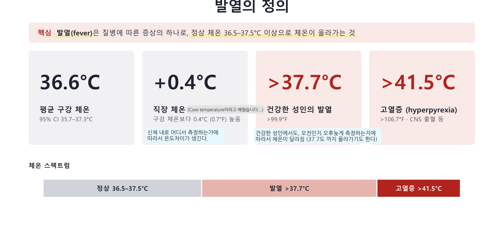
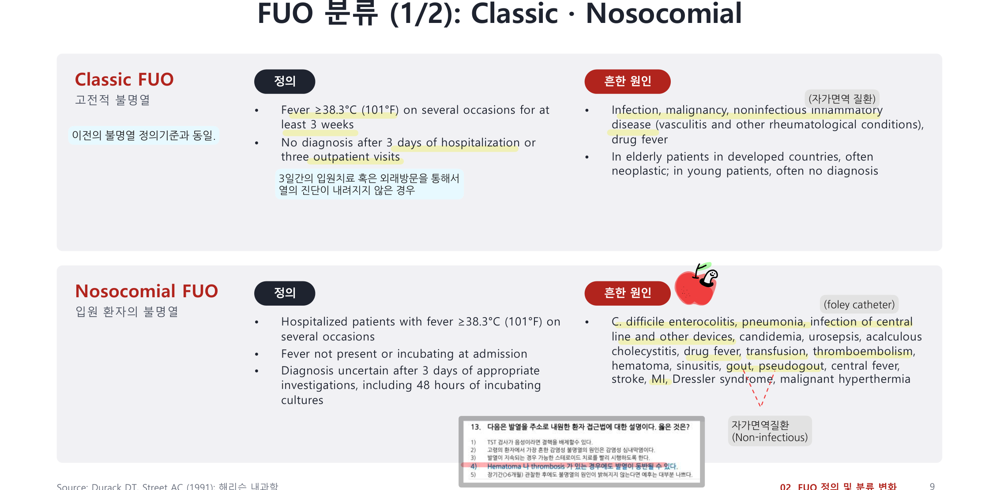

<!-- 필기본: 2026 · 2025 -->
<!-- 단계: 수업 후 -->

# 0. 이 수업을 공부하는 법

경북대병원 감염내과 **김윤정 교수님** 수업(2026). 담당 교수님은 2021–22 미상 → **2023–24 김윤정** → 2025 배소현 → **2026 다시 김윤정**. 기출 20문항 중 2023–24년 문항이 지금 교수님 것이라 그대로 다시 나올 가능성이 크다.

!!! new "올해 필기에서 추가"
    필기 작성자 메모: 교수님이 AI로 만든 PPT를 거의 그대로 읽으셨고 내용이 방대하다. 그 대신 **기출을 조금씩 많이 내신다**("조금씩 많이 태우십니다").
    필기 표시 — **사과** = 이전 기출에 나온 쪽, **¥** = 교수님이 중요하다고 하신 부분, **노란 형광펜** = 교수님이 읽으신 부분.
    교수님이 콕 집어 물어보신 두 덩어리:
    1. **불명열 원인을 찾는 혈액학적 검사**(필수 검사 목록) — "계속해서 물어보셨다"
    2. **FUO 치료 약제 + 진단 알고리즘 전체 흐름 + 경과(예후)**
    올해는 소아·노인·귀국 여행자 FUO(Mandell 교과서), 검사실 검사의 새 정리, 증례 3개(만성 Q열 척추염, AML, 호산구증가 + 림프종 의심)가 새로 들어왔다.

학습성과
1. 불명열을 **정의**한다.
2. 불명열의 **가장 흔한 3가지 원인**과 원인별 흔한 질병을 기술한다.
3. 불명열의 **진단 과정**을 설명한다.

목차(올해 필기 순서): 발열의 정의·특징 → FUO 정의와 분류 변화 → 원인 질환(+ 소아·노인·여행자, Q열 증례 2개) → 진단 접근 → 혈액·영상 검사 → 진단 알고리즘 → 치료 → 예후 → 증례 2개

- 기출 20문항(2020–2025)의 반복 틀
    - "**35세 여자, 한 달 이상 발열 — 초기에 반드시 할 혈액검사가 아닌 것**" → **FSH**(1·7번), **myoglobin**(10번), **cortisol**(14번). 나머지(CRP·ESR·ANA·RF·ferritin·LDH·IGRA)는 필수 목록.
    - "**발열 환자 접근법 — 옳은/틀린 것**" → 정답은 거의 늘 **"IGRA(TST) 음성이라도 결핵을 배제할 수 없다"**, **"6개월 이상 원인 미상이면 예후는 대부분 좋다"**, **"항생제 중단 3일 후 해열되면 약열"**, **"혈종·혈전도 발열"**. 오답은 "경험적 항생제·스테로이드를 빨리", "배양 음성이면 심내막염 배제", "고령 감염성 불명열 1위는 심내막염/요로감염".
    - 입원 중 불명열(nosocomial FUO)의 원인, **central fever**, 성인형 스틸병, 해열제(NSAID vs acetaminophen), CRP, 노인의 발열(섬망).
- 필기 2쪽과 45·52쪽에 2020–2025 기출이 붙어 있다.

!!! key "핵심"
    **불명열 = 38.3℃ 이상이 여러 번, 3주 이상, 면역저하 아님, 기본 검사를 다 했는데도 원인 불명.** 원인은 **감염 · 비감염성 염증(교원성) · 종양 · 기타** — 최근엔 감염이 줄고 교원성 질환과 "원인 미상"이 늘었다.
    **상태가 안정적이면 경험적 항생제·스테로이드는 피하고 관찰과 검사를 계속한다.** 쓸모없는 약은 끊어 본다(약열). **6개월 이상 못 찾으면 대개 예후가 좋다.**

# 1. 발열의 정의와 특징

## 체온은 시상하부가 정한다
- 시상하부(hypothalamus)는 **체온**, 혈압, 배고픔·갈증, 포만감, 기분, 성욕, 수면 등 **내분비대사와 자율신경계**를 조절하고, 감각과 의식 조절에도 관여한다. 필기: "hypothalamus는 자율신경계를 조절 → 여기서 체온조절을 함."
- 체온의 **기준점(set point)** 을 감지·결정하는 곳은 시상하부의 **시각앞핵(preoptic nucleus)**. 발열은 감염·패혈증 등으로 이 **기준점이 높게 다시 설정**되는 것이다.

{: style="width:58%"}

1. **그람음성균의 내독소(endotoxin, LPS)** 같은 외인성 발열물질(미생물 독소), 또는 감염·염증·면역반응으로 단핵구/대식세포·내피세포가 내는 **발열성 사이토카인(IL-1, IL-6, TNF, IFN)** 이 혈류를 타고 간다.
2. 시상하부 혈관내피에서 **prostaglandin E2(PGE2)** 가 만들어진다(→ cAMP).
3. 시상하부 체온조절중추 **preoptic nucleus**에는 PGE2 수용체가 있어 → **기준점 상승**, **교감신경 항진**.
4. 새 기준점에 도달하려고 **말초혈관 수축(열 손실 보존) + 떨림(shivering)으로 열 생산** → 발열.
- 반대로 체온이 기준점보다 높아지면 교감신경 억제 → 혈관 확장 → 땀으로 열 발산.
- 보일러 온도 조절기(필기의 그림)에 비유: 설정 온도를 올리면 그 온도에 도달하려고 보일러를 돌린다. 해열제(NSAID·acetaminophen)는 PGE2 생성을 막아 이 설정 온도를 다시 내리는 약이다.

!!! diff "작년 필기와 다른 점"
    작년(2025) 교수님 설명으로만 있던 내용 — "왜 36.5℃인가: 일부 학자는 40℃ 언저리면 균이 잘 못 버티지 않겠냐고 하지만, 우리 조직도 죽으면 안 되니 적절하게 설정된 것", "열사병은 몸 안 세팅은 그대로인데 외부에서 열이 들어오니 몸이 대응할 방법이 없다 → 아이스 찜질". 올해 슬라이드에는 없지만 아래 '발열 vs 고체온'을 이해하는 데 그대로 쓸 수 있다.

## 정상 체온과 발열의 정의

{: style="width:72%"}

| 숫자 | 의미 |
|---|---|
| **36.5–37.5℃** | 정상 체온 범위. 발열 = 질병에 따른 증상으로 이보다 높아지는 것 |
| **36.6℃** | 평균 구강 체온 (95% CI 35.7–37.3℃) |
| **+0.4℃** | **직장 체온은 구강보다 0.4℃(0.7°F) 높다** — 몸 안 어디서 재느냐에 따라 다르다(필기: core temperature에 가까움) |
| **>37.7℃** (>99.9°F) | 건강한 성인의 발열 기준 |
| **>41.5℃** (>106.7°F) | **고열증(hyperpyrexia)** — 흔치 않고, 대개 **CNS 출혈** 같은 중추 문제 |

- 필기: 건강한 성인도 오전에 재는지 오후 늦게 재는지에 따라 **37.7℃까지** 오르기도 한다 → 한 번 잰 값만으로 판단하지 않는다.

## 체온에 영향을 주는 요인
1. **일중·계절 변동**: **오전 8시·여름에 낮고, 오후 4시·겨울에 높다.**
2. **나이**: 기초 체온은 **10년마다 0.02℃** 낮아진다(대사 감소). 노인은 열이 덜 오른다.
3. **동반질환**: **암은 0.02℃ 높고**(암세포 대사), **갑상샘저하증은 0.01℃ 낮다**.
4. **여성 호르몬**: **배란 2주 전 가장 낮고, 배란기부터 0.6℃(1°F) 올라** 생리 때까지 지속. **임신 초기**에도 체온이 오를 수 있다.

!!! memo "암기"
    임상 포인트 — **젊은 여성이 원인 미상 발열로 오면 urine hCG 검사**(임신 가능성부터 따진다).

!!! exam "기출 포인트"
    16·19번 **central fever(중추성 발열)**: 시상하부를 침범한 뇌병변(19번 — 신경외과 입원 중 **지주막하출혈**, 39.7℃, 땀이 없음)에서 생긴다. **땀이 없음**, **해열제에 잘 반응하지 않음**, 다른 감염 증거 없음, 열에 비해 **심박수가 상대적으로 느림** — 16번은 "**상대적으로 빠른 심박수**"가 관련이 적은 것(정답).
    19번 나머지 보기: vancomycin 2주 사용 중 열(약열), MSSA 심내막염 nafcillin 3일째 열(치료 중 감염열), 조현병 약 + 심한 근육강직(신경이완제 악성증후군), 마라톤 중 열(운동 유발 고체온). Central fever는 해리슨 표의 "체온조절 장애 — 중추"(뇌종양·뇌혈관 사고·뇌염·시상하부 기능장애)에 해당한다(3장 Table 20-2).

# 2. FUO의 정의와 분류

## 정의의 변화
1. **Petersdorf & Beeson (1961)**: **38.3℃(101°F) 이상**, **3주 이상** 지속, **1주간 입원**해 검사해도 원인 불명.
    - 왜 3주? 저절로 낫는 바이러스 질환(감기 열은 2주 조금 넘게 간다)을 배제하고, 초기 평가에 충분한 시간을 두려는 의도.
2. **Durack & Street (1991)**: 입원 1주 대신 **외래 3회 이상 또는 입원 3일** — 진단 기법이 발전해 진단이 빨라졌고, 입원보다 외래 평가가 늘어난 추세를 반영. 그리고 **숙주 상태에 따라 4가지**로 나눴다: Classic, **Nosocomial(감염 50% 이상, 비감염성 25%)**, Neutropenic, HIV-associated.
    - 필기: **입원환자의 불명열은 대부분 감염성 질환**에 의해서다.

{: style="width:80%"}

{: style="width:80%"}

| 종류 | 정의 | 흔한 원인 |
|---|---|---|
| **고전적(classic)** | ≥38.3℃ 여러 번, **3주 이상**, **입원 3일 또는 외래 3회**에도 진단 안 됨 (이전 불명열 정의와 같은 틀) | **감염, 악성종양, 비감염성 염증질환(혈관염·류마티스 = 자가면역), 약열**. 선진국 **노인은 종양**이 흔하고 **젊은 환자는 진단이 안 되는 경우**가 많다 |
| **입원환자(nosocomial)** | 입원 환자에서 ≥38.3℃ 여러 번, **입원 당시 없던(잠복도 아닌)** 열, 배양 48시간 포함 **3일** 적절한 검사에도 불명 | ***C. difficile* 장염**, **폐렴**, **중심정맥관·기구(Foley 카테터 등) 감염**, 칸디다혈증, 요로패혈증, **무결석 담낭염**, **약열**, 수혈, **혈전색전증**, 혈종, 부비동염, **통풍·가성통풍**(비감염성), central fever, **뇌졸중, 심근경색**, Dressler 증후군, 악성 고열 |
| **호중구감소(neutropenic)** | **ANC <500/mm3** + ≥38.3℃ 여러 번, 배양 48시간 포함 3일 검사에도 불명 | 폐렴, **중심정맥관 패혈증**, *C. difficile* 장염, 점막염, 연조직염, **아스페르길루스·칸디다·푸사리움**(곰팡이 — 면역저하자), 단순포진, 호중구감소 장염(typhlitis) |
| **HIV 관련** | HIV + ≥38.3℃ 여러 번, **외래 4주 이상 또는 입원 3일**, 3일 검사에도 불명 | **전 세계 1위 결핵**, PJP(*Pneumocystis jirovecii* 폐렴), ***M. avium***, CMV, 톡소플라스마, 크립토코쿠스, 풍토성 진균, 내장 리슈마니아(아프리카·아시아·남유럽). 가끔 림프종, 약열, IRIS(면역재구성 염증증후군) |

- 입원 불명열은 감염이 제일 많지만, 통풍·가성통풍·혈전·혈종·약열처럼 **감염이 아닌 원인**도 표에 섞여 있다 — 기출이 바로 이걸 묻는다. 굵은 글씨 위주로 기억(빈도상 많다는 것이지 100%는 아니다).
- 호중구감소·HIV 환자는 **면역저하자**라 3주를 기다릴 수 없다 → 진단 기간이 3일·4주로 짧다.

!!! exam "기출 포인트"
    18번: 입원 중 불명열의 원인 → **C. difficile 장염, 폐렴, 약열, 혈전색전증 모두**(가·나·다·라). 3번: 입원 당시 없던 38.3℃ 이상 발열의 원인으로 가장 의심하기 **어려운** 것 → **림프종**(입원 전부터 지속되는 고전적 불명열의 원인). 약열·폐렴·혈전색전증·요로감염은 모두 표에 있다. (필기 10쪽의 사과 표시 = 이 표가 기출에 나왔다는 뜻)

## 현재의 FUO 정의

{: style="width:84%"}

Classic FUO 기준 4가지
1. **38.3℃(≥101°F) 이상, 적어도 2회**
2. **3주 이상** 지속
3. **면역저하 상태가 아닐 것**
4. 아래를 확인한 뒤에도 진단이 불확실: **병력**(예: **여행력** — 풍토병을 놓치지 않게 꼭 묻는다), **신체진찰**(예: **림프절 비대**), **검사**

- 시간이 흐르며 기간·입원 여부보다 **해야 할 검사의 질적 기준**이 더 중요해졌다 — "얼마나 오래 봤나"가 아니라 "꼭 해야 할 검사를 다 했나".

### 진단 불확실 판단 전 시행할 검사 (외우기 — 교수님이 "쭉 다 읽으셨다", 사과 표시)
| 분류 | 검사 | 왜 |
|---|---|---|
| 혈액학 | **ESR, CRP**, 혈소판, 백혈구와 감별계수, Hb | 염증 정도, 혈구 이상 |
| 화학 | 전해질, **creatinine**, 총단백, **ALP**, ALT/AST, **LDH**, **CK(creatine kinase)** | 신기능·간·담도·조직 손상(LDH는 림프종·용혈에서도↑) |
| | **ferritin** | 철분 지표이자 급성기 반응물질 — 스틸병에서 매우 높다 |
| 자가면역 | **ANA, RF** | 자가면역질환 여부 |
| | **PEP(단백전기영동, protein electrophoresis)** | 혈액종양 — **단클론감마병증(monoclonal gammopathy, 다발골수종 등)** 선별 |
| 소변 | **소변검사(urinalysis), 소변배양** | 감염 원인 배제. **좁쌀결핵(miliary TB)** 도 소변으로 확인되기도 한다 |
| 결핵 | **TST(투베르쿨린 피부검사) 또는 IGRA** | 결핵 |
| 배양 | **혈액배양 3쌍** | 심내막염 등 균혈증 |
| 영상 | **흉부 X선, 복부 초음파** | |

- 필기: **복부 초음파는 미국 가이드라인**이다. 우리나라는 의료 접근성이 좋아 흉부 X선을 기본으로 찍고, 복부는 초음파보다 **CT를 먼저** 찍는 경우가 많다(5장 알고리즘 참고).

!!! exam "기출 포인트"
    "35세 여자, 한 달 이상 발열, 초기에 반드시 할 혈액검사가 **아닌** 것" — **FSH**(1·7번), **myoglobin**(10번), **cortisol**(14번). CRP·ESR·ANA·RF·ferritin·LDH·IGRA는 모두 필수 목록에 있다. 올해 교수님이 "불명열의 원인 파악을 위한 혈액학적 검사에 대해 계속해서 물어보셨다"고 필기에 적혀 있다 — **목록에 없는 호르몬·근육 검사(FSH, cortisol, myoglobin, TSH, troponin 등)를 고르는 문제**로 다시 나올 가능성이 높다.
    20번: 간에서 만드는 급성기 반응물질로 임상에서 가장 유용하고 신뢰성 있게 쓰는 것 → **CRP**(procalcitonin은 세균감염 감별 보조 지표).
