<!-- 필기본: 2026 · 2025 -->
<!-- 단계: 수업 후 -->

# 0. 이 수업을 공부하는 법

경북대병원 감염내과 김윤정 교수님 수업. 올해 슬라이드는 **2026년 3월에 나온 Surviving Sepsis Campaign(SSC 2026) 지침**을 반영해 통째로 새로 만들어졌다(작년 71쪽 → 올해 100쪽). 필기 작성자 말: "레전드로 양 많고, guideline도 하필이면 2026년에 바뀌어서 바뀐 내용이 엄청 많네요 ㅠㅠ".

필기 작성자가 정리한 **출제 경향**(1쪽):

1. **SOFA score의 항목** 잘 알아두기
2. **Sepsis로 인한 합병증(빈도 포함) + 사진과 원인균**
3. **경험적 항생제 사용 원칙 + 특정 상황(호중구감소·비장절제·β-lactam 알레르기 등)에서 어떤 항생제를 쓰는가**
4. **Sepsis의 병태생리**

필기본의 **빨간 사과 그림 = 「족보」 표시**, 즉 기출이 나온 자리다. 올해 사과 표시는 SOFA 표, 감염원(폐렴 51%), 병태생리 그림, 괴저성 농창, 경험적 항생제 두 쪽, 스테로이드(hydrocortisone)에 붙어 있다. 아래 1부에서는 이 자리들을 "족보"라고 적었다.

!!! key "핵심"
    **Sepsis = 감염 + SOFA 2점 이상 상승**(감염 전과 비교). **Septic shock = sepsis + 충분한 수액에도 MAP ≥65 유지에 승압제 필요 + lactate >2 mmol/L.**
    **2026 치료**: 쇼크·가능성 높은 패혈증은 **배양 후 1시간 이내 항생제**(쇼크 없는 "가능성 있음"은 3시간), **균형 정질액 30 mL/kg(3시간)**, **norepinephrine → vasopressin → epinephrine**, **MAP 65(65세 이상 60–65)**, **감염원 제거 6시간 이내**, **감수성 나오면 de-escalation(강한 권고)**, **패혈성 쇼크에 IV hydrocortisone**(승압제 조건 삭제).

학습성과(올해)
1. 패혈증과 패혈성 쇼크를 정의하고, **정의가 바뀌어 온 과정**을 설명한다. (필기: "2026년 3월에도 또 바뀜..")
2. 패혈성 쇼크의 **발생 기전**을 설명한다.
3. 패혈증의 원인균을 **임상 상황에 따라 추정**한다.
4. **2026년 개정 지침에 따른 초기 치료 원칙**을 설명한다.

!!! diff "작년 필기와 다른 점"
    작년 학습성과는 "기전 설명 / 정의 / 원인균 추정과 쇼크의 치료 원칙" 3개였다. 올해는 **정의의 변천**과 **2026 개정 지침**이 따로 목표로 올라왔다 — 2021→2026 바뀐 점이 시험에 나올 수 있다. 다만 **기출(2020–2025)은 모두 2016·2021 기준 강의에서 나왔다.** 아래에 바뀐 곳마다 작년(2021) 값을 `diff` 상자로 남겼다.

- 기출 **32문항**(2020–2025). 반복 유형
    - **SOFA에 들어가지 않는 항목** → **호흡수**(4번 출제), 심박수, lactate.
    - **병태생리로 옳지 않은 것** → **혈관수축**, **fibrinolysis 증가**, **lactate 감소**, **antithrombin 증가**(모두 반대).
    - **패혈증 특징으로 옳지 않은 것** → "신손상은 대부분 비가역적"(가역적이다), "혈액배양 음성이면 배제".
    - **항생제 원칙으로 틀린 것** → "de-escalation을 최대한 늦춘다", "β-lactam 알레르기면 carbapenem", 호중구감소 환자에 **ceftriaxone**, 요로 패혈증에 **vancomycin 단독**.
    - **쇼크 사례 치료** → norepinephrine 우선, **배양 먼저** 그리고 1시간 내 항생제, 수액 30 mL/kg, 반응 없으면 **hydrocortisone(dexamethasone 아님)**.
    - 피부 소견: **괴저성 농창 = 녹농균**, TSS 홍피증, 수막알균 자반.

# 1. 역학
- **연간 전 세계 패혈증 4,900만 건, 관련 사망 1,300만 명** — "전 세계 사망의 다섯 명 중 한 명".
- 병원 내 사망 중 패혈증이 기여하는 비율 **25–50%**, **비관상동맥(non-coronary) 중환자실 사망원인 1위**. 의료비 지출도 막대하다.
- 늘어나는 이유 = 감염에 취약한 환자군이 늘어남
    - 혈관 내 도관 같은 **침습적 장치** 사용 증가
    - 암·이식 환자의 **세포독성 약제·면역억제제** 사용 증가
    - **당뇨·암 환자의 수명 연장과 인구 고령화**
    - **항균제 내성균** 감염 증가

!!! new "올해 필기에서 추가"
    발생·사망 건수(4,900만 / 1,300만)와 "인구 고령화"가 새로 들어왔다. 작년 필기의 "비심장 중환자실 사망의 가장 흔한 원인"은 올해 "비관상동맥 중환자실 사망원인 1위"로 같은 내용이다.

# 2. 정의와 진단 기준

## 정의의 변천 — Sepsis-1 → Sepsis-2 → Sepsis-3

{: style="width:80%"}

| | 핵심 기준 | 한계 |
|---|---|---|
| **Sepsis-1 (1991)** | 감염(확인·의심) + **SIRS 2개 이상**. Severe sepsis = sepsis + 장기부전, Septic shock = sepsis + 수액에도 지속되는 저혈압 | 염증반응에 치우친 전제, **SIRS의 낮은 특이도** |
| **Sepsis-2 (2001)** | 1991 정의 유지, 진단 지표를 **24개 항목**으로 확대. Septic shock = 충분한 수액에도 **SBP <90 또는 MAP <70**을 유지하려고 승압제가 필요한 경우 | 근거 부족으로 대안 제시 못함 |
| **Sepsis-3 (2016)** | **SIRS 폐기, severe sepsis 용어 삭제, 장기부전을 필수 요건으로.** sepsis = 감염 + **SOFA 2점 이상 급성 증가**. **lactate 측정 필요** | 분자·병태생리 요소 부재 |

- **SIRS**(전신염증반응증후군, systemic inflammatory response syndrome) — 4개 중 2개 이상, **현재 패혈증 정의에서는 폐기**
    1. 체온 >38℃ 또는 <36℃
    2. 심박수 >90회/분
    3. 호흡수 >20회/분 또는 PaCO2 <32 mmHg — 숨을 빨리 쉬면 CO2가 날아가 PaCO2가 낮아지니 같은 뜻이다.
    4. WBC >12,000 또는 <4,000/mm3 또는 미성숙 띠호중구(immature band) >10%
- **왜 버렸나**: 감염이 아니어도 SIRS를 만족하는 질환이 많았다 — 예: **급성 췌장염, 횡문근융해증**. 즉 특이도가 낮다. 그래서 Sepsis-3는 "염증이 있느냐"가 아니라 "**장기가 망가졌느냐**(SOFA)"로 정의를 옮겼다.

!!! new "올해 필기에서 추가"
    작년엔 "2016년 이전(Sepsis-2) / 이후(Sepsis-3)" 두 칸이었는데, 올해는 **1991·2001·2016 세 단계와 각각의 한계**를 표로 정리했다(학습성과 1번). Sepsis-2의 쇼크 기준 **SBP <90 또는 MAP <70**, SIRS 폐기 이유(**췌장염·횡문근융해**)가 새로 나왔다.

## 2016년 이후 — Sepsis-3 정의
- **패혈증(sepsis)** = 감염에 대한 숙주의 **조절되지 않는 반응**으로 생긴 **생명을 위협하는 장기부전** = **감염 + SOFA 2점 이상 상승**(사망률 약 10%).
- **패혈성 쇼크(septic shock)** = 순환·세포·대사 이상이 심해 사망률이 더 높은(**>40%**) 패혈증의 부분집합.
    1. 패혈증이면서
    2. **충분한 수액에도 MAP ≥65 mmHg를 유지하려면 승압제가 필요**하고
    3. **동시에 lactate >2 mmol/L(18 mg/dL)**
- 필기: "**진기·치기 때 죽어라 나온 내용**이었습니다.." — 쇼크의 세 조건(수액 충분히 + 승압제 필요 + lactate >2)을 하나라도 빼면 오답 보기가 된다.

## SOFA score — 장기부전의 계량화 (족보)

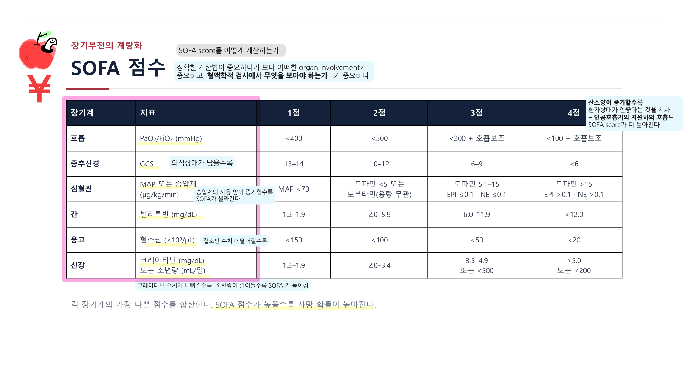{: style="width:82%"}

| 장기 | 지표 | 1점 | 2점 | 3점 | 4점 |
|---|---|---|---|---|---|
| 호흡 | **PaO2/FiO2** | <400 | <300 | <200 + 호흡보조 | <100 + 호흡보조 |
| 중추신경 | **GCS** | 13–14 | 10–12 | 6–9 | <6 |
| 심혈관 | **MAP 또는 승압제**(μg/kg/min) | MAP <70 | dopamine <5 또는 dobutamine(용량 무관) | dopamine 5.1–15, EPI ≤0.1, NE ≤0.1 | dopamine >15, EPI >0.1, NE >0.1 |
| 간 | **bilirubin**(mg/dL) | 1.2–1.9 | 2.0–5.9 | 6.0–11.9 | >12.0 |
| 응고 | **혈소판**(×103/μL) | <150 | <100 | <50 | <20 |
| 신장 | **creatinine**(mg/dL) 또는 **소변량** | 1.2–1.9 | 2.0–3.4 | 3.5–4.9 또는 <500 mL/일 | >5.0 또는 <200 mL/일 |

- **각 장기의 가장 나쁜 점수를 합산**한다. 점수가 높을수록 사망 확률이 높다.
- 필기: "**정확한 계산법이 중요하다기보다, 어떤 organ involvement가 중요하고 혈액검사에서 무엇을 봐야 하는가가 중요하다.**" 표 옆 손글씨로 방향만 잡아 두자.
    - 호흡: 산소를 많이 줘야 할수록(FiO2↑ → P/F↓) 나쁘고, **인공호흡기 보조**가 붙으면 점수가 더 높다.
    - 의식: 의식 상태가 낮을수록(GCS↓).
    - 심혈관: **승압제 사용량이 많을수록** 높다.
    - 응고: 혈소판이 떨어질수록. 신장: creatinine이 오를수록, 소변량이 줄수록.
- **SOFA는 "감염 전과 후의 점수를 비교"한다**(작년 교수님이 공지까지 부탁하신 내용). 기저 지방간·신부전으로 creatinine 1.3, bilirubin 1.3인 환자는 감염 전부터 SOFA 2점이지만 감염이 없으면 sepsis가 아니다. **감염 이후 이전보다 2점 이상 올라야 sepsis.** 기저질환을 모르면 기저 SOFA를 **0점**으로 본다.

!!! new "올해 필기에서 추가"
    작년엔 1점 기준만 표로 외웠는데 올해는 **1–4점 전체 표**와 승압제 용량 기준(dopamine 5·15, NE/EPI 0.1)이 슬라이드에 나왔다. 그래도 필기 작성자 말대로 **항목 6개와 1점 값**이 우선이다.

!!! exam "기출 포인트"
    SOFA에 **포함되지 않는** 것 → **호흡수**(3·17·19번 — RR은 qSOFA 항목!), **심박수**(23번), **lactic acid**(30번 — lactate는 쇼크 정의에 쓰지 SOFA 항목이 아님). 소변량·GCS·bilirubin·혈소판·creatinine·MAP·PaO2/FiO2는 포함. 필기본 11쪽에 이 문제들(2025 50번, 2022 46번·27번, 2021 38번)이 모여 있다.

## 패혈증의 장기부전 — 어느 장기가, 몇 개나

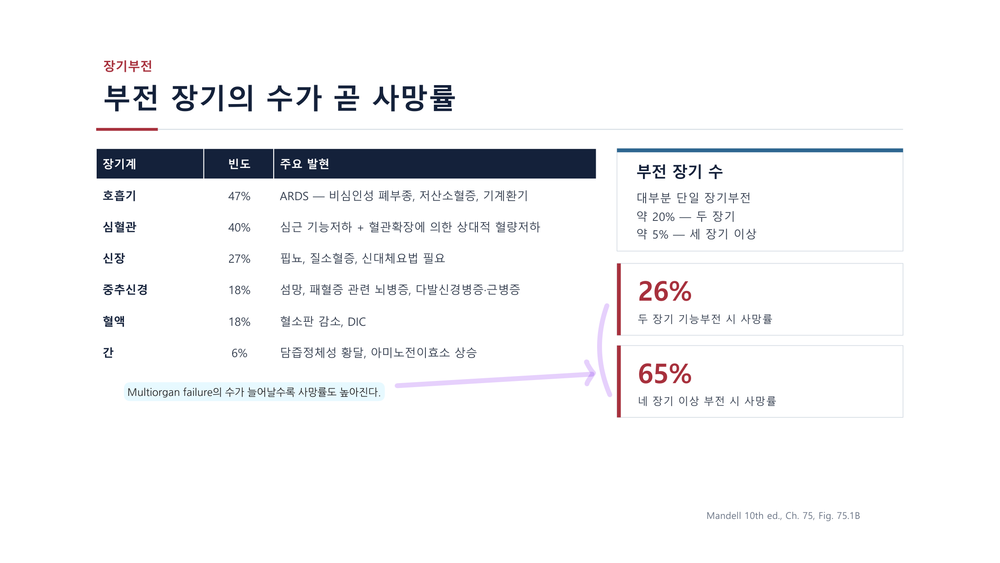{: style="width:78%"}

- 장기부전은 패혈증의 핵심 징후. **호흡기·심혈관 부전이 가장 흔하고**, 그다음 신장, 중추신경, 혈액, 간 순.
- **호흡부전, 쇼크, 신부전**이 ICU 입원의 가장 흔한 원인 — 손글씨: mechanical ventilator, ECMO, 투석이 필요할 수 있으니까.
- 필기: "= **SOFA score에 포함된 장기들에 생기는 부전들이 중요하다.**"

| 장기 | 빈도 | 주요 발현 |
|---|---|---|
| 호흡기 | **47%** | ARDS — 비심인성 폐부종, 저산소혈증, 기계환기 |
| 심혈관 | **40%** | 심근기능 저하 + 혈관 확장에 의한 상대적 혈량 저하 |
| 신장 | 27% | 핍뇨, 질소혈증, 신대체요법 필요 |
| 중추신경 | 18% | 섬망, 패혈증 관련 뇌병증, 다발신경병증·근병증 |
| 혈액 | 18% | 혈소판감소, DIC |
| 간 | 6% | 담즙정체성 황달, 아미노전이효소 상승 |

- **부전 장기의 수가 곧 사망률**: 대부분 단일 장기부전, 약 20%가 두 장기, 약 5%가 세 장기 이상. 사망률은 **두 장기 26%, 네 장기 이상 65%**. 손글씨: "Multiorgan failure의 수가 늘어날수록 사망률도 높아진다."

!!! new "올해 필기에서 추가"
    장기별 **빈도(호흡 47 > 심혈관 40 > 신장 27 > CNS 18 = 혈액 18 > 간 6%)** 와 부전 장기 수별 사망률은 올해 새 슬라이드다. 출제 경향 2번이 "합병증(빈도 포함)"이므로 순서를 외워 두자.

## 호흡 항목 계산 — P/F ratio

{: style="width:72%"}

- **FiO2(흡입산소분율)**: 환자가 들이마시는 산소의 분율을 소수로(40% 산소 = 0.4). 실제 흡입 농도는 호흡수·호흡량·산소 공급 속도에 따라 달라진다. 비강 캐뉼라 1 L/분 ≈ 24%, 이후 1 L 늘 때마다 약 4%씩(6 L ≈ 44%), 리저버 마스크 10 L ≈ 95%(필기본 14쪽 추정표).
- **PaO2(동맥혈 산소분압)**: 동맥혈가스분석(ABGA)으로 잰 혈장 내 산소분압(mmHg).
- 손글씨: "**P/F ratio는 SOFA 계산에도 쓰이지만 ARDS 중증도 분류에도 사용됨.**"
- **예시**: 인공호흡기 FiO2 0.4에서 PaO2 70.1 → **70.1 ÷ 0.4 = 175.3** → 호흡보조 중 <200이므로 **SOFA 호흡 3점**, ARDS로는 **중등증(101–200)**.
- 해석표: ≥400 정상, <400 저산소혈증, <300 호흡부전, <250 중증 호흡부전, <200 위중한 호흡부전.

## qSOFA — 더 이상 단독 선별 도구가 아니다

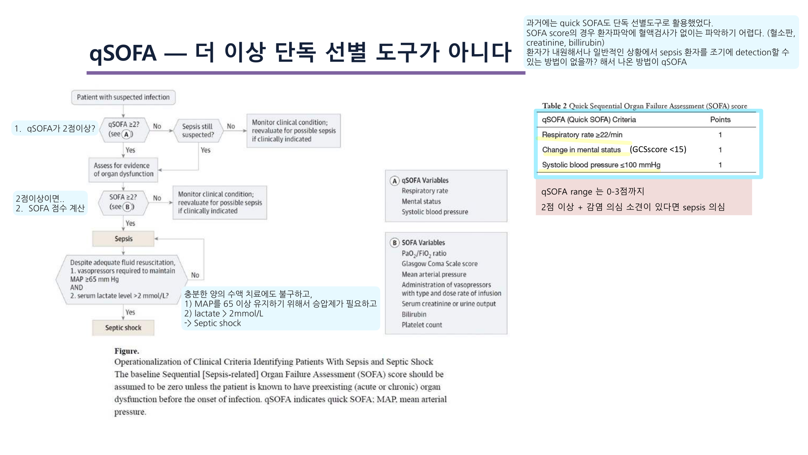{: style="width:80%"}

| qSOFA(0–3점) | |
|---|---|
| **호흡수 ≥22회/분** | 1 |
| **의식 변화**(GCS <15) | 1 |
| **수축기 혈압 ≤100 mmHg** | 1 |

- 왜 만들었나(손글씨): SOFA는 **혈액검사(혈소판, creatinine, bilirubin) 없이는** 계산할 수 없다. 환자가 막 내원했을 때나 일반 병동에서 sepsis를 **조기에** 잡을 방법이 필요해 나온 것이 qSOFA.
- 흐름: 감염 의심 → **qSOFA ≥2?** → 그러면 **SOFA 계산** → **SOFA ≥2 상승 = sepsis** → 충분한 수액에도 **MAP ≥65 유지에 승압제 필요 + lactate >2 = septic shock**.
- (작년 필기 주의) 증례에서 교수님이 "맥박"으로 qSOFA를 매기신 적이 있지만 기준은 **수축기 혈압**이다. 맥박·산소포화도는 qSOFA 항목이 아니다.

## 선별 도구 — 2026 권고: NEWS / NEWS2 / MEWS / SIRS

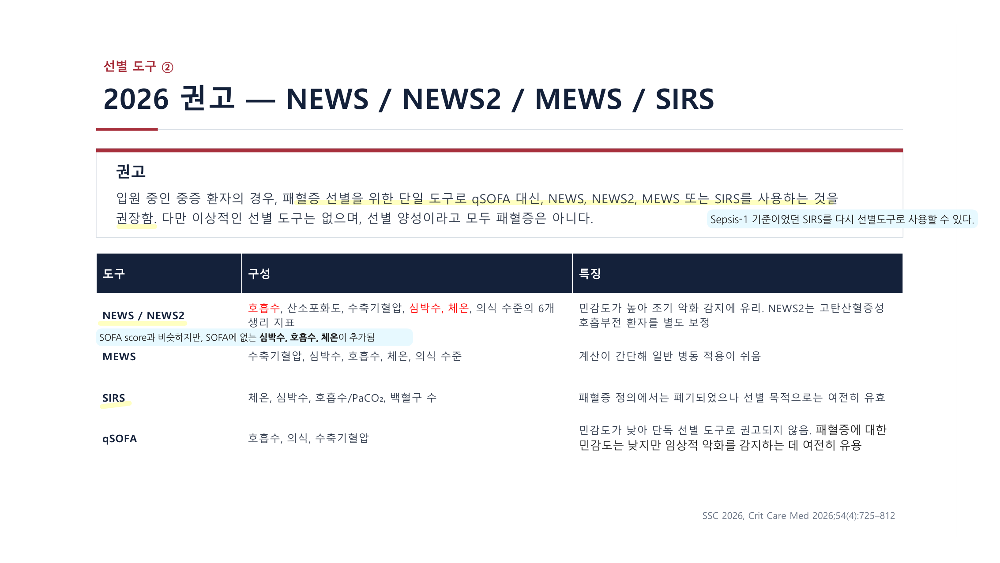{: style="width:80%"}

- **권고**: 입원 중인 중증 환자의 패혈증 선별에 **qSOFA 단독 대신 NEWS, NEWS2, MEWS 또는 SIRS**를 쓴다. 이상적인 도구는 없고, 선별 양성이라고 모두 패혈증은 아니다.

| 도구 | 구성 | 특징 |
|---|---|---|
| **NEWS / NEWS2** | 호흡수, 산소포화도, 수축기 혈압, **심박수, 체온**, 의식 수준 (6개 생리지표) | **민감도가 높아** 조기 악화 감지에 유리. NEWS2는 고탄산혈증성 호흡부전 환자를 보정 |
| MEWS | 수축기 혈압, 심박수, 호흡수, 체온, 의식 | 계산이 간단해 일반 병동에 쉬움 |
| **SIRS** | 체온, 심박수, 호흡수/PaCO2, 백혈구 | 정의에서는 폐기됐지만 **선별 목적으로는 여전히 유효** |
| qSOFA | 호흡수, 의식, 수축기 혈압 | **민감도가 낮아 단독 선별 도구로 권고되지 않음.** 임상적 악화 감지에는 여전히 유용 |

- 손글씨: "Sepsis-1 기준이었던 **SIRS를 다시 선별 도구로** 사용할 수 있다." NEWS는 SOFA와 비슷하지만 **SOFA에 없는 심박수, 호흡수, 체온**이 들어 있다(19쪽).
- 헷갈리지 말 것: **진단(정의)은 SOFA**, **선별은 NEWS·MEWS·SIRS**(qSOFA 단독 X). qSOFA는 **특이도는 높고 민감도가 낮다.**

!!! diff "작년 필기와 다른 점"
    2021 지침(작년 필기): "qSOFA는 단독 선별 도구로 적절하지 않다 → **NEWS 또는 MEWS**의 도움을 받으라." 2026: **NEWS / NEWS2 / MEWS / SIRS** 중 하나를 쓰라 — **SIRS와 NEWS2가 선별 도구로 추가**됐다.

## 진단의 확실성 — 2026에 새로 생긴 네 단계 용어

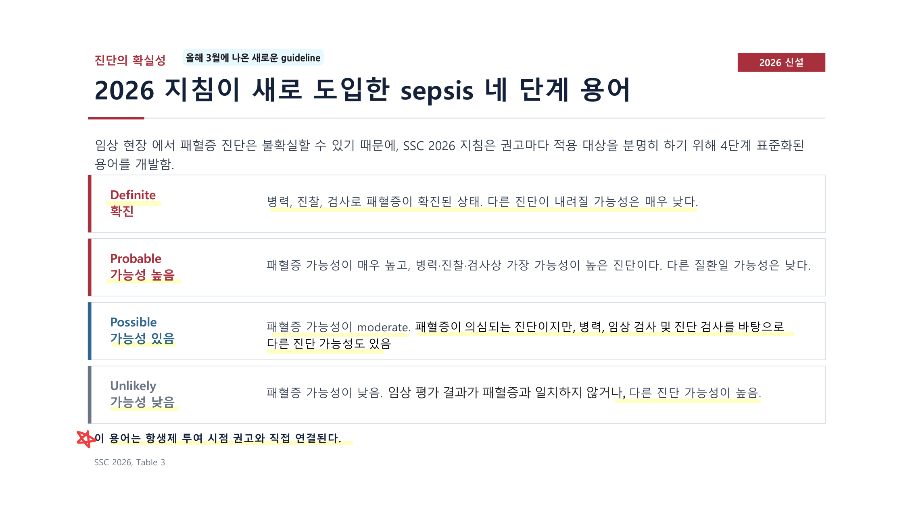{: style="width:72%"}

| 단계 | 뜻 |
|---|---|
| **Definite(확진)** | 병력·진찰·검사로 패혈증 확진. 다른 진단 가능성 매우 낮음 |
| **Probable(가능성 높음)** | 패혈증 가능성이 매우 높고 가장 유력한 진단. 다른 질환 가능성 낮음 |
| **Possible(가능성 있음)** | 패혈증 가능성 중간(moderate). 의심되지만 다른 진단 가능성도 있음 |
| **Unlikely(가능성 낮음)** | 임상 평가가 패혈증과 맞지 않거나 다른 진단 가능성이 높음 |

- 임상 현장의 진단은 불확실할 수 있어서, 권고마다 적용 대상을 분명히 하려고 만든 용어. **이 용어가 항생제 투여 시점 권고와 직접 연결된다**(→ 7장, 1시간 vs 3시간). 필기에 별표로 강조.

!!! new "올해 필기에서 추가"
    네 단계 용어(definite·probable·possible·unlikely)는 **SSC 2026 신설**이다(손글씨: "올해 3월에 나온 새로운 guideline"). 작년 필기의 "패혈증 확실/가능성 높음 vs 가능성 있음" 두 줄짜리 표가 이 네 단계로 바뀌었다.

# 3. 원인 — 누가, 어디서, 어떤 균으로

## 위험인자 — 누가 패혈증에 걸리는가

| 범주 | 위험인자 |
|---|---|
| 인구학적 | **고령(65세 초과)**, 남성(손글씨: 호르몬 영향), 흑인, 영양 상태, 예방접종력, 유전자 다형성 |
| 환경 | 낮은 사회경제적 지위, 계절 변동과 접촉력, 유행, 여행 |
| 동반질환 | 당뇨, COPD, 암, 만성 신질환, 만성 간질환, HIV, 면역억제제 — 손글씨: 동반질환이 많을수록 |
| 병원 요인 | 재원 기간, 항생제 내성, **유치 카테터(요도관·정맥관 + 투석용 도관)**, 수술 합병증(창상감염, 응급 vs 예정 수술) |

- **연령**: 65세 이상이 패혈증 환자의 약 **65%**. 고령 자체가 불량한 예후 인자이며 동반질환·면역노화가 일부를 설명한다(손글씨: 고령 환자는 동반질환도 많으니..).
- **암과 당뇨**: 암 환자는 패혈증 입원 위험 **3–4배**, 일부 혈액암은 **10배**. 당뇨에서는 **요로·피부연부조직 감염**이 상대적으로 흔하다.
- **계절**: 폐렴은 **겨울**, 비뇨생식기 감염은 **여름**. 겨울엔 중증도가 비슷해도 치명률이 더 높다.

!!! new "올해 필기에서 추가"
    위험인자 표(인구학·환경·동반질환·병원 요인)와 연령·암·당뇨·계절 수치는 올해 새 슬라이드다.

## 감염원 — 어디에서 시작되는가 (족보)

{: style="width:75%"}

- **호흡기(폐렴) 51%** > **복강 내 감염 20%** > **혈류 14%** > **비뇨생식기 10%**. 손글씨: "**가장 흔한 건 폐렴!**" 그 외 창상 감염, CNS 감염.
- 고소득 국가에서 폐렴이 성인 패혈증의 가장 흔한 감염원이고 복강·요로·피부연부조직이 뒤를 잇는다. **이 네 부위가 성인 패혈증의 80–90%.**
- 감염원이 둘 이상인 경우 약 **6%**. 자원이 부족한 환경에선 **설사 질환**이 주요 원인으로 올라선다.
- **지역사회 vs 원내**: 둘 다 생긴다. 선진국의 중증 패혈증은 **원내감염**이 많아 침습적 시술·카테터 사용 제한이 중요하다.
- **동반질환이 감염원을 정한다**: COPD는 호흡기 감염 입원을 예측하지만 호흡기 외 감염 입원과는 무관. **장기 신대체요법 환자**의 패혈증은 **중심정맥 카테터 감염, 복막염, 허혈성 장질환**이 많다.
- **못 찾는 경우**: 환자 **여섯 명 중 한 명**은 감염원을 못 찾는다. 병원균은 약 **60–70%**에서 확인되지만(패혈증 30–60%, 패혈성 쇼크 60–80%에서 양성), **혈액배양 양성은 약 10–20%뿐**.
- 손글씨: "SOFA 상승이 확인됐을 때 **배양에서 균이 안 나왔다고 sepsis를 배제해서는 안 된다.**"

!!! diff "작년 필기와 다른 점"
    작년 필기: 폐렴 **64%** > 복강 내 20% > 신장·비뇨생식기 14%, "혈액배양 양성률은 **1/3** 정도". 올해(Mandell 10판): 폐렴 **51%** > 복강 20% > **혈류 14%** > 비뇨생식기 10%, **혈액배양 양성은 10–20%**(병원균 확인은 60–70%). 순위 "폐렴 1위, 복강 2위"는 그대로다.

!!! exam "기출 포인트"
    6번: 패혈증의 가장 흔한 원인 질환 → **폐렴**(필기본 23쪽에과 함께 실림). 2·12번 ④ "혈액배양에서 균이 모두 확인되는 것은 아니다"는 옳은 보기, 5번 ② "**혈액배양 양성이 확인되지 않으면 패혈증 배제**"는 틀린 보기. 29번 ② "혈액배양에서 균은 100% 분리"도 틀림.

## 원인 미생물 — 그람음성균이 다시 앞섰다

- **그람양성**(주로 알균): ***S. aureus*, *S. pneumoniae*, *Enterococcus***
- **그람음성**(주요 장내세균 + 병원 내성균): ***E. coli*, *Klebsiella*, *Pseudomonas*·*Acinetobacter***
- **진균·바이러스**(드묾): ***Candida***(ICU 사망률이 세균 혈류감염의 **1.5배 이상**), 바이러스는 1–7%.
- 흐름: **1979–2000년엔 그람양성균 패혈증이 늘어 그람음성균을 앞질렀다**는 보고가 많았다. 그러나 2017년 **EPIC III**(88개국 15,000명 이상) 조사에서 ICU 배양 양성 분리주는 **그람음성 67%, 그람양성 37%, 진균 16%**. 손글씨: "과거엔 gram(+)이 더 많은 portion이었는데 **최근엔 gram(−)이 더 많아지고 있다.**"
- 동반질환이 많거나 ICU에서 얻은 패혈증에서는 **MRSA, *Acinetobacter*, *Pseudomonas*, *Candida***가 늘어난다(손글씨: 도관을 많이 가지고 있다 보니).
- **칸디다혈증 위험인자**: 면역억제·호중구감소, 과거 집중적 항생제 치료, **혈관 내 카테터**, 장기 ICU 입원, 여러 부위 진균 집락. 손글씨: 말초 정맥로가 나빠 **중심정맥관을 오래 두는** 환자에서 Candida 균혈증이 많다.

!!! diff "작년 필기와 다른 점"
    작년 필기: "최근 **그람양성균이 그람음성균보다 더 자주** 보고된다." 올해: "**그람음성균이 다시 앞섰다**"(EPIC III, 음성 67% vs 양성 37%). 정반대로 바뀌었으니 주의. 그람양성 중 *S. aureus*, 그람음성 중 *E. coli*가 대표라는 점은 같다.

!!! exam "기출 포인트"
    29번(2020) 옳은 것 → ④ "**황색포도알균 TSS는 전신 발적이 흔하다**". ① "패혈증은 그람음성막대균보다 **그람양성알균에서 더 흔하다**"는 오답 — 작년 필기와는 어긋나 보였지만 **올해 필기(그람음성이 다시 앞섬)와 맞는다.** 5번(2024) ④ 중심정맥관 환자는 그람양성균이 주 원인, ⑤ 그람양성 중 *S. aureus*가 가장 흔함 → 옳은 보기.

## 숙주 조건에 따른 원인균 추정

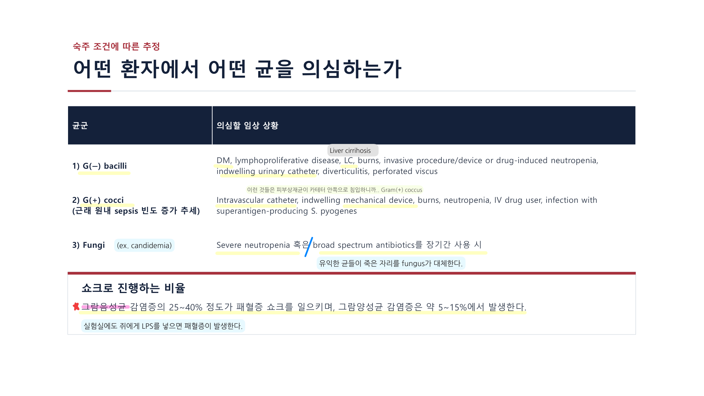{: style="width:78%"}

| 균군 | 의심할 임상 상황 | 이유(손글씨) |
|---|---|---|
| **그람음성 막대균** | 당뇨, 림프증식질환, **간경변(LC)**, 화상, 침습적 시술·기구, 약물 유발 호중구감소, **유치도뇨관**, 게실염, 장기 천공 | 장·요로의 장내세균이 들어감 |
| **그람양성 알균**(원내 sepsis 증가 추세) | **혈관 내 카테터**, 기계 장치, 화상, 호중구감소, 정맥약물 사용자, 초항원 생성 *S. pyogenes* | **피부 상재균이 카테터 안쪽으로 침입** |
| **진균** | **심한 호중구감소** 또는 **광범위 항생제 장기 사용** | "유익한 균들이 죽은 자리를 fungus가 대체한다"(예: 칸디다혈증) |

- **쇼크로 가는 비율**: **그람음성균 감염의 25–40%**, 그람양성균 5–15%. 손글씨: 실험실에서도 쥐에게 **LPS**(그람음성균 내독소)를 넣으면 패혈증이 생긴다 — 그람음성균이 쇼크를 잘 일으키는 이유.

!!! exam "기출 포인트"
    32번: 비장절제 후 예방접종을 안 한 환자의 패혈증 원인 → ***N. meningitidis***(피막 세균: 폐렴구균·Hib·수막알균). 살모넬라·이질균·대장균·프로테우스는 오답.

# 4. 병태생리 — 감염에서 장기부전까지 (족보)

{: style="width:84%"}

슬라이드의 문장 7개에 필기본이 1–6 번호를 붙여 그림 속 위치와 짝지었다. 순서대로 따라가면 된다.

1. **인식과 염증**: **PAMP(pathogen-associated molecular pattern)** 가 숙주세포의 **Toll-like receptor**에 결합 → 세포 내 신호 → **대량의 염증 매개체·사이토카인(TNF, IL-1 등)**. 조직이 손상되면 **DAMP(damage-associated molecular pattern)** 가 나와 염증을 또 부른다 → PAMP가 없어져도 염증이 이어지는 악순환.
    - 손글씨: **그람음성균은 LPS**, **그람양성균은 peptidoglycan(필기 "Glyopeptide") 층**이 PAMP로 작동.
2. **혈관 누출과 부종**: **endothelial leak**(혈관 투과성 증가)·**간질(interstitium)의 barrier function 감소** → **조직 부종** → 간질이 넓어져 혈관과 세포 사이 거리가 멀어짐 → **산소 공급 저하**(손글씨: edema → tissue hypoxia).
3. **응고 쪽**: **항응고인자(antithrombin, protein C) 감소** → 혈전·혈소판 응집. **섬유소용해(fibrinolysis)도 감소** → 미세혈전이 안 녹음 → 산소 공급 더 저하. 응고인자·혈소판이 소모돼 출혈도 생김 → **DIC**.
4. **세포 쪽**: 산소 공급 저하 → **미토콘드리아 기능장애** → **lactate 증가**, 조직 허혈(lactate 증가는 사망률 증가와 연관).
5. **혈량 감소**: 백혈구가 균이 있는 곳으로 가려고 **간질로 이동**하고, 체액도 간질로 빠져 → **hypovolemia**.
6. **혈관 확장**: 사이토카인 → **NO(nitric oxide) 증가 → 혈관 확장(vasodilation)** → 혈압 저하.
7. **순환의 악순환, 미세순환 장애 → 범발성 혈관내 응고(DIC).**

정리하면 패혈증은 **① hypovolemia(투과성↑ + 혈관 확장) ② 조직 허혈(lactate↑) ③ 응고병증(DIC)** 세 문제를 만든다. 방향을 한 줄로:

| 올라가는 것 ↑ | 내려가는 것 ↓ |
|---|---|
| TNF·IL-1, tissue factor, 혈관 투과성, NO(→ 혈관 **확장**), lactate, 조직 부종 | antithrombin, protein C, **fibrinolysis**, 간질 장벽 기능, 조직 산소 공급, 혈압 |

- 필기(30쪽): "**병태생리에 대한 문제가 자주 출제되었습니다.** 전체적인 흐름만 따라간다면, 배치되는 선지들이 몇 개씩 있어서 쉽게 고를 수는 있는 것 같습니다." — 위 표의 화살표 방향만 뒤집은 보기가 정답(틀린 것)으로 나온다.

!!! exam "기출 포인트"
    병리기전으로 **옳지 않은** 것: **vasoconstriction**(14번 — 확장이 맞음), **fibrinolysis 증가**(18번 — 감소), **lactate 감소**(22번 — 증가), **antithrombin 증가**(28번 — 감소). 4번(2025) 옳은 것 → **mitochondrial dysfunction으로 lactate 상승**. 4번 오답 — 내피 손상이 투과성을 "감소", fibrinolysis "항진", 미세혈전 "감소", NO "감소로 혈관 수축". 26번(TSS 사례)의 병태생리는 **superantigen exotoxin**(5장 피부 참고).

# 5. 임상 양상

## 초기 인지 — 놓치기 쉬운 발현
- **전형적**: 감염 병소가 있는 환자가 갑자기 **발열·오한·빈맥**. 다만 천천히 오거나 알아채기 어려울 수 있다.
- **열이 없을 수 있는 환자**: **신생아, 고령자, 알코올 사용장애**. 손글씨: 이런 환자는 충분한 염증반응이 안 일어날 수 있다. **저체온은 9–35%**에서 보이고 **불량한 예후**와 연관.
- **일반 지표**: 발열, 빈맥, 빈호흡, 의식 변화, 심한 부종. **과호흡과 호흡성 알칼리증이 가장 먼저** 나타나는 소견일 수 있다(qSOFA·NEWS에 호흡수가 들어가는 이유).
- **흔한 기저질환**: COPD, 악성종양, HIV, 만성 간질환, 만성 신질환, 당뇨, 말초혈관질환, 자가면역질환.

!!! new "올해 필기에서 추가"
    **저체온 9–35%(나쁜 예후)** 와 흔한 기저질환 목록이 새로 들어왔다.

## 흔한 합병증 한눈에
**뇌 기능장애(septic encephalopathy), 급성 폐손상(ARDS), 급성 신손상, 장마비(ileus), 심혈관 기능장애(쇼크 포함), DIC(혈소판감소 동반), 간 손상.** 필기본 34쪽 사진: ARDS 흉부 X선·CT(양측 반점 음영, 기흉, 흉관), **ileus**(소장·대장이 끊김 없이 확장), **DIC의 자반**(작은·중간 혈관의 광범위 혈전 + 여러 곳 출혈).

## 장기별 ① 호흡기 — ARDS
- **정의**: 감염 의심 후 **7일 이내** 생기는 **저산소혈증 + 비심인성 양측 침윤**. 심장 원인이 아닌 폐부종이 갑자기 생기고, 저산소혈증, 기계환기가 필요해진다.
- **중증도(PaO2/FiO2)**: mild **201–300**, moderate **101–200**, severe **≤100**.
- **기전**: 미만성 폐포 상피 손상 → **단백질이 풍부한 체액**이 간질·폐포로 삼출 → **우좌 단락**, **사강(dead space) 증가**, **폐 순응도(compliance) 감소** → 숨쉬기 힘들어짐. 폐포에 물이 차서 O2가 혈액으로 들어가고 CO2가 나오는 가스교환이 막힌다.
- **회복 이후**: 지난 20년간 ARDS 사망률 **약 60% → 25%**로 감소 — ICU 보조치료 + **폐보호 환기(낮은 기도압·낮은 일회호흡량)** 덕분. 그러나 회복한 환자의 최대 절반에 **제한성 환기장애·폐확산능 저하**가 남는다.
- SOFA에서 기억할 것: **PaO2/FiO2 <400이 1점**.

## 장기별 ② 심혈관 — 패혈증 유발 심근병증
- **두 가지 구성 요소**: **심근기능 저하** + **혈관 확장에 따른 상대적 저혈량증**.
- 초기에는 맥박 증가·심박출량 증가로 혈압을 올리려 한다(손글씨: **보상기전**).
- **경과**: 발생 **24–48시간 뒤** 전형적으로 보이고, 수액 소생 등으로 회복되면 **5–10일 후** 심근기능도 정상화.
- **허혈이 아니다**: 심근 억제는 **염증 매개체가 심근세포와 미세순환에 미치는 영향** 때문이지 관상동맥 혈전(허혈) 때문이 아니다 → 항생제·수액 치료로 정상화될 수 있고, **일반적으로 강심제(inotrope)가 필요 없다.** 수액에도 저혈량성 쇼크가 교정되지 않으면 **혈관수축제(vasopressor)**를 쓴다. 1차 혈관수축제는 아드레날린성 작용제, 그중 **norepinephrine이 가장 우선**.

!!! new "올해 필기에서 추가"
    "**허혈이 아니다 → 강심제는 보통 필요 없고 승압제를 쓴다**"가 새로 강조됐다. 작년엔 "개념적으로만 이해하시면 됩니다" 정도였다.

## 장기별 ③ 신장 — AKI
- 패혈증 환자의 **50% 이상**에서 AKI, 동반되면 입원 사망률 **6–8배**, **대부분 가역적**(손글씨: 패혈증이 호전되면 가역적으로 좋아질 수 있다 — 다행인 점).
- **핍뇨·질소혈증**(BUN 상승) 형태, 투석이 필요할 수 있다(손글씨: 소변이 잘 안 나오면 투석 고려). 경한 단백뇨부터 중증 신부전까지. 부검에서 **국소적 급성 세뇨관 손상**과 경미한 사구체 손상.
- **주요 병인**: 혈류량 감소와 저혈압, **신혈관 수축** 등.
- **가역적이지만 흔적을 남긴다**: 중환자는 creatinine이 **조금만 급히 올라도 장기 생존율 저하**와 관련. 패혈성 쇼크 환자의 생존은 **AKI 중증도와 직결**. 손글씨: 경우에 따라 AKI로 시작한 투석을 오래 지속할 수도 있다.

!!! exam "기출 포인트"
    2·12번: 옳지 **않은** 것 → "**패혈증에 의한 신손상은 대부분 비가역적**"(필기본 37쪽에 그대로 실림). 5번 ①에서는 "대부분 가역적"이 옳은 보기로 나왔다.

## 장기별 ④ 혈액 — 혈소판감소와 DIC

{: style="width:76%"}

- **혈소판감소**는 패혈증의 **10–30%**, 중증 패혈증의 **30–50%에서 DIC**.
- 응고가 부적절하게 활성화 → 혈관 내 광범위 혈전(손글씨: **thrombosis는 증가하고 fibrinolysis는 감소**) → 장기 혈류 감소·장기 손상, 혈소판·응고인자 소모 → 출혈 위험↑.
- **임상 발현**: 출혈 — **상처 부위의 지속적 삼출이나 위장관 출혈이 가장 흔함**, 혈관 내 혈전증, **말단청색증·말초조직 허혈성 괴사**.
- **DIC 진단 기준 — 4개 중 3개 이상**
    1. 혈소판 **<100,000/mm3** 또는 급격한 감소
    2. **FDP 또는 D-dimer 증가**
    3. **fibrinogen <150 mg/dL**
    4. **PT가 기준보다 3초 초과** 또는 **aPTT 5초 초과** 연장
    - antithrombin III 같은 응고억제제의 낮은 농도가 동반될 수 있으나 **진단 표지자로서 의미는 없다.**
- DIC가 생기면 사망 위험이 **두 배**. **기저질환 치료 외에 DIC 특이 치료는 없다** — 손글씨: 폐렴으로 DIC가 왔으면 폐렴을 치료하는 것 외엔 DIC만 따로 고치는 방법이 없다.
- 손글씨: sepsis에서 위장관 출혈이 생기기도 하는데 **혈소판감소**가 영향을 줄 수 있고, 수액에도 호전이 없어 **스테로이드**를 쓰면 위장관 출혈이 **악화**될 수 있다.

## 장기별 ⑤ 피부 — 혈행성 파종과 독소
- 연조직염, 농포, 수포, 출혈성 병변 → **혈행성 세균·진균 파종**. 세균 독소 → **미만성 피부 반응**.
- 왜 중요한가: 피부 병변은 **감염원과 원인균을 바로 좁혀 주는 단서**이고 경험적 항생제 선택을 바꾼다. 전신 진찰에서 반드시 본다.
- 필기(필야의 코멘트): "**사진을 주고, 합병증을 일으키는 원인균으로 가장 적절한 게 뭔지 많이 물어보셨습니다!** 불명열도 그렇고 김윤정 교수님 수업은 사진을 잘 익혀 두시는 게 좋을 것 같습니다."

{: style="width:60%"}

- **점상출혈·자반 → *Neisseria meningitidis***(*H. influenzae*에서도). 손글씨: 수막알균은 **점상형 출혈성 자반**을 일으킨다. **CNS 감염이 의심되는 환자에 출혈성 자반**이 있으면 수막알균을 떠올린다.

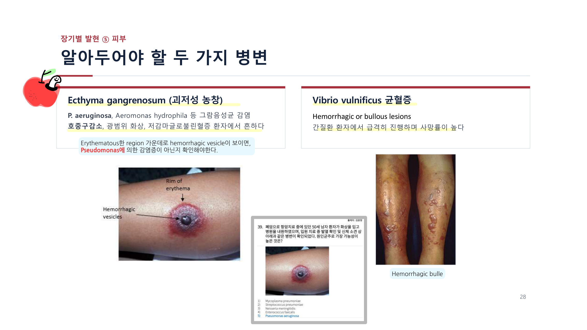{: style="width:62%"}

- **괴저성 농창(ecthyma gangrenosum)** (족보): ***P. aeruginosa***, *Aeromonas hydrophila* 등 그람음성균. **호중구감소, 광범위 화상, 저감마글로불린혈증** 환자에서 흔하다. 사진: 붉은 테두리(rim of erythema) 가운데 출혈성 수포·검은 괴사. 손글씨: "**erythematous한 부위 가운데 hemorrhagic vesicle이 보이면 Pseudomonas 감염이 아닌지 확인.**"
- ***Vibrio vulnificus* 균혈증**: **출혈성 또는 수포성 병변(hemorrhagic bullae)**. **간질환 환자**에서 급격히 진행하고 사망률이 높다. 여름철 회·어패류.

{: style="width:60%"}

- **독성쇼크증후군(TSS)의 홍색피부증**: ***S. aureus* 또는 *S. pyogenes***가 만드는 항원(초항원)에 의함. **전신 홍색피부증(박탈피부염) — 일광화상 같은 발진**이 얼굴·몸통·사지에.
    - **초항원(superantigen)**은 T세포를 **비특이적으로 활성화** → 전염증성 사이토카인 대량 방출. *S. aureus*는 24종, A군 사슬알균은 11종의 초항원을 낼 수 있다.
    - **치료 요점**: 감염원 제거 + 독소 생산을 억제하는 **clindamycin 병용**(항생제 총론 내용). 중증에서는 면역글로불린을 고려 — 손글씨: "**2026 guideline에서는 면역글로불린 투여는 기본적으로 하지 않는다고 바뀜!**"(8장 「권고되지 않는 치료」).

!!! new "올해 필기에서 추가"
    TSS 슬라이드에 **초항원 기전, clindamycin 병용**, 면역글로불린(2026에는 권고 안 함)이 새로 붙었다. 비브리오는 "**간질환 환자에서 급격히 진행**"이 추가됐다.

!!! exam "기출 포인트"
    10번(2023): 항암 중 화상 입원 환자의 피부 병변 → ***P. aeruginosa***(괴저성 농창 — 필기본 40쪽에 이 문제 사진이 붙어 있다). 29번 오답: *Vibrio*는 "가피 동반 작은 수포"(X, 출혈성 수포), ecthyma는 *H. influenzae*(X, 녹농균). 26번: 술 좋아하는 55세, 상처 없이 저혈압·급성 신부전 → **superantigen exotoxin**(TSS). 27번: 패혈증으로 투석까지 하고 퇴원 시 손바닥 피부가 벗겨짐 → **포도알균 TSS**(사슬알균 TSS는 보통 연조직 감염 같은 침입 부위가 뚜렷). 13번: 약 복용 후 열·간수치 상승 + 얼굴·가슴 발진 + 구강 병변·삼킴 곤란 → **Stevens-Johnson 증후군**(감별 — 점막 침범).

## 장기별 ⑥ 위장관·간·내분비
- **위장관과 간**: 말초혈관 확장으로 위장관 혈류 감소 → 장벽 기능 저하 → 장내 세균이 혈액·림프로 전이(손글씨: 평소에도 일부는 넘어가지만 장벽이 깨지면 비정상적으로 많아진다). 구역·구토·설사, **ileus**, 허혈성 장괴사. 간기능 장애(**간부전은 드묾**), **담즙정체성 황달**(bilirubin↑). **스트레스 궤양** → 위·십이지장 점막 미란으로 출혈.
- **혈당**: **고혈당 또는 저혈당**(손글씨: 혈당 조절이 잘 안 된다). 급성 감염 반응은 포도당신생·글리코겐분해·인슐린 저항성으로 혈당을 **유지하는** 방향이라 저혈당은 흔치 않지만, **간·신장질환·영양불량**이면 생길 수 있다. 손글씨: 입맛이 떨어져 **poor oral intake**로 저혈당이 올 수 있다.
- **부신 기능장애(adrenal dysfunction)**: **cortisol·aldosterone 분비 감소**(aldosterone = 신장에서 Na 저류·K 배출), **vasopressin(ADH) 분비 증가** → **저나트륨혈증·고칼륨혈증**. 뒤에 나올 스테로이드 치료와 연결.
- **Sick euthyroid syndrome**: 갑상샘 자체 질환이 아닌데 갑상샘 기능 저하 소견이 나오는 상태.

## 신경계 — 뇌·말초신경·근육
- **패혈증 관련 뇌병증(SAE, sepsis-associated encephalopathy)**
    - 패혈증으로 ICU에 입원한 환자의 **최대 50%**에서 섬망·혼수.
    - 정의: **CNS의 직접 감염·구조적 이상·다른 뇌병증이 없는데** 패혈증에 동반되는 광범위한 뇌 기능장애. 손글씨: CNS 감염이 아니어도 광범위한 뇌병증이 올 수 있고, **패혈증이 치료되면 완화**된다.
    - 특이 지표가 없어서 **다른 원인을 배제하는 방식으로 진단**.
    - 제안 기전: 미세 뇌손상, 혈액-뇌 장벽·뇌 미세순환 장애, CNS 대사 변화, 콜린성 신경전달 장애.
- **CIP(critical illness polyneuropathy)·CIM(critical illness myopathy)**: ICU 장기 입원 환자에 흔함. **인공호흡기 이탈(weaning) 어려움**, 사지 전반 위축, 광범위 쇠약. ICU 재원 연장·사망률 증가와 관련.
- 중증 패혈증 생존자의 **25–50%에 장기 인지·기능 장애**가 수년간 남는다.

!!! new "올해 필기에서 추가"
    SAE의 정의(배제 진단)·기전, **CIP/CIM(weaning 어려움)** 이 한 쪽으로 새로 정리됐다. 작년엔 "섬망·패혈성 뇌병증, 다발신경병증·근병증" 한 줄이었다.

# 6. 검사 소견 — 무엇을 보고 무엇을 추적하는가

| 영역 | 소견 |
|---|---|
| 혈액 | **백혈구 증가 또는 감소**, 혈소판 감소, **미성숙형 >10%** |
| 응고 | **PT·aPTT 연장, fibrinogen 감소, D-dimer 상승** → DIC 시사 |
| 간 | 고빌리루빈혈증, 아미노전이효소 상승 |
| 신장 | 질소혈증, 단백뇨, 전해질 불균형 |
| 동맥혈가스 | **대사성 산증**(조직 저관류) + **보상성 호흡성 알칼리증**(빈호흡) |
| 심전도 | 동성빈맥 또는 비특이적 ST–T 이상 |
| 관류 | **젖산(lactate) 상승 — 높을수록 예후 나쁨. 패혈성 쇼크 진단에 필수** |
| 염증 표지자 | CRP, procalcitonin 상승 — **단독으로 패혈증을 진단하거나 배제할 수 없다** |

- 손글씨: "**혈액검사를 보고 sepsis와 관련된 합병증을 떠올릴 수 있어야 한다.**" 손글씨: 감염 환자가 아주 빨리 내원하면 **CRP가 정상**일 수도 있다.
- **2026 지침의 원칙: 패혈증은 임상적 진단이며, 어떤 단일 바이오마커나 검사로도 확진하거나 배제해서는 안 된다.**

!!! new "올해 필기에서 추가"
    관류(lactate — **쇼크 진단에 필수**)와 염증 표지자(CRP·procalcitonin 단독으로 진단·배제 불가) 줄, "**패혈증은 임상적 진단**" 원칙이 새로 들어왔다.

# 7. 치료 — 2026 Surviving Sepsis Campaign

## 치료의 세 축
1. **항생제 치료** — 가능한 모든 병원체를 덮는 경험적 항생제를 **가능한 한 빨리**, 배양 결과가 나오면 범위를 좁힌다.
2. **감염 시작 병소의 제거(source control)** — 배농·절제가 필요한 곳을 찾는다. 감염 제거가 빠를수록 경과가 좋다(손글씨: 신농양이 있으면 배농을 해 줘야 항생제만 쓰는 것보다 빨리 낫는다).
3. **Sepsis·septic shock 환자 관리** — 수액 소생, 승압제, 호흡 보조, 장기 지원을 **동시에**.

## 2021 → 2026 주요 변경점 (슬라이드에 「중요」)

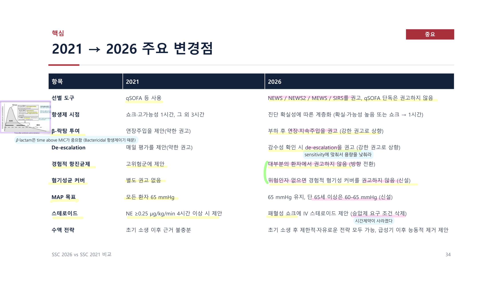{: style="width:80%"}

| 항목 | 2021 (작년 필기·기출 기준) | **2026** |
|---|---|---|
| 선별 도구 | qSOFA 등 사용 | **NEWS/NEWS2/MEWS/SIRS** 권고, qSOFA 단독 X |
| 항생제 시점 | 쇼크·가능성 높음 1시간, 그 외 3시간 | **진단 확실성으로 계층화**(확실·가능성 높음 또는 쇼크 → 1시간) |
| β-lactam 투여 | 연장주입 제안(약한 권고) | **부하 후 연장·지속주입(강한 권고)** |
| De-escalation | 매일 평가 제안(약한 권고) | **감수성 확인 시 de-escalation(강한 권고)** |
| 경험적 항진균제 | 고위험군에 제안 | **대부분 권고하지 않음**(방향 전환) |
| 혐기성균 커버 | 별도 권고 없음 | **위험인자 없으면 경험적 혐기성 커버 X**(신설) |
| MAP 목표 | 모든 환자 65 | 65 유지, **65세 이상은 60–65**(신설) |
| 스테로이드 | NE ≥0.25 μg/kg/min 4시간 이상 시 제안 | **패혈성 쇼크에 IV 스테로이드 제안(승압제 조건 삭제)** |
| 수액 전략 | 초기 소생 이후 근거 불충분 | 초기 소생 후 제한적·자유로운 전략 모두 가능, **급성기 이후 능동적 제거** 제안 |

- 손글씨: **β-lactam은 time above MIC가 중요**(살균 항생제라) → 연장·지속주입. De-escalation — "**sensitivity에 맞춰서 범위를 좁혀라.**" 스테로이드 — "**시간 제약이 사라졌다.**"

## 왜 빨리 해야 하나 — 손상 패러다임과 clinical response gap

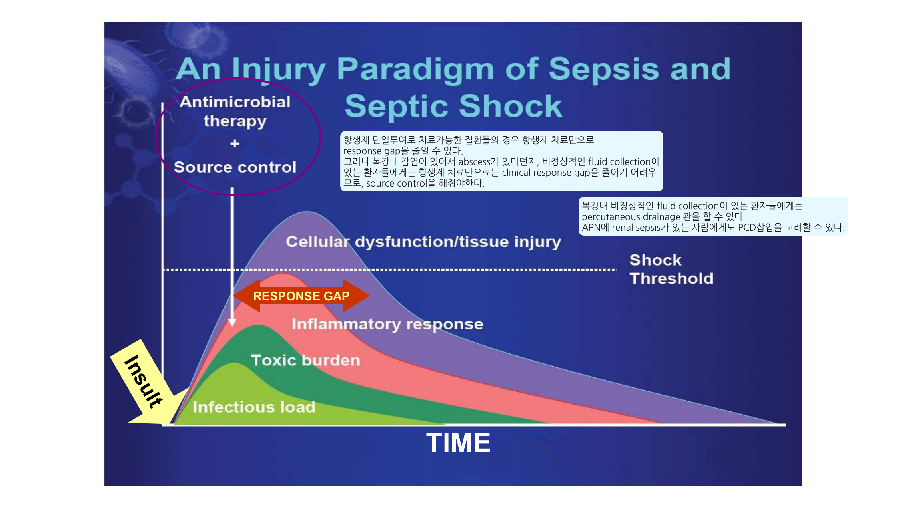{: style="width:64%"}

- (48쪽) 감염(insult)이 들어오면 **감염량(infectious load)** 이 늘고 세균이 내뿜는 **독소(toxic burden)** 가 늘고, **염증반응(PAMP·DAMP)** 이 일어나며 **세포 기능장애·조직 손상**이 cascade로 이어진다.
- (49쪽 The Golden Hours) 이 cascade가 **쇼크 역치(shock threshold)** 를 넘어 숙주가 감당 못하면 **사망**한다. 치료의 목표 = 죽음에 이르기 전에 **조기에 cascade를 끊는 것.**
- (50쪽) 항생제를 주면 회복이 시작되지만, 염증반응 때문에 바로 좋아지지는 않는다 — 항생제 투여 후 회복까지 걸리는 시간의 차이가 **clinical response gap**. 예: **급성 신우신염(APN)은 3–5일** 정도의 gap.
- (51쪽) 항생제만으로 낫는 병은 항생제로 gap을 줄일 수 있지만, **복강 내 농양이나 비정상적 fluid collection**이 있으면 항생제만으로는 gap이 줄지 않아 **source control**이 필요하다 — 경피 배액관(percutaneous drainage). APN에 renal sepsis가 있으면 **PCN(경피적 신루설치술)** 도 고려.
- (52쪽) **더 일찍 항생제를 주면** cascade 자체가 낮게 끝나 빠르게 호전된다.

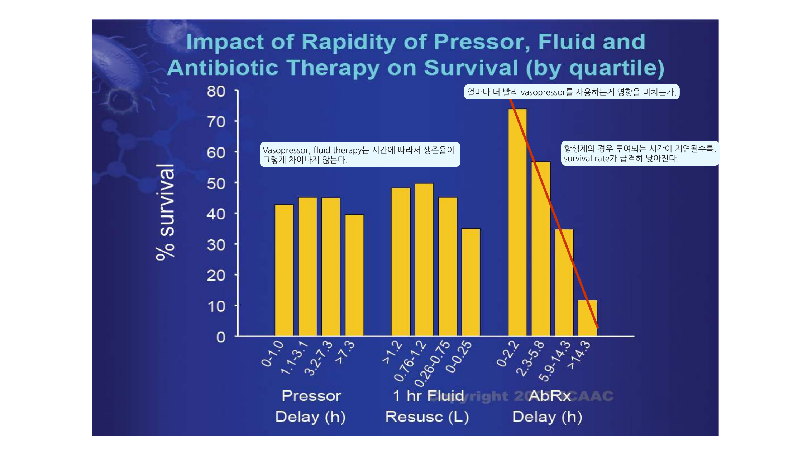{: style="width:58%"}

- 손글씨: **승압제·수액은 시작 시간에 따라 생존율이 그렇게 차이 나지 않지만**, **항생제는 늦을수록 생존율이 급격히 떨어진다.**
- (54쪽) 세균성 수막염의 door-to-antibiotic 시간: 0–2·2–4·4–6시간은 사망률이 낮다가 **6시간을 넘으면 급증**. 손글씨: **중증 감염(세균성 수막염, 괴사근막염, 감염성 심내막염)** 은 다른 병보다 항생제 조기 투여가 더 중요하다.
- (55쪽) 질환·균종은 달라도 **조기 항생제가 생존에 이득**(수막염, 균혈증·폐렴, 레지오넬라, 인공호흡기 폐렴, *S. aureus*, *P. aeruginosa* 등).

## 1) 항생제 투여 시점 — 계층화된 기준 (2026 개정)

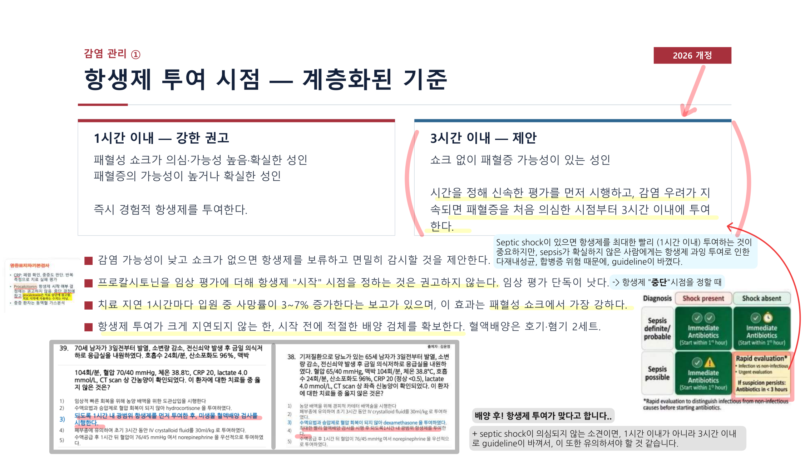{: style="width:76%"}

| 대상 | 언제 | 강도 |
|---|---|---|
| **패혈성 쇼크** 의심·가능성 높음·확실 | **즉시, 이상적으로 인지 후 1시간 이내** | 강한 권고 |
| **패혈증 가능성 높음·확실**(쇼크 없어도) | **즉시, 1시간 이내** | 강한 권고 |
| 쇼크 없이 패혈증 **가능성 있음**(possible) | 감염성·비감염성 원인을 **신속 평가**(시간을 정한 검사) → 감염 우려가 남으면 **처음 의심한 시점부터 3시간 이내** | 약한 권고 |
| 감염 **가능성 낮음** + 쇼크 없음 | 항생제를 **보류**하고 면밀히 감시 | 약한 권고 |

- **Procalcitonin**을 임상 평가에 더해 항생제 "**시작**" 시점을 정하는 것은 권고하지 않는다(임상 평가 단독이 낫다). 손글씨: procalcitonin은 항생제 "**중단**" 시점을 정할 때.
- 치료가 **1시간 늦어질 때마다 입원 중 사망률 3–7% 증가**, 이 효과는 **패혈성 쇼크에서 가장 강하다.**
- **항생제 투여가 크게 늦어지지 않는 한, 시작 전에 배양 검체를 확보**한다. **혈액배양은 호기·혐기 2세트.** 필기: "**배양 후! 항생제 투여가 맞다고 합니다..**"
- 왜 바뀌었나(손글씨): septic shock이면 최대한 빨리(1시간) 주는 게 중요하지만, sepsis가 확실하지 않은 사람에게까지 주면 **과잉 투여로 다제내성균·합병증** 위험이 생겨서. 필기: "septic shock이 의심되지 않는 소견이면 1시간 이내가 아니라 **3시간 이내**로 guideline이 바뀌어서 유의하셔야 할 것 같습니다."

!!! diff "작년 필기와 다른 점"
    2021(작년 필기) 표: 쇼크 있으면 모두 1시간, 쇼크 없을 때 "확실/가능성 높음" 1시간·"가능성 있음" 3시간. 2026은 **definite·probable·possible·unlikely 네 단계**로 나눴고 "**unlikely + 쇼크 없음 → 항생제 보류**"가 생겼다. 1시간·3시간이라는 숫자 자체는 같다.

!!! exam "기출 포인트"
    15번(2022): 옳지 **않은** 것 → "되도록 1시간 내 광범위 항생제를 **먼저** 투여한 후 혈액배양"(배양이 먼저!). 9번(2023) ④는 "최대한 빨리 혈액배양 시행 후 되도록 1시간 내 광범위 항생제"로 옳은 보기. 필기본 56쪽에 이 두 문제가 붙어 있다.

### Procalcitonin — 필기본 69쪽 문제
"패혈증에서 procalcitonin의 임상적 의미로 가장 적절한 것은?" → **③ 진단이 확립된 환자에서 항생제 치료 기간을 줄이도록 참고하는 데 쓸 수 있다.** 나머지는 모두 X:

- "민감도·특이도가 높아 진단에 확정적" X — 메타분석에서 패혈증과 비감염성 중증 질환을 구분하는 **민감도 0.77, 특이도 0.79**에 그쳤다. 진단 용도로는 한계.
- "항생제 시작 여부 결정에 임상 평가에 더해 쓰도록 권고" X — 반대. 시작 결정에는 정확하지 않아 **임상 평가만** 쓴다.
- "CRP보다 민감도·특이도가 모두 낮다" X(필기에서 "높다"로 고침 — CRP보다 낫다).
- "진료지침에 표준으로 자리 잡은 유일한 바이오마커" X.

## 2) 항균제 치료 원칙과 경험적 항생제 선택 (족보)

1. **초기에 적절한 항균제**가 생존율을 높인다.
2. 초기엔 **그람양성·음성 모두 덮는 광범위 항균제**로 경험적 치료 → 배양 결과에 따라 범위를 좁힌다(**de-escalation → 낮은 사망률과 연관**). 필기: "**치기 야마였습니다! 광범위 항생제 경험 사용**".
3. **정맥주사로 최대 용량**(손글씨: 신기능(renal function)에 따라 용량 조절).
4. 정균(bacteriostatic)보다 **살균(bactericidal)** 항균제.
5. **지역·병원의 내성 현황** 고려.
6. **병용요법** → 상승(synergistic)·부가(additive) 효과.
7. **기저질환(당뇨, 간경변)과 면역상태(호중구감소, 비장절제)** 고려(손글씨: 그래서 *Pseudomonas*를 덮는 항생제를 쓰기도).

- **선택을 좌우하는 요인**: 감염원, 지역·국가, 획득 장소(지역사회·요양원·병원), 병력, 국소 감수성. **경험적 지침은 지역마다 다르니 자체 지침을 먼저** 본다.
- **다제 병합이 필요한 경우**: 부적절한 초기 경험적 치료는 나쁜 예후와 연관. **MDR 위험인자**가 있으면 유효 약제를 최소 하나 넣기 위해 초기 다제 병합이 필요하지만, 내성 수준이 낮은 병원에 온 경증 환자는 필요 없는 경우가 많다.
- 손글씨(실제 선택 — "제일 첫 시간 항생제 매뉴얼 + 하기도 감염 시간 내용"):
    - 감염원을 찾으려고 **복부·흉부 CT**를 찍는다.
    - **지역사회 폐렴** → 지역사회 폐렴 초기 항생제(예: **3세대 cephalosporin + macrolide**, 하기도 감염 권기태 교수님). 폐렴구균의 3세대 cephalosporin 내성 가능성이 있으면 **vancomycin 병용**.
    - **복강 내 감염·요로감염** → 주 표적이 **그람음성균**이라 그람음성 커버가 좋은 **carbapenem**.

### 감염원이 분명하지 않은 성인의 초기 경험적 항균제 (참고 · 족보)

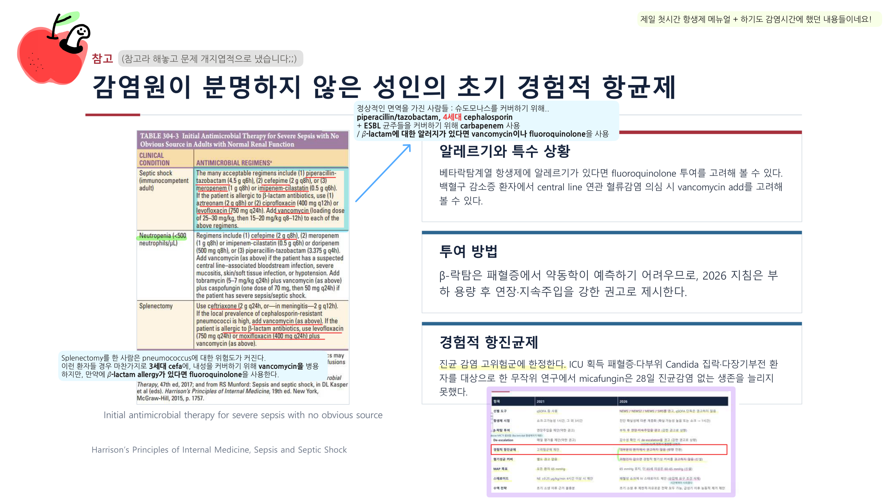{: style="width:80%"}

필기: "(**참고라 해 놓고 문제 개지엽적으로 냈습니다;;**)"

| 상황 | 초기 경험적 항균제 |
|---|---|
| **면역 정상 성인의 패혈성 쇼크** | **piperacillin/tazobactam, cefepime(4세대), meropenem·imipenem/cilastatin** 중 하나(± vancomycin) — 손글씨: *Pseudomonas*를 덮기 위해 pip/tazo·4세대, **ESBL**을 덮기 위해 carbapenem |
| **β-lactam 알레르기** | **fluoroquinolone(ciprofloxacin·levofloxacin)** 또는 aztreonam, + vancomycin — 손글씨: vancomycin이나 FQ |
| **호중구감소(<500/μL)** | **cefepime, meropenem/imipenem, pip/tazo** 중 하나(항녹농균 β-lactam). **중심정맥관 관련 혈류감염 의심 → vancomycin 추가** |
| **비장절제** | **3세대 cephalosporin(ceftriaxone·cefotaxime)** + 내성 폐렴구균 대비 **vancomycin**. β-lactam 알레르기면 FQ(+vancomycin) — 손글씨: 비장절제 후엔 **pneumococcus** 위험이 커진다 |

- **투여 방법**: 패혈증에선 β-lactam의 약동학 예측이 어려워 **부하용량 후 연장·지속주입**(2026 강한 권고).
- **경험적 항진균제**: 진균 고위험군에 한정. ICU 획득 패혈증·다부위 *Candida* 집락·다장기부전 환자에서 **micafungin**은 28일 진균감염 없는 생존을 늘리지 못했다.

!!! exam "기출 포인트"
    7번(2024): 옳지 **않은** 것 → "**β-lactam 알레르기면 carbapenem**"(→ fluoroquinolone). ⑤ "호중구감소 환자 central line 감염 의심 시 **vancomycin 추가**"는 옳음.
    16번(2022): 유방암 chemoport + 항암, **WBC 500(호중구감소)** + 쇼크 → 가장 적절하지 **않은** 초기 항생제 = **ceftriaxone**(녹농균을 못 덮음). cefepime·meropenem·pip/tazo·vancomycin은 가능.
    11번(2023): 기저질환 없는 55세, **요로결석·수신증** + 쇼크 → 적절하지 **않은** 것 = **vancomycin**(그람양성만 덮음, 요로 패혈증의 주범은 그람음성균).
    20·24번: 틀린 것 → "**다제내성균을 줄이려고 de-escalation을 최대한 늦춘다**"(빨리 좁혀야 내성이 준다).

## SSC 권고 — 감염 관리 (필기: "읽어 보시구요;;")
필기본 62–68쪽은 권고 원문이다. 62–63쪽은 2021 권고 20개(손글씨: "2021 기준이어서 참고해서 읽어 보세요"), 64–68쪽은 2026 원문(「새로운」= 신설, 「다시 보기」= 재검토 후 유지·수정, 「이월」= 그대로). 시험용으로 묶으면:

| 주제 | 2026 권고 |
|---|---|
| 감염 확인 안 됨 | 계속 재평가하며 다른 진단을 찾고, 다른 원인이 밝혀지면 **경험적 항균제 중단**(best practice) |
| **MRSA** | 고위험이면 MRSA 커버, **저위험이면 커버하지 않는다** |
| **MDR**(신설) | 특정 MDR균 **고위험이면 그 균에 듣는 경험적 요법**, 저위험이면 쓰지 않는다. 위험인자 = 그 균의 **집락**, 그 균에 의한 **이전 감염**, **광범위 항생제 장기 사용**, 그 균이 흔한 병동의 **장기 입원** |
| **혐기균**(신설) | **위험인자 없으면 혐기균 커버 없는 요법**. 위험인자 = **복강 내·심부 부인과/산과 감염원, 괴사성 연조직 감염, 두경부 감염, CNS 농양, 농흉**. (MDR 때문에 pip/tazo·carbapenem처럼 혐기균도 덮는 약이 필요하면 써도 된다) 손글씨: 이런 경우가 아니면 혐기균을 덮을 필요가 없다 |
| **항진균제** | 패혈증·패혈성 쇼크에 **경험적 항진균제를 권고하지 않음**(면역억제·장기 항생제·장기 입원·복강 내 감염원 등 위험인자가 있으면 개별 고려). **Candida 바이오마커**로 항진균제를 시작하거나 끊지 않는다(손글씨: β-D-glucan, aspergillus 바이오마커 등으로 중단 결정을 하지 않는다) |
| 그람음성 이중 커버 | 원인균·감수성이 확인되면 이중 커버하지 않는다 |
| 혈관 내 장치 | 원인일 수 있으면 다른 혈관로 확보 후 **즉시 제거** |

!!! diff "작년 필기와 다른 점"
    2021: 진균 **고위험군엔 경험적 항진균제 제안**, MDR 고위험이면 **그람음성 2제** 제안. 2026: 항진균제는 **대부분 권고하지 않음**, MDR은 "그 균에 듣는 약"으로 바뀌었고, **혐기균 커버 권고가 신설**됐다.

## 투여 최적화와 중단 — 상향된 권고들 (2026 개정)

| 항목 | 강도 | 내용 |
|---|---|---|
| **β-lactam 연장·지속주입** | **강한 권고** | 부하용량 후 유지 단계에서 연장·지속주입. 2024 메타분석 근거로 약한 → 강한 권고로 상향 |
| **De-escalation** | **강한 권고** | 원인균·감수성이 확인되면 범위를 좁힌다(2021 "매일 평가" 약한 권고에서 상향). **최종 배양에서 균이 안 나와도** de-escalation 권고(조건부) |
| 치료적 약물농도감시(TDM) | 사례별 | PK/PD 원칙에 따라 유효성과 독성의 균형 |
| **Procalcitonin** | **중단 결정에만** | 감염원 관리가 적절하고 최적 기간이 불분명할 때 임상 평가와 함께 **중단 시점**에 사용. **시작 결정에는 쓰지 않는다** |
| **치료 기간** | **짧게** | 감염원 관리가 충분하면 긴 기간보다 **짧은 기간**(손글씨: 카테터로 배액이 빨리 되면..) |

- De-escalation = 불필요한 항생제를 **끊거나 범위를 좁히는 것**.

## 3) 감염원 제거 (source control) — 12시간 → 6시간
- **2026 권고**: 응급 감염원 제거가 필요한 해부학적 진단을 **신속히 확인하거나 배제**한다. 제거가 필요하면 늦게보다 일찍, **이상적으로 진단 후 6시간 이내**.
- 배농·절제가 필요한 곳을 반드시 찾는다. **흔히 숨어 있는 감염원 — 폐, 요로, 복부(게실염, 담낭염, 담관염, 농양)**. 화농성 관절염, 심내막염, 골수염의 징후도 찾는다.
- 패혈증 원인일 수 있는 **혈관 내 장치는 다른 혈관로를 확보한 뒤 즉시 제거**. **요도관도 마찬가지.**
- **괴사근막염·화농성 관절염**처럼 생명을 위협하면 **혈역학적 최적화를 기다리느라 감염원 제거를 미루지 않는다.**
- 임상적 함의: **수액과 항생제만으로는 제거되지 않은 감염원을 이길 수 없다.** 영상 검사와 시술·수술 의뢰를 동시에.

!!! diff "작년 필기와 다른 점"
    작년(2021): 감염원 제거는 가능하면 진단 후 **12시간 이내**. 올해(2026): **6시간 이내**(슬라이드에 "12시간 → 6시간" 강조).

## 4) 혈역학 ① 수액 소생
- **초기 3시간 이내 정질액 30 mL/kg 이상**(필기: "**crystalloid 30 mL/kg 때려 넣는다 — 진치기 야마..**"). 2026에서도 약한 권고·낮은 근거로 유지되고, **초기 용량을 개별화**하라는 단서가 붙었다.
- **수액 종류**: **생리식염수보다 균형 정질액(balanced crystalloid)** 을 제안 — 손글씨: "2026년은 Balanced crystalloid를 더 권고한다." (균형 정질액 = Lactated Ringer's, Plasma-Lyte A)
- **BMI 30 초과**면 보정체중·이상체중으로 용량 계산.
- 과소·과다 소생을 피하려고 **자주 재평가**. 신체진찰·정적 지표 단독보다 **동적 지표**로 수액을 유도. **모세혈관 재충전 시간**을 관류 보조 지표로.
- 초기 소생 이후엔 **제한적·자유로운 전략 모두 가능**. **급성 소생기가 지난 패혈성 쇼크에는 능동적 수액 제거**를 제안(신설).

!!! diff "작년 필기와 다른 점"
    작년: "**생리식염수 또는 balanced crystalloid** 권장." 올해: **balanced crystalloid 쪽으로 분명해짐**. 30 mL/kg·3시간은 그대로다(기출 "폐부종이 걱정돼 5·10 mL/kg" 은 계속 오답).

## 4) 혈역학 ② 승압제와 MAP 목표

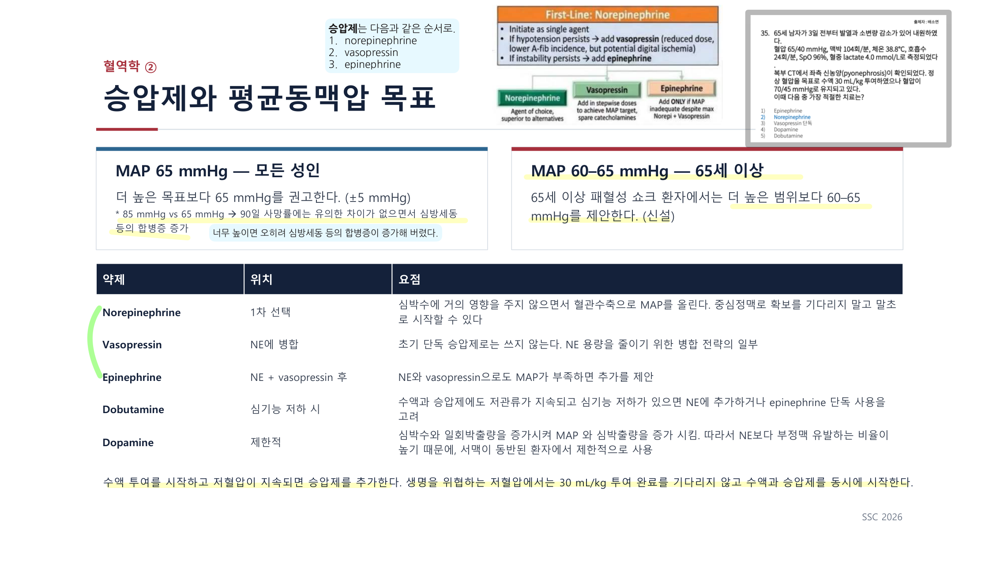{: style="width:80%"}

- **MAP 65 mmHg — 모든 성인**(±5). 85 vs 65 비교에서 90일 사망률 차이 없이 **심방세동 등 합병증만 증가**(손글씨: 너무 높이면 오히려 심방세동 등이 늘어 버렸다).
- **MAP 60–65 mmHg — 65세 이상**(신설).

| 약제 | 위치 | 요점 |
|---|---|---|
| **Norepinephrine** | **1차 선택** | 심박수에 거의 영향 없이 **혈관수축으로 MAP 상승**. **중심정맥로를 기다리지 말고 말초로 시작** 가능 |
| **Vasopressin** | NE에 병합 | **초기 단독 승압제로는 쓰지 않는다.** NE 용량을 줄이려는 병합 전략 |
| **Epinephrine** | NE + vasopressin 후 | NE와 vasopressin으로도 MAP가 부족하면 추가 |
| Dobutamine | 심기능 저하 시 | 수액·승압제에도 저관류 + 심기능 저하면 NE에 추가(또는 epinephrine 단독) |
| Dopamine | 제한적 | 심박수·일회박출량을 늘려 MAP·심박출량↑ → **NE보다 부정맥이 많아 서맥 환자에서만 제한적으로** |

- 손글씨: 승압제는 **① norepinephrine → ② vasopressin → ③ epinephrine** 순서로.
- 수액을 시작하고 저혈압이 지속되면 승압제 추가. **생명을 위협하는 저혈압이면 30 mL/kg 완료를 기다리지 않고 수액과 승압제를 동시에** 시작.
- 승압제의 주의점(작년 필기): **말초혈관 괴사** → 가능하면 빨리 **동맥 카테터(A-line)** 로 혈압 감시.

!!! diff "작년 필기와 다른 점"
    작년: MAP 목표는 **모든 환자 65**, 승압제는 NE 1차 + vasopressin 병합 + dobutamine/dopamine. 올해: **65세 이상 60–65**, **epinephrine이 3번째로 명시**, **말초 정맥으로 NE 시작 가능**이 추가됐다.

!!! exam "기출 포인트"
    1번(2025): 신농양 쇼크, 30 mL/kg 후에도 70/45 → **norepinephrine**(vasopressin **단독** X, dopamine X, dobutamine X). 21번 ⑤ "수액 후 76/45라 **NE 우선**" 옳음, 25번 ⑤ "**dopamine 우선**" 틀림. 8번(2024) ④ "수액 후에도 MAP 50이라 NE 우선" 옳은 보기. 필기본 71쪽에 1번 문제가 붙어 있다.

## 4) 혈역학 ③ 코르티코스테로이드 — 세 번 바뀐 권고 (족보)

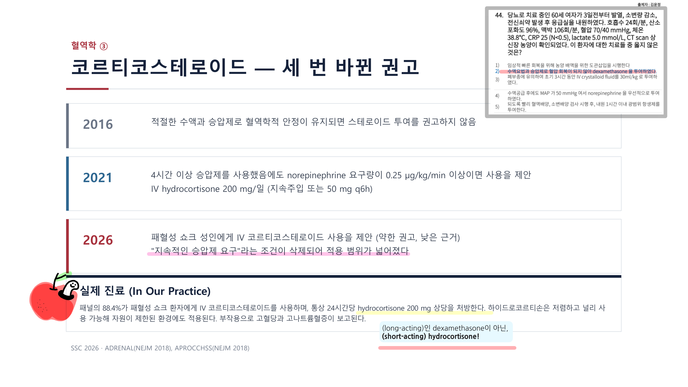{: style="width:80%"}

| 연도 | 권고 |
|---|---|
| 2016 | 적절한 수액·승압제로 혈역학적 안정이 유지되면 **권고하지 않음** |
| 2021 | **4시간 이상 승압제**를 썼는데도 **NE ≥0.25 μg/kg/min**이면 사용 제안 — **IV hydrocortisone 200 mg/일(지속주입 또는 50 mg q6h)** |
| **2026** | **패혈성 쇼크 성인에게 IV 코르티코스테로이드 사용 제안**(약한 권고, 낮은 근거) — "**지속적인 승압제 요구**" 조건이 삭제되어 적용 범위가 넓어짐 |

- 실제 진료: 패널의 **88.4%**가 패혈성 쇼크에 IV 스테로이드를 쓰고, 보통 **hydrocortisone 200 mg/24시간**. 싸고 어디서나 구할 수 있다. 부작용 — **고혈당, 고나트륨혈증**.
- **왜 하필 hydrocortisone인가**(73쪽 손글씨): 과거 **dexamethasone(long-acting)** 으로 연구하니 **위장관 출혈 같은 합병증이 늘었고**, **short-acting인 hydrocortisone**을 쓰니 치료 효과가 좋아졌다(1998년 이후 연구들은 이득 쪽, p=0.036). 필기에 굵게: "**(long-acting)인 dexamethasone이 아닌, (short-acting) hydrocortisone!**"

!!! diff "작년 필기와 다른 점"
    작년(2021): **NE ≥0.25 μg/kg/min을 4시간 이상** 쓸 때 제안. 올해(2026): **패혈성 쇼크면 승압제 요구 조건 없이 제안**. 약과 용량(hydrocortisone 200 mg/일 = 50 mg q6h)은 같다. 기출 보기 "수액·승압제로 혈압이 회복되지 않아 hydrocortisone"은 두 기준 모두에서 옳다.

!!! exam "기출 포인트"
    8번(2024)·9번(2023): 옳지 **않은** 것 → "수액·승압제로 혈압이 회복되지 않아 **dexamethasone**을 투여"(→ hydrocortisone). 21번 ③도 dexamethasone이라 오답. 25번 정답 ④ "수액·승압제로 혈압 회복이 안 돼 **corticosteroid**", 15번 ② "…**hydrocortisone**" 옳음. 31번 정답 "**hydrocortisone 50 mg 6시간마다 IV**". 필기본 72쪽에 8번 문제가 붙어 있다.

## 5) 호흡 보조 — 폐보호 환기
- 패혈증 유발 ARDS의 목표 **일회호흡량 6 mL/kg(예측 체중)** — 고일회호흡량(>10 mL/kg)보다 권고.
- 중증 ARDS는 낮은 PEEP보다 **높은 PEEP**(폐포 허탈 방지, **5 cmH2O 이상**).
- 중증 ARDS(**PaO2/FiO2 <150**)는 **엎드린 자세(prone position)**.
- 흡인성 폐렴·인공호흡기 관련 폐렴 예방 — **침상 머리 30–45도**.
- **진정제**는 효과적인 기계환기를 위해 쓰되 **최소화**, 매일 평가해 용량 조절·중단 시점을 정한다(기계호흡 기간·ICU 재원이 줄어든다).
- **2026 추가**: 패혈증 + 급성 저산소성 호흡부전이면 **비침습적 양압환기(NIV)보다 고유량 비강 캐뉼라(HFNC)** 를 초기 치료로(손글씨: intubation해서 기계호흡을 다는 것보다..).

!!! new "올해 필기에서 추가"
    **HFNC > NIV**(2026 추가 논의). 작년 필기의 "폐동맥 카테터 일상 삽입은 권고하지 않음"은 올해 슬라이드에서 빠졌다.

## 6) 보존적 관리 ① 수혈·혈당·신대체요법

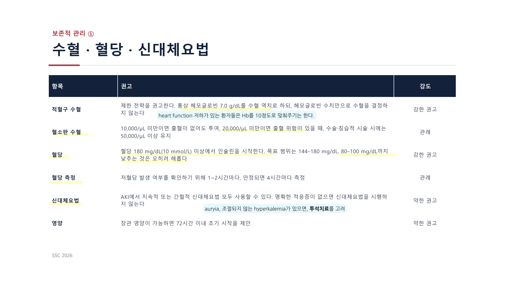{: style="width:78%"}

| 항목 | 권고 | 강도 |
|---|---|---|
| **적혈구 수혈** | **제한 전략**. 통상 **Hb 7.0 g/dL**을 역치로 하되 **Hb 수치만으로 결정하지 않는다** | 강한 권고 |
| **혈소판 수혈** | **<10,000/μL면 출혈 없어도**, **<20,000/μL면 출혈 위험이 있을 때**, 수술·침습적 시술 시 **≥50,000** 유지 | 관례 |
| **혈당** | **180 mg/dL 이상에서 인슐린 시작**, 목표 **144–180 mg/dL**. **80–100까지 낮추는 것은 오히려 해롭다** | 강한 권고 |
| 혈당 측정 | 저혈당 확인 위해 **1–2시간마다**, 안정되면 4시간마다 | 관례 |
| **신대체요법** | AKI에 지속적·간헐적 모두 가능. **명확한 적응증이 없으면 하지 않는다** | 약한 권고 |
| 영양 | **장관영양**이 가능하면 **72시간 이내** 조기 시작 | 약한 권고 |

- 손글씨: **심기능 저하가 있는 환자는 Hb를 10 정도로** 맞춰 주기는 한다. (작년 필기: Hb 10 이상 유지와 생존 차이 없음 — 산소 전달은 늘어도 소비는 안 는다. 급성 심근경색·심한 저산소혈증·급성 출혈은 예외.)
- 손글씨: **무뇨(anuria), 조절되지 않는 고칼륨혈증**이 있으면 투석 고려 — 이것이 "명확한 적응증".

!!! diff "작년 필기와 다른 점"
    혈당: 작년 "**2회 연속 >180이면 인슐린, 목표 ≤180**, 80–110은 해롭다" → 올해 "**≥180에서 시작, 목표 144–180**, 80–100은 해롭다". 수혈: "Hb <7일 때만" → "Hb 7이 역치지만 **수치만으로 결정하지 않는다**". **장관영양 72시간 내**와 "적응증 없으면 신대체요법 X"는 새로 생겼다.

!!! exam "기출 포인트"
    31번(2020) 오답: "**경구 혈당강하제로 혈당 ≤100**"(인슐린, 144–180), "**혈압 유지를 위해 적혈구 2 pack 즉시 수혈**"(수혈은 혈압이 아니라 Hb 기준), "폐부종 위험이 있어 **normal saline 금지**"(정질액은 써야 한다), "**정균** 항생제"(살균).

## 6) 보존적 관리 ② 혈전 예방·스트레스 궤양·중탄산염
- **정맥혈전색전증(VTE) 예방** — 「VTE 권고 변경」
    - 금기가 없으면 **약물 예방**(강한 권고). **미분획 헤파린보다 저분자량 헤파린**(강한 권고).
    - **약물 예방 단독**을 기계적 예방과의 **병합보다** 제안 — **2021년의 병합 권고에서 변경**.
    - 약물을 못 쓰면(혈소판감소, 중증 응고병증, 급성 출혈, 최근 뇌내출혈) **기계적 예방**, 금기가 풀리면 약물로 전환.
    - 손글씨: septic shock 환자는 **혈소판감소**가 동반되는 경우가 많아 약물(헤파린)을 쓰기 어려운 경우가 많다.
- **스트레스 궤양 예방**: 위장관 출혈 위험인자(**응고장애, 48시간 이상 기계환기, 저혈압**)가 있으면 **PPI**(메타분석에서 H2 차단제보다 효과가 다소 큼). **모든 환자에게 일률적으로 하지 않는다.**
- **중탄산염(bicarbonate)**: 혈역학 개선·승압제 감량 목적으로는 **권고하지 않는다.** 다만 **pH ≤7.2 + AKIN 2–3단계 AKI**면 투여를 제안. 손글씨: sepsis는 대사성 산증(HCO3−·pH 감소)이 흔하지만 pH 7.2 이하가 아니면 권고 X.

!!! diff "작년 필기와 다른 점"
    작년 DVT 예방: "신기능 저하면 저분자량 헤파린 우선, **가능하면 기계적 압박 병합**". 올해: **LMWH 강한 권고 + 약물 단독**(병합 X). 중탄산염 권고(pH ≤7.2 + AKIN 2–3)는 새로 들어왔다.

## 7) 권고되지 않는 치료 — 하지 않는 것도 치료다

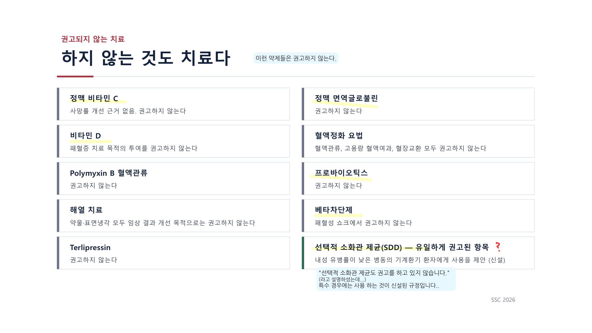{: style="width:76%"}

- **권고하지 않음**: **정맥 비타민 C**(사망률 개선 근거 없음), **정맥 면역글로불린**, 비타민 D, **혈액정화요법**(혈액관류, 고용량 혈액여과, 혈장교환), Polymyxin B 혈액관류, 프로바이오틱스, **해열 치료**(약물·표면냉각 모두 결과 개선 목적으로는 X), **베타차단제**, terlipressin.
- **선택적 소화관 제균(SDD)** — **유일하게 권고된 항목**: 내성 유병률이 낮은 병동의 **기계환기 환자**에게 사용 제안(신설).
- ※ 확인 필요: 손글씨에 교수님은 "선택적 소화관 제균도 권고를 하고 있지 않습니다"라고 설명하셨다고 적혀 있지만, 슬라이드는 "**특수한 경우(내성 낮은 병동의 기계환기 환자) 사용 제안 — 신설**"이다. 시험에서는 슬라이드 문장을 따르는 것이 안전하다.

!!! new "올해 필기에서 추가"
    「권고되지 않는 치료」 목록과 SDD는 올해 새 슬라이드다. TSS 치료에서 말한 **면역글로불린**도 여기서 "권고하지 않음".

## 8) 패혈증 이후 — 퇴원이 끝이 아니다 (2026 강화)
- 치료 목표와 예후를 환자·가족과 **가능한 한 일찍** 정하고 논의. 예후가 불량하면 **완화의료** 의뢰 고려.
- 생존자에게 **중환자 치료 이후 추적관리** 서비스, 퇴원 후 신체·인지·정서 문제 평가·추적, **구두·서면 패혈증 교육**.
- **재활**: 패혈증으로 입원해 **48시간 이상 침습적 기계환기**를 받은 생존자에게 퇴원 후 물리재활 서비스를 권장.
- 숫자: 중증 패혈증 생존자의 **43%가 90일 내 재입원**, 패혈증 후 **1년 내 심혈관 사건 30%**, 생존자의 **25–50%에 장기 인지·기능 장애**.

!!! new "올해 필기에서 추가"
    「패혈증 이후」 슬라이드(추적관리·교육·재활, 43%·30%·25–50%)는 새로 생겼다.

# 8. 예후

- **급성기**: 중증 패혈증의 **20–35%**, 패혈성 쇼크의 **40–60%가 30일 이내 사망**. 이후 약 **6개월까지 사망이 이어진다** — 조절 안 된 감염, 기저질환, 면역저하, 다장기부전.
- **배양 양성과 음성 중증 패혈증의 사망률은 비슷**하다.
- **연령과 기저질환의 중증도가 가장 중요한 결정 요인**. 손글씨: **40세 미만**은 패혈증이 와도 고령보다 사망률이 낮다. 기저질환이 많고 면역억제제를 먹는 사람은 사망률이 높다.
- **예방이 곧 치료**: 선진국의 중증 패혈증은 **원내감염**이 많다 → 침습적 시술·혈관·요로 카테터 사용 제한, **항생제·스테로이드 남용·오용 방지**, 감염관리 수칙 준수. 손글씨: 정말 필요할 때만 항생제·스테로이드 — 고령 환자에게 과량 쓰면 **aspergillosis, candida 같은 진균 감염**이 생길 수 있다.
- **생존 이후**: 신체·정신 영역 삶의 질 저하가 수개월–수년. 신체·인지 장애, 신부전, 심혈관 사건 위험↑. 재입원 진단은 **심부전, 폐렴, COPD 악화, 요로감염**이 흔하고, 패혈증 재입원의 약 **2/3는 처음과 같은 부위** 감염. 동반질환을 보정해도 **최대 5년까지 사망 위험이 높다.**

!!! new "올해 필기에서 추가"
    「생존 이후」(재입원 진단, 2/3 같은 부위, 5년까지 사망 위험)가 추가됐다.

# 9. 증례

## 증례 1 — F/89, 발열 (요로결석 + 요로성 패혈증)
- HTN·DM·골다공증. 내원 2일 전부터 **하복부 통증, 온몸이 덜덜 떨리는 오한, 배뇨 끝의 찌릿함**, 이후 발열·숨참.
- 생각해 볼 점: 고령·당뇨·요로 증상 → 어느 감염원? 어떤 균을 겨냥한 경험적 항생제? 어떤 영상을 먼저?
- **경과**: 혈압 저하 → 수액 소생 → 그래도 안 잡혀 승압제(필기 "inotropic agent").
- **검사**: 염증 수치 상승, **농뇨(pyuria)**. **젖산 8.7 mmol/L**, **대사성 산증(HCO3− 14.9, BE −9.0)**, **creatinine 1.46, 총 bilirubin 1.28** → 신장·간 부전 → SOFA 2점 이상 상승 + 승압제 필요 → **패혈성 쇼크**. 손글씨: SOFA 항목에 있는 혈액검사 항목을 떠올려야 한다.
- **배양**: 혈액배양 2세트 모두 그람음성 막대균 → ***Proteus mirabilis***(그람음성균).
- **복부 CT**: **8 mm 우측 중간 요관 결석 → 상부 경도 폐쇄성 요로병증**.
- **감염원 제거 — 경피적 신루설치술(PCN)**: 요로성 패혈증에서 **폐색이 있으면 배액이 치료의 중심**. 2026 지침은 필요하면 **진단 후 6시간 이내**. 손글씨: 수신증이 생길 정도로 폐쇄가 심하면 PCN이 필요하고, **life-threatening이면 vital이 안정된 뒤가 아니라 최대한 빨리!**

!!! diff "작년 필기와 다른 점"
    작년 증례 1 필기에는 균 이름이 없었고 SOFA를 "bilirubin 1점, creatinine 1점, 의식 1점 → 3점"으로 계산했다. 올해는 **Proteus mirabilis**, **lactate 8.7**, PCN을 **6시간 이내**로 연결했다.

## 증례 2 — M/72, 전신 쇠약 (Klebsiella 균혈증 + 패혈성 쇼크)
- HTN·DM. 7일 전 산책 후 콧물·열감 → 약국 감기약으로 지내다 3일 전부터 **전신쇠약·복부 전체 불편감**.
- 생각해 볼 점: 비특이적 전신쇠약으로 온 고령 환자 — 선행한 상기도 증상과 복부 불편감 중 무엇이 단서인가? 어떤 선별 도구로 조기 인지? 손글씨: **고령에선 발열이 뚜렷하지 않은 경우가 많다.**
- **활력징후**: 혈압이 안 잡혀 **norepinephrine → vasopressin → epinephrine**이 차례로 추가되고 **hydrocortisone** 투여. 2026 지침이면 승압제 요구 조건과 무관하게 패혈성 쇼크에 스테로이드를 제안한다.
- **검사**: **백혈구증가, 혈소판감소**, **pH 7.2 밑**, **대사성 산증 + 과호흡에 의한 호흡성 알칼리증**, **lactate 상당히 높음**, **응고시간 연장·D-dimer 상승 → DIC**(4개 중 3개 이상).
- **복부 CT**: 간 후분절의 경계 불분명한 저음영 병변(손글씨: 뭔지는 모르겠지만 간에 mass가 있다) → *K. pneumoniae*에 의한 **간농양**으로 추정. 손글씨: 평소 신기능이 정상이어도 septic shock이면 AKI가 올 수 있어 **조영제 CT**가 부담될 수 있다.
- **흉부 CT**: 양하엽 경화·간유리음영(폐렴 의심), 폐기종·COPD.
- **혈액배양**: ***Klebsiella pneumoniae***. 손글씨: *K. pneumoniae* 같은 그람음성균이 나오면 **3세대 cephalosporin 내성(ESBL)** 여부를 봐야 한다 — 내성이면 **carbapenem / piperacillin-tazobactam**. 균이 확정되면 **감수성 결과에 따라 좁은 범위로 de-escalation**.
- **경과**: **CRRT(지속적 신대체요법)** 를 계속했지만 사망.

| 단계 | 시행한 조치 | 2026 지침의 근거 |
|---|---|---|
| 인지 | 활력징후 이상·의식 변화 확인 | **NEWS/MEWS** 기반 선별, qSOFA 단독 X |
| 검사 | 혈액배양 2세트, 젖산, 장기부전 평가 | **항생제 전 배양**, 젖산 측정 |
| 항생제 | 배양 후 즉시 광범위 항생제 | 패혈성 쇼크 — **1시간 이내**(강한 권고) |
| 소생 | **balanced crystalloid 30 mL/kg**, 이후 NE | MAP 65, **72세라 60–65** 고려 |
| 보조 | hydrocortisone, CRRT, VTE 예방 | 패혈성 쇼크에 스테로이드 제안 |
| 조정 | 감수성 확인 후 좁은 범위로 | **de-escalation 강한 권고** |

!!! diff "작년 필기와 다른 점"
    작년 증례 2는 "간농양 + Klebsiella, qSOFA ≥2 → SOFA 7점 이상"으로 정리했고, 흉부 CT 폐렴은 넘어갔다. 올해는 승압제 3단계(NE → vasopressin → epinephrine) + hydrocortisone, **DIC 진단 기준 적용**, ESBL 대비 carbapenem·pip/tazo, de-escalation, **CRRT 후 사망**까지 다뤘다.

## 요약 (필기본 99쪽)

| | |
|---|---|
| 정의 | 감염에 대한 조절되지 않는 숙주반응으로 생긴 생명을 위협하는 장기부전. **SOFA 2점 이상 급성 상승** |
| 선별 | qSOFA 단독 X → **NEWS, NEWS2, MEWS, SIRS** |
| 원인 | **폐렴**이 가장 흔한 감염원, ICU 분리주는 **그람음성균** 우세 |
| 항생제 | 패혈성 쇼크·가능성 높은 패혈증은 **1시간**, 쇼크 없는 가능성 있는 패혈증은 신속 평가 후 **3시간** |
| 감염원 제거 | 필요하면 진단 후 **6시간** 이내 |
| 혈역학 | **균형 정질액 30 mL/kg, NE 1차, MAP 65(65세 이상 60–65)** |
| 관리 | 감수성 확인 시 **de-escalation**, **β-lactam 연장주입**, **짧은 치료 기간** |
| 이후 | 생존자의 장기 후유증을 평가·추적 |

!!! memo "암기"
    Sepsis = 감염 + **SOFA ≥2 상승**(사망 10%) / Shock = 충분한 수액에도 승압제로 **MAP ≥65** + **lactate >2**(사망 >40%) · qSOFA = **RR ≥22, 의식 변화, SBP ≤100**(단독 선별 X → NEWS·MEWS·SIRS) · SOFA = PaO2/FiO2·혈소판·bilirubin·MAP(승압제)·GCS·creatinine(소변량) — **RR·HR·lactate는 SOFA 아님** · 감염원 1위 **폐렴(51%)**, 혈배 양성 10–20% · ICU 분리주 **그람음성 67%** · 장기부전 빈도 **호흡 47 > 심혈관 40 > 신장 27** · 기전: 투과성↑·혈관 **확장**(NO↑)·antithrombin/protein C↓·**fibrinolysis↓**·lactate↑ · AKI는 **가역적** · 괴저성 농창 = **녹농균**, 자반 = **수막알균**, 일광화상 발진 = **TSS** · 치료: **배양 먼저 → 1시간 내 항생제**, **균형 정질액 30 mL/kg/3h**, **NE → vasopressin → epinephrine**, **MAP 65(≥65세 60–65)**, source control **6시간**, **hydrocortisone 200 mg/일**(dexamethasone X), Hb 7, 혈당 **144–180**, β-lactam 알레르기 → **FQ**, 호중구감소 → **항녹농균 β-lactam(ceftriaxone X)**.
