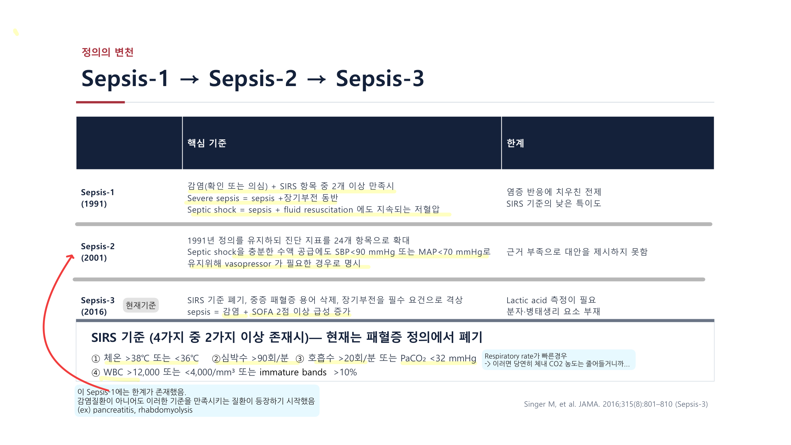

<!-- 필기본: 2026 · 2025 -->
<!-- 단계: 수업 후 -->

# 0. 이 수업을 공부하는 법

경북대병원 감염내과 김윤정 교수님 수업. 올해 슬라이드는 **2026년 3월에 나온 Surviving Sepsis Campaign(SSC 2026) 지침**을 반영해 통째로 새로 만들어졌다(작년 71쪽 → 올해 100쪽). 필기 작성자 말: "레전드로 양 많고, guideline도 하필이면 2026년에 바뀌어서 바뀐 내용이 엄청 많네요 ㅠㅠ".

필기 작성자가 정리한 **출제 경향**(1쪽):

1. **SOFA score의 항목** 잘 알아두기
2. **Sepsis로 인한 합병증(빈도 포함) + 사진과 원인균**
3. **경험적 항생제 사용 원칙 + 특정 상황(호중구감소·비장절제·β-lactam 알레르기 등)에서 어떤 항생제를 쓰는가**
4. **Sepsis의 병태생리**

필기본에 🍎(빨간 사과) 표시 = 「족보」, 즉 기출이 나온 자리다. 올해 🍎는 SOFA 표, 감염원(폐렴 51%), 병태생리 그림, 괴저성 농창, 경험적 항생제 두 쪽, 스테로이드(hydrocortisone)에 붙어 있다.

!!! key "핵심"
    **Sepsis = 감염 + SOFA 2점 이상 상승**(감염 전과 비교). **Septic shock = sepsis + 충분한 수액에도 MAP ≥65 유지에 승압제 필요 + lactate >2 mmol/L.**
    **2026 치료**: 쇼크·가능성 높은 패혈증은 **배양 후 1시간 이내 항생제**(쇼크 없는 "가능성 있음"은 3시간), **균형 정질액 30 mL/kg(3시간)**, **norepinephrine → vasopressin → epinephrine**, **MAP 65(65세 이상 60–65)**, **감염원 제거 6시간 이내**, **감수성 나오면 de-escalation(강한 권고)**, **패혈성 쇼크에 IV hydrocortisone**(승압제 조건 삭제).

학습성과(올해)
1. 패혈증과 패혈성 쇼크를 정의하고, **정의가 바뀌어 온 과정**을 설명한다. (필기: "2026년 3월에도 또 바뀜..")
2. 패혈성 쇼크의 **발생 기전**을 설명한다.
3. 패혈증의 원인균을 **임상 상황에 따라 추정**한다.
4. **2026년 개정 지침에 따른 초기 치료 원칙**을 설명한다.

!!! diff "작년 필기와 다른 점"
    작년 학습성과는 "기전 설명 / 정의 / 원인균 추정과 쇼크의 치료 원칙" 3개였다. 올해는 **정의의 변천**과 **2026 개정 지침**이 따로 목표로 올라왔다 — 2021→2026 바뀐 점이 시험에 나올 수 있다. 다만 **기출(2020–2025)은 모두 2016·2021 기준 강의에서 나왔다.** 아래에 바뀐 곳마다 작년(2021) 값을 `diff` 상자로 남겼다.

- 기출 **32문항**(2020–2025). 반복 유형
    - **SOFA에 들어가지 않는 항목** → **호흡수**(4번 출제), 심박수, lactate.
    - **병태생리로 옳지 않은 것** → **혈관수축**, **fibrinolysis 증가**, **lactate 감소**, **antithrombin 증가**(모두 반대).
    - **패혈증 특징으로 옳지 않은 것** → "신손상은 대부분 비가역적"(가역적이다), "혈액배양 음성이면 배제".
    - **항생제 원칙으로 틀린 것** → "de-escalation을 최대한 늦춘다", "β-lactam 알레르기면 carbapenem", 호중구감소 환자에 **ceftriaxone**, 요로 패혈증에 **vancomycin 단독**.
    - **쇼크 사례 치료** → norepinephrine 우선, **배양 먼저** 그리고 1시간 내 항생제, 수액 30 mL/kg, 반응 없으면 **hydrocortisone(dexamethasone 아님)**.
    - 피부 소견: **괴저성 농창 = 녹농균**, TSS 홍피증, 수막알균 자반.

# 1. 역학
- **연간 전 세계 패혈증 4,900만 건, 관련 사망 1,300만 명** — "전 세계 사망의 다섯 명 중 한 명".
- 병원 내 사망 중 패혈증이 기여하는 비율 **25–50%**, **비관상동맥(non-coronary) 중환자실 사망원인 1위**. 의료비 지출도 막대하다.
- 늘어나는 이유 = 감염에 취약한 환자군이 늘어남
    - 혈관 내 도관 같은 **침습적 장치** 사용 증가
    - 암·이식 환자의 **세포독성 약제·면역억제제** 사용 증가
    - **당뇨·암 환자의 수명 연장과 인구 고령화**
    - **항균제 내성균** 감염 증가

!!! new "올해 필기에서 추가"
    발생·사망 건수(4,900만 / 1,300만)와 "인구 고령화"가 새로 들어왔다. 작년 필기의 "비심장 중환자실 사망의 가장 흔한 원인"은 올해 "비관상동맥 중환자실 사망원인 1위"로 같은 내용이다.

# 2. 정의와 진단 기준

## 정의의 변천 — Sepsis-1 → Sepsis-2 → Sepsis-3

{: style="width:80%"}

| | 핵심 기준 | 한계 |
|---|---|---|
| **Sepsis-1 (1991)** | 감염(확인·의심) + **SIRS 2개 이상**. Severe sepsis = sepsis + 장기부전, Septic shock = sepsis + 수액에도 지속되는 저혈압 | 염증반응에 치우친 전제, **SIRS의 낮은 특이도** |
| **Sepsis-2 (2001)** | 1991 정의 유지, 진단 지표를 **24개 항목**으로 확대. Septic shock = 충분한 수액에도 **SBP <90 또는 MAP <70**을 유지하려고 승압제가 필요한 경우 | 근거 부족으로 대안 제시 못함 |
| **Sepsis-3 (2016)** | **SIRS 폐기, severe sepsis 용어 삭제, 장기부전을 필수 요건으로.** sepsis = 감염 + **SOFA 2점 이상 급성 증가**. **lactate 측정 필요** | 분자·병태생리 요소 부재 |

- **SIRS**(전신염증반응증후군, systemic inflammatory response syndrome) — 4개 중 2개 이상, **현재 패혈증 정의에서는 폐기**
    1. 체온 >38℃ 또는 <36℃
    2. 심박수 >90회/분
    3. 호흡수 >20회/분 또는 PaCO2 <32 mmHg — 숨을 빨리 쉬면 CO2가 날아가 PaCO2가 낮아지니 같은 뜻이다.
    4. WBC >12,000 또는 <4,000/mm3 또는 미성숙 띠호중구(immature band) >10%
- **왜 버렸나**: 감염이 아니어도 SIRS를 만족하는 질환이 많았다 — 예: **급성 췌장염, 횡문근융해증**. 즉 특이도가 낮다. 그래서 Sepsis-3는 "염증이 있느냐"가 아니라 "**장기가 망가졌느냐**(SOFA)"로 정의를 옮겼다.

!!! new "올해 필기에서 추가"
    작년엔 "2016년 이전(Sepsis-2) / 이후(Sepsis-3)" 두 칸이었는데, 올해는 **1991·2001·2016 세 단계와 각각의 한계**를 표로 정리했다(학습성과 1번). Sepsis-2의 쇼크 기준 **SBP <90 또는 MAP <70**, SIRS 폐기 이유(**췌장염·횡문근융해**)가 새로 나왔다.

## 2016년 이후 — Sepsis-3 정의
- **패혈증(sepsis)** = 감염에 대한 숙주의 **조절되지 않는 반응**으로 생긴 **생명을 위협하는 장기부전** = **감염 + SOFA 2점 이상 상승**(사망률 약 10%).
- **패혈성 쇼크(septic shock)** = 순환·세포·대사 이상이 심해 사망률이 더 높은(**>40%**) 패혈증의 부분집합.
    1. 패혈증이면서
    2. **충분한 수액에도 MAP ≥65 mmHg를 유지하려면 승압제가 필요**하고
    3. **동시에 lactate >2 mmol/L(18 mg/dL)**
- 필기: "**진기·치기 때 죽어라 나온 내용**이었습니다.." — 쇼크의 세 조건(수액 충분히 + 승압제 필요 + lactate >2)을 하나라도 빼면 오답 보기가 된다.

## SOFA score — 장기부전의 계량화 🍎

{: style="width:82%"}

| 장기 | 지표 | 1점 | 2점 | 3점 | 4점 |
|---|---|---|---|---|---|
| 호흡 | **PaO2/FiO2** | <400 | <300 | <200 + 호흡보조 | <100 + 호흡보조 |
| 중추신경 | **GCS** | 13–14 | 10–12 | 6–9 | <6 |
| 심혈관 | **MAP 또는 승압제**(μg/kg/min) | MAP <70 | dopamine <5 또는 dobutamine(용량 무관) | dopamine 5.1–15, EPI ≤0.1, NE ≤0.1 | dopamine >15, EPI >0.1, NE >0.1 |
| 간 | **bilirubin**(mg/dL) | 1.2–1.9 | 2.0–5.9 | 6.0–11.9 | >12.0 |
| 응고 | **혈소판**(×103/μL) | <150 | <100 | <50 | <20 |
| 신장 | **creatinine**(mg/dL) 또는 **소변량** | 1.2–1.9 | 2.0–3.4 | 3.5–4.9 또는 <500 mL/일 | >5.0 또는 <200 mL/일 |

- **각 장기의 가장 나쁜 점수를 합산**한다. 점수가 높을수록 사망 확률이 높다.
- 필기: "**정확한 계산법이 중요하다기보다, 어떤 organ involvement가 중요하고 혈액검사에서 무엇을 봐야 하는가가 중요하다.**" 표 옆 손글씨로 방향만 잡아 두자.
    - 호흡: 산소를 많이 줘야 할수록(FiO2↑ → P/F↓) 나쁘고, **인공호흡기 보조**가 붙으면 점수가 더 높다.
    - 의식: 의식 상태가 낮을수록(GCS↓).
    - 심혈관: **승압제 사용량이 많을수록** 높다.
    - 응고: 혈소판이 떨어질수록. 신장: creatinine이 오를수록, 소변량이 줄수록.
- **SOFA는 "감염 전과 후의 점수를 비교"한다**(작년 교수님이 공지까지 부탁하신 내용). 기저 지방간·신부전으로 creatinine 1.3, bilirubin 1.3인 환자는 감염 전부터 SOFA 2점이지만 감염이 없으면 sepsis가 아니다. **감염 이후 이전보다 2점 이상 올라야 sepsis.** 기저질환을 모르면 기저 SOFA를 **0점**으로 본다.

!!! new "올해 필기에서 추가"
    작년엔 1점 기준만 표로 외웠는데 올해는 **1–4점 전체 표**와 승압제 용량 기준(dopamine 5·15, NE/EPI 0.1)이 슬라이드에 나왔다. 그래도 필기 작성자 말대로 **항목 6개와 1점 값**이 우선이다.

!!! exam "기출 포인트"
    SOFA에 **포함되지 않는** 것 → **호흡수**(3·17·19번 — RR은 qSOFA 항목!), **심박수**(23번), **lactic acid**(30번 — lactate는 쇼크 정의에 쓰지 SOFA 항목이 아님). 소변량·GCS·bilirubin·혈소판·creatinine·MAP·PaO2/FiO2는 포함. 필기본 11쪽에 이 문제들(2025 50번, 2022 46번·27번, 2021 38번)이 모여 있다.

## 패혈증의 장기부전 — 어느 장기가, 몇 개나

{: style="width:78%"}

- 장기부전은 패혈증의 핵심 징후. **호흡기·심혈관 부전이 가장 흔하고**, 그다음 신장, 중추신경, 혈액, 간 순.
- **호흡부전, 쇼크, 신부전**이 ICU 입원의 가장 흔한 원인 — 손글씨: mechanical ventilator, ECMO, 투석이 필요할 수 있으니까.
- 필기: "= **SOFA score에 포함된 장기들에 생기는 부전들이 중요하다.**"

| 장기 | 빈도 | 주요 발현 |
|---|---|---|
| 호흡기 | **47%** | ARDS — 비심인성 폐부종, 저산소혈증, 기계환기 |
| 심혈관 | **40%** | 심근기능 저하 + 혈관 확장에 의한 상대적 혈량 저하 |
| 신장 | 27% | 핍뇨, 질소혈증, 신대체요법 필요 |
| 중추신경 | 18% | 섬망, 패혈증 관련 뇌병증, 다발신경병증·근병증 |
| 혈액 | 18% | 혈소판감소, DIC |
| 간 | 6% | 담즙정체성 황달, 아미노전이효소 상승 |

- **부전 장기의 수가 곧 사망률**: 대부분 단일 장기부전, 약 20%가 두 장기, 약 5%가 세 장기 이상. 사망률은 **두 장기 26%, 네 장기 이상 65%**. 손글씨: "Multiorgan failure의 수가 늘어날수록 사망률도 높아진다."

!!! new "올해 필기에서 추가"
    장기별 **빈도(호흡 47 > 심혈관 40 > 신장 27 > CNS 18 = 혈액 18 > 간 6%)** 와 부전 장기 수별 사망률은 올해 새 슬라이드다. 출제 경향 2번이 "합병증(빈도 포함)"이므로 순서를 외워 두자.

## 호흡 항목 계산 — P/F ratio

{: style="width:72%"}

- **FiO2(흡입산소분율)**: 환자가 들이마시는 산소의 분율을 소수로(40% 산소 = 0.4). 실제 흡입 농도는 호흡수·호흡량·산소 공급 속도에 따라 달라진다. 비강 캐뉼라 1 L/분 ≈ 24%, 이후 1 L 늘 때마다 약 4%씩(6 L ≈ 44%), 리저버 마스크 10 L ≈ 95%(필기본 14쪽 추정표).
- **PaO2(동맥혈 산소분압)**: 동맥혈가스분석(ABGA)으로 잰 혈장 내 산소분압(mmHg).
- 손글씨: "**P/F ratio는 SOFA 계산에도 쓰이지만 ARDS 중증도 분류에도 사용됨.**"
- **예시**: 인공호흡기 FiO2 0.4에서 PaO2 70.1 → **70.1 ÷ 0.4 = 175.3** → 호흡보조 중 <200이므로 **SOFA 호흡 3점**, ARDS로는 **중등증(101–200)**.
- 해석표: ≥400 정상, <400 저산소혈증, <300 호흡부전, <250 중증 호흡부전, <200 위중한 호흡부전.

## qSOFA — 더 이상 단독 선별 도구가 아니다

{: style="width:80%"}

| qSOFA(0–3점) | |
|---|---|
| **호흡수 ≥22회/분** | 1 |
| **의식 변화**(GCS <15) | 1 |
| **수축기 혈압 ≤100 mmHg** | 1 |

- 왜 만들었나(손글씨): SOFA는 **혈액검사(혈소판, creatinine, bilirubin) 없이는** 계산할 수 없다. 환자가 막 내원했을 때나 일반 병동에서 sepsis를 **조기에** 잡을 방법이 필요해 나온 것이 qSOFA.
- 흐름: 감염 의심 → **qSOFA ≥2?** → 그러면 **SOFA 계산** → **SOFA ≥2 상승 = sepsis** → 충분한 수액에도 **MAP ≥65 유지에 승압제 필요 + lactate >2 = septic shock**.
- (작년 필기 주의) 증례에서 교수님이 "맥박"으로 qSOFA를 매기신 적이 있지만 기준은 **수축기 혈압**이다. 맥박·산소포화도는 qSOFA 항목이 아니다.

## 선별 도구 — 2026 권고: NEWS / NEWS2 / MEWS / SIRS

{: style="width:80%"}

- **권고**: 입원 중인 중증 환자의 패혈증 선별에 **qSOFA 단독 대신 NEWS, NEWS2, MEWS 또는 SIRS**를 쓴다. 이상적인 도구는 없고, 선별 양성이라고 모두 패혈증은 아니다.

| 도구 | 구성 | 특징 |
|---|---|---|
| **NEWS / NEWS2** | 호흡수, 산소포화도, 수축기 혈압, **심박수, 체온**, 의식 수준 (6개 생리지표) | **민감도가 높아** 조기 악화 감지에 유리. NEWS2는 고탄산혈증성 호흡부전 환자를 보정 |
| MEWS | 수축기 혈압, 심박수, 호흡수, 체온, 의식 | 계산이 간단해 일반 병동에 쉬움 |
| **SIRS** | 체온, 심박수, 호흡수/PaCO2, 백혈구 | 정의에서는 폐기됐지만 **선별 목적으로는 여전히 유효** |
| qSOFA | 호흡수, 의식, 수축기 혈압 | **민감도가 낮아 단독 선별 도구로 권고되지 않음.** 임상적 악화 감지에는 여전히 유용 |

- 손글씨: "Sepsis-1 기준이었던 **SIRS를 다시 선별 도구로** 사용할 수 있다." NEWS는 SOFA와 비슷하지만 **SOFA에 없는 심박수, 호흡수, 체온**이 들어 있다(19쪽).
- 헷갈리지 말 것: **진단(정의)은 SOFA**, **선별은 NEWS·MEWS·SIRS**(qSOFA 단독 X). qSOFA는 **특이도는 높고 민감도가 낮다.**

!!! diff "작년 필기와 다른 점"
    2021 지침(작년 필기): "qSOFA는 단독 선별 도구로 적절하지 않다 → **NEWS 또는 MEWS**의 도움을 받으라." 2026: **NEWS / NEWS2 / MEWS / SIRS** 중 하나를 쓰라 — **SIRS와 NEWS2가 선별 도구로 추가**됐다.

## 진단의 확실성 — 2026에 새로 생긴 네 단계 용어

{: style="width:72%"}

| 단계 | 뜻 |
|---|---|
| **Definite(확진)** | 병력·진찰·검사로 패혈증 확진. 다른 진단 가능성 매우 낮음 |
| **Probable(가능성 높음)** | 패혈증 가능성이 매우 높고 가장 유력한 진단. 다른 질환 가능성 낮음 |
| **Possible(가능성 있음)** | 패혈증 가능성 중간(moderate). 의심되지만 다른 진단 가능성도 있음 |
| **Unlikely(가능성 낮음)** | 임상 평가가 패혈증과 맞지 않거나 다른 진단 가능성이 높음 |

- 임상 현장의 진단은 불확실할 수 있어서, 권고마다 적용 대상을 분명히 하려고 만든 용어. **이 용어가 항생제 투여 시점 권고와 직접 연결된다**(→ 7장, 1시간 vs 3시간). 필기 옆에 🌟 표시.

!!! new "올해 필기에서 추가"
    네 단계 용어(definite·probable·possible·unlikely)는 **SSC 2026 신설**이다(손글씨: "올해 3월에 나온 새로운 guideline"). 작년 필기의 "패혈증 확실/가능성 높음 vs 가능성 있음" 두 줄짜리 표가 이 네 단계로 바뀌었다.
