<!-- 필기본: 2026 · 2025 -->
<!-- 단계: 수업 후 -->

# 0. 이 수업을 공부하는 법

올해는 다시 경북대병원 감염내과 **김윤정 교수님**이 맡으셨다(2023–24년 출제, 2025년만 황소윤 교수님). 강의 제목이 「요로감염: 진단과 항생제 적정 사용」으로 바뀌었고, **2026 국내 요로감염 항생제 적정사용 실무지침**과 **IDSA 2025 complicated UTI 가이드라인**을 반영했다. 필기 작성자 말: "결국 **발열 여부로 localized vs systemic UTI**를 가르고, systemic에서는 **패혈증 여부**를 확인해 상황에 맞게 치료하는 것이 핵심. 무증상 세균뇨는 치료하지 않지만 **임산부·점막 손상 비뇨기 시술 전**은 치료 — 이 내용이 반복해서 나온다." 교수님이 바뀌어도 문제 유형은 비슷하다.

학습성과 (올해)

1. 방광염과 급성 신우신염의 흔한 원인과 발병기전
2. 급성 신우신염의 전형적 증상과 징후
3. **Localized UTI, Systemic UTI, 무증상 세균뇨를 구분해 진단** — "최근 요로감염을 구분하는 기준이 바뀌었다."
4. **중증도와 내성균 위험인자를 반영한 단계별 경험적 항생제 선택**
5. **확정적 항생제 전환, 경구 전환 기준, 적정 치료기간**
6. 치료 실패 시 확인할 요인과 **감염원 조절**의 필요성

- 기출 19문항(2020–2025)의 반복 유형
    - **건강한 젊은 여성 + 발열 + CVA 압통 → 원인균 *E. coli***(4·5·11번).
    - **무증상 세균뇨 → 치료하지 않고 관찰**(건강 여성, 당뇨 노인, 도뇨관 칸디다뇨, 다제내성 녹농균은 접촉주의). 예외 = **임산부**(+ 점막 손상 비뇨기 시술 전).
    - **경험적 항생제**: 젊은 여성 APN 외래 → ciprofloxacin, **임산부 → ceftriaxone**, **요양병원·당뇨 노인 → piperacillin/tazobactam**, 반복 감염·도뇨관(ESBL 의심) → **ertapenem**.
    - **발열 = 상부 vs 하부 요로감염 감별의 가장 중요한 증상**(19번).

!!! key "핵심 (올해 기준)"
    **발열·오한·옆구리 통증(방광을 넘은 증상) 유무**로 Localized(= uncomplicated) vs Systemic(= complicated) UTI를 나눈다. **원인균 1위는 어디서나 *E. coli***.
    **무증상 세균뇨는 임산부·점막 손상 비뇨기 시술 전만 치료** — 나머지는 선별검사도 하지 않는다. 탁한 소변·냄새·농뇨만으로는 UTI가 아니다.
    Localized UTI 1차 약 = **nitrofurantoin 5일 또는 fosfomycin 1회**(FQ는 1차 아님). Systemic UTI는 **중증도 → 내성위험 → 환자요인 → (패혈증이면) antibiogram** 순으로 고르고, 배양이 나오면 좁히고, 호전되면 경구로, **대부분 7일**(FQ 5–7일).

!!! diff "작년 필기와 다른 점 — 치료기간"
    작년(2025) 필기는 **젊은 여성 APN 14일**(퀴놀론 7일), 단순 방광염 3일(당뇨 7일), 남성 APN 2주, 급성 전립선염 4–6주였다. 올해는 **systemic UTI 대부분 7일(FQ 5–7일)**, "과거 14일 → 현재 7일"로 바뀌었다. 기출은 작년까지 강의에서 나왔으니 두 기준을 모두 알아 두되, 올해 시험은 새 기준으로 나올 가능성이 높다.

# 1. 분류, 원인, 임상양상과 진단

## 정의
- **요로감염(UTI)** = 요로의 한 곳 이상에 생긴 **증상이 있는(symptomatic) 감염**. 임상 스펙트럼은 **무증상 세균뇨부터 UTI로 인한 패혈증(sepsis)** 까지 넓다.

## 감염 범위에 따른 분류 — 바뀐 기준
핵심 질문은 둘: **증상이 있는가? 감염이 방광을 넘었는가?**

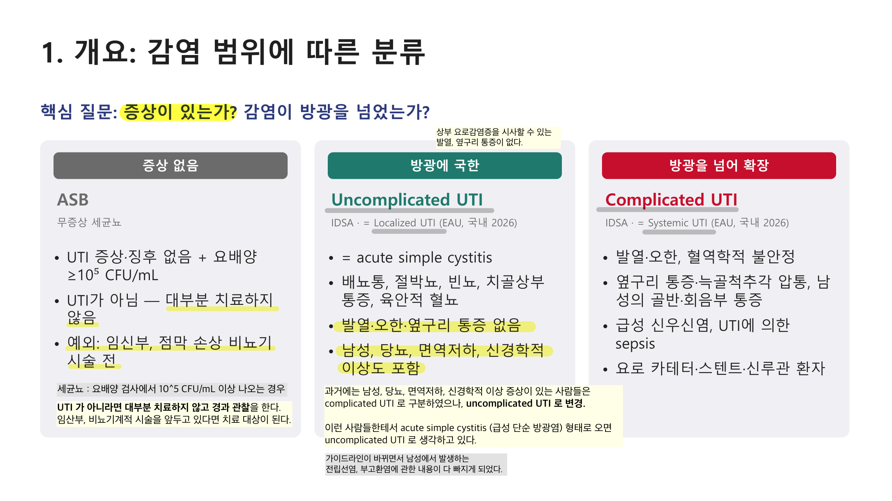{: style="width:80%"}

| 분류 | 정의 | 특징 |
|---|---|---|
| **무증상 세균뇨(ASB)** | 증상·징후 없음 + 요배양 ≥105 CFU/mL | **UTI가 아님** — 대부분 치료 X. 예외: 임신부, 점막 손상 비뇨기 시술 전 |
| **Uncomplicated UTI** = **Localized UTI**(EAU, 국내 2026) | 방광에 국한 = **급성 단순 방광염** | 배뇨통·절박뇨·빈뇨·치골상부 통증·육안적 혈뇨, **발열·오한·옆구리 통증 없음** |
| **Complicated UTI** = **Systemic UTI** | 방광을 넘어 확장 | **발열·오한·혈역학적 불안정**, 옆구리 통증·CVA 압통, 남성 골반·회음부 통증. APN, UTI에 의한 sepsis, 카테터·스텐트·신루관 환자 |

- **바뀐 점**: 과거에는 **남성, 당뇨, 면역저하, 신경학적 이상**이 있으면 무조건 complicated로 분류했다. 지금은 이런 사람도 **급성 단순 방광염 형태(방광 국한)로 오면 uncomplicated(localized) UTI**로 본다. 즉 기준이 "환자가 누구인가"에서 "**감염이 방광을 넘었는가(발열 등 전신 증상)**"로 바뀌었다.
- 가이드라인이 바뀌면서 **남성의 전립선염·부고환염** 내용은 이 분류에서 빠졌다(적용하지 않음).

!!! diff "작년 필기와 다른 점 — 분류 기준"
    작년 필기의 분류: **단순(uncomplicated) = 임산부를 제외한 성인 여성의 방광염**(해부·신경학적 이상 없는 여성), **복잡(complicated) = 소아, 남자, 임산부, 신장의 감염, 요로폐쇄, 도관, 잔뇨, 신이식**. "남자는 요도가 길어 감염이 드물어 거의 무조건 복잡 요로감염", "임산부는 무조건 치료 대상이라 단순으로 분류하지 않는다." 또 상부(신장·요관) vs 하부(방광·요도, 남자는 전립선) 분류도 있었다. 올해는 남성·당뇨·면역저하도 방광 국한이면 uncomplicated.

## 용어 정리

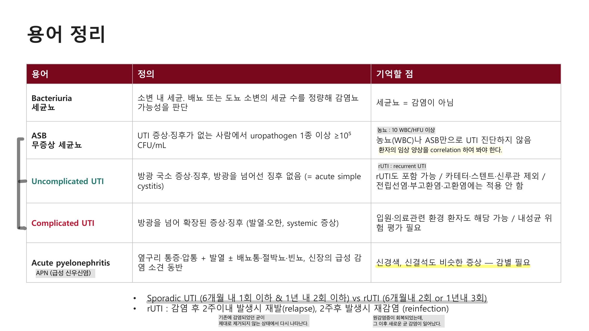{: style="width:80%"}

- **세균뇨(bacteriuria)**: 소변 내 세균. 배뇨·도뇨 소변의 세균 수를 정량해 감염 가능성을 판단. **세균뇨 ≠ 감염.**
- **무증상 세균뇨(ASB)**: UTI 증상·징후가 없는 사람에서 요로병원균 1종 이상 ≥105 CFU/mL. **농뇨(WBC)나 ASB만으로 UTI를 진단하지 않는다.**
- **Uncomplicated UTI**: 방광 국소 증상·징후만, 방광을 넘은 징후 없음(= acute simple cystitis). 재발성 UTI도 포함될 수 있으나 **카테터·스텐트·신루관은 제외**, **전립선염·부고환염·고환염에는 적용 안 함.**
- **Complicated UTI**: 방광을 넘어 확장된 증상·징후(발열·오한 등 전신 증상). 입원·의료관련 환경 환자도 해당 가능 → **내성균 위험 평가 필요.**
- **급성 신우신염(APN)**: 옆구리 통증·압통 + 발열 ± 배뇨통·절박뇨·빈뇨 + 신장의 급성 감염 소견. **신경색·신결석도 비슷한 증상** → 감별 필요(임상 양상과 함께 판단).
- **농뇨** 기준: **≥10 WBC/HPF**.
- **재발**: {{산발성(sporadic) UTI}} = 6개월 내 1회 이하 & 1년 내 2회 이하 vs **재발성 UTI(rUTI)** = **6개월 내 2회 또는 1년 내 3회**. rUTI 중 **감염 후 2주 이내 = 재발(relapse)**(원래 균이 제대로 제거되지 않고 다시 나타남), **2주 후 = 재감염(reinfection)**(회복 후 새로운 균 감염).

## 원인균
- 요로감염의 **95% 이상은 한 가지 원인균**, 방광염·신우신염의 **80% 이상이 대장균**. ***E. coli*는 모든 환자군에서 UTI의 가장 흔한 원인균.**
- ***Staphylococcus saprophyticus***: 과거엔 오염균으로 봤으나 현재는 **젊은 여성 UTI의 원인균**.
- ***S. aureus* 세균뇨**: **균혈증 뒤 전이 병소**로 나타나는 경우가 많다 → UTI는 보통 그람음성인데 *S. aureus*가 나오면 거꾸로 *S. aureus* 균혈증을 의심해 **심초음파(2D-echo)** 까지 할 수 있다.

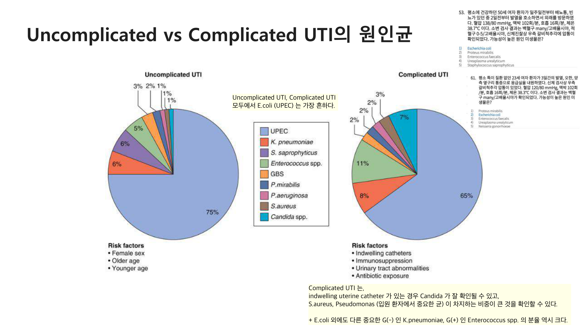{: style="width:78%"}

| | Uncomplicated (급성 단순 방광염) | Complicated (acute) |
|---|---|---|
| 1위 | **UPEC**(요로병원성 대장균) **70–80%** | ***E. coli* 약 65%** |
| 그 다음 | *Klebsiella* 6%, *S. saprophyticus* 6%, *Enterococcus* 5% | ***Enterococcus* 11%**, *K. pneumoniae* 8%, ***Candida* 7%** |
| 기타 | ***Candida* ~1%** — 요배양의 칸디다는 대부분 치료가 필요 없는 **집락(colonization)** | *S. aureus*, *P. mirabilis*, *P. aeruginosa*, *S. agalactiae*(GBS) 각 약 2% |

- Complicated UTI에서 **유치 도뇨관이 있으면 *Candida***가 잘 나오고, **입원 환자에서 중요한 *S. aureus*·*Pseudomonas*** 비중이 커진다. *K. pneumoniae*(그람음성), *Enterococcus*(그람양성) 비율도 크다.
- **외래 vs 입원**: 둘 다 *E. coli*가 가장 흔하지만 **입원 환자는 *Enterobacter*, *Pseudomonas* 등 다른 그람음성균 비율이 높다.**
- **카테터 관련 UTI에서는 yeast(진균)** 가 많다(원인균 분포표에서 28%).

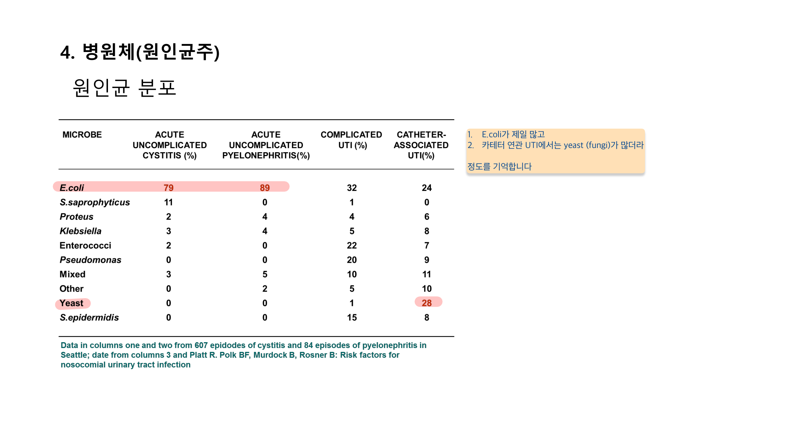{: style="width:58%"}

- 30일 이상 **장기 도뇨관**에서는 균막(biofilm)에 잘 집락하는 ***Proteus mirabilis***, ***Morganella morganii***, ***Providencia stuartii***(작년 필기).

!!! exam "기출 포인트"
    건강한 여성의 발열·CVA 압통·농뇨 → ***E. coli***(4·5·11번). 함정 — *S. saprophyticus*(젊은 여성 **방광염**), *Proteus*(결석), *E. faecalis*(의료관련·도관), *Ureaplasma*·임균(요도염). 10번: 도뇨관 관련 세균뇨의 가장 흔한 원인균도 ***E. coli***(Candida 아님). 15번: **유주현상(swarming)** + **신장결석** → ***Proteus mirabilis***(urease → struvite 결석). 17번: 신이식 7일째 농뇨 → 그래도 ***E. coli***(BK virus 아님).

## 발병기전과 위험요인

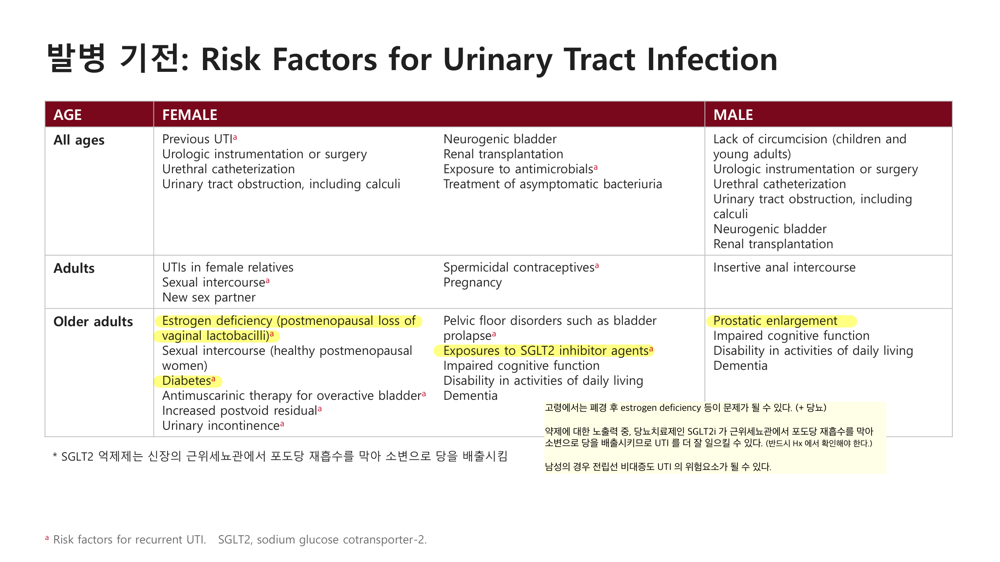{: style="width:80%"}

- **모든 나이**: 이전 UTI, 비뇨기 기구·수술, 요도 도뇨, **결석 포함 요로폐쇄**, 신경인성 방광, 신이식, 항균제 노출, 무증상 세균뇨 치료력. 남아·젊은 남성은 **포경 안 함**.
- **성인 여성**: 여성 친척의 UTI, **성교**, 새 성 파트너, **살정제**, 임신 / 남성: 삽입 항문성교.
- **고령**: 여성은 **폐경 후 에스트로겐 결핍**(질 유산균 소실), 성교, **당뇨**, 과민성방광 항무스카린제, **잔뇨 증가**, 요실금, 방광탈출 같은 골반저 질환, **SGLT2 억제제**, 인지기능 저하·일상생활 장애·치매 / 남성은 **전립선 비대**.
- **SGLT2 억제제**(당뇨약): 근위세뇨관 포도당 재흡수를 막아 **소변으로 당을 배출** → UTI를 더 잘 일으킨다. **병력에서 반드시 확인.**
- **병원체**: 부착 기능 등 형태 변화로 **독력(virulence)** 을 얻는다. **환경**: 유치 도뇨관·의료기구. **숙주**: 고령, 면역을 떨어뜨리는 기저질환. 작년 필기의 표현으로 거의 모든 감염을 **숙주·균·환경** 셋으로 나눠 생각한다. 어딘가 막혀 소변이 고이면 UTI가 잘 생긴다(요도·요관 협착, 종양, 결석, 전립선 비대).
- **숙주 방어**: ① 소변 자체(삼투압, pH, 유기산) ② **소변 흐름과 배뇨** ③ 요로 점막(살균 펩타이드·사이토카인 — 선천면역) ④ 염증 반응(호중구, **Tamm-Horsfall 단백**, 분비 IgA, 락토페린 등) ⑤ 적응면역(체액·세포) ⑥ 전립선 분비물. 병원체가 우세해지면 UTI가 생긴다.

!!! exam "기출 포인트"
    16번: 73세 여자 하복부 통증 + 방광벽 가스 사진(기종성 방광염) → 가장 중요한 기저 위험요소 **당뇨**.

## 나이에 따른 역학
- **생후 3개월 이내에는 남아가 여아보다 흔하고**, 이후 역전되어 **여자에서 많다가**, **노인에서는 남녀 비율이 같아진다.**
- 어린 나이: **방광요관역류(VUR)** — 방광 내압이 올라가 UTI가 흔하다(소아의 재발성 UTI면 해부학적 원인의 역류 의심).
- 젊은 나이: **성관계**. 고령 여자: **폐경 후 에스트로겐 결핍**, 고령 남자: **전립선 비대**.
- (작년 필기) 신우신염 횟수가 늘수록 재발률 증가, 나이가 들수록 무증상 세균뇨 증가 — 당뇨 여성 9–27%, 간헐적 도뇨 척수손상 환자 23–89%.

## 임상양상
| | 증상 |
|---|---|
| **방광염** | 갑자기 시작. **배뇨통**(dysuria), 소변량 감소, **빈뇨·긴박뇨**, 아랫배 불쾌감·허리 통증. **약 1/3에서 혈뇨** |
| **전립선염**(남자) | 방광염 증상 또는 **방광출구 폐쇄 증상**: hesitancy, 가는 소변줄, nocturia, 배뇨 후 점적(postmicturition dribbling) |
| **신우신염** | **오한, 발열, 측복부(옆구리) 통증**, 두통, 오심·구토, 복통, 허리 통증. 경증부터 **그람음성균 패혈증**까지 |

- **발열이 하부와 상부 요로감염을 감별하는 가장 중요한 요소** — 지금은 이것이 **uncomplicated(localized)와 complicated(systemic)를 가르는 중요한 요소**이기도 하다.
- 적절한 항생제에도 **48–72시간 이상 발열이 지속**되는 상부 요로감염 → **신농양**을 고려.

!!! exam "기출 포인트"
    19번: 상부와 하부 요로감염을 감별하는 가장 중요한 증상 → **열**(절박뇨·배뇨통·빈뇨는 둘 다, 의식 변화는 비특이적).

## 성인 여성의 단순 방광염 · 젊은 여성의 급성 신우신염 · 특수 상황
**성인 여성의 단순 방광염**(비임신): 성인 여성 UTI는 **방광염이 대다수**. ***E. coli* 60%**, 기타 그람음성 20%, ***S. saprophyticus* 10%**. **지역 감수성**을 고려해 처방. 외래 **3일 단기 치료가 표준**, **당뇨는 상부 감염 확률이 높아 7일**(기저질환·당뇨는 조금 더 길게).

**젊은 여성의 급성 신우신염**

- 주요 증상 **배뇨통, 발열, 늑골척추각(CVA) 압통**. 방광염 + 약간의 옆구리 통증인 경증부터 그람음성 패혈증까지. ***E. coli* 85%**, 기타 장내세균 10%, 나머지 그람양성.
- **통원 vs 입원**: 나이·기저질환·임상상태·순응도로 판단. **중증, 고령, 균혈증 의심, 면역저하 → 입원.** 혈압이 떨어지거나 패혈성 쇼크 가능성이 높으면 입원해 경과 관찰.
- **경구 치료**: 열이 심하지 않고 오심·구토가 없는 경한 환자. 요배양을 기다리며 **지역 내성을 고려한 경험적 항생제**. 경구 전에 **정주 ceftriaxone 1회** 투여도 가능(외래에서 주사 후 경구로 바꾸는 경우도 있다). 증상이 좋아지면 **감수성 있는 경구약으로 전환**.
- **치료기간: 7일 권장(FQ 5–7일, 그 외 7일)** — "예전에는 2주 정도 치료했으나 현재는 기간을 줄여 일주일 정도."

**특수 상황**

- **노인**: 10–20%에서 무증상 세균뇨.
- **임산부**: **무증상 세균뇨도 치료.** 경험적 치료는 **광범위 세팔로스포린**. 태아 이독성 때문에 **aminoglycoside 사용 안 함**. 임산부는 **FQ·aminoglycoside·tetracycline을 쓰기 어려워 대부분 β-lactam** → 경험적으로 cephalosporin.
- **남성(전립선염)**: **급성 전립선염 최소 2주**, 완전히 해결되지 않으면 **4주까지**. 만성 전립선염 가능성이면 **4–6주(최대 12주)**. **퀴놀론·TMP/SMX가 전립선 침투력이 좋다**(감수성 있을 때) — 필기: 퀴놀론 4주, TMP/SMX 6주. **전립선염에 fosfomycin은 사용 가능, nitrofurantoin은 불가.**
- **도뇨관 관련**: 하루 **3–10%** 세균뇨, **약 한 달이면 100%**. **내성균 고려.** 증상 없는 농뇨는 치료 대상이 아니고, 발열이 생기면 과거 배양 균의 감수성·내성균 여부를 보고 결정.

!!! diff "작년 필기와 다른 점 — 남성 치료기간"
    작년: 남성 **APN 2주, 급성 전립선염 4–6주, 만성 6–12주**. 올해 같은 쪽 표: 급성 전립선염 **최소 2주(최대 4주)**, 만성 **4–6주(최대 12주)**, 뒤 「치료기간」 표에서는 **급성 세균성 전립선염 의심 10–14일**.

!!! exam "기출 포인트"
    12번: 32세 **임산부** APN → **ceftriaxone**(ciprofloxacin·doxycycline X, azithromycin은 대장균에 무효, meropenem 과함). 8번: 옳지 **않은** 것 → "**증상이 없어지면 치료 완료로 평가한다**"(증상은 항생제 없이도 저절로 사라질 수 있다 — APN도 50–70%. 임상 증상 소실 ≠ 세균학적 완치). *E. coli* 1위, 성인 여성 방광염 대다수, 임산부 ceftriaxone — 모두 맞다.

## 임상양상에 따른 진단·치료 접근

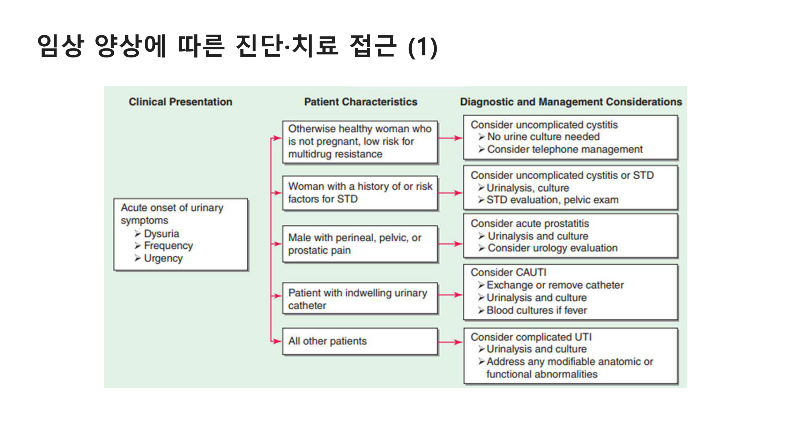{: style="width:78%"}

급성 배뇨 증상(배뇨통·빈뇨·절박뇨)이 있을 때

- **건강한 비임신 여성, 다제내성 위험 낮음** → 단순 방광염: **요배양 불필요**, 전화 진료도 고려.
- 성매개감염(STD) 위험·병력 여성 → 방광염 또는 STD: 요검사·배양, STD 검사·골반 진찰.
- **회음부·골반·전립선 통증 남성** → 급성 전립선염: 요검사·배양, 비뇨의학과 평가.
- **유치 도뇨관** → **CAUTI**: **도뇨관 교체 또는 제거**, 요검사·배양, 발열이면 혈액배양.
- 그 밖의 모든 환자 → complicated UTI: 요검사·배양, 교정 가능한 해부·기능 이상 해결.

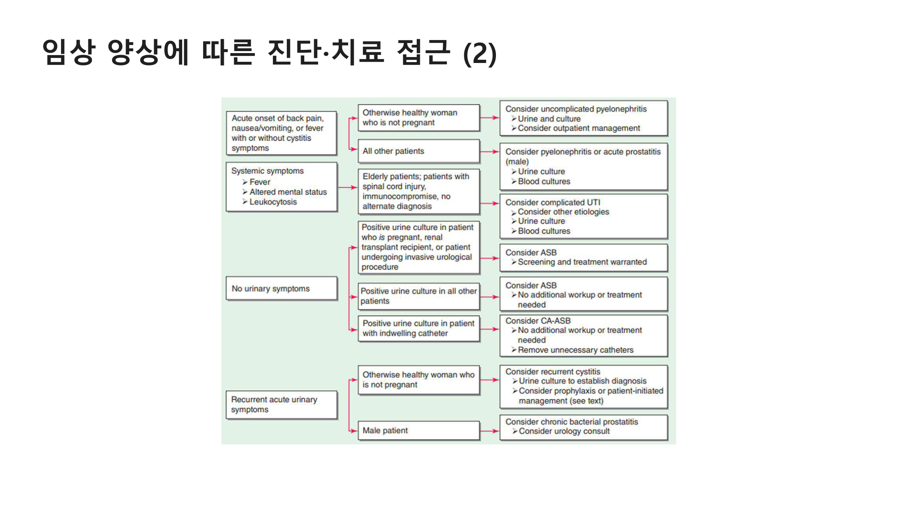{: style="width:78%"}

- 허리 통증·오심·구토·발열 ± 방광염 증상: 건강한 비임신 여성 → **단순 신우신염**(요배양, 외래 치료 고려) / 그 외 → 신우신염(남성은 급성 전립선염) — 요배양 + 혈액배양.
- **전신 증상(발열, 의식 변화, 백혈구 증가)**: 척수손상·면역저하 노인 등 다른 진단 가능성 → complicated UTI(다른 원인도 고려, 요·혈액배양).
- **배뇨 증상 없음**: 요배양 양성인데 **임신·신이식·침습적 비뇨기 시술 예정** → ASB **선별과 치료**. 그 외 환자 → ASB, **추가 검사·치료 불필요**. 유치 도뇨관 → CA-ASB, 추가 검사·치료 X, **불필요한 도뇨관 제거**.
- **재발성 급성 배뇨 증상**: 비임신 여성 → 재발성 방광염(요배양으로 진단 확정, 예방 또는 환자 주도 치료) / 남성 → **만성 세균성 전립선염**(비뇨의학과 의뢰).

## 진단 (1) 요배양검사
- 처음 소변은 요도구 주변 오염균이 섞이므로 버리고 **중간뇨**.
- **배양 양성 표준 정의: 깨끗한 중간뇨 105 CFU/mL.** 증상·농뇨가 있는 폐경 전 여성은 기준이 더 낮아 **대장균군 ≥102 CFU/mL**이면 UTI 가능성이 높다.
- **요배양 없이 진단 가능한 경우 — uncomplicated cystitis에서 다음을 모두 만족**: ✓ 폐경 전 젊은 여성 ✓ 소변검사상 농뇨 ✓ 전형적 하부 증상(요절박, 빈뇨 등) 1개 이상 ✓ 질염 증상 없음 ✓ 요로 밖으로 확산 소견 없음.
- **요배양 반드시 시행**: **재발성 UTI**, **급성 complicated UTI**, **남성에서 uncomplicated UTI 의심 시(치료 시작 전)**.
- (작년 필기) 전립선염은 **전립선 마사지 후 마지막 몇 방울**을 배양.

!!! new "올해 필기에서 추가 — 재발할수록 원인균과 내성이 변한다"
    배양으로 확진된 UTI의 재발률은 중앙값 300일에 **19%**. **첫 번째 → 여섯 번째 UTI**로 갈수록 *E. coli* 비율은 79% → 65%로 줄고 *Klebsiella*는 7% → 20%로 늘며, **≥3계열 내성**도 13% → 증가한다. 처음엔 ESBL(−) 대장균이어도 나중엔 ESBL(+)가 나올 수 있다 → **재발성 UTI는 매번 배양**하고 환자별로 결과를 추적한다.

## 진단 (2) 방사선검사
- 필요한 경우: **통상 치료에 반응 없음(치료 후 3일 이상 발열)**, **반복성**, **심한 증상**, **당뇨·면역억제**, **요로폐쇄 의심**, **신농양 같은 합병증 우려**.
- **KUB(복부 X-ray)**: **결석, 기종성 신우신염(공기)** 확인. 기종성 신우신염이면 적절한 배액·수술이 필요할 수 있다.
- **CT**: 진단과 합병증 발견에 **초음파·요로조영술보다 민감도가 높다** — 주로 CT를 한다.

## 진단기준과 추천 검사 (2026 실무지침)

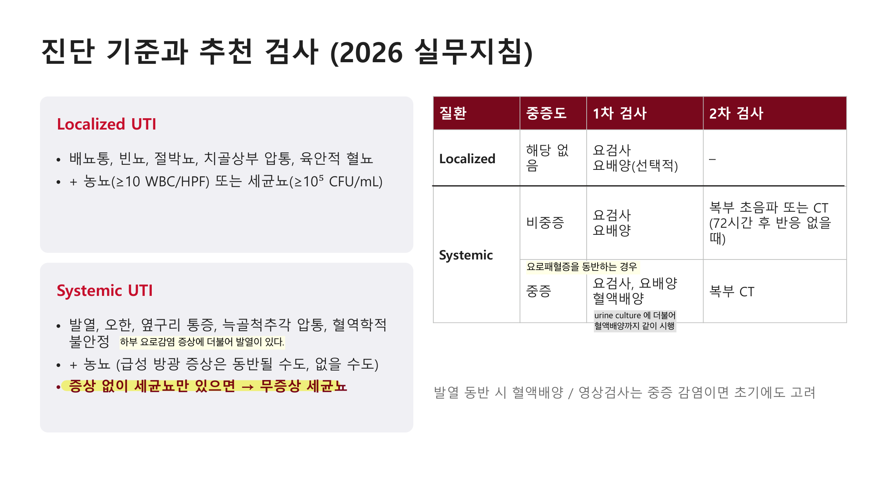{: style="width:80%"}

- **Localized UTI** = 배뇨통·빈뇨·절박뇨·치골상부 압통·육안적 혈뇨 + **농뇨(≥10 WBC/HPF) 또는 세균뇨(≥105 CFU/mL)**.
- **Systemic UTI** = **발열, 오한, 옆구리 통증, CVA 압통, 혈역학적 불안정** + 농뇨(방광 증상은 있을 수도 없을 수도).
- 증상 없이 세균뇨만 → **무증상 세균뇨**.

| 질환 | 중증도 | 1차 검사 | 2차 검사 |
|---|---|---|---|
| Localized | — | 요검사, 요배양(선택적) | — |
| Systemic | 비중증 | 요검사, 요배양 | 복부 초음파 또는 CT(**72시간 후 반응 없을 때**) |
| Systemic | 중증 | 요검사·요배양 + **혈액배양** | **복부 CT** |

- 발열이 있으면 혈액배양, 영상은 중증이면 초기에도 고려. **요로패혈증이면 요배양 + 혈액배양**을 같이.

!!! diff "작년 필기와 다른 점 — CT"
    작년: "열이 있으면 찍어보는 게 좋다", 교수님은 대학병원 응급실 환자는 처음부터 CT. 올해 지침: **비중증 systemic UTI는 72시간 치료에 반응이 없을 때 영상** → Case 3처럼 **초기 CT는 필수 아님**.

# 2. 국내 역학과 무증상 세균뇨

## 국내 내성 현황

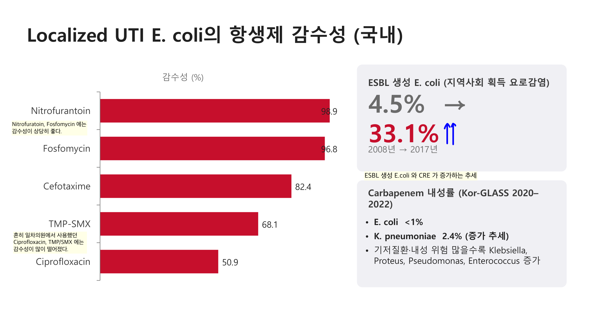{: style="width:72%"}

| 약 | 감수성 |
|---|---|
| **Nitrofurantoin** | **98.9%** |
| **Fosfomycin** | **96.8%** |
| Cefotaxime | 82.4% |
| TMP-SMX | 68.1% |
| **Ciprofloxacin** | **50.9%** |

- **Nitrofurantoin·fosfomycin은 감수성이 매우 좋고**, 일차 의원에서 흔히 쓰던 **ciprofloxacin·TMP/SMX는 감수성이 많이 떨어졌다.**
- **ESBL 생성 *E. coli***(지역사회 획득 UTI): **4.5%(2008) → 33.1%(2017)**.
- **Carbapenem 내성률**(Kor-GLASS 2020–22): *E. coli* <1%, ***K. pneumoniae* 2.4%(증가 추세)**. 기저질환·내성 위험이 많을수록 *Klebsiella, Proteus, Pseudomonas, Enterococcus* 증가. → **ESBL 대장균과 CRE가 증가 추세.**

!!! diff "작년 필기와 다른 점 — 감수성 자료"
    작년에는 2013–15년 국내 APN 대장균 자료로 **ciprofloxacin·cefotaxime 약 1/4 내성, amikacin·ertapenem 내성 거의 없음**을 봤고, 단순 방광염 약으로 **cefpodoxime(3세대 세파)을 대학병원 1차 선호**, ciprofloxacin 3일, TMP/SMX는 "덜 쓰니 내성이 줄었다"고 했다.

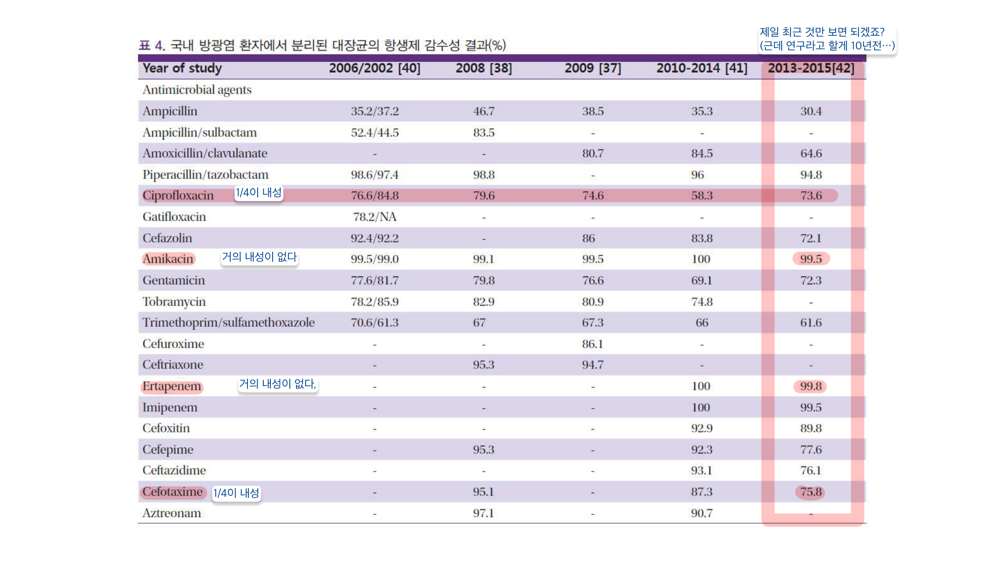{: style="width:55%"}

## 국내 요로감염 항생제 사용의 현실
- **무엇을**: 신우신염 환자의 **23.6%** 가 감수성에 맞지 않는 경험적 항생제.
- **누구에게**: 무증상 세균뇨의 **22%** 가 적응증 없이 항생제.
- **얼마나**: 방광염 환자의 **~40%** 가 평균 **12일**, 부적절하게 긴 항생제(localized UTI는 3일 정도면 되는데).
- **적정 사용의 핵심 = 올바른 약제 선택 + 무증상 세균뇨 구분 + 치료기간 관리.**

## 무증상 세균뇨 — 흔하지만 대부분 치료 대상이 아니다

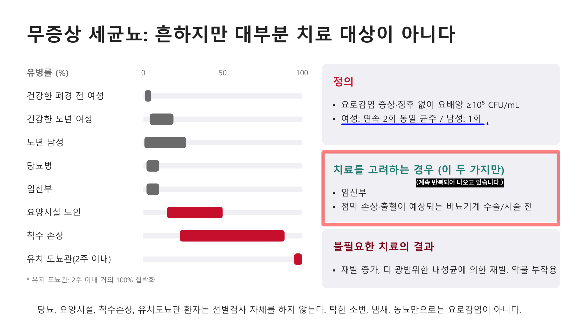{: style="width:78%"}

- **정의**: UTI 증상·징후 없이 요배양 ≥105 CFU/mL — **여성은 연속 2회 같은 균주, 남성은 1회.**
- 치료해도 **증상 빈도나 합병증이 줄지 않는다.**
- **치료를 고려하는 경우(이 두 가지만)**: ① **임신부**(저체중아 출산·신우신염을 줄임) ② **점막 손상·출혈이 예상되는 비뇨기계 수술/시술 전**(예: 경요도 전립선·방광종양 절제술).
- (근거 약하나 선별적으로 고려 가능) 백혈구 감소증 환자, 신이식 환자.
- **불필요한 치료의 결과**: **재발 증가, 더 광범위한 내성균에 의한 재발**, 약물 부작용, *C. difficile*.
- 유병률: 건강한 폐경 전 여성은 낮고, 노년·당뇨·요양시설·척수손상으로 갈수록 높아지며 **유치도뇨관은 2주 이내 거의 100% 집락화**.
- **당뇨, 요양시설, 척수손상, 유치도뇨관 환자는 선별검사 자체를 하지 않는다.** (비임신 여성, 양로원 거주 여성도.) **탁한 소변, 냄새, 농뇨만으로는 요로감염이 아니다.** — "계속 반복되어 나오고 있습니다."

## 수술 전 소변배양검사
- **일반적인 수술 전에는 권장되지 않음** — 무증상 세균뇨에 대한 불필요한 치료를 피하기 위해.
- **예외: 비뇨기계 수술** — 수술 전 배양 양성이면 **수술 후 감염 위험이 커진다** → 수술 전 항생제 치료를 시작.

!!! exam "기출 포인트"
    반드시 치료할 대상 → **임산부**(7번 — 당뇨·척수손상·양로원·유치도뇨관 X). 건강검진에서 *E. coli*가 나온 무증상 28세 여성 → **경과 관찰**(2번). 당뇨 70세 여성에서 대장균 반복 분리 → **경과 관찰**(13번 — 영상, fosfomycin, 도뇨관 재채취, 감수성 후 처방 모두 X). 18번: 무증상 도뇨관 환자에서 **다제내성 녹농균** → 항생제가 아니라 **접촉주의**.

## 칸디다뇨증(Candiduria)
- 위험요인: **입원, 요로카테터, 이전 항생제, 당뇨**, 악성종양, 요로 구조 이상.
- 대부분 **단순 집락(colonization)** → Candida UTI 진단은 까다롭다. 세균성 UTI처럼 **실제 감염 판단의 핵심은 증상**(임상적 상관관계가 중요). 증상은 방광·신장의 세균 감염과 비슷.
- **Candida UTI 치료**(fluconazole 감수성): **방광염 fluconazole 200 mg/일 × 14일**, **신우신염 200–400 mg/일 × 14일** — 약 2주.

!!! exam "기출 포인트"
    6번: 도뇨관 환자, 발열 없고 CRP·WBC 정상, 소변에서 *C. albicans* → **경과 관찰**(항진균제·항생제·반복 배양·세척 X).

# 3. 경험적 항생제 선택 — 0단계부터 4단계까지

## 치료의 목표
**가장 효과적이면서 독성이 적고 비용이 싼 항균제로, 필요한 최소 기간 안에 증상을 해소**: ① 효과 ② 안전 ③ 비용 ④ 기간. 여기에 **장·질·방광의 미생물 군집(마이크로바이옴)에 미치는 영향 최소화** — UTI에 β-lactam을 많이 쓰는데 미생물 군집을 흔들어 내성을 얻을 수 있으니 적절히 써야 한다.

## Uncomplicated UTI의 1차 약제
| 약 | 용법 | 기간 |
|---|---|---|
| TMP-SMX(미국 기준) | DS 1정(160/800 mg) 하루 2회 | 3일 |
| **Nitrofurantoin** | 100 mg 하루 2회(국내 지침: 50–100 mg qid) | **5일** |
| **Fosfomycin** | 3 g 물에 타서 | **1회** |

- **TMP-SMX**: 지역 요로병원균 내성률이 **20%를 넘으면 경험적 치료로 권장하지 않는다.** 국내 TMP-SMX 감수성 68.1%(비감수성 32%) → **국내에서는 경험적 1차 약으로 부적합.** 국내에서는 **nitrofurantoin, fosfomycin**을 쓴다.

**β-lactam 사용 시 고려사항**

1. 1차 약보다 **효과가 다소 떨어지고**, 부수적 피해(collateral damage)는 더 클 수 있다.
2. **UTI 재발 위험 증가** — complicated UTI에서 β-lactam 부작용은 질·장내 미생물 불균형과 관련 → 재발 위험 증가.
3. **Ampicillin·amoxicillin**: 높은 내성률·낮은 효과로 **권장되지 않음.**

→ Uncomplicated UTI는 1차 약(**nitrofurantoin, fosfomycin**)을 우선.

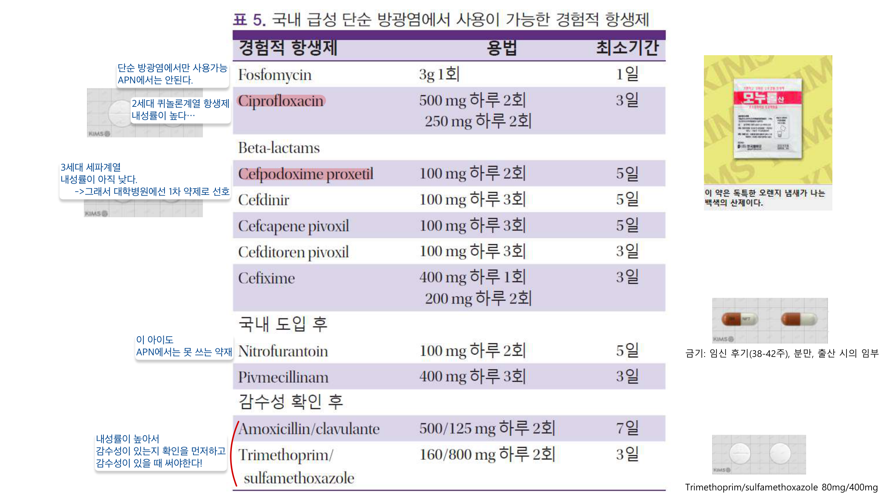{: style="width:60%"}

!!! diff "작년 필기와 다른 점 — 방광염 1차 약"
    작년 표: fosfomycin 3 g 1회, **ciprofloxacin 500 mg bid 3일**, **cefpodoxime 100 mg bid 5일(내성률이 낮아 대학병원 1차 선호)**, nitrofurantoin 100 mg bid 5일, pivmecillinam, amox/clav·TMP/SMX(감수성 확인 후). 올해는 **nitrofurantoin 5일·fosfomycin 1회가 1차**, β-lactam은 후순위, **FQ는 1차 약이 아니다.**

## 경험적 항생제 선택의 5단계 접근법

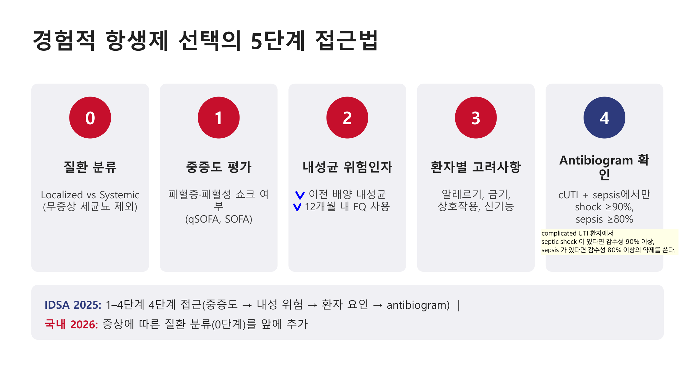{: style="width:80%"}

| 단계 | 내용 |
|---|---|
| **0 질환 분류** | **Localized vs Systemic**(무증상 세균뇨 제외) — 국내 2026이 앞에 추가 |
| **1 중증도 평가** | 패혈증·패혈성 쇼크 여부(qSOFA, SOFA) |
| **2 내성균 위험인자** | 이전 배양의 내성균, **12개월 내 FQ 사용** |
| **3 환자별 고려사항** | 알레르기, 금기, 상호작용, 신기능 |
| **4 Antibiogram 확인** | **cUTI + sepsis에서만** — 쇼크 ≥90%, sepsis ≥80% |

- IDSA 2025는 1–4단계(중증도 → 내성위험 → 환자요인 → antibiogram), 국내 2026은 **증상에 따른 질환 분류(0단계)** 를 앞에 더했다.

### 1단계: 중증도 — 패혈증인가?
- **패혈증(Sepsis-3)**: 감염으로 인한 생명을 위협하는 장기 기능장애, **SOFA가 기저치보다 2점 이상 증가.**
- **패혈성 쇼크**: 적절한 수액에도 혈압 유지에 **승압제가 필요** + **혈청 젖산 > 2 mmol/L**.
- **qSOFA**(2점 이상이면 SOFA 정식 평가 — 단독으로 쓰지는 않음): **의식변화(GCS <15)** +1, **수축기혈압 ≤100 mmHg** +1, **호흡수 ≥22회/분** +1.
- SOFA 항목: 호흡(PaO2/FiO2), 혈소판, 빌리루빈, 혈압/승압제, GCS, 크레아티닌.

### 2–4단계

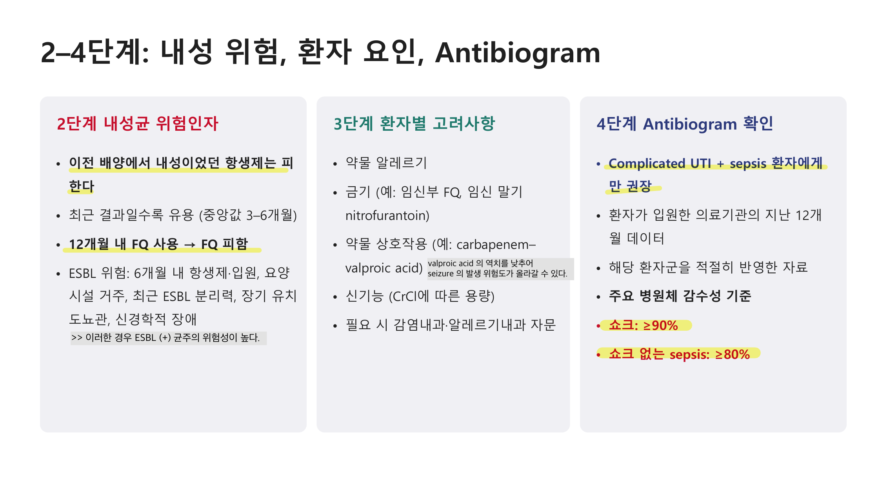{: style="width:80%"}

- **2단계 내성균 위험인자**: **이전 배양에서 내성이었던 항생제는 피한다**(최근 결과일수록 유용, 중앙값 3–6개월). **12개월 내 FQ 사용 → FQ 피함.** **ESBL 위험: 6개월 내 항생제·입원, 요양시설 거주, 최근 ESBL 분리력, 장기 유치도뇨관, 신경학적 장애.**
- **3단계 환자별 고려사항**: 약물 알레르기, **금기**(임신부 FQ, 임신 말기 nitrofurantoin), **약물상호작용**(**carbapenem–valproic acid**: valproic acid 농도가 떨어져 경련 역치가 낮아짐 → 발작 위험), **신기능**(CrCl에 따른 용량), 필요 시 감염내과·알레르기내과 자문.
- **4단계 antibiogram**: **complicated UTI + sepsis 환자에게만** 권장. 환자가 입원한 기관의 **지난 12개월** 자료, 해당 환자군을 반영한 자료. 감수성 기준 **쇼크 ≥90%, 쇼크 없는 sepsis ≥80%**.

## 패혈증을 동반한 complicated UTI의 경험적 치료 (IDSA 2025)
- **우선 권장**(4단계 평가로 선택): **3·4세대 cephalosporin, carbapenem, piperacillin-tazobactam, fluoroquinolone.**
- **후순위**: 새 β-lactam/β-lactamase 억제제, cefiderocol, aminoglycoside.
- **원칙**: 사망 예방을 위해 **초기에 적절한 경험적 치료가 더 중요** → **stewardship(항생제 관리) 고려는 배양 결과가 나온 확정적 치료 단계로 미룬다.** 중증 환자에게 처음에 적절한 항생제를 쓰지 않으면 사망률이 올라간다.

## 요로감염 경험적 항생제 추천 (국내 2026)

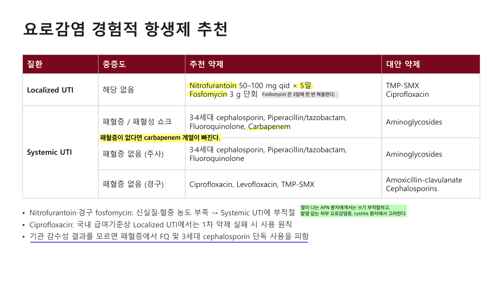{: style="width:80%"}

| 질환 | 중증도 | 추천 | 대안 |
|---|---|---|---|
| **Localized UTI** | — | **Nitrofurantoin 50–100 mg qid × 5일**, **fosfomycin 3 g 단회** | TMP-SMX, ciprofloxacin |
| **Systemic UTI** | 패혈증/패혈성 쇼크 | 3·4세대 세파, pip/tazo, FQ, **carbapenem** | aminoglycoside |
| | 패혈증 없음(주사) | 3·4세대 세파, pip/tazo, FQ | aminoglycoside |
| | 패혈증 없음(경구) | **ciprofloxacin, levofloxacin, TMP-SMX** | amox/clav, cephalosporin |

- **Nitrofurantoin·경구 fosfomycin은 신실질·혈중 농도가 부족 → systemic UTI(발열 APN)에 부적절**, 발열 없는 하부 UTI(방광염)에서 고려.
- **Ciprofloxacin**: 국내 급여 기준상 **localized UTI에서는 1차 약 실패 시 사용**이 원칙.
- 기관 감수성을 모르면 **패혈증에서 FQ·3세대 세파 단독은 피한다.**
- **패혈증이 없으면 carbapenem이 빠진다.**
- 필기 메모: "Fosfomycin은 3일에 한 번 복용한다." ※ 확인 필요: 슬라이드는 급성 방광염 3 g **단회**, 예방요법은 10일마다 3 g이다.

## 경험적 항생제 고르기 — 상황별 (작년 교수님 정리, 기출과 직결)
| 상황 | 경험적 항생제 |
|---|---|
| 지역사회 획득, 젊은 여자 | **3세대 세파(ceftriaxone)** 또는 경구 FQ(외래) |
| **요양병원에서 온 노인**(당뇨 등) | **piperacillin/tazobactam** |
| 바이탈 불안정(쇼크) | **meropenem**까지 |
| ESBL(+)인데 녹농균은 아닐 것 | **ertapenem**으로 충분(ertapenem은 녹농균 X → 녹농균이면 meropenem) |
| 임산부 | **ceftriaxone**(FQ·AG X) |

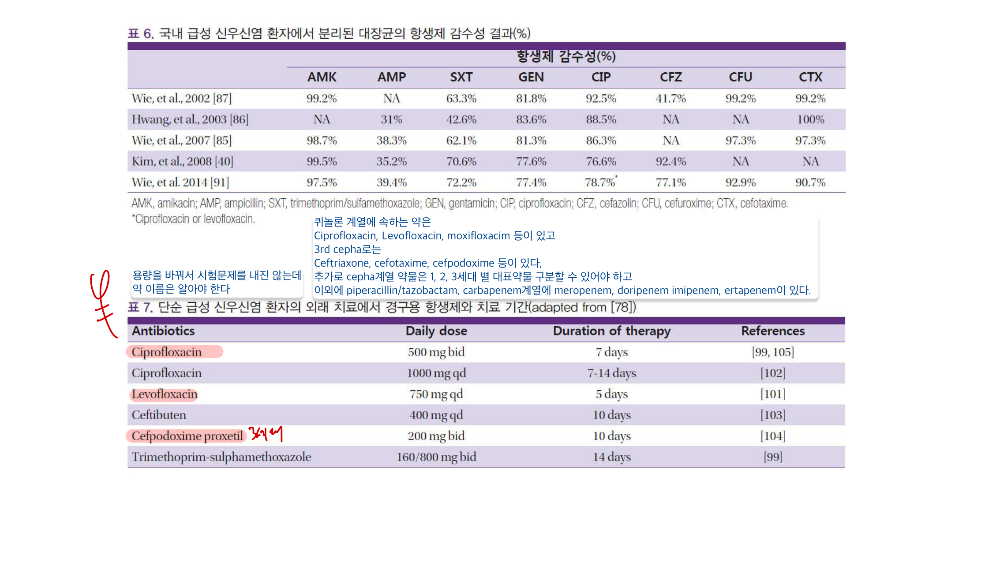{: style="width:58%"}

- 약 이름은 알아야 한다 — 퀴놀론: ciprofloxacin, levofloxacin, moxifloxacin / 3세대 세파: ceftriaxone, cefotaxime, cefpodoxime / pip/tazo / 카바페넴: meropenem, doripenem, imipenem, ertapenem.

!!! exam "기출 포인트"
    1번(2025): 68세 남성, 조절 안 되는 당뇨, **한 달 전부터 요양병원**, 배뇨 지연·잔뇨 → **정맥 piperacillin/tazobactam**. 함정 — ceftriaxone(녹농균 X), ciprofloxacin(내성), vancomycin, **ceftazidime/avibactam**(CRE용, 아껴 둠). 3번: 건강한 25세 여자 첫 APN(HCG 음성, 외래) → **ciprofloxacin**. 함정 — **fosfomycin·nitrofurantoin**(방광염 약, systemic X), doxycycline, meropenem. 14번: 도뇨관 + 요양병원 + 반복 UTI 대장균 → 감수성이 가장 높은 약 **ertapenem**(ESBL 가능성). 9번: *E. faecalis* 균혈증에 효과 가능성이 가장 낮은 약 → **ceftriaxone**(장알균은 **세팔로스포린에 내재 내성**).

## IDSA 2025 vs 국내 2026

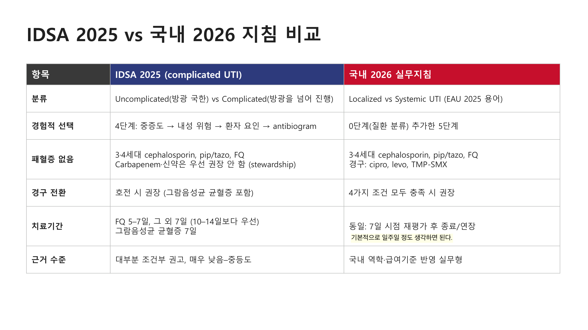{: style="width:80%"}

| 항목 | IDSA 2025 | 국내 2026 |
|---|---|---|
| 분류 | Uncomplicated(방광 국한) vs Complicated | **Localized vs Systemic**(EAU 2025 용어) |
| 경험적 선택 | 4단계 | **0단계(질환 분류)를 더한 5단계** |
| 패혈증 없음 | 3·4세대 세파, pip/tazo, FQ. carbapenem·신약 우선 권장 X | 같음 + 경구: cipro, levo, TMP-SMX |
| 경구 전환 | 호전 시 권장(그람음성 균혈증 포함) | **4가지 조건 모두 충족 시** |
| 치료기간 | **FQ 5–7일, 그 외 7일**, 그람음성 균혈증 7일 | 같음: **7일 시점 재평가 후 종료/연장** |

"기본적으로 **일주일** 정도 생각하면 된다."

# 4. 확정적 치료와 치료기간 — 좁히고, 경구로 바꾸고, 짧게

## 확정적 항생제 전환과 경구 전환

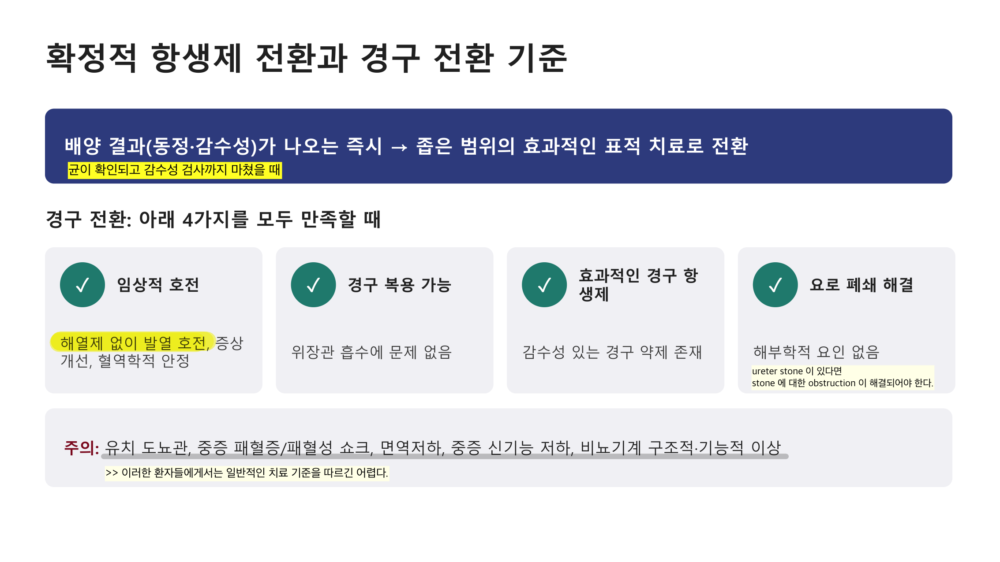{: style="width:78%"}

- **배양(동정·감수성)이 나오는 즉시 → 좁은 범위의 효과적인 표적치료로 전환.**
- **경구 전환 — 4가지를 모두 만족할 때**
    1. **임상적 호전**: 해열제 없이 발열 호전, 증상 개선, 혈역학적 안정
    2. **경구 복용 가능**: 위장관 흡수 문제 없음
    3. **효과적인 경구 항생제**: 감수성 있는 경구약 존재
    4. **요로폐쇄 해결**: 해부학적 요인 없음(요관 결석이면 폐쇄가 먼저 해결돼야)
- **주의**(일반 기준을 따르기 어려움): 유치도뇨관, 중증 패혈증/패혈성 쇼크, 면역저하, 중증 신기능 저하, 비뇨기계 구조·기능 이상.

## 치료기간 — 대부분 7일이면 충분

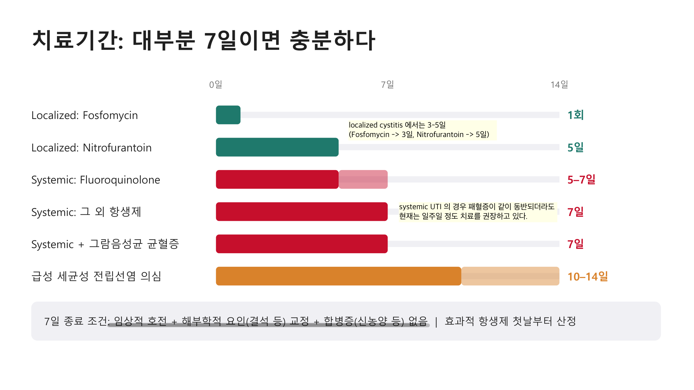{: style="width:78%"}

| 상황 | 기간 |
|---|---|
| Localized: **fosfomycin** | **1회** |
| Localized: **nitrofurantoin** | **5일** |
| Systemic: **fluoroquinolone** | **5–7일** |
| Systemic: 그 외 항생제 | **7일** |
| Systemic + **그람음성균 균혈증** | **7일** |
| **급성 세균성 전립선염 의심** | **10–14일** |

- **7일 종료 조건**: 임상적 호전 + 해부학적 요인(결석 등) 교정 + 합병증(신농양 등) 없음. 기간은 **효과적 항생제를 쓴 첫날부터** 센다.
- 패혈증이 동반된 systemic UTI도 현재는 **일주일** 정도를 권장.

## Complicated UTI 단기치료 — 적용 대상과 제외 기준
- IDSA 2025: 효과적 치료에 **임상적으로 잘 반응하는** complicated UTI → 더 짧게(FQ 5–7일, 그 외 7일).
- 단, **근거 연구에서 제외된 환자** — 그대로 적용하기 어렵다: **유치 요로카테터, 면역저하, 요로 농양, 만성 신장질환, 중증 패혈증, 세균성 전립선염, 완전 요로폐쇄, 비뇨기과 수술 진행 중** → 임상 경과와 **감염원 조절** 여부에 따라 **기간을 개별화**.

## 48–72시간에도 호전이 없다면
1. **감수성 재확인** — 원인균이 실제로 감수성인가? 용량·용법은 적절한가?
2. **감염원 확인(영상)** — **요로폐쇄, 신농양·전립선농양, 기종성 신우신염** 등 **배액이 필요한 병변** → 해결 없이는 항생제만으로 한계.
3. **다른 원인** — 다른 감염 부위, 비감염성 발열.

## 꼭 기억할 약제별 주의사항

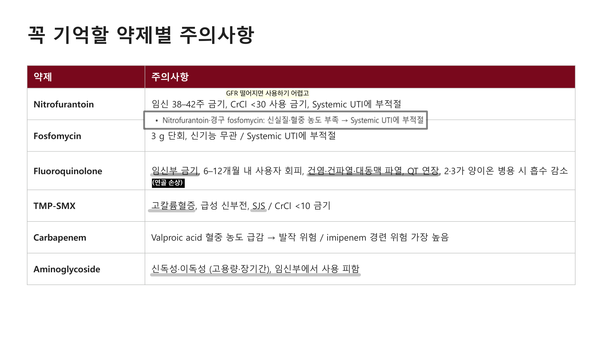{: style="width:78%"}

| 약 | 주의 |
|---|---|
| **Nitrofurantoin** | **임신 38–42주 금기**, **CrCl <30 금기**, systemic UTI에 부적절 |
| **Fosfomycin** | 3 g 단회, **신기능 무관** / systemic UTI에 부적절 |
| **Fluoroquinolone** | **임신부 금기**, **6–12개월 내 사용자 회피**, **건염·건파열·대동맥파열, QT 연장**, 2·3가 양이온 병용 시 흡수 감소, (소아) 연골 손상 |
| **TMP-SMX** | **고칼륨혈증**, 급성신부전, SJS / CrCl <10 금기 |
| **Carbapenem** | **valproic acid 혈중농도 급감 → 발작**, **imipenem 경련 위험이 가장 높음** |
| **Aminoglycoside** | **신독성·이독성**(고용량·장기간), 임신부 피함, GFR이 떨어지면 쓰기 어렵다 |

# 5. 재발성 요로감염의 예방

## 비항균제 예방법

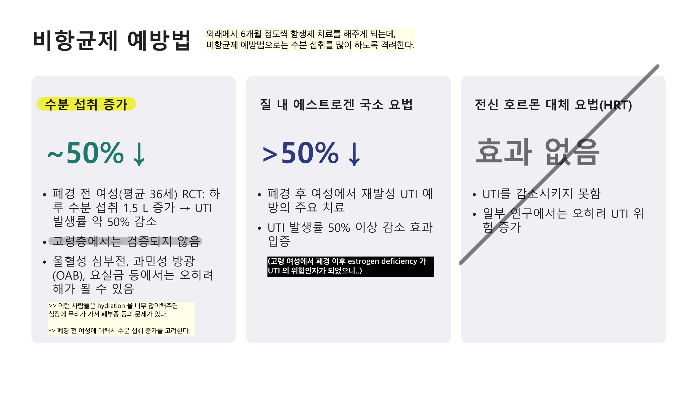{: style="width:76%"}

- **수분 섭취 증가 → 약 50% 감소**: 폐경 전 여성(평균 36세) RCT에서 하루 **1.5 L 더 마시면** UTI 약 50% 감소. **고령층에서는 검증되지 않았고**, **울혈성 심부전, 과민성 방광, 요실금**에서는 오히려 해(수분 과다 → 폐부종 등) → **폐경 전 여성**에게 고려.
- **질내 에스트로겐 국소요법 → 50% 이상 감소**: **폐경 후 여성 재발성 UTI 예방의 주요 치료**(폐경 후 에스트로겐 결핍이 위험인자였으니).
- **전신 호르몬 대체요법(HRT) → 효과 없음**, 일부 연구에서는 오히려 위험 증가.

## 저용량 항균제 예방요법
- **지속 투여**(매일 또는 주 3회) 또는 **성교 후 투여**(성관계와 UTI의 시간적 연관이 확인되는 환자). 주로 **nitrofurantoin, TMP-SMX, cephalexin** — localized UTI에 쓰는 약들. 외래에서 6개월 정도.
- 효과: 폐경 전 여성 **~80%** 감소(Cochrane), 65세 이상 **24%**(메타분석). 근거 연구는 대부분 폐경 전 여성.

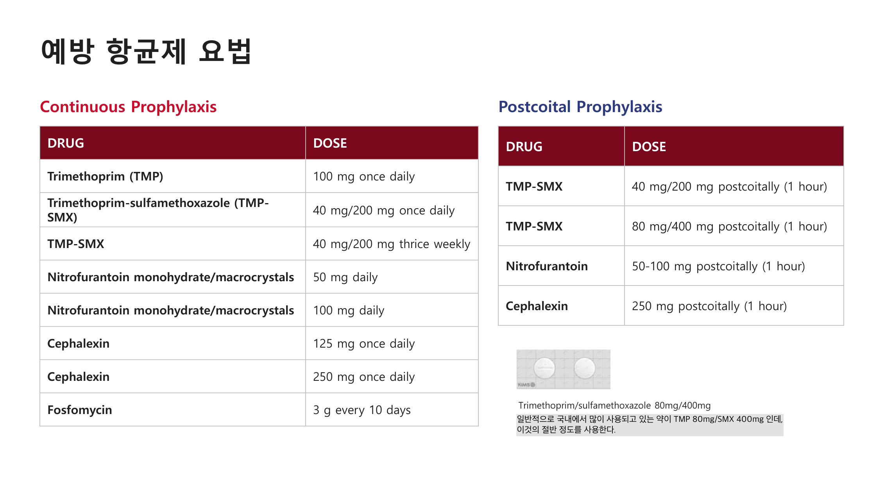{: style="width:70%"}

- 국내에서 많이 쓰는 TMP 80 mg/SMX 400 mg의 **절반 정도**(40/200 mg)를 쓴다. Fosfomycin은 예방으로 **3 g 10일마다**.
- **고령층은 신중하게**: 폐경 전 여성의 6개월 저용량 예방은 부작용이 거의 없지만, **66세 이상** 장기 예방 코호트에서는 **다음 해 UTI·패혈증·혈류감염 응급실 방문·입원 증가, 내성 증가, *C. difficile* 설사 증가**.

# 6. 증례 토의 — 반드시 알아야 할 5가지

## Case 1 — 26세 여성, 2일 전부터 배뇨통·빈뇨·절박뇨, 치골상부 불편감
- 발열·오한·옆구리 통증 없음, 기저질환 없음, 3개월 항생제력 없음, 임신 반응 음성. BT 36.8℃, CVA 압통 없음. 요검사 WBC 20–29/HPF, nitrite 양성.
- **A1 진단: Localized UTI**(방광 증상 + 농뇨, systemic 증상 없음). 증상이 명확하면 **요배양은 선택적**(재발·치료실패·내성 위험 시).
- **A2: nitrofurantoin 50–100 mg qid × 5일(CrCl <30 금기) 또는 fosfomycin 3 g 단회** — 국내 감수성 98.9% / 96.8%.
- **A3: ciprofloxacin을 1차로 쓰지 않는 이유** — 국내 감수성 50.9%, 급여 기준상 1차 실패 시 사용, 건파열·대동맥파열·QT 연장, 내성 유도.
- **A4: 임신 36주라면** — nitrofurantoin은 임신 38–42주 금기(임신 후기), FQ 금기 → **fosfomycin 단회 또는 감수성 확인된 β-lactam(cephalosporin)**, **요배양 시행**.

## Case 2 — 79세 여성, 요양시설·중등도 치매·당뇨, "소변이 탁하고 냄새가 난다"
- 발열·배뇨 증상 없음, 의식·식사·활동 평소와 같음. 요검사 WBC 10–19/HPF, 요배양 *E. coli* ≥105(ESBL 음성).
- **A1: 무증상 세균뇨** — 요양시설 노인의 15–50%. **탁한 소변·냄새·농뇨는 UTI 증상이 아니다.**
- **A2: 치료하지 않는다** — 예후 개선 없이 내성균 선택, 부작용, *C. difficile* 위험만. 치료받은 여성은 재발↑, 더 광범위한 내성균.
- **A3: 선별·치료해야 하는 2가지 = 임신부 / 점막 손상 비뇨기 시술 전.** 당뇨·요양시설·척수손상·유치도뇨관은 선별검사 자체를 하지 않는다.
- **A4: 3일 뒤 38.5℃ 발열이 생기면** — **발열 = 세균뇨 탓이라고 단정하지 않기.** 다른 감염원(폐렴, 피부, 카테터 등)을 함께 평가, 전신 UTI가 의심되면(패혈증 가능) **혈액·요배양**. 이전 ESBL 분리력·요양시설 거주 = 내성균 위험 → 경험적 항생제에 반영(예: carbapenem). 이번엔 ESBL(−)였지만 재발하면 ESBL(+)일 수 있다.

## Case 3 — 평소 건강한 40세 여성, 1주 배뇨통·빈뇨 → 2일 전부터 발열
- BP 138/80, HR 102, RR 16, BT 38.7℃, 의식 명료. 요검사 WBC many, **우측 CVA 압통**. 1년 내 항생제·입원력 없음, 구토 없이 경구 가능.
- CT: 우측 신장 하부 실질의 저음영 병변 + 주변 지방 침윤 → **급성 신우신염**, 우측 근위 요관염.
- **A1: Systemic UTI(APN)** = IDSA 2025 complicated UTI. 원인균 ***E. coli***(K. pneumoniae, P. mirabilis 등).
- **A2: qSOFA 0점 → 패혈증 아님.** 요검사·요배양·감수성, 발열 → 혈액배양. **비중증은 72시간 치료에 반응 없을 때 영상 → 초기 CT는 필수 아님.**
- **A3: 내성 위험 없음·경증 → 외래 경구 가능**: cipro/levofloxacin, TMP-SMX(감수성 확인). 주사라면 3·4세대 세파. **nitrofurantoin·fosfomycin은 부적절.**
- **A4: FQ 5–7일, 그 외 7일** — 균혈증 없고 호전·합병증 없으면 7일 시점 종료. **과거 14일 → 현재 7일.** 배양이 나오면 표적치료로 조정.

!!! diff "작년 필기와 다른 점 — 같은 Case 1(작년)"
    작년에도 거의 같은 40세 여자 증례였는데 답은 **ceftriaxone(3세대)**, 80세·요양병원·당뇨면 pip/tazo, 바이탈이 흔들리면 meropenem이었다. 올해는 외래 경구 FQ도 가능, 7일.

## Case 4 — 68세 남성, 전립선비대증, 2일 전부터 오한·발열·배뇨통·배뇨곤란·회음부 통증
- **3개월 전 ciprofloxacin 10일**, **5개월 전 폐렴 입원**. BT 39.1℃. 직장수지검사: **압통 있는 부종성 전립선**, 잔뇨 180 mL. Cefotaxime 3일째 발열 지속.
- 요·혈액배양: **ESBL 생성 *E. coli*** — cipro R, cefotaxime R, pip/tazo S, ertapenem S, TMP-SMX S.
- **A1: 내성 위험 있음** — **12개월 내 FQ → FQ 회피**, **6개월 내 항생제(입원) → ESBL 위험 → 3세대 세파 단독 대신 pip/tazo 또는 ertapenem.**
- **A2: 감수성에 맞게 즉시 변경** — cefotaxime 중단 → **ertapenem(또는 pip/tazo)**. 감수성·범위·용량·용법 점검.
- **A3: 경구 전환** — 4가지 조건 + 요폐 해결이면 **TMP-SMX 160/800 mg bid**(전립선 조직 침투 양호, 감수성 S) — 고칼륨혈증·신기능 주의. FQ는 내성이라 불가.
- **A4: 전립선염 의심 → 10–14일.** 무반응이면 감수성 재확인, **전립선농양·요폐 영상**, 다른 원인.

## Case 5 — 75세 남성, 당뇨 10년, 뇌경색 후 와상, 요양병원, 장기 유치도뇨관
- 4일 발열 후 전원. **6개월 전 요배양 ESBL 생성 *E. coli***. BP 78/46 → 수액 후에도 승압제, HR 124, RR 26, BT 39.4℃, **GCS 13**. **Lactate 4.6**, Cr 2.8(기저 1.0), 혈소판 82,000.

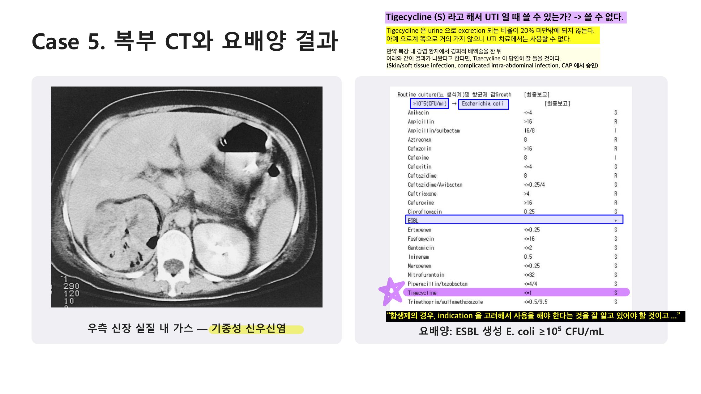{: style="width:80%"}

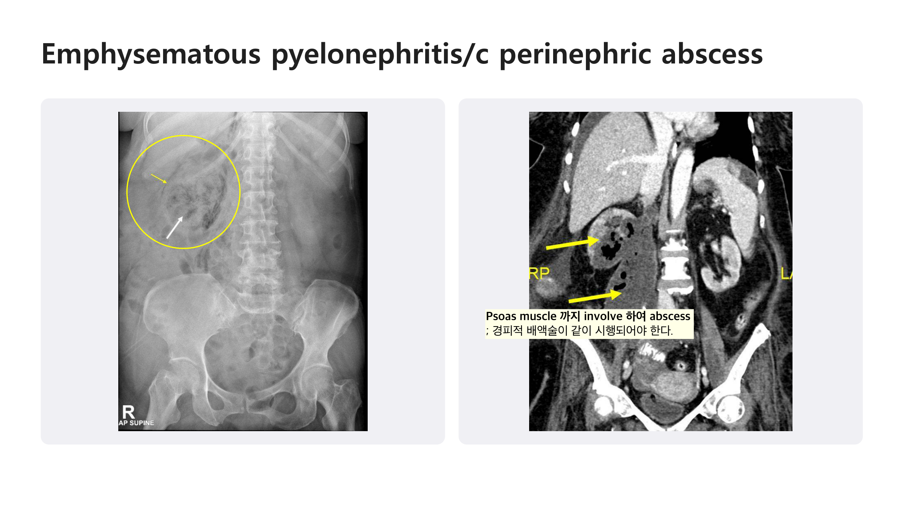{: style="width:72%"}

- CT: **우측 신장 실질 내 가스 — 기종성 신우신염(emphysematous pyelonephritis)**, 신주위 농양, **장요근(psoas)까지 농양** → **경피적 배액술**을 같이 해야 한다. 요배양 **ESBL 생성 *E. coli* ≥105**.
- **A1: 패혈성 쇼크** — **qSOFA 3점**(SBP ≤100, RR ≥22, GCS <15), **SOFA ≥2 상승**(Cr, 혈소판, 승압제, GCS), **수액 후 승압제 + 젖산 >2**.
- **A2: carbapenem(기관 감수성 ≥90%)** — 이전 ESBL, 요양시설, 장기 도뇨관, 신경학적 장애 → 쇼크이므로 감수성 ≥90% 약 = **meropenem**. 감수성을 모르면 FQ·3세대 세파 단독은 피한다.
- **A3: 감염원 조절이 핵심** — **혈액배양 2세트**, **도뇨관 교체 후 새 도뇨관에서 요배양**, 기종성 신우신염 → **배액 또는 수술, 비뇨의학과 협진**, 혈당 조절, 도뇨관 필요성 재평가.
- **A4: 좁히되 기간은 개별화** — 녹농균이 아니므로 무조건 meropenem일 필요가 없어 **ertapenem으로 de-escalation**, 안정·감염원 조절 뒤 **cipro(S) 경구** 고려. 단기 치료 근거 연구는 쇼크·도뇨관·농양 환자를 대부분 제외 → **배액·임상경과·영상 추적으로 기간 결정.**
- **교수님 강조 — Tigecycline(S)이면 UTI에 쓸 수 있나? → 쓸 수 없다.** Tigecycline은 **소변으로 배설되는 비율이 20% 미만** — 요로로 거의 가지 않는다. 같은 결과가 **복강 내 감염** 경피 배액 검체에서 나왔다면 잘 들을 것(피부·연조직 감염, complicated 복강 내 감염, CAP에서 승인). "항생제는 **indication을 고려해서** 사용해야 한다."

!!! exam "기출 포인트 (19강 패혈증과 같은 틀)"
    신농양·요로결석 + 패혈성 쇼크 사례 문항(지금은 19강으로 분류): 초기 항생제로 적절하지 **않은** 것 → **vancomycin**(그람음성을 못 덮음 — cefepime·meropenem·imipenem·pip/tazo는 적절), 쇼크에서 틀린 것 → **dexamethasone**(hydrocortisone이 맞음). 원칙: 배양 후 1시간 내 광범위 항생제, 수액 30 mL/kg, norepinephrine, **배액(PCD)**.

# 7. Take-home messages
1. **증상 없는 세균뇨·농뇨는 치료하지 않는다**(임신부, 점막 손상 비뇨기 시술 전 제외).
2. **Localized UTI: nitrofurantoin 5일 또는 fosfomycin 1회** — FQ는 1차 약이 아니다.
3. **Systemic UTI: 중증도 → 내성위험 → 환자요인 → (패혈증 시) 기관 감수성** 순으로 선택.
4. **배양이 나오면 즉시 좁은 범위의 표적치료로.**
5. **호전되면 경구로, 대부분 7일(FQ 5–7일)이면 충분.**
6. **48–72시간 무반응**: 감수성 재확인, **폐쇄·농양 확인과 감염원 조절**, 다른 원인.

!!! memo "암기"
    | 상황 | 약 | 기간 |
    |---|---|---|
    | Localized UTI | **nitrofurantoin**(CrCl<30·임신 38–42주 X) / **fosfomycin** | 5일 / **1회** |
    | Systemic, 패혈증 X, 경구 | **cipro·levo**, TMP-SMX | FQ **5–7일**, 그 외 **7일** |
    | Systemic + 패혈증/쇼크 | 3·4세대 세파, pip/tazo, FQ, **carbapenem** | 7일(개별화) |
    | 임산부 | **ceftriaxone**(β-lactam), FQ·AG X, 무증상도 치료 | |
    | 요양병원·당뇨·도뇨관 | **pip/tazo**, ESBL이면 **ertapenem**, 쇼크 **meropenem** | |
    | 급성 세균성 전립선염 | TMP-SMX·FQ(침투력), nitrofurantoin X | **10–14일** |
    | 무증상 세균뇨 | **치료 X**(임신부·점막 손상 비뇨기 시술 전만), 선별도 X | |
    | 칸디다뇨(증상 있을 때만) | fluconazole | 14일 |
