<!-- 필기본: 2026 · 2025 -->
<!-- 단계: 수업 후 -->

# 0. 이 수업을 공부하는 법

올해는 경북대병원 감염내과 **김윤정 교수님**(2021–24년 출제, 2025년만 황소윤 교수님). 제목은 「CNS INFECTIONS — Bacterial · Viral · TB meningitis · Brain abscess」로, 작년에 없던 **뇌염(encephalitis) 진단기준**과 **결핵성 수막염** 파트가 새로 생겼고 2025 WHO·2026 EAN/ESCMID 지침이 반영됐다. 필기 작성자 말: "수막염에서는 **세균·바이러스·결핵의 CSF chemistry 비교**가 중요하고, 특히 **급성 세균성 수막염에서 상황별 원인균을 생각해 경험적 항생제를 어떻게 할 것인가**가 가장 중요한 내용. 바이러스 뇌염에서는 **HSV가 측두엽(temporal lobe)** 을 침범하고 **acyclovir IV** — 여러 번 언급됐다." 뇌농양은 "되게 빠르게 읽고 넘어가셨고" 몇 쪽은 SKIP.

학습성과: 1. CNS 감염병의 **주된 질환과 주요 원인균** 2. **감별진단과 진단법** 3. **치료와 예후**
목차: CNS 구성 → CNS 감염의 특징 → **급성 세균성 수막염** → 바이러스성 수막염(+뇌염) → **결핵성 수막염** → 뇌농양

- 기출 23문항(2020–2025). 가장 많은 유형은 **"CSF 수치 + 환자 나이·기저질환 → 경험적 항생제"**.
    - 50세 이상·알코올 간경변·조절 안 되는 당뇨(면역저하) → **ceftriaxone + vancomycin + ampicillin**(*Listeria*)
    - 신경외과 수술(shunt) 후 → **ampicillin + ceftazidime + vancomycin**(녹농균)
    - 림프구 100%·당 정상 + 성기 수포/피부 병변 → **acyclovir**(HSV·VZV 수막염)
- 그 밖에: **기숙사 + 점상출혈 → 수막알균**, 국내 성인 지역사회 원인(기출 답은 **폐렴구균** — 올해 자료에선 최근 5년 *K. pneumoniae*), CSF에서 세균성으로 보기 어려운 소견 = **림프구 우세**, 뇌농양에 **요추천자 X**, 응급실 순서(혈액배양 → 스테로이드 → 항생제 → CT → 요추천자).
- 2021·2022년 미생물학 문항(*Listeria* LLO·ActA, 프리온, 크립토코쿠스)도 이 수업으로 분류되어 있다.

!!! key "핵심"
    **세균성 수막염은 응급** — 도착 **60분(1시간) 이내 항균제**. Red flag가 있으면 **혈액배양 → dexamethasone + 경험적 항균제 → 뇌 CT → 요추천자**, 없으면 혈액배양 + 요추천자 즉시 → dexamethasone + 항균제.
    **경험적 = 3세대 세파(ceftriaxone/cefotaxime) + vancomycin** 기본, **>50세·임신·면역저하·알코올·당뇨 등 → ampicillin 추가**(*Listeria*), **두부외상·신경외과 수술 후 → vancomycin + ceftazidime/cefepime/meropenem**(녹농균·MRSA).
    **CSF: 세균성 = WBC >1,000·호중구, 단백 >100, 당 <40 / 바이러스성 = 림프구, 당 정상 / 결핵 = 림프구, 당↓(<45), ADA↑(>10).** HSV 뇌염 = **측두엽**, **6시간 이내 IV acyclovir**.

# 1. 중추신경계 구성

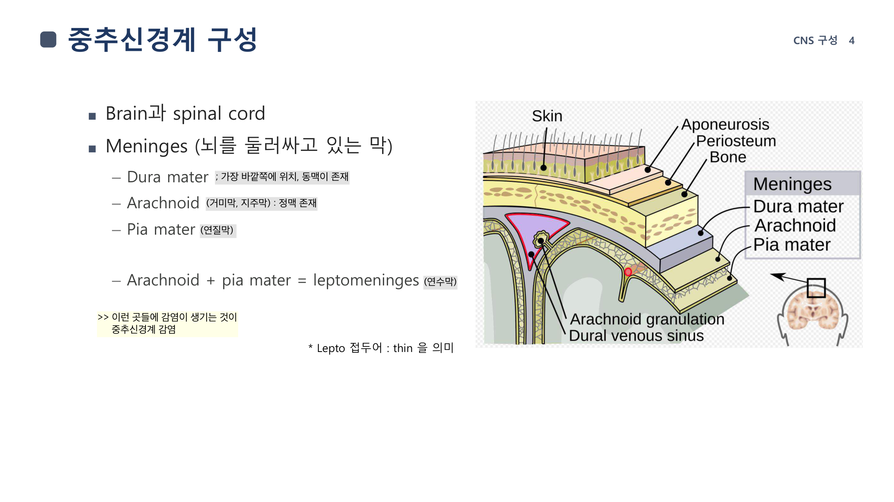{: style="width:62%"}

- 뇌와 척수, 그리고 뇌를 둘러싼 막: **경막(dura mater)**(가장 바깥, 동맥이 있음) – **거미막(arachnoid, 지주막)**(정맥) – **연막(pia mater, 연질막)**. 거미막 + 연막 = **연수막(leptomeninges)**(lepto = thin). 이런 곳에 감염이 생기는 것이 중추신경계 감염.
- **거미막밑공간(지주막하공간)**: 뇌척수액(CSF)이 있다. 감염이 생기면 연수막 전체로 퍼져 **수막염**이 되고 **뇌실염(ventriculitis)** 으로 진행하기도 한다.
    - 병원체와 싸우다 죽은 백혈구·염증성 물질이 쌓여 하얗게 침착 → **CSF가 흐르는 길을 막아 두개내압 상승**.
- **경막하농흉(subdural empyema)**: 경막과 거미막 사이의 화농성 감염, 국소 두개내 감염의 **13–20%** — 쉽게 진행할 수 있다.

# 2. 중추신경계 감염의 특징

- CNS는 **두피·두개골·수막·혈액뇌장벽(BBB)** 이 막지만, 일단 미생물이 들어오면 **보체와 면역글로불린이 극소량인 국소적 면역결핍 상태**라 **매우 빠르게 진행**한다.
- 증상은 원인균의 **독력, 감염 부위, 발병 기전**에 좌우된다.
- 사망률이 높고 **영구 신경 후유증**을 남길 수 있는 **시간을 다투는 응급질환**.

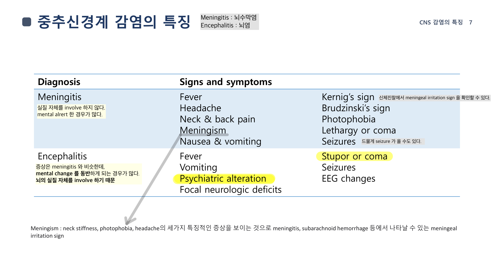{: style="width:70%"}

| 진단 | 증상·징후 |
|---|---|
| **수막염(meningitis)** | 발열, 두통, 목·등 통증, **수막자극증(meningism)**, 오심·구토, **Kernig·Brudzinski 징후**, 광공포증, 기면·혼수, 경련 |
| **뇌염(encephalitis)** | 발열, 구토, **정신 변화**, **국소 신경 결손**, 혼미·혼수, 경련, **EEG 변화** |

- **수막자극증** = **목의 뻣뻣함, 광공포증, 두통** 세 가지 — 수막염, 지주막하출혈 등에서.
- 수막염은 **뇌 실질을 침범하지 않아** 의식이 명료(mental alert)한 경우가 많고, 신체진찰에서 수막자극징후를 확인할 수 있다. 드물게 경련.
- 뇌염은 증상은 비슷하지만 **뇌 실질을 침범**하므로 **의식 변화(mental change)** 를 동반하는 경우가 많다.

## 경과에 따른 수막염 분류 — 올해 추가

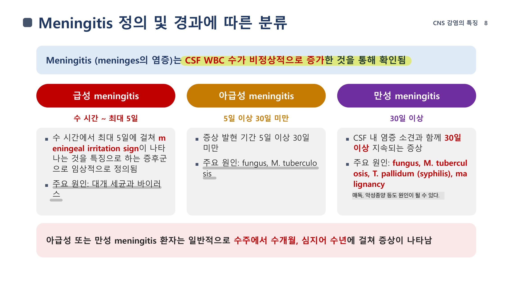{: style="width:76%"}

수막염은 **CSF WBC가 비정상적으로 증가**한 것으로 확인한다.

| 분류 | 기간 | 주요 원인 |
|---|---|---|
| **급성** | 수 시간–최대 **5일** | 대개 **세균·바이러스** |
| **아급성** | **5일 이상 30일 미만** | **진균, 결핵균** |
| **만성** | **30일 이상**(CSF 염증 소견 지속) | 진균, 결핵균, **매독(*T. pallidum*)**, **악성종양** |

- 아급성·만성 수막염 환자는 수 주–수 개월, 심지어 수 년에 걸쳐 증상이 나타난다.

!!! diff "작년 필기와 같은 내용, 다른 표현"
    작년: "세균·바이러스 → 급성, 결핵균·진균 → 아급성, 매독균 → 만성." 올해는 기간 기준(5일, 30일)과 악성종양이 추가됐다.

# 3. 급성 세균성 수막염

## 개요
- **거미막밑공간에 세균이 침입한 급성 화농성 염증**. 두개내압(ICP) 상승, 의식 저하, 경련 → 항균제가 늦으면 치명적.
- **병원 도착 후 60분 이내 항균제 시작**을 권고 — 투여 시기와 예후가 밀접. **초기 진단 + 최대한 빠른 적절한 항균제가 사망률을 줄이는 최선의 방법.**

## 원인균 — 나이·면역상태·기저질환에 따라

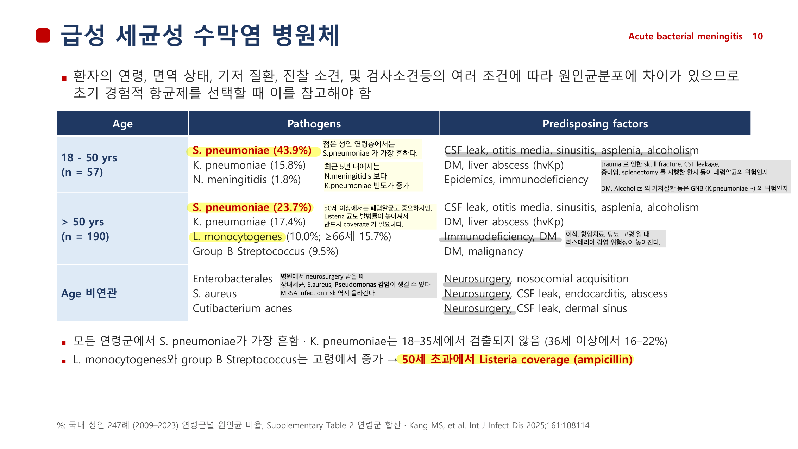{: style="width:80%"}

국내 성인 247례(2009–2023) 자료:

| 나이 | 원인균 | 위험인자 |
|---|---|---|
| **18–50세** | ***S. pneumoniae* 43.9%**, *K. pneumoniae* 15.8%, *N. meningitidis* 1.8% | 폐렴구균: CSF 누출, 중이염, 부비동염, 무비증, 알코올 / *K. pneumoniae*: 당뇨, **간농양(hvKp)** / 수막알균: 유행, 면역결핍 |
| **>50세** | *S. pneumoniae* 23.7%, *K. pneumoniae* 17.4%, ***L. monocytogenes* 10.0%(≥66세 15.7%)**, **GBS 9.5%** | *Listeria*: **면역결핍, 당뇨** / GBS: 당뇨, 악성종양 |
| 나이 무관 | **장내세균**, ***S. aureus***, ***Cutibacterium acnes*** | **신경외과 수술**, 병원 획득, CSF 누출, 심내막염, 농양, 피부 동(dermal sinus) |

- **모든 연령군에서 *S. pneumoniae*가 가장 흔하다**(15년 전체 기준). *K. pneumoniae*는 18–35세에서는 안 나왔고 **36세 이상에서 16–22%**.
- ***L. monocytogenes*와 GBS는 고령에서 증가 → 50세 초과에서 *Listeria* coverage(ampicillin).** 이식·항암치료·당뇨·고령이면 *Listeria* 위험이 높아진다.
- 외상에 의한 두개골 골절·CSF 누출, 중이염, 비장절제 → **폐렴구균** 위험인자. 당뇨·알코올 → **그람음성(*K. pneumoniae*)** 위험인자.
- 병원에서 신경외과 수술 → **장내세균, *S. aureus*, *Pseudomonas***, MRSA 위험 증가.

!!! diff "작년 필기와 다른 점 — 나이 구분과 원인균"
    작년 표(교과서): 0–4주 GBS·*E. coli*·*Listeria* / 1–3개월 / 3개월–18세 Hib·수막알균·폐렴구균 / **18–55세 폐렴구균(30–60%)·수막알균(10–35%)**(군대·기숙사) / **>55세 폐렴구균·*Listeria*·그람음성**. 올해는 국내 자료로 **50세** 기준, 수막알균은 1.8%로 드물고 대신 *K. pneumoniae*가 크게 늘었다.

### 주요 원인균의 특징
- ***S. pneumoniae***: 인접하거나 떨어진 부위에 **폐렴구균 감염 병소**가 있는 경우가 많다 — **폐렴, 중이염, 유양돌기염, 부비동염, 심내막염** → **원발 병소를 확인**한다. 기저질환: **비장절제·무비증, 다발골수종, 저감마글로불린혈증, 알코올, 영양실조, 만성 간·신장질환, 악성종양, 당뇨**.
- **호기성 그람음성 막대균**: 점점 중요해지는 원인 — *Klebsiella*, *E. coli*, *Serratia*, *P. aeruginosa*, *Acinetobacter*, *Salmonella*. **두부외상·신경외과 수술** 환자의 CSF, **신생아·고령·면역저하·그람음성 패혈증** 환자에서. **경험적 치료: ceftazidime, cefepime 또는 meropenem**(녹농균 커버).

## 역학
- **화농성 CNS 감염 중 가장 흔한 질환.** 미국 연간 10만 명당 2.5례 이상: *S. pneumoniae* ~50%, *N. meningitidis* ~25%, GBS ~15%, *L. monocytogenes* ~10%, Hib <10%.
- **국내 성인 지역사회 획득(2019–2023, 17개 병원)**: ***K. pneumoniae* 29.2%(가장 흔함)**, *S. pneumoniae* 19.4%, *L. monocytogenes* 11.1%, GBS 9.7%.
- **국내 성인 병원 획득**: **그람음성 막대균, *S. aureus*, CoNS, *S. pneumoniae*** — 원내에선 *Pseudomonas*, MRSA, CoNS.
- 백신 도입으로 역학 변화(예: 수막알균 → 군 백신) → 수막알균 발병률 감소.

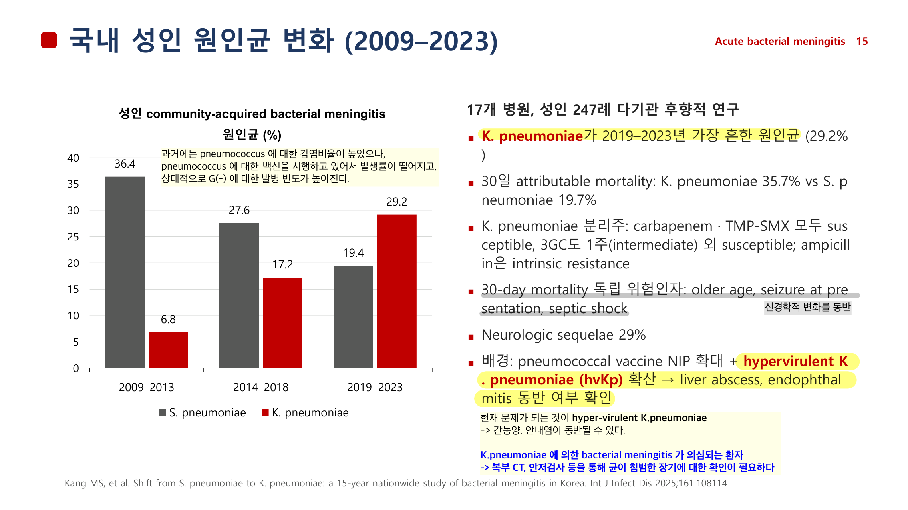{: style="width:76%"}

!!! new "올해 필기에서 추가 — 폐렴구균에서 *K. pneumoniae*로"
    국내 성인 지역사회 획득 세균성 수막염: *S. pneumoniae* 36.4% → 27.6% → 19.4%, *K. pneumoniae* 6.8% → 17.2% → **29.2%**(2019–23 가장 흔함). 이유: **폐렴구균 백신 국가예방접종 확대 + 고병원성 *K. pneumoniae*(hvKp) 확산**.

    - 30일 사망률: ***K. pneumoniae* 35.7% vs *S. pneumoniae* 19.7%**. 사망 독립위험인자: **고령, 내원 시 경련, 패혈성 쇼크**. 신경학적 후유증 29%.
    - *K. pneumoniae* 분리주는 carbapenem·TMP-SMX 감수성, 3세대 세파도 대부분 감수성, **ampicillin은 내재 내성**.
    - hvKp는 **간농양, 안내염(endophthalmitis)** 이 동반될 수 있다 → *K. pneumoniae* 수막염이 의심되면 **복부 CT, 안저검사**로 침범 장기를 확인.

!!! exam "기출 포인트"
    5번: 국내 성인 지역사회 획득 세균성 수막염의 가장 흔한 원인 → 기출 답은 ***S. pneumoniae***(작년 이전 자료·15년 전체 기준). 올해 강의 자료(2019–23)로는 *K. pneumoniae*가 1위 — 보기와 "최근/전체" 표현을 잘 읽을 것. 8번: 가능성이 **낮은** 것 → ***P. aeruginosa***(지역사회). 22번: 심장이식 10일 후 수막염, 그람양성·catalase(+)·약한 β용혈, ampicillin에 호전 → ***Listeria monocytogenes***.

## 발병 기전
1. *S. pneumoniae*·*N. meningitidis* 등이 **비인두 상피에 붙어 집락**
2. **점막 장벽 통과** → 혈액 침투, **다당류 피막** 덕에 호중구 포식·고전경로 보체 살균에 저항하며 혈액에서 증식
3. 혈액에서 증식한 세균이 **맥락막총(choroid plexus)** 상피를 통해 **CSF로 침입**
4. CSF에는 백혈구·보체·면역글로불린이 적어 포식에 필수인 **옵소닌화가 잘 안 됨** → 빠르게 파급

### 신경 손상은 세균이 아니라 숙주 면역반응 때문
- 그람음성균 **LPS**, 폐렴구균 **펩티도글리칸** → **TNF, IL-1** → CSF 단백·백혈구 증가, 수막 염증.
- TNF·IL-1 → **BBB 투과성 증가** → **혈관성 부종**, 혈청 단백이 거미막밑공간으로 누출.
- 백혈구·단백질로 된 거미막밑 삼출물이 뇌실계의 CSF 흐름을 막고 정맥동의 **거미막과립 흡수**를 줄임 → 간질 부종, **교통성·폐쇄성 수두증**.
- 호중구 탈과립 독성 대사물 → **세포독성 부종**, 세포 손상·괴사.
- **ICP 상승 → 혼수.** 혈관염 → 뇌저 동맥이 좁아져 허혈·경색 → 중대뇌동맥 가지 폐쇄, 주요 정맥동 혈전증, 피질 정맥 혈전정맥염. 좁은 공간에 뇌신경·혈관이 몰려 있어 염증이 생기면 경색이 생길 수 있다.

## 임상 양상
- 세 가지 특징적 징후 **발열, 심한 두통, 경부강직**이 **85%**, **75% 이상에서 의식 변화**.
- **수 시간 동안 급격히 진행**하는 전격성(acute fulminant) 경과가 흔하다.
- 일부에서 선행 **호흡기·부비동·귀·인두 감염** → 상기도감염, 부비동염, 중이염을 확인.
- **Kernig 징후**: 눕혀서 고관절·무릎을 굽힌 상태에서 무릎을 펴게 하면 통증으로 못 편다. **Brudzinski 징후**: 누운 상태에서 목을 들면 무릎·고관절이 저절로 굽혀진다.

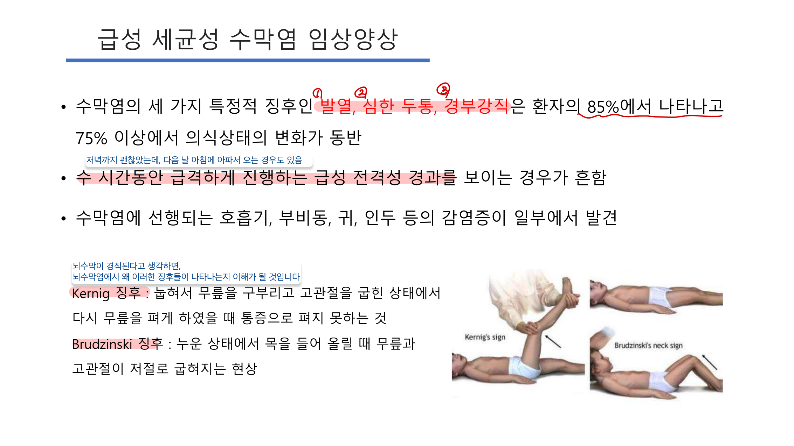{: style="width:56%"}

- 대부분 **ICP 180 mmH2O 이상** → 두통, 오심·구토, 의식저하, 유두부종(안저검사), 동공확대, 드물게 **뇌탈출**.
- **10–20%에서 뇌신경 마비(특히 CN III, IV, VI, VII)** 와 국소 신경 결손, **20–40%에서 경련**, **유두부종은 드물어 5% 미만**.
- **SIADH → 저나트륨혈증**(Na <135 mEq/L)이 생길 수 있다. *(올해 추가)*
- ***N. meningitidis***: 몸통·사지에 **홍반성 구진 → 빠르게 출혈성 병변(점상출혈·자반)** 으로.

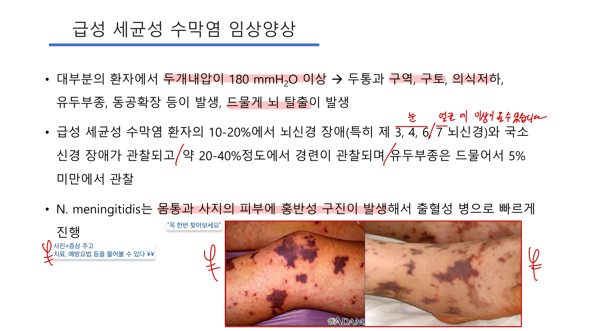{: style="width:48%"}

!!! exam "기출 포인트"
    1번(2025): **기숙사** 21세 남자, 고열·두통·경부강직·**점상출혈 발진** → ***N. meningitidis***. 18번: 하루 만에 사망한 30세 여자의 피부(자반) — 임신 3개월 간호사에게 줄 예방약 → **ceftriaxone**(임신부는 rifampin·ciprofloxacin을 피함. 필기에는 임신부 azithromycin도 있다).

## 진단
- 세균성 수막염이 의심되면 **진단 검사 때문에 치료가 지연되면 안 된다** — 사망률과 연관 → 바로 **혈액배양 + 요추천자(LP)**, 지체 없이 **경험적 항생제 + 보조 dexamethasone**.
- 확진: LP로 **ICP**를 재고 CSF **WBC(호중구·림프구), 단백, 당과 CSF/혈당 비, 그람염색, 배양**. 항생제 전 CSF에서는 **젖산(lactic acid)** 도 측정.

!!! new "올해 필기에서 추가 — CSF 정상 기준"
    - **개방압**(옆으로 누운 자세, 성인): 50–195 mmH2O — **150 미만 확실히 정상, 200 초과 비정상**.
    - **CSF/혈청 당 비**: 정상 약 **0.6**, **0.5 미만 비정상**. 세균이 증식하며 당을 소비해 비가 떨어진다.
    - **CSF 단백**: 요추 CSF **50 mg/dL 초과** 비정상(뇌실 CSF 15 초과). 성인에서 **100 mg/dL 초과**는 긴급 치료가 필요한 수막염의 위험인자.

### CSF 소견

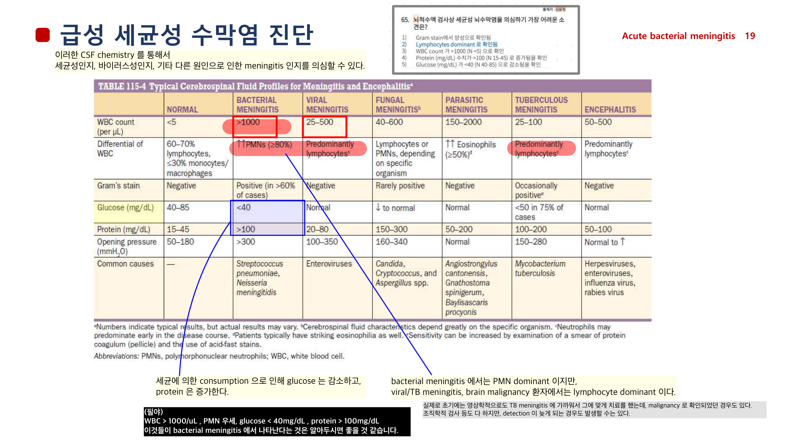{: style="width:82%"}

| | 정상 | **세균성** | **바이러스성** | 진균 | **결핵** |
|---|---|---|---|---|---|
| WBC(/μL) | <5 | **>1,000** | **25–500** | 40–600 | 25–100 |
| 우세 세포 | 림프구 | **호중구(≥80%)** | **림프구** | 림프구/호중구 | **림프구** |
| 그람염색 | 음성 | 양성(>60%) | 음성 | 드묾 | 가끔 |
| **당(mg/dL)** | 40–85 | **<40** | **정상** | ↓–정상 | **<50 (75%)** |
| 단백(mg/dL) | 15–45 | **>100** | 20–80 | 150–300 | 100–200 |
| 압력(mmH2O) | 50–180 | **>300** | 100–350 | 160–340 | 150–280 |

- (필야) **WBC >1,000/μL, PMN 우세, 당 <40 mg/dL, 단백 >100 mg/dL** — 세균성 수막염에서 나타난다는 것은 알아 두자.
- 세균성은 **호중구 우세**, 바이러스·결핵·뇌 악성종양은 **림프구 우세**. 영상도 결핵성 같아 치료했는데 악성종양이었던 경우도 있다(조직검사로도 늦게 발견되기도).
- 감별이 필요한 것: **수막주위 감염(parameningeal)**(경막외 농양, 척추·목 주위 농양 — CSF를 타고 감), **세균성 심내막염**(혈행성), CNS 유육종, **악성세포 침윤(연수막 전이)** — 세균성과 CSF가 비슷.
- CSF **호산구 증가** → **기생충**(개회충증 toxocariasis, 낭미충증 cysticercosis), 림프종, 드물게 아스페르길루스 같은 진균.
- CSF만으로는 원인균이 명확하지 않다 → **그람염색(60%)과 배양(80%)** + 원인 병원체 **PCR**. **PCR은 이미 항균제를 맞은 환자에서 유용.**
- **CSF 배양 = 세균성 수막염 진단의 gold standard** — 지역사회 획득은 항균제 전 채취하면 **80–90%** 양성.
- **Broad-range bacterial PCR**: 한 번에 흔한 원인균들을 검출, 적절한 민감도·매우 높은 특이도.
- **Multiplex PCR(Filmarray 수막염 패널)**: 2–3시간 안에 결과. 매우 민감·특이하지만 **위양성·위음성**이 있고, **모든 원인을 찾지 못하며 감수성 정보가 없다** → **CSF·혈액 배양과 함께** 사용. 지금 자주 쓰는 검사.

!!! exam "기출 포인트"
    4번: CSF에서 세균성 수막염을 의심하기 **가장 어려운** 소견 → **림프구 우세**. 그람염색 양성, WBC >1,000, 단백 >100, 당 <40은 모두 세균성 소견.

### 요추천자 전 뇌 영상(CT) — red flag

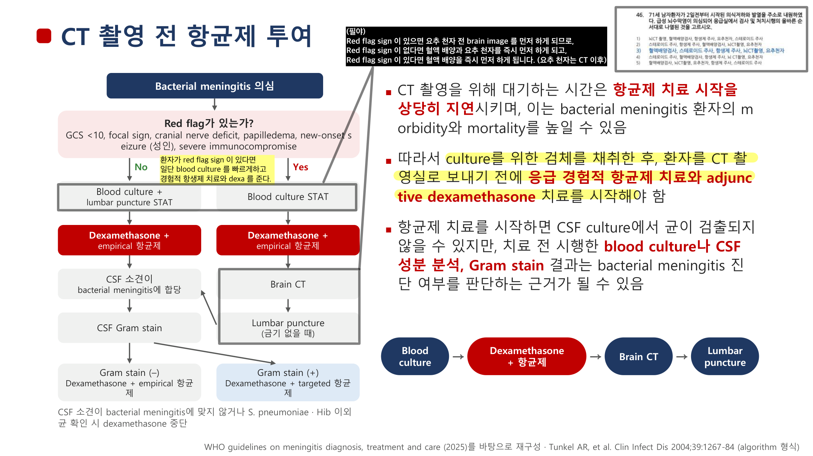{: style="width:80%"}

- **루틴으로 하지 않는다.** 다음 중 하나라도 있으면 LP 전에 영상을 먼저(영상이 불가능하면 해소될 때까지 LP를 미룸): **GCS <10, 국소 신경 징후, 뇌신경 결손, 유두부종, 새로 생긴 경련(성인), 심한 면역저하(예: 장기이식)**.
- **Red flag 있음** → **혈액배양 STAT → dexamethasone + 경험적 항균제 → 뇌 CT → (금기 없으면) LP**. **Red flag 없음** → **혈액배양 + LP STAT → dexamethasone + 경험적 항균제**.
- LP 후: CSF가 세균성에 합당하면 그람염색 (−) → dexamethasone + **경험적** 항균제 / (+) → dexamethasone + **표적** 항균제. CSF가 세균성에 맞지 않거나 **폐렴구균·Hib 이외 균**이 확인되면 **dexamethasone 중단**.
- CT를 기다리는 시간은 항균제를 상당히 지연시켜 이환율·사망률을 높인다 → **배양 검체를 받은 뒤 CT실로 보내기 전에** 응급 경험적 항균제와 dexamethasone을 시작. 항균제 뒤 CSF 배양이 음성이 돼도 치료 전 혈액배양, CSF 성분, 그람염색이 진단 근거가 된다. CSF를 빨리 못 받아도 혈액배양에서 균이 나올 수 있다.
- LP **6시간 전**에 준 항생제는 CSF 백혈구·당·그람염색·PCR에 의미 있는 영향을 주지 않는다.
- **MRI 적응증**: 두부외상·신경외과 수술·CSF 누출과 관련된 재발성 수막염, 뇌허혈·경색, 정맥동 혈전증, 뇌농양·경막하농흉 동반, 뇌실염·수두증 평가.

!!! diff "작년 필기와 다른 점 — 영상 먼저 하는 기준"
    작년 목록: **면역억제, 최근 1주 이내 경련, 의식 수준 저하, 국소신경증상, 유두부종**, 신경학적 질환 기왕력(종양·뇌졸중·뇌농양), 72시간 후 지속 발열, 천자 부위 감염. 올해(WHO 2025): **GCS <10, 국소 징후, 뇌신경 결손, 유두부종, 새 경련, 심한 면역저하**. 교수님: 응급실 환자는 일반적으로 다 영상을 하지만 적응증상으로는 이것들.

!!! exam "기출 포인트"
    21번: 71세 의식저하·발열, 수막염 의심 — 응급실 순서 → **혈액배양 → 스테로이드 → 항생제 → 뇌 CT → 요추천자**. 20번: 축농증이 있던 45세, CSF WBC 10,500(PMN 98%)·당 24 → **ceftriaxone + vancomycin + rifampin 병합**(정답). 오답 — "가장 먼저 Brain MR", "항생제 먼저, 그다음 dexamethasone"(dexamethasone은 항생제 **전·동시**), acyclovir, amphotericin B.

### 영상 소견

- 두부 CT·MRI는 세균성 수막염 **진단에는 별 도움이 안 되고** 초기엔 정상일 수 있다(너무 이르면 정상).
- 가장 흔한 소견 = **수막 조영증강(meningeal enhancement)**. 그 밖에 뇌경색, 뇌부종, 수두증, 뇌실내·실질내 출혈.
- **합병증 평가를 위해 CT·MRI를 고려**: 지속·장기화되는 발열, ICP 상승의 임상적 증거, 국소 신경 징후나 경련, (신생아) 머리둘레 증가, 지속되는 신경 기능 이상, CSF 검사·배양의 지속 이상. **수두증이면 외부 배액**을 해야 빨리 좋아진다.

## 치료

### 일반 원칙
- 응급 → 도착 후 **혈액배양(가능하면 CSF)** 을 신속히 하고 **1시간 이내 경험적 항생제**. 병원 이송이 늦어질 것 같으면 **이송 전에 IV/IM 항생제**.
- 검사 결과를 기다리지 말고 나이·기저질환으로 원인균을 추정해 **즉시** 투여.
- ***N. meningitidis* 의심 → 격리(비말주의, 적절한 항균제 투여 후 24시간까지).**
- 필요하면 산소·기도 유지 등 보존치료. **루틴 수액 제한은 하지 않고 등장액(생리식염수, 링거젖산)** 으로 유지(SIADH 의심이고 쇼크·저혈량이 없으면 중등도 제한 가능).
- **ICP 상승 의심 → 삼투성 약제(mannitol, 고장성 식염수)를 일시적으로**, glycerol은 루틴 X. 급성 경련엔 항경련제를 단기간(최대 3개월).
- **ICP 상승이면 머리 15–30° 거상**, 정상 체온 유지, 저산소·고탄산혈증·저혈압 교정. **루틴 과호흡은 하지 않는다**(뇌탈출이 임박할 때만 일시적으로). 필요하면 ICU에서 기계환기, 감압 두개골절제술.
- 항균제 **7일이 지나도 고열** → 정맥염, 뇌농양, 경막하농흉, 뇌실염, 폐쇄성 수두증 등 **합병증 검사**.
- **원인균이 확인되지 않은 경우**: 임상적으로 회복되면(발열·활력징후 이상·의식 변화가 모두 해소되고 정상 의식이 **48시간 이상**) **7일 후 경험적 항생제 중단 고려**. 1주 안에 회복이 없으면 연장하고 LP 반복을 포함해 재평가.
- **CSF 재검사**: 잘 반응하면 루틴으로 하지 않는다. 적절한 항균제 **48시간 후에도 반응이 없으면** 다시(특히 페니실린·세팔로스포린 내성 폐렴구균에서 dexamethasone 투여 중). **항균제를 끊기 위한 재검사는 필요 없다.**

!!! diff "작년 필기와 다른 점 — 두개내압 관리"
    작년: 만니톨이나 스테로이드, **머리 30–45도**, 삽관 후 **과호흡으로 PaCO2 25–30 mmHg**. 올해: 머리 **15–30°**, **루틴 과호흡은 하지 않음**(뇌탈출 임박 시에만 일시적). 무반응 시 CSF 재검 시점도 작년 48–72시간 → 올해 48시간.

### 경험적 항균제의 원칙
- **BBB를 잘 통과**하는 약을 **정맥으로, 최대량**.
    - **1세대·대부분의 2세대 세팔로스포린, clindamycin, aminoglycoside는 BBB를 통과하지 못해 쓰지 않는다.**
    - **Cefazolin은 분자량이 커서 BBB 통과가 잘 안 된다** → MSSA 패혈증에 수막염이 동반되면 MSSA의 1차 약 cefazolin·nafcillin 중 **nafcillin**.
- **국내 주요 원인균인 *K. pneumoniae*와 *S. pneumoniae*(페니실린 내성 포함)** 에 듣는 약을 고른다.
    - 폐렴구균 수막염 의심 시 **penicillin을 경험적으로 쓰는 것은 권장하지 않음**(내성) → 감수성 확인 후 penicillin으로 조절 가능.
- 배양·감수성 결과로 **좁은 범위로 조절**.

### 경험적 항균제 — 상황별

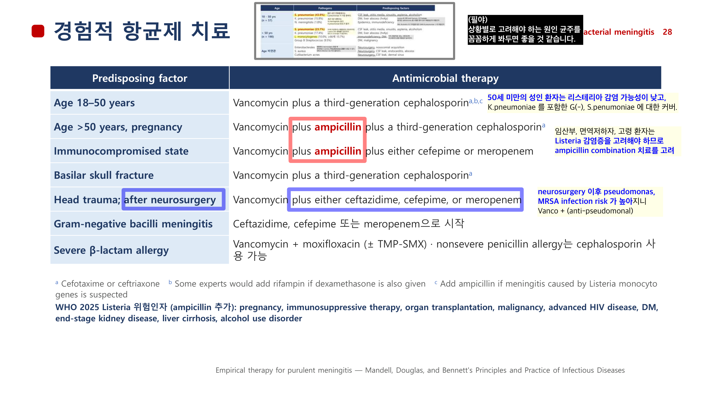{: style="width:82%"}

| 상황 | 경험적 항균제 |
|---|---|
| **18–50세** | **vancomycin + 3세대 세파**(ceftriaxone/cefotaxime) |
| **>50세, 임신** | **vancomycin + ampicillin + 3세대 세파** |
| **면역저하** | **vancomycin + ampicillin + cefepime 또는 meropenem** |
| 두개저 골절 | vancomycin + 3세대 세파 |
| **두부외상, 신경외과 수술 후** | **vancomycin + ceftazidime, cefepime 또는 meropenem** |
| 그람음성 막대균 수막염 | ceftazidime, cefepime 또는 meropenem으로 시작 |
| 심한 β-lactam 알레르기 | **vancomycin + moxifloxacin**(± TMP-SMX). 심하지 않은 페니실린 알레르기는 세팔로스포린 가능 |

- 각주: dexamethasone을 같이 주면 일부 전문가는 **rifampin 추가**, *Listeria*가 의심되면 **ampicillin 추가**.
- **WHO 2025 *Listeria* 위험인자(ampicillin 추가)**: **임신, 면역억제 치료, 장기이식, 악성종양, 진행된 HIV, 당뇨, 말기 신부전, 간경변, 알코올 사용장애.**
- 50세 미만은 *Listeria* 가능성이 낮아 *K. pneumoniae* 포함 그람음성과 폐렴구균을 커버. 임신·면역저하·고령은 *Listeria* → **ampicillin 병합**. 신경외과 수술 뒤엔 **녹농균·MRSA** → vancomycin + 항녹농균 약.
- (필야) "상황별로 고려해야 하는 원인균을 꼼꼼하게 봐 두면 좋을 것."

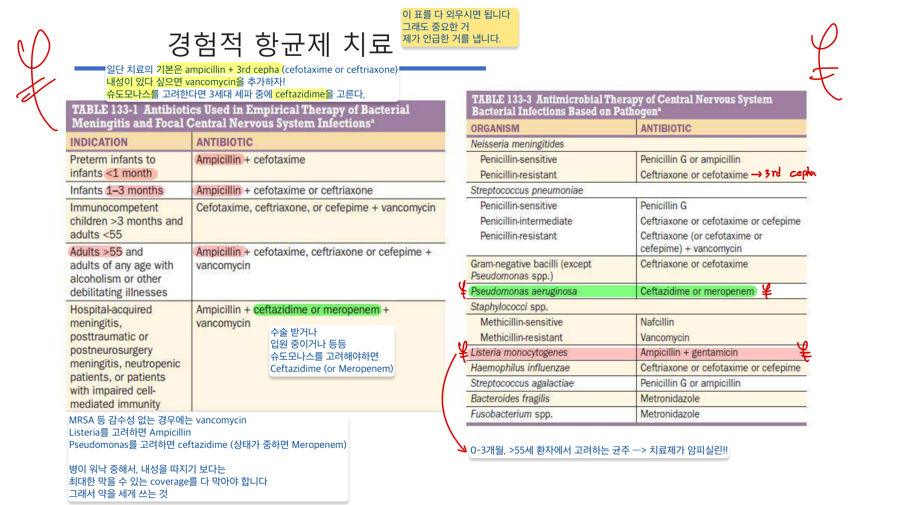{: style="width:70%"}

!!! diff "작년 필기와 다른 점 — 경험적 표"
    작년(국내 교과서 표): 1개월 미만 ampicillin + cefotaxime / 1–3개월 ampicillin + cefotaxime·ceftriaxone / 3개월–55세 ceftriaxone + vancomycin / **>55세·알코올·쇠약 → ampicillin + ceftriaxone + vancomycin** / 병원 획득·외상·신경외과·호중구감소 → **ampicillin + ceftazidime(또는 meropenem) + vancomycin**. 교수님 정리: 기본 ampicillin + 3세대 세파, 내성 의심이면 vancomycin, *Listeria* → ampicillin, 녹농균 → ceftazidime. 올해 기준 나이는 **50세**.

!!! exam "기출 포인트"
    경험적 항생제 사례는 매년 나온다.

    - **65세·70세**(기저질환 없음/고혈압) → **ceftriaxone + vancomycin + ampicillin**(3·14번)
    - **알코올 간경변 45세** → **ceftriaxone + vancomycin + ampicillin**(10번)
    - **조절 안 되는 당뇨 60세** → **ampicillin + ceftriaxone + vancomycin**(2번, 2025)
    - **뇌실 단락술(shunt) 후 신경외과 입원 중** → **ampicillin + ceftazidime + vancomycin**(7번)
    - 함정: ceftriaxone + vancomycin만(ampicillin 빠짐), ceftriaxone + metronidazole(뇌농양 조합), ceftazidime(지역사회엔 X), clindamycin·azithromycin 조합.

### 그람염색·원인균별 치료

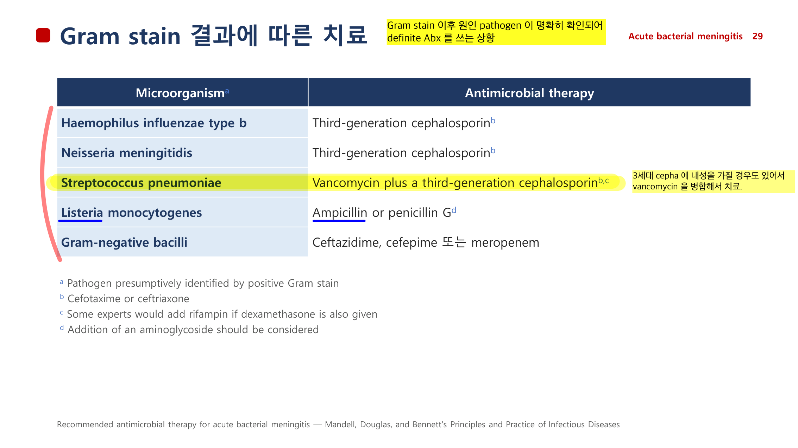{: style="width:70%"}

| 원인균 | 치료 |
|---|---|
| Hib, ***N. meningitidis*** | 3세대 세파 |
| ***S. pneumoniae*** | **vancomycin + 3세대 세파**(3세대 세파 내성이 있을 수 있어 병합) |
| ***L. monocytogenes*** | **ampicillin 또는 penicillin G**(aminoglycoside 추가 고려), 대안 TMP-SMX |
| 그람음성 막대균 | ceftazidime, cefepime, meropenem |

- 균별(교수님: "참고해서 알면 되구요"): Hib β-lactamase(−) ampicillin / (+) ceftriaxone·cefotaxime. 수막알균 penicillin MIC <0.1 → penicillin G·ampicillin, 0.1–1.0 → 3세대 세파. 폐렴구균 penicillin MIC ≤0.06 → penicillin G·ampicillin / ≥0.12 + 세파 MIC <1.0 → 3세대 세파 / 세파 MIC ≥1.0 → **vancomycin + 3세대 세파**. 장내세균 3세대 세파, **녹농균 ceftazidime·cefepime·meropenem**, ***Acinetobacter* meropenem**(대안 colistin), GBS ampicillin·penicillin G, **MSSA nafcillin·oxacillin**, **MRSA vancomycin**, *S. epidermidis* vancomycin.

### 치료 기간
| 원인균 | 기간 |
|---|---|
| ***S. pneumoniae*** | **10–14일** |
| ***N. meningitidis*** | **5–7일** |
| *H. influenzae* | 7–10일 |
| *S. agalactiae*(GBS) | 14–21일 |
| ***L. monocytogenes*** | **21일** |
| **그람음성 막대균** | **21–28일** |

- 간단히: **그람양성은 2주, 그람음성은 3주.**

!!! diff "작년 필기와 다른 점 — 기간"
    작년: *S. pneumoniae* **7–14일**, *N. meningitidis* **7일**, Hib **7일**. 나머지(GBS 14–21, *Listeria* 21, 그람음성 21–28)는 같다.

### 스테로이드 보조요법

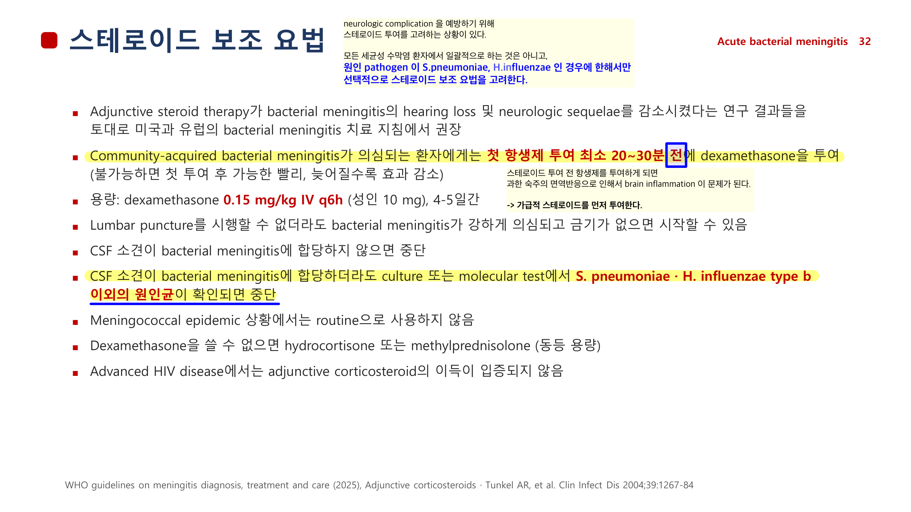{: style="width:78%"}

- 청력 소실·신경학적 후유증을 줄인다는 연구로 미국·유럽 지침에서 권장.
- 지역사회 획득 세균성 수막염 의심 시 **첫 항생제 최소 20–30분 전에 dexamethasone**(불가능하면 첫 투여 뒤 가능한 빨리 — 늦을수록 효과 감소). 스테로이드 전에 항생제를 주면 세균이 죽으며 과한 숙주 면역반응으로 뇌 염증이 문제 → **가급적 스테로이드를 먼저.**
- 용량: **dexamethasone 0.15 mg/kg IV q6h(성인 10 mg), 4–5일.**
- LP를 못 해도 세균성 수막염이 강하게 의심되고 금기가 없으면 시작 가능.
- **중단**: CSF가 세균성에 합당하지 않을 때, 합당해도 배양·분자검사에서 **폐렴구균·Hib 이외의 균**이 확인될 때. → 모든 환자에 일괄이 아니라 **폐렴구균·*H. influenzae*에 한해 선택적으로.**
- **수막알균 유행 상황에서는 루틴으로 쓰지 않음.** Dexamethasone을 못 쓰면 hydrocortisone 또는 methylprednisolone(동등 용량). **진행된 HIV에서는 이득이 입증되지 않음.**

!!! diff "작년 필기와 다른 점 — 스테로이드 시점"
    작년: "첫 항균제 투여 **전 또는 동시**", "**이미 항균제를 투여받은 환자에서는 권장하지 않는다**." 올해(WHO 2025): **최소 20–30분 전**, 불가능하면 첫 투여 후 **가능한 빨리**(늦을수록 효과 감소).

## 예후와 후유증
- 치명률: ***S. pneumoniae* 20%**, *L. monocytogenes* 15%, Hib·수막알균 3–7%.
- 높은 사망률 인자: **50세 이상, 입원 시 의식 저하, 쇼크, ICP 상승, 기계호흡, 입원 24시간 내 경련, 치료 지연**.
- 생존자의 **25%에 중등도 이상 후유증**: 인지·기억 장애, 경련, **청력 소실**, 어지럼증, 보행 장애.
- *(올해 추가 — WHO 2025)* 생존자 약 20%에 장기 후유증. **퇴원 전과 퇴원 후 4주 이내 최소 1회 후유증 평가**. **청력 선별검사는 퇴원 전**(불가능하면 4주 이내), 정상이어도 2차 선별. **청력 소실이면 달팽이관이 골화되기 전에 인공와우 평가로 긴급 의뢰.** 후유증이 있으면 가능한 빨리 재활, 환자·보호자 심리 지원.

## 격리와 접촉자 예방

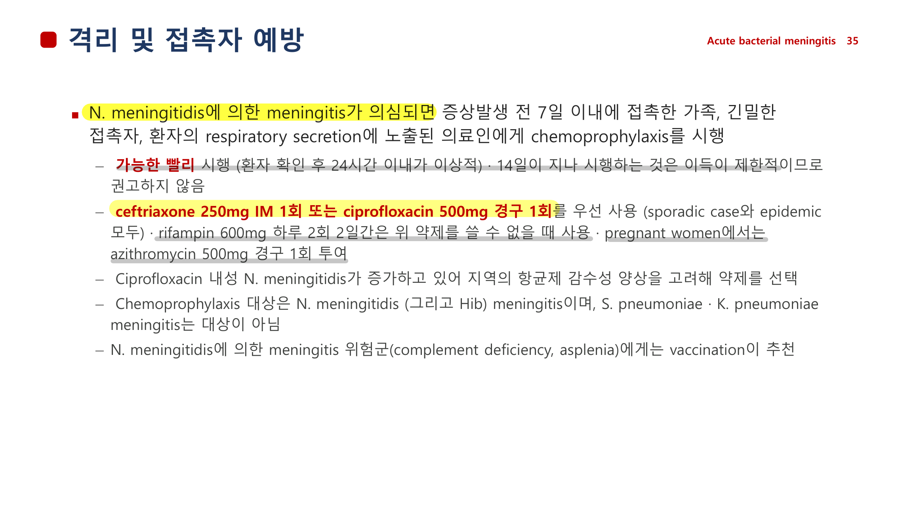{: style="width:78%"}

- *N. meningitidis* 수막염이 의심되면 **증상 발생 전 7일 이내** 접촉한 **가족, 긴밀한 접촉자, 호흡기 분비물에 노출된 의료인**에게 **화학예방**.
    - 가능한 빨리(환자 확인 후 **24시간 이내**가 이상적), **14일이 지나면** 이득이 제한적이라 권고하지 않음.
    - **우선: ceftriaxone 250 mg IM 1회 또는 ciprofloxacin 500 mg 경구 1회**(산발·유행 모두). **rifampin 600 mg 하루 2회 2일**은 위 약을 쓸 수 없을 때. **임신부: azithromycin 500 mg 경구 1회.**
    - **ciprofloxacin 내성 수막알균이 증가** → 지역 감수성을 고려.
    - **화학예방 대상은 수막알균(그리고 Hib) 수막염**이며 **폐렴구균·*K. pneumoniae* 수막염은 대상이 아님.**
- 위험군(**보체결핍, 무비증**)에게는 **백신**.

!!! diff "작년 필기와 다른 점 — 예방약 순서"
    작년: rifampin 600 mg 2회 2일 · ciprofloxacin 1회 · ceftriaxone 250 mg IM 1회를 나란히, 임산부 azithromycin(교과서상 ceftriaxone). 올해: **ceftriaxone·ciprofloxacin이 우선**, rifampin은 이를 못 쓸 때.

# 4. 바이러스성 수막염과 뇌염

## 바이러스성 수막염
- 원인: **엔테로바이러스가 무균성 수막염의 주원인 — 원인이 밝혀진 사례의 85–95%**. 그 밖에 VZV, HSV, EBV, 아르보바이러스, HIV 등.
- **성인은 소아보다 HSV가 많고**, 특히 **재발성 무균성 수막염**이면 HSV 가능성. **Mollaret 수막염**(지금은 재발성 양성 림프구성 수막염)에서 CSF HSV DNA가 검출됐고 대부분 **HSV-2**.
- 임상: 발열, 두통, 수막자극징후 + 무력감·근육통·오심·구토·설사 등 전신 증상. **의식 저하는 대부분 경미** → **심한 의식 저하·경련·국소 신경 징후**가 있으면 **뇌염** 등 다른 질환. 세균성과 증상이 비슷할 수 있다.
- 진단: CSF **림프구성 백혈구 증가(25–500/μL)**, 단백 정상–약간 상승(20–80), **당 정상**, ICP 약간 상승(100–350). 단백·당은 세균성보다 변동이 적다. CSF 바이러스 배양·**PCR**, 엔테로바이러스는 **대변·인두 스왑**도. 부분 치료된 세균성 수막염, 수막주위 감염, 종양성·비감염성 염증성 수막염과 감별.
    - (교수님 밑줄) 바이러스 수막염도 **초반엔 다형핵백혈구(호중구) 형태**일 수 있지만 **2–3일 지나면 림프구성**으로 바뀐다.
- **영상으로 진단을 돕는 바이러스 질환 — 헤르페스 뇌염: HSV는 주로 측두엽(temporal lobe)을 침범.**

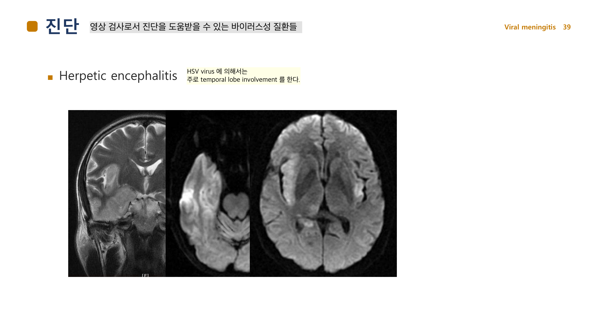{: style="width:62%"}

- 치료: **보존치료**, 두통엔 진통제(LP로 두통이 줄기도). **HSV, VZV면 acyclovir.** **뇌염(의식·인지 변화, 경련, 국소 징후)이 의심되면 IV acyclovir 10 mg/kg q8h를 내원 6시간 이내 시작.** 수일 뒤에도 호전이 없고 초기 진단이 의심되면 **LP 반복**. 뇌염에서 첫 LP가 발병 3일 이내였고 비진단적이면 **2–3일 뒤 반복**.
- 예후: 대개 **7일 이내** 경미한 경과로 **자연 치유**. 드물게 지속 두통·경한 인지장애·전신 무력이 수 주–수 개월.

!!! exam "기출 포인트"
    6번: 젊은 여자, 두통·메스꺼움 + **성기 주위 수포**, CSF WBC 39(**림프구 100%**), 단백·당 정상 → **acyclovir**(HSV-2 수막염). 11번: 같은 CSF에 목 주위 피부 병변 + multiplex PCR **VZV 검출** → **acyclovir**. 19번: HIV 양성, 1달 두통, CSF 림프구·당 저하, **India ink 도말**에서 피막 효모 → ***Cryptococcus neoformans***.

## 뇌염(Encephalitis) — 올해 추가
- **정의**: **뇌 실질**에 생기는 염증 과정으로, 신경 기능 이상의 임상적·검사적 근거를 동반. (수막염은 실질 침범 X, 뇌염은 실질 침범.)
- **역학**: **1세 미만 영아와 65세 이상**에서 가장 흔하다.
- **병인**: **최대 60%는 원인을 찾지 못한다.** 바이러스, 세균, **자가면역 염증**이 가장 흔한 원인.
- **진단**: **CSF 검사와 MRI**가 우선 권장(세균성 수막염과 달리 영상이 중요).

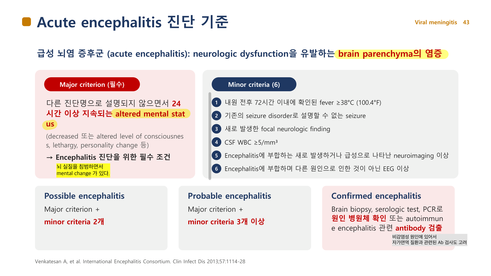{: style="width:80%"}

| 기준 | 내용 |
|---|---|
| **Major(필수)** | 다른 진단으로 설명되지 않는 **24시간 이상 지속되는 의식 변화**(의식 저하, 기면, 성격 변화 등) |
| Minor ① | 내원 전후 72시간 안의 **발열 ≥38℃** |
| Minor ② | 기존 경련 질환으로 설명되지 않는 **경련** |
| Minor ③ | 새로 생긴 **국소 신경 소견** |
| Minor ④ | **CSF WBC ≥5/mm3** |
| Minor ⑤ | 뇌염에 맞는 새 **영상 이상** |
| Minor ⑥ | 뇌염에 맞고 다른 원인이 아닌 **EEG 이상** |

- **Possible** = major + minor **2개**, **Probable** = major + minor **3개 이상**, **Confirmed** = 뇌생검·혈청검사·PCR로 병원체 확인 또는 **자가면역 뇌염 항체** 검출.
- 평가 시 고려: ① **위치**(측두엽, 기저핵) ② **기간**(급성·아급성) ③ **역학·노출**(여행, 모기) — 예방접종력도 중요 ④ **면역상태**(AIDS, 장기이식, 간경변) ⑤ **CSF 양상**(림프구성 vs 호중구성).
- **일측 측두엽 뇌염 → HSV**: 성격 변화, 의식 변화·저하, 경련, 국소 신경 징후(언어장애, 근력저하, 감각이상).

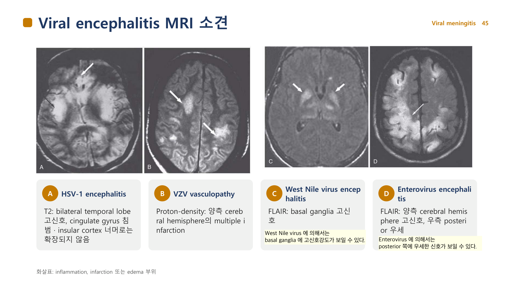{: style="width:80%"}

| 원인 | MRI |
|---|---|
| **HSV-1 뇌염** | T2 **양측 측두엽** 고신호, 대상회 침범, 섬엽 피질 너머로는 확장 안 됨 |
| VZV 혈관병증 | 양측 대뇌의 **다발성 경색** |
| West Nile 바이러스 | **기저핵** 고신호 |
| 엔테로바이러스 | 양측 대뇌 고신호, 우측 **후방 우세** |

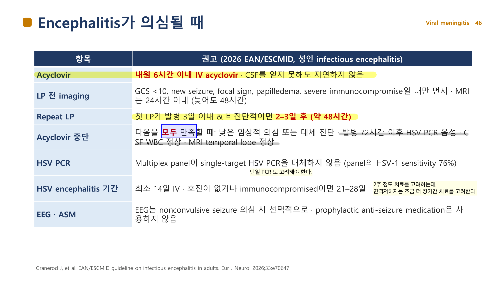{: style="width:80%"}

- **Acyclovir**: **내원 6시간 이내 IV**, CSF를 얻지 못해도 미루지 않는다.
- **LP 전 영상**: GCS <10, 새 경련, 국소 징후, 유두부종, 심한 면역저하일 때만 먼저. **MRI는 24시간 이내(늦어도 48시간).**
- **반복 LP**: 첫 LP가 발병 3일 이내 & 비진단적이면 2–3일(약 48시간) 뒤.
- **Acyclovir 중단**: 모두 만족할 때 — 임상적 의심이 낮거나 대체 진단, **발병 72시간 이후 HSV PCR 음성**, CSF WBC 정상, MRI 측두엽 정상.
- **HSV PCR**: **multiplex 패널이 단일 표적 HSV PCR을 대체하지 않는다**(패널의 HSV-1 민감도 76%) → 단일 PCR도 고려.
- **HSV 뇌염 기간: 최소 14일 IV**, 호전이 없거나 면역저하면 **21–28일**.
- EEG는 비경련성 경련 의심 시 선택적으로, **예방적 항경련제는 쓰지 않는다.**

!!! diff "작년 필기와 다른 점 — HSV 형"
    필기 작성자 요약은 "HSV-2가 temporal lobe를 침범"이라고 적었지만, 슬라이드 MRI는 **HSV-1 뇌염**이 측두엽을 침범한다고 되어 있다. ※ 확인 필요: 성인 **뇌염 = HSV-1(측두엽)**, 성인 재발성 **수막염(Mollaret) = HSV-2**로 구분하는 것이 일반적이다.

# 5. 결핵성 수막염 (TB meningitis) — 올해 추가

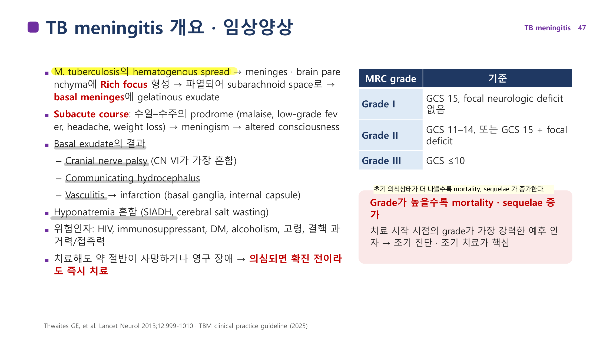{: style="width:80%"}

- **기전**: 결핵균의 혈행성 전파 → 수막·뇌실질에 **Rich focus** 형성 → 파열되어 거미막밑공간으로 → **뇌저부 수막(basal meninges)에 젤라틴 같은 삼출물**.
- **아급성 경과**: 수일–수주의 전구증상(무력감, 미열, 두통, 체중감소) → 수막자극증 → 의식 변화.
- **뇌저부 삼출물의 결과**: **뇌신경 마비(CN VI가 가장 흔함)**, **교통성 수두증**, **혈관염 → 경색(기저핵, 내포)**.
- **저나트륨혈증 흔함**(SIADH, 뇌염분소실).
- 위험인자: **HIV, 면역억제제, 당뇨, 알코올, 고령, 결핵 과거력·접촉력**.
- 치료해도 **약 절반이 사망하거나 영구 장애** → **의심되면 확진 전이라도 즉시 치료.**
- **MRC grade**: I = GCS 15 + 국소 결손 없음 / II = GCS 11–14, 또는 GCS 15 + 국소 결손 / III = **GCS ≤10**. **치료 시작 시점의 grade가 가장 강력한 예후인자** — 초기 의식이 나쁠수록 사망·후유증 증가 → 조기 진단·치료가 핵심.

## 진단

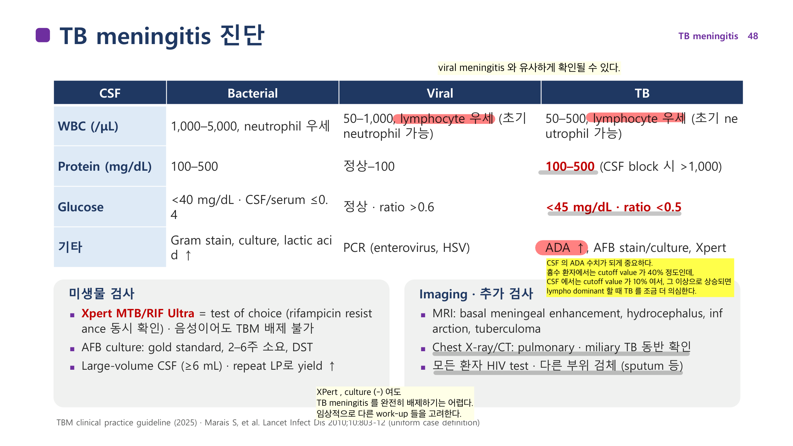{: style="width:80%"}

| CSF | 세균성 | 바이러스성 | **결핵성** |
|---|---|---|---|
| WBC(/μL) | 1,000–5,000, **호중구** | 50–1,000, **림프구**(초기 호중구 가능) | **50–500, 림프구**(초기 호중구 가능) |
| 단백(mg/dL) | 100–500 | 정상–100 | **100–500**(CSF block 시 >1,000) |
| 당 | **<40**, CSF/혈청 ≤0.4 | **정상**, 비 >0.6 | **<45**, 비 <0.5 |
| 기타 | 그람염색, 배양, **젖산↑** | PCR(엔테로, HSV) | **ADA↑**, AFB 염색·배양, **Xpert** |

- 결핵성은 바이러스성과 비슷하게(림프구 우세) 보일 수 있다. **CSF ADA가 매우 중요** — 흉수에서는 cutoff가 40 정도지만 **CSF는 10**: 림프구 우세일 때 **ADA >10이면 결핵을 더 의심.**
- 미생물 검사: **Xpert MTB/RIF Ultra = 1차 검사**(rifampicin 내성 동시 확인), **음성이어도 TBM 배제 불가**. **AFB 배양 = gold standard**(2–6주, 약제감수성). **많은 양의 CSF(≥6 mL)·반복 LP**로 검출률↑. Xpert·배양이 음성이어도 완전히 배제하기 어려워 다른 검사를 함께 본다.
- 영상: **MRI**(조영 MRI가 CT보다 민감) — **뇌저부 수막 조영증강, 수두증, 경색, 결핵종(tuberculoma)**. 흉부 X선/CT로 폐·좁쌀결핵 동반 확인. **모든 환자 HIV 검사**, 객담 등 다른 부위 검체.

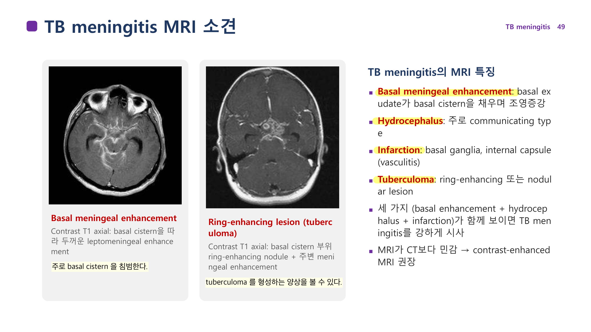{: style="width:76%"}

- **뇌저부 수막 조영증강**(삼출물이 basal cistern을 채움), **수두증**(주로 교통성), **경색**(기저핵·내포, 혈관염), **결핵종**(링 조영 또는 결절). **세 가지(뇌저부 조영증강 + 수두증 + 경색)가 함께 보이면 TBM을 강하게 시사.**

## 치료

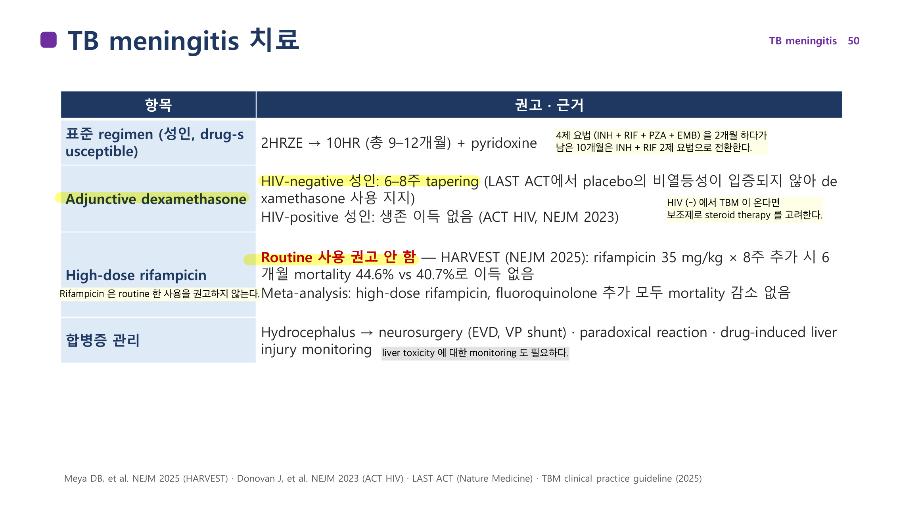{: style="width:80%"}

- **표준(성인, 약제감수성): 2HRZE → 10HR(총 9–12개월) + pyridoxine** — INH + RIF + PZA + EMB 4제 2개월 후 INH + RIF 2제 10개월.
- **보조 dexamethasone**: **HIV 음성 성인은 6–8주 감량 투여**(LAST ACT에서 위약의 비열등성이 입증되지 않아 사용 지지). **HIV 양성 성인은 생존 이득 없음**(ACT HIV, NEJM 2023).
- **고용량 rifampicin: 루틴 권고 안 함**(HARVEST, NEJM 2025 — 6개월 사망률 44.6% vs 40.7%로 이득 없음). 메타분석에서도 고용량 rifampicin·FQ 추가 모두 사망률 감소 없음.
- 합병증: **수두증 → 신경외과(EVD, VP shunt)**, 역설적 반응, **약물 간손상 모니터링**.

# 6. 뇌농양 (Brain abscess)
"뇌농양부터는 되게 빠르게 읽고 넘어가셨습니다."

- **정의**: 뇌실질 내 **국소 화농성 감염**, 혈관이 잘 발달한 **피막**으로 둘러싸임.
- 세균성 수막염 뒤 2차로 생기는 경우는 **드물고** 대부분 **단독**, 혈행성이면 **다발성**. 감염성 심내막염의 증식물이 머리로 가서 생기기도.

## 원인균
- **면역 정상**: ***Streptococcus***, *E. coli*, *K. pneumoniae*, **혐기균(*Bacteroides*, *Clostridium*, *Fusobacterium*)**, *Staphylococcus*, 결핵균.
- **면역 저하**: ***Actinomyces*, *Listeria*, *Nocardia*, 진균(*Aspergillus*, *Candida*)**.

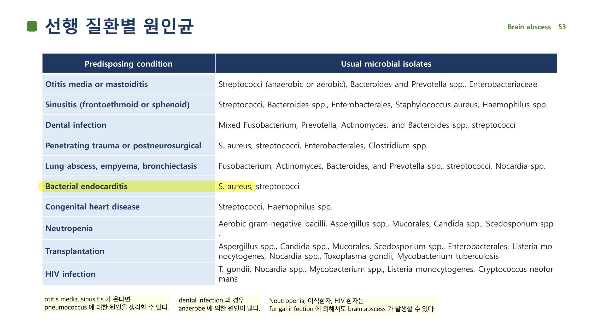{: style="width:80%"}

| 선행질환 | 흔한 원인균 |
|---|---|
| 중이염·유양돌기염 | 연쇄알균(혐기·호기), *Bacteroides*·*Prevotella*, 장내세균 |
| 부비동염 | 연쇄알균, *Bacteroides*, 장내세균, *S. aureus*, *Haemophilus* |
| **치아 감염** | *Fusobacterium*, *Prevotella*, *Actinomyces*, *Bacteroides* 혼합(**혐기균**), 연쇄알균 |
| 관통 외상·신경외과 수술 후 | ***S. aureus***, 연쇄알균, 장내세균, *Clostridium* |
| 폐농양·농흉·기관지확장증 | *Fusobacterium*, *Actinomyces*, *Bacteroides*, *Prevotella*, 연쇄알균, ***Nocardia*** |
| 세균성 심내막염 | ***S. aureus***, 연쇄알균 |
| 호중구감소 | 그람음성 막대균, ***Aspergillus***, Mucorales, *Candida* |
| 이식 | *Aspergillus*, *Candida*, Mucorales, *Listeria*, *Nocardia*, ***Toxoplasma***, 결핵균 |
| HIV | ***T. gondii***, *Nocardia*, 결핵균, *Listeria*, ***Cryptococcus*** |

- 중이염·부비동염이면 폐렴구균을, 치아 감염이면 혐기균을 생각. 호중구감소·이식·HIV는 **진균**에 의한 뇌농양도.

## 발병 기전
- **인접 부위에서 직접 파급**: **부비동염, 중이염, 유양돌기염, 치아 감염**, 두부외상·신경외과 시술 후(수술 합병증).
- **혈행성**: 멀리 떨어진 감염(**감염성 심내막염**, 폐농양, 골수염, 편도주위농양).
- **20–30%는 1차 병소를 알 수 없다.**

## 임상
- 증상은 감염 자체보다 **용적이 한정된 두개 내에서 농양이 누르는 것** 때문.
- 감염 증상: **발열 50%** — 선행질환이 심하지 않으면 높지 않거나 없을 수 있다.
- ICP 상승: **두통 75% 이상**(편측이 많음), 진행하면 **구토(50%)**·의식 변화, 유두부종 약 25%.
- 뇌조직 파괴: 신경학적 증상 약 50%, 부위에 따라(뇌간·소뇌 → 뇌신경 마비, 보행장애). **국소·전신 경련 15–25%.**

## 진단

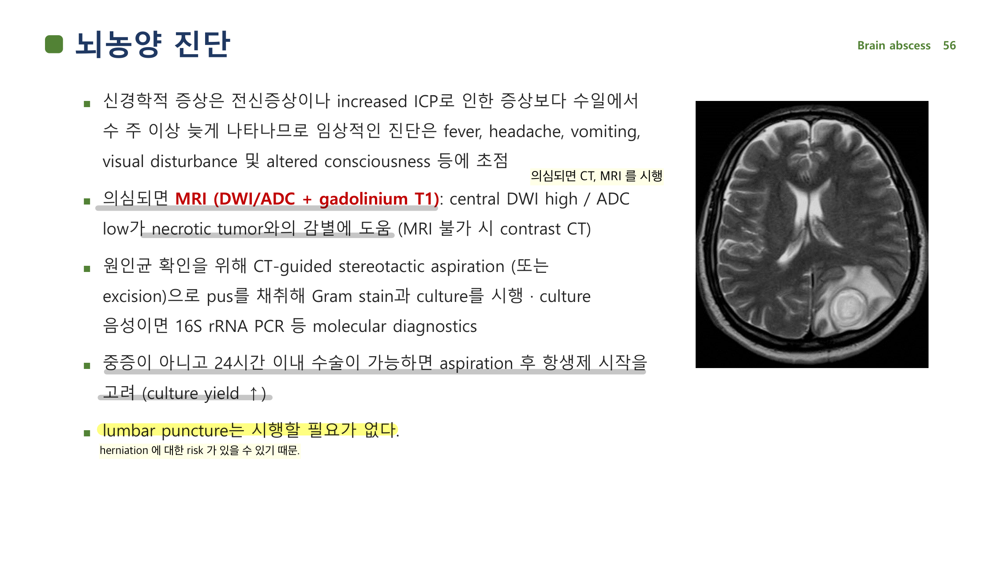{: style="width:76%"}

- 신경학적 증상은 수일–수주 늦게 나타나므로 **발열, 두통, 구토, 시력장애, 의식 변화**에 초점.
- 의심되면 **MRI(DWI/ADC + 가돌리늄 T1)**: **중심부 DWI 고신호 / ADC 저신호**가 **괴사성 종양과의 감별**에 도움(MRI 불가 시 조영 CT).
- 원인균: **CT 유도 정위적 흡인(또는 절제)** 으로 농을 받아 그람염색·배양, 배양 음성이면 **16S rRNA PCR** 등.
- **중증이 아니고 24시간 안에 수술이 가능하면 흡인 후 항생제 시작**을 고려(배양 검출률↑). *(올해 추가)*
- **요추천자는 할 필요가 없다** — 뇌탈출 위험.

## 치료
- 항균제 + 수술 + 기타(스테로이드).

### 항균제
- 기저질환·원발 병소로 결정. **주로 3세대 cephalosporin + metronidazole**(중이염·부비동염·치아 감염의 원인인 폐렴구균·혐기균).
- **혈행성 다발성 농양·두부외상 → 포도알균에 듣는 nafcillin 또는 vancomycin 추가.**
- **심한 면역저하 → 3세대 세파 + metronidazole에 TMP-SMX(*Nocardia*, *Toxoplasma*)와 voriconazole(진균) 추가.** *(올해 추가)*
- **신경외과 시술 후 → vancomycin + 3·4세대 cephalosporin**(녹농균·MRSA 커버 — ceftazidime/cefepime).
- 배양 결과로 조절. **고용량 IV로 총 6–8주**(이후 경구의 효능·필요성은 확립 안 됨). 대부분 **신경외과적 흡인·절제와 병행**.

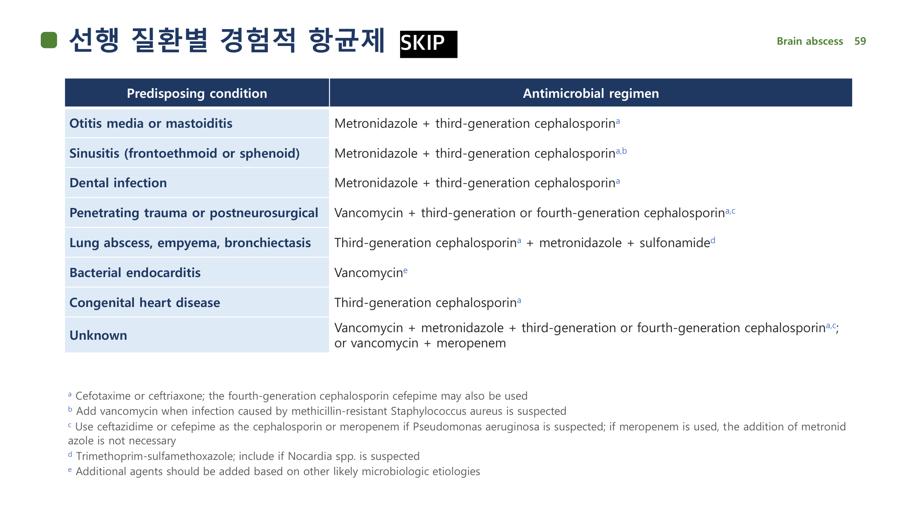{: style="width:76%"}

- 표(강의에서 SKIP): 중이염·부비동염·치아 감염 → metronidazole + 3세대 세파 / 관통 외상·신경외과 후 → vancomycin + 3·4세대 세파 / 폐농양 → 3세대 세파 + metronidazole + sulfonamide(*Nocardia*) / 심내막염 → vancomycin / 원인 불명 → vancomycin + metronidazole + 3·4세대 세파 또는 vancomycin + meropenem. 균별(SKIP): *Actinomyces* penicillin G, *B. fragilis*·*Fusobacterium* metronidazole, ***Nocardia* TMP-SMX**, 결핵균 HRZE.

### 수술과 기타
- **직경 2.5 cm가 넘는 농양 → CT 유도 정위적 흡인 또는 절제**(진단·치료 모두에 유용), 개두술·두개골절제로 완전 절제하기도.
- **스테로이드**: 심한 주위 부종이나 **뇌탈출 임박**이면 **dexamethasone 10 mg q6h**, 최대한 빨리 감량.
- **항경련제**: **1차 예방은 하지 않고** 경련이 생기면 치료.

### 치료 기간·추적

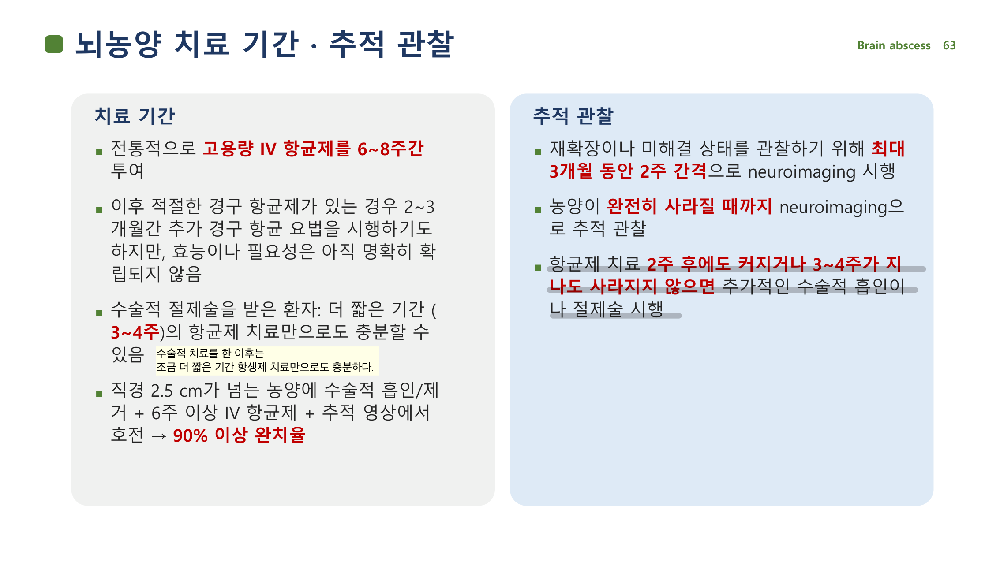{: style="width:76%"}

- 전통적으로 **고용량 IV 6–8주**. 이후 2–3개월 경구를 하기도 하지만 근거 미확립.
- **수술적 절제를 받은 환자는 3–4주**로도 충분할 수 있다.
- 2.5 cm 초과 농양에 흡인/제거 + 6주 이상 IV + 추적 영상 호전 → **90% 이상 완치**.
- **추적**: 최대 3개월간 **2주 간격 영상**, 농양이 완전히 사라질 때까지. **항균제 2주 후에도 커지거나 3–4주가 지나도 안 없어지면 추가 흡인·절제.**

### 항균제 단독 치료를 고려할 수 있는 경우

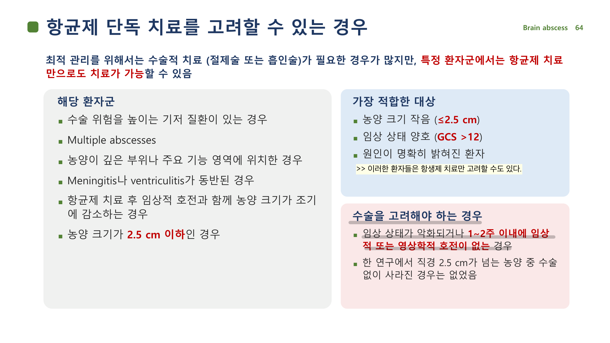{: style="width:76%"}

- 대상: 수술 위험이 큰 기저질환, **다발성 농양**, 깊은 부위·주요 기능 영역, **수막염·뇌실염 동반**, 항균제 후 임상 호전과 함께 크기가 일찍 줄어드는 경우, **2.5 cm 이하**.
- 가장 적합: **≤2.5 cm, 임상상태 양호(GCS >12), 원인이 밝혀진 환자**.
- 수술 고려: 악화되거나 **1–2주 안에 호전이 없을 때**. 한 연구에서 **2.5 cm 넘는 농양 중 수술 없이 사라진 경우는 없었다.**

!!! diff "작년 필기와 다른 점 — 크기 기준"
    작년: 항생제 단독은 **작거나(<2–3 cm)** 외과적 배농이 불가능할 때만. 올해: **2.5 cm**.

## 예후
- 대다수 성공적으로 치료, **사망률 15% 이하**. 경련·신경 결손·정신장애 등 합병증 약 **20%**.

!!! exam "기출 포인트"
    15번: 65세, 2주 발열·두통·구토 + MRI(뇌농양) — **잘못된** 것 → "**뇌척수액 천자로 원인균 확인**". 부비동염·중이염 파급, 뇌압 상승에 dexamethasone, 3세대 세파 + metronidazole, 6–8주 주사는 맞다. 9번: 뇌농양 치료에 사용이 가장 어려운 약 → **cefazolin**(1세대, BBB 통과 X).

# 7. 미생물학 보충 (2021–22 기출)
- ***Listeria monocytogenes***: 냉장 음식으로도 감염(저온 증식), 신생아·노인·임산부·세포면역결핍자. **internalin A**로 부착 → 포식용해소체에서 **LLO(listeriolysin O)** 와 phospholipase C가 막을 녹여 세포질로 탈출 → **ActA**가 **actin 재배열**을 유도해 옆 세포로 이동 → 장점막 → 혈액 → 간·비장 → **뇌·태반**(12·16번).
- **프리온**: 핵산이 없고 **면역반응을 일으키지 않으며**, 긴 잠복기 후 아급성 해면상 뇌병증. 정상 PrPc가 PrPsc와 상호작용해 PrPsc로 전환·축적. 사람 PrP 유전자는 **20번 염색체**. **protease K 저항성**을 western blot으로 확인(13·17·23번).

!!! memo "암기"
    **원인균**: 18–50세 폐렴구균 > *K. pneumoniae*(hvKp: 간농양·안내염) / >50세 + ***Listeria*·GBS** / 수술 후 그람음성·*S. aureus*·*C. acnes* · **경험적**: vanco + 3세대 세파 (+ **ampicillin**: >50세·임신·면역저하·당뇨·간경변·알코올·이식·암) (면역저하면 cefepime/meropenem) (신경외과 후 **vanco + ceftazidime/cefepime/meropenem**) · **dexamethasone 0.15 mg/kg(10 mg) q6h 4–5일, 첫 항생제 20–30분 전**, 폐렴구균·Hib 아니면 중단 · **CSF 세균성** >1,000 PMN, 단백 >100, 당 <40(비 <0.4) · **TB** 림프구, 당 <45, **ADA >10**, Xpert, 2HRZE/10HR + dexa(HIV−) · **Red flag**(GCS<10, 국소징후, 뇌신경, 유두부종, 새 경련, 심한 면역저하)면 혈액배양 → 항균제 → CT → LP · **기간** 폐렴구균 10–14, 수막알균 5–7, *Listeria* 21, 그람음성 21–28일 · 접촉자 **ceftriaxone 250 IM / cipro 500 1회**(rifampin은 대안, 임신부 azithromycin) · **HSV 뇌염** 측두엽, **6시간 내 acyclovir 10 mg/kg q8h, 14일**(면역저하 21–28) · **뇌농양** 3세대 세파 + metronidazole 6–8주, **LP X**, >2.5 cm 흡인·절제.
