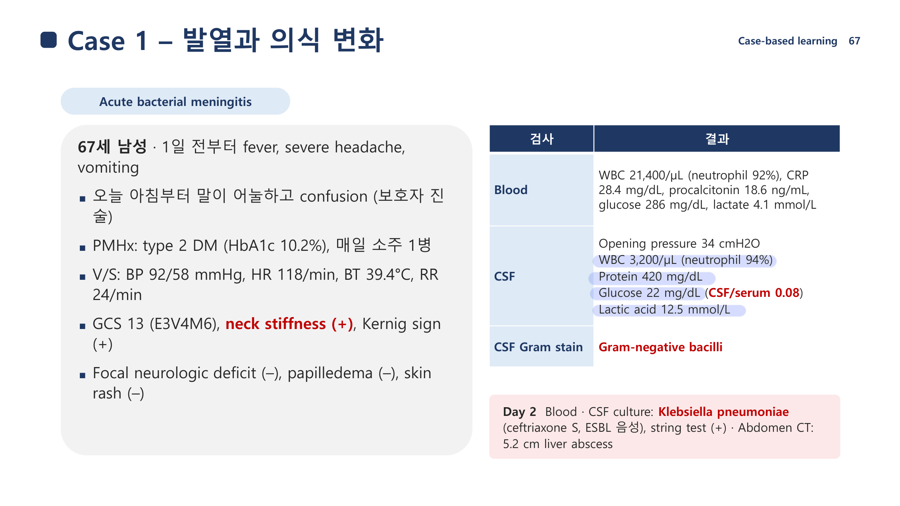
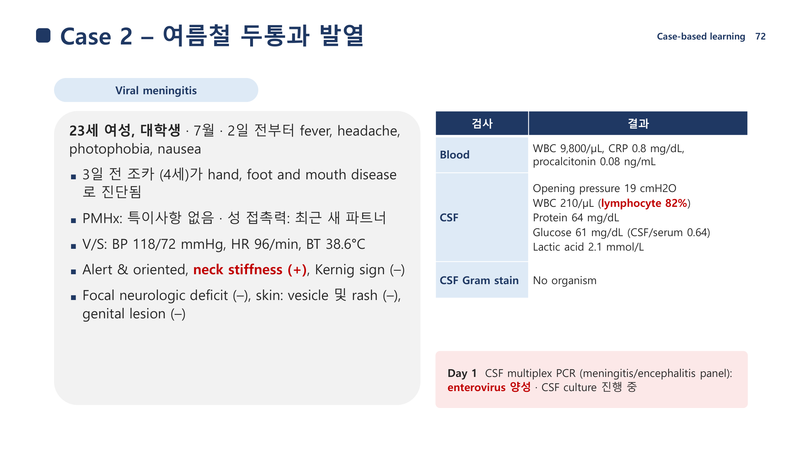
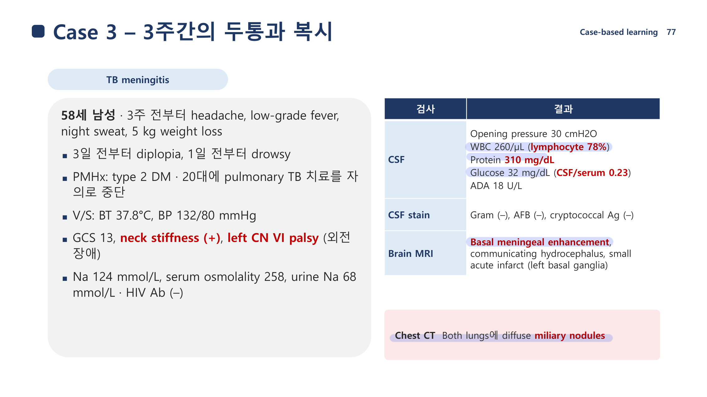
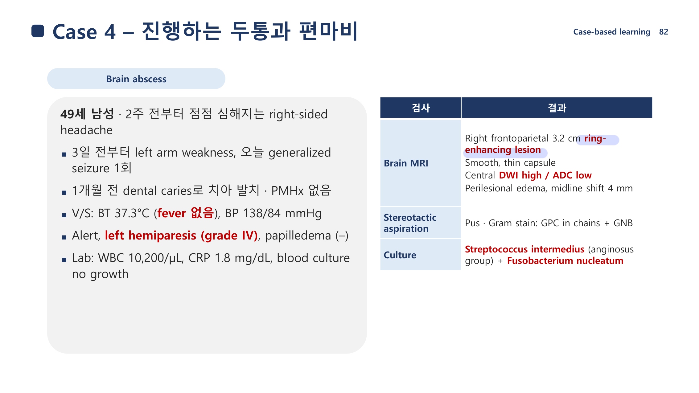
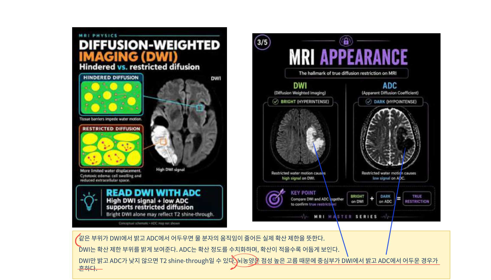
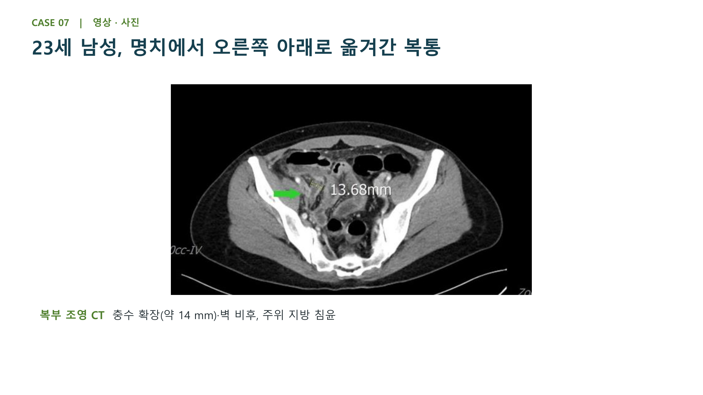
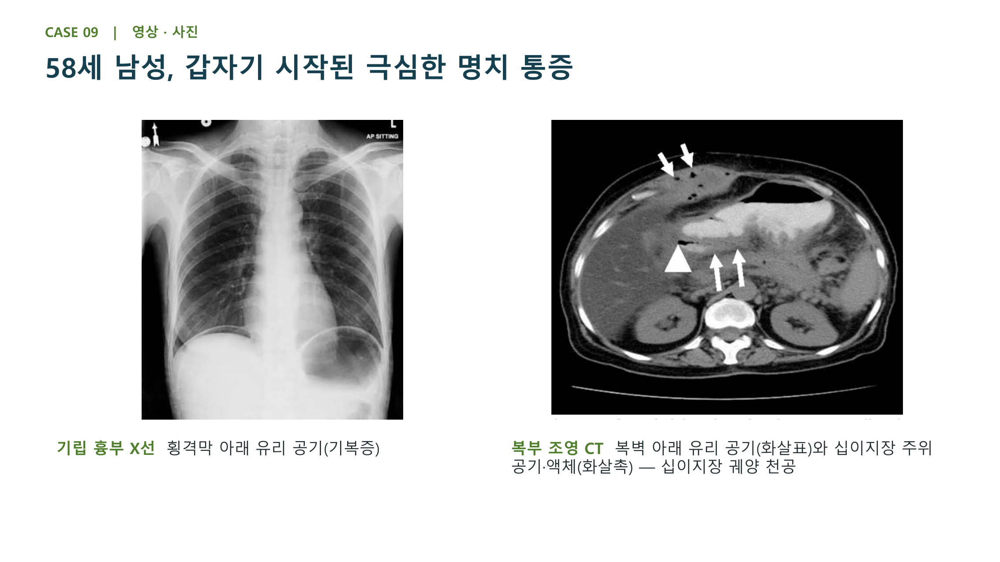
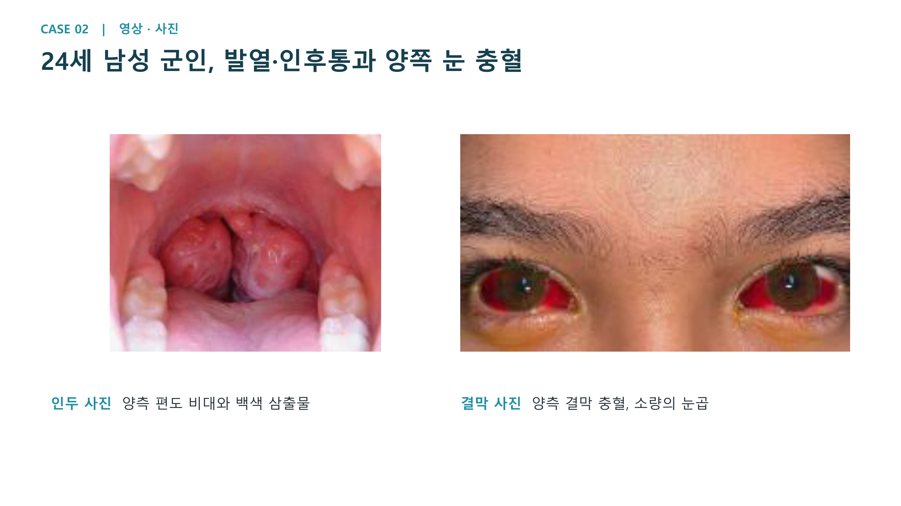
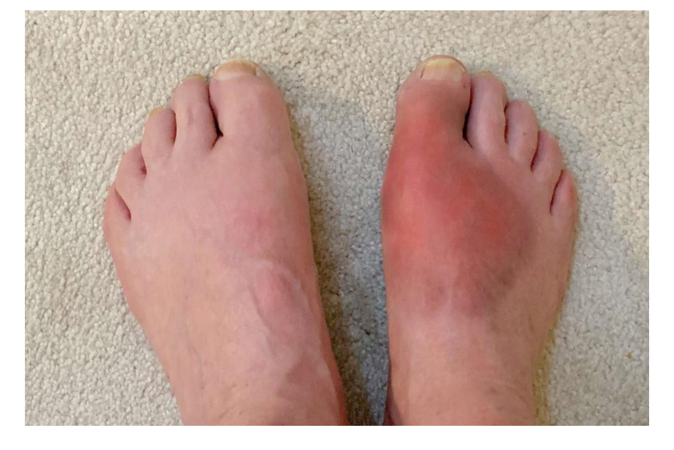
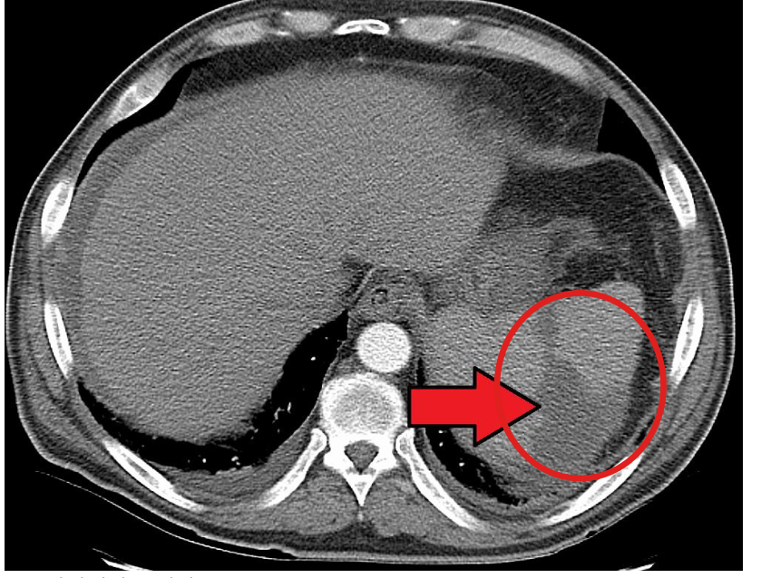

<!-- 필기본: 2026 · 2025 -->
<!-- 단계: 수업 후 -->

# 0. 이 수업을 공부하는 법

올해 CP-D1은 「감염병학 증례토의 — 진료지침으로 배우고, 실제 환자 증례로 적용하는 감염질환 진료의 흐름」으로, **학우들의 발표 수업**이었다. 교수님 언급은 적었지만 언급·강조하신 부분은 필기에 표시돼 있다. 다룬 증례는 세 묶음, 모두 **2026 항생제 적정사용 실무지침**과 앞선 강의 내용을 적용한 모의 증례다.

| 묶음 | 증례 | 연결 강의 |
|---|---|---|
| **중추신경계 감염** | Case 1 급성 세균성 수막염(*K. pneumoniae*) · 2 바이러스성 수막염 · 3 결핵성 수막염 · 4 뇌농양 | 21강 |
| **복강 내 감염** | Case 07 급성 충수염 · 08 급성 담관염 · 09 십이지장궤양 천공 | 4강 |
| **급성 상기도 감염** | Case 01 A군 연쇄구균 인두편도염 · 02 아데노바이러스 인두결막열 · 03 급성 세균성 부비동염 | 5강 |

- 필기 앞부분(1–10쪽)에 각 증례의 핵심과 관련 기출이 정리돼 있다. 그 기출 대부분은 21·4·5강 등 원래 강의로 분류돼 있어 이 PDF 2부에는 없다 — 해당 강의 학습자료에서 함께 볼 것.
- 이 수업으로 분류된 기출은 1문항(2025년 82번): **원인불명 발열 + 비장 농양 → 가장 먼저 심장초음파**.
- 이 정리는 증례마다 **증례 요약 → 질문과 해설 → 기억할 것** 순서로 쓴다.

!!! key "핵심"
    - 세균성 수막염: **door-to-antibiotic 60분**, CT·LP 때문에 항생제를 늦추지 않는다. 50세 초과 + 당뇨·알코올 → **ampicillin 추가**. 배양에서 *K. pneumoniae*면 **de-escalation + dexamethasone 중단, 21일**, hvKp의 **간농양·안내염**을 찾는다.
    - 림프구성 수막염: PCR로 바이러스가 확인되면 **항생제 중단**. 의식 변화·경련이 생기면 **뇌염 → 6시간 내 IV acyclovir**. 아급성 + 당↓ + 림프구 → **결핵**(검사 음성 ≠ 배제).
    - 뇌농양: **DWI 고신호 / ADC 저신호**, **LP 금지**, >2.5 cm 흡인, **ceftriaxone + metronidazole 6–8주**.
    - 복강 내 감염은 **감염원 조절이 항생제보다 우선**, 조절되면 **짧게**(비복잡성 충수염 수술 후 0일, 복잡성 2–4일, 담관염 배액 후 4일, 천공 96시간).
    - 인두염은 **Centor ≥3 → RADT → 양성일 때만 amoxicillin 10일**. 부비동염은 **double sickening 등 3가지 적응증**일 때 **amox/clav 5–10일**.

# 1. 중추신경계 감염 증례

## Case 1 — 급성 세균성 수막염: 67세 남성, 발열과 의식 변화

{: style="width:80%"}

- 1일 전부터 발열·심한 두통·구토, 오늘 아침부터 말이 어눌하고 confusion. **2형 당뇨(HbA1c 10.2%), 매일 소주 1병.**
- BP 92/58, HR 118, BT 39.4℃, RR 24. **GCS 13**, 경부강직(+), Kernig(+), 국소 신경 결손·유두부종·피부 발진 없음.
- 혈액: WBC 21,400(호중구 92%), CRP 28.4, procalcitonin 18.6, 혈당 286, **lactate 4.1**.
- CSF: 개방압 34 cmH2O, **WBC 3,200(호중구 94%)**, **단백 420**, **당 22(CSF/혈청 0.08)**, 젖산 12.5, 그람염색 **그람음성 막대균**.
- Day 2: 혈액·CSF 배양 ***K. pneumoniae*(ceftriaxone S, ESBL 음성), string test(+)**, 복부 CT **5.2 cm 간농양**.

**Q1. LP 전 CT가 필요한가? 항생제는 언제?**

- **LP 전 루틴 CT는 하지 않는다** — GCS 13(≥10)이고 국소 징후·뇌신경 결손·유두부종·새 경련·심한 면역저하가 없으므로(WHO 2025) **CT 없이 바로 LP**.
- 다만 국내 2012·IDSA 2004 기준(의식 저하, 국소 신경증상, 유두부종, 1주 내 경련, 면역저하, 신경 질환 기왕력, 국내는 72시간 후 지속 발열·천자 부위 감염도)으로는 GCS 13·confusion이 "의식 수준 저하"라 CT 고려 대상. **어느 기준이든 CT 때문에 항생제를 늦추지 않는다.**
- **혈액배양 직후 dexamethasone + 항생제를 1시간 이내.** LP가 늦어지면 항생제 먼저.
- **패혈성 쇼크 가능성**(BP 92/58, lactate 4.1) → 수액 소생술, 반응 없으면 승압제.

**Q2. 초기 경험적 요법과 보조요법**

- **50세 초과 + 당뇨·알코올(WHO *Listeria* 위험인자) → ampicillin 필요.**
- **Ceftriaxone 2 g IV q12h + vancomycin 15–20 mg/kg IV q8–12h + ampicillin 2 g IV q4h.**
    - 국내 2012 권고안 근거: 국내 **3세대 세파 내성 폐렴구균 40%**, 지역사회 *S. aureus* 수막염 중 **MRSA 33.3%** → 배양 전 vancomycin + 3세대 세파 병용(trough 15–20 μg/mL).
- **Dexamethasone 10 mg IV q6h — 첫 항생제 직전 또는 동시**(이미 항생제가 들어간 뒤에는 새로 시작하지 않음).

**Q3. 배양 후 조정과 기간**

- *K. pneumoniae* ceftriaxone S → **vancomycin·ampicillin 중단(de-escalation), ceftriaxone 2 g q12h 유지**(ESBL이면 meropenem 2 g q8h).
- **Dexamethasone 중단** — 폐렴구균·Hib 이외의 균.
- **그람음성 막대균 수막염: 21일**(간농양 배액·반응에 따라 연장).

**Q4. 추가로 볼 병변, 접촉자 예방**

- **hvKp 침습 증후군**: **간농양(배액), 내인성 안내염(안저검사)**, 폐농양, 괴사성 근막염 등 전이 병소.
- **접촉자 화학예방 불필요** — 대상은 수막알균(그리고 Hib)뿐.
- 퇴원 전 **청력 선별**(불가 시 퇴원 후 4주 이내), 퇴원 전·4주 이내 후유증 평가.

!!! memo "Case 1 — 기억할 것"
    ① 국내 원인균 변화: 폐렴구균 36.4 → 19.4%, ***K. pneumoniae* 6.8 → 29.2%**(2019–23 1위). ② 그람음성 막대균 + 당뇨·고령 → **hvKp**, 간농양·안내염을 반드시 찾는다(*K. pneumoniae* 관련 사망률 35.7%). ③ **Door-to-antibiotic 60분** — 고령, 경련, 패혈성 쇼크는 30일 사망 독립위험인자. ④ Stewardship: 3GC + vancomycin ± ampicillin은 *K. pneumoniae*도 커버 → 배양 확인 후 즉시 de-escalation.

## Case 2 — 바이러스성 수막염: 23세 여성, 여름철 두통과 발열

{: style="width:76%"}

- 대학생, **7월**, 2일 전부터 발열·두통·광공포증·오심. **3일 전 4세 조카가 수족구병.** 최근 새 성 파트너.
- BT 38.6℃, 의식 명료, 경부강직(+), Kernig(−), 국소 결손·수포·발진·성기 병변 없음.
- 혈액 WBC 9,800, CRP 0.8, **procalcitonin 0.08**.
- CSF: 개방압 19, **WBC 210(림프구 82%)**, 단백 64, **당 61(비 0.64)**, 젖산 2.1, 그람염색 균 없음. Day 1 multiplex PCR **엔테로바이러스 양성**.

**Q1. CSF 해석과 세균성 감별**: **림프구성 세포 증가 + 정상 당(비 >0.6) + 경도 단백 상승 + 낮은 CSF 젖산** → 바이러스성. 발병 **24–48시간 이내엔 바이러스성도 호중구 우세** 가능, **부분 치료된 세균성 수막염**은 항상 감별. 낮은 procalcitonin, 그람염색 음성도 바이러스성을 지지.

**Q2. 항생제·acyclovir 중단 시점**

- **CSF PCR은 바이러스 수막염 확진의 gold standard** → 바이러스로 진단되면 시작한 **항생제 중단**(UK 2016). 이 환자는 Day 1 PCR 양성 시점에 중단.
- 바이러스 수막염 치료는 **진통제·수액의 대증치료**. 성격·행동·인지 변화, 의식 저하 등 **뇌염 소견**이 있거나 애매하면 HSV 뇌염으로 보고 IV acyclovir. 이 환자는 뇌염 소견이 없어 **acyclovir 대상 아님**.
- **Acyclovir는 헤르페스바이러스 thymidine kinase로 활성화** → 엔테로바이러스에는 작용하지 않는다.

**Q3. 엔테로바이러스 외 원인**: **HSV-2**(특히 재발성 림프구성 수막염 = Mollaret, 성기 병변 확인), **VZV**(대상포진 발진 없이도), **급성 HIV 감염**(성 접촉력 → HIV Ag/Ab; 의심되면 음성이어도 **HIV RNA** 고려), 볼거리, 아르보바이러스. **아급성이면 결핵·크립토코쿠스**도.

**Q4. 입원 3일째 confusion과 국소 경련** → **뇌염으로 진행** → **IV acyclovir 10 mg/kg q8h를 6시간 이내**(EAN/ESCMID 2026). **MRI(측두엽) 24–48시간 이내**, multiplex 패널이 음성이어도 **단일 HSV PCR**, 첫 LP가 발병 3일 이내였다면 **2–3일 뒤 반복 LP**. EEG는 비경련성 경련 의심 시, 의식 저하가 진행하면 ICU.

!!! memo "Case 2 — 기억할 것"
    ① **수막염 vs 뇌염**: 의식·인지 변화, 경련, 국소 결손이 있으면 뇌염 — 치료(acyclovir)와 예후가 완전히 다르다. ② **여름–가을 + 소아 접촉 → 엔테로바이러스**, 대부분 대증치료로 7–10일 내 회복(동거인 증상도 확인). ③ PCR 양성 + 배양 음성이면 **항생제를 빨리 끊는다**, 단 **HSV는 multiplex 결과만으로 배제하지 않는다**. ④ **재발성 림프구성 수막염 → HSV-2 먼저**, 성 접촉력이 있으면 급성 HIV도(기저질환 확인).

## Case 3 — 결핵성 수막염: 58세 남성, 3주간의 두통과 복시

{: style="width:76%"}

- 3주 전부터 두통·미열·야간 발한·**5 kg 체중감소**, 3일 전부터 **복시**, 1일 전부터 drowsy. **2형 당뇨, 20대에 폐결핵 치료를 자의로 중단.**
- BT 37.8℃, **GCS 13**, 경부강직(+), **좌측 CN VI 마비(외전 장애)**. **Na 124**, 혈청 삼투압 258, 소변 Na 68. HIV Ab(−).
- CSF: 개방압 30, **WBC 260(림프구 78%)**, **단백 310**, **당 32(비 0.23)**, **ADA 18**. 그람·AFB·크립토코쿠스 항원 음성.
- MRI: **뇌저부 수막 조영증강, 교통성 수두증, 좌측 기저핵 작은 급성 경색**. 흉부 CT: 양폐 **미만성 좁쌀 결절**.

**Q1. 진단과 감별**: **결핵성 수막염(MRC grade II)** — 아급성 경과, CN VI 마비, 저나트륨혈증, 림프구성 + 낮은 당 비 + 높은 단백, ADA↑, 뇌저부 조영증강·수두증·경색, 좁쌀결핵. 감별: **크립토코쿠스 수막염, 부분 치료된 세균성 수막염, *Listeria*(능뇌염), 신경매독, 종양성 수막염**.

**Q2. 확진 검사와 한계**: **CSF Xpert MTB/RIF Ultra**(rifampicin 내성 동시) + **AFB 배양**(2–6주, 감수성), **많은 양의 CSF(≥6 mL)**, 필요 시 반복 LP. 좁쌀결핵 → 객담·다른 부위 검체. **검사가 음성이어도 TBM은 배제되지 않는다 → 임상적으로 의심되면 결과를 기다리지 않고 치료.**

**Q3. 치료**: **2HRZE → 10HR(총 9–12개월) + pyridoxine.** HIV 음성 → **보조 dexamethasone(0.4 mg/kg/일로 시작해 6–8주 감량)**. **고용량 rifampicin(35 mg/kg)은 생존 이득 없음(HARVEST, NEJM 2025) → 루틴 X.**

- 필기 메모: 국내 결핵 진료지침을 기준으로 확인(연구마다 약제·용량이 다름). 6개월 치료와 더 긴 치료의 재발률 차이가 없었다는 연구도 있고, 환자에 따라 12–18개월까지 연장하기도 한다.

**Q4. 치료 중 합병증**

- **수두증 악화 → 신경외과(EVD, VP shunt).**
- **저나트륨혈증: SIADH vs 뇌염분소실(CSW)을 체액 상태로 감별** — **CSW에서 수분 제한을 하면 경색 위험.**
- **역설적 반응(결핵종 증가)은 치료 실패가 아니다.** 약물 간손상 모니터링, **접촉자 조사**.

!!! memo "Case 3 — 기억할 것"
    ① **아급성 + 낮은 당 + 림프구 → TBM 먼저**, 진단 지연이 예후를 결정(grade III는 사망률 매우 높음). ② **검사 음성 ≠ 배제** — Xpert Ultra·배양 민감도가 낮아 임상 진단으로 시작. ③ 고용량 rifampicin 이득 없음(HARVEST), HIV 음성 성인은 dexamethasone(LAST ACT). ④ 결핵 과거력·당뇨·고령·면역억제제 사용자의 림프구성 수막염은 **항상 결핵을 감별**.

## Case 4 — 뇌농양: 49세 남성, 진행하는 두통과 편마비

{: style="width:76%"}

- 2주 전부터 점점 심해지는 **우측 두통**, 3일 전부터 **좌측 팔 근력 저하**, 오늘 전신 경련 1회. **1개월 전 충치로 발치.** 과거력 없음.
- **BT 37.3℃(발열 없음)**, 좌측 편마비(grade IV), 유두부종 없음. **WBC 10,200, CRP 1.8**, 혈액배양 음성.
- MRI: 우측 전두두정엽 **3.2 cm 링 조영증강**, 매끈하고 얇은 피막, **중심부 DWI 고신호 / ADC 저신호**, 주위 부종, 정중선 이동 4 mm.
- 정위적 흡인: 그람염색 사슬 GPC + GNB, 배양 ***Streptococcus intermedius***(anginosus group) + ***Fusobacterium nucleatum***.

**Q1. 감별과 영상 소견**: 감별 — **고등급 신경교종, 전이암, 종양성 탈수초**, (면역저하) **톡소포자충증**, 결핵종. **농양 = 중심부 DWI 고신호 / ADC 저신호 + 매끈하고 얇은 피막**(괴사성 종양은 대개 ADC 고신호). **발열은 약 50%뿐**, 정상 WBC·CRP로 뇌농양을 배제할 수 없다.

{: style="width:76%"}

- 같은 부위가 **DWI에서 밝고 ADC에서 어두우면** 물 분자 움직임이 줄어든 **진짜 확산 제한**. DWI는 확산 제한 부위를 밝게, ADC는 확산 정도를 수치화해 **확산이 적을수록 어둡게** 보인다. **DWI만 밝고 ADC가 낮지 않으면 T2 shine-through**일 수 있다. 뇌농양은 **점성이 높은 고름** 때문에 중심부가 DWI 밝고 ADC 어둡다.

**Q2. LP? 수술 전 항생제?**: **LP 하지 않음** — 종괴 효과로 뇌탈출 위험, 진단 수율 낮음. **3.2 cm(>2.5 cm) → 흡인 또는 절제**(진단 + 치료). **중증이 아니고 24시간 안에 수술 가능 → 흡인 후 항생제**(배양 수율↑), **중증·패혈증이면 즉시 시작**.

**Q3. 경험적·확정적 요법**: 경험적 **ceftriaxone 2 g IV q12h + metronidazole 500 mg IV q8h**. *S. anginosus* group + *Fusobacterium* → 같은 요법 유지(또는 penicillin G + metronidazole). **총 6–8주 IV**, 최대 3개월간 **2주 간격 MRI**(완전히 사라질 때까지).

**Q4. Dexamethasone·항경련제·원발 병소**: Dexamethasone은 **심한 주위 부종 증상이나 뇌탈출 임박 시에만**, 짧게 감량. **이미 경련이 있었으므로 항경련제 치료**, 1차 예방은 권고 안 함. 원발 병소: **치아·부비동·귀** → 치과·이비인후과 진료, 원인 불명(cryptogenic)이면 **심초음파(심내막염), 폐 동정맥기형** 확인.

!!! memo "Case 4 — 기억할 것"
    ① **발열 없는 두통 + 국소 결손** — 종양처럼 보여도 뇌농양을 감별, **DWI/ADC가 핵심**. ② **감염원 조절 = 진단 + 치료**: 2.5 cm 초과는 흡인/제거 + 6주 이상 IV + 추적 영상 호전 시 완치율 90% 이상. ③ ***S. anginosus* + 혐기균 → 치아·부비동 원인** → 원발 병소를 치료해야 재발을 막는다. ④ 6–8주 IV 동안 **외래 정주(OPAT)**·부작용 모니터링, 경련 등 후유증 약 20%.

!!! memo "교수님 언급 — 항생제 선택(뇌농양 예시와 퀴놀론)"
    - 교수님 뇌농양 예시: **세팔로스포린 알레르기**가 있어 **meropenem + vancomycin + metronidazole**. Vancomycin은 주로 그람양성, meropenem·metronidazole은 혐기균에도 활성.
    - **플루오로퀴놀론 개발 순서: ciprofloxacin → levofloxacin → moxifloxacin.** **Cipro는 녹농균 포함 그람음성**, **levo는 폐렴구균 활성이 더 높고**, **moxi는 일부 혐기균에도** 작용. cipro·levo의 혐기균 활성은 제한적, **moxi는 녹농균 치료에 쓰지 않는다.**
    - 안정된 뒤 경구 전환: 혐기균까지 고려해야 하면 moxi를 고를 수 있다. 단 **뇌농양의 조기 경구 전환 근거는 부족**.
    - 기관지확장증 환자 폐렴: 과거 객담 배양·감수성 확인, 폐렴구균을 겨냥한 경험적 치료로 levo 고려.
    - 녹농균: 감수성이 있으면 **cipro 등 FQ가 주요 경구 선택지**(골·조직 침투 좋음, 내성 주의). 입원 중 장기 정주가 필요하면 **pip/tazo 같은 항녹농균 β-lactam**.

# 2. 복강 내 감염 증례 (2026 실무지침)

## Case 07 — 급성 충수염: 23세 남성, 명치에서 우하복부로 옮겨간 복통

- 어제 저녁 명치 둔통 → 오늘 아침 우하복부로 이동, 식욕저하·오심·구토 1회. BT 37.8℃. **McBurney 점 압통, 반발통, Rovsing 양성**, 근육강직 없음.
- WBC 13,400(호중구 84%), CRP 3.2. CT: **충수 직경 약 14 mm**, 벽비후·주위 지방 침윤, **분석·천공·농양·유리공기 없음**.

{: style="width:52%"}

1. **분류와 병소 제거**: 염증이 충수에 국한 → **비복잡성 충수염** → **충수절제술**. 진단에는 **복부 조영 CT가 가장 정확**, **임신부는 초음파**.
2. **항생제**: **절개 0–60분 전 예방적 항생제 1회 — cefoxitin 2 g 또는 cefotetan 2 g IV.** 비복잡성 충수염에서 충수절제술을 하면 **수술 후 추가 항생제 불필요**.
3. **수술 소견이 천공 + 국소 농양이었다면** → **복잡성 충수염**: **ceftriaxone 2 g q24h + metronidazole 500 mg q8h**. ESBL 위험·중증 → **meropenem 1 g q8h 또는 imipenem 500 mg q6h**. **Ampicillin/sulbactam은 국내 *E. coli* 감수성이 낮아 경험적으로 권하지 않음.** **기간: 수술 후 2–4일.**
4. **수술을 거부하고 항생제를 택하면**: 비수술 항생제 치료 **7–10일**(주사 2–3일 후 열이 내리면 경구로 전환). 실패·재발 가능성을 설명하고 악화 시 수술로 전환.

## Case 08 — 급성 담관염: 79세 여성, 오한·고열과 황달

- 2일 전부터 **우상복부 통증, 오한 동반 고열, 황달**(눈이 노랗고 소변이 진함). 1년 내 담도 시술·스텐트 없음, 90일 내 항생제 없음. 무증상 담낭결석, 고혈압.
- **BT 39.1℃**, BP 104/62, HR 108. 공막 황달, 우상복부 압통, 복막자극징후 없음.
- **WBC 16,900**, 혈소판 168k, **T.bil/D.bil 4.6/3.5**, AST/ALT 284/312, **ALP/GGT 412/586**, 알부민 2.9, Cr 1.0, INR 1.1, CRP 14.8. CT/MRCP: **총담관 13 mm 확장, 원위부 10 mm 결석**. 혈액배양 2/2·담즙배양 ***K. pneumoniae*(ESBL 음성, ceftriaxone S)**.

1. **Tokyo 2018 진단·중증도**: A 전신염증(발열, WBC·CRP) + B 담즙정체(bil ≥2, 간기능 >1.5배) + C 담관확장·결석 → **확진**. **고열(≥39℃), 고령(≥75세), WBC 이상(>12,000) 3가지 → 중등증**(장기부전 없음 → 중증 아님).
2. **경험적 항생제**: **고령은 내성균 위험인자** → **piperacillin/tazobactam 4.5 g q8h**(또는 ertapenem 1 g q24h, ceftazidime·cefepime 2 g q8h). **담관-장 문합·담도수술력·기종성 담낭염이 없으면 metronidazole 추가 불필요.** **Pip/tazo는 담즙 침투력이 우수.**
    - 필기 메모: 저위험 지역사회 획득 복강 내 감염엔 **ceftriaxone + metronidazole 또는 cefotaxime + metronidazole**. Ceftriaxone은 담즙·소변으로, **cefotaxime은 주로 신장으로 배설**(CrCl에 따라 용량 조절). **Ceftriaxone은 담즙에서 칼슘과 침전해 담즙 슬러지·가성 담석** → 우려되면 cefotaxime. Ertapenem 단독도 대안이지만 위험도와 적정사용 원칙을 함께 고려.
3. **항생제보다 중요한 것 = 감염원 제거: ERCP 담관 배액(결석 제거·스텐트).** 배액이 안 되면 항생제만으로 조절이 어렵다. 회복 후 **담낭절제술** 계획.
4. **조정과 기간**: 감수성에 맞춰 **ceftriaxone 2 g q24h로 de-escalation**. **경증–중등증 담관염은 담관 배액 후 4일 이내 종료 — 균혈증이 있어도 동일.** 개별화: ***S. aureus* 균혈증 14일**, 중환자실, 담관암에 의한 협착·간농양 동반 14일.

## Case 09 — 십이지장궤양 천공·이차성 복막염: 58세 남성, 갑자기 시작된 극심한 명치 통증

- 6시간 전 갑자기 칼로 찌르는 듯한 명치 통증 → 복부 전체로. **무릎 통증으로 2주간 NSAID, 매일 음주.** 최근 입원·항생제 없음.
- BT 37.6℃, HR 112, RR 22. **복부 전반 판자 같은 강직, 반발통, 간둔탁음 소실**, 장음 감소 → 미만성 복막염 의심.
- WBC 15,800, CRP 2.1(**발병 초기 CRP는 아직 낮을 수 있음**), lipase 85, lactate 1.8. 기립 흉부 X선 **횡격막 아래 유리공기**, CT **복강 내 유리공기 + 십이지장 구부 전벽 결손**. 복수 배양 α-용혈 연쇄알균 소량, 혈액배양 음성.

{: style="width:70%"}

1. **진단·영상**: **위·십이지장궤양 천공에 의한 이차성 복막염.** 단순촬영으로 유리공기를 볼 수 있지만 **복부 조영 CT가 가장 권고**(천공 위치·범위).
2. **병소 제거**: 작은 천공 → **단순봉합 ± 대망(omental) 패치**, 큰 천공·악성 의심 → 위절제술. **병소 제거가 항생제보다 우선.**
3. **경험적 항생제**: 지역사회 경증/중등증 → **ceftriaxone 또는 cefotaxime + metronidazole**(β-lactam 알레르기: moxifloxacin, 또는 cipro/levo + metronidazole). **지침의 "중증"에는 미만성 복막염이 포함** → 복부 전반 강직이면 **중증**: **pip/tazo 단독, 또는 ceftazidime·cefepime + metronidazole**(ESBL 위험 시 carbapenem).
4. **기간·퇴원 전**: 병소가 적절히 제거되면 **96시간 이내 중단**(면역 정상·안정 시). **악성종양·제산제 없이 발병 24시간 이내 수술한 상부위장관 천공은 24시간을 넘길 필요 없음.** 패혈증·쇼크로 진행 중이면 기간 근거 부족. **NSAID 중단, PPI, *H. pylori* 검사 → 양성이면 제균.** 젖산이 2 미만이어도 환자 상태와 감염원 조절 여부를 함께 본다.

# 3. 급성 상기도 감염 증례 (2026 실무지침)

## Case 01 — A군 연쇄구균 인두편도염: 22세 여성

- 2일 전부터 심한 인후통·삼킴통, 38℃ 이상 발열, **기침·콧물 없음**, 두통·경미한 복통. **기숙사 룸메이트가 1주 전 비슷한 증상.**
- **BT 38.7℃**, 양측 편도 비대 + **백색 삼출물**, 연구개 점상출혈, **압통 있는 전방 경부 림프절**, 비장 촉지 안 됨, 발진 없음.
- WBC 14,200, CRP 6.8(**CBC·CRP는 항생제 결정에 필수 검사가 아님**). ***S. pyogenes* RADT 양성.**

1. **변형 Centor**: 체온 >38℃ 1 + 기침 없음 1 + 압통성 전방경부 림프절 1 + 편도 삼출물 1 + 연령 15–44세 0 = **4점**. **3점 이상 → RADT**, 양성이면 항생제(RADT 불가 시 경험적 투여 가능).
2. **1차 약**: **amoxicillin 1,000 mg 하루 1회 또는 500 mg 하루 2회, 10일.** *S. pyogenes*는 페니실린 내성 보고가 없어 **cephalosporin은 1차로 권하지 않음.** 치료 목적 = **화농성 합병증(편도주위농양 등)과 류마티스열 예방.**
3. **페니실린 알레르기**: 경증 → **cefadroxil 1 g 하루 1회 또는 cephalexin 500 mg 하루 2회 10일**. 중증(아나필락시스) → **azithromycin 500 mg 하루 1회 5일 또는 clindamycin 300 mg 하루 3회 10일**. **마크로라이드 내성률 40–50%** → 반응을 주의 깊게.
4. **72시간 후에도 고열, 침을 못 삼키고 목소리가 변했다면**: 48–72시간 무반응 = 1차 치료 실패 → 순응도 확인. **편도주위·측인두강 농양** 의심 → **이비인후과 즉시 의뢰**(배농). 다른 원인: **전염성 단핵구증, *Mycoplasma*, *Fusobacterium*(Lemierre 증후군)**. 2차 약: amox/clav, ampicillin/sulbactam, clindamycin.
- (요약 쪽) 소아에서는 **RADT 음성이면 인후배양**이 필요한 경우가 있다.

## Case 02 — 아데노바이러스 인두결막열: 24세 남성 군인

- 3일 전부터 38℃ 이상 발열, 인후통, **양쪽 눈 충혈·눈물**, 마른기침, 약간의 콧물. **같은 생활관 장병 5명이 1주 사이 비슷한 증상.**
- BT 38.9℃, 양측 편도 비대 + 백색 삼출물, **양측 결막 충혈**, 압통 있는 전방경부 림프절.
- WBC 11,200, 림프구 18%, CRP 4.6(**WBC·CRP 상승만으로 세균 감염을 구분할 수 없음**). **RADT 음성**, 호흡기 multiplex PCR **adenovirus**.

{: style="width:66%"}

1. **Centor**: 체온 1 + **기침 있음 0** + 림프절 1 + 삼출물 1 + 연령 0 = **3점** → RADT → **음성이므로 항생제 X.**
2. **CRP 4.6, 삼출물이 있는데도 항생제를 안 쓰는 근거**: 임상양상만으로 바이러스성과 *S. pyogenes*를 구분하기 어려워 지침은 **Centor + RADT로 결정**. **삼출물과 CRP 상승은 아데노바이러스에서도 흔하다.** 결막염 + 집단발생 + PCR 양성 → **인두결막열 → 대증치료.**
3. **RADT를 할 수 없었다면**: 지침상 Centor 3점 이상이면 경험적 항생제 가능. 그러나 **결막염·집단발생처럼 바이러스를 시사하는 단서가 뚜렷**하면 불필요한 항생제일 가능성을 함께 고려.
4. **부대 내 전파 예방**: **비말·접촉 전파** — 손위생, 수건·세면도구 공유 금지, 기침예절, 증상 기간 생활관 분리. 눈 통증·시력저하, 호흡곤란, 고열 지속 시 재진료.

## Case 03 — 급성 세균성 부비동염(double sickening): 38세 여성

- 9일 전 콧물·코막힘·기침 시작, **3일째 외래(대증치료, 이때 PCR rhinovirus)**, **6일째 거의 호전 → 8일째부터 39℃ 고열, 누런 콧물 재악화**, 우측 볼과 윗니 통증(고개를 숙이면 악화). 알레르기 비염.
- BT 39.2℃, 우측 상악부 압통, 비강 내 화농성 분비물, 안구운동 정상, 안와 부종·경부강직 없음. WBC 11,900, CRP 5.4. Waters view(참고) 우측 상악동 공기-액체층. **영상은 일상적으로 필요하지 않음**(합병증·치료 실패 시).
- 필기 메모: 바이러스 감염 초기에도 CRP가 오를 수 있다 — CRP는 바이오마커일 뿐, 항생제는 증상과 경과를 종합해 판단.

1. **3일째 항생제를 줬어야 했나? → 아니다.** 급성 부비동염의 **90–98%는 바이러스성, 약 85% 자연호전.** Rhinovirus 검출, 3일째 → 대증치료가 맞다.
    - **항생제 적응증 3가지**: ① **약 7일 관찰에도 호전 없음** ② **처음부터 3–4일 이상 39℃ 이상 고열 + 화농성 콧물·안면통** ③ **호전 후 다시 악화(double sickening).**
2. **지금은 ③ double sickening → 항생제.** **Amoxicillin/clavulanate 500/125 mg 하루 3회 또는 875/125 mg 하루 2회**(또는 amoxicillin 500 mg 하루 3회). **국내 *H. influenzae*의 ampicillin 내성 50–60% → amox/clav 선호.** 기간: **증상 호전 후 4–7일(총 5–10일).**
3. **페니실린 아나필락시스**: **levofloxacin 500 mg 하루 1회**(cefpodoxime은 아나필락시스 병력 시 불가). **Doxycycline은 국내 폐렴구균 내성률 >70%로 지침에서 제외.**
4. **치료 3일째 눈 주위 부종, 안구운동 시 통증, 복시** → **안와 합병증** → 즉시 이비인후과·안과, **조영 CT(부비동·안와)**, **정주 치료로 전환**(ampicillin/sulbactam 1.5 g 하루 4회 또는 ceftriaxone 2 g 하루 1회), 배농은 전문의와 결정. **두통 심화·수막자극징후·의식 변화는 두개내 합병증 신호.**
- (요약 쪽) 기출 연결: 2025년 13번은 결막염이 아니라 **초기 감기 원인 rhinovirus**를 묻는 비교 문항.

# 4. 작년(2025) CP-D1 증례

!!! diff "작년 필기와 다른 점 — 증례 구성이 완전히 바뀜"
    작년 CP-D1(2025년 10월 20일, 장현하 교수님)은 1–5조 증례 토의였다(학생마다 하나를 골라 A4 2장 레포트). 올해는 위 10개 모의 증례 발표로 바뀌었다. 기출(2025년 82번)은 작년 4조 증례에서 나왔으니 아래 요점은 함께 알아 둔다.

!!! diff "작년 1조 — 신장이식 환자의 기침과 발열"
    55세 남자, 5년 전 신장이식, 1주 기침·발열(38.9℃). **이식 6개월 이후**엔 일반인과 비슷한 **호흡기 세균·바이러스 감염**이 가장 흔하다. "기침과 발열이면 **폐만이 아니라 부비동부터 폐까지**." 검사: 부비동 X선, 흉부 X선·CT, 혈액·객담배양, 신기능, 바이러스 항원검사.

!!! diff "작년 2조 — 2달 새 세균성 폐렴 2번"
    건강한 55세가 1년에 폐렴 1번도 드문데 **2달 새 2번(다른 엽) → 면역저하자.** 검사: **Ig level, T cell count**, 자가면역, **악성종양**, CT로 구조 이상(기관지확장증, 폐암에 의한 폐쇄). 같은 엽에 반복이면 구조적 이상을 먼저.

!!! diff "작년 3조 — cefazolin을 써도 열이 나는 발 연조직염"
    연조직염은 호전에 **5–7일**. **3일째는 기다린다**, **7일째에도 열이면 진단을 의심** — 엄지발가락만 붉게 부으면 **통풍**. 배울 것: ① 감별진단 ② 항생제 반응이 시작되는 시기.

{: style="width:36%"}

!!! diff "작년 4조 — 하루 한 번 열 + 비장 경색"
    23세 남자, 하루 한 번 열이 나고 열이 없으면 멀쩡함, CT 비장 경색. → **말라리아**(강원·경기 거주·방문력 — 파주·일산은 헌혈 불가), 비장 경색 감별로 **감염성 심내막염**·전이 감염 → **심장초음파·혈액배양**, 면역저하면 칸디다증 확인. (말라리아면 말초혈액 도말·신속항원.)

{: style="width:34%"}

!!! exam "기출 포인트"
    2025년 82번: 72세, 1달간 매일 38℃ 이상 원인불명 발열, CT **비장 농양** → 치료를 위해 가장 먼저 할 검사 = **심장초음파**. 비장 농양·경색의 흔한 원인이 심내막염의 색전이고, 그 결과가 항생제 기간과 수술 여부를 정한다. (올해 Case 4 뇌농양에서도 원인 불명이면 심초음파로 심내막염을 찾는다 — 같은 생각.)

!!! diff "작년 5조 — 등의 10 cm 농양"
    일반인에게 농양이 그렇게 크게 오지 않는다 → **면역저하**, "우리나라에서 면역을 가장 잘 떨어뜨리는 것은 **당뇨**." 검사: 기저질환, 수술 후 감염 여부, **혈당·당화혈색소**, 자가면역. 치료: **수술 또는 PCD로 배농**(항생제만으로는 잘 낫지 않음).

!!! memo "암기 — 올해 10개 증례 한 줄 요점"
    | 증례 | 한 줄 요점 |
    |---|---|
    | 세균성 수막염 | 1시간 내 3GC + vanco(+ **ampicillin**: >50세·당뇨·알코올) + dexa → *K. pneumoniae*면 좁히고 dexa 중단, **21일**, 간농양·안내염 |
    | 바이러스 수막염 | 림프구·당 정상 → PCR 양성이면 **항생제 중단**, 뇌염 소견 생기면 **6시간 내 acyclovir** |
    | 결핵 수막염 | 아급성·CN VI·저Na·ADA↑·뇌저부 조영 → **2HRZE/10HR + dexa(HIV−)**, 고용량 RIF X, CSW에 수분 제한 X |
    | 뇌농양 | DWI↑/ADC↓, **LP X**, >2.5 cm 흡인, **ceftriaxone + metronidazole 6–8주** |
    | 비복잡성 충수염 | **cefoxitin 1회**, 수술 후 항생제 X / 복잡성 ceftriaxone + metronidazole **2–4일** / 비수술 7–10일 |
    | 담관염(중등증) | **pip/tazo** + **ERCP 배액**, 배액 후 **4일**(균혈증 있어도) |
    | 궤양 천공 | **병소 제거 우선**, 미만성 복막염 = 중증 → pip/tazo, **96시간** 내 중단, PPI·*H. pylori* |
    | GAS 인두염 | Centor ≥3 → RADT(+) → **amoxicillin 10일**, 아나필락시스 azithro·clinda |
    | 인두결막열 | Centor 3, RADT(−) → **항생제 X**, 대증치료·전파 예방 |
    | 세균성 부비동염 | **double sickening** → **amox/clav 5–10일**, 아나필락시스 levofloxacin, doxy X |
