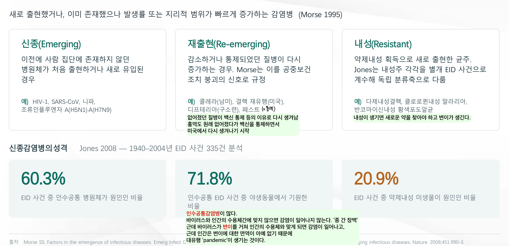
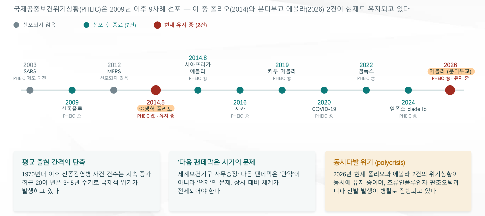
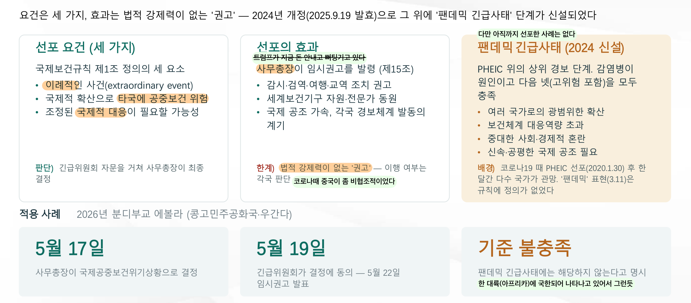

<!-- 필기본: 2026 · 2025 -->
<!-- 단계: 수업 후 -->

# 0. 이 수업을 공부하는 법

권기태 교수님(감염내과, 칠곡경북대병원) 수업. 올해(2026, 11월 17일) 강의는 작년과 **뼈대가 완전히 달라졌다.** 작년은 거의 전부 코로나19 임상(위험인자 → 중증도 → 치료제)이었는데, 올해는 목차(필기 4쪽)대로 **신종감염병의 정의 → 국제경보(PHEIC) → 우리나라의 유행 경험 → 제1급 법정감염병 → 에볼라 → (시험 범위 밖) 위기관리체계·연구경험·대응체계** 순서다. 교수님 첫마디: "슬라이드 양은 많은데 여러분들이 알아야 할 건 그닥 많지 않습니다."

!!! new "올해 필기에서 추가"
    - **시험 범위**: 필기 22쪽에 "**여기서부터는 시험문제 내지 않았습니다**" — 즉 **5–21쪽(1–5장)이 올해 출제 범위**다. 6장은 읽고 넘어가면 된다.
    - **출제 방식**: 17쪽에서 "제가 에볼라 강조했었죠? 저는 **암기형 말고 문제해결형**으로 냈습니다. 예를 들자면 *에볼라 환자가 왔다. 어떻게 대응할 것인가?* 요런 식으로." → 5장(에볼라)과 4장(즉시 신고·격리)을 **사례에 적용**하는 연습이 가장 중요하다.
    - **족보 표시(빨간 표시)** 가 붙은 슬라이드: **9쪽 우리나라 신종감염병 유행 표**("요거 표는 좀 중요하죠"), **17쪽 제1급 법정감염병 18종**. 필기 2–3쪽에는 22–25학번 기출이 실려 있다(2부 1–6·9–10번과 같은 문제).

| 장 | 필기 쪽 | 시험 | 한 줄 요점 |
|---|---|---|---|
| 1. 정의·출현동인 | 5–6 | ○ | 신종·재출현·내성, 인수공통 60.3%, 출현동인 6가지 |
| 2. PHEIC | 7–8 | ○ | 9차례 선포(폴리오·분디부교 에볼라 유지 중), 요건 3·효과는 '권고', 팬데믹 긴급사태 신설 |
| 3. 국내 유행 | 9–16 | ○ **족보** | SARS·신종플루·MERS·코로나19 비교표, 유행마다 바뀐 제도, 드라이브스루 |
| 4. 제1급 법정감염병 | 17 | ○ **족보** | 18종, 즉시 신고·음압격리·의사환자도 신고 |
| 5. 에볼라 | 18–21 | ○ **강조** | 필로바이러스, 혈액·체액 접촉, 잠복기 2–21일, 72시간 후 재검, 분디부교형엔 백신·치료제 없음 |
| 6. 범위 밖 | 22–45 | × | 초과사망, 위기관리체계 고도화, 코로나19 연구, IDHiNet |
| 7. 작년만 | (작년 필기) | 기출 多 | 코로나19 위험인자·중증도·치료제·덱사메타손 |
| 8. 필기 밖 기출 | – | 기출 | 백신 플랫폼, SARS-CoV-2 바이러스학, 말라리아·뎅기 |

!!! diff "작년 필기와 다른 점"
    작년 기출 44문항(2020–2025) 중 최근 권기태 교수님 문항은 대부분 **코로나19 치료제·중증도·백신**을 물었다. 그 내용은 올해 강의에서 거의 빠졌다(올해는 30–31쪽 렘데시비르·덱사메타손 논문만 "시험 범위 밖"으로 남음). 올해 시험은 1–5장 위주로 나올 가능성이 크지만, 기출 복습용으로 작년 내용을 **7장**에 그대로 남겨 두었다.

# 1. 신종감염병의 정의와 출현동인

!!! new "올해 필기에서 추가"
    1장 전체가 올해 새로 생긴 내용이다(필기 5–6쪽).

## 신종감염병(Emerging Infectious Diseases, EID)의 정의

{: style="width:80%"}

**정의(Morse 1995)**: *새로 출현했거나, 이미 존재했으나 발생률 또는 지리적 범위가 빠르게 증가하는 감염병.* "새로 생긴 것"만이 아니라 "있던 것이 빠르게 늘어나는 것"까지 포함한다는 점이 핵심이다. 이 정의에 따라 세 갈래로 나눈다.

| 구분 | 무엇인지 | 왜 생기나 | 예 |
|---|---|---|---|
| **신종(Emerging)** | 이전에 사람 집단에 없던 병원체가 **처음 출현하거나 새로 유입** | 동물 병원체가 변이로 사람에 적응(종 간 장벽을 넘음) | HIV-1, SARS-CoV, 니파, 조류인플루엔자 A(H5N1)·A(H7N9) |
| **재출현(Re-emerging)** | 감소하거나 통제되었던 질병이 **다시 증가** | Morse: **공중보건 조치 붕괴의 신호** | 콜레라(남미), 결핵 재유행(미국), 디프테리아(구소련), 페스트, (+**홍역**: 손글씨) |
| **내성(Resistant)** | **약제내성 획득**으로 새로 출현한 균주 | 항생제 선택압. Jones는 내성주 하나하나를 별개 EID 사건으로 세어 **독립 분류축**으로 다룸 | 다제내성결핵, 클로로퀸내성 말라리아, 반코마이신내성 황색포도알균(VRSA) |

- **재출현 — 교수님 설명(손글씨)**: 없어졌던 질병이 백신 통제(접종 중단·거부) 등의 이유로 다시 생긴다. **홍역**도 원래 (미국에서) 없어졌다가 백신 접종이 줄면서 미국에서 다시 생겨나기 시작했다. → "재출현 = 공중보건 조치(감시·예방접종·수질·매개체 방제)가 무너졌다는 신호"라는 Morse의 해석과 같은 이야기다.
- **내성 — 손글씨**: 내성이 생기면 새로운 약을 찾아야 하고, (그 약에 대해 또) 변이가 생긴다 — 끝나지 않는 경쟁.
- 헷갈리기 쉬운 점: *신종*은 "사람에게 처음"이 기준이다. SARS-CoV처럼 원래 동물(박쥐)에 있던 바이러스도 사람에게 처음 나타났으면 신종이다. 반면 콜레라·결핵·페스트는 옛날부터 있던 병이 다시 늘어난 것이라 *재출현*.

### 신종감염병의 성격 — Jones 2008 (1940–2004년 EID 사건 335건 분석)

| 수치 | 의미 |
|---|---|
| **60.3%** | EID 사건 중 **인수공통 병원체**가 원인인 비율 |
| **71.8%** | 인수공통 EID 사건 중 **야생동물**에서 기원한 비율 |
| **20.9%** | EID 사건 중 **약제내성 미생물**이 원인인 비율 |

**교수님 설명(손글씨) — 왜 인수공통감염병이 팬데믹이 되는가**

1. 바이러스가 세포에 들어가려면 그 세포의 **수용체**에 맞아야 한다. 동물 바이러스와 사람 수용체가 맞지 않으면 감염이 일어나지 않는다 → **'종 간 장벽(species barrier)'**.
2. 그런데 바이러스가 **변이**를 거쳐 사람의 수용체에 맞게 되면 사람 감염이 일어난다(예: SARS-CoV-2 spike가 사람 ACE2에 결합 — 8장).
3. 사람은 그 새 병원체에 대한 **면역이 아예 없기 때문에** 순식간에 퍼져 **대유행(pandemic)**이 된다.

!!! memo "암기"
    신종감염병 성격 숫자: **인수공통 60.3% · 그중 야생동물 71.8% · 약제내성 20.9%** (Jones 2008, 335건).
    재출현 예 = 콜레라(남미)·결핵(미국)·디프테리아(구소련)·페스트·홍역 / 내성 예 = MDR-TB·클로로퀸내성 말라리아·VRSA.

## 신종감염병의 출현 동인(Drivers of emergence)

{: style="width:80%"}

교수님: "**읽어보시면 다 상식적으로 이해할 수 있을 겁니다.**" — 외우기보다 각 동인이 *어떻게* 사람과 병원체의 접촉을 늘리는지 이해하고, 예를 보고 어느 동인인지 고를 수 있으면 된다.

| 동인 | 기전 — 왜 신종감염병이 생기나 | 예 |
|---|---|---|
| ① **생태·환경 변화** | 농업·댐·관개·산림 변화, 기후 이상 → 사람과 **자연 숙주의 접촉** 증가 | 라임병(산림 회복 → 사슴·진드기 증가), 리프트밸리열(**댐 건설** → 모기 서식지), 한탄바이러스(**벼농사** → 들쥐 접촉) |
| ② **인구 변화·행동** | 농촌→도시 이주와 과밀, 분쟁, 성행태·주사기 공유 | HIV의 도시 확산과 세계적 전파, **도시 뎅기출혈열** |
| ③ **국제 이동·교역** | 항공·선박으로 사람과 물자가 대량·고속 이동 | 남미 콜레라(**선박 평형수**), 흰줄숲모기 유입(**중고 타이어** 속 고인 물), SARS의 대륙 간 전파 |
| ④ **기술·산업** | 식품 대량가공, 혈액·조직 제제, 오염된 주사기, 항생제 광범위 사용 | E. coli O157:H7(**햄버거**), BSE(광우병, **렌더링 공정 변경**), 에볼라의 원내 전파(주사기 재사용) |
| ⑤ **미생물의 적응·변화** | 선택압에 의한 약제내성, 인플루엔자의 **항원 변이** | EID 사건의 20.9%가 약제내성 미생물 |
| ⑥ **공중보건 조치의 붕괴** | 감시·예방접종·수질관리·매개체 방제의 중단·축소 | 구소련 **디프테리아** 재유행, 밀워키 **크립토스포리디움**(약 40만 명, 수돗물 정수 실패) |

- ③ 국제 이동 — 손글씨: "이전에는 잘 가지 않았던 **동남아 등으로부터 감염병 확산**." 국내 뎅기열 증가가 해외여행 증가 때문인 것(2부 42번)이 바로 이 동인이다.
- 헷갈리는 짝: **⑤(미생물 쪽 변화)** vs **⑥(사람 쪽 관리 실패)**. 내성균이 늘어난 것은 ⑤, 예방접종을 멈춰 디프테리아·홍역이 돌아온 것은 ⑥(= 재출현). 에볼라의 원내 전파는 의료 '기술'(주사기)이 매개한 것이라 ④.

!!! exam "기출 포인트"
    2부 42번(2020): 국내 뎅기열 신고가 계속 증가하는 이유 = **동남아 여행객의 해외 유입**(국내 토착 발생이 아님) — 출현동인 ③ 국제 이동·교역.

# 2. 국제경보체계 — PHEIC과 팬데믹 긴급사태

!!! new "올해 필기에서 추가"
    2장 전체가 올해 새로 생긴 내용이다(필기 7–8쪽).

## 국제공중보건위기상황(Public Health Emergency of International Concern, PHEIC)

{: style="width:84%"}

PHEIC는 세계보건기구(WHO)가 **국제보건규칙(International Health Regulations, IHR 2005)**에 따라 선포하는 "전 세계가 함께 대응해야 할 위기" 경보다. **2009년 이후 9차례** 선포되었고, 그중 **2건(야생형 폴리오 2014, 분디부교 에볼라 2026)이 현재도 유지** 중이다.

| 연도 | 사건 | PHEIC |
|---|---|---|
| 2003 | SARS | **PHEIC 제도 이전**(IHR 2005 전이라 선포 대상 아님) |
| 2009 | 신종플루 | ① (종료) |
| 2012 | MERS | **선포되지 않음** |
| 2014.5 | 야생형 폴리오 | ② **유지 중** |
| 2014.8 | 서아프리카 에볼라 | ③ |
| 2016 | 지카 | ④ |
| 2019 | 키부 에볼라 | ⑤ |
| 2020 | COVID-19 | ⑥ |
| 2022 | 엠폭스 | ⑦ |
| 2024 | 엠폭스 clade Ib | ⑧ |
| 2026 | 에볼라(분디부교) | ⑨ **유지 중** |

- 함정 두 개: **SARS는 PHEIC가 아니다**(제도 이전), **MERS는 선포되지 않았다**(우리나라엔 큰 유행이었지만 국제 확산이 제한적). 에볼라는 세 번(2014 서아프리카, 2019 키부, 2026 분디부교), 엠폭스는 두 번.
- **평균 출현 간격의 단축**: 1970년대 이후 신종감염병 사건이 계속 늘고, 최근 20여 년은 **3–5년 주기**로 국제 위기가 온다.
- **'다음 팬데믹은 시기의 문제'**: WHO 사무총장 — 다음 팬데믹은 '만약(if)'이 아니라 '언제(when)'의 문제 → 상시 대비 체계가 전제되어야 한다.
- **동시다발 위기(polycrisis)**: 2026년 현재 폴리오·에볼라 2건의 PHEIC가 동시에 유지 중이고, 조류인플루엔자 **판조오틱**(panzootic, 동물 사이의 범유행)과 니파 산발 발생이 병렬로 진행 중.

## PHEIC 선포의 요건·효과와 팬데믹 긴급사태

{: style="width:84%"}

**선포 요건(세 가지)** — IHR 제1조 정의의 세 요소(필기 형광펜 부분)

1. **이례적인** 사건(extraordinary event)
2. 국제적 확산으로 **타국에 공중보건 위험**
3. 조정된 **국제적 대응**이 필요할 가능성

- **판단**: 긴급위원회(Emergency Committee) 자문을 거쳐 **사무총장이 최종 결정**한다(위원회가 결정하는 것이 아님 — 함정).

**선포의 효과** — **사무총장**이 **임시권고**를 발령(제15조)

- 감시·검역·여행·교역 조치 권고, WHO 자원·전문가 동원, 국제 공조 가속, 각국 경보체계 발동의 계기.
- **한계: 법적 강제력이 없는 '권고'** — 이행 여부는 각국이 판단한다. 손글씨: "**코로나 때 중국이 좀 비협조적이었다**" — 권고라서 강제할 수 없었던 예.

**팬데믹 긴급사태(pandemic emergency) — 2024년 IHR 개정으로 신설, 2025.9.19 발효**

- **PHEIC 위의 상위 경보 단계.** 감염병이 원인이고 다음 **넷을 모두** 충족(고위험 포함):
    - 여러 국가로의 광범위한 확산
    - 보건체계 대응 역량 초과
    - 중대한 사회·경제적 혼란
    - 신속·공평한 국제 공조 필요
- **배경**: 코로나19 때 PHEIC 선포(2020.1.30) 후 한 달간 다수 국가가 관망했다. WHO가 쓴 '팬데믹' 표현(2020.3.11)은 IHR에 **정의가 없는** 말이었다 → 정식 단계로 만든 것.
- 손글씨: "**다만 아직까지 선포한 사례는 없다.**"

**적용 사례 — 2026년 분디부교 에볼라(콩고민주공화국·우간다)**

| 날짜 | 일 |
|---|---|
| **5월 17일** | 사무총장이 PHEIC로 결정 |
| 5월 19일 | 긴급위원회가 결정에 동의 → 5월 22일 임시권고 발표 |
| 기준 불충족 | **팬데믹 긴급사태에는 해당하지 않는다고 명시** — 손글씨: "한 대륙(아프리카)에 국한되어 나타나고 있어서 그런 듯" |

- 순서가 특이하다: 이번에는 **사무총장이 먼저 결정하고 위원회가 이틀 뒤 동의**했다.

!!! key "핵심"
    PHEIC = **요건 3(이례적·국제 확산·국제 대응 필요) → 사무총장 결정 → 임시권고(강제력 없음)**. 그 위에 **팬데믹 긴급사태**(2024 신설, 2025.9.19 발효, 4요건 모두, **선포 사례 없음**). SARS는 제도 이전, MERS는 미선포, 현재 유지 중 = **폴리오·분디부교 에볼라**.

# 3. 우리나라의 신종감염병 유행

## SARS · 신종플루 · MERS · 코로나19 비교 ★족보

!!! new "올해 필기에서 추가"
    이 표(필기 9쪽)는 올해 새로 들어왔고 **족보 표시**가 있다. 교수님: "**요거 표는 좀 중요하죠.**"

{: style="width:94%"}

| 구분 | SARS 2002–03 | 신종플루 A(H1N1)pdm09 2009 | MERS 2012~ | COVID-19 2019~ |
|---|---|---|---|---|
| 병원체/기원 | SARS-CoV / **사향고양이·박쥐** | A(H1N1)pdm09 / **돼지 유래 재조합** | MERS-CoV / **단봉낙타·박쥐** | SARS-CoV-2 / **박쥐 추정** |
| 전 세계 규모 | 29개국 8,096명 · 사망 774명 | 전 지구적 대유행, 모델 추정 사망 15.2만–57.5만 | 27개국 2,637명 · 사망 965명 | 누적 7.7억 명 이상 · 사망 700만 명 이상 |
| **치명률** | **약 9.6%** | **0.1% 미만** | **약 37%** | 시기·변이·연령에 따라 큰 변동 |
| **국내 영향** | 추정환자 3명 · **사망 0명** | 확진 약 76만 명 · 사망 270명 | **2015년 확진 186명 · 사망 38명**, 격리 약 1.7만 명 / 2018년 해외유입 1명(사망 0) | 누적 확진 3,457만 명 · 사망 3.6만 명(2023.8.31 전수감시 종료 기준) |
| **주 전파 양상** | **증상 발현 후** 전파, 병원 내 슈퍼전파 | **지역사회 광범위** 전파, 소아·젊은 연령 다수 | **의료기관 내 전파 중심**, 지역사회 전파 제한적 | **무증상·발병 전 전파** → 조기 차단 사실상 불가 |
| **국내 제도 변화** | **질병관리본부 출범**(2004, 국립보건원 개편) | **「감염병예방법」 전부개정**(2009.12 공포, 전염병예방법 대체) | **본부장 차관급 격상**(2016), 긴급상황센터 신설 | **질병관리청 승격**(2020.9, 복지부 외청 독립) |

**행마다 교수님 설명(손글씨)과 이유**

- **기원**: SARS = 인수공통감염병(사향고양이 → 사람). 신종플루 = "**사람 → 돼지 → 사람**" — 돼지 몸 안에서 사람·조류·돼지 인플루엔자 유전자가 재조합(reassortment)되어 새 바이러스가 나왔다. 넷 다 동물에서 왔다는 점이 1장의 "인수공통 60.3%"와 이어진다.
- **SARS**: 홍콩·싱가포르 위주로 발생했고 국내는 추정환자 3명뿐. 증상이 생긴 *뒤에* 전파되므로 **증상자 격리로 막을 수 있었다**.
- **신종플루**: 치명률이 0.1% 미만으로 낮았던 이유 — "**백신은 없었지만 '타미플루(oseltamivir)'라는 약이 있어서** 사망률은 낮았다." 대신 지역사회에 넓게 퍼져 확진자는 76만 명.
- **MERS**: 치명률 약 37%로 가장 높다. 손글씨: "**원내감염 비율 높았다 → 의료기관 폐쇄, 차단**", "**중증일 때 주로 전파가 일어남**" — 많이 아픈 환자가 응급실·병실에서 여러 사람에게 옮겼다(2015년 평택·삼성서울병원 슈퍼전파). 지역사회 전파는 제한적.
- **COVID-19**: 손글씨: "**무증상일 때 주로 전파가 일어남**" → 증상자만 격리해서는 막을 수 없어 조기 차단이 사실상 불가능했다. (MERS와 정반대 — 시험에 짝으로 나오기 좋다.)
- **제도 변화** — 손글씨: "**이제는 감염병 대응 = 질병관리청.**" 유행을 겪을 때마다 한 단계씩 커졌다: 본부 출범(SARS) → 법 전부개정(신종플루) → 차관급 격상·긴급상황센터(MERS) → 청 승격(코로나19).

!!! memo "암기"
    - 치명률 순서: **MERS 37% > SARS 9.6% > 신종플루 <0.1%**.
    - 전파 시점: **SARS = 증상 후 · MERS = 중증일 때·병원 안 · COVID-19 = 무증상·발병 전 · 신종플루 = 지역사회·젊은 층**.
    - 제도: **SARS → 질병관리본부(2004) · 신종플루 → 감염병예방법 전부개정(2009) · MERS → 차관급 격상(2016) · 코로나19 → 질병관리청(2020)**.

## 드라이브스루 선별진료소 (Drive-through screening center)

(필기 10쪽, 인천의료원 감염내과 김진용 선생님 사진 — 손글씨: "요건 시험에 안 나옵니다 ^^")

- **아이디어**: 김진용 선생님 "대운동장 같은 데서 Drive-Through 하자" → 권기태 교수님 "그럴 필요 있나, **병원에서 하면 된다**"(필기 11쪽). 작년 필기: 2001년 미국 탄저균 테러 때 차에 탄 채 약을 나눠 준 방식에서 착안.
- **흐름(11쪽 그림)**: 등록·문진(Registration & Questionnaire) → 진찰(Examination) → 안내·정보 제공(Guidance & Information leaflet) → 검체 채취(Specimen collection) — 모두 **차 안에서**, 차는 한 방향으로 돌아 나간다. 구급차가 대기해 응급 상황에 대비.
- **시작 계기(12쪽 손글씨)**: 칠곡경북대병원 GS 편의점 직원이 신천지 관련 확진자였다 → **300여 명을 급하게 검사**해야 했다 → 드라이브스루 시행. "그래서 칠곡에서 **세계 최초**로 시행했다고 논문에 한 줄 기재해 놓으셨다."
- **논문(12쪽, JKMS 2020)**: 2020년 **2월 23일** 칠곡경북대병원에서 처음 시행. 2020.3.12 기준 국내 577개 선별진료소 중 68곳이 채택. 1건당 약 **10분** — 기존 방식의 1/3. 기존 방식에서 시간이 많이 든 것은 **검체 채취실의 환기·소독**(시간당 12회 환기로 공기 오염 99% 제거에 약 30분, 차아염소산 표면 소독까지 하면 더 걸림) → 드라이브스루는 **피검자의 차가 검체 채취실 = 격리 공간**이 되므로 이 시간이 필요 없다. 하루 약 100건, 4–8명 인력.
- 언론 보도(14–15쪽): 국무총리 방문, 국제학술지 소개 후 유럽 등이 벤치마킹. 16쪽: 맞은편 병원 1동 앞에 '세계 최초 코로나19 자동차 이동형(드라이브스루) 선별검사 운영' **기념패**가 설치됐다.

{: style="width:80%"}

| 장점 | 내용 |
|---|---|
| (숫자) | 1인당 검사 **10분 이내**, 하루 **100건 이상** |
| 감염 예방 | 차량 내 검사로 **대기 공간 교차감염 차단** |
| 효율성 향상 | 1인당 10분 이내, 하루 100건 이상 처리 |
| 의료자원 절감 | 인력·PPE 소모 최소화, 신속한 검사 **회전율** 확보 |
| **안전성** | **검사자–피검자 간 직접 접촉 최소화** |
| 확장성 | 백신 접종, 항바이러스제 투여 등으로 시스템 전환 가능 |
| 국제모델화 | 한국형 감염병 대응체계로 해외 여러 나라에서 채택 |

| 한계점 | 내용 |
|---|---|
| PPE 오염 위험 | 매 검사 후 완전 교체 어려움 → 2차 오염 우려 |
| 환경적 제약 | 겨울철 혹한·바람 등 야외 근무 시 의료진 보호 곤란 |
| 응급대응 한계 | 중증 환자 발생 시 즉각적인 처치 어려움 |
| 이용 제한 | 차량이 없는 사람은 이용 불가 |
| 중복 검사 | 개인정보 공유 부재로 여러 센터 방문 가능 |

- 손글씨(장점): "검사시간도 빠르고 **차 안에서 시행하니깐 자연스럽게 격리**가 이루어진다." / (한계점): "여름에는 덥고 겨울에는 춥다…"
- 헷갈리는 오답: "검사 **정확도** 향상"은 장점이 아니다 — 검사법(PCR)은 똑같고, 바뀐 것은 *장소와 흐름*이다. "실내 환기 효율"도 아니다 — 실내를 쓰지 않는 것이 핵심.

!!! exam "기출 포인트"
    2부 1번(2025, 필기 2쪽에 수록): 드라이브스루의 주요 장점 = **검사자–피검자 간 직접 접촉 최소화 및 회전율 향상**. 함정: 검사 정확도 향상, 의료폐기물 감소, 실내 환기 효율 향상, "검체 채취 시간 단축은 어려움".
    2부 4번(2024, 필기 2쪽): 2020년 초 대구 유행 때 감염관리가 **아닌** 것 = **코로나19 백신 접종**(백신은 2021년 2월부터). 마스크, 이동형 음압기 격리시설, 의심환자 검사·격리, 드라이브스루는 모두 했다.

!!! diff "작년 필기와 다른 점"
    작년에는 대구 유행 당시 **병원 안의 대응**을 길게 설명했는데 올해는 빠졌다(2부 4번이 여기서 나왔다).
    - **유행 초기**: 2020년 2월 대구 확진자 폭증(신천지 관련). 확진자 한 명만 다녀가도 **응급실 폐쇄**(약 2일). 격리 병상이 모자라 집에서 대기 → **생활치료센터**(위기 단계 '심각' 격상으로 법적 근거 마련). 병원은 한창일 때 약 400명 입원, **음압 수술실** 운영.
    - **이동형 음압기(portable negative-pressure)**: 일반 병실·중환자실 공기 흐름을 바꿔 음압 격리 공간을 만듦(Critical Care 2020).
    - **응급실 감염관리**: 외부 선별 구역·검사실·흉부 X선실 → 응급실에 들어오기 *전에* 밖에서 선별·검사, 음성이면 안으로. 드라이브스루·워크스루, 의심환자 즉시 분리·격리, 이동형 음압격리 장비, 전 직원 마스크+PPE, 인력 증원, 단톡방으로 TF 실시간 소통.
    - **진료 방식의 혁신**: 원격진료, 투명 벽 너머 코로나 산모용 초음파, 전 진료과 2주 로테이션, **critical pathway**(자동 처방 세트), 환자 모니터링 대시보드, 입원·경과·퇴원 기록 서식, 병상 공유 모바일 앱.
