<!-- 필기본: 2026 · 2025 -->
<!-- 단계: 수업 후 -->

# 0. 이 수업을 공부하는 법

**권기태 교수님**(감염내과) 수업, 2026. 11. 17. 2023·2025·2026 같은 교수님이라 작년 강의에서 나온 기출이 그대로 유효하다.
첫 쪽 안내: **"항균제에 대한 얘기가 많이 나옵니다 — 11/16 2–4교시 「항생제 치료」(배소현 교수님)를 먼저 꼼꼼하게 공부하고 오면 도움이 된다."**

!!! new "올해 필기에서 추가"
    올해 슬라이드는 **완전히 새로 만든 것**이다. 8개 단원(① 정의와 분류 ② CAP 원인체 ③ 항생제 내성 ④ 병리기전과 임상상 ⑤ 진단 ⑥ 중증도 ⑦ 치료·예후·예방 ⑧ **병원획득성 폐렴(HAP)**)으로 짜여 있고, 작년엔 이름만 있던 **HAP·VAP가 한 단원(5쪽)**으로 생겼다. 이 1부도 올해 순서대로 다시 배치했다. 학습목표도 5개로 늘었다.

학습목표 (올해)

1. 지역사회획득폐렴(CAP), 병원획득성폐렴(HAP), 인공호흡기관련폐렴(VAP)을 정의하고 구분한다.
2. CAP의 흔한 원인체와 **국내 항생제 내성 현황**을 설명한다.
3. 임상상, 영상소견, 검사실검사를 이용해 폐렴 진단에 접근한다.
4. **CURB-65와 PSI로 중증도를 평가하고 치료 장소를 결정**한다.
5. **상황별 경험적 항생제를 선택**하고 치료기간과 예방 원칙을 설명한다.

- **교수님이 마지막에 직접 찍은 곳**: "핵심 정리 **4번(CURB-65로 치료 장소 결정)과 5번(경험적 치료는 β-lactam이 기본, 기간은 짧게)**을 가장 구체적으로 기억하고, **케이스와 연결지어 해석**하면 되겠다" → 필기자 메모 "**여기서 2문제 나오는가 봅니다**". 필기본의 「족보」 표시(분홍 「족」)도 **CURB-65 쪽, 항생제 종류 쪽, 경험적 항생제 쪽** 세 곳에 있다. → 6장·7장이 이 수업의 심장이다.
- 필기본 2쪽에는 2020–2025 기출이 모아져 있다(필기자 메모: "작년 문제는 확실한데 나머지는 정확하진 않다", 220311 "이 문제는 좀 모호한데 일단 넣었다").
- 기출 45문항(2020–2025). 권기태 교수님 문항은 같은 증례를 돌려 쓴다:
    - **"평소 건강하던 30세 남자, 5일 발열·기침·화농성 객담, 오른쪽 아래 거품소리"** → 원인균(폐렴알균 + 마이코플라스마), **CRB-65 0점 → 외래**, **경구 amoxicillin/clavulanate**(6문항)
    - **"75세, 간암, 의식 혼탁, 호흡수 35, 혈압 80/40"** → CRB-65 4점, 예후 인자 = **나이**
    - **입원 CAP → ceftriaxone + azithromycin**, 인플루엔자 후 공동 → **S. aureus**, COPD → **H. influenzae**
- 2020–2022 문항 상당수는 미생물학(결핵·나병·인플루엔자·마이코플라스마·레지오넬라) — 10장에 정리했다.

!!! key "핵심"
    **폐렴 = 하기도 증상 + 흉부 영상의 새 침윤.** 원인균은 대부분 모른다(동정률 40–60%) → **경험적 치료**. 결정 순서는 **① 중증도(CURB-65: 의식, BUN >19(요소 >7 mmol/L), 호흡수 ≥30, 혈압 <90/≤60, 나이 ≥65) → 외래·병동·중환자실 ② 그에 맞는 항생제**(외래 경구 β-lactam 단독 / 병동 주사 β-lactam 또는 호흡기 FQ, 비정형·중증이면 + macrolide / 중환자실 β-lactam + azithromycin 또는 FQ 병용, 녹농균 위험이면 항녹농균 β-lactam 병용) ③ **짧게(3–5일, 최소 5일)**.

## 먼저 보는 참고표 — 항생제 스펙트럼 (필기본 3쪽)

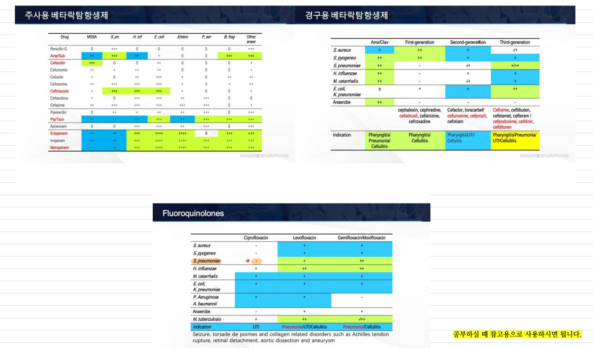{: style="width:90%"}

"공부하실 때 참고용으로 사용하시면 됩니다." 7장의 항생제 선택을 이해하는 데 쓰는 표다. 읽는 법만 잡아 두자(+ 개수 = 효과).

- **Ceftriaxone(3세대)**: S. pneumoniae·H. influenzae·E. coli에 +++ → **CAP 주사의 주력**. 녹농균(P. aer) 0.
- **Cefazolin(1세대)**: **MSSA에 +++**, 폐렴알균·헤모필루스엔 약함.
- **Amp/Sub, Pip/Tazo, carbapenem**: 혐기균(B. frag)까지. **Pip/Tazo·cefepime·carbapenem은 녹농균까지**(Ertapenem만 녹농균 0).
- 경구 **Amx/Clav**: S. aureus·S. pneumoniae·H. influenzae·M. catarrhalis·혐기균을 모두 덮는다(적응증: 인두염·**폐렴**·연조직염).
- **Fluoroquinolone**: **Ciprofloxacin은 S. pneumoniae에 "−"**(필기본에 빨간 별 표시) → 폐렴에 단독 X(적응증 UTI). **Levofloxacin·Gemi/Moxifloxacin은 폐렴알균 +~++, 결핵에도 ++** → 그래서 "결핵을 가린다"(3장). 부작용: 경련, torsade de pointes, 아킬레스건 파열 등 콜라겐 질환, 망막박리, 대동맥 박리·동맥류.

# 1. 폐렴의 정의와 분류

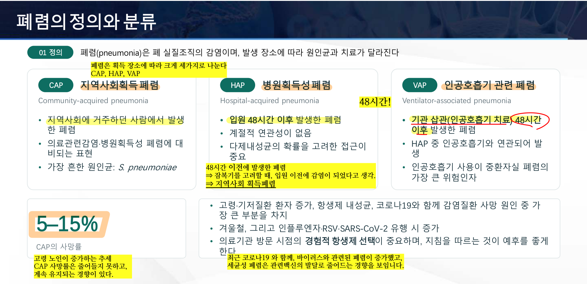{: style="width:80%"}

**폐렴(pneumonia) = 폐 실질조직의 감염.** 발생 장소에 따라 원인균과 치료가 달라지므로 **획득 장소에 따라 크게 세 가지**로 나눈다.

| 구분 | 정의 | 특징 |
|---|---|---|
| **지역사회획득폐렴(CAP, community-acquired)** | 지역사회에 거주하던 사람에서 발생한 폐렴(의료관련감염·HAP에 대비되는 말) | 가장 흔한 원인균 **S. pneumoniae** |
| **병원획득성폐렴(HAP, hospital-acquired)** | **입원 48시간 이후** 발생 | **계절 연관성 없음**, **다제내성균** 확률을 고려 |
| **인공호흡기관련폐렴(VAP, ventilator-associated)** | **기관 삽관(인공호흡기 치료) 48시간 이후** 발생 | HAP 중 인공호흡기와 연관. **인공호흡기 사용 = 중환자실 폐렴의 가장 큰 위험인자** |

- **왜 48시간인가?** 입원 후 48시간 **이전**에 생긴 폐렴은 잠복기를 고려하면 **입원 전에 이미 감염**된 것으로 본다 → **CAP**. (필기: "48시간!")
- **CAP 사망률 5–15%**. 고령·기저질환 환자 증가, 항생제 내성균, 코로나19와 함께 감염질환 사망 원인 중 가장 큰 부분. 고령 노인이 늘면서 **CAP 사망률은 줄지 못하고 유지**되는 경향.
- **겨울철**, 인플루엔자·RSV·SARS-CoV-2 유행 시 증가. 코로나19 이후 **바이러스 관련 폐렴은 늘고**, 세균성 폐렴은 **백신 발달로 줄어드는** 경향.
- 의료기관 방문 시점의 **경험적 항생제 선택**이 중요하고, **지침을 따르면 예후가 좋아진다**.

!!! exam "기출 포인트"
    - 2부 1번(2025): 폐렴 진단의 **필수 조건** = **흉부 방사선에서 폐 침윤 확인**. 객담 배양, procalcitonin, 산소포화도 저하, 백혈구 증가는 필수 아님.
    - 2부 37번(2020): 뇌출혈로 인공호흡기 **7일째** 발열·화농성 객담·산소 요구 증가 + 새 침윤 = **VAP** → 다제내성균(MRSA + 녹농균)을 덮는 **vancomycin + meropenem + amikacin**(9장).

!!! diff "작년 필기와 다른 점 — 작년에 있던 「폐렴의 중요성」"
    - **2023 사망원인 순위**에서 폐렴이 최근으로 오며 확 높아졌다.
    - **전 세계적으로는 폐렴 사망이 줄고 있다** — **5세 미만에서 극적으로 감소**(백신, 특히 **단백결합 백신** 효과 + 개도국 생활수준 향상).
    - **한국**: 5세 미만 사망은 거의 없는 대신 **고령자 사망이 늘어난다**(고령화로 의료 수요는 줄지 않는다).
    - 작년 정의 설명: 상기도 감염 = 목 아픔·콧물 / **하기도 = 기침·가래·호흡곤란**. 증상이 있으면서 **영상 소견이 있을 때** 폐렴(초반에는 영상 소견이 없을 수도 — 올해 5장 「X선이 정상이어도 폐렴일 수 있다」로 이어진다).

# 2. CAP의 원인체

## 원인체별 빈도

{: style="width:80%"}

세균이 가장 중요한 원인체이며, **국내에서도 Streptococcus pneumoniae(폐렴알균)가 가장 흔하다**.

| 원인체 | 빈도 |
|---|---|
| **S. pneumoniae** | **20–60%** |
| **H. influenzae** | 3–10% |
| S. aureus | 3–5% |
| 그람음성 막대균 | 3–10% |
| Legionella spp. | 2–8% |
| **M. pneumoniae** | 1–6% |
| Chlamydophila pneumoniae | 4–6% |
| 바이러스(SARS-CoV-2 포함) | 2–15% |
| 흡인 | 6–10% |

- **원인균 동정률은 임상연구에서도 40–60%**, 실제 진료에서는 더 낮다 → 그래서 **경험적 치료**가 중요하다.
- S. pneumoniae와 H. influenzae는 **배양이 까다로워** 실제보다 적게 동정된다.
- **폐렴알균 백신 사용**, 기저질환 변화로 폐렴알균 비율은 감소 추세 — "그럼에도 **여전히 가장 많은 비율**".
- 코로나19 이후 바이러스 폐렴 증가, **분자유전학적 검사**(PCR)로 원인 확인이 늘었다.

!!! diff "작년 필기와 다른 점"
    작년엔 원인균을 목록(전형 ① S. pneumoniae ② H. influenzae ③ S. aureus ④ 그람음성 / 비전형 ① Mycoplasma ② Chlamydia ③ Legionella ④ 바이러스)과 국내 3차 병원 데이터(S. pneumoniae > Klebsiella > S. aureus > Pseudomonas > H. influenzae)로 보여 줬다. **다균 감염: CAP의 10–15%에서 전형 + 비전형이 함께**(올해는 "외국 보고에서 비정형 동반감염 약 40%"). S. aureus는 **인플루엔자 후 합병**, **MRSA → 괴사성 폐렴**.

## 치료 장소(중증도)에 따른 원인체

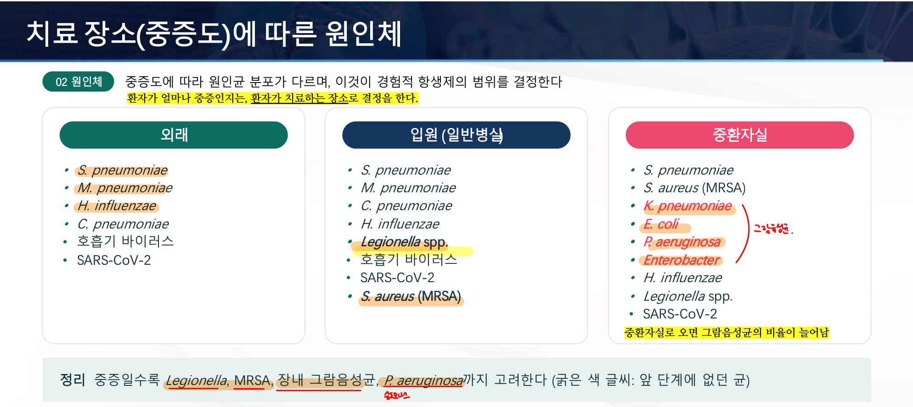{: style="width:80%"}

**환자가 얼마나 중증인지는 환자가 치료받는 장소로 결정**한다 — 그리고 장소마다 원인균 분포가 달라서 이것이 **경험적 항생제의 범위**를 정한다.

| 외래 | 입원(일반병실) | 중환자실 |
|---|---|---|
| **S. pneumoniae** | S. pneumoniae | S. pneumoniae |
| **M. pneumoniae** | M. pneumoniae | **S. aureus (MRSA)** |
| **H. influenzae** | C. pneumoniae | **K. pneumoniae** |
| C. pneumoniae | H. influenzae | **E. coli** |
| 호흡기 바이러스 | **Legionella spp.** | **P. aeruginosa** |
| SARS-CoV-2 | 호흡기 바이러스 | **Enterobacter** |
| | SARS-CoV-2 | H. influenzae |
| | **S. aureus (MRSA)** | Legionella spp. |
| | | SARS-CoV-2 |

- **정리: 중증일수록 Legionella, MRSA, 장내 그람음성균, P. aeruginosa(슈도모나스)까지 고려**한다. 중환자실로 오면 **그람음성균 비율이 늘어난다**(필기: K. pneumoniae·E. coli·P. aeruginosa·Enterobacter에 괄호 "그람음성").
- 외래의 핵심은 위 세 개(형광펜) — **S. pneumoniae, M. pneumoniae, H. influenzae**. 작년 강의: "**S. pneumoniae, Mycoplasma 두 개를 놓고 치료제를 결정한다**".

!!! diff "작년 필기와 다른 점"
    작년 표에서는 MRSA가 **중환자실에만**, Legionella는 입원(중증)·중환자실에 있었고 외래에 SARS-CoV-2는 따로 없었다. 올해는 **일반병실에도 S. aureus(MRSA)**, 중환자실은 그람음성균을 **K. pneumoniae·E. coli·P. aeruginosa·Enterobacter**로 풀어 적었다.

!!! exam "기출 포인트"
    - 2부 22번(2021): 건강한 30세 외래 CAP의 원인 2가지 = **S. pneumoniae, M. pneumoniae**.
    - 2부 5번(2023): 같은 환자에서 가능성이 **가장 낮은** 것 = **Legionella**(중증·입원 쪽).
    - 2부 8번(2022): 인플루엔자 A 회복 중 다시 고열·가래, CT 공동성 결절 → **S. aureus**.

## 정형 병원체와 비정형 병원체

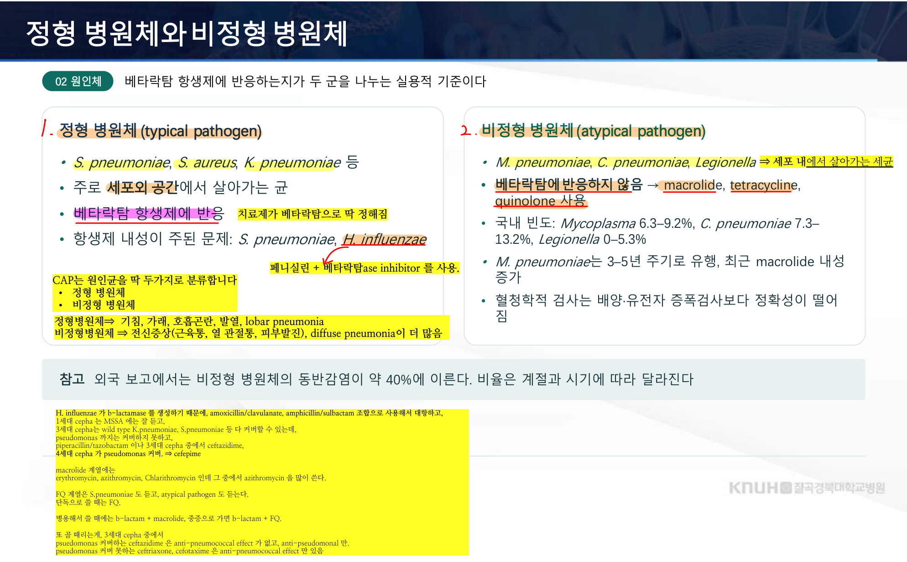{: style="width:84%"}

"**CAP는 원인균을 딱 두 가지로 분류합니다**" — 나누는 실용적 기준은 **β-lactam 항생제에 반응하는가**이다.

| | **정형 병원체(typical)** | **비정형 병원체(atypical)** |
|---|---|---|
| 균 | **S. pneumoniae, S. aureus, K. pneumoniae** 등 | **M. pneumoniae, C. pneumoniae, Legionella** |
| 사는 곳 | 주로 **세포 밖** 공간 | **세포 안**에서 살아가는 세균 |
| 치료 | **β-lactam에 반응** — "치료제가 β-lactam으로 딱 정해짐" | **β-lactam에 반응 안 함 → macrolide, tetracycline, quinolone** |
| 임상(필기) | 기침, 가래, 호흡곤란, 발열, **lobar(대엽성) pneumonia** | **전신 증상**(근육통, 열, 관절통, 피부발진), **diffuse(미만성) pneumonia**가 더 많음 |
| 문제 | **항생제 내성**: S. pneumoniae, **H. influenzae**(β-lactamase → "페니실린 + β-lactamase inhibitor 사용") | 국내 빈도 Mycoplasma 6.3–9.2%, C. pneumoniae 7.3–13.2%, Legionella 0–5.3% |

- **M. pneumoniae는 3–5년 주기로 유행**, 최근 **macrolide 내성 증가**.
- 비정형균 **혈청학적 검사는 배양·유전자증폭검사보다 정확성이 떨어진다**.
- 참고: 외국 보고에서는 **비정형 병원체 동반감염이 약 40%**. 비율은 계절·시기에 따라 달라진다.
- **왜 β-lactam이 안 듣나?** β-lactam은 세포벽(펩티도글리칸) 합성을 막는다. Mycoplasma는 **세포벽이 없고**, Chlamydia·Legionella는 **세포 안**에 있어 닿지 않는다. 그래서 세포 안으로 잘 들어가는 macrolide·tetracycline·FQ를 쓴다. 같은 이유로 **일반 배지에서 배양되지 않고 그람염색에도 안 보인다**.

### 필기 — β-lactam 세대와 macrolide·FQ 한 번에 정리 (슬라이드 아래 노란 칸)
- **H. influenzae는 β-lactamase를 만든다** → **amoxicillin/clavulanate, ampicillin/sulbactam** 조합으로 대항.
- **1세대 cephalosporin**은 **MSSA**에 잘 듣는다.
- **3세대 cephalosporin**은 wild type K. pneumoniae, S. pneumoniae 등을 다 덮지만 **Pseudomonas는 못 덮는다**.
- Pseudomonas를 덮는 것: **piperacillin/tazobactam**, 3세대 중 **ceftazidime**, **4세대 cefepime**.
- **"또 골 때리는 게"** 3세대 안에서도 — **ceftazidime은 anti-pseudomonal만 있고 anti-pneumococcal 효과가 없다**, **ceftriaxone·cefotaxime은 anti-pneumococcal만 있고 녹농균은 못 덮는다**. (그래서 CAP 주사약은 ceftriaxone/cefotaxime이지 ceftazidime이 아니다.)
- **macrolide**: erythromycin, azithromycin, clarithromycin — 그중 **azithromycin**을 많이 쓴다.
- **FQ**는 S. pneumoniae에도, 비정형균에도 듣는다 → **단독으로 쓸 때는 FQ**. **병용할 때는 β-lactam + macrolide, 중증으로 가면 β-lactam + FQ**.

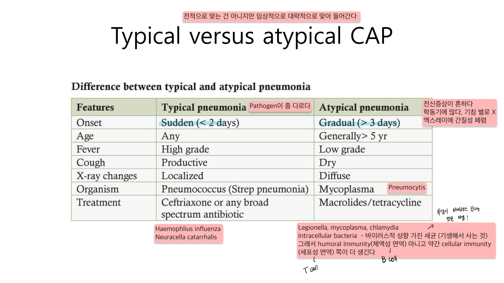{: style="width:72%"}

!!! diff "작년 필기와 다른 점 — 작년 비교표"
    작년엔 위 표로 비교했다: 시작 **갑자기(<2일)** vs **서서히(>3일)**, 나이 모두 vs 대개 >5세(**학동기**), **고열 vs 미열**, **가래 vs 마른기침**, X선 **국소 vs 미만성(간질성)**, 원인 폐렴알균·H. influenzae·M. catarrhalis vs Mycoplasma·Chlamydia·Legionella·(Pneumocystis)·바이러스. "전적으로 맞는 건 아니지만 임상적으로 대략 맞아 들어간다." 비전형균은 세포 내 세균이라 체액성보다 **세포성 면역**이 더 생기고 전신 증상이 흔하다. 올해 슬라이드에는 "**임상 양상만으로 비정형 병원체를 구분하기는 어렵다**"(4장)가 같이 있다 — 표는 경향일 뿐.

## 역학적 단서로 원인균 추정하기

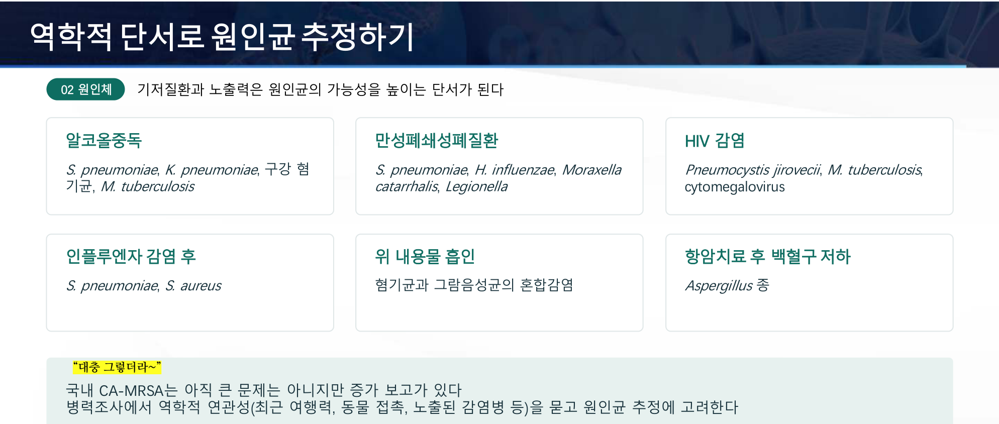{: style="width:74%"}

기저질환과 노출력은 원인균 가능성을 높이는 **단서**다("대충 그렇더라~").

| 단서 | 원인균 |
|---|---|
| **알코올 중독** | S. pneumoniae, **K. pneumoniae**, **구강 혐기균**, M. tuberculosis |
| **만성폐쇄성폐질환(COPD)** | S. pneumoniae, **H. influenzae**, Moraxella catarrhalis, Legionella |
| **HIV 감염** | **Pneumocystis jirovecii**, M. tuberculosis, cytomegalovirus |
| **인플루엔자 감염 후** | S. pneumoniae, **S. aureus** |
| **위 내용물 흡인** | **혐기균과 그람음성균의 혼합감염** |
| **항암치료 후 백혈구 저하** | **Aspergillus** 종 |

- 국내 **CA-MRSA**(지역사회 MRSA)는 아직 큰 문제는 아니지만 증가 보고가 있다.
- 병력조사에서 **역학적 연관성**(최근 여행력, 동물 접촉, 노출된 감염병 등)을 묻고 원인균 추정에 고려한다.

!!! new "올해 필기에서 추가"
    **HIV → Pneumocystis jirovecii·결핵·CMV**, **항암치료 후 호중구 감소 → Aspergillus**는 올해 표에 새로 들어왔다(면역저하자 폐렴).

{: style="width:76%"}

!!! diff "작년 필기와 다른 점 — 작년엔 더 긴 표"
    작년 표에만 있던 것: **흡연** → H. influenzae·P. aeruginosa·Legionella·S. pneumoniae·M. catarrhalis / **구조적 폐질환(기관지확장증) → P. aeruginosa**, Burkholderia cepacia, S. aureus(항생제가 달라져 중요 — 올해는 7장 「녹농균 위험요인」으로) / 폐농양 → 구강 혐기균·CA-MRSA·결핵 / 조류 → Chlamydophila psittaci / **농장 동물 → Coxiella burnetii(Q fever)** / 오래가는 기침 후 구토 → **Bordetella pertussis** / 주사약물 → S. aureus·혐기균·결핵 / 기관지 폐쇄 → 혐기균 등 / 해외: 동남아 → Burkholderia pseudomallei, 호텔·크루즈 → Legionella, 미국 남서부 → Hantavirus·Coccidioides. 산모 백신: 인플루엔자·코로나·백일해·RSV.

{: style="width:70%"}

!!! diff "작년 필기와 다른 점 — 원인균별 임상 특성(올해 없음)"
    **S. pneumoniae** = 고령·동반질환·급성·고열·**늑막성 흉통** / **Legionella** = 비교적 젊음·흡연·동반질환 없음, **설사·신경학적 증상·중증·다장기 손상(간·신기능 이상)** / **Mycoplasma** = **젊은 연령**, 이전 항생제 투여력, 다장기 손상 드묾 / Chlamydophila = 오래 끈 증상, 두통.

!!! exam "기출 포인트"
    2부 6번(2023): 바른 짝 = **COPD – H. influenzae**. 알코올–Burkholderia(X → Klebsiella·혐기균), 기관지확장증–Coxiella(X → 녹농균), 치매–녹농균(X → 흡인·혐기균), 흡연–Legionella(위험인자이긴 하나 출제 답은 COPD).

# 3. 항생제 내성

이 장이 "**국내 지침이 미국·영국 지침과 달라지는 이유**"다. 세 가지만 잡으면 된다: **폐렴알균 페니실린 내성은 사실상 문제 아님**, **macrolide 내성은 심각(단독 금지)**, **FQ는 결핵을 가린다**.

## 폐렴알균의 penicillin 내성

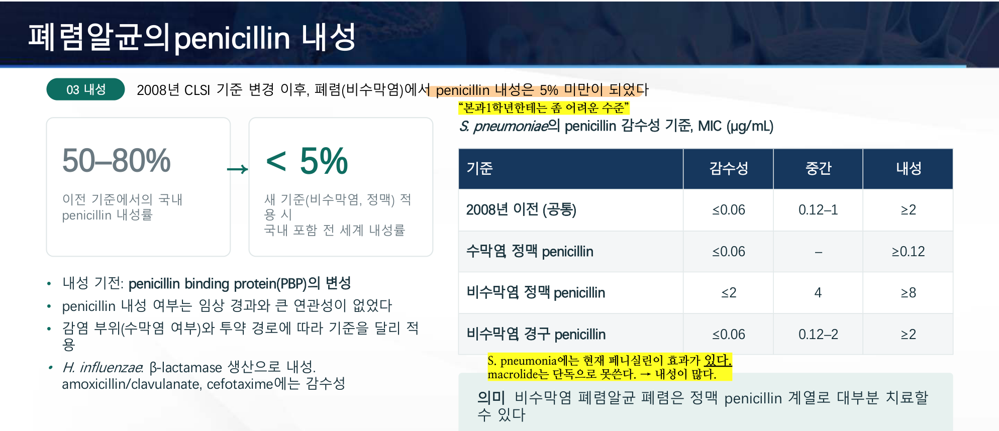{: style="width:84%"}

- **2008년 CLSI(미국 임상검사표준협회) 기준 변경 이후, 폐렴(비수막염)에서 penicillin 내성은 5% 미만**이 되었다. 이전 기준에서는 국내 내성률이 **50–80%**였다.
- **내성 기전: penicillin binding protein(PBP)의 변성** — β-lactamase가 아니다(그래서 clavulanate를 붙여도 의미 없다).
- **penicillin 내성 여부는 임상 경과와 큰 연관성이 없었다** → 그래서 기준을 바꿨다. **감염 부위(수막염 여부)와 투약 경로**에 따라 기준을 달리 적용한다 — 수막염은 약이 뇌척수액에 적게 들어가므로 기준이 엄격하고, 폐는 정맥 고용량이면 충분한 농도가 된다.

| S. pneumoniae penicillin MIC(μg/mL) | 감수성 | 중간 | 내성 |
|---|---|---|---|
| 2008년 이전(공통) | ≤0.06 | 0.12–1 | ≥2 |
| **수막염, 정맥 penicillin** | ≤0.06 | – | **≥0.12** |
| **비수막염, 정맥 penicillin** | **≤2** | 4 | **≥8** |
| 비수막염, 경구 penicillin | ≤0.06 | 0.12–2 | ≥2 |

- **의미: 비수막염 폐렴알균 폐렴은 정맥 penicillin 계열로 대부분 치료할 수 있다.** 필기: "S. pneumoniae에는 **현재 페니실린이 효과가 있다**. macrolide는 단독으로 못 쓴다 → 내성이 많다." 교수님: "본과 1학년한테는 좀 어려운 수준"(표의 수치는 외우기보다 의미를).
- **H. influenzae**: **β-lactamase 생산으로 내성** → **amoxicillin/clavulanate, cefotaxime에는 감수성**.

## Macrolide 내성과 quinolone 사용의 주의점

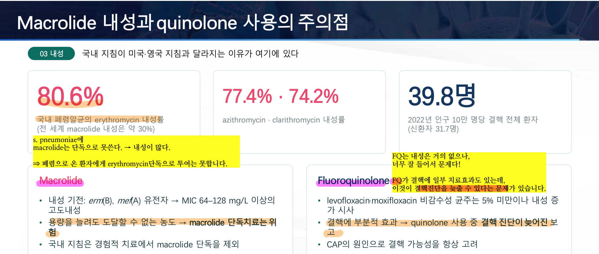{: style="width:84%"}

| 수치 | 의미 |
|---|---|
| **80.6%** | 국내 폐렴알균의 **erythromycin 내성률**(전 세계 macrolide 내성은 약 **30%**) |
| **77.4% · 74.2%** | **azithromycin · clarithromycin** 내성률 |
| **39.8명** | 2022년 인구 10만 명당 **결핵** 전체 환자(신환자 31.7명) — 결핵이 여전히 많다 |

**Macrolide**

- 내성 기전: **erm(B), mef(A)** 유전자 → **MIC 64–128 mg/L 이상의 고도내성**(erm = 리보솜 표적 메틸화, mef = 약물 배출 펌프).
- **용량을 늘려도 도달할 수 없는 농도 → macrolide 단독치료는 위험**. 국내 지침은 경험적 치료에서 **macrolide 단독을 제외**했다.
- 필기: "폐렴으로 온 환자에게 **erythromycin 단독 투여는 못합니다**." macrolide는 비정형균을 잡으려고 **β-lactam에 더해서** 쓴다.

**Fluoroquinolone**

- **levofloxacin·moxifloxacin 비감수성 균주는 5% 미만**이나 내성 증가 시사.
- **결핵에 부분적 효과 → quinolone 사용 중 결핵 진단이 늦어진 보고.** 필기: "**FQ는 내성은 거의 없으나, 너무 잘 들어서 문제다!** FQ가 결핵에 일부 치료 효과도 있는데, 이것이 **결핵 진단을 늦출 수 있다**."
- **CAP의 원인으로 결핵 가능성을 항상 고려**한다(우리나라 결핵 유병률이 높다).

!!! memo "암기 — FQ를 결핵일 때 피해야 하는 두 가지 이유(핵심정리 쪽 필기)"
    ① **진단 지연**: FQ가 결핵균도 억제해 증상이 일시적으로 좋아짐 → 결핵 진단이 늦어짐
    ② **내성 발생**: FQ 단독 사용 시 **FQ 내성 결핵균이 선택**되어 나중 치료가 어려워짐(FQ는 다제내성 결핵의 핵심 2차 약)

!!! diff "작년 필기와 다른 점 — 그 밖의 균 내성(올해 슬라이드에서 빠짐)"
    - **M. pneumoniae macrolide 내성**: 독일 3%, 일본 30%, **중국 95%, 한국 78.5%** → 국내는 FQ를 많이 쓴다(소아에게는 원래 쓰면 안 되는데 예외적으로). 올해는 "최근 macrolide 내성 증가" 한 줄.
    - **H. influenzae**: β-lactamase 생성 증가 → 경험적으로 헤모필루스까지 덮어야 하면 **β-lactamase 억제제를 붙인다**(경구 amoxicillin/clavulanate, 주사 ampicillin/sulbactam). 폐렴알균이 확인되면 페니실린 단독으로.
    - 그람음성균(P. aeruginosa, E. coli, K. pneumoniae, Acinetobacter): 국내는 3차 병원 환자 비율이 높아 의료관련 폐렴과 경계가 모호하고, 내성 증가로 예후가 나쁘다.
    - 폐렴알균 내성의 주요 위험인자: **최근 3개월 이내 항생제 사용**.

# 4. 병리기전과 임상상

## 폐렴의 병리기전

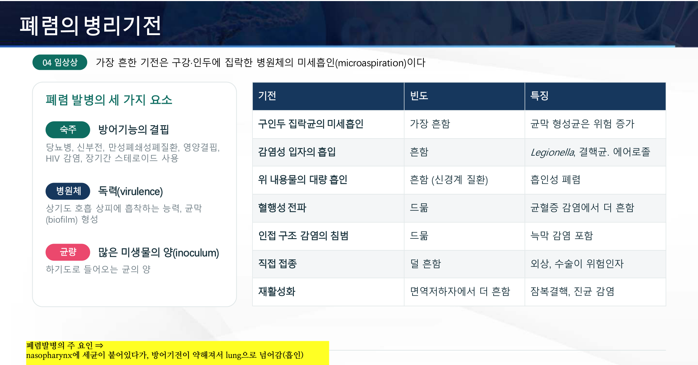{: style="width:84%"}

**가장 흔한 기전은 구강·인두에 집락한 병원체의 미세흡인(microaspiration).** 필기: "nasopharynx(비인두)에 세균이 붙어 있다가, **방어기전이 약해져서 lung으로 넘어감(흡인)**."

**폐렴 발병의 세 가지 요소** — 셋 중 무엇이 기울면 폐렴이 된다.

| 요소 | 내용 | 예 |
|---|---|---|
| **숙주** | 방어기능의 결핍 | 당뇨병, 신부전, COPD, 영양결핍, HIV 감염, 장기간 스테로이드 |
| **병원체** | 독력(virulence) | 상기도 호흡상피에 **흡착하는 능력**, **균막(biofilm) 형성** |
| **균량** | 많은 미생물의 양(inoculum) | 하기도로 들어오는 균의 양 |

| 감염 경로 | 빈도 | 특징 |
|---|---|---|
| **구인두 집락균의 미세흡인** | **가장 흔함** | 균막 형성균은 위험 증가 |
| 감염성 입자의 흡입 | 흔함 | **Legionella, 결핵균** — 에어로졸 |
| 위 내용물의 대량 흡인 | 흔함(신경계 질환) | **흡인성 폐렴** |
| 혈행성 전파 | 드묾 | 균혈증 감염에서 더 흔함 |
| 인접 구조 감염의 침범 | 드묾 | 늑막 감염 포함 |
| 직접 접종 | 덜 흔함 | 외상, 수술이 위험인자 |
| 재활성화 | 면역저하자에서 더 흔함 | 잠복결핵, 진균 감염 |

- **미세흡인 vs 대량흡인**: 미세흡인은 누구나 자는 동안 조금씩 일어나는 것(대부분의 CAP), 대량흡인은 뇌졸중·치매·의식저하로 삼킴이 망가져 위 내용물이 한꺼번에 들어가는 것(혐기균 + 그람음성균 혼합, 2장 표).

!!! diff "작년 필기와 다른 점 — 작년 병태생리 설명(이해용으로 그대로 둔다)"
    - 폐포에서 병원체가 증식하고 숙주 염증 반응이 생긴다(**원인 병원체가 있는 게 폐렴**, 병원체 없이 면역학적으로 오는 게 간질성 폐렴).
    - **S. pneumoniae**가 잘 들어온다(어린이집 아이 20–30%에서 집락; **백신을 맞으면 구인두 집락이 없어진다**).
    - 병원체가 면역을 이기면 → 상피·내피 손상 → 사이토카인 → 국소 호중구 증가 → **폐포 모세혈관 누출** → 산소화 저하·영상의 침윤.
    - 액체로 찬 폐포 → 심한 저산소혈증, **폐 순응도 감소**(물이 차면 폐가 단단해짐), 호흡곤란, **폐내 션트** → 호흡부전.

## 임상상, 병력조사와 신체검진

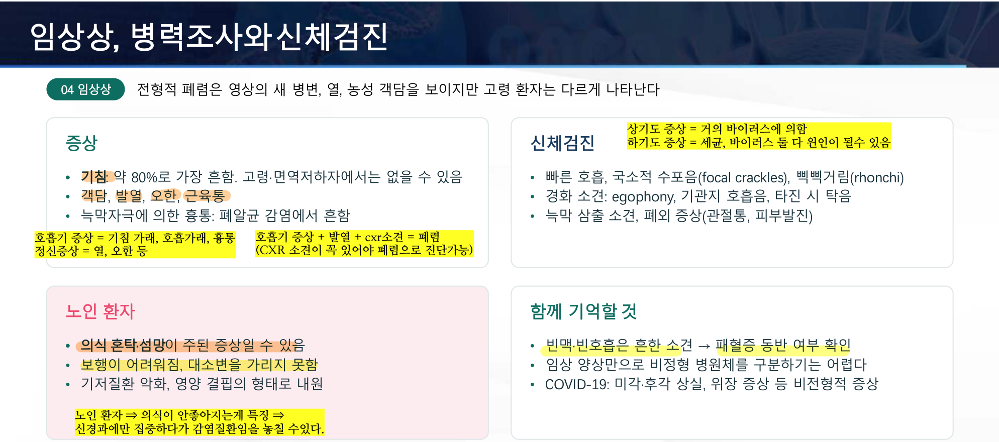{: style="width:80%"}

전형적 폐렴은 **영상의 새 병변 + 열 + 농성 객담**이지만 **고령 환자는 다르게** 나타난다.

**증상**

- **기침: 약 80%로 가장 흔함** — 단, 고령·면역저하자에서는 없을 수 있다.
- 객담, 발열, 오한, 근육통.
- **늑막 자극에 의한 흉통: 폐알균 감염에서 흔함**(늑막성 흉통 = 숨 들이쉴 때·기침할 때 찌르는 통증).
- 필기 정리: **호흡기 증상** = 기침·가래·호흡곤란·흉통 / **전신 증상** = 열·오한 등. **호흡기 증상 + 발열 + CXR 소견 = 폐렴 (CXR 소견이 꼭 있어야 폐렴으로 진단 가능)**.
- 필기: **상기도 증상 = 거의 바이러스**에 의함 / **하기도 증상 = 세균, 바이러스 둘 다** 원인이 될 수 있다.

**신체검진**

- **빠른 호흡**, **국소적 수포음(focal crackles)**, 삑삑거림(rhonchi).
- **경화 소견**: egophony(염소음 — "이" 하고 말하면 청진기로 "에"처럼 들림), **기관지 호흡음**, 타진 시 **탁음** — 폐포가 고름으로 차 소리가 잘 전달되기 때문.
- 늑막 삼출 소견, **폐외 증상(관절통, 피부발진)** — 비정형 쪽을 시사.

**노인 환자**

- **의식 혼탁·섬망이 주된 증상**일 수 있다. 필기: "**노인 환자 ⇒ 의식이 안 좋아지는 게 특징** ⇒ 신경과에만 집중하다가 감염질환임을 놓칠 수 있다."
- **보행이 어려워짐, 대소변을 가리지 못함**, **기저질환 악화, 영양결핍**의 형태로 내원.

**함께 기억할 것**

- **빈맥·빈호흡은 흔한 소견 → 패혈증 동반 여부 확인**.
- **임상 양상만으로 비정형 병원체를 구분하기는 어렵다**.
- **COVID-19**: 미각·후각 상실, 위장 증상 등 비전형적 증상.

!!! diff "작년 필기와 다른 점"
    작년엔 증상 목록에 **육안적 객혈 → CA-MRSA 폐렴 시사**, 소화기 증상(약 20%), 진찰에 촉각진탕음 증가·감소, 늑막 마찰음, "노인 감염 질환의 20–30%가 의식 변화로 온다", "패혈 쇼크·장기부전 동반 가능, 영상 소견은 **중력 의존 부위**에서 더 뚜렷"이 있었다. 역학: 미국 매년 500만 건, **70% 외래 / 30% 입원**, 사망률 외래 <5% · 입원 12–40%, 발병률은 **나이의 양 극단(U자형)**.

# 5. 진단

두 가지 질문: **① 폐렴인가?** → 임상·영상으로 **② 원인균은?** → 검사로(못 찾는 경우가 많다).

## 영상의학적 검사 — 진단의 중심

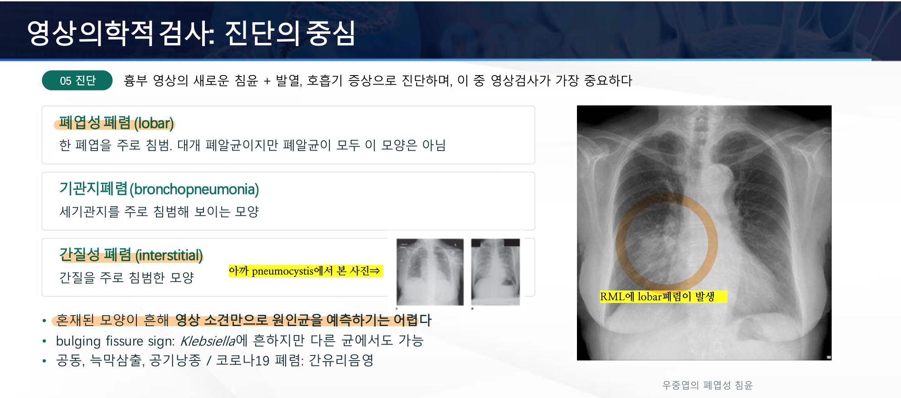{: style="width:80%"}

진단은 **흉부 영상의 새로운 침윤 + 발열·호흡기 증상**, 이 중 **영상검사가 가장 중요**하다.

| 모양 | 설명 |
|---|---|
| **폐엽성 폐렴(lobar)** | 한 폐엽을 주로 침범. **대개 폐알균**이지만 폐알균이 모두 이 모양은 아님. (슬라이드 사진: **우중엽(RML)의 폐엽성 침윤** — 우심장 경계가 지워짐) |
| 기관지폐렴(bronchopneumonia) | 세기관지를 주로 침범해 보이는 모양(얼룩덜룩 여러 곳) |
| **간질성 폐렴(interstitial)** | 간질을 주로 침범한 모양 — 필기: "아까 **pneumocystis**에서 본 사진" (비정형·바이러스·P. jirovecii) |

- **혼재된 모양이 흔해 영상 소견만으로 원인균을 예측하기는 어렵다.**
- **bulging fissure sign**(엽간열이 불룩 밀림): **Klebsiella**에 흔하지만 다른 균에서도 가능.
- 공동, 늑막삼출, 공기낭종 / **코로나19 폐렴: 간유리음영**.

!!! diff "작년 필기와 다른 점"
    작년 강조: **기종낭(pneumatocele) → S. aureus**, **상엽 공동 → 결핵** 의심 → 객담 검사(X선은 전형적인데 천천히 만성으로 오면 결핵일 수 있다). 흉부 CT는 종양·이물에 의한 폐쇄 후 폐렴, 공동 병변 의심 시. **외래는 임상·영상만으로 치료를 시작**하는 경우가 많다. 신체진찰 정확도는 민감도 58%, 특이도 67%.

## 흉부 X선이 정상이어도 폐렴일 수 있다

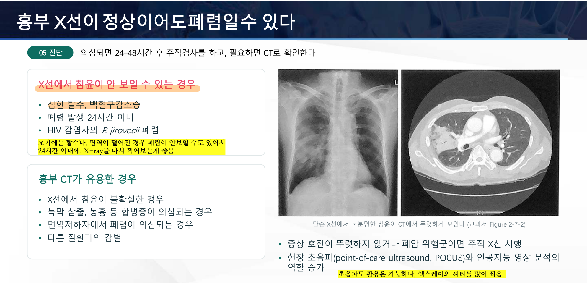{: style="width:80%"}

의심되면 **24–48시간 후 추적검사**, 필요하면 **CT**로 확인한다.

- **X선에서 침윤이 안 보일 수 있는 경우**: ① **심한 탈수**(폐에 물이 없어 침윤이 안 생김 → 수액 후 나타남) ② **백혈구감소증**(염증 세포가 없어 경화가 안 생김) ③ **폐렴 발생 24시간 이내** ④ **HIV 감염자의 P. jirovecii 폐렴**. 필기: "초기에는 탈수나 면역이 떨어진 경우 폐렴이 안 보일 수도 있어서 **24시간 이내에 X-ray를 다시** 찍어 보는 게 좋음."
- **흉부 CT가 유용한 경우**: X선 침윤이 불확실할 때, **늑막삼출·농흉 등 합병증** 의심, **면역저하자** 폐렴 의심, 다른 질환과의 감별(슬라이드: X선에서 불분명한 침윤이 CT에서 뚜렷).
- 증상 호전이 뚜렷하지 않거나 **폐암 위험군**이면 **추적 X선**.
- **현장 초음파(POCUS)**와 **인공지능 영상 분석**의 역할 증가 — 필기: "초음파도 활용 가능하나, 엑스레이와 CT를 많이 찍음."

!!! new "올해 필기에서 추가"
    「X선 정상 폐렴」 쪽과 아래 「감별진단」 목록은 올해 새로 정리된 슬라이드다.

## 폐렴처럼 보이는 질환 — 감별진단

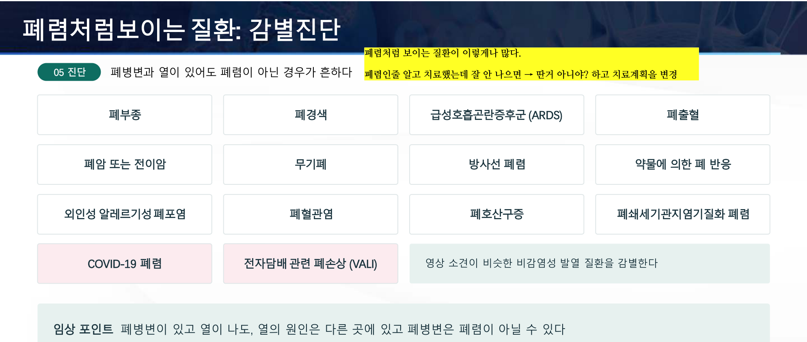{: style="width:80%"}

**폐 병변과 열이 있어도 폐렴이 아닌 경우가 흔하다.** "**폐렴처럼 보이는 질환이 이렇게나 많다**. 폐렴인 줄 알고 치료했는데 잘 안 나으면 → **딴 거 아니야?** 하고 치료계획을 변경."

| 심혈관·혈관 | 종양·물리적 | 면역·약물 | 감염·기타 |
|---|---|---|---|
| **폐부종**(심부전) | **폐암 또는 전이암** | **약물에 의한 폐 반응** | **COVID-19 폐렴** |
| **폐경색**(폐색전증) | **무기폐** | 외인성 알레르기성 폐포염(과민성 폐렴) | **전자담배 관련 폐손상(VALI)** |
| 폐출혈 | **방사선 폐렴** | 폐혈관염, 폐호산구증 | |
| 급성호흡곤란증후군(ARDS) | | 폐쇄세기관지염 기질화 폐렴(BOOP/COP) | |

- **임상 포인트: 폐 병변이 있고 열이 나도, 열의 원인은 다른 곳에 있고 폐 병변은 폐렴이 아닐 수 있다.** 예: 요로감염으로 열 나는 심부전 환자의 폐부종.
- 작년 강의: 병력이 중요 — **심질환 → 폐부종 악화, 폐암 → 방사선 폐손상**.

## 검사실 검사 ① — 혈액배양, 객담, 염증표지자

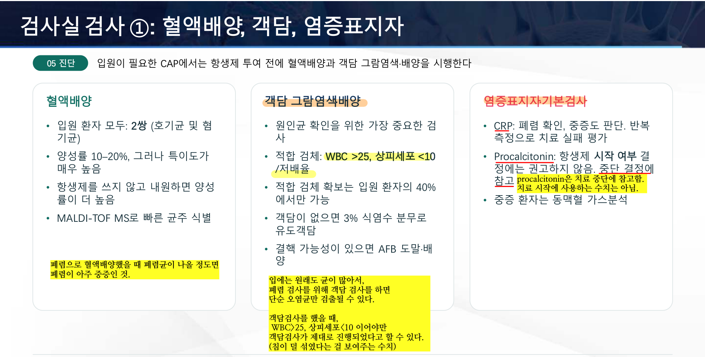{: style="width:80%"}

**입원이 필요한 CAP에서는 항생제 투여 전에 혈액배양과 객담 그람염색·배양**을 시행한다.

**혈액배양**

- **입원 환자 모두: 2쌍(호기균 및 혐기균 병)**.
- **양성률 10–20%**로 낮지만 **특이도가 매우 높다**(피에서 나오면 원인균이 확실).
- 항생제를 쓰지 않고 내원하면 양성률이 더 높다. **MALDI-TOF MS**(질량분석)로 빠른 균주 식별.
- 필기: "폐렴으로 혈액배양했을 때 **폐렴균이 나올 정도면 폐렴이 아주 중증**인 것."

**객담 그람염색·배양** — **원인균 확인을 위한 가장 중요한 검사**

- **적합 검체: 저배율에서 WBC >25, 상피세포 <10.** 필기: "입에는 원래 균이 많아서 객담검사를 하면 **단순 오염균만** 검출될 수 있다. WBC >25, 상피세포 <10이어야 객담검사가 제대로 됐다고 할 수 있다(**침이 덜 섞였다**는 걸 보여주는 수치)." — 편평상피세포는 입안 점막에서 오므로 많으면 침이다.
- 적합 검체 확보는 **입원 환자의 40%에서만** 가능. 객담이 없으면 **3% 식염수 분무로 유도객담**.
- **결핵 가능성이 있으면 AFB 도말·배양**.

**염증표지자·기본검사**

- **CRP**: 폐렴 확인, 중증도 판단, **반복 측정으로 치료 실패 평가**.
- **Procalcitonin(PCT)**: **항생제 시작 여부 결정에는 권고하지 않음. 중단 결정에 참고.** (필기: "치료 시작에 사용하는 수치는 아님.")
- 중증 환자는 **동맥혈가스분석**.

!!! diff "작년 필기와 다른 점 — 혈액배양 수치·대상"
    작년: 혈액배양은 입원 환자의 **5–14%**만 양성, **모든 입원 CAP에 필수는 아니고 고위험군에서 반드시** → 올해: **입원 환자 모두 2쌍, 양성률 10–20%**. 가장 흔히 자라는 균은 **S. pneumoniae**(혈액에서 나오면 사망률 높고 수막염 동반 가능). 작년엔 "50% 이상에서 원인균을 모른다, 객담에서 나온다고 원인균이 아니다(비인두 집락), **혈액·흉수 같은 무균 검체**에서 나오면 원인균"이라고 했고, PCT·CRP는 "보조 지표, 교수님은 개인적으로 CRP에 의존하는 편".

## 검사실 검사 ② — 항원검사, 분자진단, 침습적 검사

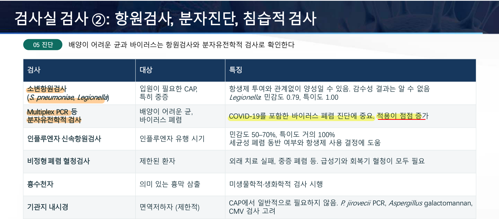{: style="width:80%"}

배양이 어려운 균과 바이러스는 **항원검사와 분자유전학적 검사**로 확인한다.

| 검사 | 대상 | 특징 |
|---|---|---|
| **소변 항원검사(S. pneumoniae, Legionella)** | 입원이 필요한 CAP, 특히 중증 | **항생제 투여와 관계없이 양성일 수 있음**. **감수성 결과는 알 수 없음**. Legionella 민감도 0.79, 특이도 1.00 |
| **Multiplex PCR 등 분자유전학적 검사** | 배양이 어려운 균, 바이러스 폐렴 | **COVID-19 포함 바이러스 폐렴 진단에 중요**, 적용 점점 증가 |
| 인플루엔자 신속항원검사 | 유행 시기 | **민감도 50–70%, 특이도 거의 100%**(음성이어도 배제 못 함). 세균성 폐렴 동반 여부·항생제 결정에 도움 |
| 비정형 폐렴 혈청검사 | 제한된 환자(외래 치료 실패, 중증) | **급성기와 회복기 혈청 모두 필요**(그래서 늦다) |
| 흉수천자 | 의미 있는 흉막삼출 | 미생물학적·생화학적 검사 |
| 기관지 내시경 | 면역저하자(제한적) | **CAP에서 일반적으로 필요 없음**. P. jirovecii PCR, Aspergillus galactomannan, CMV 검사 고려 |

- **Legionella 소변 항원은 serogroup 1만** 잡는다(작년 필기) — 음성이어도 다른 혈청형 Legionella는 배제 못 한다.

!!! diff "작년 필기와 다른 점 — 소변 항원 수치"
    작년: **폐렴알균 소변 항원 민감도 70%, 특이도 >90%**, **Legionella serogroup 1 민감도 70%, 특이도 99%** → 올해 슬라이드는 **Legionella 민감도 0.79, 특이도 1.00**. 작년: PCR은 1시간에 20여 종 결과("있기만 하면 나와 과대평가되기도 하지만 없는 것보단 낫다"), 혈청검사(IgM 4배 상승)는 오래 걸려 요즘은 연구용.

!!! exam "기출 포인트"
    2부 7번(2022): 65세, 화농성 가래·발열·**늑막성 흉통**, 대엽성 경화 → 양성 가능성이 가장 큰 검사 = **소변 pneumococcal 항원**(늑막성 흉통 + 대엽성 = 폐렴알균).

# 6. 중증도 평가와 입원 결정

"외래, 일반병동, 중환자실 — **어디로 갈 거냐**가 중요." 치료 장소가 정해지면 2장의 원인균 범위와 7장의 항생제가 따라 정해진다. 잘 모를 때는 **표준화된 지표**를 따른다.

## CURB-65와 CRB-65 — 족보

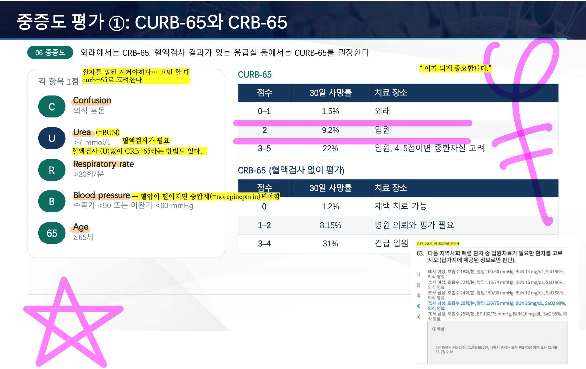{: style="width:86%"}

**"이거 되게 중요합니다."** (필기본에 분홍 「족」 + 별표.) "환자를 입원시켜야 하나… 고민할 때 CURB-65로 고려한다." **외래에서는 CRB-65, 혈액검사 결과가 있는 응급실 등에서는 CURB-65**를 권장한다. **각 항목 1점**.

| 글자 | 항목 | 기준(올해 슬라이드) |
|---|---|---|
| **C** | Confusion | **의식 혼돈** |
| **U** | Urea(= BUN) | **>7 mmol/L**(BUN으로 **>19 mg/dL**) — **혈액검사가 필요** |
| **R** | Respiratory rate | **>30회/분**(관례적으로 ≥30) |
| **B** | Blood pressure | **수축기 <90 또는 이완기 <60 mmHg**(관례적으로 이완기 ≤60) — 혈압이 떨어지면 **승압제(norepinephrine)**를 써야 함(패혈 쇼크) |
| **65** | Age | **≥65세** |

- **CRB-65** = U(요소)를 뺀 것 — "혈액검사(U) 없이 CRB-65라는 방법도 있다." → 동네 의원·외래에서 진찰만으로.

| **CURB-65** 점수 | 30일 사망률 | 치료 장소 |
|---|---|---|
| **0–1** | 1.5% | **외래** |
| **2** | 9.2% | **입원** |
| **3–5** | 22% | **입원, 4–5점이면 중환자실 고려** |

| **CRB-65** 점수 | 30일 사망률 | 치료 장소 |
|---|---|---|
| **0** | 1.2% | **재택 치료 가능** |
| **1–2** | 8.15% | **병원 의뢰와 평가 필요** |
| **3–4** | **31%** | **긴급 입원** |

!!! diff "작년 필기와 다른 점 — 기준 경계와 표현"
    - 작년 필기: 호흡수 **≥30**, 혈압 **수축기 ≤90 또는 이완기 ≤60**, BUN **>19 mg/dL** → 올해 슬라이드: 호흡수 **>30**, 혈압 **수축기 <90 또는 이완기 <60**, 요소 **>7 mmol/L**(같은 값을 mmol/L로).
    - ※ 확인 필요: 원래 CURB-65(영국 흉부학회)는 **호흡수 ≥30, 수축기 <90 또는 이완기 ≤60**이다. 시험에서 경계값(정확히 30회, 이완기 정확히 60)이 나오면 올해 슬라이드와 원 기준이 갈린다 — 2부 2번 해설은 원 기준(≥30, <90/≤60)으로 풀었다.
    - 작년 3–5점 권고: "**중증 폐렴으로 치료(중환자실)**" → 올해: "**입원, 4–5점이면 중환자실 고려**". 핵심정리에는 "3점 이상은 중환자실 고려".
    - 작년 강의 덧말: "80세인데 폐렴이다? 무조건 입원. 70세? 다른 것도 봐야. 70세 미만이면 기저질환이 많을 때 입원."

!!! exam "기출 포인트 — 권기태 교수님이 매년 내는 곳"
    - 2부 2번(2025, 필기본 이 쪽에 붙어 있음): 입원이 필요한 환자 = **75세 + BUN 25**(CURB-65 2점). 나머지는 0–1점(70세 호흡수 25 → 나이 1점뿐).
    - 2부 4번(2024): 70세 COPD 흡연자, 맥박 120 → 중증도 판단에 가장 중요한 것 = **70세 연령**(맥박·흡연·고혈압·COPD는 CURB-65 항목이 아님).
    - 2부 12번(2022): 75세 간암 여성 → 나쁜 예후에 가장 큰 인자 = **75세**.
    - 2부 9번(2022): 건강한 30세, 호흡수 20, 혈압 120/75, 의식 명료 → **CRB-65 0점, 집에서 치료**.
    - 2부 10번(2022): 75세 간암, 의식 혼탁, 호흡수 35, 혈압 80/40 → CRB-65 4점(사망률 약 30%, "10%"는 틀림), 정답은 **SARS-CoV-2를 원인으로 고려**(2022년 유행 중).
    - 함정: **맥박·체온·산소포화도·백혈구·흡연·COPD는 CURB-65 항목이 아니다**(맥박·체온은 PSI 항목).

## PSI와 중환자실 입실 기준

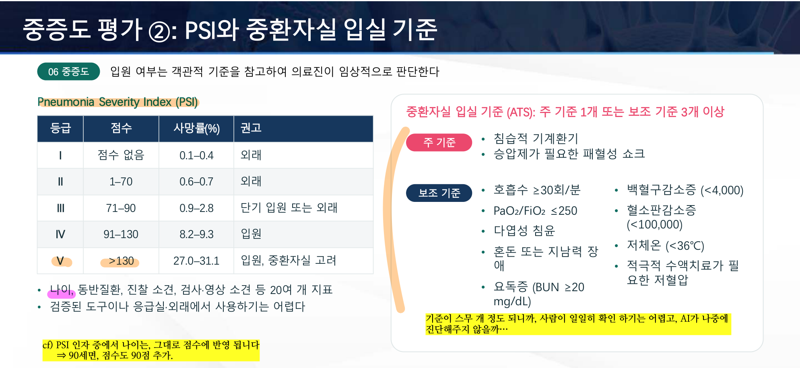{: style="width:84%"}

입원 여부는 **객관적 기준을 참고하여 의료진이 임상적으로 판단**한다(점수는 도구일 뿐).

**Pneumonia Severity Index(PSI)**

| 등급 | 점수 | 사망률(%) | 권고 |
|---|---|---|---|
| I | 점수 없음 | 0.1–0.4 | 외래 |
| II | 1–70 | 0.6–0.7 | 외래 |
| III | 71–90 | 0.9–2.8 | 단기 입원 또는 외래 |
| IV | 91–130 | 8.2–9.3 | **입원** |
| **V** | **>130** | **27.0–31.1** | **입원, 중환자실 고려** |

- **나이**, 동반질환, 진찰 소견, 검사·영상 소견 등 **20여 개 지표** — 검증된 도구이나 **응급실·외래에서 사용하기는 어렵다**("기준이 스무 개 정도 되니까 사람이 일일이 확인하기 어렵고, AI가 나중에 진단해 주지 않을까…").
- 필기: **PSI 인자 중 나이는 그대로 점수에 반영된다 ⇒ 90세면 점수도 90점 추가.** (그래서 80세 이상은 나이만으로 IV 근처 → PSI는 노인을 입원 쪽으로 민다.)

{: style="width:68%"}

!!! diff "작년 필기와 다른 점 — PSI 점수 항목(올해는 등급표만)"
    나이 **원점수 그대로**(**여자는 −10**, 수명이 길어서), 요양시설 +10, 동반질환(신생물 +30, 간질환 +20, 심부전·뇌혈관·신질환 +10), 진찰(의식 장애 +20, 호흡수 ≥30 +20, 수축기 <90 +20, 체온 <35 또는 ≥40 +15, 맥박 ≥125 +10), 검사(pH <7.35 +30, BUN ≥30 +20, Na <130 +20 등). 작년 권고는 "I–III 외래, IV 입원, V 중환자실 고려".

**중환자실 입실 기준(ATS/IDSA): 주기준 1개 또는 보조기준 3개 이상**

| 주기준 | 보조기준 |
|---|---|
| **침습적 기계환기** | **호흡수 ≥30회/분** · **PaO2/FiO2 ≤250** · **다엽성 침윤** |
| **승압제가 필요한 패혈성 쇼크** | **혼돈 또는 지남력 장애** · **요독증(BUN ≥20 mg/dL)** · **백혈구감소증(<4,000)** |
| | **혈소판감소증(<100,000)** · **저체온(<36℃)** · **적극적 수액치료가 필요한 저혈압** |

- 보조기준에 **CURB-65의 C·U·R·B가 다 들어 있다**(의식, BUN, 호흡수, 저혈압) + 산소화, 다엽성, 혈구 감소, 저체온.
- **백혈구 "감소"·저체온이 나쁜 징후**인 이유: 감염에 반응할 골수·체온 조절 능력이 무너졌다는 뜻(패혈증의 중증 형태).

# 7. CAP의 치료·예후·예방

교수님 핵심정리 5번: **"경험적 치료는 β-lactam이 기본, 기간은 짧게(3–5일). 임상적으로 안정되면 경구 전환."** — 4번(CURB-65)과 함께 **"케이스와 연결지어"** 나온다. 필기: "**케이스 주고 문제 내기 좋음** — 정형 있고 비정형 있고, 외래 있고 입원 있고, 항생제 β-lactam + macrolide or …"

## CAP에 쓰는 항생제의 종류 — 족보

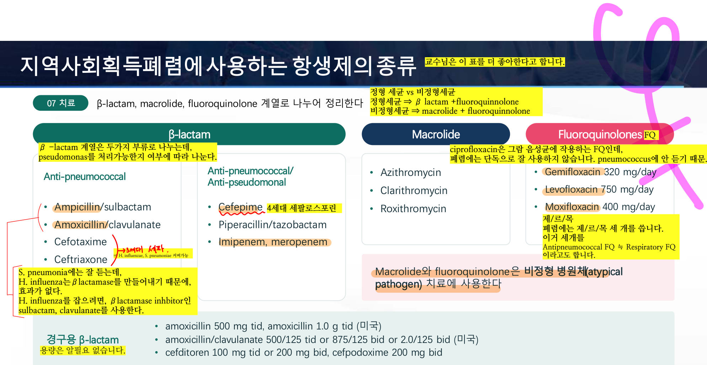{: style="width:86%"}

"**교수님은 이 표를 더 좋아한다고 합니다.**" β-lactam, macrolide, fluoroquinolone 세 계열로 나눠 정리한다.

| β-lactam: **Anti-pneumococcal** | β-lactam: **Anti-pneumococcal / Anti-pseudomonal** | **Macrolide** | **Fluoroquinolone(FQ)** |
|---|---|---|---|
| **Ampicillin/sulbactam** | **Cefepime**(4세대 세팔로스포린) | **Azithromycin** | **Gemifloxacin** 320 mg/day |
| **Amoxicillin/clavulanate** | **Piperacillin/tazobactam** | Clarithromycin | **Levofloxacin** 750 mg/day |
| **Cefotaxime**(3세대) | **Imipenem, meropenem** | Roxithromycin | **Moxifloxacin** 400 mg/day |
| **Ceftriaxone**(3세대) | | | |

- **β-lactam은 Pseudomonas를 처리할 수 있는지에 따라 두 부류로 나눈다.** 왼쪽 칸(항폐렴알균)은 일반 CAP, 오른쪽 칸(항폐렴알균 + 항녹농균)은 녹농균 위험이 있을 때·HAP.
- **Ampicillin/sulbactam, amoxicillin/clavulanate**(빨간 괄호): S. pneumoniae에는 잘 듣는데, **H. influenzae는 β-lactamase를 만들어 내서 그냥 페니실린은 효과가 없다** → H. influenzae를 잡으려면 **β-lactamase inhibitor인 sulbactam, clavulanate**를 붙인다.
- **Cefotaxime, ceftriaxone = 3세대 세파**(빨간 글씨) → **H. influenzae, S. pneumoniae 커버 가능**.
- **Macrolide와 FQ는 비정형 병원체(atypical pathogen) 치료에 사용한다.** 필기: **정형 세균 ⇒ β-lactam + FQ / 비정형 세균 ⇒ macrolide + FQ** (FQ는 양쪽 다).
- **"제/르/목"** — 폐렴에는 **제미플록사신 / 레보플록사신 / 목시플록사신** 세 개를 쓴다. 이 셋을 **Antipneumococcal FQ ≒ Respiratory FQ(호흡기 퀴놀론)**라고도 한다.
- **Ciprofloxacin은 그람음성균에 작용하는 FQ**인데, **pneumococcus에 안 들어서 폐렴에는 단독으로 잘 쓰지 않는다**(1부 처음 참고표에서 S. pneumoniae "−").
- **경구용 β-lactam**: amoxicillin, amoxicillin/clavulanate, cefditoren, cefpodoxime — "**용량은 알 필요 없습니다**."

!!! memo "암기"
    **CAP β-lactam 주사 = ceftriaxone·cefotaxime(3세대) / 경구 = amoxicillin(/clavulanate)** · **항녹농균 = cefepime·pip/tazo·imipenem·meropenem** · **macrolide = azithromycin** · **호흡기 FQ = 제/르/목(cipro X)**

## CAP의 경험적 항생제 (2018 국내 지침) — 족보

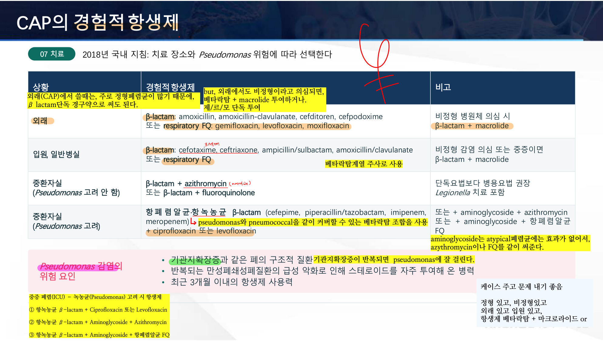{: style="width:88%"}

**치료 장소와 Pseudomonas 위험에 따라 선택한다.**

| 상황 | 경험적 항생제 | 비고 |
|---|---|---|
| **외래** | **β-lactam**(경구): amoxicillin, amoxicillin/clavulanate, cefditoren, cefpodoxime **또는 respiratory FQ**: gemifloxacin, levofloxacin, moxifloxacin | **비정형 병원체 의심 시 β-lactam + macrolide** |
| **입원, 일반병실** | **β-lactam**(주사): **cefotaxime, ceftriaxone**(3세대), ampicillin/sulbactam, amoxicillin/clavulanate **또는 respiratory FQ** | **비정형 감염 의심 또는 중증이면 β-lactam + macrolide** |
| **중환자실(Pseudomonas 고려 안 함)** | **β-lactam + azithromycin(macrolide) 또는 β-lactam + FQ** | **단독요법보다 병용요법 권장**, **Legionella 치료 포함** |
| **중환자실(Pseudomonas 고려)** | **항폐렴알균·항녹농균 β-lactam**(cefepime, pip/tazo, imipenem, meropenem) **+ ciprofloxacin 또는 levofloxacin** | **또는 + aminoglycoside + azithromycin / 또는 + aminoglycoside + 항폐렴알균 FQ** |

필기로 풀어 쓰면:

- **외래**: CAP는 주로 **정형 폐렴균이 많기 때문에 β-lactam 단독 경구약으로 써도 된다**. 그러나 **외래에서도 비정형이라고 의심되면 β-lactam + macrolide**를 투여하거나, **제/르/모 단독** 투여.
- **입원 일반병실**: **β-lactam 계열을 주사로** 사용(3세대 cefotaxime·ceftriaxone).
- **중환자실**: 처음부터 세게 — **병용**. 왜? 중증 CAP에서 놓치면 치명적인 **Legionella**(비정형)를 반드시 덮어야 하고, macrolide의 면역조절 효과도 있다.
- **중환자실 + 녹농균 위험**: **pseudomonas와 pneumococcal을 같이 커버할 수 있는 β-lactam 조합**을 쓴다. 세 가지 조합:
    1. 항녹농균 β-lactam + **ciprofloxacin 또는 levofloxacin**
    2. 항녹농균 β-lactam + **aminoglycoside + azithromycin**
    3. 항녹농균 β-lactam + **aminoglycoside + 항폐렴알균 FQ**
- **왜 aminoglycoside만으로는 안 되나?** "**aminoglycoside는 atypical 폐렴균에는 효과가 없어서 azithromycin이나 FQ를 같이 써 준다.**" (aminoglycoside는 녹농균을 두 계열로 덮기 위한 것.)
- 여기서는 **ciprofloxacin도 쓸 수 있다** — 폐렴알균은 항녹농균 β-lactam이 덮고, cipro는 녹농균 + 비정형을 맡는다(외래 단독 cipro와 구별).

**Pseudomonas 감염의 위험요인**

1. **기관지확장증** 같은 **폐의 구조적 질환** — 필기: "**기관지확장증이 반복되면 pseudomonas에 잘 걸린다.**"
2. **반복되는 COPD 급성 악화로 스테로이드를 자주 투여해 온 병력**
3. **최근 3개월 이내의 항생제 사용력**

!!! diff "작년 필기와 다른 점"
    - 작년 표는 「**질병관리청 2017**」, 올해는 「**2018년 국내 지침**」으로 표기(내용 틀은 같다).
    - 작년: 외래 ① β-lactam 단독("원래 섞어야 하는데 경증은 페니실린 하나로 되더라") ② β-lactam + macrolide(비정형 의심) ③ 호흡기 FQ 단독(**결핵 배제**될 때). 입원 경증은 "항생제 줄이자는 흐름이라 macrolide 루틴 추가는 권하지 않는다". **COPD가 있으면 H. influenzae → amoxicillin/clavulanate.** MRSA 의심이면 vancomycin·teicoplanin·linezolid.
    - 올해 새로: **중환자실 녹농균 고려 시 세 가지 조합**(+ cipro/levo, + aminoglycoside + azithro, + aminoglycoside + FQ)이 구체적으로 나왔다.

!!! exam "기출 포인트"
    - 2부 11·23·36번(2022·2021·2020): 건강한 30세 외래 CAP → **경구 amoxicillin/clavulanate**(2021은 + **경구 moxifloxacin**도 정답). 오답: 즉시 입원, 1세대 세팔로(cefadroxil — 폐렴알균·헤모필루스 약함), pip/tazo 주사(과함), **azithromycin·doxycycline 단독**(국내 내성), **ciprofloxacin**(폐렴알균 약함), aminoglycoside, 침대 머리 올리기(VAP 예방법).
    - 2부 3번(2024): 53세, 호흡 30, BUN 35(CURB-65 2점 → 입원) → **ceftriaxone + azithromycin**. 녹농균 위험인자가 없으므로 pip/tazo + cipro는 과함, 결핵약·vancomycin·clindamycin은 아님.
    - 교수님 예고("여기서 2문제"): **증례 → CURB-65 점수 → 장소 → 그 장소의 항생제**를 한 번에 묻는다.

## 국내 지침의 특징과 특수 상황

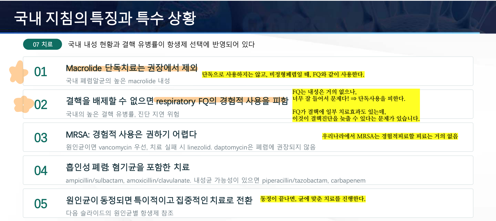{: style="width:84%"}

**국내 내성 현황과 결핵 유병률이 항생제 선택에 반영되어 있다.**

1. **Macrolide 단독치료는 권장에서 제외** — 국내 폐렴알균의 높은 macrolide 내성(3장). 필기: "단독으로 사용하지는 않고, 비정형폐렴일 때 (β-lactam이나) FQ와 같이 사용한다."
2. **결핵을 배제할 수 없으면 respiratory FQ의 경험적 사용을 피함** — 국내의 높은 결핵 유병률, 진단 지연 위험. "FQ는 너무 잘 들어서 문제다! ⇒ 단독 사용을 피한다."
3. **MRSA: 경험적 사용은 권하기 어렵다** — "우리나라에서 MRSA는 경험적 치료할 필요는 거의 없음." 원인균이면 **vancomycin 우선**, 치료 실패 시 **linezolid**. **daptomycin은 폐렴에 권장되지 않음**(폐 표면활성제에 불활성화된다).
4. **흡인성 폐렴: 혐기균을 포함한 치료** — **ampicillin/sulbactam, amoxicillin/clavulanate**. 내성균 가능성이 있으면 piperacillin/tazobactam, carbapenem.
5. **원인균이 동정되면 특이적이고 집중적인 치료로 전환** — "동정이 끝나면 균에 맞춘 치료를 진행한다."

!!! diff "작년 필기와 다른 점 — 외국 지침 비교(올해 없음)"
    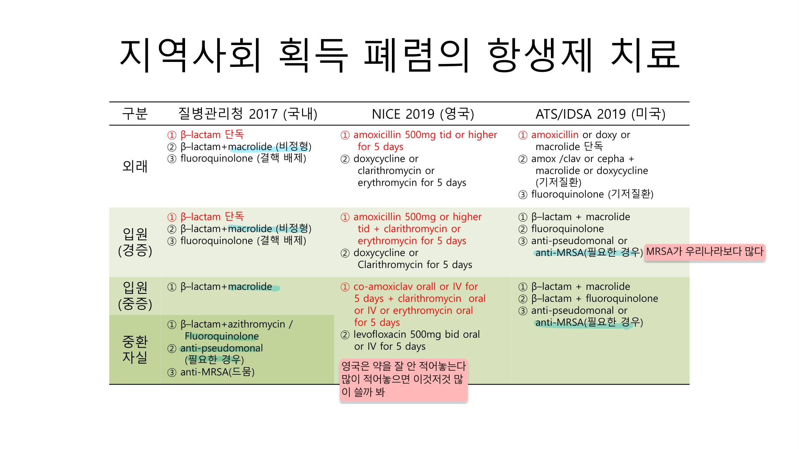{: style="width:70%"}

    영국(NICE)은 약을 많이 적어 두면 이것저것 쓸까 봐 잘 안 적는다(외래 **amoxicillin 5일**). 미국(ATS/IDSA)은 MRSA가 우리나라보다 많아 **anti-MRSA**를 넣는다. 우리나라는 macrolide 내성·결핵 때문에 macrolide 단독과 FQ 남용을 피한다.

## 원인균이 확인된 경우의 항생제 선택 — "몰라도 됩니다"

필기본에서 이 표 전체에 X 표시와 "**몰라도 됩니다.**" 흐름만 기억하자 — 경험적 치료에서 **원인균에 맞춘 치료로 좁혀 간다**. 대표만: S. pneumoniae → penicillin G·고용량 amoxicillin / H. influenzae(β-lactamase 생성) → 2·3세대 세팔로·β-lactam/억제제 / MSSA → 항포도알균 penicillin·1세대 세팔로 / MRSA → glycopeptide(vancomycin) / Mycoplasma·Chlamydophila → macrolide / Legionella → respiratory FQ·macrolide / 혐기균 → β-lactam/억제제·clindamycin / 인플루엔자 → **oseltamivir**.

- 같은 쪽 필기: **객담에서 배양된 세균이 원인균이 아니라 단순 오염균인 경우도 많다**. 단, **객담 + 흉수 + 혈액에서 같은 세균이 자라면 ⇒ 원인균으로 확정 가능**.

## 경구 전환, 치료기간, 퇴원

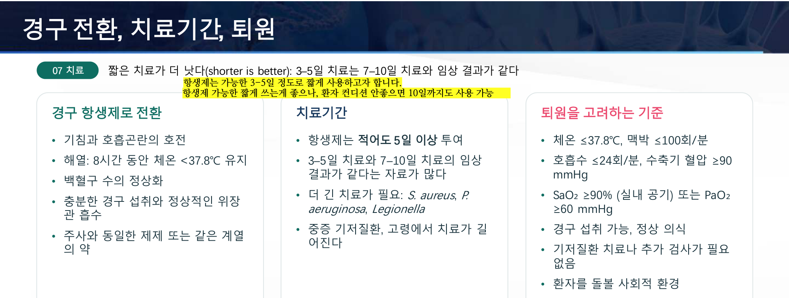{: style="width:84%"}

**짧은 치료가 더 낫다(shorter is better): 3–5일 치료는 7–10일 치료와 임상 결과가 같다.** 필기: "항생제는 가능한 **3–5일** 정도로 짧게 사용하고자 합니다. … 환자 컨디션이 안 좋으면 **10일까지도** 사용 가능."

| 경구 항생제로 전환 | 치료기간 | 퇴원을 고려하는 기준 |
|---|---|---|
| 기침과 호흡곤란의 호전 | 항생제는 **적어도 5일 이상** 투여 | 체온 ≤37.8℃, 맥박 ≤100회/분 |
| **해열: 8시간 동안 체온 <37.8℃ 유지** | 3–5일과 7–10일의 임상 결과가 같다는 자료가 많다 | 호흡수 ≤24회/분, 수축기 혈압 ≥90 mmHg |
| 백혈구 수의 정상화 | **더 긴 치료가 필요: S. aureus, P. aeruginosa, Legionella** | SaO2 ≥90%(실내공기) 또는 PaO2 ≥60 mmHg |
| 충분한 경구 섭취와 정상적인 위장관 흡수 | 중증 기저질환, 고령에서 치료가 길어진다 | 경구 섭취 가능, 정상 의식 |
| 주사와 동일한 제제 또는 같은 계열의 약 | | 기저질환 치료나 추가 검사가 필요 없음, 환자를 돌볼 사회적 환경 |

- "3–5일"과 "적어도 5일"이 같이 있는 이유: **최소 5일, 그중 마지막 48–72시간은 열이 없고 안정**해야 끊는다(임상적 안정 기준 = 퇴원 기준과 거의 같은 수치).
- 왜 짧게? 오래 쓰면 **내성균 선택·C. difficile·부작용**만 늘고 효과는 같다.

!!! new "올해 필기에서 추가"
    경구 전환·치료기간·퇴원 기준, 다음의 치료 실패, 예후 쪽은 올해 새로 생긴 슬라이드다. 핵심정리 5번의 「**3–5일**」(HAP은 **7–8일**)이 여기서 나온다.

## 치료 반응이 느리거나 실패할 때

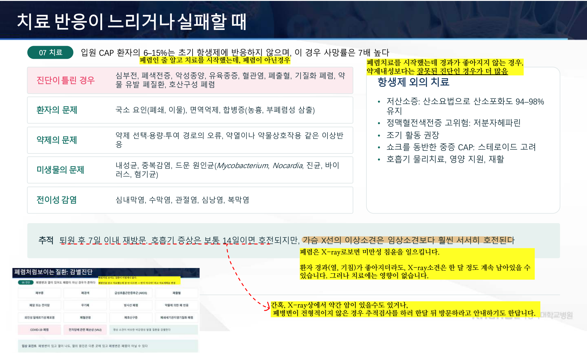{: style="width:84%"}

**입원 CAP 환자의 6–15%는 초기 항생제에 반응하지 않으며, 이 경우 사망률은 7배 높다.** 필기: 폐렴인 줄 알고 치료를 시작했는데 **폐렴이 아닌 경우**, 또는 폐렴 치료를 시작했는데 경과가 좋아지지 않는 경우 — "**약제 내성보다는 잘못된 진단인 경우가 더 많음**."

| 원인 | 예 |
|---|---|
| **진단이 틀린 경우** | 심부전, 폐색전증, 악성종양, 유육종증, 혈관염, 폐출혈, 기질화 폐렴, 약물유발 폐질환, 호산구성 폐렴 |
| 환자의 문제 | 국소 요인(폐쇄, 이물), 면역억제, **합병증(농흉, 부폐렴성 삼출)** |
| 약제의 문제 | 약제 선택·용량·투여경로의 오류, 약열이나 약물상호작용 같은 이상반응 |
| 미생물의 문제 | 내성균, 중복감염, 드문 원인균(**Mycobacterium**, Nocardia, 진균, 바이러스, 혐기균) |
| 전이성 감염 | 심내막염, 수막염, 관절염, 심낭염, 복막염 |

**항생제 외의 치료**: 저산소증 → 산소요법으로 **산소포화도 94–98%** 유지 / 정맥혈전색전증 고위험 → **저분자헤파린** / **조기 활동** 권장 / **쇼크를 동반한 중증 CAP → 스테로이드 고려** / 호흡기 물리치료, 영양 지원, 재활.

**추적**: **퇴원 후 7일 이내 재방문.** 호흡기 증상은 보통 **14일**이면 호전되지만, **가슴 X선 이상 소견은 임상 소견보다 훨씬 서서히 호전**된다. 필기: "환자 경과(열, 기침)가 좋아지더라도 **X-ray 소견은 한 달 정도 계속 남아 있을 수 있다. 그러나 치료에는 영향이 없다.**" X선에 암이 있을 수도 있거나 병변이 전형적이지 않으면 **한 달 뒤 추적검사**를 하러 오라고 안내하기도 한다. (→ X선이 아직 안 좋아 보인다고 항생제를 늘리지 않는다.)

!!! exam "기출 포인트"
    2부 24번(2021): ceftriaxone + azithromycin 5일에도 열 지속 + X선에서 한쪽 흉수 → **농흉 병발**(환자의 문제 — 합병증, 배농해야 낫는다). 항생제만 바꾸는 보기가 함정.

## 예후와 예방

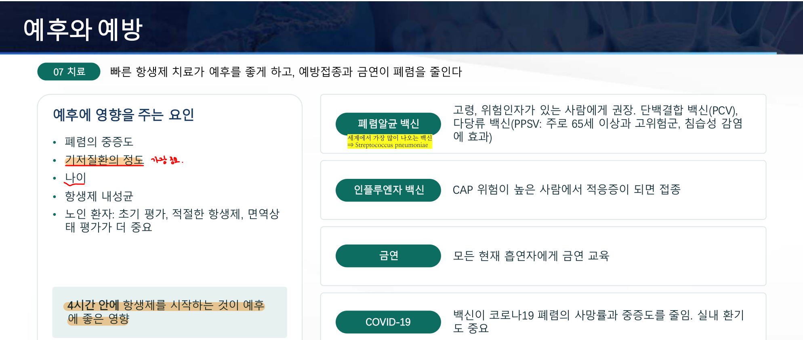{: style="width:84%"}

**빠른 항생제 치료가 예후를 좋게 하고, 예방접종과 금연이 폐렴을 줄인다.**

**예후에 영향을 주는 요인**: 폐렴의 중증도 / **기저질환의 정도**(필기: 빨간 밑줄 + "**가장 중요**") / **나이**(밑줄) / 항생제 내성균 / 노인 환자는 초기 평가, 적절한 항생제, 면역상태 평가가 더 중요.

- **4시간 안에 항생제를 시작하는 것이 예후에 좋은 영향.**

!!! exam "기출 포인트 — 예후 인자 함정"
    2부 12번(2022): "75세 간암 여성, 나쁜 예후에 가장 큰 인자" → 정답 **75세**(PSI에서 나이는 원점수 그대로, 간암 +20·종양 +30보다 큼; CURB-65에도 나이만 들어감). 올해 필기엔 "**기저질환의 정도 — 가장 중요**"라는 메모가 있다. 보기 중에 고르는 문제라면 **점수 체계(CURB-65·PSI)에 가장 크게 반영되는 것 = 나이**로 답한 것이 기출 답이니, 두 말이 같은 문제에서 부딪히면 증례 수치를 점수로 계산해서 고르자.

**예방**

| 예방 | 내용 |
|---|---|
| **폐렴알균 백신** | 고령, 위험인자가 있는 사람에게 권장. **단백결합 백신(PCV)**, **다당류 백신(PPSV: 주로 65세 이상과 고위험군, 침습성 감염에 효과)**. 필기: "세계에서 가장 많이 나오는 백신 ⇒ Streptococcus pneumoniae" |
| 인플루엔자 백신 | CAP 위험이 높은 사람에서 적응증이 되면 접종 |
| **금연** | 모든 현재 흡연자에게 금연 교육 |
| COVID-19 | 백신이 코로나19 폐렴의 사망률과 중증도를 줄임. **실내 환기**도 중요 |

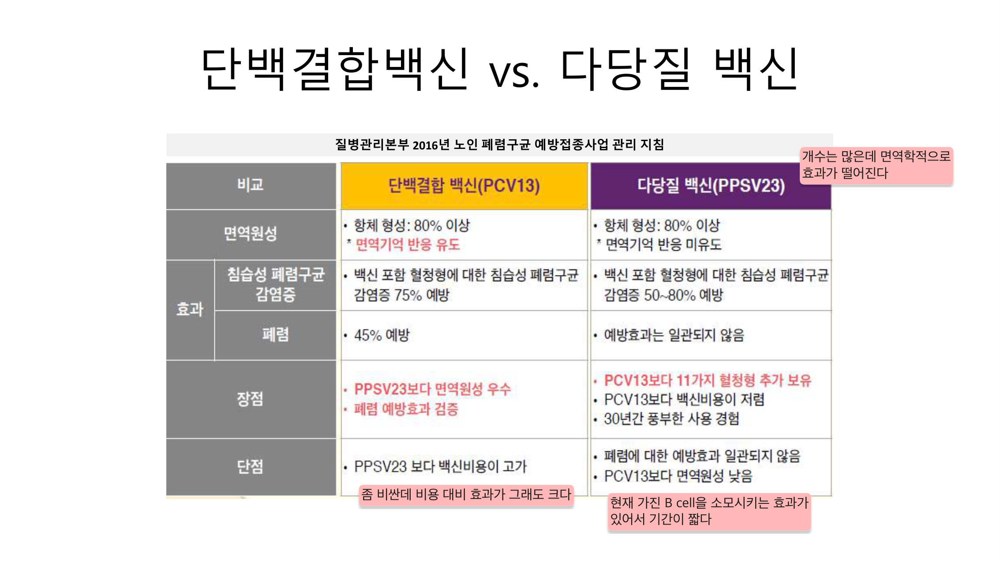{: style="width:74%"}

!!! diff "작년 필기와 다른 점 — 작년엔 백신 비교표가 따로(기출 15·29·45번과 연결)"
    | | **단백결합 백신(PCV13 등)** | **다당질 백신(PPSV23)** |
    |---|---|---|
    | 혈청형 | 13개(지금은 20·21가, 31가 임상 중) | 23개 |
    | 면역 | **T세포 의존**, **면역기억 유도**, 항체 형성 80% 이상 | **T세포 비의존**, 면역기억 X |
    | 효과 | 침습성 폐렴알균 감염 75% 예방, **폐렴 45% 예방** | 침습성 감염 50–80%, 폐렴 예방은 일관되지 않음 |
    | 장점 | **비인두 보균을 없애 안 맞은 사람까지 보호**(소아 → 노인 전파 감소) | 혈청형 11개 더, 저렴, 30년 경험 |
    | 단점 | 비싸다, 비백신 혈청형으로 대체 | 현재 B세포를 소모시켜 효과 기간이 짧다 |

    단백결합 백신은 협막 다당을 **단백에 결합**해 T세포를 끌어들인 것 — 그래서 영아에서도 듣고 기억이 남는다. 인플루엔자 백신은 근육주사 불활성화 백신, 비강 약독화 생백신.
