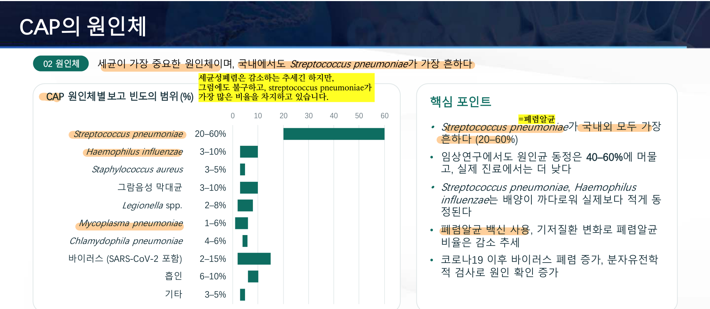
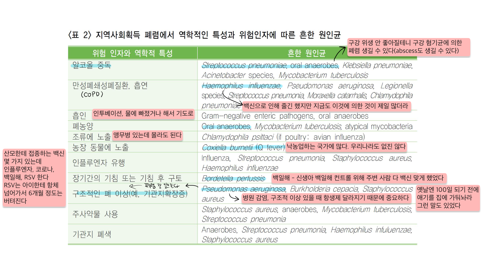
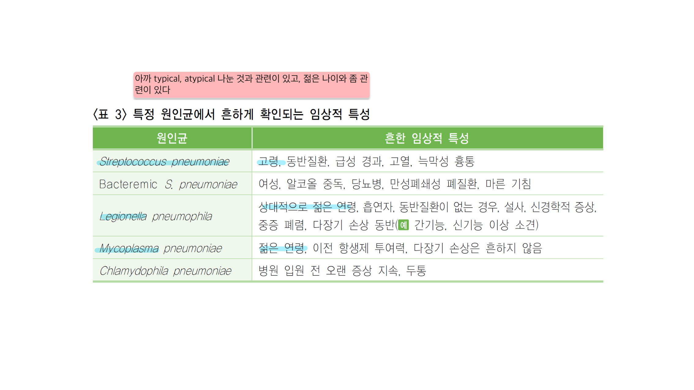

<!-- 필기본: 2026 · 2025 -->
<!-- 단계: 수업 후 -->

# 0. 이 수업을 공부하는 법

**권기태 교수님**(감염내과) 수업, 2026. 11. 17. 2023·2025·2026 같은 교수님이라 작년 강의에서 나온 기출이 그대로 유효하다.
첫 쪽 안내: **"항균제에 대한 얘기가 많이 나옵니다 — 11/16 2–4교시 「항생제 치료」(배소현 교수님)를 먼저 꼼꼼하게 공부하고 오면 도움이 된다."**

!!! new "올해 필기에서 추가"
    올해 슬라이드는 **완전히 새로 만든 것**이다. 8개 단원(① 정의와 분류 ② CAP 원인체 ③ 항생제 내성 ④ 병리기전과 임상상 ⑤ 진단 ⑥ 중증도 ⑦ 치료·예후·예방 ⑧ **병원획득성 폐렴(HAP)**)으로 짜여 있고, 작년엔 이름만 있던 **HAP·VAP가 한 단원(5쪽)**으로 생겼다. 이 1부도 올해 순서대로 다시 배치했다. 학습목표도 5개로 늘었다.

학습목표 (올해)

1. 지역사회획득폐렴(CAP), 병원획득성폐렴(HAP), 인공호흡기관련폐렴(VAP)을 정의하고 구분한다.
2. CAP의 흔한 원인체와 **국내 항생제 내성 현황**을 설명한다.
3. 임상상, 영상소견, 검사실검사를 이용해 폐렴 진단에 접근한다.
4. **CURB-65와 PSI로 중증도를 평가하고 치료 장소를 결정**한다.
5. **상황별 경험적 항생제를 선택**하고 치료기간과 예방 원칙을 설명한다.

- **교수님이 마지막에 직접 찍은 곳**: "핵심 정리 **4번(CURB-65로 치료 장소 결정)과 5번(경험적 치료는 β-lactam이 기본, 기간은 짧게)**을 가장 구체적으로 기억하고, **케이스와 연결지어 해석**하면 되겠다" → 필기자 메모 "**여기서 2문제 나오는가 봅니다**". 필기본의 「족보」 표시(분홍 「족」)도 **CURB-65 쪽, 항생제 종류 쪽, 경험적 항생제 쪽** 세 곳에 있다. → 6장·7장이 이 수업의 심장이다.
- 필기본 2쪽에는 2020–2025 기출이 모아져 있다(필기자 메모: "작년 문제는 확실한데 나머지는 정확하진 않다", 220311 "이 문제는 좀 모호한데 일단 넣었다").
- 기출 45문항(2020–2025). 권기태 교수님 문항은 같은 증례를 돌려 쓴다:
    - **"평소 건강하던 30세 남자, 5일 발열·기침·화농성 객담, 오른쪽 아래 거품소리"** → 원인균(폐렴알균 + 마이코플라스마), **CRB-65 0점 → 외래**, **경구 amoxicillin/clavulanate**(6문항)
    - **"75세, 간암, 의식 혼탁, 호흡수 35, 혈압 80/40"** → CRB-65 4점, 예후 인자 = **나이**
    - **입원 CAP → ceftriaxone + azithromycin**, 인플루엔자 후 공동 → **S. aureus**, COPD → **H. influenzae**
- 2020–2022 문항 상당수는 미생물학(결핵·나병·인플루엔자·마이코플라스마·레지오넬라) — 10장에 정리했다.

!!! key "핵심"
    **폐렴 = 하기도 증상 + 흉부 영상의 새 침윤.** 원인균은 대부분 모른다(동정률 40–60%) → **경험적 치료**. 결정 순서는 **① 중증도(CURB-65: 의식, BUN >19(요소 >7 mmol/L), 호흡수 ≥30, 혈압 <90/≤60, 나이 ≥65) → 외래·병동·중환자실 ② 그에 맞는 항생제**(외래 경구 β-lactam 단독 / 병동 주사 β-lactam 또는 호흡기 FQ, 비정형·중증이면 + macrolide / 중환자실 β-lactam + azithromycin 또는 FQ 병용, 녹농균 위험이면 항녹농균 β-lactam 병용) ③ **짧게(3–5일, 최소 5일)**.

## 먼저 보는 참고표 — 항생제 스펙트럼 (필기본 3쪽)

{: style="width:90%"}

"공부하실 때 참고용으로 사용하시면 됩니다." 7장의 항생제 선택을 이해하는 데 쓰는 표다. 읽는 법만 잡아 두자(+ 개수 = 효과).

- **Ceftriaxone(3세대)**: S. pneumoniae·H. influenzae·E. coli에 +++ → **CAP 주사의 주력**. 녹농균(P. aer) 0.
- **Cefazolin(1세대)**: **MSSA에 +++**, 폐렴알균·헤모필루스엔 약함.
- **Amp/Sub, Pip/Tazo, carbapenem**: 혐기균(B. frag)까지. **Pip/Tazo·cefepime·carbapenem은 녹농균까지**(Ertapenem만 녹농균 0).
- 경구 **Amx/Clav**: S. aureus·S. pneumoniae·H. influenzae·M. catarrhalis·혐기균을 모두 덮는다(적응증: 인두염·**폐렴**·연조직염).
- **Fluoroquinolone**: **Ciprofloxacin은 S. pneumoniae에 "−"**(필기본에 빨간 별 표시) → 폐렴에 단독 X(적응증 UTI). **Levofloxacin·Gemi/Moxifloxacin은 폐렴알균 +~++, 결핵에도 ++** → 그래서 "결핵을 가린다"(3장). 부작용: 경련, torsade de pointes, 아킬레스건 파열 등 콜라겐 질환, 망막박리, 대동맥 박리·동맥류.

# 1. 폐렴의 정의와 분류

{: style="width:80%"}

**폐렴(pneumonia) = 폐 실질조직의 감염.** 발생 장소에 따라 원인균과 치료가 달라지므로 **획득 장소에 따라 크게 세 가지**로 나눈다.

| 구분 | 정의 | 특징 |
|---|---|---|
| **지역사회획득폐렴(CAP, community-acquired)** | 지역사회에 거주하던 사람에서 발생한 폐렴(의료관련감염·HAP에 대비되는 말) | 가장 흔한 원인균 **S. pneumoniae** |
| **병원획득성폐렴(HAP, hospital-acquired)** | **입원 48시간 이후** 발생 | **계절 연관성 없음**, **다제내성균** 확률을 고려 |
| **인공호흡기관련폐렴(VAP, ventilator-associated)** | **기관 삽관(인공호흡기 치료) 48시간 이후** 발생 | HAP 중 인공호흡기와 연관. **인공호흡기 사용 = 중환자실 폐렴의 가장 큰 위험인자** |

- **왜 48시간인가?** 입원 후 48시간 **이전**에 생긴 폐렴은 잠복기를 고려하면 **입원 전에 이미 감염**된 것으로 본다 → **CAP**. (필기: "48시간!")
- **CAP 사망률 5–15%**. 고령·기저질환 환자 증가, 항생제 내성균, 코로나19와 함께 감염질환 사망 원인 중 가장 큰 부분. 고령 노인이 늘면서 **CAP 사망률은 줄지 못하고 유지**되는 경향.
- **겨울철**, 인플루엔자·RSV·SARS-CoV-2 유행 시 증가. 코로나19 이후 **바이러스 관련 폐렴은 늘고**, 세균성 폐렴은 **백신 발달로 줄어드는** 경향.
- 의료기관 방문 시점의 **경험적 항생제 선택**이 중요하고, **지침을 따르면 예후가 좋아진다**.

!!! exam "기출 포인트"
    - 2부 1번(2025): 폐렴 진단의 **필수 조건** = **흉부 방사선에서 폐 침윤 확인**. 객담 배양, procalcitonin, 산소포화도 저하, 백혈구 증가는 필수 아님.
    - 2부 37번(2020): 뇌출혈로 인공호흡기 **7일째** 발열·화농성 객담·산소 요구 증가 + 새 침윤 = **VAP** → 다제내성균(MRSA + 녹농균)을 덮는 **vancomycin + meropenem + amikacin**(9장).

!!! diff "작년 필기와 다른 점 — 작년에 있던 「폐렴의 중요성」"
    - **2023 사망원인 순위**에서 폐렴이 최근으로 오며 확 높아졌다.
    - **전 세계적으로는 폐렴 사망이 줄고 있다** — **5세 미만에서 극적으로 감소**(백신, 특히 **단백결합 백신** 효과 + 개도국 생활수준 향상).
    - **한국**: 5세 미만 사망은 거의 없는 대신 **고령자 사망이 늘어난다**(고령화로 의료 수요는 줄지 않는다).
    - 작년 정의 설명: 상기도 감염 = 목 아픔·콧물 / **하기도 = 기침·가래·호흡곤란**. 증상이 있으면서 **영상 소견이 있을 때** 폐렴(초반에는 영상 소견이 없을 수도 — 올해 5장 「X선이 정상이어도 폐렴일 수 있다」로 이어진다).

# 2. CAP의 원인체

## 원인체별 빈도

{: style="width:80%"}

세균이 가장 중요한 원인체이며, **국내에서도 Streptococcus pneumoniae(폐렴알균)가 가장 흔하다**.

| 원인체 | 빈도 |
|---|---|
| **S. pneumoniae** | **20–60%** |
| **H. influenzae** | 3–10% |
| S. aureus | 3–5% |
| 그람음성 막대균 | 3–10% |
| Legionella spp. | 2–8% |
| **M. pneumoniae** | 1–6% |
| Chlamydophila pneumoniae | 4–6% |
| 바이러스(SARS-CoV-2 포함) | 2–15% |
| 흡인 | 6–10% |

- **원인균 동정률은 임상연구에서도 40–60%**, 실제 진료에서는 더 낮다 → 그래서 **경험적 치료**가 중요하다.
- S. pneumoniae와 H. influenzae는 **배양이 까다로워** 실제보다 적게 동정된다.
- **폐렴알균 백신 사용**, 기저질환 변화로 폐렴알균 비율은 감소 추세 — "그럼에도 **여전히 가장 많은 비율**".
- 코로나19 이후 바이러스 폐렴 증가, **분자유전학적 검사**(PCR)로 원인 확인이 늘었다.

!!! diff "작년 필기와 다른 점"
    작년엔 원인균을 목록(전형 ① S. pneumoniae ② H. influenzae ③ S. aureus ④ 그람음성 / 비전형 ① Mycoplasma ② Chlamydia ③ Legionella ④ 바이러스)과 국내 3차 병원 데이터(S. pneumoniae > Klebsiella > S. aureus > Pseudomonas > H. influenzae)로 보여 줬다. **다균 감염: CAP의 10–15%에서 전형 + 비전형이 함께**(올해는 "외국 보고에서 비정형 동반감염 약 40%"). S. aureus는 **인플루엔자 후 합병**, **MRSA → 괴사성 폐렴**.

## 치료 장소(중증도)에 따른 원인체

{: style="width:80%"}

**환자가 얼마나 중증인지는 환자가 치료받는 장소로 결정**한다 — 그리고 장소마다 원인균 분포가 달라서 이것이 **경험적 항생제의 범위**를 정한다.

| 외래 | 입원(일반병실) | 중환자실 |
|---|---|---|
| **S. pneumoniae** | S. pneumoniae | S. pneumoniae |
| **M. pneumoniae** | M. pneumoniae | **S. aureus (MRSA)** |
| **H. influenzae** | C. pneumoniae | **K. pneumoniae** |
| C. pneumoniae | H. influenzae | **E. coli** |
| 호흡기 바이러스 | **Legionella spp.** | **P. aeruginosa** |
| SARS-CoV-2 | 호흡기 바이러스 | **Enterobacter** |
| | SARS-CoV-2 | H. influenzae |
| | **S. aureus (MRSA)** | Legionella spp. |
| | | SARS-CoV-2 |

- **정리: 중증일수록 Legionella, MRSA, 장내 그람음성균, P. aeruginosa(슈도모나스)까지 고려**한다. 중환자실로 오면 **그람음성균 비율이 늘어난다**(필기: K. pneumoniae·E. coli·P. aeruginosa·Enterobacter에 괄호 "그람음성").
- 외래의 핵심은 위 세 개(형광펜) — **S. pneumoniae, M. pneumoniae, H. influenzae**. 작년 강의: "**S. pneumoniae, Mycoplasma 두 개를 놓고 치료제를 결정한다**".

!!! diff "작년 필기와 다른 점"
    작년 표에서는 MRSA가 **중환자실에만**, Legionella는 입원(중증)·중환자실에 있었고 외래에 SARS-CoV-2는 따로 없었다. 올해는 **일반병실에도 S. aureus(MRSA)**, 중환자실은 그람음성균을 **K. pneumoniae·E. coli·P. aeruginosa·Enterobacter**로 풀어 적었다.

!!! exam "기출 포인트"
    - 2부 22번(2021): 건강한 30세 외래 CAP의 원인 2가지 = **S. pneumoniae, M. pneumoniae**.
    - 2부 5번(2023): 같은 환자에서 가능성이 **가장 낮은** 것 = **Legionella**(중증·입원 쪽).
    - 2부 8번(2022): 인플루엔자 A 회복 중 다시 고열·가래, CT 공동성 결절 → **S. aureus**.

## 정형 병원체와 비정형 병원체

{: style="width:84%"}

"**CAP는 원인균을 딱 두 가지로 분류합니다**" — 나누는 실용적 기준은 **β-lactam 항생제에 반응하는가**이다.

| | **정형 병원체(typical)** | **비정형 병원체(atypical)** |
|---|---|---|
| 균 | **S. pneumoniae, S. aureus, K. pneumoniae** 등 | **M. pneumoniae, C. pneumoniae, Legionella** |
| 사는 곳 | 주로 **세포 밖** 공간 | **세포 안**에서 살아가는 세균 |
| 치료 | **β-lactam에 반응** — "치료제가 β-lactam으로 딱 정해짐" | **β-lactam에 반응 안 함 → macrolide, tetracycline, quinolone** |
| 임상(필기) | 기침, 가래, 호흡곤란, 발열, **lobar(대엽성) pneumonia** | **전신 증상**(근육통, 열, 관절통, 피부발진), **diffuse(미만성) pneumonia**가 더 많음 |
| 문제 | **항생제 내성**: S. pneumoniae, **H. influenzae**(β-lactamase → "페니실린 + β-lactamase inhibitor 사용") | 국내 빈도 Mycoplasma 6.3–9.2%, C. pneumoniae 7.3–13.2%, Legionella 0–5.3% |

- **M. pneumoniae는 3–5년 주기로 유행**, 최근 **macrolide 내성 증가**.
- 비정형균 **혈청학적 검사는 배양·유전자증폭검사보다 정확성이 떨어진다**.
- 참고: 외국 보고에서는 **비정형 병원체 동반감염이 약 40%**. 비율은 계절·시기에 따라 달라진다.
- **왜 β-lactam이 안 듣나?** β-lactam은 세포벽(펩티도글리칸) 합성을 막는다. Mycoplasma는 **세포벽이 없고**, Chlamydia·Legionella는 **세포 안**에 있어 닿지 않는다. 그래서 세포 안으로 잘 들어가는 macrolide·tetracycline·FQ를 쓴다. 같은 이유로 **일반 배지에서 배양되지 않고 그람염색에도 안 보인다**.

### 필기 — β-lactam 세대와 macrolide·FQ 한 번에 정리 (슬라이드 아래 노란 칸)
- **H. influenzae는 β-lactamase를 만든다** → **amoxicillin/clavulanate, ampicillin/sulbactam** 조합으로 대항.
- **1세대 cephalosporin**은 **MSSA**에 잘 듣는다.
- **3세대 cephalosporin**은 wild type K. pneumoniae, S. pneumoniae 등을 다 덮지만 **Pseudomonas는 못 덮는다**.
- Pseudomonas를 덮는 것: **piperacillin/tazobactam**, 3세대 중 **ceftazidime**, **4세대 cefepime**.
- **"또 골 때리는 게"** 3세대 안에서도 — **ceftazidime은 anti-pseudomonal만 있고 anti-pneumococcal 효과가 없다**, **ceftriaxone·cefotaxime은 anti-pneumococcal만 있고 녹농균은 못 덮는다**. (그래서 CAP 주사약은 ceftriaxone/cefotaxime이지 ceftazidime이 아니다.)
- **macrolide**: erythromycin, azithromycin, clarithromycin — 그중 **azithromycin**을 많이 쓴다.
- **FQ**는 S. pneumoniae에도, 비정형균에도 듣는다 → **단독으로 쓸 때는 FQ**. **병용할 때는 β-lactam + macrolide, 중증으로 가면 β-lactam + FQ**.

{: style="width:72%"}

!!! diff "작년 필기와 다른 점 — 작년 비교표"
    작년엔 위 표로 비교했다: 시작 **갑자기(<2일)** vs **서서히(>3일)**, 나이 모두 vs 대개 >5세(**학동기**), **고열 vs 미열**, **가래 vs 마른기침**, X선 **국소 vs 미만성(간질성)**, 원인 폐렴알균·H. influenzae·M. catarrhalis vs Mycoplasma·Chlamydia·Legionella·(Pneumocystis)·바이러스. "전적으로 맞는 건 아니지만 임상적으로 대략 맞아 들어간다." 비전형균은 세포 내 세균이라 체액성보다 **세포성 면역**이 더 생기고 전신 증상이 흔하다. 올해 슬라이드에는 "**임상 양상만으로 비정형 병원체를 구분하기는 어렵다**"(4장)가 같이 있다 — 표는 경향일 뿐.

## 역학적 단서로 원인균 추정하기

{: style="width:74%"}

기저질환과 노출력은 원인균 가능성을 높이는 **단서**다("대충 그렇더라~").

| 단서 | 원인균 |
|---|---|
| **알코올 중독** | S. pneumoniae, **K. pneumoniae**, **구강 혐기균**, M. tuberculosis |
| **만성폐쇄성폐질환(COPD)** | S. pneumoniae, **H. influenzae**, Moraxella catarrhalis, Legionella |
| **HIV 감염** | **Pneumocystis jirovecii**, M. tuberculosis, cytomegalovirus |
| **인플루엔자 감염 후** | S. pneumoniae, **S. aureus** |
| **위 내용물 흡인** | **혐기균과 그람음성균의 혼합감염** |
| **항암치료 후 백혈구 저하** | **Aspergillus** 종 |

- 국내 **CA-MRSA**(지역사회 MRSA)는 아직 큰 문제는 아니지만 증가 보고가 있다.
- 병력조사에서 **역학적 연관성**(최근 여행력, 동물 접촉, 노출된 감염병 등)을 묻고 원인균 추정에 고려한다.

!!! new "올해 필기에서 추가"
    **HIV → Pneumocystis jirovecii·결핵·CMV**, **항암치료 후 호중구 감소 → Aspergillus**는 올해 표에 새로 들어왔다(면역저하자 폐렴).

{: style="width:76%"}

!!! diff "작년 필기와 다른 점 — 작년엔 더 긴 표"
    작년 표에만 있던 것: **흡연** → H. influenzae·P. aeruginosa·Legionella·S. pneumoniae·M. catarrhalis / **구조적 폐질환(기관지확장증) → P. aeruginosa**, Burkholderia cepacia, S. aureus(항생제가 달라져 중요 — 올해는 7장 「녹농균 위험요인」으로) / 폐농양 → 구강 혐기균·CA-MRSA·결핵 / 조류 → Chlamydophila psittaci / **농장 동물 → Coxiella burnetii(Q fever)** / 오래가는 기침 후 구토 → **Bordetella pertussis** / 주사약물 → S. aureus·혐기균·결핵 / 기관지 폐쇄 → 혐기균 등 / 해외: 동남아 → Burkholderia pseudomallei, 호텔·크루즈 → Legionella, 미국 남서부 → Hantavirus·Coccidioides. 산모 백신: 인플루엔자·코로나·백일해·RSV.

{: style="width:70%"}

!!! diff "작년 필기와 다른 점 — 원인균별 임상 특성(올해 없음)"
    **S. pneumoniae** = 고령·동반질환·급성·고열·**늑막성 흉통** / **Legionella** = 비교적 젊음·흡연·동반질환 없음, **설사·신경학적 증상·중증·다장기 손상(간·신기능 이상)** / **Mycoplasma** = **젊은 연령**, 이전 항생제 투여력, 다장기 손상 드묾 / Chlamydophila = 오래 끈 증상, 두통.

!!! exam "기출 포인트"
    2부 6번(2023): 바른 짝 = **COPD – H. influenzae**. 알코올–Burkholderia(X → Klebsiella·혐기균), 기관지확장증–Coxiella(X → 녹농균), 치매–녹농균(X → 흡인·혐기균), 흡연–Legionella(위험인자이긴 하나 출제 답은 COPD).
