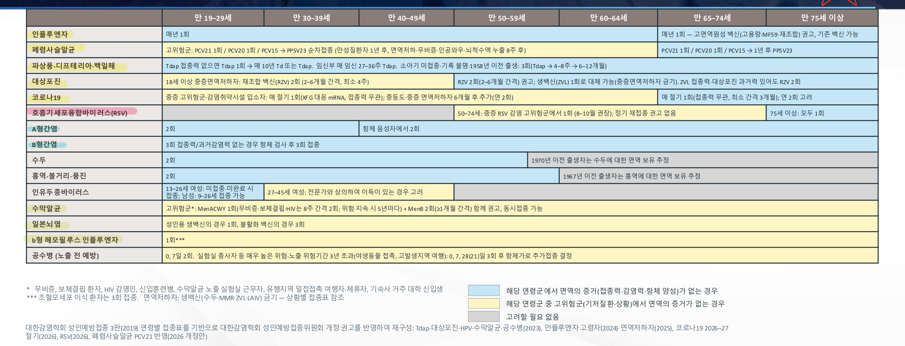
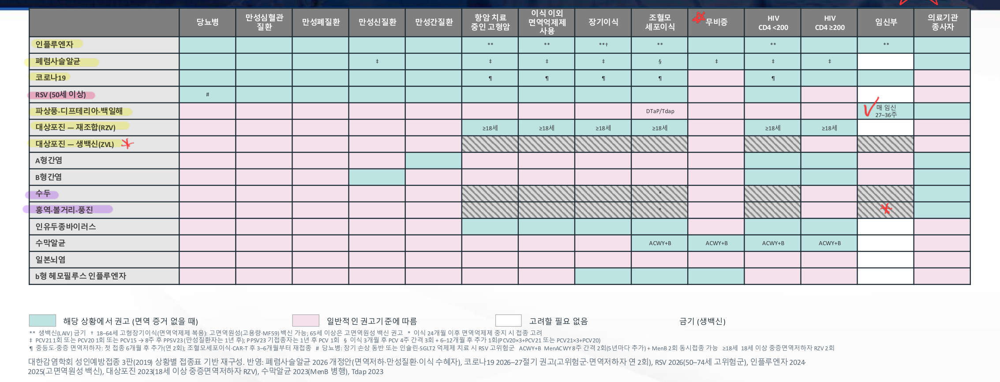
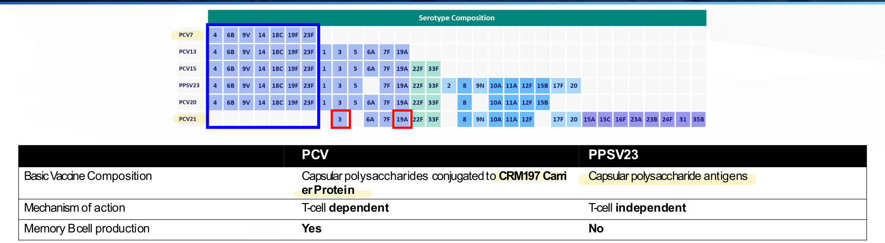
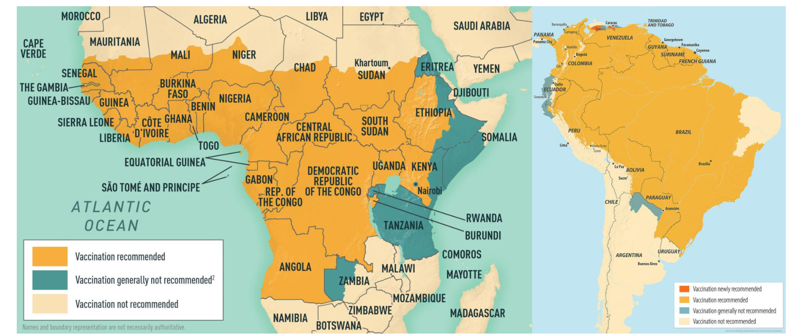

<!-- 필기본: 2026 · 2025 -->
<!-- 단계: 수업 후 -->

# 0. 이 수업을 공부하는 법

CP-B2는 **성인 예방접종** 증례 토의다(감염내과 **권기태 교수님**, 2026. 11. 25). 강의를 먼저 듣고 다섯 증례를 조별로 발표했다.

| 조 | 환자 | 생각할 것 |
|---|---|---|
| 6조 | 18세 이후 접종력 없는 **건강한 65세** 남자 | 65세 이상 기본 백신 |
| 7조 | 당뇨약 먹는 67세, **65세에 PPSV23** 맞음, 11월 방문 | PPSV23 뒤 단백결합 백신, 인플루엔자 시기 |
| 8조 | 류마티스관절염으로 **고용량 MTX** 50세 | 면역억제 → 생백신 금기 |
| 9조 | 한 달 전 교통사고로 **비장절제** 50세 여자 | 피막세균 백신 3가지 |
| 10조 | 4주 뒤 **남수단** 배낭여행 29세 | 황열·여행 백신 |

필기한 동기: "**5개의 증례 중 4문제**를 출제하신다고 합니다. **해야 할 것과 하지 말아야 할 것** 위주로 공부하라고 하셨습니다."

교수님: "실제 문제는 **20, 21페이지 표 2개**(연령별·상황별 접종표)만 열심히 보면 맞힐 수 있습니다." "학생 수준에서는 **종류만** 알면 됩니다. 간격, 횟수 자세하게는 몰라도 됩니다. 국가고시에서도 '접종해야 하는 백신은?' 이런 식으로 나오니까." "**문제 꼬아서 내지 않으니까 단순하게** 생각해라!"

!!! diff "작년 필기와 다른 점"
    작년 5번째 증례는 **임신 28주 + 야생 너구리 교상**이었는데, 올해는 **남수단 배낭여행(황열)**으로 바뀌었다. 기출 9문항 중 4문항(3·4·5·9번)이 동물 교상이므로 작년 내용은 7장에 그대로 남겨 둔다. 또 올해는 폐렴구균 권고가 **PCV20/PCV21 중심**으로 바뀌고(PPSV23 공급 중단 예정), **RSV·코로나19**가 접종표에 새로 들어왔다.

!!! key "핵심"
    - **PCV**(단백결합, CRM197): T세포 의존 → **memory B cell**, 소아 접종으로 **간접효과**. **PPSV23**(다당): T세포 비의존, 기억 없음.
    - 현재 권고: **PCV21 1회 / PCV20 1회 / PCV15 → PPSV23**. 2027 개정안은 **PCV21 또는 PCV20 1회**.
    - **비장절제**: 폐렴구균 + 수막알균(**MenACWY + MenB**) + **Hib 1회** (+ 매년 인플루엔자).
    - 면역저하자·임신부: **생백신 금기**(MMR, 수두, 대상포진 생백신 ZVL, 비강 인플루엔자 LAIV, 황열).
    - 임신부: **매 임신 27~36주 Tdap** + 인플루엔자·코로나19.
    - 여행: **황열** = 아프리카 벨트 + **남아메리카**, **수막알균** = meningococcal belt + **하지 순례(사우디)**.

# 1. 왜 성인에게 예방접종이 필요한가

## 백신 — 가장 안전하고 비용효과적인 의료 중재

- 백신은 항생제와 함께 **20세기 최고의 의학적 성과**다. 소아 예방접종으로 영유아 사망률이 급감했다.
- 그러나 평균수명이 늘고 만성질환을 안고 사는 성인이 많아지면서 **백신으로 예방 가능한 질환**(VPD, vaccine preventable disease)으로 인한 사망은 이제 소아보다 **성인에서 훨씬 많다**.
- 미국: 소아기 VPD 사망은 연 **500명 미만**, 인플루엔자·폐렴구균·B형간염으로 인한 성인 사망은 연 **5만~7만 명**으로 **100배 이상**이다. 사회적 비용은 자동차 사고나 AIDS 사망을 넘는다.
- 우리나라도 감염병 사망률이 영아에서는 급감, **고령자에서는 급증**했다. **폐렴**은 1980년대에는 사망원인 순위 하위였지만 지금은 **3위**까지 올라왔다(2024 통계청). 전 세계 폐렴 사망은 5세 미만에서 줄어 전체적으로 감소하지만 **70세 이상에서는 증가**한다.

## 성인 예방접종이 필요한 여섯 가지 이유

| 이유 | 대표 예 | 요점 |
|---|---|---|
| ① 소아기 미접종·불완전 접종 | **홍역**(MMR) | 2014년 홍역 퇴치 인증국이지만 **해외 유입**으로 성인 유행. 2025년 환자 중 해외유입 72%, 19세 이상 78% |
| ② 면역의 자연 감소 | **Td/Tdap, 백일해** | 백신 면역은 시간이 지나며 감소(waning) → 10년마다 추가. 2024년 백일해 **48,048명** 대유행 |
| ③ 역학의 변화 | **A형간염** | 위생 개선 → 소아기 노출 감소 → 항체 없는 20~40대 누적. 성인 감염은 **간부전**까지 |
| ④ 새 백신 개발 | HPV, **RZV**, RSV, PCV20·21 | 성인 질병 부담 감소 |
| ⑤ 여행·직업 | 황열, 수막알균, 장티푸스 | 의료인·실험실 종사자·군인 |
| ⑥ 고령·만성질환·면역저하 | 초고령사회 | 207x년에는 인구 절반이 65세 이상 |

- **홍역**: 접종력이 없거나 불확실한 성인(특히 해외여행·**의료인**)은 MMR **4주 간격 2회**. "의료인은 반드시 면역이 되어 있어야 한다."
- **백일해**: 2024년 환자의 45.7%가 13~19세, 집단발생 97%가 학교에서 시작. 성인 Tdap은 비NIP(본인부담)이라 접종률이 매우 낮다.
- **A형간염**: 2019년 국내 약 1만 7천 명(오염 조개젓). 항체 음성 성인, 특히 만성간질환자·의료인·여행자·군인에게 2회. **20~30대는 항체 검사 없이 접종, 40대 이상은 항체 검사 후** 접종 고려.
- **여행**: 출국 **4~6주 전** 여행의학 상담. 동남아 여행 전 MMR·A형간염·장티푸스. **직업**: 의료인은 B형간염·인플루엔자·MMR·수두·Tdap(·코로나19), 미생물 실험실 종사자는 수막알균·장티푸스, 군인·단체생활은 수막알균·Tdap·인플루엔자, 영유아 돌봄 종사자는 Tdap·인플루엔자. 병원 직원 인플루엔자·코로나19 접종은 **원내 전파 차단**(환자 보호)의 의미가 크다.

!!! new "올해 필기에서 추가"
    교수님은 대한감염학회 성인예방접종 교과서(초판 2007, 2판 2012, 3판 2019)의 **폐렴사슬알균** 장을 집필해 오셨고, 지금 **4판**을 준비 중이다. PCV15·20·21 도입으로 개정판을 학회 홈페이지에 올려 두었다.

# 2. 성인 예방접종표 — 이 두 장을 외운다

## 연령별 예방접종표

{: style="width:100%"}

색의 뜻: **하늘색** = 그 연령에서 면역의 증거(접종력·감염력·항체)가 없으면 접종, **노란색** = 그 연령 중 **고위험군**이면 접종, **회색** = 고려할 필요 없음.

- **65세 이상 기본 5가지**: **인플루엔자, 폐렴사슬알균, Tdap/Td, 대상포진, 코로나19**.
- **인플루엔자**: 매년 1회. 65세 이상은 **고면역원성 백신**(고용량·MF59 면역증강·재조합) 권고, 기존 백신도 가능.
- **폐렴사슬알균**: 65세 이상 **PCV21 1회 / PCV20 1회 / PCV15 → 1년 후 PPSV23**. 19~64세는 고위험군만(만성질환자는 PCV15 1년 후, 면역저하·무비증·인공와우·뇌척수액 누출은 **8주 후** PPSV23).
- **Tdap/Td**: Tdap 접종력이 없으면 **Tdap 1회 → 10년마다 Td 또는 Tdap**. 임신부는 **매 임신 27~36주** Tdap. 소아기 미접종·기록 불명·1958년 이전 출생은 3회(Tdap → 4~8주 → 6~12개월).
- **대상포진**: 50세 이상 **RZV**(재조합, 사백신) **2회(2~6개월 간격)** 권고, 생백신(ZVL) 1회로 대체 가능(중증 면역저하자 금기). **18세 이상 중증 면역저하자는 RZV**. ZVL을 맞았거나 대상포진을 앓았어도 RZV 2회.
- **RSV**: **75세 이상 모두 1회**, **50~74세는 중증 RSV 고위험군만** 1회(8~10월 권장). 정기 재접종 없음.
- **코로나19**: 매 절기 1회(접종력 무관, 최소 간격 3개월), 중등도·중증 면역저하자는 연 2회.
- **A형간염**: 2회(40세 이상은 **항체 음성자**에서). **B형간염**: 접종력·감염력 없으면 항체 검사 후 3회.
- **수두**: **1970년 이전 출생자는 면역 보유로 추정**. **MMR**: **1967년 이전 출생자는 홍역 면역 보유로 추정** → 고령자에게 일괄 접종하지 않는다.
- **HPV**: 13~26세 여성(미접종·미완료), 남성 9~26세 가능, 27~45세 여성은 상의 후 → **젊은 사람 위주**.
- **수막알균·일본뇌염·Hib**: 주로 **고위험군**. 수막알균 고위험군 = 무비증, 보체결핍, HIV, 신입훈련병, 수막알균 노출 실험실 근무자, 유행지역 여행자, 기숙사 거주 대학 신입생.
- **공수병(노출 전 예방)**: **0, 7일 2회**(예전 3회에서 줄었다). 매우 높은 위험·3년 초과 노출이면 0, 7, 28(21)일 3회 후 항체가로 추가 결정.

## 상황별 예방접종표

{: style="width:100%"}

색의 뜻: **청록** = 그 상황에서 권고, **분홍** = 일반 권고 기준을 따름, **흰색** = 고려할 필요 없음, **빗금** = **금기(생백신)**.

- **인플루엔자·폐렴사슬알균·코로나19**: 거의 **모든 기저질환자**에게 해당. **RSV**도 50세 이상 고위험군에 해당(당뇨는 장기 손상 동반 또는 인슐린·SGLT2 억제제 치료 시).
- 만성신질환(투석) → **B형간염**, 만성간질환 → **A형간염**(간질환자에게 A형간염이 생기면 치명적).
- **재조합 대상포진(RZV)**은 사백신이라 면역저하자(항암, 면역억제제, 장기이식, 조혈모세포이식, HIV)에게 **18세 이상**이면 권고.
- **생백신 = 면역저하자·임신부에게 금기**: **대상포진 생백신(ZVL), 수두, MMR**, 비강 인플루엔자(LAIV). 교수님: "Zoster 생백신은 live거든요. 사실 **미국 CDC에서는 빠졌습니다**. 한국에는 있는데… 면역저하자나 임신부한테는 안 한다."
- **임신부**: 인플루엔자·코로나19 권장, **Tdap은 매 임신 27~36주** — 엄마의 항체가 태반을 통해 아기에게 가서 **아기가 접종받기 전까지 보호**한다.
- **무비증**: 폐렴사슬알균 + 수막알균(**ACWY+B**) + **Hib**. "무비증 환자에게 꼭 접종해야 되는 게 중요."
- **HIV**: CD4 < 200이면 생백신 금기, CD4 ≥ 200이면 MMR·수두는 일반 기준. HIV는 수막알균 ACWY+B.
- **조혈모세포이식**: 골수가 바뀌어 이전 항체가 다 없어지므로 **소아처럼 처음부터 다시**(폐렴구균은 이식 3개월 후 PCV 4주 간격 3회 + 6~12개월 후 1회; Hib 3회). MMR·수두는 이식 24개월 이후 면역억제제를 끊었을 때 고려.
- **의료기관 종사자**: 인플루엔자, A·B형간염, 수두, MMR, Tdap 등.

!!! diff "작년 필기와 다른 점"
    작년 표에는 RSV·코로나19 줄이 없었고 폐렴구균은 PCV13·PCV15·PCV20 위주였다. 올해 표는 **PCV21**, **RSV(50세 이상 고위험군, 75세 이상 전원)**, **코로나19**, 고령자 **고면역원성 인플루엔자 백신**, **MenB 병행**이 들어갔다.

!!! exam "기출 포인트"
    2번(2022): 비장절제 50세 여자를 상황별 접종표의 칸(가~사)에서 고르는 문제 — **무비증** 칸. 필기본에 실린 다른 시험 문항에도 같은 형식으로 "**고용량 MTX 류마티스관절염**(이식 이외 면역억제제 사용 칸)", "**비장절제**(무비증 칸)"를 표에서 고르는 문제가 있다.

## 3판(2019) 이후 바뀐 권고

| 백신 | 바뀐 점 |
|---|---|
| 폐렴사슬알균 | PCV13+PPSV23 → **PCV21 / PCV20 / PCV15→PPSV23** 중 하나. PCV21은 혈청형 4 미포함 |
| 코로나19·RSV | 권장안 새로 도입(2026) |
| 인플루엔자 | 65세 이상 **고면역원성** 백신(2024·2025) |
| 대상포진 | 생백신 1회 → **RZV 2회**, 18세 이상 중증 면역저하자 RZV(2023) |
| Tdap/Td | 매 임신 27~36주, 미접종자 첫 회 Tdap(2023) |
| HPV | **27~45세 여성** 추가(2023) |
| 수막알균 | MenACWY에 **MenB** 함께(2023) |
| 공수병(노출 전) | 3회 → **2회**(0, 7일)(2023) |

## 국가예방접종(NIP) — 성인은 제한적

| 백신 | 성인 NIP 대상(2026) |
|---|---|
| 인플루엔자 | 65세 이상, 임신부 |
| 폐렴구균 PPSV23 | 65세 이상 1회 → **2027년 4월 PCV로 전환 예정** |
| 코로나19 | 65세 이상, 12세 이상 면역저하자·감염취약시설 |
| HPV | 12~17세 여성, 18~26세 저소득층 여성, **12세 남성(2026 신규)** |
| A형간염·Tdap·대상포진(RZV) | 성인은 비NIP(RZV는 NIP 도입 검토 중) |

- **조혈모세포이식 수혜자**: 2026년 7월 27일부터 이식 후 재접종(17개 백신)을 **전 연령 NIP로 전액 지원**.
- 질병관리청 예방접종 지침은 대한감염학회 권고와 별개로, **국가 지원 기준** 중심이다.

# 3. 폐렴사슬알균 백신 — PCV와 PPSV (교수님 집필 분야)

{: style="width:90%"}

- 폐렴사슬알균 백신은 **피막 다당 항원**(capsular polysaccharide antigen)으로 만들고, 이 항원 종류가 **혈청형**이다. 약 100개 혈청형이 알려져 있지만 다 넣으면 분자량이 너무 커져 기술적 한계가 있다.
- **PPSV23**(1983년 허가): 23개 혈청형 — 당시 침습성 폐렴구균의 약 90%. 다당 항원만 있으면 **항원제시세포를 활성화하지 못하고** 기존 B세포만 자극 → 항체 지속 기간이 짧고 효과가 떨어진다. **소아에서는 효과가 없다**(소아는 B세포 반응이 약하고 T세포로 효과를 낸다).
- **PCV**: 다당에 **CRM197 운반 단백**을 붙이자 항원제시세포 → **T세포 활성화** → **memory B cell** 생성 → 오래가고 강력하다.
- **PCV7**(2000년) → 7개 혈청형이 소아 감염의 70~80%라 효과가 매우 좋았지만, 다른 혈청형 감염이 늘어 **PCV13 → PCV15 → PCV20 → PCV21**로 넓혀 왔다. 다당 백신은 더 이상 개발되지 않는다.
- **PCV21은 최초 7개 혈청형(4, 6B, 9V, 14, 18C, 19F, 23F)을 뺐다** — 소아 접종의 간접효과로 성인에서도 이미 줄었기 때문. 대신 성인에 많은 다른 혈청형을 넣어 **간접효과 + 직접효과**를 노린다. 현재 **가장 넓은 혈청형**을 포괄한다. (그래서 PCV20과 비교하면 PCV20은 그 7가 부분이 소아 백신과 중복된다.)
- 개발 중: SK바이오사이언스 백신(올해 3상), **PCV31**(결과 괜찮음) — 성공하면 권고가 다 바뀔 것.

| | PCV (PCV13·15·20·21) | PPSV23 |
|---|---|---|
| 구성 | 다당 + **CRM197 단백** | 다당 항원만 |
| 기전 | **T세포 의존** | T세포 비의존 |
| memory B cell | **있음** | 없음 |
| 소아 | 효과 있음 | 거의 없음 |
| 간접효과 | **있음**(보균 감소) | 없음 |

## 소아 PCV 접종의 간접효과

- 미국에서 2000년 PCV7을 **소아에게만** 도입했는데, 약 7년 만에 PCV7 혈청형 침습성 감염(IPD)이 소아뿐 아니라 **접종하지 않은 65세 이상에서도** 같은 양상으로 거의 사라졌다.
- 기전: 폐렴사슬알균은 **비인두 집락**(보균)으로 전파된다. 집락 → 점막 침범 → 부비동, 귀(중이염), CNS(수막염), 폐(폐렴). 고령자 감염은 주로 **소아의 비인두 보균에서 전파**된다. 소아 보균율 약 60%, 성인 1~6%(아동과 접촉하면 약 20%).
- PCV는 소아의 **집락화를 줄여** 고령자로의 전파를 막는다. **다당 백신은 이런 효과가 없다**.

## 정책 변화 — PPSV23 공급 중단

- **내년(2027)부터 PPSV23 공급 중단** → 고령층 NIP가 **PCV**로 바뀐다(PPSV23이 싸서 지원해 왔음).
- **대한감염학회 2027 개정안**(교수님 초안, 확정본과 문구가 다를 수 있음):
    - 65세 이상 또는 18~64세 고위험군: **PCV21 또는 PCV20 중 한 가지**.
    - PCV13·PCV15·PPSV23 중 하나를 맞았으면 **1년 뒤 PCV21 1회**.
    - **PCV13 → PPSV23 순차접종을 완료**했으면 **5년 뒤 PCV21 1회**.
    - **조혈모세포이식** 성인: 이식 전문의와 상의 후 **PCV20 3회 → PCV21 1회** 또는 **PCV21 3회 → PCV20 1회**(소아의 2·4·6·12~15개월처럼 넓게).

!!! memo "암기 — 폐렴구균 순서"
    - 처음이면: **PCV21 또는 PCV20 1회** (또는 PCV15 → PPSV23: 만성질환 1년 후, 면역저하·무비증 8주 후)
    - **PPSV23만** 맞았으면: **1년 후 PCV** 1회
    - PCV13 → PPSV23을 다 했으면: **5년 후** PCV21

# 4. 6조 — 건강한 65세 남자

> 건강한 65세 남자가 예방접종을 위해 내원하였다. 18세 이후에 예방접종을 받은 적이 없었다.

| 해야 할 것 | 하지 말아야 할 것 |
|---|---|
| **인플루엔자** 매년(65세 이상 고용량·면역증강 우선) + **코로나19** 절기 권고 | 건강하다고 65세 권장 접종을 **생략하지 않는다** |
| **폐렴구균**: PCV20 또는 PCV21 1회(PCV15면 1년 후 PPSV23) | 65세라는 나이만으로 **RSV를 일률 접종하지 않는다**(50~74세는 고위험군만) |
| **대상포진 RZV 2회**(2~6개월 간격) | 기초접종력·중증 알레르기 확인을 빼지 않는다 |
| **Tdap 1회** → 10년마다 Td/Tdap. 기초접종 불명이면 3회 | 매년 Tdap × |

!!! exam "기출 포인트"
    6번(2020): 65세 건강인, 11월, **HBs 항체·HAV IgG 양성** → **인플루엔자, Tdap, 폐렴사슬알균, 대상포진** 4가지. 간염 항체가 있으니 A·B형간염 백신은 필요 없고, MMR(1967년 이전 출생)·수두(1970년 이전 출생)·HPV·수막알균·Hib은 해당 없음. 2020년 보기는 대상포진 **생백신**이었다 — 지금은 RZV 권장.

# 5. 7조 — 당뇨 67세, 65세에 PPSV23

> 11월에 당뇨로 혈당강하제를 복용 중인 67세 남자가 예방접종을 위해 방문하였다. 65세 때 보건소에서 PPSV23을 무료로 접종받았다.

| 해야 할 것 | 하지 말아야 할 것 |
|---|---|
| **폐렴구균**: PPSV23만 맞았고 2년 지남 → **PCV20 또는 PCV21 1회**(2027 개정안: 1년 지나면 **PCV21**) | PPSV23을 맞았다고 **단백결합 백신을 생략**하거나 PPSV23만 반복하지 않는다 |
| **11월** → 이번 절기 **인플루엔자**(고면역원성 우선)·코로나19 확인 후 접종 | PCV13→PPSV23 순차접종자의 **5년 간격**을 이 환자에게 적용하지 않는다 |
| RZV 2회, Tdap/Td 접종력 확인. B형간염은 면역·노출 위험 확인 | |
| **RSV**: 67세 → 당뇨 장기 손상, **인슐린·SGLT2 억제제** 치료 등 고위험 조건 확인 | |

- 당뇨는 면역저하로 감염 고위험이고 상처 치유가 늦어 파상풍 예방도 중요하다. 대상포진 후 신경통 위험도 높다.

!!! diff "작년 필기와 다른 점"
    작년 발표는 "65세 때 PPSV23을 맞았으므로 **PCV13** 접종 권장"이었다. 올해는 **PCV20 또는 PCV21**(1년 이상 지난 뒤).

# 6. 8조 — 고용량 MTX를 먹는 류마티스관절염 50세

> 류마티스관절염으로 고용량 methotrexate를 복용 중인 50세 남자. 18세 이후 접종력 없음.

- MTX는 dihydrofolate reductase를 억제해 면역세포 증식을 막는다 → **면역억제 상태** → **생백신 금기, 사백신은 가능**.

| 해야 할 것(비생백신) | 하지 말아야 할 것 |
|---|---|
| **불활성화 인플루엔자**, 절기 **코로나19** | 고용량 MTX 중에는 **MMR·수두·생대상포진(ZVL)·비강 생인플루엔자(LAIV)** 금지 |
| 폐렴구균 **PCV20 또는 PCV21**(PCV15면 **8주 후** PPSV23) | **MTX를 임의로 중단하지 않는다** |
| **재조합 대상포진(RZV) 2회** | 휴약을 협의하느라 인플루엔자 접종 기회를 놓치지 않는다 |
| 접종력에 따른 Tdap/Td. RSV(50세 이상) 고위험 여부 확인 | 다른 비생백신에 같은 휴약을 일괄 적용하지 않는다 |
| 질환이 안정적이면 **인플루엔자 접종 후 2주 MTX 휴약**을 처방의와 상의(ACR 지침) | |

!!! diff "작년 필기와 다른 점"
    작년 발표: 생백신이 꼭 필요하면 MTX 중단 **4주 뒤**, 접종 **전후 1~2주** MTX 휴약 시 독감 백신 반응률 75.5% vs 54.5%. 작년에는 RZV를 "고용량 MTX에서 근거 부족"으로 비권장했지만, 올해 표와 발표는 **18세 이상 면역저하자에게 RZV 권고**다. HPV는 50세라 비권장, A·B형간염은 항체 검사 후.

# 7. 9조 — 비장절제 50세 여자 (기출 3문항)

> 한 달 전 교통사고로 비장절제술을 시행한 50세 여자가 예방접종을 위해 외과에서 의뢰되었다. 18세 이후 접종력 없음.

- 비장: 혈액 내 항원에 대한 적응면역을 시작하는 장기. 절제하면 혈중 Ig 생산·T세포 기능이 떨어져 **피막세균**(*S. pneumoniae*, *N. meningitidis*, *H. influenzae*)에 취약하다.

| 해야 할 것 | 하지 말아야 할 것 |
|---|---|
| 응급 비장절제 후 **한 달, 안정적 → 접종**(계획 수술이면 수술 2주 전, 이미 했으면 2주 후) | **폐렴구균만 하고 수막알균·Hib을 빠뜨리지 않는다** |
| **폐렴구균**: PCV20 또는 PCV21 1회(PCV15면 **8주 후** PPSV23) | **Hib을 2개월 뒤 반복하지 않는다**(성인 1회) |
| **수막알균**: **MenACWY 8주 간격 2회**, 위험 지속 시 **5년마다** + **MenB** | 무비증만으로 **생백신을 모두 금기로 하지 않는다**(동반 면역저하 확인) |
| **Hib**: 미접종이면 **1회** | |
| 인플루엔자·코로나19, Tdap/Td, RZV도 접종력에 따라 | |

!!! exam "기출 포인트"
    - 1번(2023, 권기태): 오늘 할 것 3가지 → **Hib 오늘, MCV4 오늘, PCV13 오늘**. PPSV23은 PCV 8주 뒤, Hib은 성인 1회라 2개월 뒤 추가 없음. 필기본 해설: "④ PCV13은 출제 당시 보기다. 이번 강의 답은 **PCV20 또는 PCV21**."
    - 8번(2020): 비장절제와 관련해 권장할 백신 → **수막알균, 폐렴사슬알균, Hib**.
    - 2번(2022): 같은 증례를 상황별 접종표의 칸에서 고르는 문제.

# 8. 10조 — 남수단 배낭여행 29세

!!! new "올해 필기에서 추가"
    > 29세 남자가 4주 후 아프리카 **남수단**으로 한 달간 배낭여행을 간다. 건강하고 어릴 때 기본 접종은 모두 받았다. 출발 전 권장해야 할 백신은?

    | 해야 할 것 | 하지 말아야 할 것 |
    |---|---|
    | **황열**: 지금 접종기관 예약. 첫 접종 **10일 후부터** 국제예방접종증명서(ICVP) 유효. 경유지 포함 입국 요건 확인 | 황열 접종을 **출국 직전까지 미루지 않는다** |
    | 음식·물: **A형간염**(면역 없으면), **장티푸스**. 안전한 식수 교육 | 황열 **생백신** 전 중증 면역저하·중증 알레르기 확인 |
    | 건기 수막염 벨트 방문 시 **MenACWY**, 폴리오 유행 시 성인 IPV, 동물 노출 시 **공수병 노출 전** 접종 | 여행 백신이 **말라리아 예방약·모기 회피를 대신하지 않는다** |
    | MMR·Tdap·B형간염 점검, **말라리아 예방약** 준비 | |

## 황열과 수막알균 — 어디로 가면 무엇을

{: style="width:85%"}

- **황열**: **사하라 이남 아프리카 벨트 + 남아메리카**(아마존). 생후 9개월 이상 여행자에게 권장. 아프리카 일부 국가는 **입국 시 증명서**를 요구한다. **약독화 생백신** → 출발 **최소 10일 전**, 증명서도 **10일 후**부터 유효. **임신부·면역저하자 금기** → 의사에게 **황열예방접종 면제증명서**를 받아 가야 입국 가능. 시험에 증명서 사진이 나올 수도 있다.
- **수막알균**: **meningococcal belt**(사하라 이남, 남수단 포함) 또는 **사우디아라비아 하지(메카) 성지순례** — 사우디는 수막알균 접종 증명이 **필수**.
- 교수님: "황열도 meningococcal belt랑 겹치죠? 대신 **남아메리카에 하나 더** 있다는 거. 국가고시에 사우디아라비아, 남아메리카, 아프리카 벨트 이렇게 황열/수막알균 잘 내고…" "임신부랑 면역저하자 나오는데 **황열 있으면 틀린 선지**."
- **말라리아 예방약**: doxycycline, **atovaquone-proguanil**, mefloquine — mefloquine은 내성이 있어 atovaquone-proguanil이 좋다. 동남아는 ***P. falciparum*** 유행이라 예방약이 필요, 우리나라 말라리아는 ***P. vivax***.

| 여행지 | 반드시 생각할 백신 |
|---|---|
| 사하라 이남 아프리카(남수단 등) | **황열** + 수막알균(벨트, 건기) + A형간염·장티푸스 |
| 남아메리카(브라질 아마존) | **황열** |
| 사우디 메카(하지) | **수막알균**(입국 증명 필수) |
| 동남아 | MMR, A형간염, 장티푸스, 말라리아(falciparum) 예방 |

## 강의 추가 문항

- **하지 순례**: 고혈압 58세, 2개월 후 메카 성지순례 — 사우디 입국에 반드시 접종 증명이 필요한 백신 → **수막알균 백신**(황열은 아프리카·남아메리카).
- **브라질 아마존**: 건강한 29세, 3주 후 한 달 배낭여행 → **황열 백신**(3주 후 출발이라 10일 요건 충족).
- **국시 문제**(작년): 아프리카 봉사 후 귀국한 16세, 고열·두통·목 강직, CSF 다핵구 우세·당 감소, 그람염색 **빨간 쌍알균** → **수막알균**, 치료 **ceftriaxone**. 남수단이 meningococcal belt라서 증례로 냈다.

!!! memo "그람염색 읽기 (교수님)"
    - **그람음성(빨강) 쌍알균** = 수막알균. **그람양성(파랑) 쌍알균**이면 대부분 폐렴사슬알균.
    - 황색포도알균 = 파란 알균이 **포도송이**처럼 뭉침.
    - *E. coli*·*Klebsiella* = 빨간 **막대**(가로로 길쭉). 간농양에 빨간 막대 → *Klebsiella* 의심.

# 9. 동물 교상 — 작년 증례 (기출 4문항)

!!! diff "작년 필기와 다른 점"
    작년 5번째 증례(임신 28주, 야생 너구리 교상)는 올해 발표에서 빠졌지만 **기출 3·4·5·9번**이 모두 이 내용이다. 그대로 공부한다.

- **야생 너구리 = 국내 광견병 주요 매개 동물**. 교상은 dirty wound → **파상풍 예방**도 필요.
- 광견병: 바이러스가 **신경을 타고** 중추신경계로. 잠복기 **20~90일**. **증상이 나타나면 거의 치명적**.

**순서: 상처 세척·소독 → 광견병 PEP → 파상풍 → 예방적 항생제**

| 처치 | 내용 |
|---|---|
| 상처 | 비누와 물로 **15분** 세척, 소독. **일차 봉합하지 않는다** |
| **광견병 면역글로불린 (HRIG)** | **20 IU/kg**, Day 0. **가능한 전량을 상처 안·주위에**, 남으면 다른 근육. 백신 시작 7일 이내까지. 임신 중 가능 |
| **광견병 백신** | **삼각근** IM(둔부 ×). **Day 0, 3, 7, 14**(면역저하 시 Day 28 추가). HRIG와 같은 부위·같은 주사기 × |
| **파상풍** | 접종력 없음·불명 → **TIG** + **Td/Tdap**. 이후 총 3회 |
| **예방적 항생제** | *Pasteurella multocida*, *Capnocytophaga*, 구강 혐기균 → **amoxicillin-clavulanate** 3일 |

- WHO 상처 분류: I(핥음 — 불필요), II(가벼운 긁힘 — 백신), **III(피부 관통 교상·점막 오염·박쥐 — 면역글로불린 + 백신)**.
- 개·고양이가 **10일간 건강**하면 광견병 위험 없음 → 관찰 가능하면 PEP 보류. **도망가서 관찰 못 하면 바로 시작**. 설치류는 거의 옮기지 않는다.

!!! exam "기출 포인트"
    - 5번·3번: 야생 너구리(5번), 강원도 길고양이(3번), 동물 도망 → **광견병 백신 + 면역글로불린 + 파상풍 + amoxicillin-clavulanate 모두**.
    - 9번: 접종력 모르는 60세, 너구리 → **파상풍 면역글로불린, 광견병 면역글로불린, Td, 광견병 백신**.
    - 4번: 들고양이 교상, 손목 2 cm — **"소독하고 일차 봉합"이 틀림**.

# 10. 임신부 예방접종

- **권장**: 불활성화 **인플루엔자**, **코로나19**, **Tdap(매 임신 27~36주)**. 영아 접촉자(가족)는 접촉 2주 전까지 Tdap(**코쿤 전략**).
- **금기**: 생백신 — **MMR, 수두, 대상포진 생백신, LAIV, 황열**. **MMR·수두 접종 후 2개월(작년 필기) 피임**.

!!! exam "기출 포인트"
    7번(2020): 30세 **임신 30주**, 11월, HBs 항체·HAV IgG 양성 → **인플루엔자 + Tdap**. 필기본에 실린 다른 시험 문항(2022~2025) 4개도 모두 "임신부에게 권장하여 **접종 전 영아**를 보호하는 백신" → **디프테리아·파상풍·백일해(Tdap)**. 오답 보기: BCG, MMR, 수두, HPV, 인플루엔자 약독화 생백신.

# 암기 — CP-B2 요점

| 상황 | 꼭 기억할 것 |
|---|---|
| 65세 건강인 | 인플루엔자(고면역원성)·폐렴구균(PCV21/20 1회)·RZV 2회·Tdap→Td·코로나19. RSV는 75세↑ 전원, 50~74세 고위험군 |
| PCV vs PPSV | PCV = CRM197·T세포·memory·간접효과 / PPSV23 = 다당·T 비의존. **PPSV23만 맞았으면 1년 후 PCV** |
| 당뇨·만성질환 | 인플루엔자·폐렴구균·코로나19·RSV(고위험). 투석 → B형간염, 간질환 → A형간염 |
| 면역억제(MTX) | 생백신 ×, 비생백신 ○(RZV 포함). MTX 임의 중단 × |
| 조혈모세포이식 | 소아처럼 다시(PCV 3회 + 1회), 2026.7부터 NIP |
| 비장절제 | 폐렴구균 + MenACWY 2회(5년마다) + MenB + **Hib 1회** |
| 여행 | 황열(아프리카·남미, 10일 전, 생백신) / 수막알균(벨트·하지) / A형간염·장티푸스 / 말라리아 예방약 |
| 동물 교상 | 세척, 봉합 ×, HRIG 상처 주위 + 백신 0·3·7·14 삼각근, TIG + Td, amoxicillin-clavulanate |
| 임신부 | 인플루엔자 + 코로나19 + **매 임신 27~36주 Tdap**. 생백신 금지 |
| 생백신 목록 | MMR, 수두, ZVL, LAIV, 황열 → 면역저하·임신부 × |
