<!-- 필기본: 2026 · 2025 -->
<!-- 단계: 수업 후 -->

# 0. 이 수업을 공부하는 법

감염내과 **황소윤 교수님** 수업. 올해 필기본은 하나로 합쳐져 있고 앞은 **피부·연조직 감염**(Harrison, IDSA SSTI 2014, 대한감염학회 자료 기반), 뒤는 **골관절 감염**이다. 슬라이드가 새로 바뀌어 **화농성/비화농성 분류와 중증도**, **LRINEC**, **당뇨병성 족부감염**, **인공관절 감염(PJI)**, **OVIVA trial**(경구 전환)이 새로 들어갔다. 필기 작성자: "역대 기출은 거의 다 황소윤 교수님 출제", 교수님: "오늘 끝나면 학습성과에 대해서는 다 알고 있으면 좋겠다."

학습성과

- 피부·연조직: ① 화농성/비화농성·중증도로 **분류**하고 농가진·종기·단독·연조직염을 구별 ② 원인균과 **중증도·MRSA 위험도에 따른 경험적 항생제** ③ **괴사근막염을 의심할 단서**, LRINEC의 한계, 응급수술의 중요성 ④ **교상·당뇨병성 족부감염** 접근 원칙
- 골관절: ① 골수염·화농성 관절염의 원인균과 경험적·선택적 항생제 ② **세균성 vs 결핵성 척추염** 구분, 수술이 필요한 상황 ③ **인공관절 감염 분류**, **OVIVA trial**에 근거한 정주→경구 전환 시점

- 기출 46문항(2020–2025), 황소윤 교수님 문항은 거의 **사진 + 상황 → 항생제**. 핵심은 "**누구에게 생겼나**".
    - **건강한 사람의 연조직염** → **cefazolin**(혈액배양 MSSA여도 cefazolin)
    - **이식·당뇨 등 면역저하자의 연조직염** → **piperacillin/tazobactam**(+ vancomycin)
    - **반상출혈·수포 + 쇼크/회음부 = 괴사근막염** → **vancomycin + pip/tazo(또는 carbapenem) (+ metronidazole·clindamycin)**, **수술이 핵심**
    - **해산물·간질환 + 출혈성 수포 → *Vibrio vulnificus***, **개 교상 → ampicillin/sulbactam**
    - **화농성 관절염(관절액 WBC >50,000, 결정 없음)** → 건강하면 **nafcillin/cefazolin**
    - **척추염** → 검사 **MRI**, 원인 ***S. aureus***, 치료 **cefazolin / ampicillin-sulbactam**
- 2020–22년 미생물학 문항(포도알균·사슬알균·*C. perfringens*·여드름균·무산소균·*Nocardia*)도 이 수업으로 분류되어 있다.

!!! key "핵심"
    **분류가 먼저**: **비화농성**(단독·연조직염 — 연쇄알균, penicillin 계열) vs **화농성**(농양·종기 — *S. aureus*, MRSA 위험도 따라, **절개·배농**) + **중증도**(경증 경구 / 중등증 정주 / 중증 입원·광범위·외과 평가).
    **깊이**: 각질층(농가진) → 모낭(종기) → 진피 상층(단독) → 진피 하층·피하지방(연조직염) → 근막(괴사근막염). 깊을수록 위험.
    **괴사근막염 = pain out of proportion + 빠른 진행 + 전신 독성 → 즉시 수술(debridement)**, LRINEC이 낮아도 배제 X, MRI 때문에 수술을 늦추지 않는다.
    **뼈·관절은 오래**: 골수염 debridement 후 **4–6주**, 척추염 **6–12주(최소 6주)**, 화농성 관절염 **4–6주**. 요즘은 **OVIVA** 근거로 선택된 환자에서 **7일 안에 경구 전환**도 가능.

# Part A. 피부·연조직 감염

> 오늘의 케이스: 58세 남성, 당뇨(HbA1c 9.1%). 2일 전부터 우측 하지 발적·부종, 오늘 아침부터 심한 통증과 수포. 38.9℃, BP 100/62, HR 118. 경계가 불분명한 발적, **촉진 시 통증이 발적 범위보다 훨씬 심함(pain out of proportion)**, 일부 암적색 반상출혈. → 답은 Part A 4(괴사근막염) 끝에.

## 1. 임상에서 쓰는 분류 체계 — 올해 추가

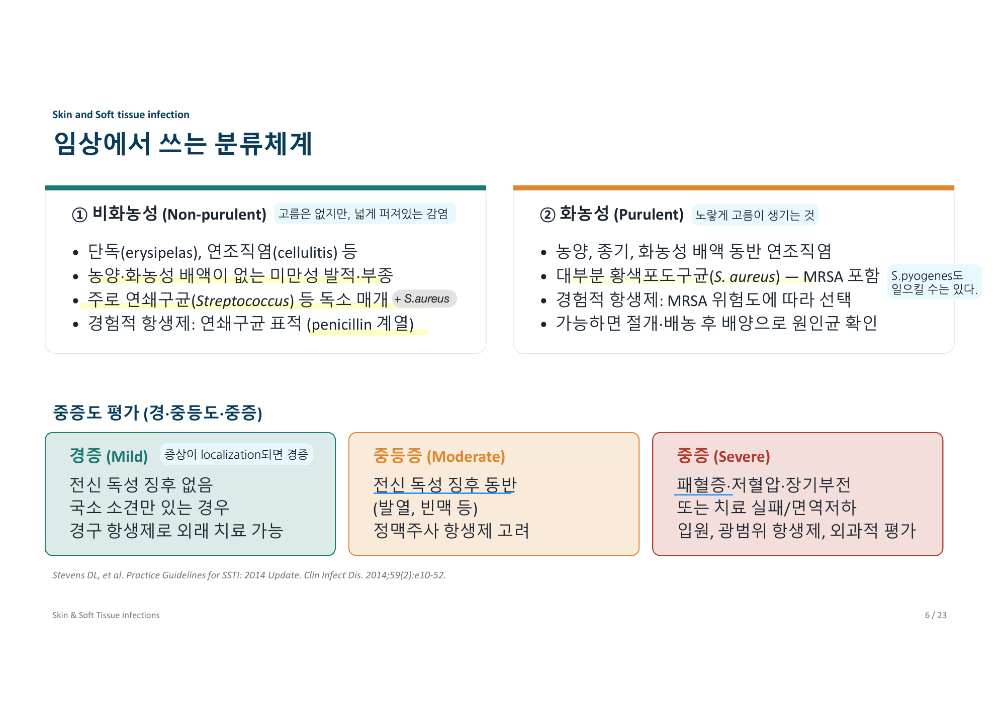{: style="width:80%"}

| | ① 비화농성(non-purulent) | ② 화농성(purulent) |
|---|---|---|
| 예 | **단독, 연조직염** | **농양, 종기**, 화농성 배액 동반 연조직염 |
| 모양 | 농양·고름 없는 **미만성 발적·부종**(고름은 없지만 넓게 퍼진 감염) | 노랗게 고름이 생김 |
| 원인 | 주로 **연쇄알균**(독소 매개), *S. aureus*도 | 대부분 ***S. aureus*(MRSA 포함)**, *S. pyogenes*도 가능 |
| 경험적 | **연쇄알균 표적(penicillin 계열)** | **MRSA 위험도**에 따라, 가능하면 **절개·배농 후 배양** |

- **중증도**: **경증** = 전신 독성 없음, 국소 소견만(증상이 국한되면 경증) → **경구, 외래** / **중등증** = 발열·빈맥 등 전신 독성 → **정주 고려** / **중증** = 패혈증·저혈압·장기부전, 또는 치료 실패·면역저하 → **입원, 광범위 항생제, 외과적 평가**.
- 피부 전체가 붓고 붉게 퍼지면 연쇄알균, 고름 잡힌 국소 덩어리면 포도알균 가능성이 높다.

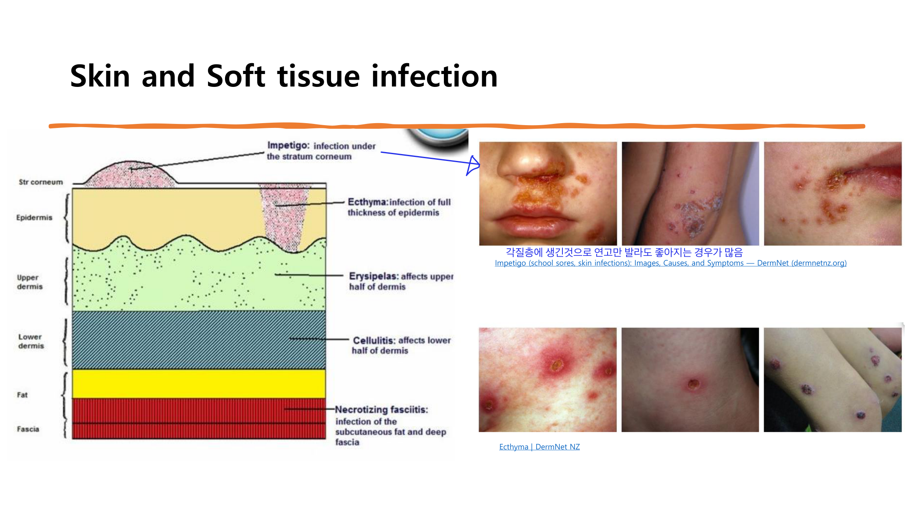{: style="width:66%"}

## 2. 농가진(impetigo)과 농창(ecthyma) — 화농성, 각질층

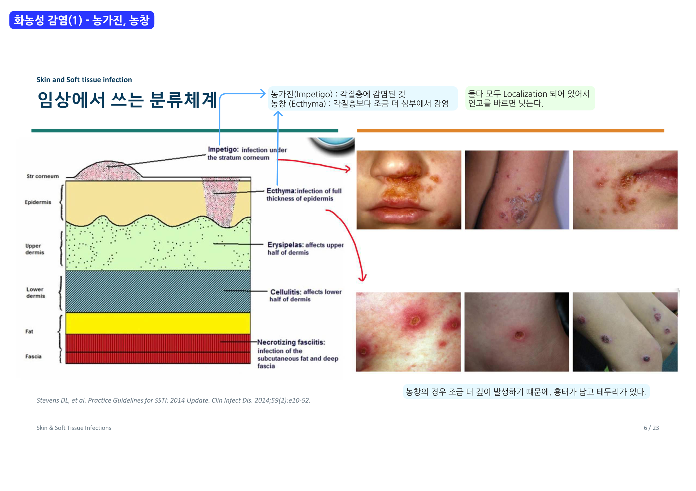{: style="width:70%"}

- **농가진 = 각질층**의 감염, **농창(대농포진) = 각질층보다 조금 더 깊이**. 둘 다 국한돼 있어 **연고를 바르면 낫는다.** 농창은 더 깊어 **흉터가 남고 테두리가 있다.**
- **β-용혈 연쇄알균(*S. pyogenes*)과 *S. aureus***가 주원인인 얕은 화농성 병변. 열대·아열대의 위생이 열악한 **소아(2–5세 호발**, 성인도 가능), **전염력이 높아** 형제·친구 사이 전파.
- 경과: 반점·잔물집 → 고름물집 → 터진 뒤 장액성 분비물 → **황갈색(꿀색) 딱지**. **얼굴·사지** 호발.
- ***S. pyogenes* 농가진은 급성 사구체신염**의 선행감염이 될 수 있다(류마티스열과의 연관은 불확실).
- **국내 가장 흔한 원인균은 *S. aureus***, 2000년대 이후 **MRSA 증가**.
- 진단: 분비물 그람염색·배양, 전형적이면 임상 진단.
- 치료: **국소형 → mupirocin 등 항생제 연고**, 광범위·중증 → **경구 항생제(1주 이내 충분)**. 교수님: 항생제는 *S. aureus*를 겨냥한 **nafcillin, 1세대 세파**, 메티실린 내성이면 **vancomycin, teicoplanin(글리코펩타이드)** — 그러나 연고만으로 낫는 경우가 많다.
- 전염력이 매우 강해 **등원 제한**, 개인 수건·의류 분리 세탁.

## 3. 종기(furuncle)와 큰종기(carbuncle) — 화농성, 모낭

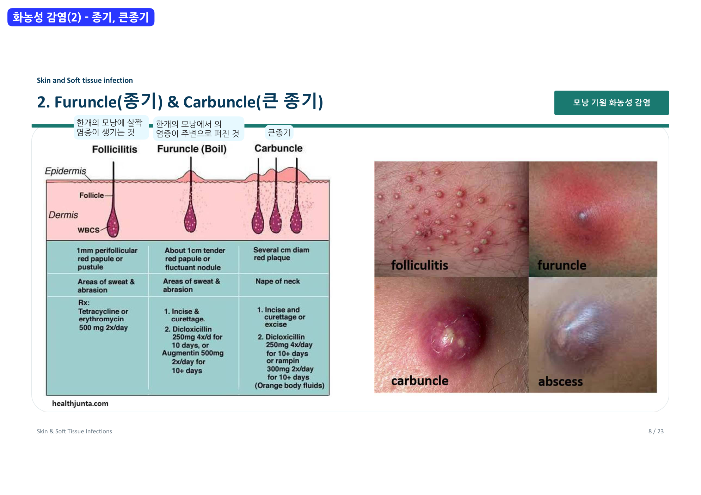{: style="width:70%"}

- **모낭의 감염이 피하조직까지 농양으로 파급** — 표피에 국한되는 **모낭염(folliculitis)** 과 구별.
- **하나의 모낭 = furuncle**, 여러 모낭이 융합(한 모낭의 염증이 주변으로 퍼짐) = **carbuncle** — **목 뒤** 호발, **당뇨 환자**에서 흔함. 옛날 왕(연산군 등)에게 종기가 많았던 이유: 당뇨(운동 안 하고 고기를 많이 먹음), 항생제가 없었고 고름을 짜는 정도.
- 원인균은 대부분 ***S. aureus***. **재발성 종기증의 선행 요인 = 앞콧구멍·회음부 *S. aureus* 집락.** 위험요인: 부적절한 위생, 면역저하, 종기 환자와의 접촉.
- 치료
    - **Furuncle: 온찜질로 배농 촉진**, **Carbuncle: 절개·배농이 핵심** — 안에 농양이 있으므로 **drain을 잘 해야 한다.**
    - **광범위 연조직염·발열 동반·면역저하 시에만 항생제 추가**(1세대 세파, amox/clav, clindamycin 등). 교수님: nafcillin, 1세대 세파, MRSA 가능성이면 vancomycin.
    - 과거 MRSA 감염·집락, 1차 치료 실패 → **MRSA 표적 항생제**.
    - **재발 방지: 비강 mupirocin(매달 5일, 하루 2회), chlorhexidine 목욕, 개인 물품 분리 세탁.**
- 교수님: 종기가 목 뒤·겨드랑이·사타구니에 계속 생기는 사람이 있다 — **재발성 한선염**, 면역억제제를 써 보기도 한다. 이럴 땐 **비강 MRSA**를 확인하고 있으면 비강 mupirocin.

## 4. 단독(erysipelas)과 연조직염(cellulitis) — 비화농성

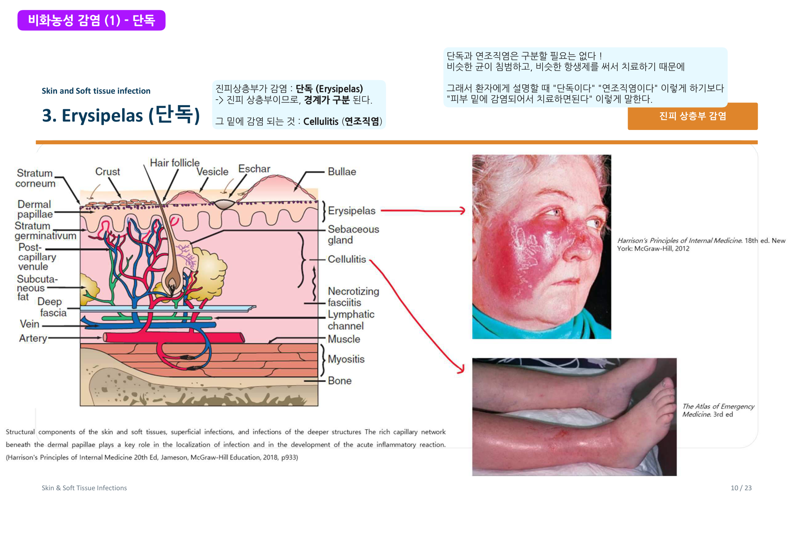{: style="width:70%"}

| | 단독 | 연조직염 |
|---|---|---|
| 깊이 | **진피 상층부** | **진피 하층부 + 피하지방**(단독보다 깊음) |
| 경계 | **명확**, 주변보다 **융기** | **모호**, 융기 안 됨 |
| 원인균 | **A군 연쇄알균(*S. pyogenes*)** 대부분, 드물게 *S. aureus* | 외국: 연쇄알균·*S. aureus* / **국내 10개 병원 735명: 원인균 확인 7.8%, 그중 *S. aureus* 44%, β-용혈 연쇄알균 27%** |
| 호발 | 영아·소아·고령, 과거 얼굴 → 최근 **하지** | 주로 **하지** |

- 교수님: **"단독과 연조직염은 구분할 필요는 없다!"** 비슷한 균, 비슷한 항생제 → 환자에게도 "피부 밑에 감염돼서 치료하면 된다"고 설명. 옛날엔 단독은 얼굴, 연조직염은 다리라 했지만 요즘은 그렇게 구분하지 않는다(연조직염도 얼굴에 생긴다).

### 단독
- 진단: **임상 소견** — 열감 동반 발적이 주변보다 **융기되고 경계가 뚜렷**.
- 1차: **penicillin, amoxicillin, ampicillin/sulbactam**. *S. aureus*를 배제하기 어려우면 **nafcillin 또는 1세대 세파(cefazolin)**.
- **페니실린 알레르기**: clindamycin, (원인균 불명확 시) IV vancomycin(MRSA가 있다면), 또는 감수성 확인 후 cipro/levofloxacin·macrolide(**국내 내성률 10–35%로 단독요법 주의**).

### 연조직염
- 단독보다 깊어서 더 조심 — **여기서 더 들어가면 괴사근막염·근염**. **통증이 엄청 심하고, 물집이 생기고, 피부 괴사가 생기면 초응급.**
- 임상: **빠르게 퍼지는 부종·발적·국소 열감**, 때로 소수포·수포·출혈반, 림프관염·국소 림프절 종대. 전신 증상은 보통 심하지 않음.
- ⚠ **출혈반 확산 + 전신 증상 악화 → 괴사근막염 감별.**
- 원인·위험요인: 피부 손상 부위로 균 침투. **비만, 기존 피부 결손, 림프부종**(림프절 절제 등 정맥·림프관 폐색). 교수님: 자궁경부암 수술이나 사타구니 림프절을 다 떼면 **한쪽 다리가 계속 부어 있고** 순환이 안 돼 감염이 잘 됨 → **1개월에 한 번 penicillin 주사를 예방적으로** 놓기도 한다.

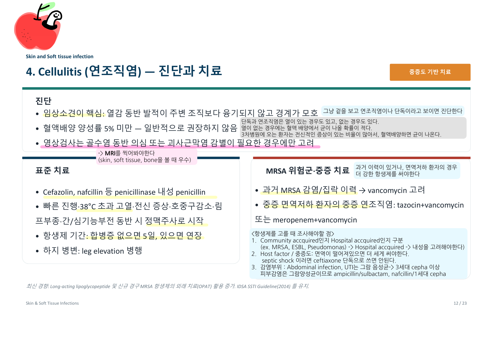{: style="width:78%"}

- **진단**: **임상 소견** — 열감 동반 발적, 융기 안 되고 경계 모호. **혈액배양 양성률 5% 미만 → 일반적으로 권장하지 않음.** 교수님: 열이 없으면 혈액배양에서 균이 나올 확률이 적지만, **3차 병원 환자는 전신 증상이 많아 혈액배양하면 균이 나온다.** **영상은 골수염 동반 의심 또는 괴사근막염 감별 시에만** → **MRI**(피부·연조직·뼈를 보는 데 우수).
- **표준 치료**: **cefazolin, nafcillin 등 penicillinase 내성 penicillin.** 빠른 진행·**38℃ 초과 고열**·전신 증상·호중구감소·림프부종·간/심부전 → **정주로 시작**. **기간: 합병증 없으면 5일**, 있으면 연장. 하지는 **다리 올리기**.
- **MRSA 위험군·중증**: 과거 MRSA 감염·집락 → **vancomycin**. **중증 면역저하 환자의 중증 연조직염 → pip/tazo + vancomycin 또는 meropenem + vancomycin.** 과거력이 있거나 면역저하면 더 강하게.
- 최신 경향: 장기작용 리포글리코펩타이드·새 경구 MRSA 약으로 외래 정주(OPAT) 증가(IDSA 2014 틀은 유지).
- (교수님 필기 메모 — 단독/연조직염 정상면역자 치료: **cefazolin(또는 nafcillin)**)

!!! memo "교수님 — 항생제를 고를 때 조사할 점"
    1. **지역사회 획득 vs 병원 획득**: 병원 획득이면 **MRSA, ESBL, *Pseudomonas*** 같은 내성을 고려.
    2. **숙주·중증도**: 면역이 떨어져 있으면 더 세게. 패혈성 쇼크면 ceftriaxone 단독은 안 된다.
    3. **감염 부위**: 복강 내 감염·UTI는 그람음성 → 3세대 세파 이상, **피부 감염은 그람양성 → ampicillin/sulbactam, nafcillin/1세대 세파.**

!!! exam "기출 포인트"
    건강한 사람의 하지 연조직염 → **cefazolin**(5·14번). 2번(2025): 32세 종아리 연조직염, 혈액배양 그람양성 알균(MSSA) → **cefazolin**. 연조직염의 원인 → ***S. pyogenes***(29·36번, 번지는 붉은 피부) / ***S. aureus***(38번, 고름). 19번: 옳지 **않은** 것 → "괴사근막염과 구분하기 어려우면 **혈액배양**이 필요"(필요한 건 **영상**). 12번: 하지 연조직염 + 서혜부 2 cm 압통 종괴 → 반응성 림프절 → **cefazolin 투여하며 관찰**. 18번: 입원 거부, 외래에서 하루 한 번 주사 → **ceftriaxone 2 g q24h**.
    **면역저하자**: 신장이식 + 당뇨 하지 연조직염 → **pip/tazo**(8번), 간이식 후 면역억제 + 발바닥 → **pip/tazo + vancomycin**(1번, 2025).

## 5. 괴사근막염 (necrotizing fasciitis) — 외과적 응급

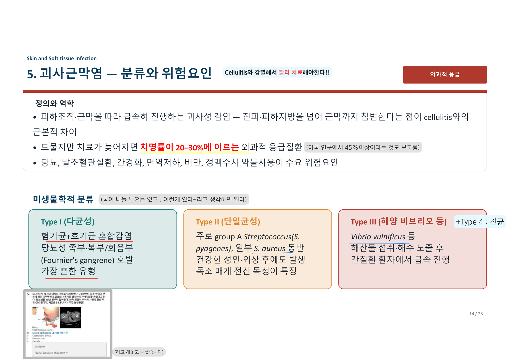{: style="width:80%"}

- **피하조직·근막을 따라 급속히 진행하는 괴사성 감염** — 진피·피하지방을 넘어 **근막까지 침범**한다는 점이 연조직염과의 근본적 차이. **연조직염과 감별해 빨리 치료해야 한다!**
- 드물지만 치료가 늦으면 **치명률 20–30%**(미국 연구에서 45% 이상도 보고).
- 위험요인: **당뇨, 말초혈관질환, 간경화, 면역저하, 비만, 정맥주사 약물.**

| 유형 | 원인 | 특징 |
|---|---|---|
| **Type I(다균성)** — 가장 흔함 | **혐기균 + 호기균 혼합** | **당뇨발, 복부·회음부(Fournier 괴저)** |
| **Type II(단일균성)** | 주로 **A군 연쇄알균**, 일부 *S. aureus* | 건강한 성인·외상 후에도, **독소 매개 전신 독성** |
| **Type III** | ***Vibrio vulnificus*** 등 해양균 | **해산물 섭취·해수 노출 후 간질환 환자**에서 급속 진행 |
| (+Type IV) | **진균** | 교수님이 "이런 게 있다"며 **언급하고 시험에 내셨다** |

- 교수님: 유형은 굳이 나눌 필요는 없고 "이런 게 있다" 정도로.

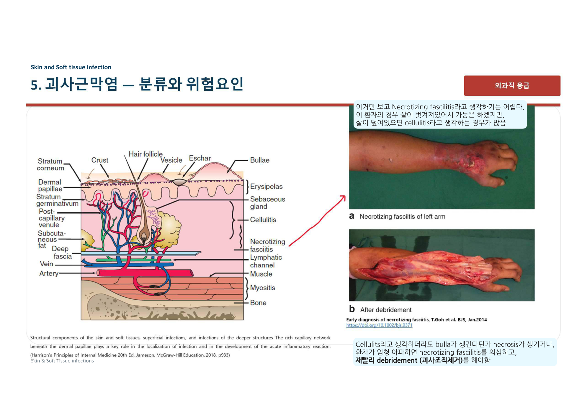{: style="width:62%"}

- 교수님: 이 사진만 보고 괴사근막염이라 하기는 어렵다(살이 벗겨져 있어 가능은 하지만). **살이 덮여 있으면 연조직염으로 생각하는 경우가 많다.** 연조직염이라 생각해도 **수포(bulla)·괴사가 생기거나 환자가 엄청 아파하면 괴사근막염을 의심하고 재빨리 괴사조직 제거(debridement)**.

### 진단

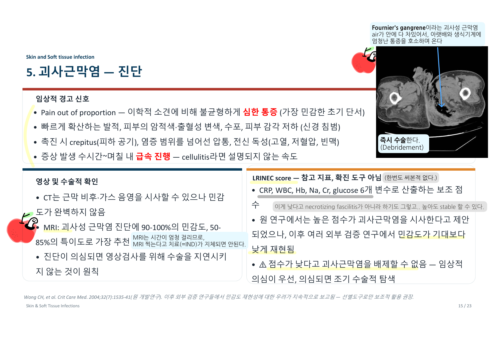{: style="width:80%"}

- **임상적 경고 신호**
    - **Pain out of proportion** — 이학적 소견에 비해 불균형하게 심한 통증(**가장 민감한 초기 단서**)
    - 빠르게 확산하는 발적, **암적색·출혈성 변색, 수포, 피부 감각 저하**(신경 침범)
    - 촉진 시 **crepitus(피하 공기)**, 염증 범위를 넘는 압통, **전신 독성**(고열, 저혈압, 빈맥)
    - 수 시간–며칠 내 급속 진행 — 연조직염으로는 설명되지 않는 속도
- **영상**: CT는 근막 비후·가스를 시사할 수 있으나 민감도가 완벽하지 않음. **MRI: 민감도 90–100%, 특이도 50–85%로 가장 추천.** 그러나 **진단이 의심되면 영상 때문에 수술을 지연시키지 않는다** — MRI는 시간이 엄청 걸리므로 치료(I&D)가 지체되면 안 된다. → **즉시 수술(debridement).**
- **LRINEC score**(참고 지표, 확진 도구 아님): **CRP, WBC, Hb, Na, Cr, glucose** 6개 변수. 원연구에선 높은 점수가 괴사근막염을 시사했지만 외부 검증에서 민감도가 낮게 재현 → **점수가 낮다고 배제할 수 없다**, 임상적 의심이 우선. 교수님: "한 번도 써 본 적 없다", 낮다고 아니라 하기도 그렇고 높아도 안정적일 수 있다.
- **Fournier 괴저**: 회음부 괴사근막염 — 안에 공기가 차 있어 **아랫배와 생식기에 엄청난 통증**으로 온다.

### 치료

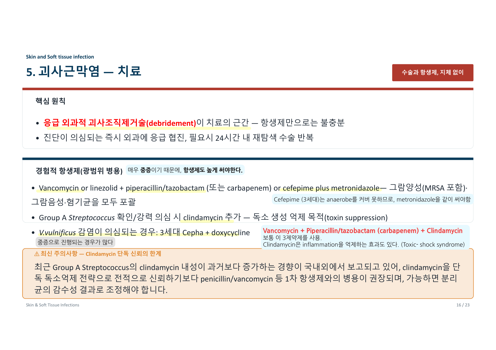{: style="width:80%"}

- **응급 외과적 괴사조직 제거술(debridement)이 치료의 근간** — 항생제만으로는 불충분. 의심 즉시 외과 응급 협진, 필요하면 **24시간 내 재탐색 수술 반복**.
- **경험적 항생제(광범위 병용)**: **vancomycin 또는 linezolid + piperacillin/tazobactam(또는 carbapenem) 또는 cefepime + metronidazole** — 그람양성(MRSA 포함)·그람음성·혐기균을 모두.
    - **Cefepime은 혐기균을 못 덮으므로 metronidazole을 같이.**
    - 교수님: 매우 중증이라 항생제도 세게 — 보통 **vancomycin + pip/tazo(carbapenem) + clindamycin 3제**.
- **A군 연쇄알균 확인·강력 의심 → clindamycin 추가(독소 생성 억제)**. Clindamycin은 염증을 억제하는 효과도 있다(독성 쇼크 증후군).
- ***V. vulnificus* 의심 → 3세대 세파 + doxycycline.**
- ⚠ **최신 주의**: A군 연쇄알균의 **clindamycin 내성이 증가** → clindamycin 단독 독소 억제를 전적으로 믿지 말고 **penicillin/vancomycin 등 1차 약과 병용**, 감수성으로 조정.
- 중증으로 진행하는 경우가 많다.

!!! diff "작년 필기와 다른 점 — 괴사근막염"
    작년: 사망률 8–65%(평균 21.9%), 진단에 **X-ray 피하 가스(약 13%)**, CT, MRI. 치료 "pip/tazo 또는 meropenem 또는 cefepime + vancomycin/linezolid/teicoplanin + metronidazole", **IVIG**(패혈성 쇼크), **고압산소(HBO)** 보조치료. 올해는 **LRINEC**(한계), **clindamycin 내성 증가** 주의가 추가됐고 type IV(진균)를 언급.

!!! exam "기출 포인트"
    9번: 당뇨 70세, **회음부·하복부 극심한 통증 + 저혈압** + CT(가스) → **meropenem + vancomycin + metronidazole**. 23번: 당뇨 10년, 엉덩이 종기 자가치료 후 의식저하 + CT → 주된 원인 **복합균(호기성 + 혐기성)**. 13번: 신장이식 + 당뇨 하지 **반상출혈·수포** → **meropenem**. 20번: 반상출혈·수포 하지 → **ampicillin/sulbactam + clindamycin**(독소 억제). 15번: 유리에 찔린 발 + 수포 → 가장 유용한 검사 **MRI**.
    *Vibrio*: 양측 발의 출혈성 수포 → ***Vibrio vulnificus***(17·28번). 35번: 반드시 물을 병력 → **간질환 및 술 섭취력**.

!!! key "처음 케이스, 다시 보기"
    당뇨 + 빠르게 진행하는 발적 + **pain out of proportion** + 암적색 반상출혈 + 전신 독성(고열·빈맥·저혈압) = 전형적 **괴사근막염** 경고 신호. LRINEC이나 영상을 기다리지 말고 **즉시 외과 응급 협진(debridement)** + **광범위 항생제(vancomycin/linezolid + pip/tazo, GAS 의심 시 clindamycin)**. "**의심되면 바로 수술**" — 진단 확인에 시간을 쓰는 것이 치명률을 높이는 가장 흔한 실수.

## 6. 교상 (bite wounds)

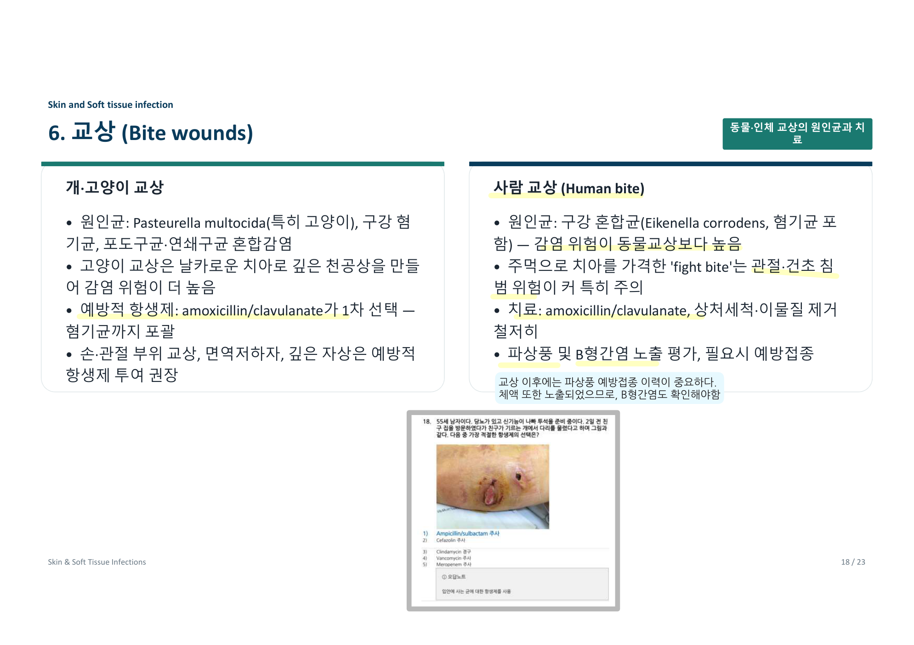{: style="width:76%"}

| | 개·고양이 교상 | 사람 교상 |
|---|---|---|
| 원인균 | ***Pasteurella multocida*(특히 고양이)**, 구강 혐기균, 포도·연쇄알균 혼합 | **구강 혼합균(*Eikenella corrodens*, 혐기균)** — 동물 교상보다 감염 위험이 높다 |
| 특징 | **고양이는 날카로운 이빨로 깊은 천공상** → 감염 위험이 더 높다 | 주먹으로 이빨을 친 **"fight bite"** — 관절·건초 침범 위험 |
| 치료 | 예방적 **amoxicillin/clavulanate 1차**(혐기균까지). **손·관절 부위, 면역저하, 깊은 자상**이면 예방적 항생제 권장 | **amox/clav**, 상처 세척·이물 제거 철저 |

- **파상풍** 예방접종 이력이 중요, 사람 교상은 체액 노출이므로 **B형간염**도 확인(필요 시 예방접종).
- (작년 필기) 교상 후 **8시간 이내**: 상처 치료, 파상풍, 필요하면 **광견병**. 8–12시간 지나면 대부분 감염. 주사는 **ampicillin/sulbactam**, 경구 **amoxicillin/clavulanate**.

!!! exam "기출 포인트"
    37번: 당뇨·신부전 55세, 개에게 물린 다리 → **ampicillin/sulbactam 주사**.

## 7. 당뇨병성 족부감염 — 올해 추가

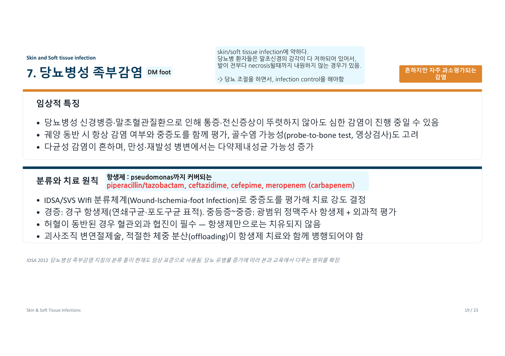{: style="width:76%"}

- **신경병증·말초혈관질환** 때문에 **통증·전신 증상이 뚜렷하지 않아도 심한 감염이 진행 중**일 수 있다. 교수님: 감각이 다 떨어져 **발이 전부 괴사될 때까지 안 오는 경우**도 있다 → 당뇨 조절과 감염 조절을 함께.
- 궤양이 있으면 항상 감염 여부·중증도를 평가하고 **골수염 가능성(probe-to-bone test, 영상)** 도 고려.
- **다균성 감염이 흔하고**, 만성·재발성 병변은 다제내성균 가능성 증가.
- **IDSA/SVS WIfI(Wound–Ischemia–foot Infection)** 분류로 중증도를 평가해 치료 강도 결정.
- **경증: 경구(연쇄·포도알균 표적)**, **중등증–중증: 광범위 정주 + 외과적 평가.**
- **허혈이 있으면 혈관외과 협진 필수**(항생제만으로는 안 낫는다), **괴사조직 변연절제술과 체중 분산(offloading)** 병행.
- 교수님: 항생제는 **녹농균까지 커버**되는 **pip/tazo, ceftazidime, cefepime, meropenem**. (필야) 녹농균을 포함해 거의 모든 균주를 덮는 항생제를 고르면 된다.

## 8. 요약

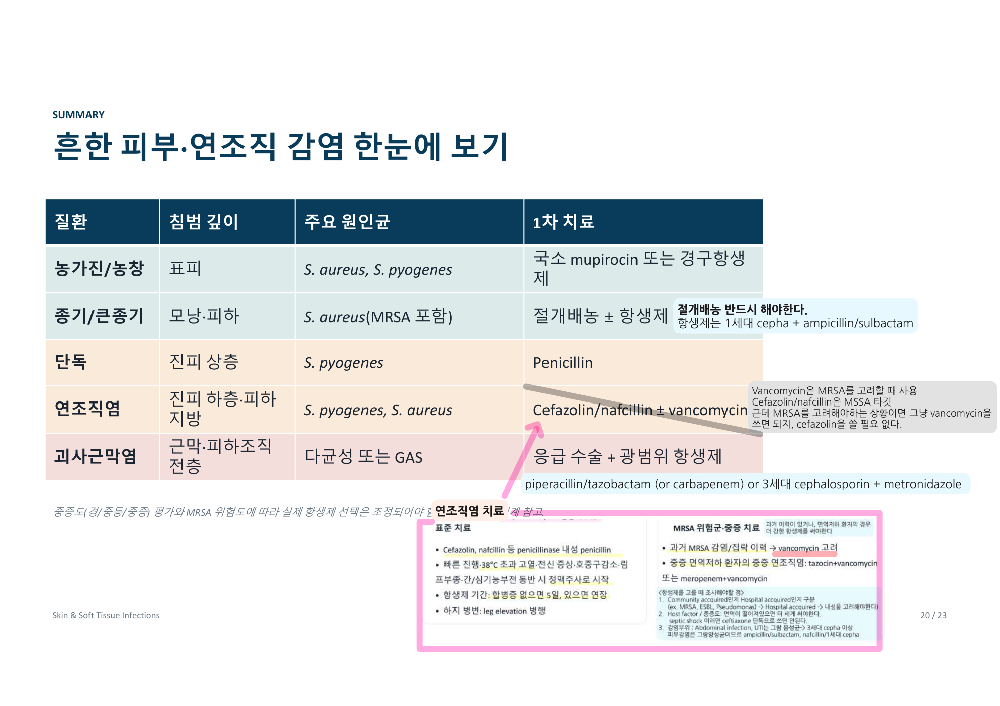{: style="width:80%"}

| 질환 | 깊이 | 주요 원인균 | 1차 치료 |
|---|---|---|---|
| 농가진/농창 | 표피 | *S. aureus*, *S. pyogenes* | 국소 mupirocin 또는 경구 |
| 종기/큰종기 | 모낭·피하 | *S. aureus*(MRSA 포함) | **절개배농** ± 항생제 |
| 단독 | 진피 상층 | *S. pyogenes* | penicillin |
| 연조직염 | 진피 하층·피하지방 | *S. pyogenes*, *S. aureus* | **cefazolin/nafcillin** ± vancomycin |
| 괴사근막염 | 근막·피하 전층 | 다균성 또는 GAS | **응급수술** + 광범위 |

- 교수님 메모: 종기는 **절개배농을 반드시**, 항생제는 1세대 세파·amp/sulbactam. **Vancomycin은 MRSA를 고려할 때**, cefazolin/nafcillin은 MSSA 표적 — MRSA를 고려해야 하는 상황이면 그냥 vancomycin을 쓰면 되지 cefazolin을 같이 쓸 필요 없다. 연조직염(중증·복부 원인 등)엔 pip/tazo(또는 carbapenem) 또는 3세대 세파 + metronidazole.
- **Key takeaways**: ① **분류가 먼저**(화농성/비화농성 + 중증도) ② **속도가 생명**(pain out of proportion + 빠른 진행 + 전신 독성 → 즉시 외과) ③ **점수는 보조일 뿐**(LRINEC 낮다고 배제 X) ④ **특수 상황**(교상·당뇨발)을 놓치지 않기.

## 9. 흔한 감염성 피부병변 (작년 해리슨 표)
- 수포: 수두·대상포진·단순포진·수족구 / **출혈성 수포 — *Vibrio vulnificus***, 괴사근막염 / 딱지: 농가진 / 모낭염: *S. aureus*, 녹농균(온탕) / 괴사: 괴사근막염, Fournier 괴저, 가스괴저(*C. perfringens*).

!!! exam "기출 포인트"
    10번: 당뇨 80세, 엉덩이·겨드랑이 통증 + 피절 따라 수포(대상포진) → **acyclovir**. 31번: 치매 와상 노인의 엉덩이 병변(욕창)과 같은 기전의 호발 부위가 **아닌** 곳 → **전흉부**(발뒤꿈치·후두·좌골결절·견갑골은 압박 부위).

# Part B. 골관절 감염
교수님: "연조직보다 조금 더 깊게 들어가지만 **항생제는 비슷하게** 쓴다."

## 1. 골수염 (osteomyelitis)

### 정의와 분류

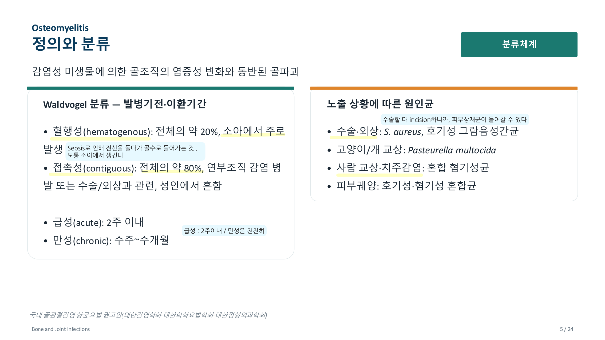{: style="width:80%"}

- **감염성 미생물에 의한 골조직의 염증성 변화와 동반된 골 파괴.**
- **Waldvogel 분류(발병기전·기간)**
    - **혈행성(hematogenous): 전체의 약 20%, 소아에서 주로** — 패혈증으로 전신을 돌다 골수로 들어감.
    - **접촉성(contiguous): 약 80%**, 연부조직 감염 병발 또는 **수술·외상 관련, 성인에서 흔함** — 수술 시 절개로 피부 상재균이 들어갈 수 있다.
    - **급성: 2주 이내**, **만성: 수주–수개월**(천천히).
- **노출 상황별 원인균**: 수술·외상 *S. aureus*, 호기성 그람음성 / **고양이·개 교상 *Pasteurella multocida*** / 사람 교상·치주감염 혼합 혐기균 / 피부궤양 호기·혐기 혼합균.
- **Cierny-Mader**(해부학적 침범 정도): I **수질(medullary)** — 골수강 내 / II **표재(superficial)** — 골 표면(피질 외층) / III **국소(localized)** — 피질 전층이지만 골 안정성 유지 / IV **미만(diffuse)** — 골 전체 침범, 안정성 소실.

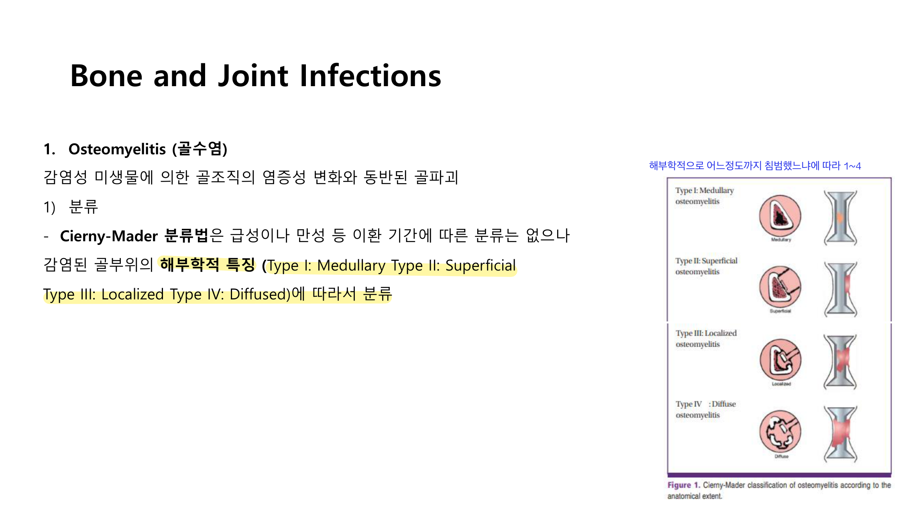{: style="width:44%"}

- (작년 필기) 접촉성은 **주사를 많이 맞는 사람**에서 호발 — 주사는 항상 무균적으로.

### 원인균

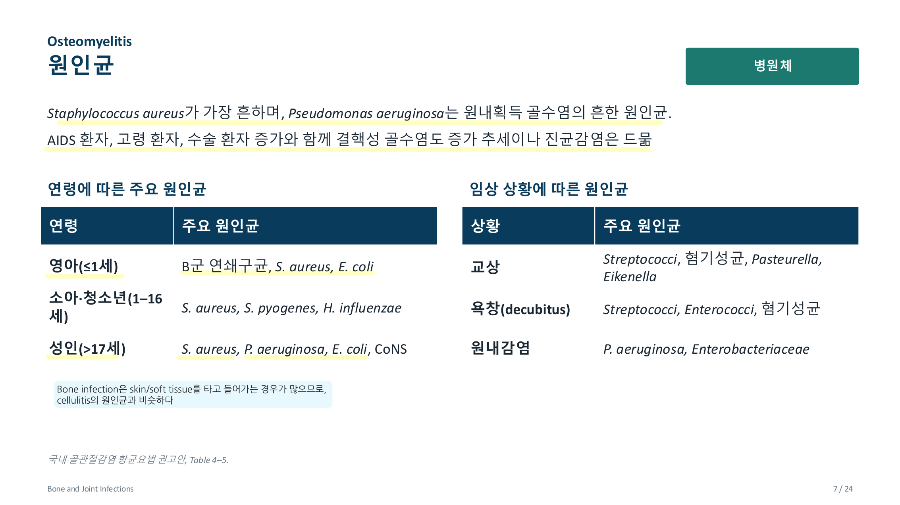{: style="width:80%"}

- ***S. aureus*가 가장 흔하고**, ***P. aeruginosa*는 원내 획득 골수염**의 흔한 원인. AIDS·고령·수술 환자 증가로 **결핵성 골수염도 증가** 추세, 진균은 드묾.

| 연령 | 주요 원인균 |
|---|---|
| 영아(≤1세) | **B군 연쇄알균**, *S. aureus*, *E. coli* |
| 소아·청소년(1–16세) | *S. aureus*, *S. pyogenes*, *H. influenzae* |
| 성인(>17세) | *S. aureus*, *P. aeruginosa*, *E. coli*, CoNS |

| 상황 | 주요 원인균 |
|---|---|
| 교상 | 연쇄알균, 혐기균, ***Pasteurella***, ***Eikenella*** |
| 욕창(decubitus) | 연쇄알균, 장알균, 혐기균 |
| 원내 감염 | ***P. aeruginosa***, 장내세균 |

- 뼈 감염은 피부·연조직을 타고 들어가는 경우가 많아 **연조직염의 원인균과 비슷하다.**

### 진단 — 임상과 영상

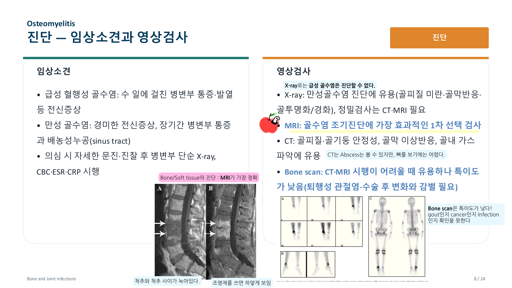{: style="width:80%"}

- 임상: **급성 혈행성** — 수 일에 걸친 병변부 **통증·발열** 등 전신 증상 / **만성** — 경미한 전신 증상, 장기간 통증과 **배농성 누공(sinus tract)**. 의심 시 문진·진찰 후 **단순 X-ray, CBC·ESR·CRP**.
- **X-ray: 만성 골수염 진단에 유용**(골피질 미란·골막반응·골투명화/경화). **급성 골수염은 X-ray로 진단할 수 없다.** 정밀검사는 CT·MRI.
- **MRI: 골수염 조기 진단에 가장 효과적인 1차 선택 검사.** 뼈·연조직 진단은 MRI가 가장 정확(척추와 척추 사이가 녹아 있고 조영제를 쓰면 하얗게 보인다).
- **CT**: 골피질·골기둥 안정성, 골막 이상, 골내 가스 파악. 농양은 볼 수 있지만 뼈를 보기는 어렵다.
- **Bone scan: CT·MRI가 어려울 때 유용하나 특이도가 낮다**(퇴행성 관절염·수술 후 변화와 감별 필요) — 통풍인지 암인지 감염인지 확인을 못 한다.

!!! exam "기출 포인트"
    21번: 골수염 진단 설명 중 옳지 **않은** 것 → "**Bone scan은 특이도가 높지만** 조기 진단에는 유용하지 않다"(특이도가 **낮다**). 임상 소견 중요, X-ray는 만성에 유용, 항균제 전 배양, MRI가 조기 진단에 가장 효과적 — 모두 맞다.

### 진단 — 배양과 조직검사

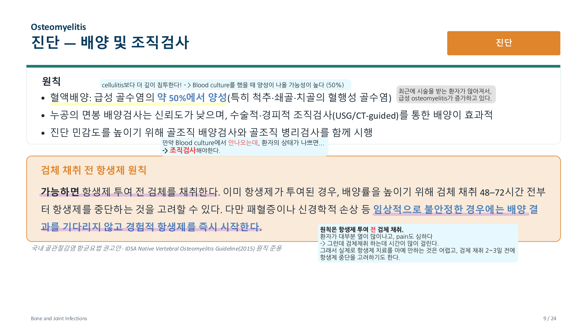{: style="width:80%"}

- **혈액배양: 급성 골수염의 약 50%에서 양성**(특히 **척추·쇄골·치골의 혈행성**). 연조직염보다 깊이 침투해서 양성률이 높다. 최근 시술을 받는 환자가 많아져 급성 골수염이 늘고 있다.
- **누공 면봉 배양은 신뢰도가 낮다** → **수술적·경피적 조직검사(초음파/CT 유도)** 로 배양. 진단 민감도를 높이려 **골조직 배양 + 병리**를 함께. 혈액배양에서 안 나오는데 상태가 나쁘면 → **조직검사**.
- **검체 채취 전 항생제 원칙**: **가능하면 항생제 전에 검체를 채취.** 이미 투여됐으면 배양률을 높이려 **채취 48–72시간 전부터 중단**을 고려. 다만 **패혈증·신경학적 손상 등 임상적으로 불안정하면 배양을 기다리지 않고 경험적 항생제를 즉시.** 교수님: 환자 대부분이 열이 많고 통증이 심한데 검체 채취에 시간이 걸려, 실제로는 항생제를 아예 안 하기 어렵고 채취 2–3일 전에 중단을 고려하기도 한다.

### 치료 원칙과 기간

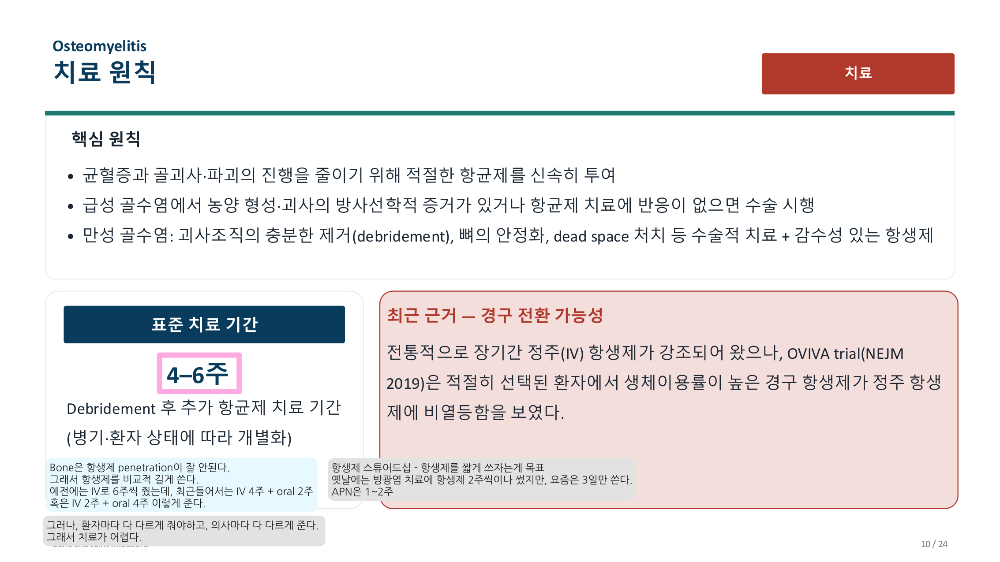{: style="width:80%"}

- **균혈증과 골괴사·파괴 진행을 줄이려 적절한 항균제를 신속히.**
- **급성**: 농양 형성·괴사의 방사선학적 증거가 있거나 **항균제에 반응이 없으면 수술**.
- **만성**: **괴사조직 충분한 제거(debridement)**, 뼈 안정화, dead space 처치 등 수술 + 감수성 있는 항생제.
- **표준 기간: debridement 후 추가 4–6주**(병기·환자 상태에 따라 개별화).
- **최근 근거 — 경구 전환 가능성**: 전통적으로 장기간 정주가 강조됐지만 **OVIVA trial(NEJM 2019)** 은 적절히 선택된 환자에서 **생체이용률이 높은 경구 항생제가 정주에 비열등**함을 보였다.
- 교수님: 항생제 스튜어드십의 목표는 **짧게 쓰자**(옛날 방광염 2주 → 요즘 3일, APN 1–2주). 하지만 **뼈는 항생제 침투가 잘 안 돼 비교적 길게**. 예전엔 IV 6주, 최근엔 **IV 4주 + 경구 2주** 또는 **IV 2주 + 경구 4주** — 환자마다, 의사마다 다르게 줘서 치료가 어렵다.

### 항균제 선택

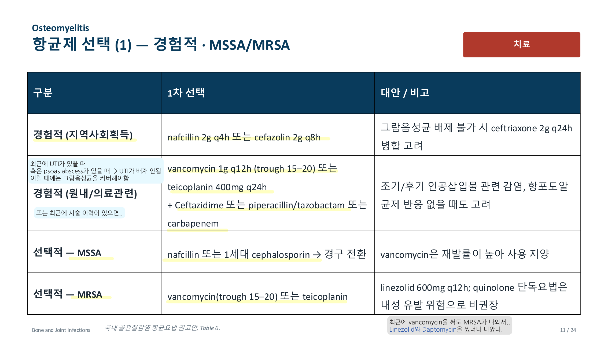{: style="width:80%"}

| 구분 | 1차 선택 | 대안·비고 |
|---|---|---|
| **경험적(지역사회)** | **nafcillin 2 g q4h 또는 cefazolin 2 g q8h** | 그람음성 배제 불가 시 **ceftriaxone 2 g q24h 병합** |
| **경험적(원내·의료관련)** | **vancomycin 1 g q12h(trough 15–20) 또는 teicoplanin 400 mg q24h + ceftazidime 또는 pip/tazo 또는 carbapenem** | 조기/후기 **인공삽입물 관련**, 항포도알균 약에 반응 없을 때 |
| **선택적 — MSSA** | **nafcillin 또는 1세대 세파** → 경구 전환 | **vancomycin은 재발률이 높아 지양** |
| **선택적 — MRSA** | **vancomycin(trough 15–20) 또는 teicoplanin** | linezolid 600 mg q12h; **quinolone 단독은 내성 유발 위험으로 비권장** |

- 교수님: **최근 UTI가 있거나 장요근(psoas) 농양**이 있을 때(UTI 배제가 안 됨), 또는 최근 시술 이력 → **그람음성 커버**. 최근 vancomycin을 써도 MRSA가 나와서 **linezolid와 daptomycin**을 썼더니 나았다.

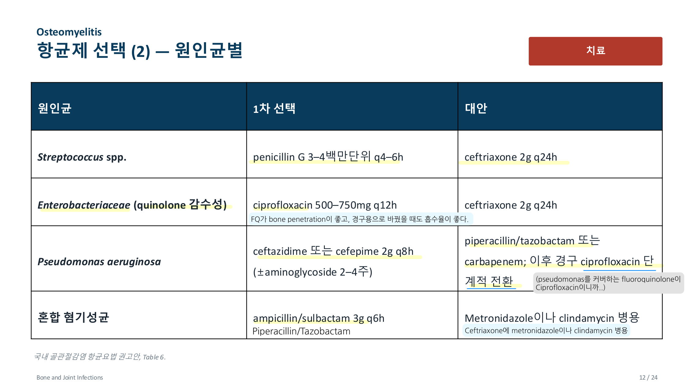{: style="width:80%"}

| 원인균 | 1차 | 대안 |
|---|---|---|
| 연쇄알균 | **penicillin G** 300–400만 단위 q4–6h | ceftriaxone 2 g q24h |
| 장내세균(퀴놀론 감수성) | **ciprofloxacin 500–750 mg q12h** | ceftriaxone |
| ***P. aeruginosa*** | **ceftazidime 또는 cefepime 2 g q8h**(± aminoglycoside 2–4주) | pip/tazo 또는 carbapenem; 이후 **경구 ciprofloxacin 단계적 전환** |
| 혼합 혐기균 | **ampicillin/sulbactam 3 g q6h**(또는 pip/tazo) | ceftriaxone + metronidazole 또는 clindamycin |

- **FQ는 뼈 침투가 좋고, 경구로 바꿔도 흡수율이 좋다.** 녹농균을 덮는 FQ는 **ciprofloxacin**.

## 2. 척추골수염 (spondylitis, vertebral osteomyelitis) ★

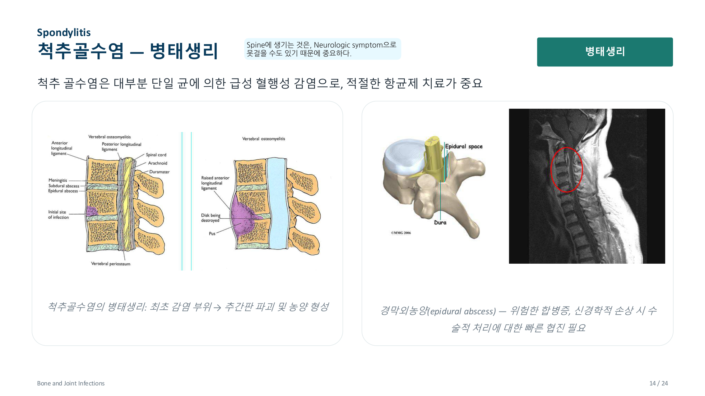{: style="width:80%"}

- 척추 골수염은 대부분 **단일 균에 의한 급성 혈행성 감염** → 적절한 항균제가 중요. 최초 감염 부위 → **추간판 파괴 및 농양 형성**.
- **경막외 농양(epidural abscess)**: 위험한 합병증, **신경학적 손상 시 수술적 처치에 대한 빠른 협진** 필요. 척추에 생기면 **신경 증상으로 못 걸을 수도** 있어 중요하다.
- 뼈 감염은 비슷비슷 — **가장 많은 것은 척추**, 그다음이 **당뇨발**.

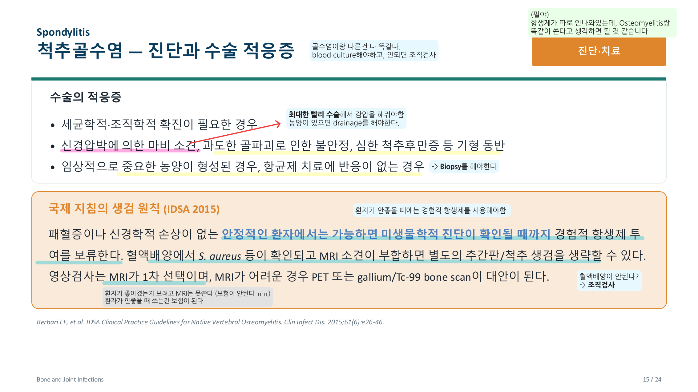{: style="width:80%"}

- **수술 적응증**: **세균학·조직학적 확진이 필요한 경우**, **신경 압박에 의한 마비**, 과도한 골파괴로 인한 **불안정·심한 척추후만증** 등 기형, **임상적으로 중요한 농양** 형성, **항균제에 반응 없는 경우**. 교수님: 최대한 빨리 수술해 **감압**, 농양이 있으면 **배액**.
- **국제 지침의 생검 원칙(IDSA 2015)**: 패혈증이나 신경학적 손상이 없는 **안정적인 환자에서는 가능하면 미생물학적 진단이 확인될 때까지 경험적 항생제를 보류.** **혈액배양에서 *S. aureus* 등이 확인되고 MRI 소견이 부합하면 별도의 추간판/척추 생검을 생략할 수 있다.** 환자가 안 좋으면 경험적 항생제. 혈액배양이 안 나오면 → **조직검사(biopsy)**.
- **영상은 MRI가 1차**, MRI가 어려우면 **PET 또는 gallium/Tc-99 bone scan**. 교수님: 좋아졌는지 보려고 MRI는 못 쓴다(보험 안 됨), 안 좋을 때는 보험이 된다.
- (필야) 척추염 항생제는 따로 안 나와 있는데 **골수염과 똑같이** 쓴다고 생각하면 된다.

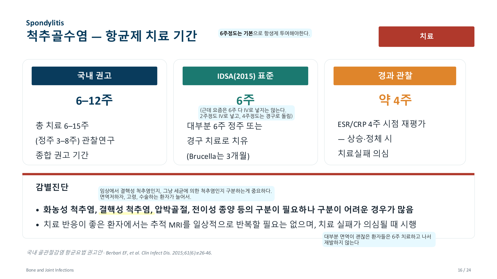{: style="width:80%"}

| 국내 권고 | IDSA(2015) 표준 | 경과 관찰 |
|---|---|---|
| **6–12주**(총 6–15주, 정주 3–8주 관찰연구 종합) | **6주** — 대부분 6주 정주 또는 경구 치료(**Brucella는 3개월**) | **약 4주** — ESR/CRP 4주 재평가, 상승·정체 시 치료 실패 의심 |

- **6주 정도는 기본.** 요즘은 6주를 다 IV로 넣지 않고 **2주 IV + 4주 경구** 정도. 면역이 괜찮은 환자는 대부분 6주 후 재발하지 않는다.
- **감별진단**: **화농성 척추염, 결핵성 척추염, 압박골절, 전이성 종양** — 구분이 필요하지만 어려운 경우가 많다. 면역저하자·고령·수술 환자가 늘어 **결핵성인지 세균성인지 구분이 중요**.
- 치료 반응이 좋은 환자에서는 **추적 MRI를 일상적으로 반복할 필요는 없고**, 치료 실패가 의심될 때 시행.

### 화농성 vs 결핵성 척추염

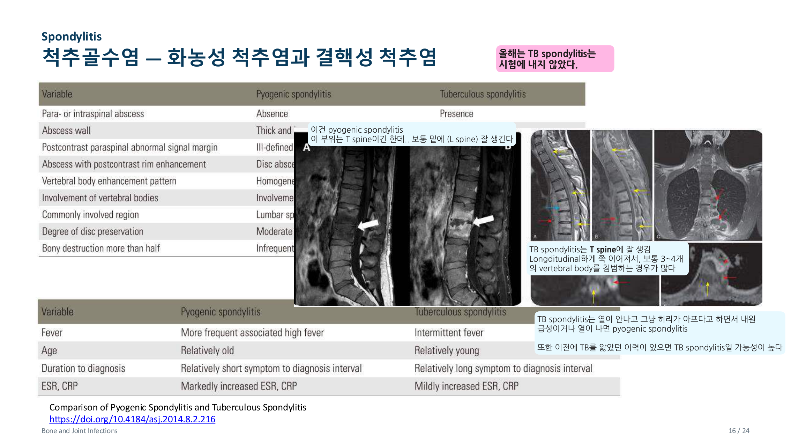{: style="width:76%"}

| | 화농성(pyogenic) | 결핵성(TB, Pott병) |
|---|---|---|
| 부위 | 보통 **L spine(요추)**, 1–2개 | **T spine(흉추)**, **세로로 길게 3–4개 척추체** 침범 |
| 임상 | **급성이거나 열이 남** | **열이 없고 그냥 허리가 아프다**고 옴, **결핵 과거력**이 있으면 가능성↑ |

- 필기: "**올해는 TB spondylitis는 시험에 내지 않았다.**" (작년 필기: 결핵성 척추염은 항결핵제 9–12개월.)

!!! exam "기출 포인트"
    척추염 검사 → **허리뼈 MRI**(6번 — 당뇨 60세, 허리 통증·발열, 하지로 뻗침), **척추 MRI로 추간판·경막외 농양 평가**(3번, 2025 — 한의원 침 여러 번 + 당뇨·CKD). 원인균 → ***S. aureus***(16·40번). 치료(신경학적 증상 없음, 73세) → **cefazolin**(22번 — 수술·cipro+vanco·결핵약 X), **ampicillin/sulbactam**(7번). 39번: 열 없는 35세, 경제 사정으로 지내다 체형 변화 + CT → **Pott disease**(결핵성 척추염).

## 3. 인공관절 감염 (prosthetic joint infection, PJI) — 올해 추가

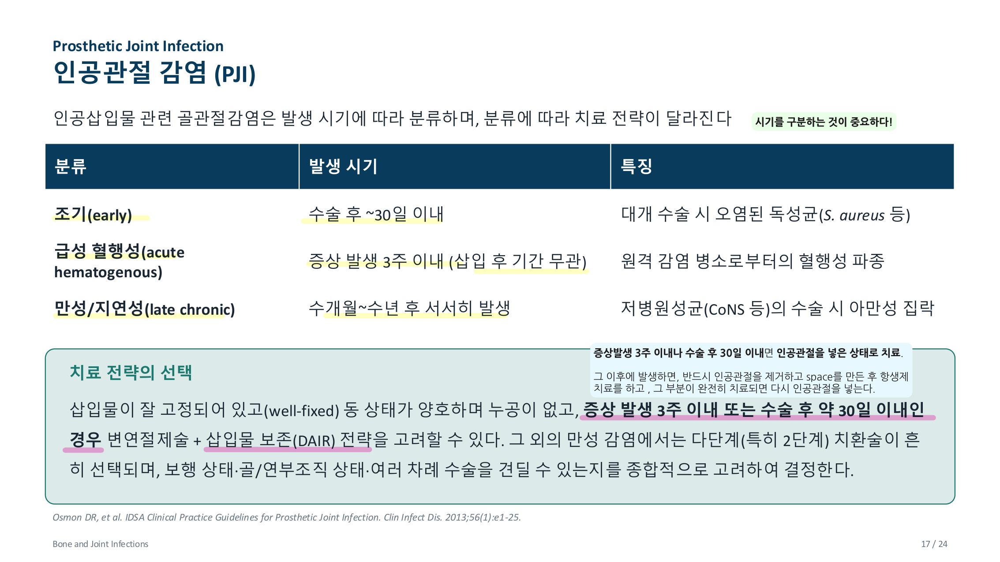{: style="width:80%"}

| 분류 | 발생 시기 | 특징 |
|---|---|---|
| **조기(early)** | **수술 후 ~30일 이내** | 수술 시 오염된 독성균(***S. aureus*** 등) |
| **급성 혈행성** | **증상 발생 3주 이내**(삽입 후 기간 무관) | 원격 감염 병소로부터 혈행성 파종 |
| **만성/지연성** | **수개월–수년 후** 서서히 | 저병원성균(**CoNS** 등)의 수술 시 아만성 집락 |

- **치료 전략**: 삽입물이 잘 고정돼 있고(well-fixed) 동 상태가 양호하며 **누공이 없고, 증상 발생 3주 이내 또는 수술 후 30일 이내**면 **변연절제술 + 삽입물 보존(DAIR)**. 그 외 만성 감염은 **다단계(특히 2단계) 치환술** — 보행 상태, 골·연부조직 상태, 여러 차례 수술을 견딜 수 있는지 종합해 결정.
- 교수님: **시기를 구분하는 것이 중요!** 증상 3주 이내나 수술 후 30일 이내면 **인공관절을 넣은 상태로 치료**, 그 이후면 **반드시 인공관절을 제거하고 공간(spacer)을 만든 뒤 항생제**, 완전히 치료되면 **다시 인공관절을 넣는다**.

## 4. 화농성 관절염 (septic arthritis)

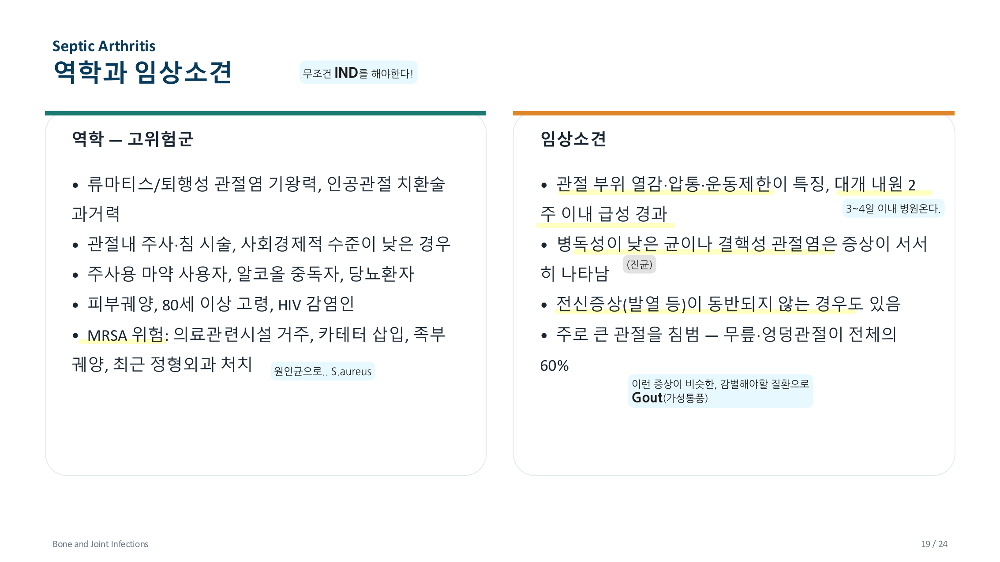{: style="width:80%"}

- 교수님: **무조건 I&D(절개·배농)를 해야 한다!**
- **고위험군**: 류마티스/퇴행성 관절염 기왕력, **인공관절** 치환술 과거력, **관절 내 주사·침 시술**, 낮은 사회경제적 수준, 주사 마약, 알코올, **당뇨**, 피부궤양, **80세 이상**, HIV.
- **MRSA 위험**: 의료관련시설 거주, 카테터, 족부궤양, 최근 정형외과 처치. (위험인자 없으면 원인균은 *S. aureus*.)
- **임상**: 관절 **열감·압통·운동제한**, 대개 내원 **2주 이내 급성**(3–4일 이내 병원에 온다). 병독성이 낮은 균·결핵성(진균)은 서서히. **전신 증상(발열)이 없을 수도** 있다. 주로 **큰 관절 — 무릎·엉덩관절이 60%**. 증상이 비슷해 감별할 질환: **통풍(가성통풍)**.

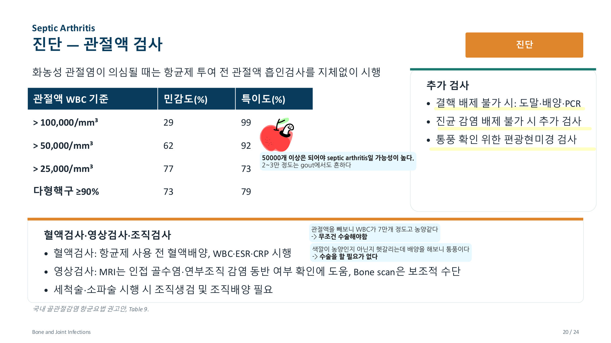{: style="width:80%"}

- 의심되면 **항균제 투여 전 관절액 흡인을 지체 없이.**

| 관절액 WBC | 민감도(%) | 특이도(%) |
|---|---|---|
| >100,000/mm3 | 29 | 99 |
| **>50,000/mm3** | 62 | **92** |
| >25,000/mm3 | 77 | 73 |
| 다핵구 ≥90% | 73 | 79 |

- **5만 개 이상은 되어야 화농성 관절염 가능성이 높다**, **2–3만 정도는 통풍에서도 흔하다.**
- 추가 검사: 결핵 배제 불가 시 도말·배양·PCR, 진균 배제 불가 시 추가 검사, **통풍 확인을 위한 편광현미경**.
- 혈액: **항생제 전 혈액배양**, WBC·ESR·CRP. 영상: MRI는 인접 골수염·연부조직 감염 확인, bone scan은 보조. 세척술·소파술 때 조직생검·배양.
- 교수님: 관절액을 빼 보니 WBC 7만 개 정도에 농양 같다 → **무조건 수술**. 색깔이 농양인지 헷갈리는데 배양해 보니 통풍이다 → **수술할 필요 없다.**

### 치료

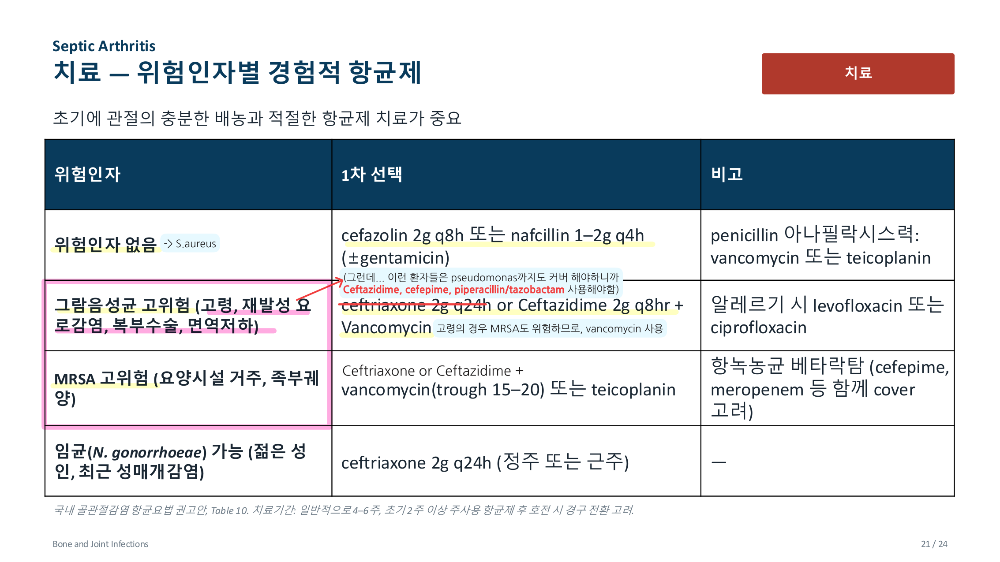{: style="width:80%"}

- **초기에 관절의 충분한 배농 + 적절한 항균제.**

| 위험인자 | 1차 선택 | 비고 |
|---|---|---|
| **위험인자 없음**(→ *S. aureus*) | **cefazolin 2 g q8h 또는 nafcillin 1–2 g q4h(± gentamicin)** | 페니실린 아나필락시스: vancomycin 또는 teicoplanin |
| **그람음성 고위험**(고령, 재발성 요로감염, 복부수술, 면역저하) | **ceftriaxone 2 g q24h 또는 ceftazidime 2 g q8h + vancomycin** | 알레르기 시 levofloxacin 또는 ciprofloxacin |
| **MRSA 고위험**(요양시설, 족부궤양) | ceftriaxone 또는 ceftazidime + **vancomycin(trough 15–20) 또는 teicoplanin** | 항녹농균 β-lactam(cefepime, meropenem 등)으로 함께 cover 고려 |
| **임균** 가능(젊은 성인, 최근 성매개감염) | **ceftriaxone 2 g q24h**(정주 또는 근주) | |

- 교수님: 고령은 MRSA도 위험하므로 **vancomycin**. 그런데 이런 환자는 **녹농균까지 커버**해야 하니 ceftazidime, cefepime, pip/tazo.
- **기간: 일반적으로 4–6주, 초기 2주 이상 주사로 호전 후 경구 전환 고려.**

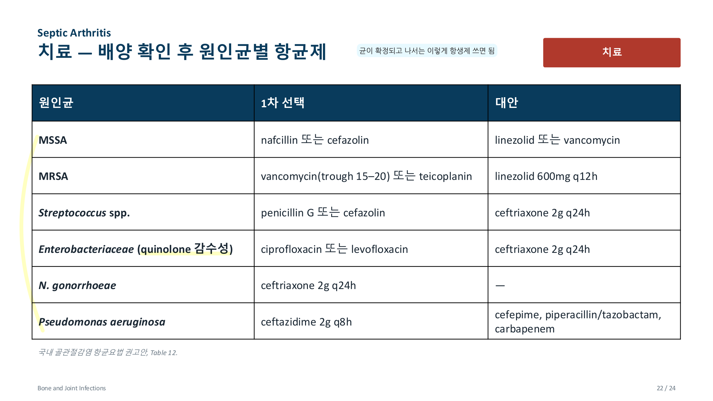{: style="width:76%"}

| 원인균 | 1차 | 대안 |
|---|---|---|
| **MSSA** | **nafcillin 또는 cefazolin** | linezolid 또는 vancomycin |
| **MRSA** | **vancomycin(trough 15–20) 또는 teicoplanin** | linezolid 600 mg q12h |
| 연쇄알균 | penicillin G 또는 cefazolin | ceftriaxone |
| 장내세균(퀴놀론 감수성) | ciprofloxacin 또는 levofloxacin | ceftriaxone |
| ***N. gonorrhoeae*** | **ceftriaxone 2 g q24h** | |
| ***P. aeruginosa*** | **ceftazidime 2 g q8h** | cefepime, pip/tazo, carbapenem |

!!! diff "작년 필기와 다른 점 — 화농성 관절염"
    작년: 경험적 1세대 세파·**ampicillin/sulbactam**·nafcillin, 그람음성 위험 → ceftriaxone, **중증 패혈증이면 gentamicin 병용**. 올해 표는 위험인자별(그람음성 고위험·MRSA 고위험)로 **vancomycin 병용**을 명시.

!!! exam "기출 포인트"
    11번: 건강한 40세, 무릎 통증·39.2℃, 관절액 WBC 89,000(PMN 88%) → **nafcillin**. 4번(2025): 35세, 무릎, 2주 전 장염 병력(반응성 관절염 함정), 관절액 WBC 84,000(호중구 92%), **결정 없음** → **화농성 관절염**. 30번: 건강한 37세 무릎, 관절액·혈액 그람양성균 → ***S. aureus***.

## 5. 최신 치료 동향 — OVIVA trial (정주에서 경구로)

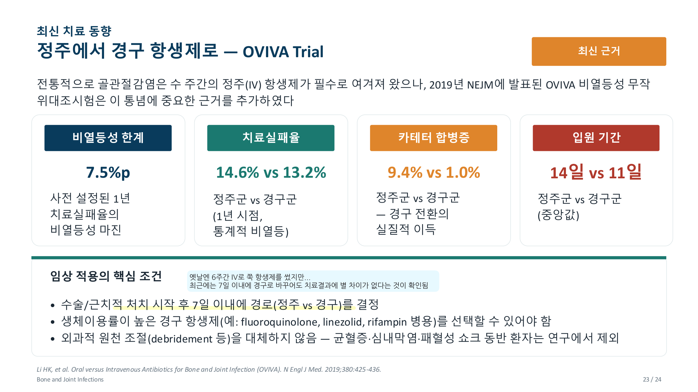{: style="width:80%"}

- 전통적으로 골관절 감염은 **수 주간 정주(IV)** 가 필수로 여겨졌지만, **2019년 NEJM OVIVA 비열등성 무작위대조시험**이 근거를 추가했다.
    - 비열등성 한계 **7.5%p**(1년 치료실패율)
    - **치료실패율 14.6%(정주) vs 13.2%(경구)** — 통계적 비열등
    - **카테터 합병증 9.4% vs 1.0%** — 경구 전환의 실질적 이득
    - 입원 기간 14일 vs 11일(중앙값)
- **임상 적용의 핵심 조건**: 수술/근치적 처치 시작 후 **7일 이내에 경로(정주 vs 경구)를 결정**, **생체이용률이 높은 경구 항생제**(예: **fluoroquinolone, linezolid, rifampin 병용**)를 선택할 수 있어야 함, **외과적 원천 조절(debridement 등)을 대체하지 않음** — **균혈증·심내막염·패혈성 쇼크** 동반 환자는 연구에서 제외.
- 교수님: 옛날엔 6주간 IV로 쭉 썼지만 **최근엔 7일 이내 경구로 바꿔도 결과에 별 차이가 없다**는 것이 확인됐다.

# Part C. 작년 증례 (2025)

!!! diff "작년 필기 — 증례 3개"
    1. **신장이식 환자의 발 감염** — 병원을 다닌 이력 → **병원 내성균** 고려 → **pip/tazo 또는 meropenem + vancomycin**. 검사 MRI, 혈액·고름 배양, CRP. 원인 *S. aureus*. 면역억제제 + 깊은 상처로 결국 **절단** 후 호전.
    2. **이상지질혈증·고혈압 고령 환자의 발 감염** — 지역사회면 cefazolin·amp/sulbactam·nafcillin이지만 **고령 + 발** 감염이라 **pip/tazo**. 검사 혈액배양, CT 또는 MRI.
    3. **장요근(psoas) 농양** — 요로감염에서 근육으로, 척추로 잘 넘어간다. PCD 경로가 어려워 **ceftriaxone·pip/tazo로 보다 악화되면 PCD**. pip/tazo로 좋아져 경구로 바꿔 퇴원.

# Part D. 미생물학 보충 (2020–22 기출)
- ***S. aureus* 병원성 인자**: **coagulase, protein A, catalase**(M protein은 *S. pyogenes*). 독소 — 식중독(장독소), **TSS(TSST-1)**, 중증 폐렴(**PVL**), **SSSS(표피탈락독소)**. 대부분 항생제에 감수성이 높아 치료가 쉽다는 말은 틀림(MRSA).
- ***S. aureus*와 *S. epidermidis* 공통**: **catalase 양성**(coagulase는 *S. aureus*만). *S. epidermidis* — coagulase 음성, 보철 장치 감염. *S. saprophyticus* — urease 양성, 젊은 여성 UTI.
- **SSSS**: 표피탈락독소가 표피 과립층 세포 연결을 끊음, 국소형은 **수포성 농가진**.
- **사슬알균**: 신생아 수막염 — ***S. agalactiae*, CAMP 양성**(*S. pyogenes*는 β용혈·bacitracin 감수성).
- ***C. perfringens***: 그람양성 아포형성 막대균, 혈액배지 **이중 용혈**, alpha 독소, 연조직 감염·**가스괴저**.
- **여드름균**: *Propionibacterium acnes* → ***Cutibacterium acnes***, propionic acid, 피부 정상균, lipase.
- **무산소균**: 느리게 자라고 산소 노출 주의, 혐기 배양기, **복합균 감염이 흔함**. *Veillonella* — 그람음성 알균. *Actinomyces*, *Lactobacillus*, *Mobiluncus*.
- ***Nocardia***: 발의 만성·무통성 감염(균종), 피하 부종·다발성 굴, 림프 따라 결절, **CNS 침범**.

!!! memo "암기"
    | 질환 | 원인균 | 치료 |
    |---|---|---|
    | 농가진/농창 | *S. aureus*(국내 1위), GAS | mupirocin, 광범위 시 경구 1주 |
    | 종기/큰종기 | *S. aureus* | 온찜질 / **절개배농**, 재발 시 비강 mupirocin |
    | 단독·연조직염 | GAS / 국내 *S. aureus* 44% | **cefazolin/nafcillin** 5일, 면역저하 중증 **pip/tazo(mero) + vanco** |
    | 괴사근막염 | I 혼합(Fournier) · II GAS · III *Vibrio* · (IV 진균) | **즉시 debridement** + vanco/linezolid + pip/tazo(carbapenem) 또는 cefepime + metronidazole, GAS면 + clindamycin, *Vibrio* 3세대 세파 + doxy |
    | 교상 | *Pasteurella*(고양이), *Eikenella*(사람) | **amox/clav**(주사 amp/sulbactam), 파상풍·B형간염 |
    | 당뇨발 | 다균성 | WIfI, 중등증 이상 **pip/tazo 등 광범위** + 혈관외과·debridement·offloading |
    | 골수염 | **S. aureus**, 원내 녹농균 | 지역 nafcillin/cefazolin, 원내 vanco + 항녹농균, MSSA에 vanco X, **4–6주**, MRI |
    | 척추염 | S. aureus(혈행성) | 혈액배양 + MRI(안정적이면 진단까지 항생제 보류), **6–12주**(2주 IV + 4주 경구), 결핵성은 흉추 길게 |
    | PJI | 조기 *S. aureus*, 만성 CoNS | **3주/30일 이내 DAIR**, 그 외 **2단계 치환** |
    | 화농성 관절염 | 무릎·고관절 60%, *S. aureus* | **WBC >50,000**, 결정 확인 → **I&D** + cefazolin/nafcillin, **4–6주** |
    | OVIVA | | 7일 내 경구 전환 가능(치료실패 14.6 vs 13.2%), source control 대체 X |
