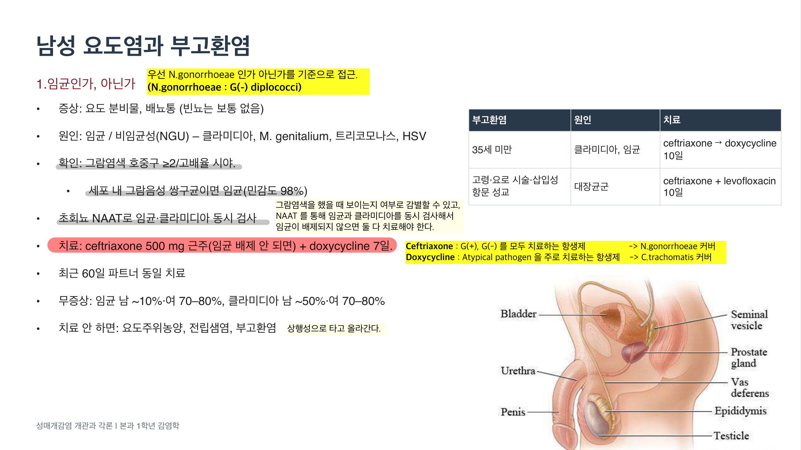
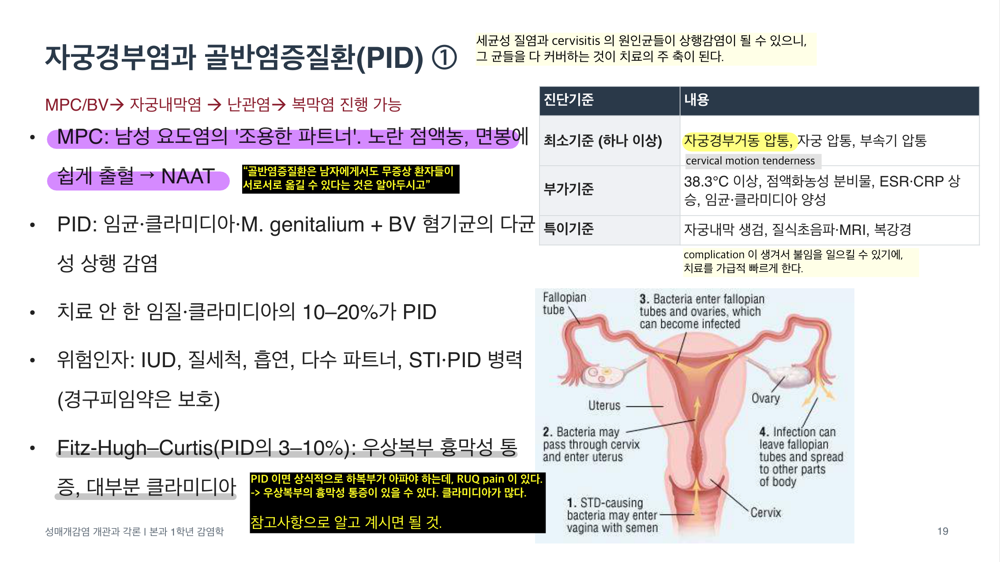
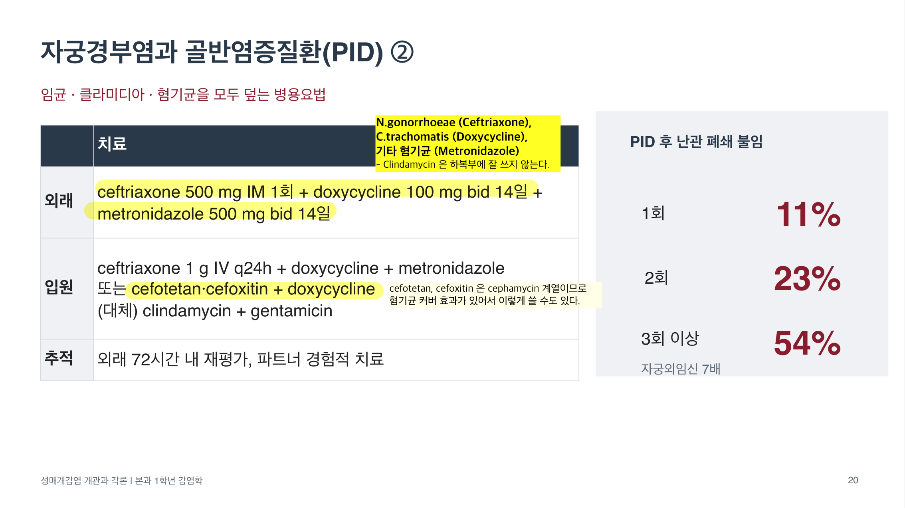
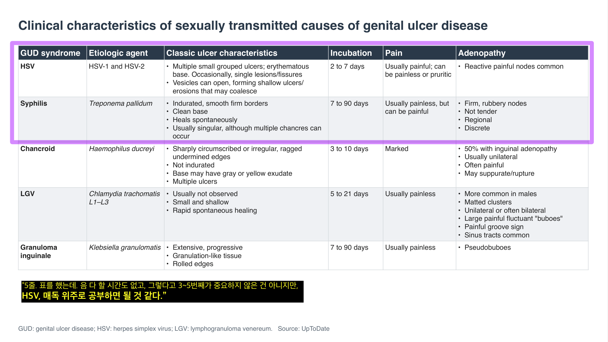
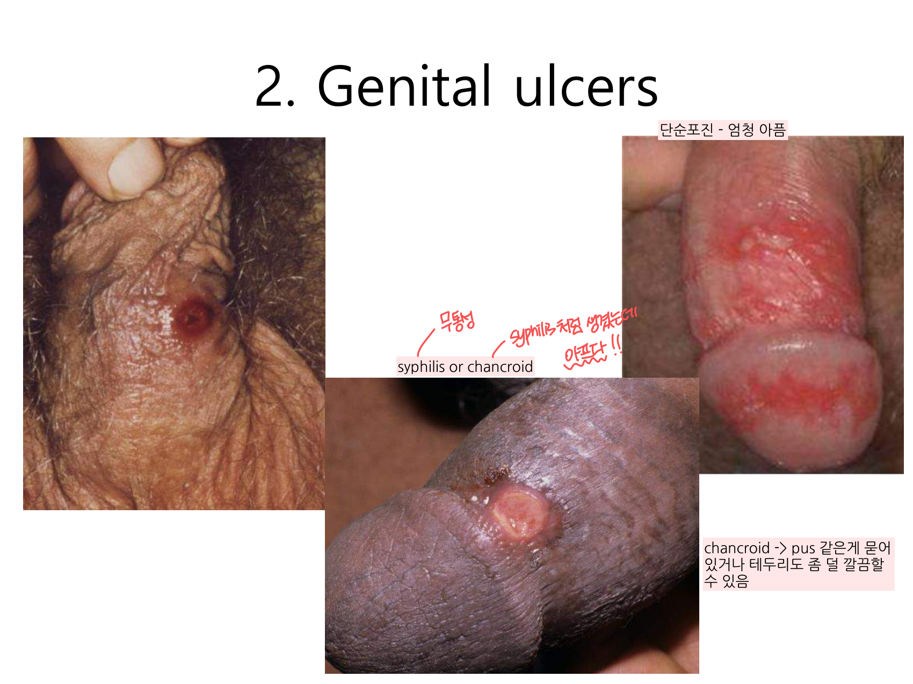
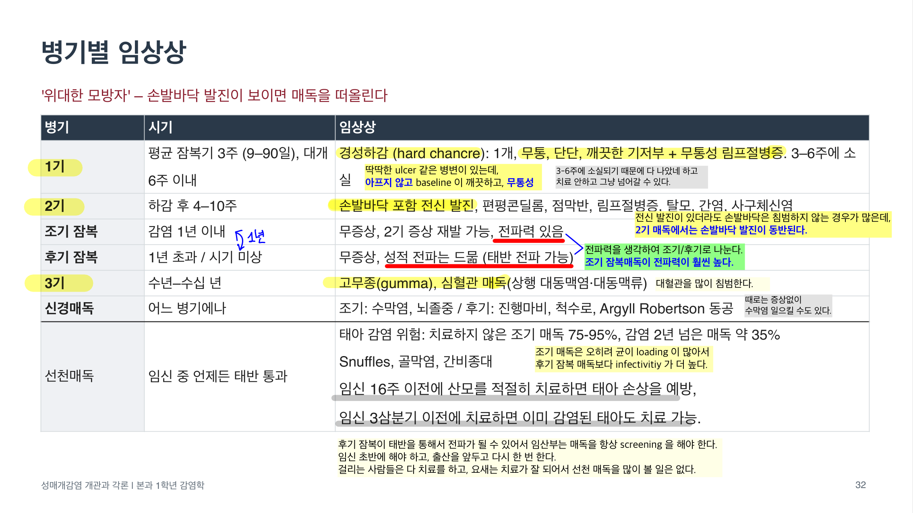
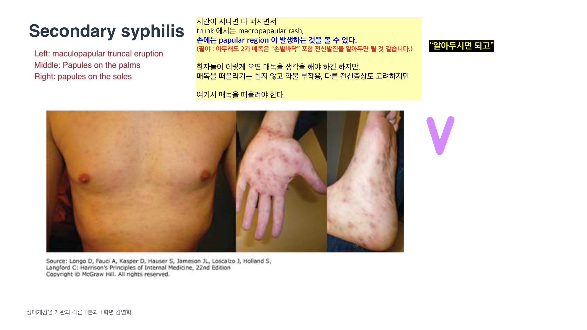
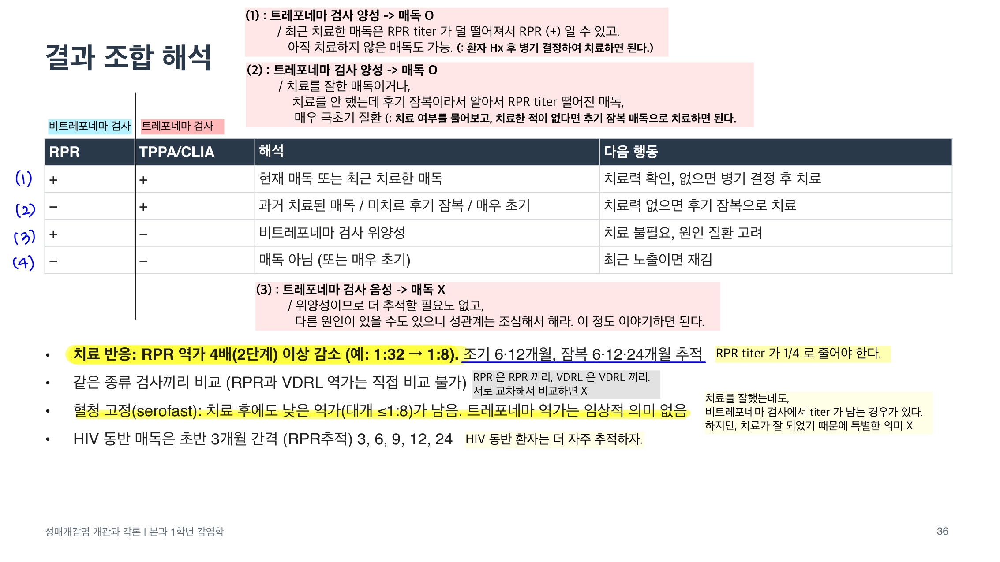
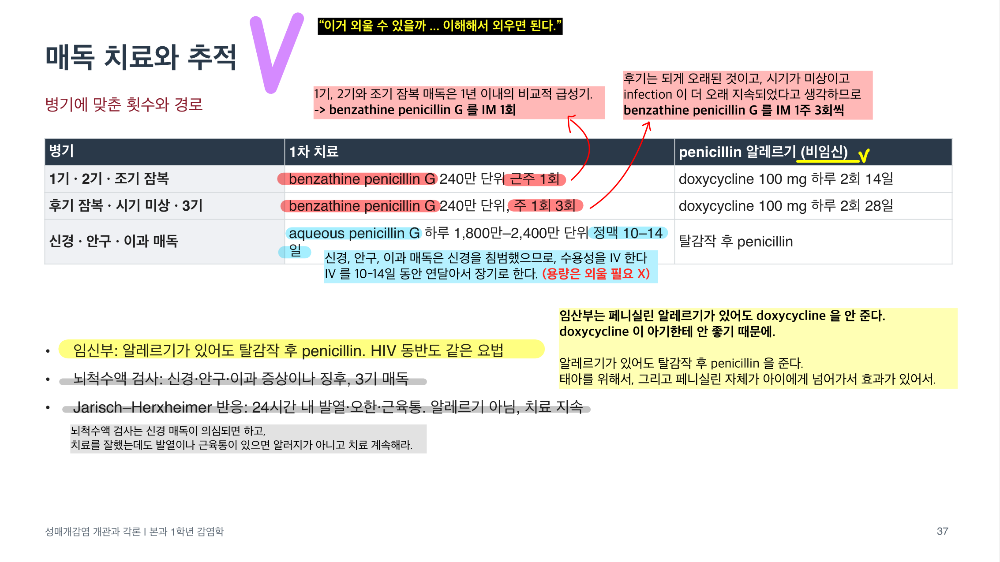

<!-- 필기본: 2026 · 2025 -->
<!-- 단계: 수업 후 -->

# 0. 이 수업을 공부하는 법

**성매개감염(STI): 개관과 각론** — 칠곡경북대학교병원 감염내과 **임승진 교수님**.

!!! diff "작년 필기와 다른 점"
    **교수님이 바뀌었다.** 작년까지는 계속 **장현하 교수님** 수업이었고 기출 37문항도 그 시절 것이다. 장현하 교수님 문항은 "사진 한 장 + 아픈지 안 아픈지"로 원인을 고르는 형식이었다. 올해 강의는 **CDC 2021 지침**을 따라 **치료 약이 몇 가지 바뀌었다**(임균 ceftriaxone **500 mg** 단독, 클라미디아 **doxycycline 7일**, azithromycin은 병용에서 빠짐). 기출의 "ceftriaxone + azithromycin" 답은 예전 기준이다.

필기한 동기: "올해 처음 들어오셨지만 **중요한 부분들은 여러 번 강조**해 주셨기에 그 부분들 위주로, 그리고 **마지막 퀴즈 5개**까지 연관해서 학습하시면 큰 무리 없을 것 같습니다."

교수님이 강조한 것

- "**매독, HSV를 주의해서** 보면 된다." 임균·클라미디아도 "앞에서부터 계속 나오고 있기 때문에 중요할 수밖에 없다."
- "**치료제 종류는 다 알아 두어야** 하고, 대부분 **NAAT**로 진단하나, 매독은 **비트레포네마(RPR) + 트레포네마(TPPA)** 검사를 같이 한다."
- "임상에서 STI 환자에게는 적절한 상담과 함께 **매독 및 HIV 동반 감염**이 있는지, 검사가 필요하다는 말을 해 주고 가능하면 검사하게 하는 것이 맞다."
- 질 분비물 감별표: "중요한 표이긴 한데, **시험 문제를 내진 않을 것이다**. 산부인과에서 내야지."

학습목표(강의 순서)

1. STI 진료의 순서 — **위험평가 → 임상평가 → 검사 → 치료 → 4C**
2. 주요 **증후군별 원인 병원체와 경험적 치료**
3. 임균·클라미디아·트리코모나스·*M. genitalium*·HPV의 핵심과 **1차 치료**
4. **매독**의 병기, **혈청검사 해석**, 병기별 치료 (자세히)
5. **HSV**의 잠복·재활성화, **무증상 배출**, 치료 (자세히)

!!! key "핵심 — 이 표 하나"
    | 병원체 | 대표 증후군 | 진단 | 1차 치료 |
    |---|---|---|---|
    | *N. gonorrhoeae* (그람음성 쌍알균) | 화농성 요도염, 자궁경부염, PID | NAAT, 그람염색 | **ceftriaxone 500 mg IM 1회** |
    | *C. trachomatis* (비정형균) | 무증상, NGU, 자궁경부염, PID | NAAT | **doxycycline 7일** |
    | *T. pallidum* | **무통성 궤양**, 발진, 잠복 | **RPR + TPPA/CLIA** | **benzathine penicillin G**(병기별) |
    | HSV-1/2 | **통증성 수포·궤양**, 재발 | 병변 **PCR** | **acyclovir** 계열 |
    | *T. vaginalis* | 거품성 질 분비물 | NAAT | **metronidazole**(파트너 필수) |
    | *M. genitalium* | **지속성 요도염** | NAAT | doxycycline → **moxifloxacin** |
    | HPV | 첨규콘딜롬, 자궁경부암 | 육안, Pap/HPV | **백신**으로 예방 |

# 1. 역학과 진료의 틀

## STI는 얼마나 흔한가

- 매일 **100만 건 이상** 새로 감염. 치료 가능한 4대 STI가 연 3억 5,700만 건, 성 접촉으로 전파되는 미생물 **40종 이상**.
- 미국 매독 신고 2022년 207,255건(1950년 이후 최다), **국내 매독 신고 2024년 2,790명**(남성 78%, 20~30대 59%). "최근에 눈에 띄는 것은 **매독**."
- 국내 법정감염병: **제3급 = 매독·AIDS**, **제4급 표본감시 6종** = 임질, 클라미디아, 연성하감, 성기단순포진, 첨규콘딜롬, HPV. 4급 STI 2022년 35,757명 중 **성기단순포진**(10,403명)이 최다, **클라미디아는 20대 여성**에 많다.

## STI 확산의 세 요소

**확산 속도 ∝ 노출률 × 1회 노출당 전파 효율 × 감염력 지속기간** (작년 필기의 R0 = B × D × C와 같은 뜻)

| 요소 | 줄이는 방법 |
|---|---|
| 노출률 | 교육, 파트너 수 감소, **노출 후 예방(PEP)** |
| 1회 노출당 전파 효율 | **콘돔**, 백신(HBV, HPV), 남성 포경수술 |
| 감염력 지속기간 | **조기 진단**, 완치·억제 치료, **파트너 치료** |

- 검사와 치료는 세 번째 요소를 줄이는 일 → **무증상 감염자를 찾아야** 하는 이유. "감염내과에서 하는 일은 이것."

## STI 진료의 5단계 — 치료로 끝나지 않는다

1. **위험평가**: 파트너, 성행동, 노출 부위, 과거 STI
2. **임상평가**: 증상과 징후
3. **검사**: 증상 있으면 **확진**, 없으면 **선별**
4. **치료**: 가능한 원인을 **모두 덮는 경험적 치료**
5. **4C**: **C**ontact tracing(접촉자 추적), **C**ompliance(복약 순응), **C**ounseling(상담), **C**ondom(콘돔)

- **선별**: 성적으로 활발한 **25세 이하 여성은 클라미디아 매년**, **모든 성인은 HIV 평생 1회 이상**, STI 진단자와 **모든 임신부는 매독·HIV**.
- **파트너 통보 기간**: 임균 **1개월**, 클라미디아 **1~2개월**, 조기 매독 **최대 3개월**.
- **DoxyPEP**: MSM·트랜스여성에서 콘돔 없는 성관계 후 **72시간 내 doxycycline 200 mg**(시스젠더 여성은 효과 미입증).
- **위험인자**: 25세 미만, 다수 파트너, 콘돔 미사용, 주사약물, 취약 청소년, STI 과거력.
- 실제 감염자는 진단된 수의 2배 이상 → STI를 진단하면 **HIV·매독·HBV·HCV**, 필요하면 Pap.

!!! memo "교수님이 처음과 끝에 두 번 강조한 문장"
    STI가 새로 발견되었거나 위험도 평가상 고위험군인 모든 환자, 그리고 **모든 임신부**에게는 적절한 **상담**과 함께 **매독 및 HIV 혈청검사**를 권한다. 위험 감소 상담은 이후 STI 획득을 유의하게 줄인다(RCT).

## 성 전파 미생물과 증후군

- "다 외울 수는 없다. **카테고리화**해서 참고하면 된다." 성인에서 주로 성교로 전파: 세균(*N. gonorrhoeae*, *C. trachomatis*, *T. pallidum*, *H. ducreyi*, *K. granulomatis*, *U. urealyticum*, ***M. genitalium***), 바이러스(HIV, HTLV-1, **HSV-2**, HPV, HBV, molluscum), 기타(*T. vaginalis*, 사면발이). 구강-분변 접촉으로는 *Shigella*, *Campylobacter*, HAV, *Giardia*, *E. histolytica*.
- **하나의 증후군, 여러 원인** — 표마다 ***C. trachomatis***, ***N. gonorrhoeae***가 계속 들어간다. 여성에서는 **PID**가 더 중요하다.

| 증후군 | 원인 |
|---|---|
| 남성 요도염 | 임균, 클라미디아, *M. genitalium*, *Ureaplasma*, 트리코모나스, HSV |
| 부고환염 | 클라미디아, 임균, (고령·MSM) 대장균군 |
| 점액농성 자궁경부염 | 클라미디아, 임균, *M. genitalium* |
| 급성 골반염(PID) | 임균, 클라미디아, BV 관련 세균, *M. genitalium*, GBS |
| 생식기 궤양 | **HSV-1·2, *T. pallidum***, *H. ducreyi*, *C. trachomatis*(LGV), *K. granulomatis* |
| 직장염 | 클라미디아, 임균, HSV, *T. pallidum* |
| 급성 관절염 | 임균(DGI), 클라미디아(반응성 관절염), HBV |
| 생식기·항문 사마귀 | HPV |
| 종양 | HPV(16·18·31·45 — 자궁경부·항문·음경암), **HHV-8(카포시육종)**, HTLV-1(T세포 백혈병), HBV(간세포암) |

- STI는 일부 종양(자궁경부암, 간세포암, 카포시육종)과 관련이 있다.
- **주요 감염은 무증상이 많다** → 무증상자도 적극적으로 검사(임균, 클라미디아, *M. genitalium*, 트리코모나스, 매독, HSV, HPV, HIV).

!!! exam "기출 포인트"
    3번: 남성 요도염의 가장 흔하고 중요한 원인 2가지 → ***C. trachomatis***, ***N. gonorrhoeae***. 18번: 2020년 국내 가장 흔한 세균성 STI → **클라미디아 감염증**(올해 자료로는 4급 STI 전체 최다는 성기단순포진). 31번: 인공배지 배양 불가, 비임균성 요도염의 흔한 원인, 보라색 봉입체 → ***C. trachomatis***.

# 2. 남성 요도염과 부고환염

{: style="width:80%"}

- 증상: **요도 분비물, 배뇨통**(빈뇨는 보통 **없음**).
- "**주요 원인균 2가지는 알아 두세요.**" — ***N. gonorrhoeae***(그람음성 **쌍알균**) / ***C. trachomatis***(그람음성, **비정형균**). 클라미디아는 과거 비임균성 요도염(NGU)의 30~40%, 감소 추세.
- 임균·클라미디아가 아니라면 ***M. genitalium***이 흔하다(역시 비정형균; *M. pneumoniae*는 지역사회획득 폐렴 원인균이었다). 클라미디아 음성 NGU의 상당수. "**임균, 클라미디아, *M. genitalium* 정도까지만** 알아 두면 될 것 같다."
- 기타: HSV, 트리코모나스, 드물게 아데노바이러스. 삽입 항문 성교 → 대장균군, 이성애 남성 → BV 관련 혐기균(*Leptotrichia/Sneathia*). *Ureaplasma*는 ***U. urealyticum*만** 일부 연관(*U. parvum*은 무관).

## 1단계 — 임균인가, 아닌가

- **그람염색 호중구 ≥ 2/고배율 시야** → 요도염 확인.
- **세포 내 그람음성 쌍알균**이면 **임균**(민감도 98%).
- **초회뇨 NAAT**로 **임균·클라미디아 동시 검사**. 초기 진단에는 임균·클라미디아 특이 검사만 권고(*M. genitalium* NAAT는 상용화되어 있지만 초기 권고는 아님).
- **치료: ceftriaxone 500 mg 근주**(임균이 배제 안 되면) **+ doxycycline 7일**.
    - **Ceftriaxone**: 그람양성·음성을 모두 치료 → **임균** 커버.
    - **Doxycycline**: 비정형균을 주로 치료 → **클라미디아** 커버.
    - 임균이 배제되지 않으면 **둘 다** 치료한다.
- **최근 60일 파트너**도 같은 치료.
- **무증상**: 임균 남 ~10%·여 **70~80%**, 클라미디아 남 ~50%·여 70~80%.
- 치료하지 않으면 **상행**해서 요도주위농양, 전립샘염, **부고환염**.

| 부고환염 | 원인 | 치료 |
|---|---|---|
| **35세 미만** | 클라미디아, 임균 | ceftriaxone → doxycycline 10일 |
| 고령·요로 시술·삽입 항문 성교 | 대장균군 | ceftriaxone + levofloxacin 10일 |

## 2단계 — 지속되는 요도염

- 임균·클라미디아를 치료했는데 요도염이 계속되면: 치료가 잘 안 되었거나 **다른 원인(*M. genitalium*)**.
- *M. genitalium*: NAAT 검출 후 지역 감수성에 따라 **azithromycin 또는 moxifloxacin**. "**azithromycin조차도 최근 내성**이 많이 늘어서 **moxifloxacin, doxycycline**을 많이 쓰는 추세." 감수성 검사는 쉽지 않다.

!!! diff "작년 필기와 다른 점"
    - 작년(장현하 교수님): 임균성 요도염 **ceftriaxone 250 mg IM 1회 + azithromycin 1 g PO 1회**, 비임균성은 azithromycin 1 g 1회 또는 doxycycline 7일. 요도염 진단 기준 4가지(분비물, 그람염색 WBC ≥ 2, 첫 소변 백혈구 에스테라아제, 첫 소변 WBC ≥ 10/HPF).
    - 올해: **ceftriaxone 500 mg + doxycycline 7일**. 필기한 동기: "아마도 예전 기출이라(+ 교수님도 다르고) 답이 ceftriaxone + azithromycin인 것 같습니다. **강의에서는 임균 치료제로 ceftriaxone만** 언급하셨습니다."

!!! exam "기출 포인트"
    요도 고름(사진) → **ceftriaxone + azithromycin**(12번), **ceftriaxone 250 mg IM + azithromycin 1 g PO**(19번) — 둘 다 작년 기준 답이다. 6번: 요도염 환자 접근으로 옳은 것 → **내원 시 그리고 4~8주 후 anti-HIV 검사**. 오답 — 확진을 VDRL·TPHA로, **파트너 치료 불필요**, meropenem 1회, metronidazole 7일.

# 3. 질 분비물 (참고 — 시험에는 안 낸다고 함)

| | 칸디다증 | 트리코모나스 | 세균성 질염(BV) |
|---|---|---|---|
| 분비물 | **하얀 덩어리** | 많고 **황색, 거품** | **회백색, 균질**, 악취 |
| pH | ≤ 4.5 | ≥ 5 | > 4.5 |
| KOH 비린내 | 없음 | 있을 수 있음 | **있음** |
| 현미경 | **가균사·균사** | **움직이는 원충** | **단서세포(clue cell)** |
| 치료 | 질내 azole, fluconazole 150 mg 1회 | **metronidazole 7일** | **metronidazole 7일** |
| 파트너 치료 | 불필요 | **필수** | 효과 없음 |

- 원충(트리코모나스)과 세균(BV) 모두 **metronidazole** — 원충 치료가 되는 항생제.
- 무증상: BV 50%, 칸디다 20%. 임신 중 BV·트리코모나스 → 조기양막파열·조산·저체중아 → 증상 있는 임부는 치료.
- 치료했는데 안 나으면 다른 원인: 포도알균 독성쇼크증후군, 박리성 염증성 질염, 잔류 이물질, 살정제·세정제·콘돔 알레르기, HIV, 베체트("참고사항").

# 4. 자궁경부염과 골반염증질환(PID)

{: style="width:80%"}

- **정의**: 자궁경부·질의 감염이 **상행**해 **자궁내막염** 및/또는 **난관염**. MPC/BV → 자궁내막염 → 난관염 → 복막염까지 진행 가능.
- **점액농성 자궁경부염(MPC)**: 남성 요도염의 **'조용한 파트너'**. 노란 점액농, **면봉에 쉽게 출혈** → NAAT. 교수님: "골반염증질환은 **남자에게서도 무증상 환자들이 서로서로 옮길 수 있다**는 것은 알아 두시고."
- **원인**: 자궁경부염 원인균(**임균, 클라미디아, *M. genitalium***) + **BV 관련 혐기균**·장내세균(*Prevotella*, *Peptostreptococcus*, *E. coli*, *H. influenzae*, GBS) — **다균성** 상행 감염. 질염 원인균과 비슷하다 → **치료는 이들 모두를 표적**.
- 치료하지 않은 임질·클라미디아의 **10~20%가 PID**.
- **위험인자**: 자궁경부염·BV 동반, 과거 난관염, **질 세척**, 흡연, 다수 파트너, **최근 IUD 삽입**, 소파술·제왕절개 등 **자궁 내 시술**, **월경 직후**(생리혈을 통한 상행). **경구피임약·난관결찰술은 보호**.
- **Fitz-Hugh–Curtis**(PID의 3~10%): PID면 하복부가 아파야 하는데 **우상복부 흉막성 통증** — 대부분 **클라미디아**("참고사항").

| 진단기준 | 내용 |
|---|---|
| **최소기준(하나 이상)** | **자궁경부 거동 압통**(cervical motion tenderness), 자궁 압통, 부속기 압통 |
| 부가기준 | 38.3 °C 이상, 점액화농성 분비물, ESR·CRP 상승, 임균·클라미디아 양성 |
| 특이기준 | 자궁내막 생검, 질식초음파·MRI, 복강경 |

- **합병증으로 불임**이 올 수 있어 **가급적 빨리** 치료한다.

{: style="width:76%"}

| | 치료 |
|---|---|
| **외래** | **ceftriaxone 500 mg IM 1회 + doxycycline 100 mg bid 14일 + metronidazole 500 mg bid 14일** |
| 입원 | ceftriaxone 1 g IV q24h + doxycycline + metronidazole, 또는 **cefotetan·cefoxitin + doxycycline**, (대체) clindamycin + gentamicin |
| 추적 | 외래 **72시간 내 재평가**, 파트너 경험적 치료 |

- 약 하나하나의 의미: **임균 = ceftriaxone**, **클라미디아 = doxycycline**, **혐기균 = metronidazole**. Cefotetan·cefoxitin은 **cephamycin** 계열이라 혐기균도 덮어 이렇게 쓸 수 있다. "Clindamycin은 하복부에 잘 쓰지 않는다."
- PID 후 **난관 폐쇄 불임**: 1회 11%, 2회 23%, 3회 이상 **54%**, **자궁외임신 7배**.

!!! diff "작년 필기와 다른 점"
    작년: 외래 **ceftriaxone 250 mg** IM 1회 + doxycycline 14일 ± metronidazole, 입원 cefotetan/cefoxitin + doxycycline. 올해는 **ceftriaxone 500 mg**, metronidazole을 **기본으로** 포함. 작년 강조점 — PID 발생 경로 중 **IUD 삽입 등 침습적 자궁내 시술**이 많다, 간 주위에 물이 고이면 간 감염이 아니라 PID가 올라간 것.

!!! exam "기출 포인트"
    교수님 형성평가 2번: 20세 여성, **월경 직후 양측 하복부 통증, 자궁경부 거동 압통**, 37.6 °C → PID. 치료 전 반드시 할 것 = **임신 배제, 검체 채취**("잊지 말아야 해서 넣었다. 뭘 배제해야 하는지는 강의록에 없었다"). PID 약(metronidazole + doxycycline + ceftriaxone)이 **아기에게 영향**을 줄지 봐야 하므로 **임신부터 배제**한다.

# 5. 생식기 궤양과 직장염

- **궤양이면 매독·HSV·HIV를 모두 검사**한다.
- 가장 흔한 원인 **HSV**, 다음 **매독**. 그 밖에 연성하감, LGV, 서혜육아종.
- **첫 방문에 검체를 모두 채취하고 바로 경험적 치료**.
- **매독 위험이 높으면(MSM, 임신부) 혈청 음성이어도 매독 치료** — "매독 위험이 높으면 검사를 적극적으로 해라."
- 2~6주 넘게 낫지 않으면 **조직검사**.
- 연성하감 임상 진단: **통증성 궤양 + 국소 림프절**, 매독 증거 없음(7일 후 혈청 음성), HSV 배제.

{: style="width:90%"}

교수님: "5줄 표를 했는데 다 할 시간도 없고, 3~5번째가 중요하지 않은 건 아니지만 **HSV, 매독 위주로** 공부하면 될 것 같다."

| | **HSV** | **매독** | 연성하감 (*H. ducreyi*) | LGV (*C. trachomatis* L1–L3) |
|---|---|---|---|---|
| 궤양 | **작은 다발성**, 홍반 기저, 수포가 터져 얕은 궤양 | **경결, 단단한 경계, 깨끗한 기저**, 대개 **1개**, 저절로 낫는다 | 울퉁불퉁 파고든 가장자리, 경결 없음, 회색·노란 삼출, 다발 | 잘 안 보임, 빨리 나음 |
| 잠복기 | 2~7일 | 7~90일 | 3~10일 | 5~21일 |
| **통증** | **대개 아픔** | **대개 무통** | **심함** | 대개 무통 |
| 림프절 | 반응성 **압통** 림프절 | **단단, 고무 같음, 압통 없음** | 50%, 대개 **편측, 아픔, 화농·파열** | 크고 아픈 파동성 **bubo**, groove sign |

{: style="width:60%"}

| | 직장염 | 장염·직장결장염 |
|---|---|---|
| 전파 | 수용성 항문 성교 | 구강-항문 접촉 |
| 증상 | 항문 통증, **이급후중**, 점액농성 분비물 | 설사, 복통 |
| 원인 | 임균, 클라미디아(LGV), HSV, 매독 | *Campylobacter*, *Shigella*, *Giardia* |
| 치료 | ceftriaxone + doxycycline 7일(**LGV 21일**) | 원인별 |

## 생식기 사마귀 · 사면발이 · 옴

- **첨규콘딜롬 = HPV 6, 11**. 80%가 18개월 안에 자연 소실. 가려움·화끈거림·통증, 잠복기 1~8개월. **항바이러스제가 없어** 필요 시 **외과적 절제**가 주된 치료 → **백신**이 예방에 중요. 2기 매독의 편평콘딜롬과 감별.
- **사면발이**(*Phthirus pubis*, 음모)·**옴**(*Sarcoptes scabiei*, 손가락 사이·손목·겨드랑이, 심한 **야간** 가려움, 굴) — **permethrin 5%**, ivermectin. 성접촉뿐 아니라 **가족·친구 간에도** 옮는다 → **밀접 접촉자 모두 함께 치료**, 의복·침구는 뜨거운 물로("참고만").

# 6. 임균 vs 클라미디아

| | 임균 *N. gonorrhoeae* | 클라미디아 *C. trachomatis* |
|---|---|---|
| 미생물 | **그람음성 쌍알균**, 항원 변이 → 재감염 흔함, **백신 없음** | **절대 세포내 기생균**(기본체 → 망상체) |
| 잠복기 | 2~7일 | 1~3주 |
| 남성 | **많은 화농성** 분비물 | 적고 맑은 분비물, **무증상 흔함** |
| 여성 | 자궁경부염(절반 이상 무증상), PID | 대부분 무증상, PID·불임·자궁외임신 |
| 전신 | **파종성 임균 감염(DGI)** | **반응성 관절염**, LGV(L1–L3) |
| 진단 | NAAT, 남성 요도 그람염색 | **NAAT** |
| 1차 치료 | **ceftriaxone 500 mg IM 1회** | **doxycycline 100 mg bid 7일** |

교수님: "절대적으로 외우려고 하기보다는 **임균 → 그람음성 쌍알균 / ceftriaxone**, **클라미디아 → 비정형균 / doxycycline**으로 외우고, 배양은 둘 다 쉽지 않아서(특히 클라미디아) **NAAT**로 진단한다."

## 임균의 내성

- penicillin → tetracycline → fluoroquinolone → cefixime·azithromycin 순으로 **내성이 계속 진화**. **ceftriaxone**이 현재 1차(감수성 저하 일부).
- **경구 cephalosporin, fluoroquinolone은 임균 치료에 권장하지 않는다.** **azithromycin도 내성 증가로 병용요법에서 빠졌다.**
- WHO 우선순위 내성균, MSM에서 흔하다. 국내 대부분 균주가 penicillin·tetracycline 내성, FQ는 2006년부터 사용 제한.
- "마지막 남은 ceftriaxone에 감수성이 있어서 쓰는데, 최근 보고는 거기에도 내성이 있지 않을까? 현재까지는 ceftriaxone으로 치료한다."

# 7. 트리코모나스 · *M. genitalium* · HPV

| | *T. vaginalis* | *M. genitalium* | HPV |
|---|---|---|---|
| 분류 | **편모원충** | **세포벽 없는 세균** | 외피 없는 dsDNA 바이러스 |
| 대표 임상 | **황색 거품성** 질 분비물, **딸기 모양 자궁경부** | **지속·재발성 요도염**, 자궁경부염, PID | **6·11 첨규콘딜롬 / 16·18 자궁경부암** |
| 진단 | NAAT | NAAT(**무증상 선별 안 함**) | 육안, Pap ± HPV 검사 |
| 치료·예방 | **metronidazole, 파트너 필수** | **doxycycline → moxifloxacin** | **9가 백신**(11~12세) |
| 한 줄 | 파트너를 같이 치료하는 질염 | **항생제가 안 듣는 요도염** | **백신으로 막는 암** |

- *M. genitalium*: 클라미디아 감염자의 3~15%에서 동시 감염. 국내 교과서는 azithromycin, **CDC 2021은 doxycycline → moxifloxacin**(macrolide 내성으로 지침 변화 중). "독시가 잘 안 들으면 moxifloxacin."
- HPV: 바이러스라 특별한 치료는 없고 **병변 제거**(imiquimod 5%·podofilox 자가 도포, 냉동요법, 소작술, TCA).

# 8. 매독 (*Treponema pallidum*) — 자세히

## 미생물과 병인 — 감염 직후 이미 전신 질환

- **나선균**(spirochete). **인공 배지 배양 불가, 그람염색에 안 보인다**("그람염색도 안 되는 나선형의 꼬인 균") → 진단은 **암시야 현미경, PCR, 혈청검사**.
- 외막 표면 단백이 적어 **면역을 회피**. 점막·미세 상처로 침입 → **수시간 내 림프·혈류**로 전파 → "**감염되는 순간 전신성 질환**". 임상 양상이 매우 다양하다.
- 병리: **폐쇄성 동맥내막염**(endarteritis obliterans), **형질세포** 침윤.
- 전파: 성 접촉(1·2기·조기 잠복), **태반(임신 중 언제든)**. 잠복기 보통 **3주**, 대개 6주 이내.

## 병기별 임상상 — '위대한 모방자'

{: style="width:88%"}

| 병기 | 시기 | 임상상 |
|---|---|---|
| **1기** | 잠복기 평균 3주(9~90일) | **경성하감**(hard chancre): **1개, 무통, 단단, 깨끗한 기저부** + **무통성 림프절병증**. **3~6주에 소실** |
| **2기** | 하감 후 **4~10주** | **손발바닥 포함 전신 발진**, 편평콘딜롬, 점막반, 림프절병증, 탈모, 간염, 사구체신염 |
| **조기 잠복** | 감염 **1년 이내** | 무증상, 2기 증상 재발 가능, **전파력 있음** |
| **후기 잠복** | 1년 초과 / 시기 미상 | 무증상, 성적 전파 드묾(**태반 전파 가능**) |
| **3기** | 수년~수십 년 | **고무종(gumma)**, **심혈관 매독**(상행 대동맥염·대동맥류) |
| 신경매독 | **어느 병기에나** | 조기: 수막염, 뇌졸중 / 후기: 진행마비, 척수로, **Argyll Robertson 동공** |
| 선천매독 | 임신 중 언제든 태반 통과 | Snuffles, 골막염, 간비종대 |

- **1기**: "딱딱한 궤양 같은 병변이 있는데 **아프지 않고 기저부가 깨끗**." **3~6주에 소실되어** "다 나았네" 하고 **치료 안 하고 넘어갈 수 있다** — 이게 관건. 특히 여성에서 놓치기 쉽다.
- **2기**: 전신 발진이 있어도 **손발바닥은 보통 침범하지 않는데, 2기 매독은 손발바닥 발진이 동반**된다. 몸통은 반점구진, 손발바닥은 구진. "환자가 이렇게 오면 매독을 떠올리기 쉽지 않고 약물 부작용, 다른 전신 질환도 고려하지만 **여기서 매독을 떠올려야** 한다."
- **3기**: 대혈관을 많이 침범. 신경매독은 **증상 없이 수막염**을 일으킬 수도 있다.
- **잠복기를 조기/후기로 나누는 이유 = 전파력.** 조기 매독은 균 부하(loading)가 많아 **조기 잠복이 후기 잠복보다 전파력이 훨씬 높다**.
- **선천매독**: 치료하지 않은 조기 매독은 태아 감염 위험 **75~95%**, 감염 2년 넘은 매독 약 35%. **임신 16주 이전**에 산모를 적절히 치료하면 태아 손상 예방, **3삼분기 이전**에 치료하면 이미 감염된 태아도 치료 가능. 후기 잠복도 태반으로 전파될 수 있어 **임신부는 항상 매독 선별** — **임신 초반에 하고, 출산 전에 한 번 더**. 요즘은 치료가 잘 되어 선천매독을 볼 일은 많지 않다.

{: style="width:72%"}

## 혈청검사 — 두 종류를 함께 본다

| | **비트레포네마 검사** | **트레포네마 검사** |
|---|---|---|
| 예 | **RPR, VDRL** | **TPPA**, TPHA, FTA-ABS, (CLIA) |
| 측정 | **cardiolipin** 항체 | ***T. pallidum* 특이 항체** |
| 결과 | **역가**(예: 1:32) | 양성 / 음성 |
| 치료 후 | 역가 감소·음전 → **치료 반응 추적** | 대개 **평생 양성** → 과거 감염 흔적 |
| 주의 | **위양성**(임신, 자가면역, 바이러스 감염), **전지대 현상**(prozone) | 치료 반응 판정 **불가** |

- "**두 검사의 차이를 알아 두어야 한다.**" 비트레포네마(+)·트레포네마(−)면 **매독이 아니다**.
- 그러면 비트레포네마 검사는 왜 하나? → **치료 반응을 추적**하려고. 치료 전에 먼저 재고 치료하면서 주기적으로 추적.
- 트레포네마 검사는 확진검사지만 **한 번 양성은 평생 양성** → 다 나았는데도 양성이라 헷갈릴 수 있다.
- **초기 1기에는 두 검사 모두 음성**일 수 있다 → 의심되면 **치료하고 1~2주 후 재검**.

{: style="width:84%"}

| RPR | TPPA/CLIA | 해석 | 다음 행동 |
|---|---|---|---|
| + | + | **현재 매독** 또는 최근 치료한 매독 | 치료력 확인, 없으면 **병기 결정 후 치료** |
| − | + | 과거 치료된 매독 / **미치료 후기 잠복** / 매우 초기 | 치료력 없으면 **후기 잠복으로 치료** |
| + | − | **비트레포네마 위양성** | 치료 불필요, 원인 질환 고려 |
| − | − | 매독 아님(또는 매우 초기) | 최근 노출이면 재검 |

- **치료 반응 = RPR 역가 4배(2단계) 이상 감소**(예: 1:32 → 1:8). 조기는 6·12개월, 잠복은 6·12·24개월 추적.
- **같은 종류끼리** 비교한다 — RPR은 RPR끼리, VDRL은 VDRL끼리(교차 비교 ×).
- **혈청 고정(serofast)**: 치료가 잘 됐는데도 낮은 역가(대개 ≤ 1:8)가 남음 → 특별한 의미 없음. 트레포네마 역가는 임상적 의미 없다.
- **HIV 동반 매독**은 더 자주 추적(3, 6, 9, 12, 24개월).

## 치료 — 병기에 맞춘 횟수와 경로

{: style="width:84%"}

| 병기 | 1차 치료 | penicillin 알레르기(비임신) |
|---|---|---|
| **1기 · 2기 · 조기 잠복** | **benzathine penicillin G 240만 단위 IM 1회** | doxycycline 100 mg bid 14일 |
| **후기 잠복 · 시기 미상 · 3기** | **benzathine penicillin G 240만 단위, 주 1회 × 3회** | doxycycline 100 mg bid 28일 |
| **신경 · 안구 · 이과 매독** | **aqueous(수용성) penicillin G IV 10~14일** | 탈감작 후 penicillin |

- 이해해서 외우기: 1기·2기·조기 잠복은 **1년 이내의 비교적 급성기** → **1회**. 후기·시기 미상은 오래 지속된 감염 → **주 1회 3번**. 신경을 침범했으면 **수용성을 IV**로 10~14일 연달아(용량은 외울 필요 없음). "이거 외울 수 있을까… 이해해서 외우면 된다."
- **임신부**: 알레르기가 있어도 doxycycline을 **안 준다**(아기에게 안 좋음) → **탈감작 후 penicillin**(penicillin 자체가 태아에게 넘어가 효과). HIV 동반도 같은 요법.
- **뇌척수액 검사**: 신경·안구·이과 증상·징후, 3기 매독.
- **Jarisch–Herxheimer 반응**: 치료 후 **24시간 내 발열·오한·근육통**. **알레르기가 아니다 → 치료 지속**(지지 치료).

## 적절한 반응과 재치료

- 목표 = **역가 4배 이상 감소**. 12개월 내 음전: 1기 40~75%, 2기 20~40%.
- **재치료 고려**: 역가가 충분히 안 떨어짐, **4배 이상 다시 상승**, 증상 지속·재발 → **재감염** 또는 **신경매독** 의심 → **뇌척수액 검사** → 이상이면 신경매독 요법, 정상이면 후기 잠복 요법(BPG 주 1회 × 3).
- 재치료하지 않는 경우: 증상 없이 낮은 역가 유지(serofast), 후기 잠복으로 처음부터 역가가 낮아 4배 감소가 안 나오는 경우.
- 음전이 느린 경우: HIV 감염자, 과거 매독력(재감염).

!!! exam "기출 포인트"
    - **통증 없는 음경 궤양** → ***T. pallidum***(1·11·30번). 9번: 2주 전 성관계, **1 cm 무통 궤양**, 양측 서혜부 림프절 단단·압통 없음 → ***T. pallidum***.
    - 매독 치료제 → **benzathine penicillin G**(5·10·28번).
    - 20번: 무통 궤양·사타구니 부음(저절로 없어짐) → 열·**손바닥** 발진 → **매독**. 13번: 몸통 발진 + **손·발바닥** 병변 + 입안 불편 → ***T. pallidum***(콕사키 함정).
    - 16번: 손바닥 병변 = 2기, "치료 효과 판단은 **treponemal** 검사" → **False**(non-treponemal로 판단).
    - 24번: 비트레포네마 항원 = **cardiolipin**. 34번: 1기 **경성하감**, 3기 **고무종**.

# 9. 단순포진바이러스 HSV-1/2 — 자세히

## 바이러스와 잠복

1. 점막·피부 상피세포에서 증식
2. 감각신경 말단 → **역행성 축삭수송**
3. **천골(생식기) / 삼차(구강) 신경절**에 **평생 잠복**
4. 재활성화 → 순행성 → **병변 또는 무증상 배출**

- Herpesviridae, **이중가닥 DNA, 외피** 있음. **HSV-1은 구강, HSV-2는 생식기** 쪽이 주. **HSV-2는 생식기 재발이 훨씬 잦고 전파력이 높다**. 구강 성교로 **생식기 HSV-1 초감염**이 늘고 있다.
- 신경절(DRG)에 잠복 → 위로 가면 **CNS(뇌염)**, 아래로 가면 **재발성 생식기 궤양**. "**acyclovir는 복제하는 바이러스만** 표적하므로 **얌전히 잠복한 애들은 죽일 수 없어서** 평생 가지고 간다."
- **HSV–HIV 악순환**: 헤르페스는 HIV 획득·전파를 늘리고, HIV는 헤르페스 재발을 늘린다. 항바이러스 억제 치료로 HIV 전파가 줄지는 않았다.

## 임상상 — 전파는 대부분 증상이 없을 때

| | 초발(첫 감염) | 재발 |
|---|---|---|
| 병변 | **양측, 다발성 수포 → 농포 → 통증성 궤양**, 치유 2~3주 | **편측, 더 적고 작음**, 5~10일 치유 |
| 전신 증상 | 발열, 두통, 근육통, **압통성 샅부 림프절** | 드묾 |
| 전구증상 | – | **따끔거림·가려움·신경통** |
| 합병증 | **무균성 수막염**, 천골신경근병증(요저류), 직장염 | – |

- **무증상 바이러스 배출이 대부분의 전파**를 일으킨다. 감염자 대부분은 자신이 감염된 것을 모른다. "**궤양이 없을 때도 전파력이 있다.**"
- 비전형적이거나 사소한 궤양·균열이 전형적 수포보다 **더 흔한** 모습이다.
- **신생아 헤르페스**: **임신 말기 산모 초감염**에서 위험이 가장 높다. 파종성은 치명적.
- 새로 진단된 HSV-2 감염자의 약 60%는 무증상. 원발성: 여성 70~90% 자궁경부염, 80% 압통성 림프절, 무균성 수막염 16~26%.

## 진단과 치료

- 진단: **병변 스왑 PCR**이 표준(형 구분은 예후·상담에 중요). 형 특이 혈청검사는 일반 선별에 권장하지 않는다.
- 약리: **바이러스 thymidine kinase(TK)**가 인산화 → **감염세포에서만** DNA 중합효소 억제.

| 상황 | 치료(CDC 2021 예) |
|---|---|
| **초발** | acyclovir 400 mg tid 또는 valacyclovir 1 g bid, **7~10일** |
| **재발** 삽화 | 전구증상·병변 **1일 내** 시작, 예: valacyclovir 500 mg bid **3일** |
| **억제 요법** | 잦은 재발, **파트너 전파 감소** 목적. valacyclovir 하루 1회 |
| 중증·파종·CNS | **acyclovir IV** 5~10 mg/kg q8h |
| 임신 | **36주부터 억제 요법**. 분만 시 병변·전구증상 있으면 **제왕절개** |
| HIV 동시 감염 | 더 심하고 오래가 더 길게 |

- 교수님: "**초발은 길게, 재발은 짧게.** 지금은 외우라고 안 하겠다. **HSV = acyclovir** 정도만 알아 두고, 상식적으로 **중증·파종·CNS는 IV**, 생식기 궤양과 CNS 감염의 용량·경로는 다르다. 이 정도만."

!!! exam "기출 포인트"
    **심한 통증 + 작은 다발 병변** → **HSV-2**(2·29번). **1~2 mm 수포 여러 개, 매우 아픔, 4년간 4번째 재발** → **HSV-2**(4번). 3개월 전과 같은 병변 재발 → **HSV**(8번). 1~2달마다 쓰리고 아픈 병변 재발 → **acyclovir**(7번). 미생물학: acyclovir 선택성 = 바이러스 **thymidine kinase**(35번), 성기 헤르페스는 **평생 잠복**·완치 불가(37번), 무증상 배출 가능(26·36번).

# 10. 교수님 형성평가 5문제 — "똑같이 낼 것은 아니다. 변형할 예정"

| 문제 | 핵심 답 |
|---|---|
| 1. 22세 남성, 요도 분비물. 그람염색에 호중구는 많으나 **쌍알균은 없다** | 그람음성 쌍알균이 없으니 **임균 배제** → **클라미디아** 생각. **NAAT**로 진단, **doxycycline** |
| 2. 20세 여성, **월경 직후** 양측 하복부 통증, **자궁경부 거동 압통**, 37.6 °C. 치료 전 반드시 할 것? | PID → **임신 배제, 검체 채취** 후 치료 시작(ceftriaxone + doxycycline + metronidazole이 태아에 영향) |
| 3. 30세 **임신 초기** 검진, CLIA 양성, **RPR 1:2, TPPA 양성**, 치료력 없음 | 두 검사 모두 양성 → **매독**(RPR+/TPPA−였다면 임신에 의한 위양성). 치료력 없음 → **후기 잠복에 준해 benzathine penicillin G 주 1회 × 3회** — 아이를 위해 반드시 치료 |
| 4. 2기 매독, benzathine penicillin G **6시간 뒤 발열·오한** | **Jarisch–Herxheimer 반응** → 알레르기 아님, **지지 치료**, 치료 지속 |
| 5. 재발 잦은 헤르페스 환자: "물집이 없을 때는 안 옮기죠?" | **물집이 없어도 옮길 수 있다**(무증상 배출) → **콘돔**, 파트너에게 알리기, (억제요법 valacyclovir 고려 — "시험에 낼 건 아니고"). 임신부 초감염은 제왕절개까지 고려 |

# 11. 미생물학 보충 (2020~22 기출, 작년 필기)

- **임균**: 남성은 **요도**, 여성은 **자궁경부**에 주로 감염 → 여성 검체는 자궁경부(14·22번). 산모 감염 → **신생아 화농성 결막염**, 항원 다양성으로 **백신 없음**, 여성은 상행 감염으로 **불임**, 무증상 보균은 **여성**이 더 흔함(32번). **피막 없음**(국소 감염) vs 수막알균 **피막 있음**(21번).
- **매독균**: **축사(내편모)가 세포질막과 외막 사이**, 병원성 균에 **외피(outer sheath)**(15·33번). 그람염색 ×(암시야), 배양 불가. 끝이 **히알루론산**으로 내피에 결합, **hyaluronidase**가 혈관 주위 침윤 촉진(23번).
- **클라미디아**: **기본소체**가 감염 → **망상소체**로 전환해 증식 → 다시 기본소체로(25번).
- **HSV**: 정이십면체 **이중가닥 DNA**, 외피, 조절에 **세포매개면역**, 치료제 **acyclovir**(ganciclovir·foscarnet은 CMV)(26·36번). HSV-1은 **episome**으로 잠복(17번).
- **HPV**: **E6 → p53**, **E7 → pRB** 결합 → 자궁경부암(27번).

# 암기 — 성매개 감염 요점

| 주제 | 꼭 기억할 것 |
|---|---|
| 진료 순서 | 위험평가 → 임상평가 → 검사 → 치료 → **4C**(접촉자 추적·복약 순응·상담·콘돔) |
| STI 진단하면 | **매독·HIV**(+ HBV·HCV) 검사, 파트너 치료(임균 1개월, 클라미디아 1~2개월, 조기 매독 3개월) |
| 남성 요도염 | 임균(그람음성 쌍알균) vs 비임균 → **ceftriaxone 500 mg IM + doxycycline 7일** / 지속되면 *M. genitalium* → moxifloxacin |
| PID | 자궁경부 거동 압통, 월경 직후·IUD → **임신 배제·검체 채취** → ceftriaxone 500 IM + doxy 14일 + metronidazole 14일 |
| 임균 내성 | 경구 세팔로·FQ ×, azithromycin 병용에서 빠짐, **ceftriaxone만** 남음 |
| 궤양 | **HSV(아픈 다발 수포)** > **매독(무통·1개·깨끗·단단, 무통 림프절)**. 궤양이면 매독·HSV·HIV 검사 |
| 매독 혈청 | RPR(cardiolipin, 역가 → **치료 반응**, 위양성) + TPPA(특이, **평생 양성**). RPR+/TPPA− = 위양성 |
| 매독 치료 | 1기·2기·조기 잠복 **BPG 1회** / 후기·미상·3기 **주 1회 × 3** / 신경·안구·이과 **수용성 PCN IV 10~14일** / 임신부 알레르기 → **탈감작 후 PCN** |
| 반응 판정 | RPR **4배(2단계) 감소**, 같은 검사끼리. Jarisch–Herxheimer = 알레르기 아님 |
| HSV | 신경절 평생 잠복, **무증상 배출이 대부분의 전파**, PCR, acyclovir(초발 길게·재발 짧게·억제), 임신 36주 억제 |
| 트리코모나스·BV | metronidazole (트리코모나스는 파트너 필수) |
| HPV | 6·11 콘딜롬(절제), 16·18 암 → **백신** |
