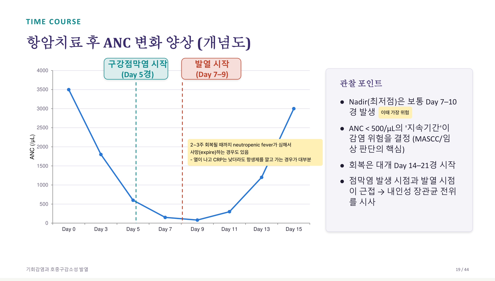
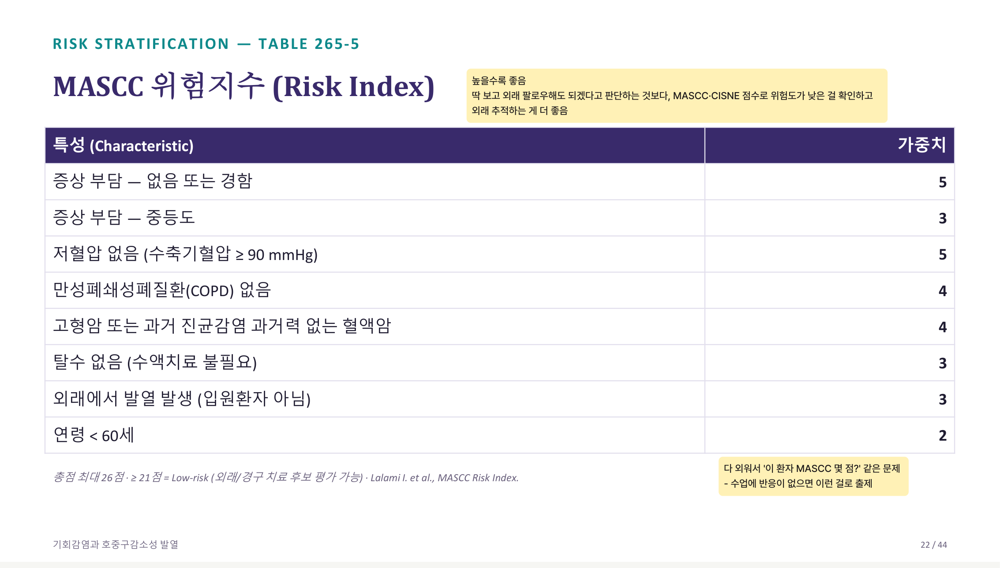
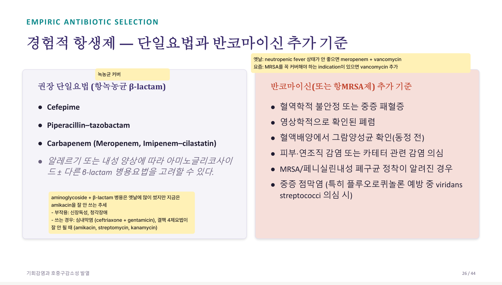
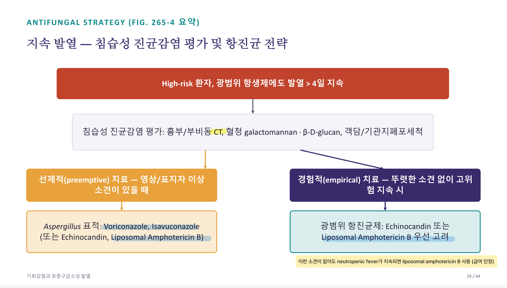
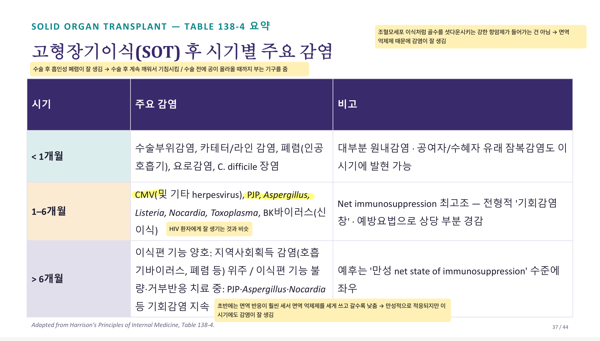
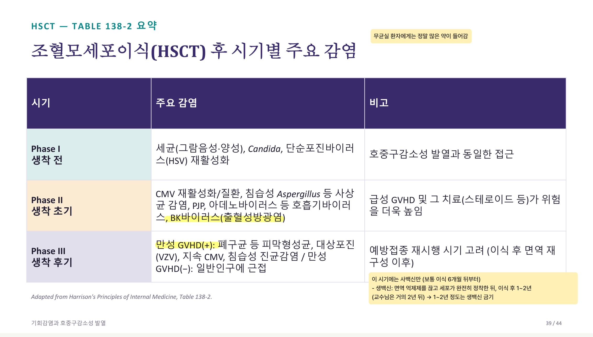

<!-- 필기본: 2026 · 2025 -->
<!-- 단계: 수업 후 -->

# 0. 이 수업을 공부하는 법

**기회감염과 호중구감소성발열**(Approach to Fever and Suspected Infection in the Immunocompromised Host). 세 파트: ① 면역저하 숙주 감염의 일반적 접근 ② **항암치료 후 호중구감소성발열**의 진단과 치료 ③ **이식 후** 면역저하 환자의 감염 패턴.

!!! new "올해 필기에서 추가 — 교수님이 출제에 대해 한 말"
    - "**내용이 많지 않고, 몇 개만 알면 됨.**"
    - "**기출문제는 아예 안 보고 새로 출제**(너무 쉬움)." → 아래 2부 기출 21문항(모두 장현하·권기태 교수님 출제)은 개념 확인용으로 보고, 올해 강의의 **정의·MASCC·경험적 항생제·이식 시기**를 확실히 한다.
    - MASCC 표: "다 외워서 '**이 환자 MASCC 몇 점?**' 같은 문제 — 수업에 반응이 없으면 이런 걸로 출제."
    - 강의는 **AML 환자 케이스**로 시작해 Part 2 끝에 답을 맞춘다(5장).

!!! diff "작년 필기와 다른 점"
    작년은 **장현하 교수님**(필기본 16쪽, 해리슨 표·흐름도 위주, "호중구감소열 흐름도 하나 빼고는 딱히 강조한 건 없다"). 올해 강의는 44장으로 늘었고 **ECIL-10(2024)**, **CISNE 점수**, **EORTC/MSGERC 2020 진균 진단기준**, ***Candida auris* 법정감염병 지정(2026. 3)**, 조혈모세포이식 **3단계(Day 0~30 / 30~100 / 100~)** 같은 최신 내용이 들어갔다.

!!! key "핵심"
    - **면역저하자**: 균이 다양하고, 염증 반응이 약해 증상이 숨고, 늦게 발견되며, 치료가 길고 독성이 잦다 → **high index of suspicion, 영상을 일찍, 항생제를 빨리(살균제)**. 면역저하는 **net state of immunosuppression**.
    - **호중구감소성발열 = 구강 체온 ≥ 38.3 °C(또는 ≥ 38.0 °C 1시간 지속) + ANC < 500/μL**(또는 < 1,000이면서 48시간 내 < 500 예상). Profound = **ANC < 100**.
    - **배양 후 바로 항녹농균 β-lactam 단독**(cefepime, piperacillin–tazobactam, carbapenem). ESBL 정착이면 처음부터 **carbapenem**. 쇼크·폐렴·그람양성 균혈증·카테터·피부연조직·MRSA 정착·심한 점막염이면 **+ vancomycin**.
    - **MASCC ≥ 21 = 저위험**(경구·외래 후보), < 21 = 고위험(입원, 정주).
    - **2~4일째 재평가**, 고위험에서 **4일 넘게 발열** → 침습성 진균 평가(CT, galactomannan, β-D-glucan) → **선제적 또는 경험적 항진균제**.
    - **이식 후 시기**: 초기 = 수술·원내 감염, 중기 = 기회감염(CMV, PJP, *Aspergillus*), 후기 = 이식편 기능·GVHD에 따라.

# 0-1. 수업 전 항생제 총정리 (필기본 앞에 정리)

"이 정도만 알고 있으면 PK 때 질문에 다 답할 수 있음."

| 계열 | 꼭 알 것 |
|---|---|
| **Penicillin** | 단독으로 치료할 균은 많지 않다(그람양성). β-lactamase 억제제를 붙이면 범위가 확 넓어짐 — ampicillin/sulbactam(그람양성, 혐기균, 일부 그람음성), **piperacillin/tazobactam = 녹농균까지** |
| **Cephalosporin** | 1세대 = 그람양성, **MSSA는 cefazolin**. 3세대(cefotaxime, ceftriaxone) = 양성·음성 모두(MSSA는 1세대보다 못함). **녹농균: 4세대 cefepime, 3세대 중엔 ceftazidime** |
| **Fluoroquinolone** | **ciprofloxacin**(그람음성, 혐기균 ×, 녹농균에 강함), levofloxacin(하루 1회), **moxifloxacin**(혐기균 → 복강내 감염, **UTI에는 못 씀**) |
| **Carbapenem** | **meropenem**이 가장 강력 — ESBL *E. coli*, 녹농균, 혐기균 모두. "ESBL 문제가 나오면 거의 carbapenem." **ertapenem은 녹농균 ×** |
| CRE | ceftolozane/tazobactam, **ceftazidime/avibactam** |
| **MRSA** | vancomycin, teicoplanin, daptomycin, linezolid |
| Tetracycline | doxycycline(혐기균, 쯔쯔가무시), tigecycline(내성균 일부, 정균이라 초기 약으로 잘 안 씀) |

- 녹농균을 가장 많이 덮는 것: **piperacillin/tazobactam, cefepime**(meropenem도).
- **살균**(bactericidal) = 균을 죽임, **정균** = 퍼지지 않게 막음. **초기에 감염이 심하면 살균제**.

# 1. 면역저하 숙주 감염의 일반적 접근

## 기회감염이란

- "Invasive infection caused by **nonpathogens**, and infection of a type and extent **unheard of in the normal host**." — 정상 숙주에서는 병을 일으키지 않는 저병원성균이 침습성 질환을 일으키거나, 흔한 균이라도 정상인에게서 볼 수 없는 정도·양상으로 감염을 일으키는 것.
- 면역계는 **선천면역**(피부·점막 장벽, 식세포, 보체, 사이토카인)과 **후천면역**(T·B림프구)으로 되어 있고, **어느 방어기전이 손상되었는지**를 먼저 파악하는 것이 진단의 출발점이다.
- 같은 균이라도 감염이 되려면 숙주 요인이 약하고, 어느 정도 양의 균이 들어오고, 여러 환경이 맞아야 한다.

## 정상 숙주 vs 면역저하 숙주

| 정상 숙주 | 면역저하 숙주 |
|---|---|
| 비교적 제한된 흔한 병원균 | **원인균이 훨씬 다양**(저병원성균 포함) — *Candida*, *S. aureus* 등 몸에 붙어 있던 균도 들어간다 |
| 전형적 증상·징후 → 조기 진단 | 염증 반응 변화로 증상·징후가 약해 **진단 지연** → **조기 CT/MRI** |
| 표준 기간 항균제로 충분 | **치료 기간이 길고 독성이 잦다**(일반인 5일이면 될 것을 2주) |
| 균의 직접 효과가 중심 | 사이토카인 매개 **간접 효과**(면역조절, 발암, GVHD)도 중요 |
| 환경 노출에 둔감 | **병실 공기·급수**에 민감 → 모니터링 |
| 예방 우선순위 낮음 | **예방**(백신, 예방적 항균제) 강조 — 다만 백신 효과는 떨어짐 |

- 올해 필기: 면역세포가 힘을 못 써서 **CRP는 엄청 높은데 열이 잘 안 나는** 환자도 있다(열을 내는 사이토카인이 일을 못 해서).

## Net state of immunosuppression

면역저하는 한 가지 이유만으로 생기지 않는다 — 여러 요인이 누적된 '**순면역억제 상태**':

1. 면역억제 치료의 종류·시기·강도
2. 과거·현재 치료(항암, 방사선, 항균제)
3. **피부·점막 장벽 손상**(카테터, 배액관)
4. 호중구감소, 림프구감소, 저감마글로불린혈증
5. 기저 면역결함(자가면역질환, 유전적 다형성)
6. **대사 상태**(요독증, 영양실조, **당뇨**, 간경화, 고령)
7. **바이러스 감염**(CMV, EBV, HBV, HCV, HIV, RSV, 인플루엔자)

## 기저질환과 면역결함

| 기저질환 | 치료 | 생기는 결함 |
|---|---|---|
| 혈액암 | 세포독성 항암 | **골수억제 → 호중구감소**, 체액·세포면역 결함, 점막 손상 |
| **조혈모세포이식** | 전처치(± 전신방사선), GVHD 예방(스테로이드, calcineurin 억제제) | 세포·체액면역 결함, 식세포 기능 이상, 점막 손상, 생착 지연 |
| 고형장기이식 | 유도·유지 면역억제제 | 세포·체액면역 저하, 점막 손상, 장기 기능 이상 |
| 자가면역질환 | 스테로이드, 생물학적 제제 | 식세포 기능 이상, 체액·세포면역 결함 |

- 혈액암은 골수를 표적으로 항암 → 골수에서 나오는 면역세포가 다 영향. 백혈병은 대부분 관해 후 **조혈모세포이식**(AML M3 = APL만 항암 몇 번으로 완치 가능).
- **조혈모세포이식**: 아주 강한 항암으로 **내 세포를 다 죽인 뒤** 남의 세포를 넣는다 — 위험하지만 혈액암을 치료하는 유일한 방법이기도 하다.
- **고형장기이식**: 남의 장기만 받으므로 **내 면역세포는 그대로** → 장기를 공격하지 못하게 면역억제제.

## 면역저하를 의심할 단서

1. **같은 균**에 의한 반복 감염
2. **비정형(unusual) 병원체**에 의한 반복 감염
3. 일반적인 치료에 **잘 반응하지 않음**
4. 치료 종료 후 **재발**이 잦음
5. 면역저하와의 연관성이 이미 잘 알려진 경우

- 올해 필기: 면역이 떨어진 성인은 대부분 기저질환이 있어 따로 의심할 것도 없다. 예외 — **Good syndrome**(흉선종 동반, 성인): 기저질환 없이 같은 균 감염이 반복(코로나 → 독감 → 폐렴) → **면역글로불린** 검사(떨어져 있으면 보충), DM·HIV 검사. 발견 못 한 **혈액암**일 수도 있어 CBC, PB smear도.

## 진단과 치료의 원칙

| 진단 원칙 | 치료 원칙 |
|---|---|
| **기저질환**과 면역결함의 종류·시기 파악 | 감염이 확인되면 균 동정 전이라도 **조기 경험적 치료**, **살균** 항생제 우선 |
| **감염 vs 비감염** 감별 — 비감염성 발열도 흔하다 | 면역 회복이 늦어 **장기 치료**가 흔하다 |
| 적극적 미생물 검사(동정, 감수성, 면역검사) | **불필요한 침습 검사·시술은 피한다** |
| **High index of suspicion** | 예방적 항생제는 일반적으로 안 쓰지만 **특수 고위험**에서는 예방 항균제·백신 |

- 급성 발열은 **감염이 제일 많다(80~90%)** → 감염부터 배제. 보호자에게는 "열의 원인은 ① 감염(감염내과) ② 자가면역질환(류마티스내과) ③ 암(종양내과)" 세 가지로 설명한다.
- "감염 아닌 것 같다, 성인 스틸병 같다" 하면서 **항생제 없이 지켜보면 큰일**.
- **중심정맥관**은 보통 일주일이면 라인 감염이 생긴다고 보고 **매일 필요한지 확인해 빨리 제거**(chemoport는 어쩔 수 없이 유지하며 관찰). 혈압이 떨어지면 중심정맥관을 잡는 이유: ① norepinephrine을 달 굵은 라인 ② CVP 측정(높으면 수액 불필요, 혈압은 낮은데 CVP가 높으면 다른 쇼크 고려).
- 예방적 항생제를 쓰는 대표 상황: **자가 조혈모세포이식 직후** — 한 달 동안 WBC가 거의 0 → 무조건 예방적 항생제, 무균실.

## 장기별 흔한 감염

- **피부**: 거의 모든 균(그람양성·음성, *Candida*, *Aspergillus*, HSV, VZV). 비감염성으로 약물발진·GVHD.
- **부비동·폐**: 녹농균, *Legionella*, ***Nocardia***, 결핵균, ***Aspergillus***, Zygomycetes, ***Pneumocystis jirovecii***, 호흡기 바이러스, CMV.
- **위장관**: ***C. difficile***(면역저하자는 **항생제를 안 써도** 잘 생김), 장내세균, **CMV**(혈변 → 내시경 → CMV PCR 양성, 요즘 많이 늘었다), 아데노·로타·노로바이러스, *Cryptosporidium*. 호중구감소성 장염 포함.
- **신경계**: ***Listeria***, 폐렴구균, *Nocardia*, 결핵균, HSV, VZV, JC virus, *Toxoplasma*, ***Cryptococcus*** 수막염. 교수님 환자 예: 용혈성빈혈로 고용량 스테로이드를 먹던 72세 → **크립토코쿠스 수막염** → **amphotericin B + flucytosine**(flucytosine은 희귀의약품센터에서 구해 와야 함).
- 요즘 ***Aspergillus***, ***Candida***가 면역저하 환자에서 굉장히 위험한 균으로 떠오르는 중.

!!! diff "작년 필기와 다른 점"
    작년 강조점(장현하 교수님): **PALE(post-antibiotic leukocyte effect)** — 면역저하자는 항생제를 끊은 뒤 백혈구가 살균을 이어 가지 못해 **약을 끊으면 다시 나빠진다** → 오래 쓴다. **TMP/SMX** 발진·가려움이 면역저하자의 약 75%(정상인 5% 이하). 나이는 면역의 가장 밑바닥 요소, 장벽이 잘 깨지는 대표 질환은 **당뇨**.

!!! exam "기출 포인트"
    면역저하자 감염의 특징 — 옳은 것: **초기에 적절한 항생제 치료**(19번), **염증반응이 뚜렷하지 않아 CT·MRI가 더 조기에 필요**(3·14·17번). 오답 — 균이 단순, 증상이 잘 나타나 조기 진단, 치료기간 짧고 독성 드묾, 발열 원인 명확, **CRP가 발열 전에 일찍 나타남**, **배양 결과까지 항생제 연기**, 약열이 확실하니 검사 불필요, 환경 노출에 덜 민감.

# 2. 항암치료 후 호중구감소성발열 — 정의와 병태생리

## 정의

| 발열 | 호중구감소증 |
|---|---|
| 1회 구강 체온 **≥ 38.3 °C** | **ANC < 500/μL** |
| 또는 **≥ 38.0 °C가 1시간 이상** | 또는 ANC < 1,000이면서 **48시간 내 < 500**으로 감소 예상 |
| | **Profound**: ANC **< 100** |

- 중증도는 ANC 절대치와 **예상 지속기간(≤ 7일 vs > 7일)**으로 저위험·고위험을 나누고, 이것이 **치료 장소와 항생제**를 결정한다.
- 올해 필기: "수치로 딱 나와서 예외 없음." 다만 체온계마다 달라서 교수님은 **37.5 °C 이상 + 오한**이면 열로 본다. 호중구감소 환자는 **역격리**(환자가 위험해서 하는 격리) — 국가가 1인실 비용을 대 주는데 **ANC 500 미만이어야** 하고 501이면 안 된다(요즘은 거의 무조건 500 미만 기준).

## 병태생리

**세포독성 항암·광범위 항생제 → 점막 장벽 손상(구강·위장관) + 정상 상재균 중 내성균 선택 증식 → 장벽을 통한 전위(translocation) → 균혈증·감염**

- 주요 위험인자 = **ANC < 500 + 점막염(mucositis)**의 조합.
- 감염의 대부분은 외부 병원체가 아니라 **환자 자신의 내인성균**(장관·피부 상재균).
- 예방·치료 항생제 자체가 **내성균을 선택**하는 압력이 된다 — 살아남은 일부 균이 크게 퍼지면 내성균.

{: style="width:80%"}

- 항암 Day 0 → **구강점막염 Day 5경** → **nadir Day 7~10**(이때 가장 위험), **발열 Day 7~9** → 회복은 대개 **Day 14~21**.
- **ANC < 500의 지속기간**이 감염 위험을 결정(MASCC·임상 판단의 핵심).
- 점막염 시점과 발열 시점이 가깝다 → **내인성 장관균 전위**를 시사.
- 2~3주 회복될 때까지 호중구감소열이 심해 **사망**하는 경우도 있어, 열이 나고 CRP가 낮아도 **항생제를 깔고 가는** 경우가 대부분.

## 원인 분류

- **원인불명 발열 39%**, **미생물학적으로 확인된 감염 44%**(균혈증 35% — 그람양성 19%, 그람음성 10%, 다균성 6%), **임상적으로 확인된 감염 17%**.
- 그람양성·음성 중 무엇이 많은지는 **시기·기관·지역마다 다르다**(2010년 자료는 그람양성이 많았지만 2025년 리뷰들은 제각각).

!!! diff "작년 필기와 다른 점"
    작년: 호중구감소열의 **약 60~70%(2/3)만 감염** 때문, 나머지는 조직 손상·항암제·종양 용해 등. 백혈구는 항암 7일째부터 감소, **14일쯤 최저**, 한 달쯤 회복(그래서 항암을 3~4주마다). 올해 슬라이드는 nadir **Day 7~10**, 회복 **Day 14~21**. 작년엔 **G-CSF**(ANC 500 이하면 생성 촉진, 안 먹혀 한 달 이상 지속되면 치명적)도 언급.

!!! exam "기출 포인트"
    호중구감소열 설명 — 옳은 것: "**약 2/3에서 감염이 진단되므로 경험적으로 항녹농균 penicillin을 투여**"(1·4번). 오답 — Enterococci·Cryptococcus가 가장 흔함, ANC **50** 이하(500이 맞다), 간농양·장요근 농양 같은 **심부감염**, 당뇨·영양실조가 선행요인.

# 3. 위험도 평가 — MASCC와 CISNE

{: style="width:80%"}

| 특성 | 점수 |
|---|---|
| 증상 부담 — **없음 또는 경함** / 중등도 | **5** / 3 |
| **저혈압 없음**(수축기 ≥ 90 mmHg) | **5** |
| **COPD 없음** | 4 |
| **고형암**, 또는 과거 진균 감염이 없는 혈액암 | 4 |
| **탈수 없음**(수액 불필요) | 3 |
| **외래**에서 발열(입원 환자 아님) | 3 |
| 나이 **< 60세** | 2 |

- 최대 **26점**, **≥ 21점 = 저위험**(외래·경구 치료 후보), < 21점 = 고위험. **높을수록 좋다.**
- "딱 보고 외래 추적해도 되겠다고 판단하는 것보다 **MASCC·CISNE로 위험도가 낮은 걸 확인**하고 외래 추적하는 게 더 좋음."

!!! memo "MASCC 계산 연습 — '이 환자 몇 점?'"
    - 대장암 항암 중, 외래에서 발열, 증상 경함, 혈압 정상, COPD 없음, 탈수 없음, 45세 → 5 + 5 + 4 + 4 + 3 + 3 + 2 = **26점(저위험)**.
    - AML 관해유도 중 **입원 환자**, 증상 중등도, 혈압 정상, COPD 없음, 과거 진균 감염 없음, 탈수 없음, **68세** → 3 + 5 + 4 + 4 + 3 + 0 + 0 = **19점(고위험)**.

- **CISNE**(Clinical Index of Stable Febrile Neutropenia): ECOG 수행상태, COPD, 심혈관질환, 점막염, 단핵구감소, 고혈당 등을 반영 → **겉보기에 안정적인 고형암 환자** 중 합병증 위험이 높은 사람을 추가로 골라낸다(MASCC만으로 저위험으로 과소평가되는 환자 보완). 두 점수 모두 **혈액암**에서는 외부 타당도가 제한적.

| **저위험(Low-risk)** | **고위험(High-risk)** |
|---|---|
| **MASCC ≥ 21** | MASCC < 21 |
| 예상 호중구감소 **≤ 7일** | **> 7일** 또는 profound(ANC < 100) |
| 임상적으로 안정, 중증 동반질환 없음 | 혈역학적 불안정, 장기부전 |
| 활동성 점막염·장기부전 없음 | 활동성 동반질환, **심한 점막염**, 조절 안 되는 암 |
| → 사회적 지지가 되면 **경구 항생제 외래 치료** 후보 | → **입원, 광범위 정주 항생제 즉시** |

- "점수상 저위험이어도 딱 봤을 때 퇴원시키면 안 되겠다 싶은 환자가 있다" — **점수 + 의사의 판단**.
- 교수님이 권기태 교수님과 쓴 후향적 연구: MASCC·CISNE로 보면 입원 대신 외래로 봐도 괜찮았을 환자가 저위험 90%, 고위험 57%(평균 70%). 그래도 입원하는 이유 — 환자는 병원비가 싸고(산정특례 5%) 마음이 편하고, 의사는 보냈다가 쇼크로 돌아오면 소송이 걱정.

!!! exam "기출 포인트"
    - 중증도 판단에 해당 **없는** 것 → **해외여행력**(6번), **6개월 전 도뇨관 삽입**(10번). 해당하는 것: 혈압 저하, 탈수 정도, 증상 중증도, 폐질환·기저질환.
    - 16번: 유방암 4차 항암 10일째 발열 → "**수축기 혈압 90 이하로 떨어지지 않는지가 치료 결정에 중요**"(정답).
    - 18번: 대장암 4차 10일째, 안정 → "**기저질환과 MASCC로 외래/입원 판단**". 오답 — 혈액배양 안 함, 외래 azithromycin + metronidazole, 1일째 해열 안 되면 교체.
    - 11번: 2차 항암, 기저질환 없음, 활력징후 정상, 수액 후 4시간 해열·무증상 → **저위험, 경구 항생제로 변경하고 다음날 외래**. 오답 — 무조건 입원, 뇌척수액 검사, vancomycin, **저위험이라 혈액배양 안 함**.

# 4. 경험적 항생제와 재평가

## 초기 평가

**발열 + 호중구감소 확인 → 병력·진찰, 혈액배양 2세트, 요배양, 흉부 영상 + MASCC → 저위험(경구·정맥, 외래 적합성 평가) / 고위험(입원, 항녹농균 β-lactam 단일요법 정맥 즉시, 필요하면 vancomycin)**

## 경험적 항생제 선택 시 고려할 것

- **지역·기관 내성 역학**(ESBL, CRE, MRSA, VRE) — 예: 응급실 발열 환자 중 ESBL이 20~30%라면 호중구감소열에는 **carbapenem**.
- 감염 추정 부위(폐렴, 피부연조직, 카테터, 복부).
- 과거 항생제·항진균제 노출 — 예방적 **ciprofloxacin**을 쓰다 열이 나면 cipro보다 넓은 것.
- **집락(colonization)** 과거력 — 실제 감염은 안 일으키면서 균을 가진 상태(보균자). 면역이 괜찮으면 금방 없어지지만 **CRE·VRE는 면역저하자에서 한 번 정착되면 안 없어진다**(평생 나오기도). 패혈성 쇼크로 오면 정착균까지 감안.
- 알레르기 과거력(알레르기 약을 줬다 사고 나면 100% 병원 책임 — 교수님은 경증 알레르기도 경고창을 띄우게 함).
- 신장·간 기능(용량 조절), 혈역학 상태.
- 신약 ceftazidime/avibactam, ceftolozane/tazobactam도 이미 내성이 생기는 중(국내 MRPA, 일부는 all resistant).

{: style="width:84%"}

| 권장 단일요법(항녹농균 β-lactam) | **Vancomycin(항MRSA제) 추가** 기준 |
|---|---|
| **Cefepime** | **혈역학적 불안정·중증 패혈증** |
| **Piperacillin–tazobactam** | 영상으로 확인된 **폐렴** |
| **Carbapenem**(meropenem, imipenem–cilastatin) | 혈액배양에서 **그람양성균**(동정 전) |
| 알레르기·내성에 따라 aminoglycoside ± 다른 β-lactam | **피부연조직** 또는 **카테터** 관련 감염 의심 |
| | **MRSA·페니실린내성 폐렴구균 정착** |
| | **심한 점막염**(특히 FQ 예방 중 viridans streptococci 의심) |

- 예전엔 상태가 나쁘면 meropenem + vancomycin, **요즘은 MRSA를 꼭 덮어야 할 적응증이 있을 때만** vancomycin.
- Aminoglycoside + β-lactam 병용은 옛날에 많이 썼지만 지금은 잘 안 씀(신독성·청력 손상). 아미노글리코사이드를 쓰는 경우: 심내막염(ceftriaxone + gentamicin), 결핵 4제가 안 될 때(amikacin, streptomycin, kanamycin).

## ECIL-10 (2024) — 최신 흐름

1. **cefepime, piperacillin–tazobactam, carbapenem** 모두 적절한 1차 단일요법(기관 내성 역학에 따라 선택).
2. **ESBL 생성균 정착 또는 과거 감염** → **처음부터 carbapenem**.
3. **항생제 스튜어드십**: 불필요한 광범위 병용 지양, 재평가 때 **de-escalation**(처음엔 넓게 → 배양 보고 좁힌다).

## 2~4일째 재평가

| Day 2~4 | 대응 |
|---|---|
| **발열 호전 + 배양 음성·원인불명** | 현 항생제 유지(ANC 회복까지), 안정되면 **de-escalation** 고려 |
| **발열 지속·재발, 임상적으로 안정** | **항생제 범위를 섣불리 바꾸지 않는다**, 원인 재탐색, 밀착 관찰 |
| **임상적 악화**(불안정, 새 병소) | **범위 확장**, 영상 재시행, **항진균제 고려** |

- 항생제가 듣는지, 호중구가 회복되는지 확인 → **4일 이상 발열**이 계속되면 항생제 step-up 또는 **진균 감염**.

!!! diff "작년 필기와 다른 점"
    작년: 경험적 항생제는 진료 시작 **1시간 이내**(IDSA, 국내도 1시간; 필기엔 우리나라 3시간 표기도). **저위험 외래 경구 = ciprofloxacin + amoxicillin/clavulanate**(가장 많이 씀), 첫 용량은 병원에서 주고 **4~24시간 관찰**(최소 4시간) 후 다음날 외래. 재평가 72시간. 고위험 단일요법에 **ceftazidime**도 포함. 올해는 재평가 **2~4일(48~96시간)**, ECIL-10의 **ESBL → carbapenem**이 추가.

!!! exam "기출 포인트"
    21번: 호중구감소 발열에 가장 넓고 권장되는 cephalosporin → **cefepime**. 3번: 항암 58일째 AML 환자 발열 → "입원 초기 원인 감별을 위해 **CT·MRI가 면역정상인보다 조기에 필요**"(정답) — 배양 결과까지 항생제 연기, CRP가 더 일찍, 균이 더 단순, 약열이니 검사 불필요는 오답.

# 5. 지속 발열 — 침습성 진균 감염

{: style="width:84%"}

- **고위험 환자, 광범위 항생제에도 발열 > 4일** → 침습성 진균 평가: **흉부·부비동 CT**, 혈청 **galactomannan**(*Aspergillus* 항원), **β-D-glucan**, 객담·BAL.
- **선제적(preemptive) 치료** — 영상·표지자 이상이 있을 때: ***Aspergillus* 표적 voriconazole, isavuconazole**(또는 echinocandin, liposomal amphotericin B). "항원 검사 양성 + CT 의심 → 바로 voriconazole, isavuconazole, liposomal amphotericin B 중 사용."
- **경험적(empirical) 치료** — 뚜렷한 소견 없이 고위험 지속: **echinocandin 또는 liposomal amphotericin B** 우선. "이런 소견이 없어도 호중구감소열이 지속되면 **liposomal amphotericin B**(급여 인정)."
- 요즘은 호중구감소에 열이 지속되면 **CT로 진균성 폐렴을 확인**하는 추세.
- **EORTC/MSGERC 2020 개정 진단기준**: *Aspergillus* **PCR** 등 핵산검사 인정, galactomannan cut-off 재조정(위양성 감소), 크립토코쿠스·PCP·풍토성 진균증 정의 보완. 신약 **rezafungin**(주 1회 echinocandin, 2023 FDA 승인 — 국내에는 없음), fosmanogepix는 임상시험 중. **Isavuconazole·posaconazole**은 *Aspergillus* 표적 예방의 핵심.

!!! new "올해 필기에서 추가 — *Candida auris*"
    - 침습성 *C. auris* 감염 치명률 **29~53%**(WHO). 면역저하·호중구감소처럼 **침습 장치가 많은 중증 환자**에서 특히 위험.
    - **2026년 3월 국내 4급 법정감염병(의료관련감염병)으로 신규 지정** — 발생 시 신고 의무.
    - 국내는 독성이 낮은 **clade II**가 주류였지만 2022년 이후 독성이 강한 **clade I** 검출 증가. 카테터·의료기기 표면에 **생물막**을 만들어 오래 산다. WHO 진균 우선순위 최고위험군, 미국 CDC 'urgent threat'.

!!! exam "기출 포인트"
    12·13번(권기태): AML 골수이식 10일, **ANC 10**, 기침·발열, 흉부 CT(결절·halo) → **아스페르길루스증**, 치료 **voriconazole**.

# 6. 처음 케이스 다시 보기

> 68세 남성, AML 관해유도 항암치료 **7일째** 38.6 °C, 혈압 110/70, 심박수 102, WBC 400, **ANC 180**, 구강점막염, 감염 병소는 아직 모름.

| 단계 | 답 |
|---|---|
| 분류 | 입원 중 발열 + ANC < 500 → **호중구감소성발열** 정의에 부합 |
| 위험도 | 입원 환자, 심한 점막염, 장기간 호중구감소 예상 → **고위험** |
| 초기 조치 | 혈액·요배양 즉시 채취 후 결과를 기다리지 않고 **항녹농균 β-lactam(예: cefepime)** 경험적 투여(pip/tazo, carbapenem도 가능) |
| Vancomycin | 혈역학적으로 안정하고 배양 전이라 즉시 필수는 아님. 다만 **심한 점막염**이 있어 48시간 재평가 때 추가 여부 재검토 |

# 7. 이식 후 면역저하 환자의 감염

## 감염 위험을 결정하는 3가지

1. **수술·기술적 요인**: 수술 합병증, 문합부 누출, 혈종, 체액 저류, 이물(카테터·스텐트), 허혈-재관류 손상. "수술을 잘 해도 감염은 생길 수 있다."
2. **환경 노출**: 원내 병원체, 공사·수도 관련 진균, 지역사회 여행·음식, **공여자 유래** 감염.
3. **Net state of immunosuppression**.

## 시기에 따른 공통 틀

- **초기**: 수술·입원 관련 원내 감염(창상, 카테터, 폐렴, *C. difficile*) + 수혜자·공여자의 잠복 감염.
- **중기**: 순면역억제가 최고조 → **전형적 기회감염**(CMV, PJP, *Aspergillus*) — "감염을 가장 조심해야 하는 시기".
- **후기**: 이식편 기능·만성 거부반응·GVHD에 따라 지역사회 감염 vs 지속 기회감염.

## 고형장기이식(SOT)

{: style="width:84%"}

| 시기 | 주요 감염 | 비고 |
|---|---|---|
| **< 1개월** | **수술부위감염**(가장 많음), 카테터·라인, 폐렴(인공호흡기, **수술 후 흡인성**), 요로감염, *C. difficile* | 대부분 **원내 감염**. 공여자·수혜자 유래 잠복 감염도 이때 |
| **1~6개월** | **CMV**(및 다른 herpesvirus), **PJP**, ***Aspergillus***, *Listeria*, *Nocardia*, *Toxoplasma*, **BK virus(신장이식)** | net immunosuppression 최고조 — '**기회감염 창**'. 예방요법으로 상당 부분 경감. HIV 환자에게 잘 생기는 것과 비슷 |
| **> 6개월** | 이식편 기능 양호 → **지역사회 획득 감염**(호흡기 바이러스, 폐렴) / 이식편 불량·거부반응 치료 중 → PJP·*Aspergillus*·*Nocardia* 지속 | 예후는 만성 net state 수준에 좌우 |

- 수술 후 흡인성 폐렴이 잘 생겨 수술 후 계속 깨워 기침시키고, 수술 전에 공이 올라올 때까지 부는 기구(incentive spirometer)를 준다.
- 초반에 면역반응이 세서 면역억제제를 세게 쓰고 갈수록 낮춘다. 조혈모세포이식처럼 골수를 셧다운시키지는 않는다.

## 조혈모세포이식(HSCT) — 면역 재구성 3단계

{: style="width:84%"}

| 단계 | 상태 | 주요 감염 |
|---|---|---|
| **Phase I 생착 전**(~Day 0~30) | 전처치로 **호중구감소 + 점막 손상** — 내 백혈구가 하나도 없다 → **무균실** | **세균(그람음성·양성), *Candida*, HSV 재활성화** — 호중구감소성발열과 같은 접근. posaconazole·항생제·항바이러스제 예방을 거의 깔고 간다 |
| **Phase II 생착 초기**(~Day 30~100) | 호중구는 회복되지만 **세포면역 심각히 저하 + 급성 GVHD** — 정말 위험한 시기 | **CMV** 재활성화, 침습성 ***Aspergillus***, PJP, **아데노바이러스** 등 호흡기 바이러스, **BK virus(출혈성 방광염)** |
| **Phase III 생착 후기**(Day 100~) | 만성 GVHD 유무가 갈림 | 만성 GVHD(+): **피막세균(폐렴구균)**, **VZV**, 지속 CMV, 침습성 진균 / GVHD(−): 일반인에 근접 |

- **GVHD**: 남의 세포가 들어와 **나를 공격** — 온몸 피부 발진(피부가 다 벗겨지기도), 간 독성(AST/ALT 수천). 사망하기도 한다.
- **BK virus**: 요로감염·**출혈성 방광염**, 치료제가 별로 없고 잘 안 낫는다.
- **자가이식보다 동종이식**에서 GVHD로 면역억제 기간이 길어 감염 위험이 더 높고 오래간다.
- 생착이 끝나면 **예방접종력이 0으로 리셋** → 아기처럼 처음부터. **사백신은 보통 이식 6개월 뒤부터**, **생백신은 면역억제제를 끊고 완전히 정착한 뒤 1~2년**(교수님은 거의 2년) — 그때까지 생백신 금기.

| | 고형장기이식(SOT) | 조혈모세포이식(HSCT) |
|---|---|---|
| 면역억제 기간 | **평생 유지**(거부반응 예방) | 생착 후 감량, **GVHD 없으면 중단 가능** |
| 초기 주요 위험 | **수술·원내 감염** | **호중구감소**(항암과 유사) |
| 중기 특징 병원체 | CMV, PJP, *Aspergillus* | CMV, *Aspergillus*, 아데노바이러스 |
| 후기 위험 결정 | 이식편 기능·거부반응 치료 강도 | **만성 GVHD** 유무·치료 강도 |
| 결손 | 주로 **세포성**(calcineurin 억제제) | **세포성 + 체액성**(GVHD 동반 시) |

- **CMV 재활성화**와 ***Aspergillus***는 두 이식 모두 똑같이 위험.

## 이식 후 감염 예방

- **PJP**: **TMP-SMX**를 이식 후 일정 기간(흔히 6~12개월 이상). 교수님: "**prednisolone 20 mg을 4주 이상** 쓰면 무조건 TMP/SMX(셉트린)를 같이."
- **CMV**: 고위험군(**공여자 +/수혜자 −**)에서 항바이러스 예방 또는 정기 모니터링 후 **선제 치료**. 조혈모세포이식 환자는 초반 **2주마다 CMV RQ-PCR** → 올라가 있으면 **증상이 없어도 ganciclovir**(CMV가 꽤 높아도 증상이 없을 수 있고, 정말 나빠진 뒤엔 치료가 안 될 수 있어서).
- **항진균 예방**: 고위험 HSCT(동종, GVHD)와 일부 SOT(**폐이식** — 5년 내 사망률 50% 이상)에서 **posaconazole·isavuconazole**.
- **예방접종**: 이식 전 생백신 완료가 원칙이지만, 실제로는 항암 중이라 생백신을 맞히는 경우가 거의 없다. 이식 후에는 면역 재구성 이후 비활성화 백신 위주로 재접종.

!!! diff "작년 필기와 다른 점"
    작년 표(고형장기): **1개월 이내 = 수술·기술적 문제 > 95%**, 간이식이면 **간농양(*E. coli*)**·담도·장알균, 기회감염은 과도한 환경 노출이 아니면 거의 없다. **6개월 이후**: 지역사회 호흡기 감염 80%, 만성 B·C형간염 10%, 거부반응·GVHD로 면역억제제를 늘린 군 10%(PCP·크립토코쿠스·리스테리아, 평생 예방). 수술 당일부터 면역억제제를 써도 **한 달은 지나야 full 효과**. CMV는 우리나라 사람 약 80%가 노출력. 조혈모세포이식 시기 구분: 작년 <1개월 / 1~4개월 / >4개월, 올해 Day 0~30 / 30~100 / 100~.

!!! exam "기출 포인트"
    간이식 **2주(1개월 이내)** 후 발열 — 가능성 **가장 낮은** 것 → **EBV 폐렴**(2·5번). 8번: 간이식 10일 후 고열 + 우상복부 통증 → ***E. coli* 간농양**. 15번: 신장이식 15일째 발열 → ***Enterococcus faecalis***(CMV·HHV-6·크립토코쿠스는 1~6개월 이후). 7번: 조혈모세포이식 **3주** 후 발열·설사 → ***C. difficile***. 9번: 조혈모이식 3달, GVHD로 면역억제제 증량 후 발열 → "**전신 파종 감염 원인으로 칸디다 등 진균, EBV도 고려**"(정답). 20번: 신이식 3년, 대장염 + 시력 감소·비문증(망막염) → **CMV**.

# 암기 — 세 줄 메시지와 요점

1. **High index of suspicion**: 면역저하 숙주의 감염은 다르게 나타난다 — 작은 단서도 놓치지 말고 기저질환과 net state를 함께 본다.
2. **신속한 경험적 치료**: 호중구감소성발열은 **응급** — 배양 결과를 기다리지 말고 MASCC를 평가해 즉시 항생제, **48~96시간마다 재평가**.
3. **시기를 알면 병원체가 보인다**: 초기(원내) → 중기(기회감염) → 후기(이식편 기능·GVHD).

| 주제 | 꼭 기억할 것 |
|---|---|
| 정의 | ≥ 38.3 °C(또는 38.0 °C 1시간) + **ANC < 500**(또는 < 1,000 → 48시간 내 < 500). profound < 100 |
| 기전 | 점막염 + 호중구감소 → **내인성 상재균 전위**. nadir Day 7~10 |
| MASCC | 증상 5/3, 저혈압 없음 5, COPD 없음 4, 고형암 4, 탈수 없음 3, 외래 3, < 60세 2 → **≥ 21 저위험** |
| 경험적 | **cefepime / pip–tazo / carbapenem** 단독. ESBL → carbapenem. vanco: 쇼크·폐렴·그람양성·카테터·SSTI·MRSA·심한 점막염 |
| 재평가 | 2~4일. 안정적 지속 발열이면 바꾸지 않는다. **> 4일 고위험 → 진균**(CT, galactomannan, β-D-glucan) |
| 항진균 | 선제적: voriconazole·isavuconazole / 경험적: echinocandin·liposomal amphotericin B |
| SOT | < 1개월 수술·원내(SSI, 흡인성 폐렴, UTI, *C. diff*), 1~6개월 CMV·PJP·*Aspergillus*·BK, > 6개월 지역사회 |
| HSCT | Phase I 세균·*Candida*·HSV / II CMV·*Aspergillus*·아데노·BK·GVHD / III 피막세균·VZV(만성 GVHD) |
| 예방 | PJP TMP-SMX(pred 20 mg 4주↑), CMV RQ-PCR → 선제 ganciclovir, posaconazole. HSCT 후 사백신 6개월, 생백신 1~2년 뒤 |
| *C. auris* | 2026. 3 국내 4급 법정감염병, 치명률 29~53%, 생물막 |
