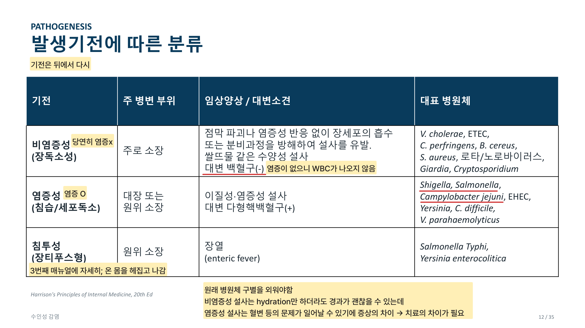
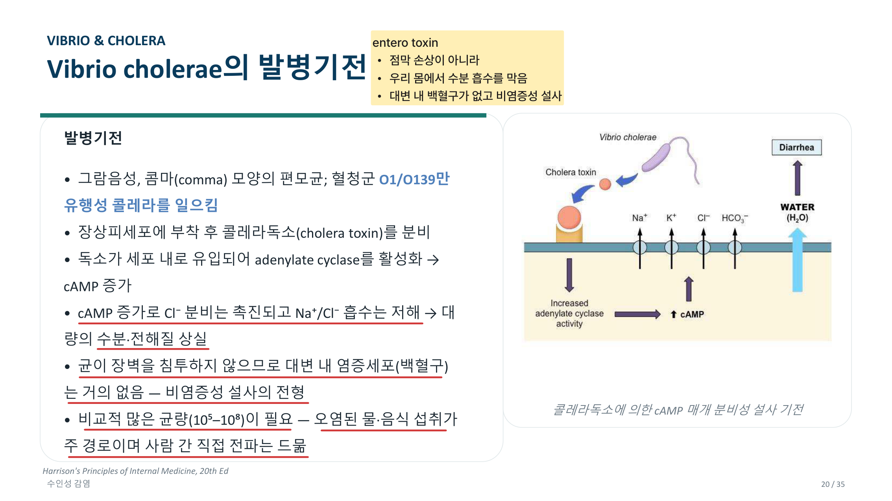
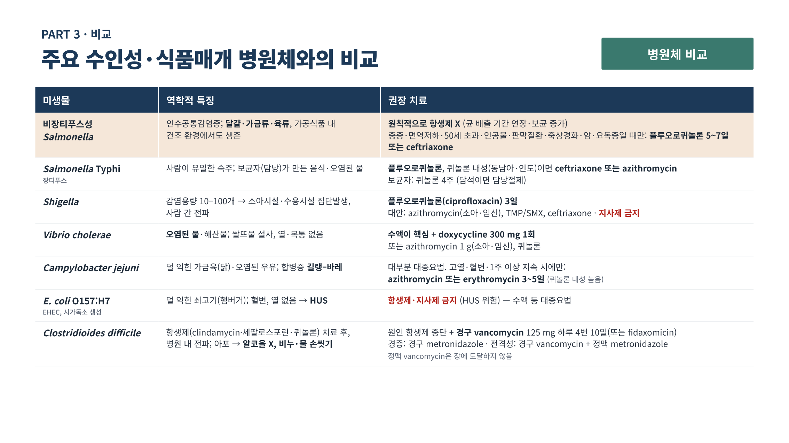
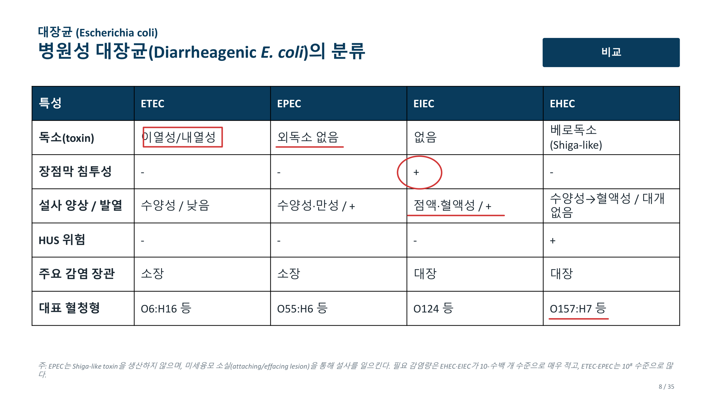
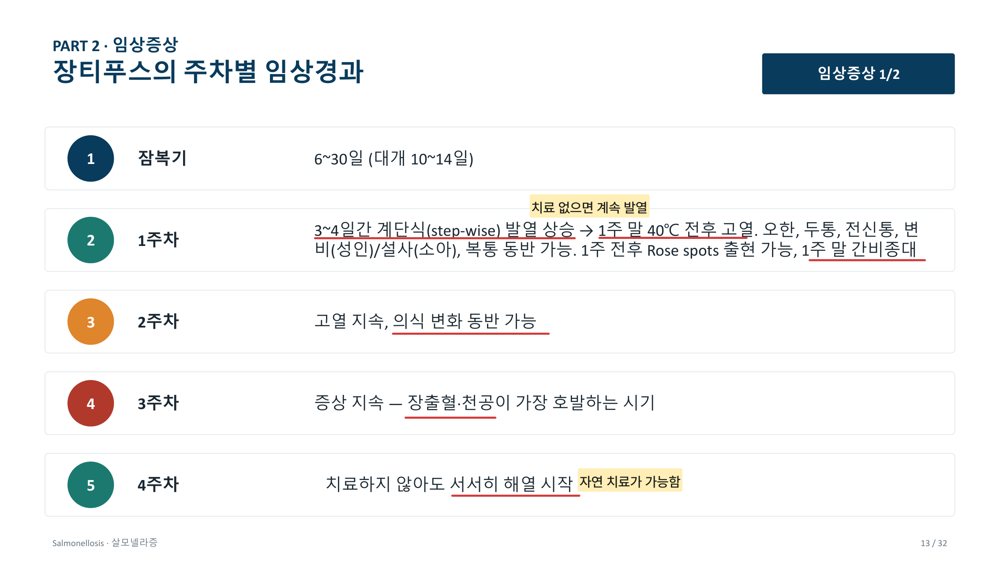
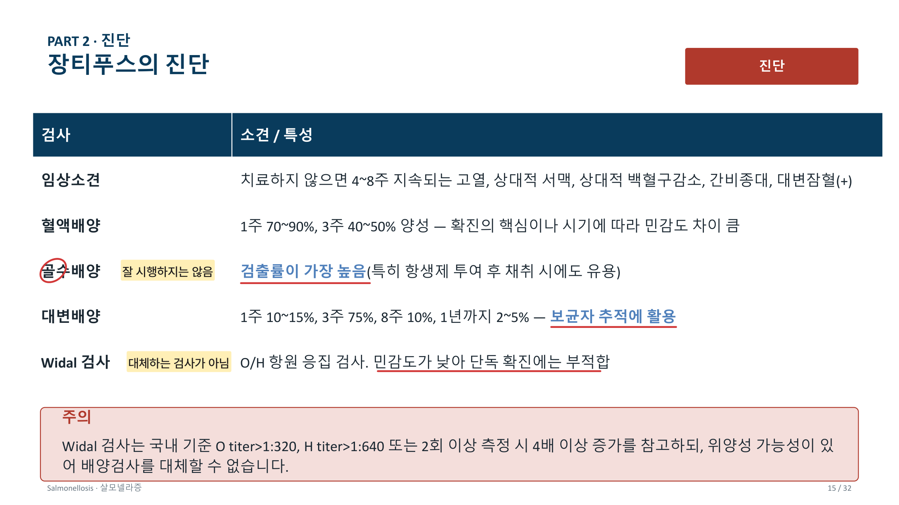

<!-- 필기본: 2026 · 2025 -->
<!-- 단계: 수업 후 -->

# 0. 이 수업을 공부하는 법

감염내과 **황소윤 교수님** 수업(2026. 11. 26, 목). 올해는 세 강의로 나뉘어 들어왔다.

1. **수인성 감염**(Waterborne & Foodborne Infections) — 총론, 독소매개성 식중독, **비브리오·콜레라**, 임상평가·치료·합병증, *C. difficile* 증례
2. **장관 감염증**(Enteric Bacterial & Protozoal Infections) — **대장균, 이질균, 캄필로박터, 람블편모충**
3. **살모넬라증**(Salmonellosis) — **장티푸스**, 보균자, 비장티푸스성 살모넬라증(NTS)

교수님: "수인성 감염은 **매우 쉬움** — 누구나 설사 걸려 본 적이 있을 것."

!!! diff "작년 필기와 다른 점"
    작년 필기본은 대장균·시겔라·장티푸스·콜레라·비브리오 파트 슬라이드가 **빈 쪽**이어서 교과서로 채웠다("교과서 보충"). 올해는 그 부분이 모두 강의 슬라이드로 들어왔고, 새로 **람블편모충(*Giardia*)**, **노로바이러스**, **XDR 시겔라·XDR 장티푸스**, *C. difficile* 2021 IDSA/SHEA 지침(**fidaxomicin**), 콜레라 **ORS 조성·백신·세계 재유행**, **장티푸스 백신 3종(Ty21a·ViPS·TCV)**이 추가됐다.

- 기출 73문항(2020–2025)으로 인체감염학에서 가장 많다. 황소윤 교수님 문항의 반복 틀:
    - **볶음밥 먹고 1–5시간 뒤 구토** → ***Bacillus cereus***(구토형), 도시락 8시간 뒤 설사 → *B. cereus*(설사형).
    - **햄버거 + 혈변 + 빈혈·혈소판감소·신부전(HUS)** → **EHEC O157:H7, Shiga-like toxin**, 필요한 검사 **대변배양**, **항생제는 되도록 안 씀**.
    - **발열 + 혈변 + 후중(tenesmus)** → ***Shigella dysenteriae***, 대변 백혈구 → 염증성.
    - **바지락·조개 + 간경변·음주 + 저혈압 + 다리 출혈성 수포** → ***Vibrio vulnificus*** → **ceftriaxone + doxycycline**.
    - **동남아, 물 같은 설사(쌀뜨물), 열 없음** → ***V. cholerae***.
    - **항생제 치료 후 설사** → ***C. difficile* → 경구 vancomycin**.
    - **장티푸스**: 고열 지속 + 장미진 + 상대서맥 → *S.* Typhi, 초기 진단 **혈액배양**, **회장 천공**, 퀴놀론 내성이면 **ceftriaxone**.
    - **닭·소면 + 혈변 + 임신** → *Campylobacter* → **azithromycin**, 후유증 **길랭–바레**.

!!! key "핵심 — 교수님 Key takeaways"
    1. **비염증성 vs 염증성 설사**를 구분하라 — 침습 여부와 독소 기전에 따라 임상과 치료가 다르다.
    2. 병력의 세 단서: **잠복기, 음식력, 대변 양상**.
    3. **콜레라와 비브리오**를 놓치지 말 것 — 쌀뜨물 설사, 해산물·해수 노출.
    4. **수액요법이 모든 수인성 감염 치료의 근간** — 항생제는 특정 적응증의 보조 수단.
    5. **최근 항생제를 쓴 고령 환자의 설사 = *C. difficile*** — fidaxomicin/vancomycin.

    잠복기: **1–6시간 = 미리 만들어진 독소**(*S. aureus*, *B. cereus* 구토형) / **8–16(20)시간 = *C. perfringens*, *B. cereus* 설사형** / **16시간 이상 = 장에서 증식**(노로, ETEC, *Vibrio*, *Salmonella*, *Shigella*, *Campylobacter*, EHEC).

# 1. 수인성 감염 개요

## 정의와 역학

1. 병원성 미생물이 오염된 **물(음료수)이나 음식**으로 전파되는 질환군. 가장 흔한 증상은 **설사와 구토**.
2. 경미한 복부 불쾌감부터 사망까지 다양. **상기도 감염 다음으로 흔한** 감염성 질환.
3. 국내 증가 이유: **육류·회 소비 증가, 집단급식 보편화, 외식·배달 발달**(오염이 쉬움).
4. 원인은 세균·바이러스·원충이지만 실제로 미생물이 확인되는 경우는 흔치 않다(설사 몇 번에 검사하지 않으니 통계도 정확하지 않을 수 있음).
5. 2022년 식중독 **발생 장소 1위는 음식점(45.5%)**, 음식점·급식시설이 **약 80%**. **최다 원인 병원체는 노로바이러스**(2022년 157건). **6~9월에 약 40%**.
6. 국내 세균성 원인 빈도: ***E. coli*** > ***S. aureus*** > ***Salmonella*** > ***V. parahaemolyticus*** > ***C. perfringens*** > ***B. cereus*** > ***C. jejuni*** > ***Shigella***. 주요 감염원은 어패류·물·육류.
7. 교수님 경험: 콩나물국으로 집단 감염이 났는데 편식이 심해 콩나물국을 안 드셔서 안 걸렸다 — 접촉·상한 음식으로 옮고, 대변 검사로 **보균자**를 찾아야 한다.

## 바이러스성 대표 — 노로바이러스

- 전파: **분변-경구**, 오염된 물·식품(특히 **굴** 등 어패류), 감염자 접촉, **구토물 비말**. **10–100개**의 매우 적은 입자로도 감염.
- 잠복기 **12–48시간**, **급성 구토 + 수양성 설사**, 발열은 경미하거나 없음, 대개 **1–3일 내 자연 호전**되는 **비염증성** 설사.
- **국내 식중독 원인 병원체 매년 1위**, **겨울철(11월~2월)** 유행 — 온도가 낮을 때 잘 살아남는다. 학교·보육시설 집단 발생.
- **특이 항바이러스제·백신 없음**(2026년 기준 임상 개발 단계) → **대증치료**. **손씻기와 염소계 소독**이 핵심 — **알코올 소독제는 효과가 제한적**.

# 2. 설사의 발병 기전

## 숙주 방어 인자

1. **위산**: 정상(pH < 4)이면 30분 안에 섭취한 세균의 99% 사멸. **로타바이러스는 위산에 극히 강함**(저항성이 있으면 장까지 내려간다).
2. **장 운동**: 연동운동이 세균을 밀어내 과증식 억제 → **당뇨·피부경화증** 같은 저운동 상태에서 위험 증가. **지사제**를 쓰면 균 배출이 지연되어 ***Shigella***·***Salmonella*** **감염이 악화**될 수 있다.
3. **정상 장내 세균총**: 대장 균총의 **짧은사슬지방산**이 *Shigella* 같은 병원균을 억제. **미숙아·항생제 사용**으로 균총이 바뀌면 장염이 잘 생긴다.
4. **면역(특히 점막면역)**: **분비형 IgA**가 혈장 항체보다 먼저 장에 나타나 *Shigella*·*V. cholerae* 항원·내독소를 중화. **AIDS** 등 면역저하에서는 모든 감염 증가.

## 미생물 인자 — 감염량(inoculum size)

| 병원체 | 필요 균량 | 의미 |
|---|---|---|
| ***Shigella***, **EHEC**, ***Giardia***, ***Entamoeba*** | **10–100**(균 또는 cyst) | **사람–사람 직접 접촉만으로 전파** → 적은 오염으로 집단 발병 |
| *Campylobacter jejuni* | 10–105 | 중등도 |
| *E. coli*(ETEC 등), ***V. cholerae***, ***Salmonella*** | **105–108** | 많은 균량 → 오염된 물·식품이 주 경로 |

- host factor가 강하거나 균이 적게 들어오면 안 걸릴 수 있다 → 개인차.

## 발생 기전에 따른 분류 — 병원체 구별을 외워야 한다

{: style="width:84%"}

| 기전 | 부위 | 임상 / 대변 | 대표 병원체 |
|---|---|---|---|
| **비염증성(장독소성)** | **주로 소장** | 점막 파괴·염증 없이 흡수·분비 방해 → **쌀뜨물 같은 수양성 설사, 대변 백혈구(−)** | ***V. cholerae***, **ETEC**, ***C. perfringens***, ***B. cereus***, ***S. aureus***, 로타·노로, *Giardia*, *Cryptosporidium* |
| **염증성(침습·세포독소)** | **대장·원위 소장** | **이질·염증성 설사, 대변 다형핵백혈구(+)** | ***Shigella***, ***Salmonella***, ***C. jejuni***, **EHEC**, *Yersinia*, ***C. difficile***, *V. parahaemolyticus* |
| **침투성(장티푸스형)** | 원위 소장 | **장열(enteric fever)** — 온몸을 헤집고 나감 | ***Salmonella* Typhi**, *Y. enterocolitica* |

- 교수님: "비염증성 설사는 **hydration만 해도** 경과가 괜찮을 수 있는데, 염증성 설사는 **혈변** 등 문제가 생길 수 있어 증상과 **치료가 달라야** 한다."

## 독소의 종류

| 독소 | 병원체 | 대표 독소 | 특징 |
|---|---|---|---|
| **신경독소** | *S. aureus*, *B. cereus*, *C. botulinum* | Enterotoxin B, **emetic toxin**, botulinum toxin | 바로 뇌신경으로 → **1–6시간 만에** 증상 |
| **장독소** | ***V. cholerae***, **ETEC**, ***C. perfringens*** | **cholera toxin**, heat-labile/heat-stable toxin | 보통 **비염증성** 설사 |
| **세포독소** | ***S. dysenteriae***, **EHEC**, ***C. difficile*** | **Shiga toxin, Shiga-like toxin 1·2, toxin A·B** | 보통 **염증성** 설사 |

!!! diff "작년 필기와 다른 점"
    작년 필기에는 ETEC 장독소 상세(**LT 이열성 — 60 ℃ 10분에 소멸, cAMP, 잠복기 10–12시간 / ST 내열성 — 100 ℃ 30분에도 유지, cGMP, 24–72시간**, 여행자 설사의 가장 흔한 원인)와 *Salmonella*가 **Peyer 판 M세포**로 들어가 대식세포 안에서 살아남는 기전이 있었다.

# 3. 독소매개성 식중독

## 황색포도알균 (*S. aureus*)

- 포도송이 그람양성 구균, **5–9월**.
- **Enterotoxin이 구토중추를 자극** → **심한 구토** + 설사·복통. "먹자마자 토함."
- 잠복기 **1–6시간(평균 3시간)** — 다른 세균성 식중독과 구분.
- 원인 식품: 육류·어패류 가공품, **김밥·도시락** 같은 전분질, 햄·가금류·마요네즈·달걀 샐러드.
- 독소는 **100 ℃ 30분에도 파괴되지 않음** → 가열로 예방 불가, **식재료 위생**이 핵심. 치사율 낮고 24–48시간 내 회복.

## 바실루스 세레우스 (*B. cereus*)

- 그람양성 **통성혐기** 간균, **내열성 포자**. 가열 식품의 **냉각·냉장이 부적절**해 균이 105–108/g 이상이 되면 발병.
- **구토형**: 잠복기 **1–5시간**, **볶음밥·쌀밥** 등 탄수화물 → 구역·구토. 독소가 **미리 만들어져** 있다(내열성 cereulide).
- **설사형**: 잠복기 **8–16시간**, 육류·채소 **수프** → 설사·복통(구토 드묾). 독소가 미리 있지 않고 **몸에 들어와서 형성**.
- 예방: 조리 후 즉시 먹거나 신속히 냉각·냉장.

## 클로스트리디움 퍼프린젠스 (*C. perfringens*)

- 그람양성 **편성혐기** 포자형성 간균, 포자는 **100 ℃ 4분**에도 생존. 몸에 들어와 포자를 형성해 잠복기가 살짝 길다.
- 잠복기 **8–20시간**, **설사·복통**이 주, 구토·발열 거의 없음.
- 원인: 육류·가금류·어육 가공품 등 **단체급식** 조리식품. 예방: 즉시 섭취 또는 신속 냉각, **먹기 전 재가열**.

## 클로스트리디움 보툴리눔 (*C. botulinum*)

- 그람양성 편성혐기, 내열성 아포(국내 **2003년 이후 보고 없음**).
- **A·B형 72시간, E형 2–4시간** 이내 신경 증상 — 위장 증상 후 **약시·복시·동공확대** 등 **하행성 마비**. "위험."
- 원인: 보존 처리가 부적절한 **병조림·훈제품·식육 가공품**. 예방: **80 ℃ 30분 이상** 가열로 독소 파괴.

| 잠복기 | 병원체 | 주요 증상 | 대표 식품 |
|---|---|---|---|
| **1–6시간** | *S. aureus*, *B. cereus* 구토형 | 구역·**구토**, 설사 | 햄·가금류·마요네즈·달걀 샐러드 / **볶음밥** |
| **8–16시간** | *C. perfringens*, *B. cereus* 설사형 | 복통·**설사**(구토 드묾) | 육류·가금류·콩류 / 육류·채소 수프 |
| **16시간 이상** | *V. cholerae*, ETEC | 다량의 수양성 설사 | 어패류·물 / 샐러드·치즈·물 |

- "짧은 것들은 **neurotoxin**, 긴 것은 **enterotoxin**."

!!! exam "기출 포인트"
    **볶음밥 → 3시간 → 구토** → ***Bacillus cereus***(5·7번), "가장 가능성이 높은 독소와 질환" → ***B. cereus*–Neurotoxin**(25번), 볶음밥 점심 → 오후 구토·설사 → ***S. aureus*–Neurotoxin**(21번). **편의점 도시락 8시간 뒤 설사, 열 없음** → ***B. cereus***(설사형, 17번). 40번: 발열 가능성이 가장 **적은** 식중독 → ***S. aureus***. 45번: **아메바 장염은 wet smear에서 WBC가 잘 안 보인다**(아메바가 백혈구를 파괴). ETEC는 점막 손상 ×.

# 4. *Clostridioides difficile* 장염

- **독소(toxin A, B)** 매개 **염증성 설사** — 독소가 상피에 붙어 세포 안으로 들어가 **단백합성 저해·세포 괴사**.
- 위험인자: **최근 항생제**(clindamycin·세팔로스포린·퀴놀론 — 장내 유익균이 죽어 *C. difficile*이 늘어남), **입원력, 고령, 기저질환**.
- 중증이면 **위막성 대장염(PMC)** — 내시경에서 노란 위막.
- 진단: **대변 독소검사(toxin A/B EIA)** 또는 **PCR**.
- 교수님: 최근 항생제 기록이 없고 **술을 많이 마시는** 환자도 *C. difficile*이었다 → 경구 vancomycin.

## 치료 — 2021 IDSA/SHEA 개정

- **원인 항생제 중단**.
- **초기 비중증에서도 fidaxomicin이 vancomycin보다 선호**(재발률이 더 낮다). **metronidazole은 단독 1차 요법에서 원칙적으로 제외**.
- **우리나라는 아직 경구 vancomycin**(125 mg 하루 4번 10일)을 쓴다.
- **전격성**(쇼크·장폐색): **고용량 경구 vancomycin + 정맥 metronidazole**.
- **정맥 vancomycin은 장에 도달하지 않는다**(신장 배설).
- 아포 → 알코올 손소독 무효, **비누·물**, 접촉주의.
- 교수님 치료 환자 100명 중 1명만 사망(대부분 vancomycin으로 호전). 다만 **기저질환이 있는 PMC는 사망률 약 40%**(예: 대장암 수술 후 1주일 복통·발열).

## 증례 — 강의 처음과 끝

> 90세 여성, 내원 2일 전부터 수양성 설사, 내원 당일 **저혈압·의식저하**. 고혈압, 치매, **1개월 전 방광염으로 항생제 치료**. 복부 CT: 방광벽 비후(방광염), **직장벽 경한 층상 비후(직장염)**. WBC 9,300, CRP 0.56, procalcitonin 0.30.

→ 최근 항생제 + 고령 + 설사 = ***C. difficile***, 치료 **vancomycin**.

!!! exam "기출 포인트"
    4번(2025): 폐렴으로 ceftriaxone 10일 후 점액·혈변·발열 → ***C. difficile* – 경구 vancomycin**(정맥 vanco ×). 16번: 요양병원 80세, 2주 전 폐렴 항생제 + 내시경(위막) → 1차 치료 **경구 vancomycin**. 58번: 동남아 귀국 설사 + CT → 적절하지 **않은** 항생제 → **경구 vancomycin**(*C. difficile*이 아니면 의미 없음).

# 5. 비브리오속 감염과 콜레라

## *Vibrio cholerae* — 발병기전

{: style="width:80%"}

- 그람음성 **콤마 모양의 편모균**. 혈청군 **O1/O139만** 유행성 콜레라.
- 장 상피에 부착해 **콜레라 독소** 분비 → 세포 안으로 들어가 **adenylate cyclase 활성화 → cAMP 증가** → **Cl- 분비 촉진, Na+/Cl- 흡수 저해** → 대량의 수분·전해질 상실.
- **균이 장벽을 침투하지 않아** 대변 백혈구가 거의 없다 — **비염증성 설사의 전형**. "점막 손상이 아니라 우리 몸에서 수분 흡수를 막음."
- **많은 균량(105–108)** 필요 → 오염된 물·음식이 주 경로, 사람 간 직접 전파는 드묾.
- (작년 필기) 독소 구조: **A 소단위 1개 + B 소단위 5개**, B가 **GM1 ganglioside**에 결합 → A1이 들어가 adenylate cyclase 활성화. ***V. cholerae***·***V. mimicus***는 **NaCl 없이도 자란다**(다른 비브리오는 호염성). 역사적으로 **7회 대유행**.

## 콜레라의 임상과 진단

- 잠복기 **1–3일**, 무증상부터 전격성까지.
- **갑작스러운 무통성 수양성 설사 + 구토**, 중증은 **시간당 1 L 이상**. 대변은 분변 성분 없이 흰 액체 — **쌀뜨물(rice-water stool)**.
- 심한 체액 손실 → 극심한 갈증, 핍뇨, **근육 경련**, 피부 긴장도 저하 → **저혈량성 쇼크, 대사성 산증, 저칼륨혈증**(혈청 Na은 대개 정상).
- 치료하지 않으면 사망률 **50% 이상**, 신속한 수액이면 **1% 미만**.
- **발열이 거의 없으면서 다량의 쌀뜨물 설사 → 콜레라 의심.** 진단: **TCBS 배지** 대변 배양 + 혈청형, 또는 PCR.
- 교수님: "설사 1 L 한다고 물 1 L를 마실 수는 없다 → **입원 후 치료**가 필요(CPX 출제)."

## 콜레라 치료 — 수액요법이 핵심

- **치료의 근간은 신속한 수분·전해질 보충**, 항생제는 보조.
- **WHO 표준 ORS**(물 1 L당): 포도당 13.5 g, NaCl 2.6 g, 구연산삼나트륨 2.9 g(또는 중탄산칼륨 2.5 g), KCl 1.5 g — **포도당과 NaCl이 함께** 있어야 한다("목이 마른 정도면 포카리 마시면 됨").
- 경~중등도 탈수: **ORS**로 충분. 중증·쇼크: **등장성 정맥 수액** 신속히, 이후 실측 대변량만큼 보충. **칼륨 보충**(KCl 10–15 mEq/L) — 소아에서 특히 중요.
- 항생제(보조, 너무 심할 때): **doxycycline 300 mg 1회**(성인 1차), 내성이면 **azithromycin 1 g 1회**(소아·임신) — 조기 투여 시 대변량 약 50% 감소, 48시간 안에 설사 호전.

## 콜레라 백신과 세계 재유행

- 2024년 **60개국** 발생 보고, 사망 **6,000명 이상**(전년 대비 약 50%↑), 아프리카 치명률 1.4% → 1.9%. 동인: **기후변화, 분쟁, 식수·위생 붕괴**.
- **경구 콜레라 백신**(사균, O1/O139 — Euvichol-Plus, Dukoral): **2회 원칙**(효과 60–85%), 공급 부족으로 **1회 접종 전략** 시행 중. 생백신(Vaxchora)은 국내 미도입.
- 콜레라는 국내 **2급 법정감염병**, 해외 유입 중심 감시.

## *Vibrio vulnificus* — 비브리오 패혈증

- **고염분 해수**, **5–9월** 수온 상승기. 국내 **3급 법정감염병**.
- 경로: 오염된 해산물(특히 **굴**) **생식**, 또는 **상처 난 피부의 바닷물·어패즙 접촉** — 상처 감염이 중요한 경로.
- **고위험군: 간질환(간경변)·당뇨·알코올 의존·면역저하** → 치명률 매우 높음. 국내 2024년 49명 발생, 21명 사망(**치명률 약 43%**).
- 증상: 발열·오한·복통·설사 후 **24시간 안에 하지의 출혈성 수포·괴사성 병변**. 교수님 환자: 기저질환은 없었지만 **술을 많이** 드심(간경변 위험), 까만 **bulla가 급하게** 생김 → **응급 절개·배농(I&D)**.
- 치료: **3세대 cephalosporin + doxycycline**, **변연절제**.
- 예방: 어패류는 **85 ℃ 이상** 충분히 가열, 상처가 있으면 바닷물 접촉 피하기.

## *Vibrio parahaemolyticus* — 장염비브리오

- 국내 수인성 식중독의 주요 세균성 원인(***E. coli* 다음으로 흔함**). 해산물 생식·불충분한 조리.
- 잠복기 수 시간–3일, **수양성 또는 혈성 설사**, 복통. 대개 자연 호전되는 **염증성** 설사, 중증·고위험군은 **fluoroquinolone**.
- 교수님: 황소윤 교수님 파트에서는 FQ가 잘 안 나왔지만 **장염에서는 FQ를 잘 쓴다**(+ azithromycin). (골 감염에서 경구로 바꿀 때 cipro — 경구 흡수 90–95%, 뼈 침투 좋음.)

!!! exam "기출 포인트"
    - 2번(2025): 동남아 배낭여행 해산물 → **물처럼 쏟아지는 설사 하루 8회 이상, 열 없음, 혈변 없음, 탈수** → ***V. cholerae***. 60·41번: 쌀뜨물 설사 → ***V. cholerae***. 44·57번: 오지 여행 설사의 음용수 → **끓인 물(생수) + 소금 + 설탕**. 50·67번: 콜레라 독소 기전. 36번: NaCl 없이 자라는 비브리오 → ***V. cholerae***, ***V. mimicus***.
    - **3일 전 바지락(칼국수) + 간경변·매일 소주 + 발열·저혈압 + 양측 발·다리 병변** → ***V. vulnificus***(8·19·23번), 치료 → **ceftriaxone + doxycycline**(9번). 59번: 멍게비빔밥 후 복통·설사(*V. parahaemolyticus*) — 부적절한 항생제 → **clindamycin 주사**.

# 6. 임상 평가와 치료

## 병력 청취의 단서

| 단서 | 시사 병원체 |
|---|---|
| **잠복기 6시간 이내** | *S. aureus*, *B. cereus* 구토형 — **미리 형성된 독소** |
| **잠복기 6–24시간** | *C. perfringens*, *B. cereus* 설사형 |
| **잠복기 16–72시간** | 노로바이러스, ETEC, *Vibrio*, *Salmonella* |
| 해산물·어패류 | *Vibrio*, 노로, *Salmonella* |
| **쌀뜨물 다량 수양성 설사** | **콜레라** |
| **혈변·점액변** | 침습성 — **EHEC 약 90%**, *Shigella* 약 50%, *Salmonella*·*Campylobacter* < 30% |
| **고열** | *Salmonella*·*Shigella*·*Campylobacter* 대부분, **EHEC는 약 40%만** |
| **구토가 주** | **독소 매개** |

- (작년 필기) 기간 2주 이상이면 만성(결핵 등), **가금류 → *Campylobacter*·*Salmonella***, **육류 → EHEC**, 달걀 → *Salmonella*. **후중(tenesmus) — *Shigella*가 가장 뚜렷**. 여행자 설사는 **ETEC**가 가장 흔함.

## 진단적 접근

- **대변 도말**: 백혈구 유무 → 염증성/비염증성. **대변 배양**: *Salmonella*, *Shigella*, *Campylobacter*, 병원성 대장균. 잠혈. **대변 독소**(*C. difficile*). 혈액: 백혈구, CRP.
- **다중 PCR 패널(GI FilmArray)**: **2시간**이면 결과, 하지만 **위양성**이 높다(예전에 걸려 죽은 균이 남아 있어도 양성). **배양은 3–4일**. 요즘은 PCR을 같이 돌리고, 대변 배양은 잘 하지 않는다(잘 검출되지 않고 오염균이 많음).

## 치료 원칙

- 대부분의 단순 설사: **수분·전해질 보충** 등 대증치료로 충분.
- **지사제(loperamide 등)**: 여행자 설사엔 유효하지만 **염증성·침습성 질환에는 금기**(독소·균 배출 지연). 설사가 너무 심하고 균 감염이 아니거나, 균 감염을 항생제로 치료 중이면 쓰기도 한다.
- **항생제 적응증: 이질형(dysenteric) 질환 — 성인 fluoroquinolone, 소아 azithromycin**.
- ***C. difficile***: fidaxomicin/vancomycin(위 4장).
- **여행자 설사 예방**: **개인위생(물·음식)**이 가장 중요, **예방적 항생제는 권장하지 않음**(부작용·내성).
- 적응증에 따라 **예방접종**(콜레라 백신 등).
- (작년 필기) **Bismuth subsalicylate**: 항균·항분비·항염증, 여행자 설사에 유효. **손위생**이 가장 중요(특히 요리하는 사람).

## 주요 병원체 치료 비교 (동기 정리본)

{: style="width:90%"}

| 균 | 권장 치료 |
|---|---|
| 비장티푸스 *Salmonella* | **원칙적으로 항생제 ×**(균 배출 연장·보균 증가). 중증·면역저하·50세 초과·인공물·판막질환·죽상경화·암·요독증만 **FQ 5–7일 또는 ceftriaxone** |
| *S.* Typhi | FQ, **퀴놀론 내성(동남아·인도)이면 ceftriaxone 또는 azithromycin**. 보균자 퀴놀론 4주(담석이면 담낭절제) |
| ***Shigella*** | **FQ(ciprofloxacin) 3일**. 대안 azithromycin(소아·임신), TMP/SMX, ceftriaxone. **지사제 금지** |
| ***V. cholerae*** | **수액 + doxycycline 300 mg 1회**, 또는 azithromycin 1 g |
| *Campylobacter* | 대부분 대증. 고열·혈변·1주 이상만 **azithromycin 또는 erythromycin 3–5일**(퀴놀론 내성 높음) |
| **EHEC O157:H7** | **항생제·지사제 금지**(HUS 위험) — 수액 등 대증 |
| ***C. difficile*** | 원인 항생제 중단 + **경구 vancomycin 125 mg 하루 4번 10일**(또는 fidaxomicin). 전격성: 경구 vanco + 정맥 metronidazole |

## 감염성 설사의 합병증

| 합병증 | 내용 |
|---|---|
| 만성 설사 | 여행자 설사의 약 1% — 유당불내성, 소장 세균 과증식, 흡수장애(1달 정도 지속) |
| 염증성 장질환 | 초발 또는 악화 |
| 과민성 장 증후군 | 여행자 설사의 약 10% |
| **반응성 관절염(Reiter)** | **침습성 균 — *Shigella*, *Salmonella*, *Campylobacter*, *Yersinia*** 후. 젊은 사람이 관절이 아파 오면 요로염·장염 병력 확인 |
| **HUS** | **Shiga 독소 생성균(EHEC, *S. dysenteriae* 1형)** 후 — 용혈성 빈혈·혈소판감소·신부전 |
| **길랭–바레** | 특히 ***Campylobacter*** 후 |

# 7. 대장균 (*Escherichia coli*)

학습목표: 장내세균과 특성과 병원성 대장균 분류 / **EHEC 임상과 HUS 기전** / ***Shigella* 4혈청군과 국내 호발균** / 세균성 이질의 전파·경과·합병증 / *Campylobacter* 경과와 내성 / ***Giardia*** 생활사·진단·치료 / 진단·치료 원칙(항생제 득실).

## 장내세균과 (Enterobacteriaceae)

- 사람·동물 위장관에 사는 **그람음성 간균**. 정상 균총: *Escherichia, Klebsiella, Serratia, Proteus, Enterobacter*. 병원균: ***Salmonella***, ***Shigella***(obligate pathogen).
- **통성혐기**, **포도당 발효(+)**, **oxidase(−)**, **질산염 → 아질산염 환원**(UTI에서 소변 **nitrite** 양성). 대부분 주모성 편모로 운동성(단 ***Klebsiella***·***Shigella***·***Yersinia***는 **편모 없음**). UTI·장염을 많이 일으킨다.
- 표면항원: **O 항원**(균체, LPS, 약 150종), **K 항원**(협막, 약 90종), **H 항원**(편모, 약 50종). 예) **O157:H7** = O항원 157번 + H항원 7번 = EHEC 대표 혈청형.

## 병원성 대장균의 분류

{: style="width:82%"}

| | ETEC | EPEC | EIEC | EHEC |
|---|---|---|---|---|
| 독소 | **이열성/내열성** | 외독소 없음 | 없음 | **베로독소(Shiga-like)** |
| 장점막 침투 | − | − | **+** | − |
| 설사 / 발열 | 수양성 / 낮음 | 수양성·만성 / + | **점액·혈액성** / + | 수양성 → **혈액성** / 대개 없음 |
| HUS | − | − | − | **+** |
| 부위 | 소장 | 소장 | 대장 | 대장 |
| 감염량 | 108 | 108 | 10–수백 | **10–수백(< 100)** |

- **EPEC**: 개발도상국 **영아 설사**, 보육기관 집단 발생. 소장 세포에 부착해 **미세융모 소실(attaching/effacing lesion)** → 흡수면 감소, 대개 자연 치유. Shiga-like toxin을 만들지 않는다.
- **ETEC**: 개발도상국 위장관염의 가장 흔한 원인, **여행자 설사**의 주원인. 복통 + 수양성 설사(드물게 콜레라 같은 중증). ST/LT 둘 다 있으면 더 심하다. ST/LT 유전자는 **플라스미드** → 수평 전달.
- **EIEC**: 많은 접종량(> 108), 장점막 침투, **이질과 비슷**. **EAEC**: 소아·성인 **지속성 설사**. **DAEC**: 유아 비정형 설사.

## 병독력 인자와 항균제 내성

- **섬모(pili/fimbriae)**: 요로상피 부착 → **요로감염**. **CFA I/II**: 장 상피 부착 → 설사. **장독소**(ST·LT, 콜레라 독소처럼 cAMP — 독성은 1/100 이하). **세포독소(verotoxin, Shiga-like toxin)**: vero 세포 독성, **혈관내피 손상**. 장관 투과성 증가.
- 내성: 지역사회 **ampicillin·1세대 세파** 내성 증가, **ESBL → 3세대 세파 내성 → carbapenem**, 퀴놀론 내성 증가, carbapenem 내성은 아직 드물지만 확산 중. **CPE**(carbapenemase 유전자) — **수평 전달**로 다른 균·같은 병실로 전파되어 임상에서 중요. 경험적 항생제는 **지역 내성 양상**을 고려.

## 장출혈성 대장균 (EHEC, STEC) — 가장 중요

- **"햄버거병"**: 대장 상피 부착 → **출혈성 장염**, **verotoxin(Shiga-like toxin)** 생산(STEC). 대표 **O157:H7**, 비O157 STEC도 있다.
- 감염원: **덜 익힌 소고기**, 오염된 물, **저온살균하지 않은 우유**. **100개 미만**으로도 발병.
- 잠복기 **3–8일**, 미열·복통·구토·(혈성) 설사. 사망률 3–5%.
- 국내 발생 증가(2009년 62건 → 2020년 270건 → 2022년 211건) — 코로나 때 **배달 증가**와 관련된 듯. 2023년 수도권 수인성 집단 발생의 9.0%가 병원성 대장균.
- 법정감염병: 슬라이드엔 "제1급"으로 되어 있지만 필기: "**2급으로 바뀐 듯** 합니다"(작년 기출 28번 답도 "제1급이 틀림").

### 진단

- 선별: **Sorbitol MacConkey 한천배지** — O157은 **sorbitol 비분해 → 무색 집락**. 요즘은 선별검사를 잘 하지 않는다.
- 확진: **Shiga toxin ELISA**, 배양 동정, **PCR**로 빠르게. CDC는 O157 배양 + 비O157 STEC를 위한 Shiga 독소·유전자 검사를 함께 권고. 다중 GI PCR 패널이 늘고 있지만 **균주 분리·감수성은 배양**이 필요.

### 용혈성 요독증후군 (HUS)

| 특징 | 설명 |
|---|---|
| **용혈성 빈혈** | 적혈구 파괴 |
| **혈소판감소** | 미세혈전으로 소모 |
| **급성 신부전** | 신장 미세혈관 폐쇄 — 일부는 투석, 평생 투석이 필요할 수도 |

- 주로 **10세 이하 소아의 5–10%**, 혈성 설사·경련성 복통 후 발생, 약 3–5% 사망.
- **Shiga toxin이 혈관내피세포를 손상** → 미세혈전·용혈·신손상.
- **항생제로 균이 파괴되면 Shiga toxin이 한꺼번에 방출되어 HUS 위험이 오히려 높아질 수 있다** → 의심 단계에서는 **경험적 항생제·지사제를 피하고 수액 등 보존적 치료**(CDC). 소아는 **설사 4일 이내 적극적 정맥 수액**이 신부전 위험을 낮춘다는 보고. 항생제 없이 대개 **5–10일 내 자연 호전**.
- 필기: "항생제 사용 **금기는 아님**(위중하면 사용이 필요함)" — 중증·고열 동반 시 쓰기도 한다. 빠른 투석이 필요하면 투석.

## 장외 병원성 대장균 (ExPEC)

- **요로감염 — 가장 흔한 원인**(ExPEC의 약 90%가 요로감염; UTI 원인균 중 *E. coli* 75–90%, 지역사회·병원 감염에서 비율이 다름), 복강 내 감염(복막염·농양·**간농양**·담도염·담낭염), **폐렴(사망률 20–60%)**, **신생아 수막염(약 75%가 K1 협막 항원)**, 피부연조직, 패혈증.

## 치료와 예방

- 원인 균주·임상에 따라 개별 판단. **EHEC 의심 시 항생제·지사제는 원칙적으로 피한다.** **백신·예방 약은 없다.**
- 예방: 오염 가능한 물·음식 주의, **육류 중심온도 70 ℃ 이상**, 손씻기, 보육기관 2차 전파 주의.

!!! exam "기출 포인트"
    **햄버거 + 혈변 + 소변 감소 + 빈혈·혈소판감소·Cr 상승(HUS)** → **EHEC**(14번), 원인균 설명 → "**shiga-like toxin이 장 혈관 내피를 손상**"(1번 — 항생제가 HUS 예방 ×, 신경독소·통조림 ×, 대식세포·림프절 ×, 장 침범 없이 ×), 필요한 검사 → **대변배양**(12·24번 — 골수생검·Widal ×). 28번: 틀린 것 → "**제1급 법정전염병**". 61번: 유치원 집단 설사 + 신부전·용혈 → **EHEC**. 38·64번: HUS를 일으키는 대장균 → **EHEC**, 독소 → **Shiga toxin-2(Stx2)**. 10·26번: 혈변 + 대변 메틸렌블루(백혈구) → **EHEC**.

# 8. 이질균 (*Shigella*) — 세균성 이질

- 세균성 설사의 대표 원인, 성상은 대장균과 비슷하지만 **유당 비발효, 운동성 없음(H 항원 없음)**.
- **Shiga toxin**: 세포독성·장독성·신경독성(대장균 verotoxin과 비슷).

| 혈청군 | 특징 |
|---|---|
| ***S. dysenteriae***(A) | **Shiga toxin 다량 → HUS**, **가장 중증**, 치사율 높음, 저개발국 |
| *S. flexneri*(B) | 전 세계적으로 가장 흔함(개발도상국) |
| *S. boydii*(C) | 드묾 |
| ***S. sonnei***(D) | 선진국 약 70%, 경증 — **국내 90% 이상** |

- 교수님: "혈청군마다의 특징을 **시험으로 내지는 않음** — 이런 줄글 별로 안 좋아합니다. '이렇구나' 하고 지나가면 됩니다." (국내 최다 = *S. sonnei*는 알아 두기)
- 국내 발생: 2003년 1,117건까지 유행 → 위생 개선으로 100–300건대 → 코로나 때 20건 미만 → 2025년 64건 소폭 반등.

## 전파와 발병기전

- **5F: foods, fingers, flies, feces, fomites**.
- **위산에 강한 저항성** → **10–100개**로도 감염 → **사람–사람 직접 전파**, 가족 내 2차 감염, 보육시설 집단 감염(노로바이러스도 위산 저항성).
- 대장 상피 흡착 → **세포 내 이입** → 세포 안에서 증식 후 **인접 상피로 파급** → 점막 손상 → **혈변**.
- **고유판(lamina propria)을 넘어 혈류로 들어가지 못해 전신 감염(균혈증)은 드물다** — 장관 내 국소 염증이 주.
- 병독력: O항원, 독소(초기 수양성 설사), **침투력**(혈변·점액성 설사·궤양).

## 임상과 합병증

- 잠복기 **1–3일**. 무증상~발열만~자연 호전 설사~혈변까지 다양.
- **갑작스러운 복통·발열·수양성 설사** → 1–2일 후 배변 횟수↑ 분변량↓ → **혈변·점액성 설사, 배변 후 후중(tenesmus)**. "**tenesmus가 나오면 *Shigella* 의심.**" 성인은 대개 2–5일 후 자연 치유.
- 합병증(소아·노인 주의): 탈수·전해질 손실, **독성 거대결장**, **HUS(특히 *S. dysenteriae*)**, **반응성 관절염**.

## 진단과 치료

- **대변: 백혈구·적혈구(+)**, 대변 배양. 배양이 오래 걸려 **PCR로 먼저** 확인(PCR은 치료 후에도 남을 수 있어 추적은 배양으로 음성 확인).
- 감별: EHEC, EIEC, *C. jejuni*, *Y. enterocolitica*, *S.* Enteritidis.
- 치료: **경구 수분 보충** 기본. 항균제는 이환 기간·중증도를 줄이고 **균 배출 기간을 단축**(이미 만들어진 독소와는 무관). 1차: **성인 FQ, 소아 azithromycin, 또는 ceftriaxone** — 단 내성 동향 참고.
- 예방·격리: 법정감염병 → 환자 격리, **항생제 치료 완료 48시간 후 24시간 간격 대변(직장도말) 배양 2회 연속 음성**이면 격리 해제.

!!! new "올해 필기에서 추가 — XDR *Shigella*"
    - **XDR**(extensively drug-resistant) *Shigella* = **ampicillin, azithromycin, ceftriaxone, ciprofloxacin, TMP-SMX 5개 계열 모두 내성**(CDC MMWR 2024).
    - 미국 비율 2011–2015년 0% → **2023년 8.5%**, XDR 중 ***S. sonnei* 66%**, *S. flexneri* 34%. 주로 성인 남성·HIV 동반 감염자.
    - **FDA 승인 경구 항생제 없음** → 감수성 검사 필수, 이런 경우 **meropenem**.

!!! exam "기출 포인트"
    **3일 복통·발열 + (혈변 동반) 수양성 설사 + 배변 후 후중** → ***Shigella dysenteriae***(6·11·27번). 43번: 대변 백혈구가 많음 → ***Shigella***. 22번: 혈변 + 메틸렌블루 → ***S. dysenteriae***. 47번: 균혈증을 일으키지 **않는** 병원체 → ***Shigella sonnei***.

# 9. 캄필로박터 (*Campylobacter*)

- 전 세계 수인성·식품매개 설사의 **5–14%**, 선진국 **여행자 설사**의 주원인, **5세 이하 소아·청년층**.
- *C. jejuni* 병원소: **가금류**(닭고기에 많음), 개, 고양이, 양, 소. **덜 익힌 가금육**, 오염된 **우유**, 사람–사람.
- 약 **10,000마리 이상** 섭취 시 발병, 공장·회장·대장 침범 → **침습성 장염(혈변)**.
- 잠복기 **1–7일**, 설사·**혈변**·복통·권태감·발열·오심·구토가 최대 1주. 치료하지 않으면 **2–7주** 균 배출.
- "**나가시 소멘**"(일본 — 대나무 통에 흐르는 소면을 젓가락으로 건져 먹음, 892명 식중독) — 원인균 *Campylobacter*.
- 진단: 대변·직장채변·혈액 배양.
- 치료: **수분·전해질**(대부분 자가 치유). **고열·혈성·중증 설사**만 항생제 — 원서는 ciprofloxacin이지만 **FQ 내성** 때문에 **azithromycin**.
- 합병증: 충수염·장티푸스·IBD 같은 임상상, **반응성 관절염**, 열성 경련, 수막염, **길랭–바레**.
- 예방: 가금류 충분히 가열, 조리·날음식 **교차오염 방지**(조리대 분리), 멸균 우유, 물은 염소 처리·끓이기.

!!! new "올해 필기에서 추가 — FQ 내성과 국내 동향"
    - 유럽 *C. jejuni* ciprofloxacin 내성 **약 60–70%**, 미국도 FQ 내성 흔함(해외 획득이 더 높음 — 62% vs 14%). → **경증은 지지요법, 중증·고위험만 azithromycin**(FQ는 감수성 확인 시), 가능하면 감수성 검사.
    - 질병관리청 표본감시 **2026년 7월** 캄필로박터 주별 신고가 116 → 139 → 178 → **365건**으로 급증, 세균성 장관감염 전체도 전년 대비 23.5% 증가.

!!! exam "기출 포인트"
    15번: 일본 여행 **나가시 소멘 + 닭고기** → 혈변·39 ℃, **임신 30주** → **azithromycin**. 34번: 양계장 맨손 작업, 그람음성 **만곡형** 막대균, **길랭–바레** → ***C. jejuni***. 39번: **polyneuritis·HUS·관절염 합병 가능**. 62번: "**합병증 없는 장염은 대증요법으로 호전**". 46번: 혈변 초기 내시경으로 감별이 어려운 것 → **궤양성 대장염**. 48·66번: *C. jejuni* — 길랭–바레, *C. fetus* — 균혈증·CNS.

# 10. 람블편모충 (*Giardia lamblia*)

!!! new "올해 필기에서 추가"
    - 여행자 설사의 중요한 원인, **미국에서 수인성 위장관염의 가장 흔한 원인**(수돗물을 그냥 마시고, 수영장 물에도 많음) — 기생충 중 가장 흔한 원인.
    - 국내: **2010년 전북 진안 지하수 오염** 집단 발생 이후 추가 집단 발생 없음, 2025년 신고 52건.
    - 생활사: **포낭(cyst, 감염형)**을 먹으면 십이지장에서 탈낭 → **영양형(trophozoite, 진단형)**이 **십이지장·근위 소장**에 기생. **포낭 약 100개**로도 감염. 상수원 근처 가축(소·개·말)의 포낭이 상수원을 오염시켜 **돌발 유행**.
    - 잠복기 평균 **2주**. 대부분 무증상~경한 설사, 일부는 복통·구역·구토 등 상부 위장관 증상. **만성**이면 만성 설사, **지방변**, 식욕부진, 체중감소. 자연 회복 가능.
    - 진단: 대변 — **고형변에서는 포낭**, **설사변에서는 영양형과 포낭**. PCR 가능. 강하게 의심되나 대변에서 안 보이면 **십이지장 점막 생검**.
    - 치료: 전통적 1차 **metronidazole 250 mg 하루 3회 7일**. 최신 옵션 **tinidazole, nitazoxanide**(우리나라에는 없음). 1차 약 치료 실패·내성 보고.
    - 예방: 손씻기, 음식 익혀 먹기, **물은 끓이거나** 안전하게 처리.

| | *Campylobacter* | *Giardia* |
|---|---|---|
| 분류 | 그람음성 **나선형** 세균 | 편모충류 **원충** |
| 전파 | 덜 익힌 가금육, 우유, 사람–사람 | 오염된 물·음식(포낭), 동물 포낭의 상수원 오염 |
| 잠복기 | 1–7일 | 평균 2주 |
| 임상 | 급성 장염(설사·혈변·복통·발열) | 무증상~경한 설사, 만성화 시 지방변·체중감소 |
| 내성 이슈 | **FQ 내성** 60% 이상 | metronidazole 치료 실패 보고 |
| 1차 치료 | 경증 지지요법, 중증 azithromycin | **metronidazole/tinidazole**, 대안 nitazoxanide |

| | 대장균(EHEC) | 이질균 |
|---|---|---|
| 독소 | verotoxin(Shiga-like) | Shiga toxin |
| 감염량 | 10–100개 | 10–100개 |
| 임상 | **출혈성 장염, HUS** | 세균성 이질(혈변·점액변), HUS(*S. dysenteriae*) |
| 국내 호발 | O157:H7 등 STEC | ***S. sonnei*(90% 이상)** |
| 항생제 | **의심 시 원칙적으로 회피** | 권장되나 내성 증가로 감수성 확인 |

# 11. 살모넬라증 (Salmonellosis)

교수님: "여행지에서 물 떠먹어 봄? **약수터 물** 조심하기."

학습성과: 장티푸스의 역학(전파·보균자)·병태생리·주차별 경과 / 진단(배양, **Widal의 한계**)·치료(FQ 내성, **XDR**) / **보균자 정의와 약제** / NTS 임상과 항생제가 필요한 경우 / 예방(백신)과 국내 동향.

> **증례** M/18 — 10일째 지속되는 발열. 내원 10일 전부터 발열·인후통·식은땀, RUQ·RLQ·LLQ에 콕콕 쑤시는 복통, poor oral intake. **해외여행력 없음**, 특이 병력 없음. "한 번도 떨어진 적 없이 계속 발열." → **장티푸스**, 확인: **혈액·대변 배양, 골수 배양**.

## 감염 형태와 분류

- 감염 형태 5가지: **enteric fever(장티푸스형)**, **gastroenteritis**, focal infection, septicemia, 무증상 감염.
- **장티푸스(typhoid fever)**: *S.* Typhi, Paratyphi A/B/C의 **전신성 발열 질환** / **비장티푸스성 살모넬라증(NTS)**: 그 외 혈청형, 주로 위장관염. 숙주·전파·임상·치료가 다르다.

| 혈청군 | 혈청형 | 임상 |
|---|---|---|
| A | *S.* Paratyphi A | enteric fever |
| B | *S.* Paratyphi B / ***S.* Typhimurium** | enteric fever·위장관염 / **위장관염(가장 흔한 NTS)** |
| C | *S.* Choleraesuis | **균혈증**(침습 경향) |
| D | ***S.* Typhi** / *S.* Enteritidis | **장티푸스** / 위장관염 |

- 같은 혈청군 안에도 둘이 섞여 있다 — 핵심은 혈청군이 아니라 **Typhi/Paratyphi 여부**.
- 국내 NTS 식중독은 **여름(5–9월)**, **달걀**·달걀물 실온 방치, 조리기구 교차오염, **김밥·도시락** 집단 발생(2021년 고양 김밥집 — 살모넬라·병원성 대장균, 약 100명, 사망자). 계란 껍데기에 많다.

## 장티푸스 — 정의와 역학

- *S.* Typhi에 의한 급성 전신성 발열 질환. 설사를 동반할 수 있지만 **주된 증상은 '지속되는 열'**.
- **보균자 대변**으로 오염된 물·음식, **사람만이 병원소**.
- 체외 생존: 대변 약 60시간, 물 5–15일, 얼음 3개월, **아이스크림 2년**.
- 불현감염 10–15%, 불현감염에서도 **만성 보균자**가 될 수 있다.
- 국내 장티푸스 2001년 401명 → 2024년 33명으로 크게 감소. 국내 2급 감염병.

## 병태생리

1. 소장 말단 **Peyer's patch의 M세포**로 침입
2. 1차 일과성 무증상 균혈증 → **대식세포 안에서 증식**
3. **간·비장·골수·림프절**에서 증식 → 2차 **증상성 균혈증**
4. **담낭·Peyer's patch 재침입** → 대소변으로 균 배설(**2주차부터**)
5. 회장 말단 **궤양·괴사 → 출혈·천공(3주차 호발)**

- 그래서 처음에는 **혈액배양 양성**, 숨은 뒤에는 혈액에서 잘 안 나오고 **대변**에서 검출된다.

## 주차별 임상 경과

{: style="width:76%"}

| 시기 | 경과 |
|---|---|
| 잠복기 | **6–30일(대개 10–14일)** |
| **1주** | 3–4일간 **계단식(step-wise) 발열 상승** → 1주 말 **40 ℃** 전후. 오한, 두통, 전신통, **변비(성인)/설사(소아)**, 복통. 1주 전후 **rose spots**, 1주 말 **간비종대** |
| 2주 | 고열 지속, **의식 변화** 가능 |
| **3주** | 증상 지속 — **장출혈·천공이 가장 호발** |
| 4주 | 치료하지 않아도 서서히 해열(자연 치료 가능) |

- **Rose spots(장미진)**: 발병 1주 전후, **흉부·복부**에 수 개의 작은(2–3 mm) 옅은 붉은 **압박 시 퇴색**되는 약간 융기된 반점. 특이도는 높지만 민감도는 제한적(어두운 피부에선 잘 안 보임). "고열 + rose spot이면 *Salmonella* 검출 여부를 확인."

## 진단

{: style="width:80%"}

| 검사 | 소견 |
|---|---|
| 임상 | 치료하지 않으면 **4–8주** 지속되는 고열, **상대적 서맥**, **상대적 백혈구감소**, 간비종대, 대변잠혈(+) |
| **혈액배양** | **1주 70–90%**, 3주 40–50% — 확진의 핵심, 시기에 따라 민감도 차이 |
| **골수배양** | **검출률이 가장 높음**(항생제 투여 후에도 유용) — 잘 시행하지는 않음 |
| 대변배양 | 1주 10–15%, **3주 75%**, 8주 10%, 1년까지 2–5% — **보균자 추적** |
| Widal | O/H 항원 응집 — **민감도가 낮아 단독 확진 부적합**, 배양을 대체하지 못함(국내 기준 O > 1:320, H > 1:640 또는 4배 증가) |

## 치료 — 내성 동향 반영

| 전통적 1차(과거) | 최신 접근 |
|---|---|
| **Ciprofloxacin 500 mg bid 7일** — 과거 매우 효과적 | **FQ 비감수성 *S.* Typhi/Paratyphi A 증가** — 남아시아 여행력이면 cipro 단독 경험치료는 더 이상 안전하지 않음 |
| **Ceftriaxone 1–2 g qd 10–14일** — 신속, relapse 감소 | **XDR *S.* Typhi(파키스탄 등)**: 기존 1차 약 모두 내성, **azithromycin·carbapenem**엔 대체로 감수성 |
| Chloramphenicol — 재생불량성빈혈로 비선호 | 경험적: 중증 의심 시 **azithromycin(비합병증) 또는 carbapenem(합병증)** 우선 → 감수성으로 조정 |
| Steroid — 중증에서 제한적 | **수액**, **해열제는 가급적 피하고** 필요하면 비해열성 진통제 |

- 필기: "FQ 내성균이 많음 → **1차 치료 약제: azithromycin, carbapenem**."
- **증례 결과**: M/18의 혈액배양 *S.* Typhi가 **ciprofloxacin 등 여러 1차 약에 내성** → **meropenem**으로 겨우 회복(3주 치료). 이후 **재발** 의심으로 다시 와서 meropenem 2주 후 퇴원. → **해외여행력이 없어도 FQ 내성 *S.* Typhi**가 있을 수 있다. 배양·감수성 확인 전까지 내성을 염두에 둔 경험적 항생제.

## 만성 보균자

- 회복 후에도 보통 **1주일**까지 균 배출, 치료하지 않으면 약 10%에서 **3개월**까지.
- **2–5%는 영구적 무증상 보균자** — **담도계 이상(담석)**과 관련, 담도에 계속 살아 감염의 근원이 된다(Peyer's patch에도 숨을 수 있음).
- 근절: 과거 장기(6주) 항생제 ± 담석·담낭 질환이면 **담낭절제**. **Ciprofloxacin 750 mg bid 4주** — 담석이 있어도 근절 가능성이 가장 높았다(**감수성일 때만**). 지금은 **감수성 결과를 확인**하고, 내성이면 azithromycin 등.
- **식품위생업 종사자** 등 고위험 보균자는 보건소 장기 추적(**최대 2년** 보균 검사) — 보건증의 이유.

## 합병증

- **장출혈·천공**(대개 **회장**) — 항생제 이후 각 약 3%, 1%. **배가 매우 아프면 복부 CT를 무조건**.
- 드물게 간염, 수막염, 신염, 심근염, 골수염 등 전이성 감염.
- 장기 무증상 보균자(2–5%).
- **재발** 5–10%, 대개 1개월 이내(chloramphenicol이면 10–20%).

## 예방과 백신

- 환경·개인위생(손씻기, 안전한 물·음식, 충분히 익혀 먹기), **만성 보균자 확인·관리**(주된 병원소), **백신은 고위험군만**.
- 고위험군: 보균자와 밀접 접촉하는 가족, 유행지역 여행자·파병 군인, 균 취급 실험실 요원, 불완전 급수지역 주민, 집단급식소·식품접객업 종사자.
- 환자 발생 시 신고·격리 — **대변 격일 배양 3회 연속 음성**이면 해제(*Shigella*는 2회).

| | Ty21a 생백신 | Vi 다당백신(ViPS) | **Vi 단백결합백신(TCV)** |
|---|---|---|---|
| 투여 | **경구**, 6세 이상 | 주사, 2세 이상 | 주사, **생후 6개월 이상** |
| 횟수 | 3–4회, 5년마다 | **1회, 3년마다**(면역이 빨리 떨어짐) | **1회로 장기간 방어** |
| 비고 | **면역저하자 금기** | **국내 접종 가능**(우리나라에서 쓰는 백신) | **WHO 선호** — 가장 효과 좋음 |

- WHO(2023)는 TCV를 소아 정기 접종에 포함하고 15세까지 catch-up 권고. 국내는 발생률이 낮아 정기 접종 아님. (폐렴구균처럼 **단백결합 백신**이 면역 부스트가 잘 되어 더 효과적.)
- **Typhoid Mary**(Mary Mallon): 무증상 만성 보균자 요리사, 약 51명 감염·3명 사망, 총 약 30년 격리 — 잘 만든 게 **복숭아 아이스크림**(아이스크림에서 2년 생존). 보균자 관리 원칙의 기원.

!!! exam "기출 포인트"
    13·29번: 일주일 고열(40 ℃ 지속) + **누르면 소실되는 반구진(장미진)** → ***S.* Typhi**, 확진을 위한 가장 높은 검출률 → **혈액배양**(골수배양이 더 높지만 보기에 없을 때). 3번(2025): 틀린 것 → "**감염 초기에는 대변 배양이 가장 민감**". 20번: 인도네시아 근무 후 2주 열 → 갑작스러운 복통·강직 → **회장 천공**. 18번: 동남아, ciprofloxacin 복용 중 고열, *S.* Typhi(**ofloxacin 내성**) → **ceftriaxone**. 42번: 보건증·만성보균자 → **장티푸스**. 49번: 보균 장소 → **담낭**. 63번: Vi 항원 → **협막**. 65번: 상복부 2–5 mm 구진 + 혈액배양 맥콘키 무색 집락 → ***S.* Typhi**.

## 비장티푸스성 살모넬라증 (NTS)

- **위장관염**이 가장 흔함 — 비교적 많은 균량이 필요해 대개 **식품 안에서 미리 증식** 후 감염, 잠복기 **1–2일**(작년 필기 6–72시간).
- **발열을 동반한 self-limited diarrhea**(구토·복통, 때로 이질과 비슷). 오염된 지하수·음식, 외식 후, 더운 계절.
- 그 외 국소 감염, 균혈증·패혈증, 드물게 enteric fever 유사.
- 감염원: **감염된 가축** — **달걀·우유**, 건조·냉동식품 안에서도 생존. 사람–사람·보균자 전파보다 **오염된 식품·동물**이 핵심.
- 예방: 식품 취급자 위생, **날달걀·덜 익힌 달걀 피하기**(특히 면역저하자), 도마 분리로 교차오염 방지.

| 대상 | 치료 |
|---|---|
| **건강한 성인·소아(비합병증)** | **항생제 투여하지 않음** — 증상 호전을 앞당기지 못하고 **균 배출 기간을 연장** → 수액 등 대증, 3–5일 관찰 |
| **고위험군**(면역저하, HIV, 영유아, 고령·요양시설, 혈색소병증 등) | ciprofloxacin/azithromycin(성인), TMP-SMX(소아), 중증 ceftriaxone 정주. 요즘 FQ 내성이 많아 azithromycin, 안 되면 meropenem |
| **균혈증·침습성** | 장티푸스에 준하는 고용량 장기 치료 |

- **침습성 NTS(iNTS)**: 사하라 이남 아프리카의 HIV·중증 영양실조 소아 균혈증. 국내에서도 면역저하자(혈액암, 이식, 간경변, 고령, HIV) 주의. **지속 균혈증은 4–6주**, 농양은 배농 + 4주 이상, 심내막염·감염성 동맥류·골관절 감염은 수술 + 장기 항생제. **원인 불명의 재발성 살모넬라 감염은 HIV 검사**.
- (작년 증례) 살모넬라 균혈증, 거의 모든 약에 내성 → **meropenem** + 감염 병소 수술적 제거.

| | 장티푸스 | NTS |
|---|---|---|
| 혈청형 | *S.* Typhi, Paratyphi | 그 외(*S.* Typhimurium 등) |
| 병태 | **전신성 발열**(장출혈·천공) | 급성 위장관염(자연 호전) |
| 전파 고리 | **사람 보균자** → 물·음식 | **감염된 가축·식품**(달걀·유제품) |
| 치료 | **비합병증도 원칙적으로 항생제** | **비합병증은 항생제 ×**, 고위험군만 |
| 보균자 | 만성 보균자 흔함, 공중보건상 중요 | 드묾 |
| 백신 | Ty21a, ViPS, TCV | 없음 |

# 12. 미생물학 보충 (2020–22 기출, 작년 필기)

- **노로바이러스**: **겨울철 식중독의 주된 원인**, 열·건조에 강하고 60 ℃에도 안정, **10개 virion**으로도 발병, 혈변 없음. **담즙이 함유된 사람 장 줄기세포**에서 배양 가능(37·53·69번).
- ***Clostridium***: 아포형성 그람양성 혐기 막대균, 질환은 대부분 **독소** 때문(35번). *C. perfringens* — **비운동성**, 4개 주 치사독소(alpha·beta·epsilon·iota)(68번).
- ***H. pylori***: **CagA**는 4형 분비계로 들어가 세포골격 손상, **urease**로 위산 중화(51번).
- **간염바이러스**: **HAV**(Picornaviridae, 분변-구강, 만성화 ×) / **HBV**(부분 이중가닥 DNA, 역전사, **42 nm Dane 입자만 감염성**, 22 nm 입자 HBsAg = **백신 성분**, **HBeAg = 활발한 증식**, **신생아 감염의 90%가 만성**) / **HCV**(Flaviviridae, **만성화 비율 가장 높음**, **백신 없음**) / **HDV**(결손 바이러스, HBV 감염자에서만) / **HEV**(분변-구강, **임산부 간부전 사망 20–30%**). HBV·HCV 공통: 수직감염·만성화·성 접촉·간암 — **예방접종은 HBV만**(30–33·52·54–56·70–73번).

!!! memo "암기"
    | 균 | 잠복기 | 특징 | 치료 |
    |---|---|---|---|
    | *S. aureus* | **1–6h** | 구토, 열 ×, 김밥·도시락, 내열 독소 | 대증 |
    | *B. cereus* 구토형 / 설사형 | **1–5h / 8–16h** | **볶음밥** / 수프 | 대증 |
    | *C. perfringens* | 8–20h | 설사·복통, 단체급식 육류 | 대증 |
    | 노로바이러스 | 12–48h | **겨울**, 집단, 10–100개, 알코올 소독 효과 제한 | 대증 |
    | *V. cholerae* | 1–3일 | 쌀뜨물, 열·복통 ×, cAMP, 저칼륨 | **수액 + doxycycline 300 mg 1회** |
    | *Shigella* | 1–3일 | 10–100개, **후중**, 혈류 침범 드묾, *S. sonnei* 국내 90% | **FQ 3일**(소아 azithro), XDR → meropenem |
    | **EHEC O157:H7** | 3–8일 | **햄버거**, 혈변, 열 대개 ×, **HUS**, sorbitol MacConkey 무색 | **항생제·지사제 ×** |
    | *Campylobacter* | 1–7일 | 닭·소면, 혈변, **길랭–바레**, FQ 내성 | azithromycin |
    | *Giardia* | 평균 2주 | 포낭 100개, 지방변, 미국 수인성 1위 | metronidazole |
    | NTS | 1–2일 | 달걀·가금류 | 원칙적 ×(고위험만) |
    | *S.* Typhi | 10–14일 | 지속 고열·장미진·상대서맥, **혈액배양**(골수 최고), 3주 회장 천공, 담낭 보균 | FQ 내성 → **azithromycin·ceftriaxone·carbapenem** |
    | *V. vulnificus* | 수 h–수일 | 굴·바지락 + **간경변·술**, 출혈성 수포·쇼크 | **ceftriaxone + doxycycline** + 변연절제 |
    | *C. difficile* | 항생제 후 | 위막성 대장염 | **경구 vancomycin**(지침상 fidaxomicin 선호) |
