<!-- 필기본: 2026 · 2025 -->
<!-- 단계: 수업 후 -->
<!-- 전사본: 2026-11-27 -->

# 0. 이 수업을 공부하는 법

올해는 **임승진 교수님** 수업(2026. 11. 27, 금 1교시, 약 52분). 교재는 Goldman-Cecil 27판 303장(총론)과 Harrison 22판(각론). 필기 작성자: "교수님이 바뀌어서 기출은 따로 표시하지 않았고, 수업 중 강조하신 부분에 빨간 형광펜·별."

!!! diff "작년 필기와 다른 점"
    작년(**장현하 교수님**) 필기는 개요 → 리케치아 → 아나플라즈마증 → Q열 → **SFTS** → 브루셀라병 → **공수병** 순서였다. 올해는 **총론 → Q열 → 브루셀라증 → MERS → 라임병 → 공수병**. **라임병·MERS가 새로 들어왔고**, 리케치아·아나플라즈마·SFTS는 올해 **35강(가을철 열성질환)**에서 다뤘다. 작년 내용은 기출 대비용으로 지우지 않고 **8장**에 모아 두었다.

**출제 공개** — "Q열, 브루셀라, 라임, 광견병 이렇게 하나씩 냈어요"(전사본 32:29). 필기 첫 쪽에 받아 적은 사례:

| 사례 | 떠올릴 병 | 문제의 초점 |
|---|---|---|
| 젖소 목장·축산업 종사자 (2명) | **Q열**, **브루셀라증** | Q열은 **심내막염**, 브루셀라는 생우유·허리 통증 |
| 겨드랑이 근처 **홍반** 환자 사진 | **라임병** | **유주성 홍반** 보고 바로 치료 |
| 해외여행 중 **야생 개**에게 물림 | **광견병** | **노출 후 예방(PEP)** |

- 교수님이 읽다 만 문제 "58세 여자, 6일 전부터 열나고 허리가 아파서…" — 35강에서 "2주 전 밭에서 콩 수확" 사례로 다시 읽어 **쯔쯔가무시** 문제로 보인다(35강 전사본 정리).
- **시험에 안 낸다고 한 것**: 총론 전체(정의·원헬스·전파 기전), **MERS**("눈에 힘 풀고 봐도 돼요"), 고양이할큄병, 라임병 예방·예방적 항생제, 브루셀라 심내막염, Q열 조직검사 소견, 국내 공수병 지침(참고만).
- "**시험 문제는 헷갈리게 내진 않아요.** 근데 환자들은 헷갈리게 와요" — 증상이 비슷하니 **사례의 단서(직업·노출·피부 병변)**로 구분하게 낸다.
- "앞으로 대부분은 **독시사이클린을 찍으면 절반은 맞습니다**."(40:48)

!!! key "핵심"
    **Q열**: *Coxiella burnetii*, 분만하는 양·염소·소 → **에어로졸**(바람 타고 수 km). **phase II = 급성, phase I = 만성**. 만성 = **배양음성 심내막염**(Duke 주요 기준에 phase I IgG >1:800). **급성 doxycycline 14일 / 만성 doxycycline + hydroxychloroquine 18개월 이상**.
    **브루셀라증**: **비살균 우유·치즈**, 분만 조직, 다량 에어로졸 → 발열·**야간 발한**·**허리 통증(척추염·천장관절염)**. **혈액배양에서 자람**(검사실 감염 주의). **streptomycin + doxycycline**(2차 doxycycline + rifampin 6주).
    **라임병**: *Borrelia burgdorferi*, ***Ixodes*** 진드기 약충. **유주성 홍반이 보이면 검사 기다리지 말고 doxycycline**(초기 항체 음성이어도 배제 못 함). 2기 **방실 차단**·안면마비.
    **공수병 PEP**: **비눗물 15분 이상 세척** + 소독 + 파상풍 + 필요시 항생제, 봉합 미룸. **접종력 없으면 백신 0·3·7·14일 + RIG 20 IU/kg(상처 주위 침윤)**, 있으면 **백신 0·3일만**. **정상 행동하는 개·고양이·페럿을 관찰할 수 있으면 10일 관찰**, 못 잡으면(도망·해외) **바로 시작**.

- 기출 25문항(2020–2025)은 작년 이전 교수님·병원체학 문항이다. 반복된 틀:
    - **도망친 야생 너구리·오소리에게 물림, 10년간 백신 없음** → **공수병 백신 4회 + 면역글로불린 + amoxicillin/clavulanate + 파상풍 백신·면역글로불린 — 모두**(3번 출제).
    - **이웃의 개·고양이에게 물림** → **그 동물을 10일간 관찰**(2번 출제).
    - 브루셀라: 결핵과 매우 비슷(척추염), 국내 원인 ***B. abortus*(소)**.
    - 병원체–매개체–숙주 연결: **Zika는 파충류가 아니다**(모기, 숙주는 영장류).
- 2020–22년 병원체학 문항(탄저, 라임병 균종, 보렐리아, 리케치아 매개체, Negri 소체)도 이 수업으로 분류되어 있다(9장).

# 1. 총론 — 역학, 원헬스, 전파 기전 (시험 X, 상식)

!!! key "수업에서 강조"
    "총론은 시험 문제에 나오지 않으니 **가볍게** 들으세요." 학습목표 3번 **병력 청취와 치료 원칙(바이러스 vs 세균)**은 임상적으로 중요하고, 4번 "원인 미상 발열에서 **Q열·브루셀라를 의심할 역학적 위험요인**(직업, 동물 접촉, 비살균 유제품 섭취)"은 "그대로 내지는 않고 Q열과 브루셀라 각각 하나씩 냈다". (전사본 03:06–04:08)

## 정의와 경계
- **인수공통감염병(zoonosis)**: **척추동물과 사람 사이에 자연적으로 전파되는** 감염병. 어원 zoon(동물) + nosos(질병). 농산물이 이차적으로 오염돼 생긴 식중독은 제외.
- **경계**: **매개체 전파 + 동물 저장소**가 있어야 한다(Zika virus, *Borrelia burgdorferi*, *Babesia microti*, *Plasmodium knowlesi*). 사람 → 매개체 → 사람으로만 돌면(*P. falciparum*, *Bartonella quintana*) 아니고, 환경에서 얻는 것(멜리오이도시스, 히스토플라스마증)도 아니다. "곤충–나, 진드기–나로만 전파되면 **엄밀하게는 인수공통감염병이 아님**."
- **역인수공통감염병(reverse zoonosis)**: 사람의 병원체가 동물로(결핵균, 인플루엔자, **SARS-CoV-2의 반려동물 전파**). Spillover = 동물 → 사람, spillback = 사람 → 동물.
- **신종·재출현 감염병의 60–75%(최대 70%)가 인수공통감염병** — 박쥐(Nipah·Hendra·Marburg·SARS 계열), 설치류(Hantavirus·LCMV·Leptospira), 영장류(HIV — SIV 유래), 조류(인플루엔자·WNV).
- 감염의 사슬: **병원소 → 탈출구 → 전파 방식 → 침입구 → 감수성 숙주**("참고사항"). Spillover 결정요소 5가지(저장 숙주 분포, 숙주 내 유병률, 배출, 환경 생존·확산, 사람 쪽 요인) — "그렇다 하고 넘어가면 됩니다".

!!! new "올해 필기에서 추가 — 출현 요인과 원헬스"
    - **인위적 환경 변화**: 산림 벌채·도시화로 서식지 파괴, 야생동물 사냥·도축·섭취로 종간 장벽 극복.
    - **기후 변화**: 모기·진드기 분포 확대 — "우리나라가 따뜻해지면서 열대성 모기·진드기가 국내에 서식, 예) **라임병 없었는데 증가**."
    - 출현 위험 예측 인자: 열대 우림, 포유류 종 다양성, 토지 이용 변화, 불법 야생동물 거래. 가장 강력한 인자는 **주거지 확장 등 인간 활동과 직접 관련된 토지 개발**.
    - **원헬스(One Health)**: 사람·동물·환경의 건강은 하나로 연결(19세기 Virchow·Osler). 1999년 뉴욕 웨스트나일 유행 — 동물원 조류 집단 폐사와 뇌염 환자가 따로 조사돼 처음엔 세인트루이스 뇌염으로 오인. "**해리슨에 안 나와서 시험에 안 내기로 했어요**."(08:01)

!!! diff "작년 필기와 다른 점"
    작년 필기는 국내 대표 인수공통감염병으로 **신증후군출혈열, 렙토스피라증, 쯔쯔가무시병, 살모넬라증, 광견병, 일본뇌염**을 들고, 새 인수공통감염병의 요인을 ① 사람·동물 집단의 크기와 밀도 ② 이동 증가 ③ 축산물 국제 거래 ④ 자연환경 변화 ⑤ 문화적 규범·인류학적 양식 다섯 가지로 정리했다("이게 중요"). 발생 가능성이 높은 지역이 **아시아**에 몰려 국내 유입 위험이 크다고 했다.

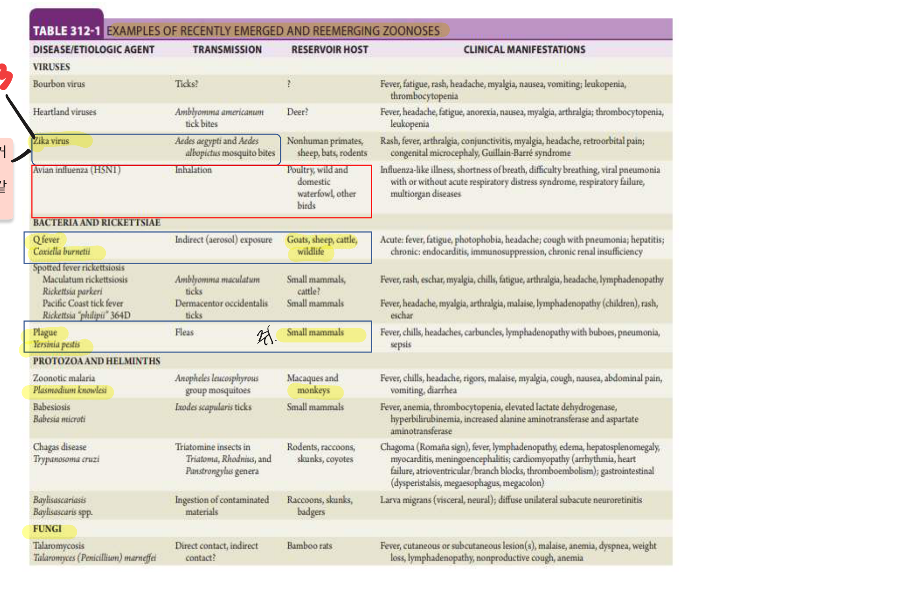{: style="width:72%"}

| 병원체 | 전파 | 숙주 |
|---|---|---|
| **Zika virus** | ***Aedes*** 모기 | **영장류**, 양·박쥐·설치류 |
| **조류인플루엔자(H5N1)** | **흡입** | **가금류**, 야생 물새 |
| **Q열(*C. burnetii*)** | **에어로졸(간접 노출)** | **염소·양·소** |
| **페스트(*Y. pestis*)** | **벼룩** | **소형 포유류** |
| **바베시아(*B. microti*)** | ***Ixodes scapularis*** 진드기 | 소형 포유류 |
| Hendra / Nipah | 말 접촉 / 접촉·섭취 | 과일박쥐 / 박쥐 |

!!! exam "기출 포인트"
    6·8번: 연결이 **틀린** 것 → "**Zika virus – Aedes aegypti 모기 – 파충류**"(숙주는 영장류). 17번: 인수공통감염병 원인체 → ***Francisella tularensis*, *Salmonella* Enteritidis**(*Mycoplasma pneumoniae*·*C. trachomatis*는 사람만).

## 전파 기전 3가지
1. **식품 매개·섭취** — 야생동물 도축·섭취(Ebola, Marburg, SARS, Mpox, 야토병), 가축 육류·유제품(비장티푸스 살모넬라, 병원성 대장균, vCJD). 피할 것: **비살균 유제품(Brucella, Listeria)**, 덜 익힌 육류, 날 해산물.
2. **절지동물 매개** — 모기(WNV, Zika, 일본뇌염), **진드기(라임병, 진드기매개뇌염, SFTS)**, 흡혈 파리(야토병, 리슈만편모충증). "**진드기는 곤충이 아니에요** — 다리 8개인 절지동물." 미국 매개체 전파 인수공통감염병의 **68.5%가 라임병** — "미국에서 중요한 병: 라임병, 국내: SFTS·쯔쯔가무시."
3. **직접 접촉·에어로졸** — 설치류 소변·배설물(렙토스피라증, 한타바이러스, LCMV), **교상·할큄**(광견병, 고양이할큄병 — *Bartonella henselae*). 호흡기 전파가 전파력이 가장 높다.

- 고위험군: 수의사, 농부, 도축장 종사자, 동물 취급자. 개 교상 균 *Capnocytophaga canimorsus*, 고양이 *Pasteurella multocida*.

## 임상적 접근 — "의심하지 않으면 진단할 수 없다"
- **가장 중요한 진단 도구 = 포괄적 병력 청취**: 해외 여행력, 직업, 반려동물, 야외 활동(등산·캠핑), 생식·야생동물 섭취력. "바빠서, 개인정보라서 안 물어보면 놓치고, 진단이 늦어지면 환자가 힘들다" → **의심하고 히스토리를 끝까지**(수업 설명).
- **피부를 끝까지 본다**: 발진, **가피(eschar)**, 궤양 — "피부 병변으로 오는 경우가 아주 많다"(수업 설명).
- 확진 검사는 의심 병원체에 맞춘다 — 핵산증폭검사, 혈액배양·말초혈액 도말, **급성기·회복기 혈청 항체 4배 이상 상승**, PCR. 교수님은 비슷한 병을 묶어 검사를 같이 내고(**Q열·브루셀라 검사는 둘 다**), 결과를 기다리는 동안 경험적으로 치료한다(수업 설명).
- **치료**: 바이러스성은 (HIV, 인플루엔자, COVID-19 빼면) 특이 치료제가 없어 **보존 치료**, **세균성은 원인균에 맞는 항생제 — 조기 투여로 생명을 구한다**. 상용 백신은 극소수(광견병, 황열, 일본뇌염 등).
- **예방의 세 수준**: 개인(손 씻기, 기피제, 비살균 유제품 피하기, 고위험군 백신) / 병원(격리가 필요한 병원체 — "병원 감염관리가 중요") / 사회(야생동물 거래 통제, 표적 감시).

## 증례 토의 2개
- **증례 1**: 54세 남성, 가을철 **벌초 5일 후** 고열·두통·근육통, 백혈구·혈소판 감소, AST/ALT 상승. 감별 → **SFTS vs. HFRS vs. 쯔쯔가무시병**, 확진 전 **경험적 doxycycline**. "의대생은 쯔쯔가무시만 떠올리지만, 응급실에서는 SFTS·HFRS·아나플라즈마증·라임병까지 고려하고, 중요한 검사 몇 가지 + 경험적 치료 → 다 음성이면 다시 평가."(12:02)
- **증례 2**: 22세 대학생, 동남아 배낭여행 중 **길고양이에게 오른손을 물린 후 3일 만에 귀국**, 상처는 아물어 가는 중, 발열 없음. 즉각 개입이 필요한 이유 → **광견병의 잠복기와 발병 시 치명률**. PEP 구성 → **상처 소독 + RIG + 광견병 백신**.

!!! key "수업에서 강조"
    "**시험에는 광견병이 나와요.**" 그러나 동물 교상 환자는 **광견병만 생각하지 말 것** — ① 입안의 다른 균 → 오염 상처로 보고 **치료적 항생제** ② **파상풍** — Tdap/DTP 접종력을 묻고 필요하면 접종, 지저분한 상처면 **파상풍 면역글로불린**까지 ③ 광견병 예방 여부 — "**세 가지가 다 머릿속에 돌아다녀야 돼요**." (전사본 13:03–14:29, 42:37–43:28)

**핵심 요약**: ① 70% 규칙과 원헬스 ② **History taking is key** ③ 세균성 인수공통감염병은 **조기 항생제로 치료 가능**.

# 2. Q열 (Q fever) ★ 1문제

!!! key "수업에서 강조"
    "Q열에서는 한 문제 나올 거예요. 별로 없는데 왜 내냐 — **제가 좋아해서 내요**."(15:36) "히스토리 테이킹 안 하면 진단하기가 되게 힘들어요." "Q열은 **엔도카다이티스(심내막염)로 낼 거고**"(27:06) — "debate가 심한 건 안 냈고 딱 떨어지게 냈다."

학습목표: ① *C. burnetii*의 특징과 가축 → 사람 **에어로졸 전파** ② **급성 Q열**(폐렴형·간염형) — "약을 쓰면 좋아짐" ③ **만성 Q열**(심내막염·혈관 감염·골수염) — "약을 쓰지만 치료하기 쉽지 않음" ④ **phase I·II 항체로 급성·만성을 구분**하고 치료 선택.

## 병원체 — 극소량으로 감염되고 환경에서 오래 산다
- ***Coxiella burnetii***: 작은 **절대 세포내 그람음성 간균**. 세포 안에서 자라므로 **일반 혈액배양에서 안 자란다**(수업 설명).
- **단핵구·대식세포를 주로 감염** → 전신 감염. 과거엔 리케치아로 분류했으나 유전적으로 다르다. **Q = query**(원인을 모른다는 뜻), 호주에서 처음 기술.
- 생존: 혹독한 환경에서 생존("춥거나 더워도 잘 삶"), **대식세포 안 포식소체(phagosome) 성숙을 억제하고 산성 포식용해소체에 적응**해 살균을 피한다("면역을 회피 → 잘 안 죽음").
- 숫자: 감염에 필요한 균 **1–10개**(추정), 분뇨·건초·흙에서 **수년** 생존, 바람을 타고 **수 km** 이동.

## 전파 — 분만하는 가축에서 나온 균을 들이마신다
1. **감염 가축**: **양·염소·소**("경북·경남에 염소 목장이 꽤 있음").
2. **분만**: 태반·양수에 **대량의 균**, 젖·소변·대변으로도 배출.
3. **환경 오염**: 분뇨·건초·흙에서 수년간 생존.
4. **에어로졸**: 바람을 타고 먼 거리까지.
5. **사람**: **흡입**으로 감염 — **가축 접촉이 없어도 감염 가능**.

- 드문 경로: **생우유 섭취**, 사람 간(감염 산모의 출산, 수술, 부검, **수혈**, 장기 이식), 실험실 감염. "혈액질환으로 대량 수혈을 받는 사람은 **무증상 Q열 공여자**의 피로 걸릴 수 있다."(수업 설명)
- **진드기의 역할은 미미** — 동물 집단 안에서 균을 유지할 뿐, 사람 감염의 대부분은 **가축 유래 에어로졸**("보통은 바람").

!!! key "수업에서 강조"
    바람을 타고 오므로 **가축 종사자가 아니어도** 목장·축사 근처(약 20 km 이내)에 사는 사람이 걸릴 수 있다 → 의심되면 **직업과 사는 곳**(반경 몇 km에 축사가 있는지)을 확인. (전사본 17:00–17:50)

## 역학 — 가축 종사자의 병, 그러나 유행은 일반 주민에게도
- 혈청 양성률: 네덜란드 젖소 농장 거주·종사자 **72%**, 캐나다 **65%**, 미국 수의사 **22%**, 미국 일반 인구 약 **3%**.
- **네덜란드 유행(2007–2010)**: 신고 4,000명 이상, 감염 40,000명 이상. 도시 가까이의 고밀도 염소 농장, **가축 접촉이 없는 주민도 감염**.
- 고위험 직업: **도축장 종사자, 수의사, 농부**. 15세 초과에서 증상 감염 5배, 남성에서 더 흔함. **감염자의 약 60%는 무증상 혈청전환**.
- 통제가 쉽지 않다 — 가축·환경·사람을 모두 관리해야 하는 **원헬스** 문제(수업 설명).

## 감염 후 경과 — 무증상, 급성, 만성

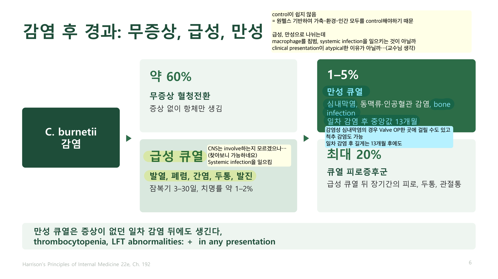{: style="width:70%"}

- **약 60% 무증상** / **급성 Q열**(발열·폐렴·간염·두통·발진, 잠복기 3–30일, 치명률 약 1–2%) / **1–5% 만성 Q열**(심내막염, 동맥류·인공혈관 감염, 뼈 감염 — 일차 감염 후 **중앙값 13개월**) / 급성 후 **최대 20% Q열 피로증후군**.
- 만성 Q열은 **증상이 없던 일차 감염 뒤에도** 생긴다. **혈소판감소·간기능 이상은 어느 형태에서든** 보일 수 있다.
- 교수님 생각: 대식세포를 침범해 전신에 퍼지므로 폐렴·간염·두통·발진까지 생기고, 그래서 임상 양상이 비전형적(수업 설명).

## 급성 Q열 — 비특이적 열병, 폐렴 또는 간염
- **잠복기 3–30일**, 치명률 약 **1–2%**. 임신 중 감염: 조산 35%, 유산·신생아 사망 43%(한 연구).
- 증상: 발열·극심한 피로, **심한 두통**(흔히 눈 뒤쪽), 눈부심, 오한·발한·오심·구토·설사, **폐렴 환자의 약 절반에서 기침**, 비특이적 발진 4–18%.
- 검사: 백혈구 대개 정상, **혈소판감소 약 25%**(회복기엔 반응성 증가), 자가항체(ANA, ANCA, 항인지질항체) 흔히 양성, 흉부 X선은 다른 폐렴과 비슷.
- **병형은 지역마다 다르다**: 폐렴형 — 네덜란드·캐나다·크로아티아 / 간염형 — 프랑스·이스라엘.
- "흡입을 하니 폐로 들어옴 → **급성 Q열은 폐렴이 많다**고 외우세요. 물론 간도 침범."(수업 설명, 23:12) 증상만으로 쯔쯔가무시·SFTS·Q열 구분은 어려워 **단서를 최대한 많이 주고** 냈다.

!!! diff "작년 필기와 다른 점"
    작년 필기는 "**유제류(양·염소·소)와 애완동물**이 주 감염원 — 분만 산물·에어로졸", "우리나라엔 거의 없고 **결핵과 굉장히 비슷**"이라 했고, **급성 Q열을 의심할 상황**(phase II IgG ≥200, IgM ≥50)과 **만성 Q열을 의심할 상황**(phase I IgG ≥800, IgA ≥100)을 아래 표로 나열했다. 작년엔 **급성 Q열 환자 전원에게 심장초음파**(심내막염 약 3%)라고 했다.

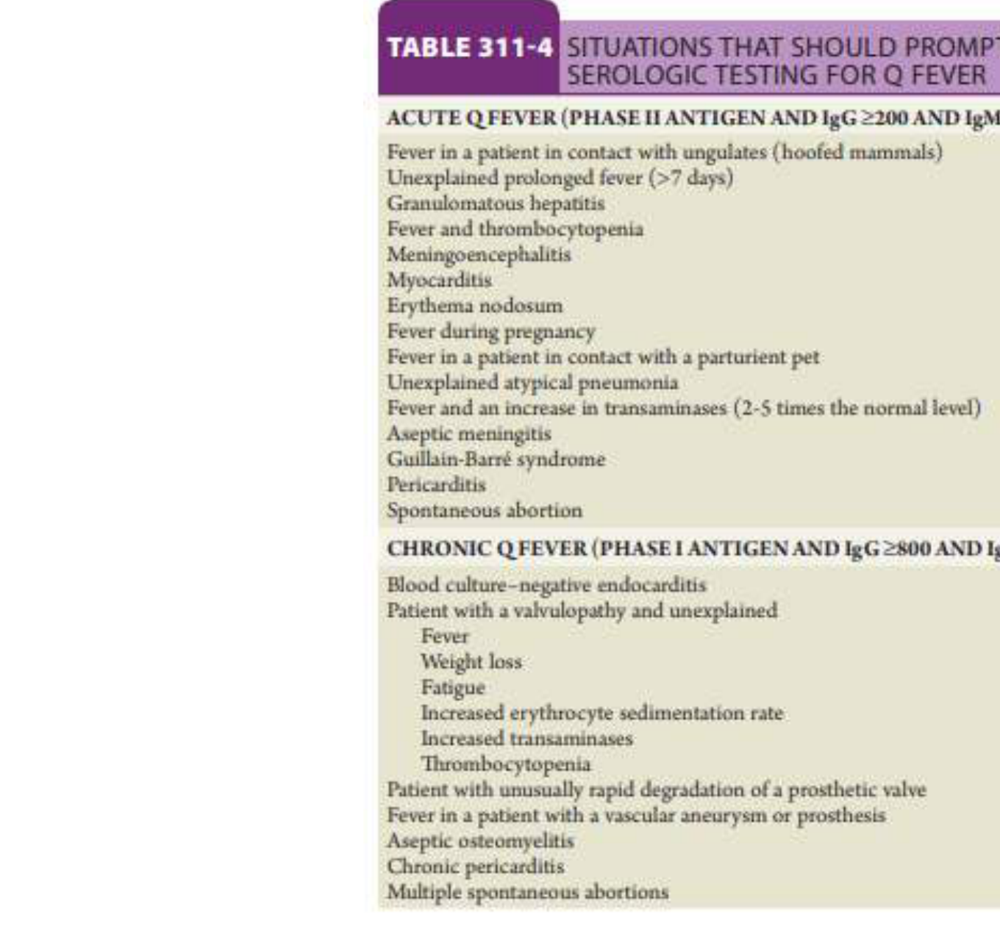{: style="width:48%"}

- 급성 Q열 의심(작년 표): 유제류 접촉자의 발열, 7일 넘는 원인 불명 발열, **육아종성 간염**, 발열 + 혈소판감소, 수막뇌염, 심근염, 결절홍반, 임신 중 발열, 비정형 폐렴, 간효소 2–5배 증가, 심낭염, 자연유산.
- 만성 Q열 의심(작년 표): **배양 음성 심내막염**, 판막질환자의 원인 모를 발열·체중감소·ESR 상승, 인공판막 조기 퇴행, 혈관류·혈관 보형물 환자의 발열, 무균성 골수염, 반복 유산.

## 만성 Q열 — 배양 음성 심내막염이면 의심한다 ★
- 감염자의 **1–5%**가 만성으로, 발현까지 **중앙값 13개월**(최장 9년 이상), **확진 만성 Q열 사망률 25%**.
- 병형: **심내막염**(가장 중요), 감염성 동맥류, 인공혈관 감염, **척추 골수염**, 인공관절 감염. "국내 환자는 절반 가량이 **척추 골수염이나 뼈 감염**."(수업 설명)
- 위험인자: **판막질환·판막 수술력**("valve OP한 곳에 다시 달라붙을 수 있다"), 동맥류·인공혈관(**이물질이 있는 곳**), 남성·고령, 신기능 저하·면역저하.
- 이럴 때 검사: **배양 음성 심내막염 환자 전부**; 판막질환·동맥류·인공혈관 환자의 원인 불명 체중 감소, 발열, 염증 수치 상승, 뇌졸중, 동맥류 확장, 진행하는 심부전.
- **국내 증례**(올해 필기): 53세 남자, **2개월 전부터 허리 통증**, 척추 MRI만으로는 브루셀라·Q열·MSSA 척추염 구분 불가. phase I IgG 1:8192, phase II IgG 1:2048, 브루셀라 <1:20, 직업 = **동물 사료 배달업**. "*S. aureus*는 며칠 전부터(**onset이 짧음**), Q열은 **onset이 길고 찌글찌글하게** 진행." 조직은 결핵(건락)과 달리 **비건락성 육아종**(시험 X). (전사본 22:00–23:50)

## 진단 — 혈청검사가 중심, phase II는 급성, phase I은 만성 ★

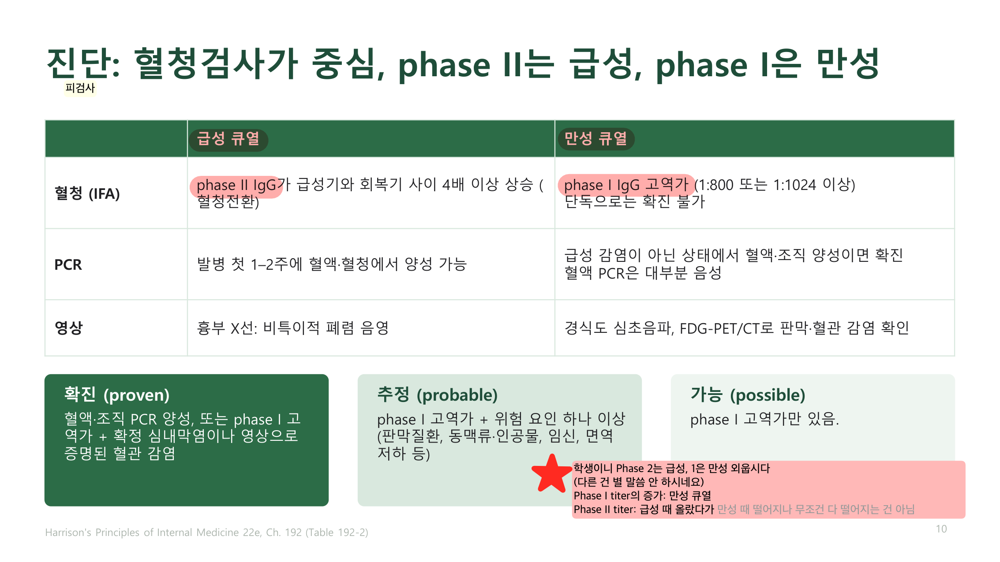{: style="width:76%"}

| | 급성 Q열 | 만성 Q열 |
|---|---|---|
| 혈청(IFA) | **phase II IgG**가 급성기·회복기 사이 **4배 이상 상승** | **phase I IgG 고역가**(1:800 또는 1:1024 이상), 단독으론 확진 불가 |
| PCR | 발병 첫 1–2주 혈액·혈청 양성 가능 | 급성기가 아닐 때 혈액·조직 양성이면 확진, 혈액은 대부분 음성 |
| 영상 | 흉부 X선 비특이적 폐렴 | **경식도 심초음파**, FDG-PET/CT |

- 만성 Q열 분류: **확진** — PCR 양성, 또는 phase I 고역가 + 확정 심내막염·영상으로 증명된 혈관 감염 / **추정** — phase I 고역가 + 위험요인 하나 이상 / **가능** — phase I 고역가만.
- 병원에서 PCR은 세팅이 어려워, **피를 뽑아 보건환경연구원으로 보내는 혈청검사**를 주로 쓴다(수업 설명).

!!! key "수업에서 강조"
    "**phase II가 급성기 항체, phase I이 만성기 항체** — 왠지 거꾸로일 것 같은데 아니에요."(16:26) "학생이니까 **2는 급성, 1은 만성** 이렇게 외웁시다." **phase I 역가가 오르기 시작하면 만성으로 진행 중**. phase II는 만성 때 떨어지지만 완전히 떨어지지 않을 수도 있다. (24:03–24:24)

### Q열 검사가 Duke 기준에 들어간 이유
- 2023 Duke–ISCVID 감염성 심내막염 기준의 **미생물학적 주요(Major) 기준**에 ***Coxiella burnetii***가 들어 있다. 다음 중 하나면 Major 1개: **phase I IgG >1:800**, 혈액 PCR 양성, 단일 혈액배양 양성.
- 확정 IE: Major 2 / Major 1 + Minor 3 / Minor 5. 예: ***C. burnetii* Major + 영상 Major = 확정 IE**. 검사 Major 1개만으로는 확정 아님.

!!! key "수업에서 강조"
    "Duke criteria를 찾아보면 **이상한 말**이 있습니다 — Major 기준에 뜬금없이 *Coxiella burnetii*… **이 Q열이 그 Q열 맞습니다.**" 만성 Q열은 심내막염이 잘 오고 놓치면 안 되므로 Major 기준에 들어갔다. (전사본 24:28–26:00)

## 치료 — 급성은 2주, 만성은 18개월 이상 ★

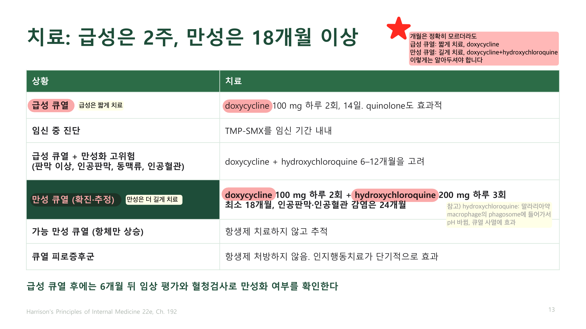{: style="width:76%"}

| 상황 | 치료 |
|---|---|
| **급성 Q열** | **doxycycline 100 mg 하루 2회, 14일**. quinolone도 효과 |
| 임신 중 진단 | **TMP-SMX** 임신 기간 내내 |
| 급성 + 만성화 고위험 | doxycycline + hydroxychloroquine 6–12개월 고려 |
| **만성 Q열(확진·추정)** | **doxycycline + hydroxychloroquine 200 mg 하루 3회, 최소 18개월**, 인공판막·인공혈관 24개월 |
| 가능 만성(항체만) | 치료하지 않고 추적 |
| Q열 피로증후군 | 항생제 안 씀. 인지행동치료가 단기 효과 |

- **급성 Q열 후 6개월 뒤 임상 평가와 혈청검사로 만성화 여부를 확인**한다.
- **hydroxychloroquine**(말라리아 약)은 대식세포 **포식소체에 들어가 pH를 바꿔** Q열균 사멸을 돕는다(수업 설명).

!!! key "수업에서 강조"
    "개월은 정확히 모르더라도 **급성 Q열 = 짧게, doxycycline / 만성 Q열 = 길게, doxycycline + hydroxychloroquine** — 이렇게는 알아두셔야 합니다."(26:06–26:45)

!!! diff "작년 필기와 다른 점"
    작년: 급성 doxycycline 2주(간염 동반 시 짧은 스테로이드), 임신 cotrimoxazole, **심내막염 hydroxychloroquine + doxycycline 18–36개월**. 올해는 만성 **최소 18개월, 인공판막·인공혈관 24개월**. "만성은 길게, doxycycline + hydroxychloroquine"은 같다.

## 예방 — 가축 관리가 사람을 지킨다
- **가축 위생**: 유산한 동물 최대 14일 격리, 유산 부산물은 소각·매몰, 다룰 때 마스크·장갑, 양·염소 백신.
- **사람 백신**: **Q-Vax** — 호주에서만 허가, 도축장 종사자에서 효과, 혈청·피부반응 음성인 사람에게만.
- **유행 시**: 유행 지역 거주자 헌혈 제한(종료 후 4주까지), 고위험 직업군 관리.
- "사람은 **급성 Q열 환자가 만성으로 진행하는지 추적**해야 한다."(수업 설명)

!!! memo "암기 — Q열 핵심 5줄"
    1. *C. burnetii*는 양·염소·소의 **분만 부산물**에서 나와 **에어로졸 흡입**으로 감염된다.
    2. 급성 Q열은 비특이적 열병, **폐렴이나 간염**. 약 **60%는 무증상**.
    3. **1–5%는 만성 Q열**. **배양 음성 심내막염**이면 반드시 의심한다.
    4. 급성은 **phase II** 항체 상승, 만성은 **phase I IgG 고역가**.
    5. 급성 **doxycycline 14일**, 만성 **doxycycline + hydroxychloroquine 18개월 이상**.

# 3. 브루셀라증 (Brucellosis) ★ 1문제

!!! key "수업에서 강조"
    "브루셀라도 한 문제 냈어요." 증례 — **48세 남자, 생우유로 만든 치즈를 먹은 뒤 수주간 발열과 야간 발한, 최근 허리 통증까지** → 무엇을 물어볼까? "축산업 종사자들은 자기가 받은 생유가 깨끗하다고 생각하는지 생유를 먹기도 함." "**헷갈리지 않게 최대한 문제를 내 볼 거예요**." (전사본 27:06–27:42)

학습목표: ① 어떤 동물과 식품이 감염원이 되는가 ② 발열 환자에서 언제 의심하는가.

## 원인균과 전파 경로
- **호기성, 통성 세포내 그람음성 구간균**(coccobacilli). 인수공통감염병.
- ***B. abortus*** — 소·버팔로 / ***B. melitensis*** — 양·염소·낙타(유증상 감염 최다) / *B. suis* — 돼지 / *B. canis* — 개. "**동물별로 구분해 외우는 건 기대하지 않고 그냥 브루셀라로 외우세요**."
- **감염 경로 ★**: **비살균 우유·치즈 섭취**, **분만 조직 접촉**(태반, 유산한 조직을 처리하거나 땅에 묻을 때), **에어로졸 흡입**. Q열은 **소량의 에어로졸**, 브루셀라는 **다량의 에어로졸** — 직업 병력만으로는 구분이 어려워 **검사를 둘 다 낸다**.
- **혈액배양에서 자라므로 검사자가 뚜껑을 열고 흡입하면 노출**(실험실 감염). 수혈은 "가능할 듯한데 잘 모르겠다".
- 유행 지역: 지중해(스페인, 포르투갈, 이탈리아, 그리스, 터키, 이라크 등), 인도, 중앙아시아, 라틴아메리카, 미국 일부(이민자 중심 — Texas, Arizona, California). 몽골·시리아 인근이 높고, 데이터 없는 나라도 많다 — "생뚱맞은 병 같아도 세계적으로 많이 퍼져 있다."

## 국내 발생
- **2024년 환자 5명**, 2025년 4명(잠정). "보고는 별로 없지만 놓치면 안 되고 **과소추정** 가능성이 높다."
- 국내는 주로 ***B. abortus***, 해외 유입은 ***B. melitensis***(이라크 귀국 48세 남성의 척추염 보고).

!!! diff "작년 필기와 다른 점"
    작년: 국내 **2002년 경기 파주** 첫 보고, 주로 **소** → *B. abortus*(경상도에 많다), **축산업자**가 가장 많고 수의사·도축업자·인공수정사, 경로는 **경구·흡입·결막·상처 난 피부**. 주된 표적은 **대식세포**, **괴사·건락화를 동반하거나 안 하는 육아종** → 결핵과 비슷, 동물에서는 **유산**.

## 임상 — 발열과 근골격계 통증
- **발열·야간 발한·피로·체중 감소**. 열이 수주간 오르내림 = **파상열(undulant fever)**.
- 급성·아급성: 잠복기 약 1–4주(때로 수개월), 국소 소견 없는 열병. 재발형: 관절염, 허리 통증, 발한, 피로. 만성: 주기적·국소적, 신경·정신 증상.
- **국소 병변은 치료를 바꾼다**: **척추염·천장관절염**(지속되는 허리·엉덩이 통증) / 신경브루셀라증(수막염) / **심내막염**(드물지만 가장 중요한 중증 합병증).
- "Q열이 있는데 굳이 브루셀라 심내막염으로 시험 문제를 내진 않겠으나 환자 볼 때는 필요하다."(32:00)

!!! diff "작년 필기와 다른 점"
    작년 합병증: **근골격계(척추염, 천장관절염)**, 약 1/4 **간비장비대**, **10–20%에서 급성 부고환고환염**(볼거리·고환염전과 감별), 전립선염, 신우신염. 치료 후에도 관절통·만성 피로가 가장 오래 남는다.

## 진단 — 노출력 + 배양·혈청검사
- **혈액배양**(필요하면 관절액·뇌척수액·조직). 검체를 보내기 전 **검사실에 'Brucella 의심'을 미리 알린다**.
- **혈청 응집검사**: 노출·임상과 함께 해석, 필요하면 2–4주 뒤 재검.
- "혈청검사 도움을 받지만 **배양에서 나오면 확실!!**" — Q열과 달리 배양에서 자란다.
- 증례: **비살균 치즈 + 발열·야간 발한 + 허리 통증** → 노출 확인, 척추 침범 평가, 혈액배양·혈청검사, 검사실에 알리고 병합치료.
- 감별(전신 발열): 심내막염, **결핵**, 장티푸스, 렙토스피라증, **Q열**, 전염단핵구증, 히스토플라스마증, 류마티스 질환, 악성 종양 — "학생 시험에서 다 내진 않을 것."

## 치료 — 병합요법과 충분한 기간
- **1차: streptomycin 근주 14–21일 + doxycycline 100 mg 하루 2회 6주**(재발 5–10%).
- 대체: **gentamicin** 5–6 mg/kg/일 1–2주.
- **2차: doxycycline + rifampin 6주** — 재발 시험에서 약 10%, 실제로는 20% 넘음.
- 척추·신경계·심내막 침범은 더 길게. 치료 실패는 대부분 **복약 순응도** 문제 — 추적 관찰.
- "Q열이랑 약이 조금 다르지만 비슷 — **Q열은 hydroxychloroquine과 doxycycline, 브루셀라는 streptomycin과 doxycycline**."(30:00)

!!! diff "작년 필기와 다른 점"
    작년(그림)은 **1차 doxycycline 6주 + rifampin 600–900 mg 6주**, 대안 doxycycline + streptomycin 2주(또는 gentamicin)였다. 올해(Harrison 22판)는 **streptomycin + doxycycline이 1차, doxycycline + rifampin이 2차**로 순서가 바뀌었다. 두 조합 모두 "브루셀라 치료로 옳다"이고, **"1차"를 물으면 올해 필기·수업대로 streptomycin + doxycycline**.

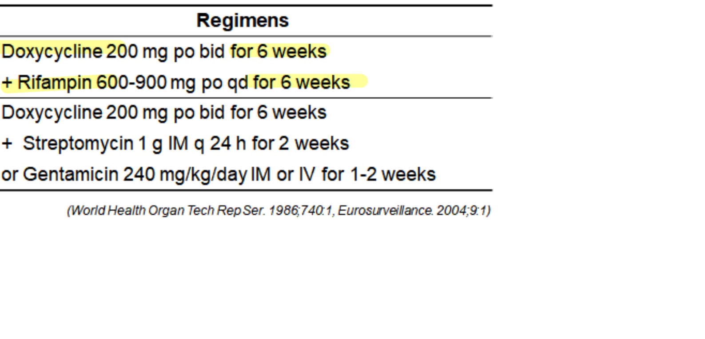{: style="width:58%"}

!!! exam "기출 포인트"
    7번: 62세, 2달 미열·허리통증, L4–5 척추염, 혈액배양 음성, **Brucella 항체 1:640** → "**임상증상이 모호하여 결핵 같은 만성감염병과 매우 유사**". 오답 — 비말전파 2급·격리, amphotericin B, 생식기 합병증 거의 없음(→ 부고환고환염 흔함), **어업** 종사력(→ 축산업). 13·22번: 국내 가장 흔한 균종 → ***B. abortus***. 18번: 오염 음식, 대식세포 증식, 육아종·농양, **파상열** → ***Brucella abortus***.

# 4. Q열 vs 브루셀라증

!!! new "올해 필기에서 추가 — 두 병 비교"
    닮은 점(참고): 둘 다 **가축에서 오는 세포내 감염**, 비특이적 열병. 고위험군(농부·목축업자·수의사·도축장·실험실), 대식세포 안에서 생존하며 육아종성 염증, 에어로졸, 비살균 유제품 위험, 사람 간 전파는 극히 드묾, 급성기 증상만으로 구분 불가, 둘 다 심내막염·골수염 가능, 노출력 + 혈청검사 중심, doxycycline 기반 장기 치료, 사람 백신은 사실상 없음.

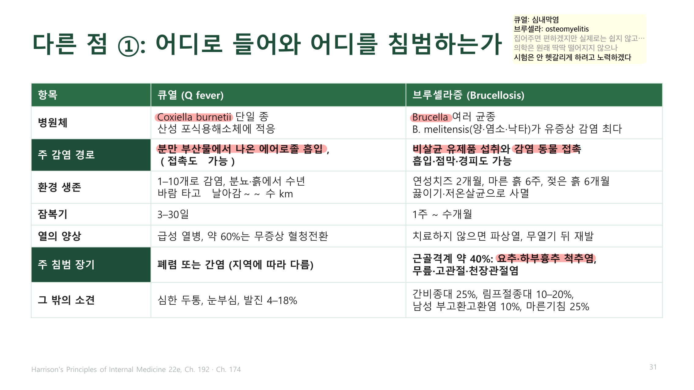{: style="width:80%"}

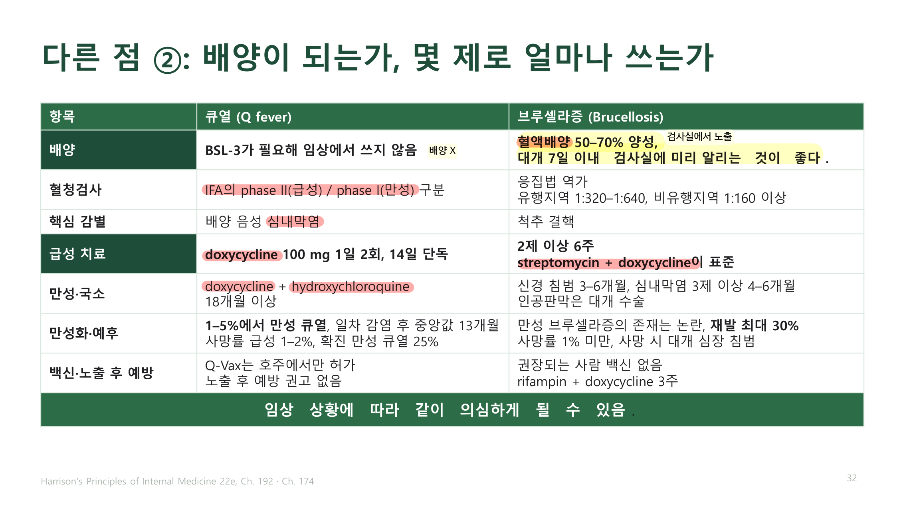{: style="width:80%"}

| 항목 | Q열 | 브루셀라증 |
|---|---|---|
| 주 감염 경로 | **분만 부산물 에어로졸 흡입** | **비살균 유제품 섭취**, 감염 동물 접촉 |
| 잠복기 | 3–30일 | 1주–수개월 |
| 주 침범 | **폐렴 또는 간염** | **근골격계 약 40%**: 요추·하부흉추 **척추염**, 천장관절염 |
| 그 밖 | 심한 두통, 눈부심, 발진 4–18% | 간비종대 25%, 림프절종대 10–20%, **부고환고환염 10%** |
| 배양 | **임상에서 배양 안 함** | **혈액배양 50–70% 양성**, 대개 7일 이내 |
| 혈청 | IFA **phase II(급성) / phase I(만성)** | 응집법: 유행지 1:320–1:640, 비유행지 1:160 이상 |
| 핵심 감별 | **배양 음성 심내막염** | 척추 **결핵** |
| 급성 치료 | **doxycycline 14일 단독** | **2제 이상 6주**(streptomycin + doxycycline) |
| 만성·국소 | doxycycline + HCQ 18개월 이상 | 신경 3–6개월, 심내막염 3제 4–6개월 |
| 예후 | 만성 1–5%, 확진 만성 사망률 25% | **재발 최대 30%**, 사망률 1% 미만 |

!!! key "수업에서 강조"
    "딱 **Q열은 심내막염, 브루셀라는 골수염** 이렇게 집어주면 편할 텐데, 의학은 원래 딱딱 떨어지지 않아요. 그래도 **시험은 안 헷갈리게 하려고 노력하겠다**." (전사본 31:01–32:01) → **배양 음성 심내막염**이면 Q열, **비살균 치즈 + 허리 통증 + 혈액배양 양성**이면 브루셀라.

# 5. 중동호흡기증후군 (MERS) — 시험 X

!!! new "올해 필기에서 추가 — MERS (시험에 안 냄)"
    "메르스 안 낸 것 같은데 — 눈에 힘 풀고 봐도 돼요."(32:29) 교수님이 2015년에 "한 달 동안 집에 못 들어갔다"는 병.

- **2012년 사우디아라비아** 처음 확인, 확진 **2,600명 이상**(2023), 치명률 **35%**, 대부분 **아라비아 반도**.
- **MERS-CoV** — SARS-CoV-1·2와 같은 베타코로나바이러스. **사람 간 전파는 비효율적이지만 치명률이 높다**.
- 전파: **박쥐(추정 병원소) → 단봉낙타 → 사람 → 병원 내 전파**(중증 입원환자가 슈퍼전파자). 박쥐는 **포유류**, 여러 바이러스의 저장소지만 자신은 잘 안 아프다(수업 설명).
- 임상: 무증상 → **ARDS** → 다장기부전 → 사망. **기저질환 있는 고령 남성**의 예후가 가장 나쁘다. "건강한 40–50대 남자가 급격히 진행하기도 — ECMO도 하고, 치료가 쉽지 않다."
- SARS(2002, 2004년 이후 보고 없음) / **MERS(비효율적 전파, 중증 환자가 전파)** / COVID-19(무증상·경증도 전파 → 전세계 확산).
- **잠복기 약 14일**. "**감염관리가 핵심**" — 중동 체류 후 발열 환자를 만나면 **질병관리청에 신고, 격리, 보호구(마스크) 착용, 환자에게 설명** — "1차 의료의 역할"(35:03).

# 6. 라임병 (Lyme borreliosis) ★ 1문제

!!! key "수업에서 강조"
    "미국 갈 사람들이 있을 테니 하나 냈어요." 해외여행력 없는 **순수 국내 감염 라임병이 늘고 있어 의심해야 한다 — 그래서 한 문제 냈어요.** 35강에서 미리 읽은 사례: "**24세 여자, 발열·두통, 10일 전 야외 산책, 피부 병변**" → 라임병. (전사본 36:02–37:00, 35강 정리)

!!! new "올해 필기에서 추가 — 라임병 전체"
    작년 필기에는 아나플라즈마증과 "발생 지역이 비슷하다"는 한 줄과 병원체학 기출(국내 균종 *B. afzelii*)뿐이었다. 올해는 한 단원으로 들어왔다.

학습목표: ① *B. burgdorferi* sensu lato와 *Ixodes* 진드기의 분포, 국내 현황 ② 유주성 홍반과 1·2·3기 침범 장기 ③ 검사 전 확률에 따른 혈청검사와 2단계 검사 해석 ④ 병기별 항생제와 기간, 치료 후 증상.

## 병원체와 매개체
| 지역 | 주요 균종 | 매개 진드기 |
|---|---|---|
| 미국 | *B. burgdorferi* (sensu stricto) | *Ixodes scapularis*, *I. pacificus* |
| 유럽 | *B. afzelii*, *B. garinii*, *B. bavariensis*, *B. burgdorferi* | *I. ricinus* |
| 아시아 | *B. garinii*, *B. afzelii*, *B. bavariensis* | *I. persulcatus* |

- **미세호기성 스피로헤타**. 진드기는 유충·약충·성충 단계마다 흡혈, 병원소는 설치류. 같은 진드기가 *Anaplasma*, *Babesia*, 진드기매개뇌염 바이러스도 옮긴다.
- **약충(nymph)**: 유충 → 약충 → 성충의 중간 단계, **사람 전파의 주범**, 초여름 정점 — "이 단계에서 물리면 걸림".
- 전파에 필요한 진드기 부착 **24시간 이상**. 미국 연간 추정 환자 **476,000명**.

!!! key "수업에서 강조"
    "어쨌든 **보렐리아는 외우세요**. 지역을 구분해 외울 필요는 없어요." "진드기는 다 **I로 시작합니다 = *Ixodes***." SFTS는 **작은소피참진드기**, 라임병은 **참진드기**(*Ixodes*) — 속(genus)이 달라 매개체가 완전히 같지 않다. (전사본 36:02–37:00)

## 국내 발생 — 국내 감염이 늘고 있다
- 신고 환자: 2019년 23명 → 2021년 8명 → **2023년 45명**(국내 감염 36, 해외 유입 8, 불명 1).
- **2019–2023년 국내 감염 72.4%**(2011–2018년 56.4%). 2012년 첫 환자. 매개 진드기가 **국내에 토착화**한 것으로 평가. **제3급 법정감염병**.

## 병태생리 — "안 외워도 됩니다"
- 진드기 중장(OspA) → 흡혈 시작 시 침샘(OspC, Salp15 결합) → 피부(VlsE 항원 변이로 면역 회피, 퍼지며 유주성 홍반) → 혈행·림프로 신경·심장·관절 → 수주–수개월 안에 대부분 제거, 일부 수년 잔존.
- **독소가 없다** — 조직 손상은 숙주 염증 반응. 사람은 종말 숙주.
- 진드기를 **24시간 안에 떼면 전파 위험이 낮다**. 치료 안 해도 초기 증상은 가라앉지만 균은 남을 수 있다. 초기 감염 뒤 재감염 가능.

## 임상 경과 — 세 병기

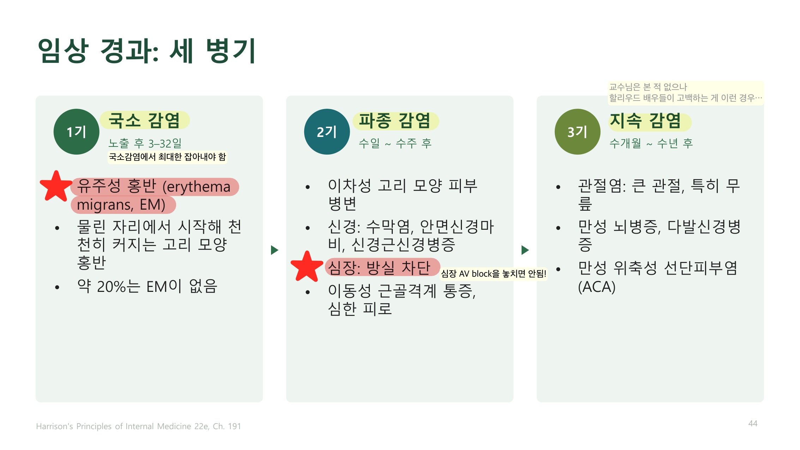{: style="width:76%"}

| 병기 | 시기 | 소견 |
|---|---|---|
| **1기 국소** | 노출 후 **3–32일** | **유주성 홍반(EM)**. 약 20%는 EM 없음 |
| **2기 파종** | 수일–수주 후 | 이차성 고리 모양 피부 병변, 신경(수막염, **안면신경마비**, 신경근신경병증), **심장: 방실 차단**, 이동성 근골격계 통증, 피로 |
| **3기 지속** | 수개월–수년 후 | **관절염**(특히 무릎), 만성 뇌병증·다발신경병증, 만성 위축성 선단피부염(ACA) |

!!! key "수업에서 강조"
    "**국소 감염에서 최대한 잡아내야 함.**" 2기에서 중요한 건 **심장 — 갑자기 생기는 방실 차단을 놓치면 안 된다**. 3기는 "본 적 없어서 넘어갈게요". (전사본 37:00–38:08)

### 유주성 홍반 (erythema migrans) — 보면 진단한다 ★

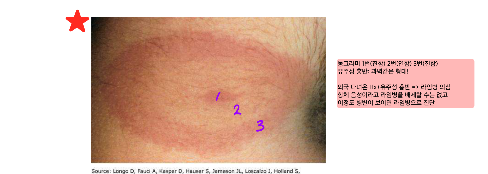{: style="width:74%"}

- 물린 자리의 붉은 반점·구진에서 시작 → 천천히 커져 **큰 고리 모양**.
- **밝은 붉은 테두리 + 부분적 중심부 소실**, 물린 자리의 중심 병변 — 사진의 **진한 고리(1) – 연한 고리(2) – 진한 고리(3), 과녁 모양**.
- 호발: **허벅지, 서혜부, 겨드랑이**. **통증·가려움은 드물다** — "병변이 큰데 간지럽지도 아프지도 않아 찾아보지 않으면 모른다."
- 약충이 작아 **대부분 물린 것을 기억하지 못한다**.
- **비전형도 흔하다**: 전체가 고르게 붉은 병변, 여러 겹 고리, 중심부 수포·괴사 — 초기 진단을 놓치는 가장 흔한 이유.
- **2기**에서는 더 작은 EM이 **여러 곳**에. 교수님도 피부 진균 감염과 완전히 구분하긴 어렵지만 **히스토리(야외 산책) + 병변**으로 의심한다(수업 설명).

!!! key "수업에서 강조"
    "**유주성 홍반, 이거는 외우라고 했어요.**"(40:17) 야외 산책·외국 다녀온 병력 + 유주성 홍반 → 라임병. 급성기라 **항체가 대부분 음성 — 음성이라고 배제할 수 없고, 이 정도 병변이면 그냥 라임병으로 진단**. "**검사 기다리지 말고 치료하자.**" (38:08–40:48)
    35강에서 정리한 **피부 병변 3개**: 비특이적 벌레 물린 자국 = SFTS / **가피(eschar) = 쯔쯔가무시** / **유주성 홍반 = 라임병**.

### 2기 파종 감염 — 신경과 심장 ("조심해야 한다")
- **신경계 약 15%**: 수막염, 뇌신경염, 신경근신경병증. **안면신경마비가 가장 흔한 뇌신경염**(양측 가능). CSF 림프구 증가·단백 상승. 유럽·아시아는 신경근 통증으로 시작(**Bannwarth 증후군**). 대개 수개월 안에 회복.
- **심장 약 8%**: **방실 차단이 가장 흔함** — 1도, Wenckebach, 완전 차단 사이를 오르내림. 대개 수주 안에 호전, 영구 심박동기는 필요 없음.

### 3기 지속 감염 — 관절염 (시험 비중 낮음)
- 치료받지 않은 미국 환자 **약 60%**에서 큰 관절(특히 **무릎**) 소수관절염 발작 반복. 관절액 백혈구 평균 25,000/μL.
- 감염 후 라임 관절염: 항생제 후에도 수개월–수년, 배양·PCR 음성 — 과도한 염증 반응.
- **ACA**: *B. afzelii*, 유럽·아시아, 고령 여성, 사지 말단 적자색 변색이 경화·위축.

| 균종 | 지역 | 특징 |
|---|---|---|
| *B. burgdorferi* | 북미, 유럽 | 널리 파종, **관절염** |
| *B. garinii*, *B. bavariensis* | 유럽, 아시아 | **신경친화성** — Bannwarth 증후군 |
| *B. afzelii* | 유럽, 아시아 | 주로 **피부** — **ACA** |

- "뒤 이름 외우라고 안 합니다, 그냥 다르다. **보렐리아는 외워야 함**." 모든 균종이 대개 유주성 홍반으로 시작.

!!! exam "기출 포인트"
    11번(2022 병원체학): 우리나라 라임병에서 가장 많이 분리되는 균종 → ***Borrelia afzelii***. *B. burgdorferi* sensu stricto는 북미, *B. hermsii*·*B. recurrentis*는 재귀열.

## 진단 — 임상 양상이 먼저, 혈청검사는 확인용

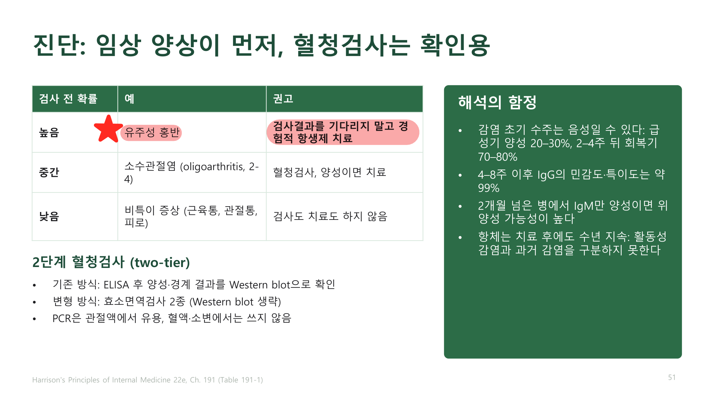{: style="width:76%"}

| 검사 전 확률 | 예 | 권고 |
|---|---|---|
| **높음** | **유주성 홍반** | **검사 결과를 기다리지 말고 경험적 항생제** |
| 중간 | 소수관절염(2–4 관절) | 혈청검사, 양성이면 치료 |
| 낮음 | 비특이 증상(근육통, 관절통, 피로) | 검사도 치료도 안 함 |

- **2단계 혈청검사**: ELISA → 양성·경계면 Western blot(또는 효소면역검사 2종). **PCR은 관절액에서 유용**, 혈액·소변엔 안 씀.
- **함정**: 초기 수주는 **음성일 수 있다**(급성기 양성 **20–30%**, 2–4주 뒤 70–80%). 4–8주 이후 IgG 민감도·특이도 약 99%. **2개월 넘은 병에서 IgM만 양성**이면 위양성 가능성. 항체는 치료 후에도 수년 남아 활동성·과거 감염을 구분 못 한다.
- 감별: 진드기 물린 자국·봉와직염·다형홍반 / 안면마비 — HSV-1(Bell), VZV(Ramsay Hunt) / 소수관절염 — 척추관절병증, 소아특발관절염 / 발열 + 혈구감소 — **같은 진드기의 동시감염**(아나플라즈마증, 바베시아증) / 만성피로증후군·섬유근통.

## 치료 — 대부분 경구 항생제로 충분하다 ★

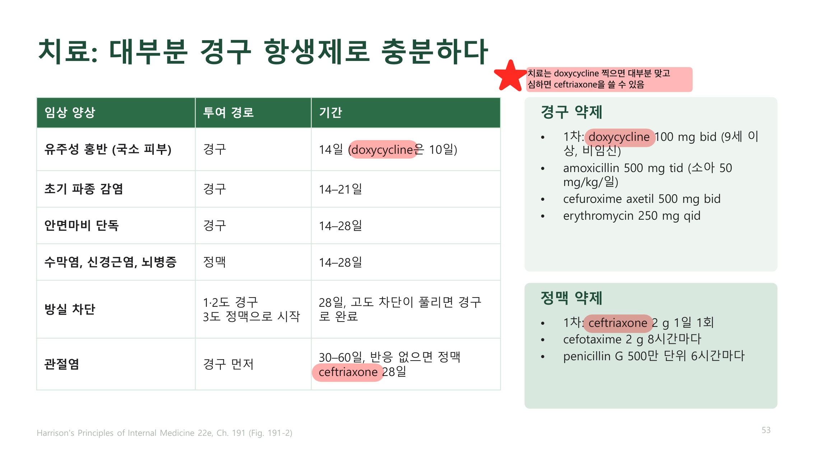{: style="width:76%"}

| 임상 양상 | 투여 경로 | 기간 |
|---|---|---|
| **유주성 홍반** | 경구 | 14일(**doxycycline은 10일**) |
| 초기 파종 | 경구 | 14–21일 |
| 안면마비 단독 | 경구 | 14–28일 |
| 수막염, 신경근염, 뇌병증 | **정맥** | 14–28일 |
| 방실 차단 | 1–2도 경구, **3도 정맥으로 시작** | 28일 |
| 관절염 | 경구 먼저 | 30–60일, 반응 없으면 ceftriaxone 28일 |

- 경구: **1차 doxycycline 100 mg 하루 2회**(9세 이상, 비임신), amoxicillin(소아 50 mg/kg/일), cefuroxime axetil, erythromycin.
- 정맥: **1차 ceftriaxone 2 g 하루 1회**, cefotaxime, penicillin G.

!!! key "수업에서 강조"
    "치료는 **doxycycline 찍으면 대부분 맞고**, **심하면 ceftriaxone**." (전사본 40:17–40:48)

### 치료 후 라임병 증후군 (PTLDS) — "이런 게 있다 넘어가고"
- 약 **10%**가 치료 후에도 통증·인지 증상·피로. 추가 항생제의 이득을 못 보인 위약대조 시험 **5개**. 대부분 수개월에 호전. **반복·장기 항생제는 권장하지 않는다** — 증상 완화.

## 예방 — "상식적으로" (시험 X)
- 서식지 피하기, 기피제, 야외 활동 후 몸 확인, **24시간 안에 제거하면 위험 낮음**.
- 진드기는 모기와 달리 **옷에 붙어 피부로 가서 자리를 잡은 뒤 24시간(SFTS 진드기는 48시간) 동안 천천히 흡혈** → 귀가 후 옷을 털고 몸을 확인하는 것만으로 상당히 예방(수업 설명).
- 제거는 **손으로 뜯지 말고 핀셋으로 머리(침) 쪽을 집어 조심히 들어 올린다**(수업 설명).
- 물린 뒤 예방적 항생제: 일상적으로 주지 않음. 흡혈한 약충 + 추적이 어려우면 doxycycline 200 mg 1회(72시간 이내) 고려 — "교수님도 잘 몰라서 시험 문제 안 내심." 시판 백신 없음.

!!! memo "암기 — 라임병 핵심 5줄"
    1. ***Ixodes*** 진드기가 옮기는 ***Borrelia*** 감염. 국내 감염이 늘고 있다.
    2. **유주성 홍반**이 보이면 혈청 결과 전에 치료한다. 초기 혈청 음성은 배제 근거가 아니다.
    3. 2기는 **안면신경마비·수막염·방실 차단**, 3기는 **무릎 관절염**.
    4. 대부분 **doxycycline 경구**, 심한 신경 침범·3도 방실 차단은 **ceftriaxone 정맥**.
    5. 치료 후 남는 주관적 증상에 항생제를 반복하지 않는다.

# 7. 공수병 (광견병, Rabies) ★ 1문제 · 매년 출제

!!! key "수업에서 강조"
    "**여기서도 한 문제 냈어요. 중요해서.**"(42:04) "시험엔 **노출 후 예방(PEP)** 냈고, 실무적으로는 환자에게 백신·면역글로불린이 어디 있는지 알려주는 게 중요하겠죠."(52:29) 국내엔 지금 없는 병이라 처방할 때 고민이 많지만 "**약간 보수적으로**" — 예방접종이 필요하면 빨리.

학습목표: ① 잠복기 동안 바이러스가 어디 있는지 — 노출 후 예방의 근거 ② 뇌염형과 마비형, 의심해야 할 상황 ③ **교상 환자에서 PEP 시작 여부를 판단하고 상처 처치·백신·면역글로불린 처방** ④ 국내 현황, 노출 범주별 조치, 약품 수급과 신고.

## 교상 상처 — "dirty wound!"
- 개에게 물린 상처 사진: **생각보다 이빨 자국이 작고**, 환자가 스스로 소독하고 피도 닦고 와서 **깨끗해 보이지만 괜찮다고 생각하면 안 된다**. **관통한 이빨 자국은 주의**.
- 실제 임상에서는 **광견병 + 혐기균(입안 세균) + 파상풍**을 다 고려 — "물론 오늘은 광견병만 합니다^^."

## 병원체와 전파
- 전 세계 연간 사망 **약 59,000명**(대부분 아시아·아프리카), 사람 공수병의 **약 99%는 개가 매개**, 잠복기 **20–90일**(수일–1년 이상).
- **Rhabdoviridae 과, *Lyssavirus* 속**. 비분절 **음성가닥 ssRNA**, 단백 5개. 변이주가 동물 병원소에 따라 구분된다.
- 전파: **교상** — 감염 동물의 **침이 상처로 침투**(가장 흔함). 유행 지역은 **개**, 미국은 **박쥐**(교상을 인지 못하는 경우가 많다). 드물게 각막·장기 이식. **사람 간 전파는 극히 드묾**.

## 국내 발생 — 사람은 2004년, 동물은 2013년이 마지막
- **사람**: **2004년 이후 환자 없음**. 1999–2004년 6명(경기 4, 강원 2) — **모두 적절한 교상 후 치료를 받지 못하고 사망**.
- **동물**: 2014년 이후 없음. 발생 동물 소 45.5%, 개 37.9%, **너구리** 15.4%. 강원 57.0%, 경기 42.8%. **2013년 경기도 화성 너구리가 마지막**. 제3급 법정감염병.
- 수의학자들이 시즌마다 **야생동물이 먹는 미끼 백신**을 산에 살포한다(수업 설명). 야생동물은 전수조사가 어려워 보균 동물이 있을 수 있다.

!!! diff "작년 필기와 다른 점"
    작년: "**우리나라는 너구리와 개**가 주요 감염원", 병원소 = 야생동물(**너구리, 오소리, 여우, 박쥐**), 개, 고양이, 소. **쥐·다람쥐·토끼 같은 설치류는 전염원이 아니다.** 국내 발생은 **경기 연천·파주·포천, 강원 인제·양구·철원**에 집중. 수업에서 "2005년도 이후엔 아무도 없다"고도 말했지만(46:02) 필기는 **마지막 환자 2004년**.

## 병태생리 — 잠복기에는 바이러스가 접종 부위 근처에 머문다

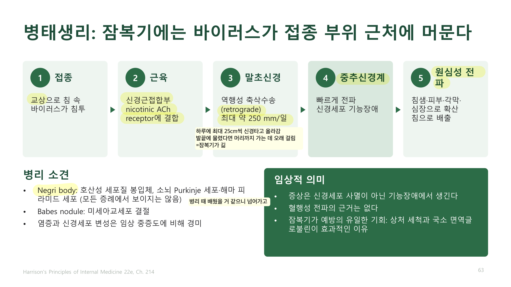{: style="width:72%"}

1. **접종**: 교상으로 침 속 바이러스 침투.
2. **근육**: 신경근접합부 **니코틴성 아세틸콜린 수용체**에 결합.
3. **말초신경**: **역행성 축삭수송** — **최대 약 250 mm/일**.
4. **중추신경계**: 빠르게 전파, 신경세포 기능장애.
5. **원심성 전파**: 침샘·피부·각막·심장 → **침으로 배출**.

- 병리: **Negri body** — 호산성 세포질 봉입체(소뇌 Purkinje·해마 세포, 모든 증례에서 보이지는 않음). 염증·신경 변성은 임상 중증도에 비해 경미.
- **임상적 의미**: 증상은 신경세포 사멸이 아닌 **기능장애**. **잠복기가 예방의 유일한 기회** — 상처 세척과 국소 면역글로불린이 효과적인 이유.

!!! key "수업에서 강조"
    "**하루에 최대 25 cm씩** 신경을 타고 올라간대요. 발끝에 물렸다면 머리까지 오래 걸림 = **잠복기가 긺**." Negri 소체는 "병리 때 배웠을 거 같으니 넘어가고". (전사본 45:01)

!!! diff "작년 필기와 다른 점"
    작년은 상행 속도를 "**시간당 3 mm**"로 적었고, 올해는 "**최대 약 250 mm/일**"이다. 둘 다 "**물린 부위가 머리에 가까울수록 잠복기가 짧다**"는 뜻. 작년엔 **증상 전에는 PCR로 안 나온다**고 했다.

## 임상 경과 — 전구기에서 사망까지 1–3주

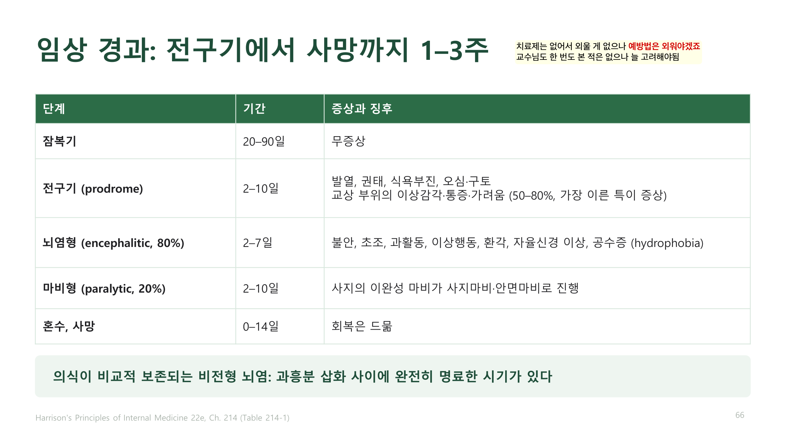{: style="width:74%"}

| 단계 | 기간 | 증상과 징후 |
|---|---|---|
| 잠복기 | 20–90일 | 무증상 |
| 전구기 | 2–10일 | 발열, 권태, 오심·구토. **교상 부위의 이상감각·통증·가려움**(50–80%, 가장 이른 특이 증상) |
| **뇌염형(80%)** | 2–7일 | 불안, 초조, 이상행동, 환각, 자율신경 이상, **공수증(hydrophobia)** |
| **마비형(20%)** | 2–10일 | 사지의 이완성 마비 → 사지마비·안면마비 |
| 혼수, 사망 | 0–14일 | 회복은 드묾 |

- **뇌염형(furious)**: 과흥분 삽화와 **명료기가 교대**(의식이 비교적 보존되는 비전형 뇌염). **공수증** — 물을 삼키려 할 때 인후두근·횡격막의 통증성 수축. **공기공포증** — 바람에 같은 반응. 침 과다분비 등 자율신경 이상. 수일 안에 혼수·사망.
- **마비형(paralytic)**: 공수증 없음, 물린 사지에서 시작하는 이완성 근력저하, 감각 침범 경미. **길랭–바레 증후군으로 흔히 오진**. 며칠 더 살지만 결국 사망.
- "**치료제는 없어서 외울 게 없으나 예방법은 외워야겠죠**."(45:01)

!!! diff "작년 필기와 다른 점"
    작년 병기: 잠복기 → 전구기(감기 같지만 **물린 부위 주위의 마비감**이 특징) → 급성 신경질환기(빛·소음 민감, 침·눈물 과다, **격노형 — 물 공포 / 마비형**) → 보통 **4일 내 사망**, 길어야 14일.

## 진단 — 의심이 먼저, 음성이어도 배제하지 않는다
- **의심**: 급성 비전형 뇌염(의식 비교적 보존), 급성 이완성 마비(GBS 의심 포함). **교상력이 없어도, 공수증이 없어도 배제 불가**. 유행 지역 여행력·동물 접촉력 확인.
- 검체: **침** RT-PCR(반복 채취), **목덜미 피부 생검**(모낭 포함) DFA·RT-PCR, 혈청 중화항체(미접종자에서 양성이면 진단적), 뇌척수액 항체·PCR, 뇌조직(주로 사후). **생전 검사 음성은 배제 못 함**. "진단할 때는 biopsy — 교수님도 진단한 적 없으시다네요."
- 감별("알고는 있어야"): HSV·아르보바이러스 뇌염, **Anti-NMDA receptor 뇌염**(젊은 여성, 행동 변화), **길랭–바레 증후군**, 감염 후 뇌척수염, rabies hysteria.

!!! diff "작년 필기와 다른 점"
    작년 진단: ① **문 동물을 잡아 가두고 관찰** — 광견병이면 10일 안에 죽으니 **10일 이상 잘 살면 문제없다** ② 침 PCR, 뇌 조직 RT-PCR, **Negri 소체** ③ 국내 최종 진단: 사람 — 국립보건연구원, 동물 — 농림축산검역본부.

## 치료와 예후 — 확립된 치료는 없다
- 문서화된 생존자 **최소 33명**, 그중 **31명은 발병 전 백신을 1회 이상 접종** — "생존자 별로 없고 대부분 백신 접종자". 유도 혼수 + 항바이러스제 치료는 60건 넘게 실패.
- 효과가 입증된 항바이러스제 없음. 중환자실 보존 치료, 대부분 수일 안에 사망.

## 노출 후 예방 (PEP)의 세 요소 ★★

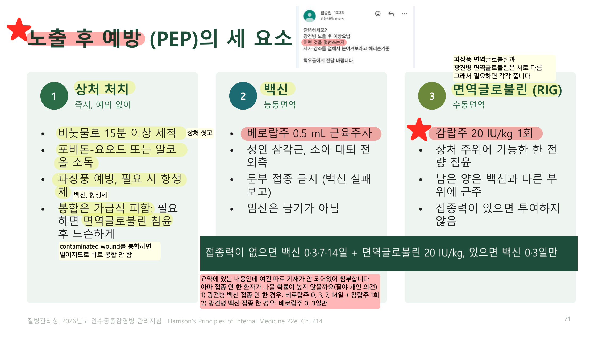{: style="width:78%"}

### 1) 상처 처치 — 즉시, 예외 없이
- **비눗물로 15분 이상 세척**.
- **포비돈-요오드 또는 알코올** 소독.
- **파상풍 예방**, 필요하면 **항생제**.
- **봉합은 가급적 피함** — 오염 상처를 바로 봉합하면 벌어진다. 꼭 필요하면 **면역글로불린 침윤 후 느슨하게**.

!!! diff "작년 필기와 다른 점"
    작년: "물린 직후 **가능하면 15분 내** 비누와 많은 물로 충분히 씻는다", 항생제는 **amoxicillin/clavulanate 또는 ampicillin/sulbactam** — 예방이 아니라 **치료적 항생제**. 올해는 "**15분 이상** 세척" — 시험에선 **비누와 물로 15분 이상**.

### 2) 백신 — 능동면역
- **베로랍주 0.5 mL 근육주사**. 성인 **삼각근**, 소아 대퇴 전외측. **둔부 접종 금지**(백신 실패 보고). 임신은 금기 아님.

### 3) 면역글로불린 (RIG) — 수동면역
- **캄랍주 20 IU/kg 1회**.
- **상처 주위에 가능한 한 전량 침윤**, 남은 양은 **백신과 다른 부위**에 근주.
- **접종력이 있으면 투여하지 않는다**.
- **파상풍 면역글로불린과 광견병 면역글로불린은 서로 다른 약** — 필요하면 각각 준다(47:06).

!!! memo "암기 — PEP 일정"
    **접종력 없음**: 백신 **0·3·7·14일 4회** + 면역글로불린 **20 IU/kg 1회**(상처 주위 침윤).
    **접종력 있음**: 백신 **0·3일 2회만**, 면역글로불린 없음.

!!! diff "작년 필기와 다른 점"
    작년: HRIG 20 IU/kg **상처 부위에**, 남으면 상처에서 떨어진 곳. **과량이면 백신 면역 형성을 방해 → 백신 1주가 지나면 면역글로불린은 주지 않는다**. 백신은 원문 5회였지만 **4회로 바뀜(면역저하자만 5회)**. **면역력 있는 사람**(항체 1:5 이상 또는 교상 후 적절한 치료 5년 이내) → 백신 당일·3일. 올해 숫자와 같다.

## PEP를 시작할 것인가 — 관찰할 수 있으면 기다리고, 못 하면 시작 ★

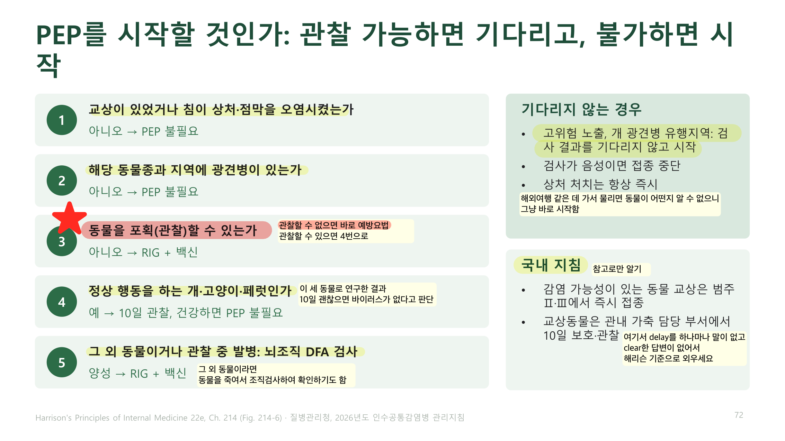{: style="width:76%"}

1. **교상이 있었거나 침이 상처·점막을 오염시켰는가** — 아니오 → PEP 불필요.
2. **해당 동물종과 지역에 광견병이 있는가** — 아니오 → 불필요.
3. **동물을 포획(관찰)할 수 있는가** — **아니오 → RIG + 백신**.
4. **정상 행동을 하는 개·고양이·페럿인가** — 예 → **10일 관찰**, 건강하면 PEP 불필요.
5. 그 외 동물이거나 관찰 중 발병 → **뇌조직 검사**, 양성이면 RIG + 백신.

- **기다리지 않는 경우**: 고위험 노출, 개 광견병 유행 지역 → **검사 결과를 기다리지 않고 시작**, 음성이면 중단. "**해외여행 가서 물리면 동물이 어떤지 알 수 없으니 바로 시작**."
- 왜 개·고양이·페럿인가 — "이 세 동물로 연구해 **10일 괜찮으면 물렸을 당시 바이러스가 없었다**고 판단. 다른 동물은 잘 모른다."(48:03)

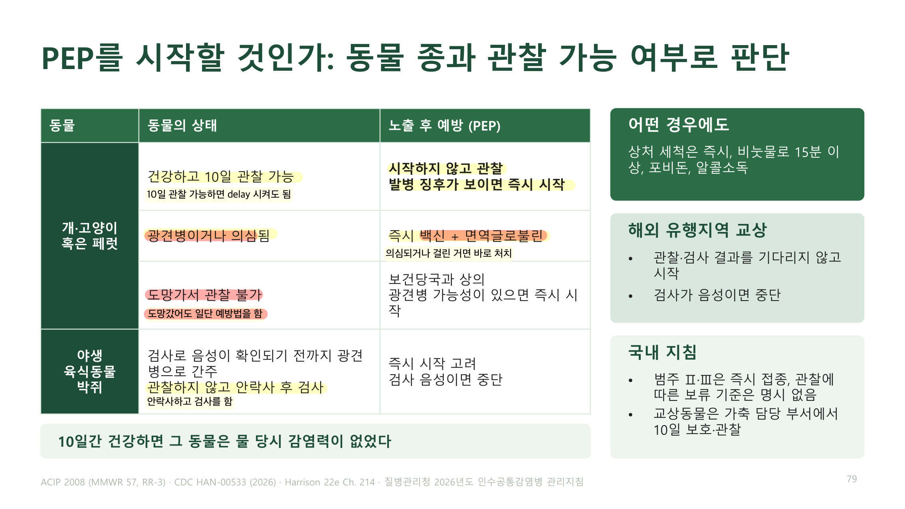{: style="width:76%"}

| 동물 | 상태 | PEP |
|---|---|---|
| 개·고양이·페럿 | **건강하고 10일 관찰 가능** | **시작하지 않고 관찰**, 발병 징후면 즉시 시작 |
| | **광견병이거나 의심** | **즉시 백신 + 면역글로불린** |
| | **도망가서 관찰 불가** | 광견병 가능성이 있으면 즉시 시작 — "**도망갔어도 일단 예방법**" |
| 야생 육식동물·박쥐 | 음성 확인 전까지 광견병으로 간주, 관찰 없이 검사 | 즉시 시작 고려, 검사 음성이면 중단 |

!!! key "수업에서 강조"
    PEP 여부는 국내·해리슨·CDC가 조금씩 다른데 "**여러분은 해리슨을 기준으로 외우세요**." 국내 지침은 "10일 관찰한다면서 **delay를 하나마나 말이 없어서**" 참고만. **동물을 포획해 관찰할 수 있는지가 결정적** — 못 하면(도망, 해외) 바로 예방요법. (전사본 47:06–49:48)

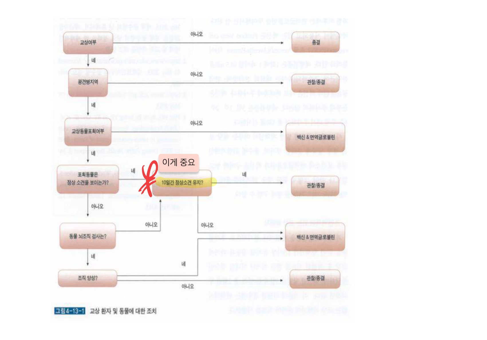{: style="width:50%"}

## 국내 지침(참고만) — 노출 범주
| 범주 | 접촉 | 조치 |
|---|---|---|
| **I. 노출 없음** | 만지거나 먹이 줌, 손상 없는 피부를 핥음 | PEP 불필요 |
| **II. 노출** | 출혈 없는 경미한 긁힘·찰과상 | 세척, **즉시 백신** |
| **III. 중증 노출** | 경피적 물림·할큄, 손상 피부를 핥음, **박쥐 직접 접촉** | 세척, **즉시 백신 + 면역글로불린** |

- **II와 III의 차이 = 면역글로불린**. 교상 동물은 관내 가축 담당 부서에서 10일 보호·관찰.
- "한 번 걸리면 치료제가 없어서 귀찮아도 하는 게 맞지 않나 — **감옥에 갈 수 있기 때문에 보수적으로**."(50:04)

## 국내 실무 — 약이 어디 있는지부터 확인
- **한국희귀·필수의약품센터** 긴급도입의약품(02-508-7316-8). 구비 기관 전국 60곳, 면역글로불린 30곳. **대구: 경북대학교병원(삼덕 본원) — 백신·면역글로불린 모두 보유**. 관할 보건소에 먼저 문의. 질병관리청이 「공수병 백신·면역글로불린 비축 의료기관 현황」을 주기적으로 공지.
- 급하고 연락이 안 되면 **국립중앙의료원(서울)에는 거의 있어 "KTX 타고 서울 가서 맞고 와라"** 하기도(수업 설명).
- 요양급여: 백신은 **노출 후만 인정**, 면역글로불린은 감염 추정·심각할 우려 시.
- **제3급 — 24시간 이내 보건소 신고**. 환자 격리 불필요, 분비물 접촉 주의.
- 헌혈 제한: 예방 백신 후 24시간, 물린 뒤 백신 후 1년, 치료 종료 후 1개월.

## 노출 전 예방 (PrEP) — 0일, 7일 2회 ("참고사항")
- 대상: 바이러스 실험실 종사자, **수의사·동물 사육·관리 종사자**, 풍토 지역 여행자, 의료 접근성 낮은 위험 지역 거주자. 반복 노출·장기 체류면 0·7·21(28)일 3회 고려. 위험도에 따라 6개월·2년마다 항체검사.

!!! diff "작년 필기와 다른 점"
    작년: 노출 전 백신 **0, 7, 21(또는 28)일 3회**("교수님은 두 번이라 했는데 찾아보면 세 번"). 올해는 **기본 0·7일 2회**, 반복 노출·장기 체류 시 3회.

!!! exam "기출 포인트"
    1·3·5번: **도망친 야생 너구리·오소리**에게 물림, 10년간 백신 없음 → **가·나·다·라 모두**(백신 4회 + amoxicillin/clavulanate + 면역글로불린 + 파상풍 백신·면역글로불린) — 올해 흐름으로는 "동물 포획 불가 → RIG + 백신". 2·4번: **이웃의 개·고양이** → "**10일간 관찰**". 오답 — 항생제로 완치, 바로 도살해 뇌조직검사, **면역글로불린을 물린 팔 삼각근에**(→ 상처 주위 침윤, 백신과 다른 부위), ribavirin, 0·7·21일 3회(노출 전 일정). 12·21·23번: **Negri 소체** → **rabies virus**, 관찰 장기 → **뇌 조직**.

!!! memo "암기 — 공수병 핵심 5줄"
    1. 발병하면 치료가 없다. **잠복기에 시작하는 노출 후 예방이 유일한 대책**.
    2. 의식이 보존된 비전형 뇌염, 원인 불명 급성 이완성 마비에서 의심한다.
    3. 교상 환자는 **즉시 비눗물로 15분 이상 세척**.
    4. **접종력 없으면 백신 0·3·7·14일 + 면역글로불린 20 IU/kg, 있으면 백신 0·3일만.**
    5. 국내는 범주 II 백신, 범주 III 백신 + 면역글로불린. 약품 보유 기관을 먼저 확인.

# 8. 작년 필기에만 있던 내용 — 리케치아, 아나플라즈마증, SFTS

!!! diff "작년 필기와 다른 점"
    아래 세 단원은 **작년(장현하 교수님) 34강 필기**에만 있었다. 올해는 **35강(가을철 열성질환)**에서 다뤘다 — 35강에서 "아나플라스마증은 이번 시험엔 안 내요", **SFTS(밭일하는 할머니 + 백혈구·혈소판 감소)는 출제 사례로 읽음**. 작년 기출 대비용으로 남기고, 올해 시험 준비는 **35강 학습자료**를 기준으로.

## 리케치아 감염증
- *Rickettsiaceae*: ***Rickettsia, Orientia*, *Ehrlichia, Anaplasma***, ***Coxiella*** 등. **세포 밖에서 오래 살지 못해** 매개충(이, 벼룩, 진드기)이 필요, 털진드기는 **알을 통해 다음 세대로**.
- **발열, 두통, 발진**(Q열 제외), **가피(eschar)** — 쯔쯔가무시병, 리케치아두. **doxycycline·클로람페니콜**로 열이 극적으로 떨어진다.
- **발진열** *R. typhi* — **쥐벼룩** / 발진티푸스 *R. prowazekii* — 이 / 록키산홍반열 *R. rickettsii* — 진드기 / 리케치아두 *R. akari* — 쥐진드기 / 쯔쯔가무시 *O. tsutsugamushi* — 털진드기 유충.

!!! exam "기출 포인트"
    14번: 맞게 짝지은 것 → ***R. rickettsii* – 진드기(tick)**. 20번: 쥐벼룩 매개 → **발진열**.

## 아나플라즈마증 (HGA)
- ***Anaplasma phagocytophilum***, 병원소 **사슴·흰발생쥐**, 매개 **참진드기(*Ixodes*)** — 라임병과 지역이 비슷. 늦봄–가을, **국내 2014년 첫 환자**.
- 잠복기 7–10일, **39 ℃ 이상 고열**, **백혈구감소·혈소판감소** → **SFTS와 감별**. 치사율 1% 이하. 말초혈액 호중구 안 **morulae**, PCR.
- 치료 **doxycycline 100 mg 하루 2회 7–10일**, 임산부·소아 rifampin.

## 중증열성혈소판감소증후군 (SFTS)
- 국내 **2013년 첫 사례**, 치명률이 높다. **4–11월**. **작은소피참진드기**, **환자 혈액·체액 노출**로도 전파.
- 잠복기 6–14일. **발열기 → 다장기부전기 → 회복기**(사망은 주로 14일 내). **고열 + 위장관 증상**, 출혈 경향, 의식 저하. **백혈구·혈소판 감소**, AST·ALT·LDH·CK 상승, **CRP는 잘 안 오른다**. 확진: 혈청 RT-PCR.
- **특이 치료제 없음** → 대증요법, 치사율 10–30%. 1인실, **혈액·체액 노출 주의**(의료진 감염 사례). 예방은 진드기에 물리지 않기.

# 9. 병원체학 보충 (2020–22 기출)
- **탄저(*Bacillus anthracis*)**: 그람양성 **아포형성** 막대균, 독소 2가지 = **부종독소 + 치명독소**. 자연감염의 대부분 = **피부탄저**(검은 가피). 흡입형은 균이 **종격동 림프절**에서 증식해 **사람 간 전파가 없다**. 혈액배지 비용혈성 **"메두사 머리"** 집락.
- **라임병**: 국내 가장 많이 분리되는 균종 ***Borrelia afzelii***(6장). **재귀열 보렐리아**는 발열기 혈액 도말(Giemsa·Wright)에서 나선균이 보인다.

!!! memo "암기 — 한눈에"
    | 질환 | 병원체 | 노출·매개 | 핵심 | 치료 |
    |---|---|---|---|---|
    | **Q열** | *C. burnetii* | 분만 가축 에어로졸 | phase II 급성 / I 만성, 배양음성 심내막염 | 급성 doxy 14일 / 만성 doxy + HCQ ≥18개월 |
    | **브루셀라** | *B. abortus* | 비살균 우유·치즈 | 야간 발한, 척추염, 혈액배양 양성 | streptomycin + doxy (2차 doxy + rifampin) |
    | **라임병** | *B. burgdorferi* | *Ixodes* 약충 | 유주성 홍반, 방실 차단 | doxy, 중증 ceftriaxone |
    | **공수병** | *Lyssavirus* | 개, 국내 너구리 | 공수증, Negri 소체 | PEP: 세척 + 백신 0·3·7·14 + RIG 20 IU/kg |
