<!-- 필기본: 2026 · 2025 -->
<!-- 단계: 수업 후 -->
<!-- 전사본: 2026-11-27 -->

# 0. 이 수업을 공부하는 법

올해 담당은 **임승진 교수님**(올해 처음 맡음, 2026-11-27 2교시). 작년·재작년 기출 47문항은 모두 **장현하 교수님** 출제다.
교수님 말씀: "**제가 잘 모르는 건 낼 수가 없어요. 경험한 것밖에 못 내요.**" 올해 필기 순서(매개체별)대로 정리했다.

| 매개 | 병 | 올해 시험 |
|---|---|---|
| 털진드기 | ① **쯔쯔가무시증** | 나온다 — "매우 많으므로 낼 수밖에 없음" |
| 참진드기 | ② **SFTS**, ⑥ 아나플라스마증, ⑦ 에를리히증 | SFTS 나온다 / 아나플라스마·에를리히는 "이번 시험엔 안 내요" |
| 설치류(쥐) | ③ **신증후군출혈열(HFRS)**, ④ **렙토스피라증** | 둘 다 나온다 — "HFRS 하나 냈다" |
| 벼룩·이 | ⑤ 발진열·발진티푸스 | 안 나온다 — "있다는 것만" |

!!! key "수업에서 강조 — 교수님이 미리 읽어 준 출제 사례 (전사본 02:39–04:24, 39:30–40:41)"
    - 58세, 6일 전부터 열·허리 통증, **2주 전 밭에서 콩 수확 + 풀밭에 앉아 있었다** → **쯔쯔가무시** (가피 찾기)
    - 45세 남자, **핍뇨·황달**, **홍수로 쓰러진 벼를 세웠다** → **렙토스피라증(Weil 증후군)**
    - 62세 여자, 발열·구토, **고구마 캐다가** 아파서 온 할머니 → **SFTS**
    - 24세 여자, 발열·두통, 10일 전 야외 산책, 피부 병변 → 라임병(유주성 홍반, 34강)
    - "**HFRS 하나 냈다**" → 대증치료(승압제·수액·투석) (전사본 12:14)
    - 젖소 목장·축산업 종사자(Q열·브루셀라), 해외 야생개 물림(광견병) → 34강 / 요도염, 임산부 매독, **후기 잠복매독 진단 기준** → 30강

교수님이 정리한 "한 병당 한 가지" (전사본 11:57–12:54, 36:33–38:04):

- **쯔쯔가무시 = 가피(에스카)** → 박테리아 → **doxycycline** (중증 + azithromycin, 임신부 azithromycin)
- **SFTS = 혈소판이 쭉쭉 떨어짐, 위중함, 미세한 물린 흔적** → 바이러스 → **대증치료**
- **HFRS = 저혈압·핍뇨** → 바이러스 → **대증치료(승압제·수액, 필요하면 투석)**
- **렙토스피라 = 홍수 후 논 작업한 농부, 황달 + 폐출혈(Weil)** → 박테리아 → 중증 **ceftriaxone 또는 IV penicillin**, 경증 doxycycline
- "**1교시부터 지금까지 찍으면 독시사이클린 절반 이상은 맞아요.**" 리케치아 계열(이름이 다 R)은 doxycycline, 중증이면 ceftriaxone.

안 낸다고 한 것: **SFTS 치료제 favipiravir**("해리슨에 안 나와서"), **HFRS ribavirin**("쓰기 어려운 약은 안 내겠죠"), 아나플라스마증·에를리히증·발진열·발진티푸스, 진드기 종류 구분("털진드기냐 작은소피참진드기냐 이런 걸 낼 사람 같아 보이진 않잖아요"), 진드기 계절 그래프, 잠복기 숫자 자체.

!!! key "수업에서 강조 — 피부 병변 세 가지를 구분하라 (전사본 09:49–10:26, 40:08)"
    **벌레 물린 흔적(비특이적) = SFTS** / **가피(eschar) = 쯔쯔가무시** / **유주성 홍반 = 라임병**. 교수님이 마지막에 세 사진을 다시 띄우고 "이렇게 알아두고, 3개"라고 정리했다.

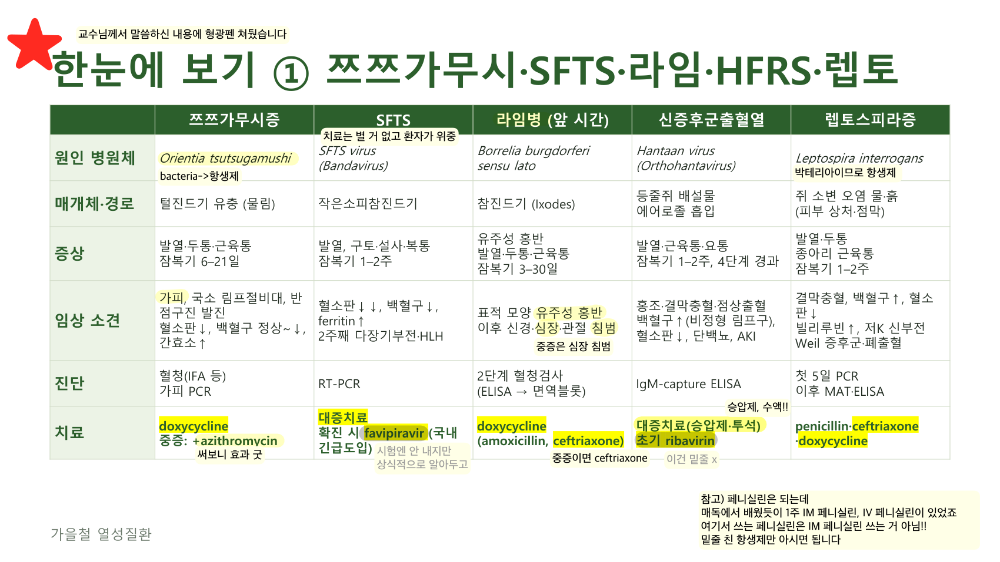{: style="width:92%"}

**기출(작년까지, 장현하 교수님)** 은 거의 같은 증례의 반복이었다. 교수님이 바뀌어도 병과 정답 방향은 같으므로 2부는 그대로 풀어 둔다.

| 반복 패턴 | 정답 방향 | 2부 문항 |
|---|---|---|
| 가을 야외작업 + 발진 + **가피** → 치료제 | **doxycycline** (임신부 → **azithromycin**) | 3, 5, 8, 10, 14, 18, 26, 38 |
| 홍수 난 논 + 결막충혈 + 황달·신부전·폐출혈 | 렙토스피라증·**Weil 증후군**, 중증은 penicillin/ceftriaxone | 2, 6, 15, 27 |
| 렙토스피라 발병 **2주 이후** 검체 | **소변** (1주 이내는 혈액·CSF) | 12, 17, 22, 33, 39 |
| 산지 야외취침 + 핍뇨 + 혈소판↓ + 혈액농축 | **HFRS → 보존적(대증) 치료** | 4, 9, 11, 16, 19, 21, 28, 40 |
| 진드기 노출 + 백혈구·혈소판↓ + 발진·가피 없음 | **SFTS → 대증치료**, 혈액 PCR, 격리 | 1, 7, 13, 30, 32, 41, 47 |

!!! key "핵심"
    - **가피 = 쯔쯔가무시**. 치료는 doxycycline — **진단을 기다리지 말고 바로**. 임신부 azithromycin, 중증 doxycycline + azithromycin.
    - **SFTS**: 혈소판↓↓·백혈구↓, RT-PCR, 치료제 없음 → **대증치료**. 혈액·체액으로 의료인 감염 → 보호구·표준주의.
    - **HFRS**: 들쥐 배설물 에어로졸 흡입, 발열기 → 저혈압기 → 핍뇨기 → 이뇨기, **대증치료(승압제·적절한 수액·투석)**.
    - **렙토스피라**: 쥐 소변 → 물·흙, 결막충혈 + **종아리 근육통**, Weil 3징(출혈·황달·급성신손상) + 폐출혈. 박테리아 → 항생제.
    - 백혈구: 쯔쯔가무시 정상~↓, SFTS ↓, HFRS·렙토스피라 ↑ — 그러나 교수님: "**랩만으로 감별하지 않는다.**"

# 1. 도입 — 진드기와 가을철 열성질환

## 1-1. 국내에서 보는 병, 거의 못 보는 병

교수님 개인 경험 기준이다.

| 국내에서 보는 병 | 규모 | 거의 못 보는 병 | 규모 |
|---|---|---|---|
| **쯔쯔가무시증** | 연 수천 명 | 발진열 | 연 십수 명 |
| **HFRS · SFTS** | 연 수백 명 | 발진티푸스 | 사실상 없음 |
| **렙토스피라증** | 연 50명 안팎 | 에를리히증 / 아나플라스마증 | 주로 미국 / 국내 일부 사례 |

- 위의 넷이 **가을철 발열 환자에서 먼저 떠올려야 할 질환**이다.
- 발진열·발진티푸스: 교수님이 학생 때는 중요하게 배웠지만 임상에서는 못 봤다. "우리나라에 쥐가 별로 없어서가 아닐까"(수업 설명).
- 그래도 배우는 이유: 해외 의료봉사·선교, 해외 진료에서 만날 수 있다. 에를리히증은 "미국 가서 의사 할 사람은 알아야"(수업 설명). 아나플라스마증은 국내에 실제로 있지만 진단을 못 할 뿐이다.

!!! new "올해 필기에서 추가"
    "모든 걸 다 알려고 하지 말고 중요한 걸 알고, 흔하지 않은 것 중에서 **검사를 해야겠다는 느낌**을 잡았으면 좋겠다"(수업 설명). 강의는 **매개체별 순서**(털진드기 → 참진드기 → 설치류 → 벼룩·이)로 진행했다.

## 1-2. 참진드기는 왜 늘었나

- 국내 참진드기는 33종 이상 보고, 주요 4종: **작은소피참진드기**(*Haemaphysalis longicornis*, 숲·수풀 참진드기의 **85~95%**), 개피참진드기, 일본참진드기(*Ixodes*), 뭉뚝참진드기(*Amblyomma*).
- 늘어난 배경: 국토 약 70%가 산림 → 치산녹화(1967~1987), 연료 전환, 이농으로 숲이 울창해짐 → 멧돼지·고라니·들쥐 등 야생동물 증가 → 체표 참진드기 증가. 교수님: 기후 영향과 산림 증가(수업 설명).
- 진드기는 **곤충이 아니다**(다리 8개) — 교수님도 "되게 충격적"이었다고(몰라도 됨).
- 참진드기가 옮기는 병원체: 사람 — **SFTS 바이러스, *Borrelia*(라임병)** / 사람·동물 — *Anaplasma*, *Ehrlichia* / 개 *Babesia gibsoni*, 고양이 *Cytauxzoon felis*, 소 *Babesia*·*Theileria*. "그냥 눈에 발라두시면 되고요."
- 이름 요령: **SFTS 진드기는 H(*Haemaphysalis*)**, **라임병 진드기는 I(*Ixodes*)** — 같은 참진드기지만 살짝 다르다(수업 설명). 그러나 개피·일본·뭉뚝참진드기도 SFTS를 옮길 수 있어 "절대적인 게 없다". 일본참진드기는 라임병도 가능.
- 작은소피참진드기 성충 암컷은 흡혈 후 **10배 이상, 약 1 cm**까지 커진다(48시간 흡혈). **고라니**가 작은소피참진드기가 선호하는 반추동물 — 2023년 SFTS 양성 진드기 14건 중 8건의 숙주.
- 환자가 진드기를 담아 오면 보건소 등에 보내 PCR을 돌리기도 한다(수업 설명).

## 1-3. 진드기 생활사와 사람으로 오는 길

1. 알 → 유충 → 약충(nymph) → 성충, 알을 제외한 세 단계가 흡혈하며 탈피. 라임병은 주로 **약충** 단계에서 옮긴다.
2. 소형 포유류·조류 — 유충·약충의 주된 흡혈 대상, 병원체를 얻는 단계.
3. 유제류(소·사슴 등) — 성충 암컷이 흡혈하고 산란, 진드기 개체 수를 키운다.
4. 사람 — 우연한 숙주. 진드기 생활사 유지에는 기여하지 않는다.
5. 사람 → 사람 — **SFTS는 혈액·체액 노출로 전파 가능**(의료기관 내 전파 보고).

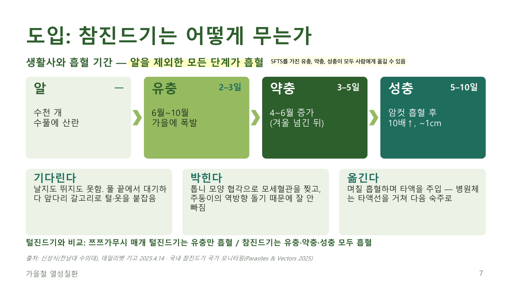{: style="width:75%"}

| 단계 | 기간(흡혈) | 특징 |
|---|---|---|
| 알 | — | 수천 개, 수풀에 산란 |
| 유충 | 2~3일 | 6~10월, 가을에 폭발 |
| 약충 | 3~5일 | 4~6월 증가(겨울 넘긴 뒤) |
| 성충 | 5~10일 | 암컷 흡혈 후 10배↑, ~1 cm |

- **기다린다**: 날지도 뛰지도 못한다. 풀 끝에서 대기하다 앞다리 갈고리로 털·옷을 붙잡는다.
- **박힌다**: 톱니 모양 협각으로 모세혈관을 찢고, 주둥이의 역방향 돌기 때문에 잘 안 빠진다.
- **옮긴다**: 며칠 흡혈하며 타액을 주입 — 병원체는 타액선을 거쳐 다음 숙주로.

!!! key "수업에서 강조 — 털진드기와 참진드기는 무는 단계가 다르다 (전사본 09:04–11:01)"
    **참진드기는 유충·약충·성충 모두 흡혈** → SFTS를 가진 진드기라면 어느 단계든 사람에게 옮긴다 → SFTS는 **4~11월**, 봄(5월)과 늦여름(8~9월) **두 봉우리**.
    **털진드기는 유충만 흡혈** → 쯔쯔가무시는 **10~11월에 집중**, 봄에는 드물다. (계절 그래프 자체는 "시험에 안 나옴")

※ 확인 필요: 수업에서는 "털진드기는 성충만 먹거든요. 어 맞나? 헷갈린다"(전사본 10:52)라고 했지만, 올해 필기(14쪽 "유충만 사람을 문다")·작년 필기·기출 25·31번 모두 **털진드기는 유충(chigger) 시기에만 사람을 문다**. 시험은 **유충**으로.

## 1-4. 참진드기에 물린 자리 — 가피와 다르다

참진드기에 물린 자리의 한 달 변화: 제거 전 주둥이로 단단히 박힌 진드기와 금방 사라지는 홍반 → 24시간 홍반성 팽진·구진, 희미한 동심원 반상출혈 → 48~72시간 지속되는 홍반성 구진 → 96시간 가라앉는 홍반, 중심에 바늘끝 자반 → 14일 옅은 분홍색 경화 구진 → 30일 작고 희미한 분홍 구진만 남음.
**가피와 다르다**: 검은 딱지 없이 홍반·자반으로 수일~수주에 걸쳐 사라진다.

!!! key "수업에서 강조 (전사본 09:49–10:26)"
    "쯔쯔가무시 **에스카는 외워야 되고**, 참진드기 물린 자리는 솔직히 외울 수는 없어요. 너무 비전형적이라." 그러나 **컨디션이 나쁘고 열이 나고 백혈구·혈소판이 크게 떨어지는데, 가피는 아닌 이런 흔적**이 있으면 **SFTS를 한 번쯤 생각하라**.

# 2. 쯔쯔가무시증 (Scrub typhus)

올해 학습목표: ① 매개체, 유행 시기, 전형적 임상양상(발열·**가피**·발진) ② 진단검사(간접면역형광항체법, PCR) 해석 ③ 성인·임신부·소아에 맞는 치료제 선택.

## 2-1. 병원체와 전파 — 유충만 사람을 문다

- 감염된 털진드기 성충(*Leptotrombidium*) → **알로 전달(경란전파, transovarial)** → **유충(chigger)** — 유일하게 흡혈하는 단계(10~11월에 물림) → 사람 피부에 접종, 물린 자리 → **가피**. 털진드기는 **매개체이자 보유숙주**다 → 풀숲·덤불 노출력이 핵심 질문.
- ***Orientia tsutsugamushi***: 리케치아 속과 유전적으로 다르고, **세포벽에 LPS가 없다**. 우리나라 매개종 *L. pallium*, *L. scutellare*.
- 항원 다양성이 매우 크다(Karp, Gilliam, Kato, **Boryong**형 등 — 우리나라 대표는 Boryong) → 동종 면역은 1~3년, 교차 방어는 1개월 만에 소실 → **재감염 가능, 백신 없음**.
- 작년 필기: 유충은 동물의 조직액을 먹어야 다음 단계로 자라고 그 뒤에는 다시 동물을 물지 않는다. 낮은 관목·수풀에 살다가 포유류가 지나가면 위로 떨어져 흡혈한다. "**물어도 아프지 않아** 물린 줄 모르는 경우가 많다."
- 위험군: **농부, 군인, 야외활동**이 잦은 사람.

!!! exam "기출 포인트"
    - 가을에 많은 이유를 서술하라는 주관식(**25번**): 여름 산란 → 초가을 부화 → **유충이 동물 체액을 먹으며 자라는 시기**.
    - 34번 보기: 가을 최다 ○, **베타락탐에 내성** ○(세포벽이 거의 없음), 가피는 겨드랑이에 흔함 ○.
    - 31번: 목의 가피 사진 + 낚시 중 벌레 → 매개체는 **chigger**(털진드기 유충).

## 2-2. 국내 역학 — 연 수천 명, 10~11월에 몰린다

- 연간 신고: 2019년 4,005 → 2022년 6,235 → 2024년 6,268 → **2025년 3,405(−45.7%)**. 실제 감소보다 **신고 기준에 가피 여부가 추가된 영향** — 연도 비교 시 감시체계 변화를 함께 볼 것.
- 털진드기 유충 활동이 늘고 1~3주 뒤 환자가 는다 → **10~11월**. 주별로 보면 1~9월은 주 50명 미만, **45~46주(11월 초중순)가 정점**(2023년 897명/주). 2024년은 42~44주 58 → 264 → 459명으로 급증 — 털진드기 지수가 늦게 오른 해와 일치.
- 작년 필기: 유행 시기 9~11월(교과서 10~11월). 여름에 낳은 알이 초가을에 부화해 유충이 활발히 활동하기 때문.

## 2-3. 임상양상 — 고전적 3징, 그러나 없을 수도 있다

- **잠복기 6~21일**. 발열, 두통, 근육통, 기침, 위장관 증상으로 시작. 경증은 수일 내 자연 회복.
- **가피**: 진드기가 흡혈한 자리의 검은 딱지. **국소 림프절비대**: 가피 배액 부위(하지에 물리면 inguinal LN → 시간이 지나면 전신 림프절).
- **반점구진 발진**: 발병 4~6일째, **체간 중심**. 교수님: "매독 발진과 상당히 유사한데 **손바닥·발바닥은 잘 침범하지 않는다**"(수업 설명).
- 중증 경과: **뇌염·수막뇌염, 간질성 폐렴, 저혈압·다장기부전**. 치료하지 않은 고전적 환자의 치명률 **6%**.
- Harrison: 토착 지역 환자에서는 고전적 소견이 드묾 — 귀국 여행자에서 가피 <50%, 발진 <40%.

!!! key "수업에서 강조 — 놓치면 중환자실 (전사본 15:02–15:57)"
    처음엔 "감기몸살 같아요" 하고 오고, 감기약만 먹다가 **멘탈이 처지고, 폐렴, 저혈압, 다장기부전·패혈증**으로 응급실에 실려 오는 경우가 많다.

!!! key "수업에서 강조 — 잠복기는 '대략 2주'만 (전사본 14:05–15:02)"
    "잠복기를 5일, 4일 일부러 틀리게 내지는 않는다. **중간값 14일, 대략 2주**를 외우고, 케이스의 '며칠 전에 어디 갔다 왔다'로 감을 잡으면 된다."

!!! diff "작년 필기와 다른 점"
    잠복기: 작년 **6~20일(보통 10~12일)** → 올해 **6~21일**(수업: 중간값 약 2주). 발진: 작년 **3~5일째** 몸통에서 시작해 사지로(얼굴·앞가슴 먼저인 경우 많음) → 올해 **4~6일째**, 체간 중심.

작년 필기의 설명(그대로 유효): 물린 자리에서 *O. tsutsugamushi*가 증식 → 구진 → 궤양 → **가피(eschar)**. 소속 림프절이 붓고 4~5일 내에 전신 림프절이 붓고 균혈증으로 퍼진다. 고열은 40℃ 전후로 1~2주. 발진은 크기가 다양하고 경계가 불분명한(**dirty margin**) erythematous **maculopapular rash**. 간질성 폐렴, 심근염, 수막염 등 **혈관이 많은 장기는 어디든 침범** — Orientia는 **혈관 내피세포**를 파괴한다(기출 37번).

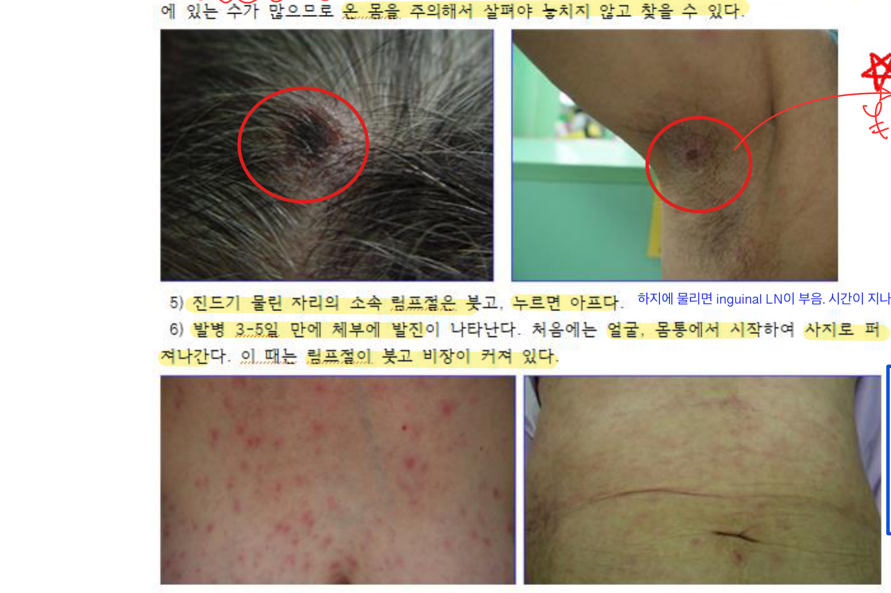{: style="width:80%"}

!!! memo "작년 교수님 정리 — 가을철 열성질환의 공통 특징"
    몸통에 발진(앞가슴부터), dirty margin의 erythematous maculopapular rash, 혈관이 있는 곳이면 어느 장기든 침범.
    **이건 쯔쯔가무시만의 특징이 아니다 — 발진만으로는 확진 불가.** 그래서 가피를 온몸에서 찾아야 한다.

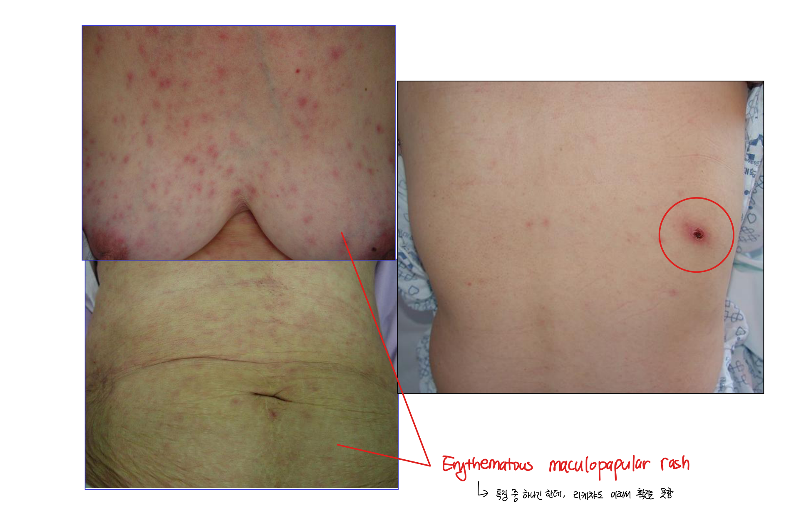{: style="width:60%"}

## 2-4. 가피는 숨어 있다 — 옷을 벗기고 찾을 것

가피가 잘 숨는 곳: **겨드랑이, 사타구니·음부, 유방 아래, 속옷·벨트·기저귀 라인, 오금·무릎 뒤, 두피·귀 뒤** — **피부가 접히고 옷이 조이는 곳, 땀이 차는 곳**. 가피는 **PCR 검체로도 가장 좋다**.

생김새: **가운데 검은 딱지(괴사) + 둘레 홍반 테두리**. 통증·가려움이 거의 없고 접히는 곳에 숨는다.

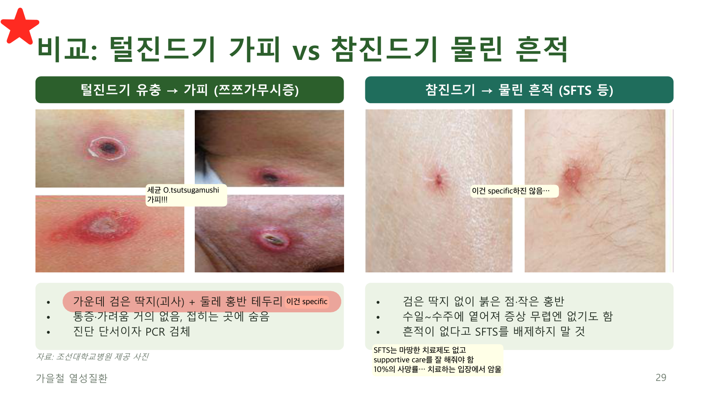{: style="width:80%"}

!!! key "수업에서 강조 — 에스카는 외워야 돼요 (전사본 16:54–17:38)"
    올해 11월 초 환자: **수능을 며칠 앞둔 구미의 고3 여학생**, 학교 말고 다닌 데가 없음 → 학교가 시골인지, 운동장 산책을 했는지 계속 묻다가 "벌레 물린 자국 있냐" → **팔꿈치 가피** → "순간 명의가 됐다".
    "센트럴엔 크러스트가 있고 바깥쪽은 붉은 선." 이걸 놓치면 **수막염 → ICU**. 따뜻하고 접히는 깊숙한 곳에 있어 찾기 힘들다 — **손톱만 한 딱지가 있었는지 계속 묻고, '없었다'고 해도 너무 믿지 말고 직접 찾아라.**

작년 교수님 말씀(그대로 유효): "**가피가 쯔쯔가무시 확진 소견.**" 작년 필기의 가피 호발 부위 — 머리카락 속, 겨드랑이, 사타구니, 가슴 아래, 배, 오금.

## 2-5. 검사와 진단 — 혈청검사가 기본, PCR은 가피에서

| 검사 소견(리케치아 공통) | 방향 |
|---|---|
| 혈소판 | ↓ |
| 백혈구 | 정상~↓ |
| AST/ALT | ↑ |
| Na | ↓ |

- **혈청검사가 주된 진단법**: 간접면역형광항체법(**IFA**), 간접면역과산화효소법(IIP), EIA, 신속진단검사.
- **PCR**: **가피 검체는 효과적**, 혈액은 민감도가 낮다.
- SFTS와 감별: SFTS는 가피가 없다 — 진드기 물린 흔적만 가끔 보인다.
- 작년 필기: 갑자기 열이 나는 환자에서 피부의 까만 딱지(가피), 소속 림프절 비대, 발진이 있으면 의심. Weil-Felix(Proteus OX-K)는 민감도가 낮고 렙토스피라에서도 양성이 나와 쓰지 않는다.

!!! key "수업에서 강조 — 랩만으로는 감별할 수 없다 (전사본 17:38–18:20)"
    대부분의 리케치아도, 바이러스인 SFTS도 **같은 검사 패턴**이다. "CBC·LFT만 가지고는 DDx할 수 없고 의심만 한다. 조금 나아 보이면 쯔쯔가무시, 진짜 위중해 보이면 SFTS — 이렇게 생각만 하지, 한쪽으로 확신하고 그쪽만 치료하지는 않는다."

!!! exam "기출 포인트"
    - 43번: 가장 적합한 진단 검사 → **간접면역형광항체법**.
    - 44번: 사진·영문 설명 → **eschar** (가피, 괴사 딱지).
    - 42번: mite가 문 자리에 가피가 생기는 병 → **리케차 두창, 쯔쯔가무시병** (발진열·Q열은 아님).

## 2-6. 치료 — 의심되면 doxycycline을 바로 시작

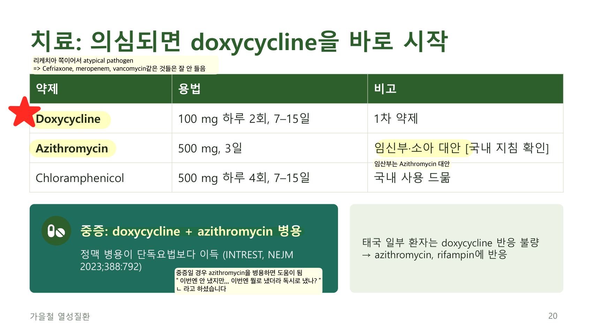{: style="width:78%"}

| 약제 | 용법 | 비고 |
|---|---|---|
| **Doxycycline** | 100 mg 하루 2회, 7~15일 | **1차 약제** |
| **Azithromycin** | 500 mg, 3일 | **임신부·소아 대안** |
| Chloramphenicol | 500 mg 하루 4회, 7~15일 | 국내 사용 드묾 |

- **중증: doxycycline + azithromycin 병용** — 정맥 병용이 단독요법보다 이득(INTREST, NEJM 2023;388:792).
- 태국 일부 환자는 doxycycline 반응 불량 → azithromycin, rifampin에 반응.
- 리케치아 쪽은 **비정형 병원체(atypical pathogen)** → **ceftriaxone, meropenem, vancomycin 같은 것은 잘 안 듣는다**(수업 설명).
- 예방: **백신 없음** → 물리지 않는 것이 최선. 긴소매·긴바지·작업복, 풀밭에 앉거나 눕지 않기, 기피제, 귀가 후 샤워·옷 세탁.

!!! key "수업에서 강조 — 진단을 기다리지 말고 doxycycline (전사본 18:24–19:06)"
    "**가피가 있으면 확실하게 독시사이클린 그냥 쓰시면 돼요. 중증이면 두 개 다 써도 되고.**" doxycycline이 primary, 중증은 azithromycin 병용이 도움("써 보니 효과 좋다"), **임신이면 azithromycin**이 대안.

!!! memo "올해 필기 핵심 정리 5"
    ① 털진드기 유충만 흡혈 — 풀숲 노출력을 물어라 ② 가피를 찾되, 없다고 배제하지 말 것 ③ PCR은 혈액보다 가피에서 ④ **진단을 기다리지 말고 doxycycline** ⑤ 중증이면 doxycycline + azithromycin

!!! diff "작년 필기와 다른 점"
    작년: doxycycline **100 mg 1일 2회 7일**, doxycycline 내성 → **rifampin 600 mg 1일 1회**, 클로람페니콜은 **혈액학적 부작용** 때문에 이제 쓰지 않음, 창궐 시 **doxycycline 200 mg 주 1회 예방**. 작년 교수님: "가을철 열성질환 **대부분의 치료 약제**가 doxycycline."
    올해: 7~15일, 중증 병용(doxycycline + azithromycin)이 새로 들어왔고 rifampin은 태국 반응불량 사례로만 언급.

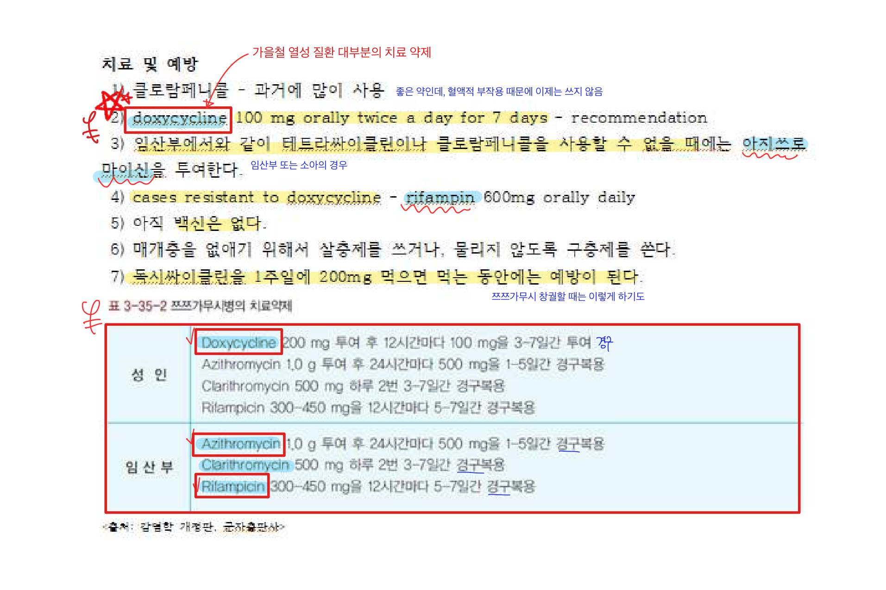{: style="width:65%"}

!!! exam "기출 포인트"
    - "가을 야외 작업 + 발진 + 가피 → 치료제?" 가 **매년** 나온다: 정답 **doxycycline** (3, 5, 14, 38번).
    - 같은 증례에 **임신부**가 붙으면 **azithromycin** (8, 10, 18번). 26번은 보기에 doxycycline이 없어 azithromycin이 정답.
    - β-lactam(ampicillin, cefazolin, ceftriaxone)·quinolone·amphotericin은 오답 보기로 나온다.

# 3. 중증열성혈소판감소증후군 (SFTS)

올해 학습목표: ① 임상·검사 특징(**백혈구감소, 혈소판감소, 의식변화**)과 중증화 경과 ② 의료인 2차 감염을 막는 감염관리 수칙 ③ 아나플라스마증과 감별해야 하는 이유와 doxycycline 경험적 치료의 근거.

!!! key "수업에서 강조 — 이런 환자가 오면 SFTS부터 (전사본 19:09–19:31)"
    **밭일하는 할머니**가 배 아프고 피 토하고, **백혈구·혈소판이 감소**하고, **의식 변화**가 있어 응급실에 실려 오면 SFTS부터 생각한다. "학습목표지만 이렇게 자세하게 묻지는 않았고, **환자가 오면 어떻게 할지를 냈다**."

!!! new "올해 필기에서 추가"
    작년 필기에서 SFTS는 진드기 단원 안에 짧게 있었다. 올해는 **독립 단원**(21쪽 분량)이다.

## 3-1. 병원체와 매개체 — 작은소피참진드기

- **SFTS virus**: *Bandavirus* 속, *Phenuiviridae* 과 — **음성·양방향(ambisense) 3분절 RNA**. (기출 46번은 이것을 분야바이러스목·Phlebovirus로 불렀다.)
- 주 매개체 ***Haemaphysalis longicornis*(작은소피참진드기, Asian long-horned tick)** — 다른 참진드기 종도 전파. 철새(아시아), 반려동물·가축 수입(미국)으로 분포 확대, 미국에서는 침입종으로 광범위하게 정착.
- 숙주 동물: 고양이, 개, 소, 염소, 양, 돼지, 닭, 고슴도치, 설치류 등.
- 분포: 중국(다수), 일본, 한국, 베트남, 태국. 중국 유행지역 혈청유병률 약 5%.

## 3-2. 국내 역학 — 고령자에서 치명적

- 연간 신고: 2019년 223 → 2024년 170 → **2025년 280명**. **2025년 환자의 81.8%가 60세 이상** — 텃밭·농작업, 벌초·성묘.
- 치명률: Harrison **>12%**, 특히 고령. 국내 누적 18.0%, 2025년 14.6%.
- **4~11월** 연중 발생 가능. 2020~2023년 월별로 보면 **두 봉우리** — 6~8월(농작업, 참진드기 봄·여름 밀도), **10월 연중 최고**(2023년 62명 — 벌초·성묘·추수).
- **원헬스**: 2023년 야생 포유류에 붙은 참진드기에서 SFTS 유전자 14건 검출(작은소피 8·개피 3·일본 3 / 고라니 8·노루 3·너구리 2·삵 1). 작은소피참진드기만이 아니고, **3월에 이미** 바이러스 보유 진드기가 있다(국내 첫 환자는 대개 4월). 검출 지역 전국.

!!! key "수업에서 강조 (전사본 19:31–20:30)"
    "고령에서 치명률이 높게 나오는데, **젊은 사람은 걸려도 그냥 지나가는 경우**가 있었을 것 같다 — 고령 환자가 많이 보고되면서 그렇지 않을까"(교수님 개인 생각). 전형적 이야기는 **60세 이상, 텃밭·벌초·성묘** — 쯔쯔가무시와 비슷해 **겉으로 봐서는 잘 모른다**.

!!! diff "작년 필기와 다른 점"
    치명률: 작년 교수님 "요즘은 더 많다, **지역에 따라 25~50%**까지" → 올해 필기 **>12%**(국내 누적 18.0%), 수업 "**10% 넘는다**". 작년 필기: 바이러스를 가진 진드기는 1%도 안 된다, 호발 4~11월.

## 3-3. 임상경과 — 둘째 주에 갈린다

| 시기 | 내용 |
|---|---|
| 잠복기 | **1~2주**, 진드기에 물린 뒤 |
| 1주: 발열기 | 비특이적 발열, **복통·구토·설사** 동반 흔함 |
| 대부분 | 자연 회복 |
| **2주째 일부** | **다장기부전** — 급성신손상, 심근염, 수막뇌염, DIC와 출혈, **혈구탐식림프조직구증(HLH)** |

- 의식저하·경련 같은 **신경학적 증상**은 흔하고 나쁜 예후 인자(작년 필기).
- 교수님: "대부분 자연회복된다지만, **병원에 오는 건 다장기부전 상태**가 많다. 1주째 발열기에 오면 운이 좋은 것"(수업 설명).

## 3-4. 검사와 진단 — 혈소판 ↓↓, 백혈구 ↓, RT-PCR

| 검사 | 방향 | 수업 설명 |
|---|---|---|
| 혈소판 | **↓↓ 뚜렷** | 정상 14만 이상 → **1~3만**, 출혈 |
| 백혈구 | ↓ (비정형 림프구 흔함) | 정상 4,000 이상 → **1,500, 1,000 밑** |
| AST/ALT | ↑ (간세포 손상) | 정상 30~40 → 몇백~1,000 넘게 |
| Ferritin | ↑ | — |

- 진단: **RT-PCR이 필요**(혈액). Harrison: 혈청검사는 이용할 수 없음. 국내는 질병관리청 확진 기준·검사 의뢰 절차 확인.
- 작년 필기: **LDH·ferritin 상승**(LDH는 가을철 열성질환 공통이지만 **SFTS에서 매우 크게**), 가피·발진 없음.

!!! key "수업에서 강조 — 혈소판이 상상을 초월할 정도로 떨어진다 (전사본 21:24–22:03)"
    "랩이 깨지는 강도가 SFTS가 더 강한 느낌은 있지만, **이걸로 구분하기는 불가능**하다 — 그래서 시험은 웬만하면 **헷갈리지 않게** 내도록 노력하고 있다."

## 3-5. 감별 — 백혈구가 낮고 진드기에 물렸다면

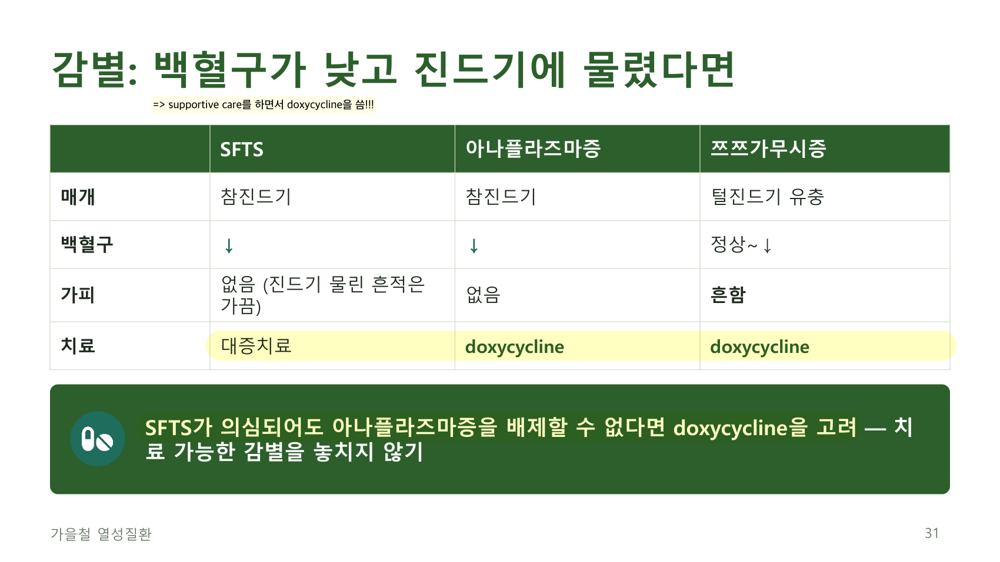{: style="width:80%"}

| | SFTS | 아나플라스마증 | 쯔쯔가무시증 |
|---|---|---|---|
| 매개 | 참진드기 | 참진드기 | 털진드기 유충 |
| 백혈구 | ↓ | ↓ | 정상~↓ |
| 가피 | 없음(물린 흔적은 가끔) | 없음 | **흔함** |
| 치료 | **대증치료** | doxycycline | doxycycline |

**SFTS가 의심되어도 아나플라스마증을 배제할 수 없다면 doxycycline을 고려** — 치료 가능한 감별을 놓치지 않기.

!!! key "수업에서 강조 — SFTS는 바이러스인데 왜 doxycycline부터? (전사본 22:03–22:31, 36:06–36:28)"
    환자가 "저는 SFTS예요, 저는 아나플라스마증이에요" 하고 오지 않는다. 비슷한 병 — **아나플라스마증, 에를리히증, 라임병, 가피 없는 쯔쯔가무시**("스크럽 타이퍼스도 가끔 에스카 없는 경우가 있어요") — 을 모두 덮는 것이 doxycycline이므로, **대증치료를 하면서 경험적으로 doxycycline을 쓰는 것**이 어느 정도 근거가 있다.

## 3-6. 치료와 감염관리 — 대증치료가 기본

- **대증치료가 중심**. 백신 없음, 승인된 치료제 없음(Harrison). Ribavirin, favipiravir가 사용된 바 있음.
- 교수님: "SFTS는 마땅한 치료제도 없고 supportive care를 잘 해줘야 한다. 치료를 다 해도 사망률이 10% 넘어서 치료하는 입장에서 마음의 부담이 있다"(수업 설명).

**국내 favipiravir 긴급도입** (참고 — 시험에 안 냄)

- 아비간 정 200 mg(성분 favipiravir, 기원은 일본 인플루엔자 항바이러스제). 국내 정식 품목허가 제품이 아니고, 질병관리청 긴급도입 물량에 한해 **SFTS 적응증 승인(식약처, '26.1.7.)**. 환자 동의 + 의료진 판단으로 투여, 권고수준 **B-III**.
- 대상: **만 19세 이상 SFTS 확진 환자**로 중증 진료·응급 대응이 가능한 의료기관(상급종합병원, 감염병전문병원, 권역응급의료센터, 의대 부속·국립대병원, 감염내과 전문의가 진료하는 종합병원 이상)에 입원 중이거나 입원 예정. **소아(만 19세 미만) 투여 금지 — 자료 부족.**
- 근거: 일본 Suemori 등(비무작위 단일군, 23명 중 19명 생존 82.6%, 치명률 17.3% — 기존보다 약 10%p 낮음), 중국 Yuan 등(**70세 이하, 발병~입원 5일 이하, 바이러스 ≤1×106 copies/mL**일 때 유의한 효과), 일본 Saijo 등(사망위험 RR 0.50). 무작위 대조 근거는 제한적 → 효과는 **조기 투여**·비교적 젊은 환자·낮은 바이러스량에서 뚜렷 → 의심되면 빨리 RT-PCR로 확진.
- 기전(가짜 뉴클레오타이드): 세포 안으로 → HGPRT로 인산화 → favipiravir-RTP → **RdRp(RNA 중합효소) 억제** → 가짜 뉴클레오타이드로 RNA에 끼어듦 → 사슬 종결(chain termination) 또는 치명적 돌연변이(lethal mutagenesis). RdRp를 노리므로 여러 RNA 바이러스에 활성.
- 권고 강도 A(근거 충분)·B(중간)·C(부족) / 근거 수준 I(무작위 대조연구 1개 이상)·II(잘 설계된 비무작위 임상시험, 코호트·증례대조 등)·III(임상경험, 전문가 의견). **B-III = 근거 중간 정도, 전문가 의견 수준** — "별로 높지 않아요."

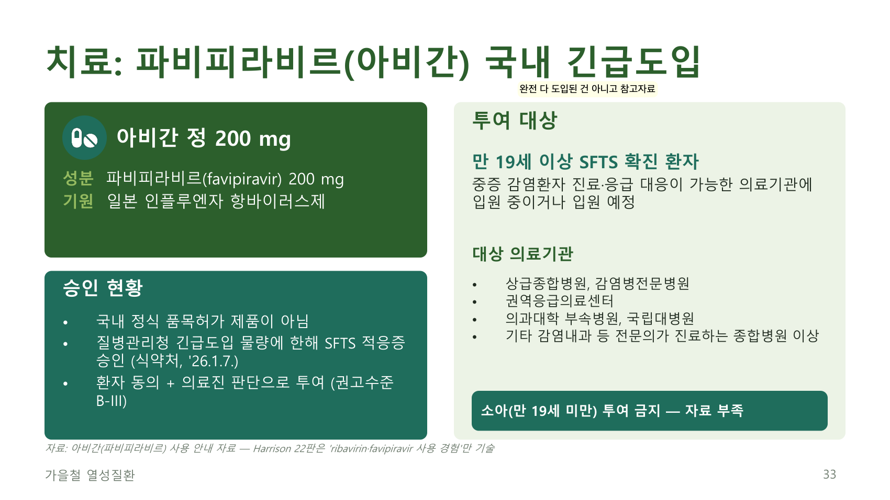{: style="width:70%"}

!!! key "수업에서 강조 — favipiravir는 시험에 안 나와요 (전사본 22:31–23:29, 37:02)"
    "새로운 약이 나왔는데 **해리슨에 아직 안 나와서 시험에는 안 냈다**." 교수님은 대증치료로 환자가 좋아져서 아직 써 본 적이 없다. "떠오르는 샛별 — 될 것 같긴 한데 잘 모르겠다." 기전 슬라이드는 "못 외우는 친구들만 보는 참고사항". → 시험 답은 **대증치료**.

**의료인 보호**: SFTS 환자를 치료하다 의료인이 감염된 사례가 있다 → **CPR·삽관(intubation) 때 보호구**, 평소 **표준주의(손위생)** 준수, 체액 노출 위험이 있으면 적절한 보호구.

!!! key "수업에서 강조 — 의료인 감염 (전사본 23:29–24:24)"
    뉴스에도 나오는 이야기. 국가 연구 과제로 SFTS 환자 혈청을 모으는 중인데, 감염된 의료진이 검체 수집에 많이 협조했다는 뒷이야기. "**의료진은 자기를 잘 보호해야 된다.**"

작년 필기(그대로 유효): 진단은 **혈액 실시간 RT-PCR**, **혈액·체액을 통한 사람 간 전파**(의료진 감염) → 확진 환자는 **1인실 격리**, 비말·체액 대비 보호장비, 심폐소생술·삽관 때 N95. "**치료제는 없지만 치료법은 있다**" → 대증치료.

**예방**(쯔쯔가무시와 비슷): 긴소매·긴바지·기피제, 풀밭 작업 후 샤워·진드기 확인, 반려동물 진드기 관리, **물린 진드기는 무리하게 떼지 말고 의료기관에서 제거** — 교수님: "조심해서 **핀셋으로 머리를 들어 올려** 떼라."

!!! memo "올해 필기 핵심 정리 5"
    ① 작은소피참진드기 — **고령 농업인**에서 치명적 ② **혈소판 ↓↓** + 백혈구 ↓ + 위장관 증상 ③ 2주째 다장기부전·HLH로 진행 가능 ④ RT-PCR 확진 → **대증치료** ± favipiravir ⑤ 아나플라스마증 감별 → doxycycline, 의료인 PPE

!!! exam "기출 포인트"
    - "등산 + 진드기 + 백혈구·혈소판↓ + 간효소·ferritin↑ + 발진 없음" 증례가 3번 똑같이 나왔다(1, 7, 41번) → 정답 **"대증치료로 충분한 경우가 많다"**. 오답: 소변 배양 확진, acyclovir, ampicillin, "1인실 격리 필요 없다".
    - 13번: SFTS 확진되면 **1인실 격리 필요** ○. 으뜸치료제 doxycycline(×), 인두도말 PCR(×, 혈액).
    - 30번: "신경학적 증상은 동반하지 않는 것이 특징"이 **틀림**.
    - 47번: 의료진 보호장비 → **비말전파에 대비한 장비**.
    - 32번: 7월 텃밭 + 백혈구·혈소판↓ + 혈액배양 음성 + 가피 없음 → **SFTS virus**.
    - 올해 수업과 맞춰 볼 것: 기출 13번 "으뜸치료제 doxycycline(×)"는 그대로 맞다 — 올해도 SFTS **자체의** 치료는 대증치료이고, doxycycline은 **감별이 안 될 때 함께 쓰는 경험적 치료**다.

# 4. 신증후군출혈열 (HFRS, 한타바이러스)

올해 학습목표: ① 병원체, 보유숙주, 감염경로 ② 병기별 임상경과와 각 시기의 병태생리 ③ **저혈압기·핍뇨기의 수액 관리와 투석 적응증**(필기에 빨간 형광펜).

!!! key "수업에서 강조 — 군대 가면 볼 수 있다 (전사본 25:06–25:41)"
    교수님도 한두 번밖에 못 봤지만 시험에 내야 하는 이유: **군의관**으로 가면 병사들이 걸릴 수 있고, **실제로 군의관이 걸려 사망한 사례**도 있었다. "군대에서 장병이 작업하다가 이렇게 아파서 오면 **얼럿하게** 봐야 된다."

## 4-1. 병원체와 전파 — 들쥐 소변 에어로졸을 들이마신다

- **등줄쥐**(*Apodemus agrarius*) — 만성적으로 바이러스 배출 → **소변·타액·대변**(주로 소변이 마른 에어로졸) → **사람 흡입**(농작업·야외활동, 농촌 거주자).
- ***Orthohantavirus*(Hantaviridae)** — **외피 보유, 3분절 음성 RNA**. 작년 필기: 분야바이러스목(Bunyavirales), 표면 당단백 돌기(Gn·Gc), 유전체 **L·M·S** 3분절.
- **환자는 감염력이 없다** — 사람 간 전파는 드물다(예외: 남미 **Andes virus**).
- 다른 원인 바이러스: **Seoul virus**(집쥐, 전 세계 도시·실험실 감염, 경증~중등증), **Puumala virus**(유럽, 유행성 신증, 치명률 <1%), Dobrava virus(발칸).
- 교수님: "이건 진드기 아니죠, **쥐**. 직접 접촉이 아니라 **흡입**." 남부에는 별로 없고 **경기 쪽**, 이상하게 **제주도**에도 좀 있었다(수업 설명).

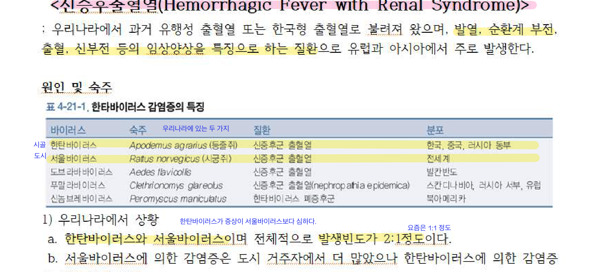{: style="width:70%"}

작년 필기: 우리나라에는 **한탄바이러스**(등줄쥐, 시골)와 **서울바이러스**(시궁쥐 *Rattus norvegicus*, 도시) — 한탄이 더 심하다. 발생은 2:1이라 했지만 작년 교수님 "요즘은 1:1 정도". 미주 대륙은 **Hantavirus pulmonary syndrome**(급성 폐부종). 1951년 6·25 때 유엔군에서 처음 보고, **남자 40~50대**, **군인·심마니**.

!!! exam "기출 포인트"
    - 36번 주관식: 감염 경로 → **들쥐(등줄쥐)의 소변·대변·타액 → 건조 → 호흡기** (채점: 들쥐·호흡기·배설물).
    - 23·35번: 바이러스 모식도 → **3분절 RNA + 외피 + 당단백 돌기** = 한타바이러스(Bunyavirus).
    - 46번: Bunyavirales — 외피·당단백 ○, 3분절 ○, HPS는 미주 ○. Nairovirus·Phlebovirus(SFTS)는 **진드기** 매개라 "쥐 배설물 비말"은 ×.
    - 24번: 유럽 = Puumala ○, 회복기 항체 4배 ○, "**4병기**"는 × (작년 필기 기준 5병기 — 아래 4-3 참고).

## 4-2. 역학 — 아시아에서 연 10만 명 이상 중증

- 국내 연간 신고: 2019년 399 → 2023년 452 → **2025년 230명**.
- **봄·가을** — 한국·중국 농촌의 Hantaan virus 감염은 봄과 가을에 많고, 설치류 밀도와 농작업에 좌우된다. 아시아 연간 중증 환자 **>100,000명**(Harrison), 유럽은 수천 명의 경증.
- 예방접종 **한타박스(Hantavax)** — 농사짓는 어르신들은 알고 있는 분이 많다(수업 설명).

## 4-3. 임상경과 — 잠복기 1~2주 후 4단계

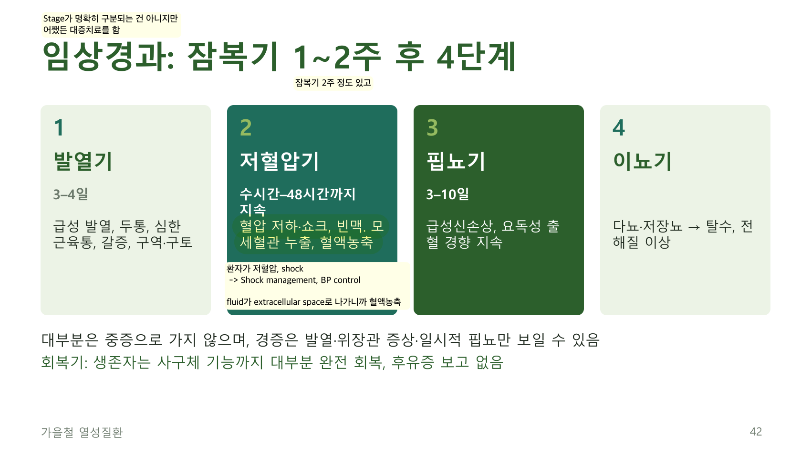{: style="width:80%"}

| 단계 | 기간 | 특징 |
|---|---|---|
| 1 **발열기** | 3~4일 | 급성 발열, 두통, 심한 근육통, 갈증, 구역·구토 |
| 2 **저혈압기** | 수 시간~48시간 | 혈압 저하·쇼크, 빈맥, **모세혈관 누출, 혈액농축** |
| 3 **핍뇨기** | 3~10일 | 급성신손상, 요독성 출혈 경향 지속 |
| 4 **이뇨기** | — | 다뇨·저장뇨 → **탈수, 전해질 이상** |

- 대부분은 중증으로 가지 않으며, 경증은 발열·위장관 증상·일시적 핍뇨만 보일 수 있다.
- 회복기: 생존자는 사구체 기능까지 **대부분 완전 회복**, 후유증 보고 없음.
- 교수님: "**스테이지가 딱딱 떨어지는 건 아니지만 어쨌든 대증치료를 한다.** 저혈압이면 셉틱 쇼크에서 배운 **쇼크 매니지먼트, BP 컨트롤**. 모세혈관 누출로 세포외 공간으로 체액이 빠져 혈관 안 볼륨이 부족해 **혈액이 농축**된다 — BP를 유지하며 케어하라"(수업 설명, 전사본 26:12–26:57).

!!! diff "작년 필기와 다른 점 — 병기 수"
    작년 필기는 **5병기**(발열기 → 저혈압기 → 핍뇨기 → 이뇨기 → **회복기**), 올해 필기·수업은 **4단계**(회복기는 따로 단계로 세지 않음). 기출 24번은 "4병기"를 **오답**으로 냈다(작년 교수님 기준). 올해 시험이 병기 수를 묻는다면 올해 필기(4단계)를 따를 가능성이 크지만, 교수님은 "딱딱 떨어지지 않는다"며 대증치료를 강조했다.
    잠복기: 작년 **4~42일(2~3주)** → 올해 **1~2주**(수업: "대충 2주").

작년 필기의 병기별 설명(그대로 유효):

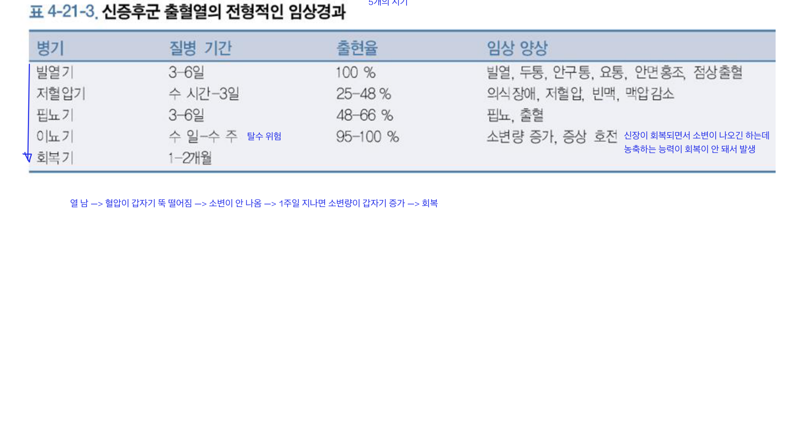{: style="width:80%"}

| 병기 | 기간 | 특징(작년 필기) |
|---|---|---|
| 발열기 | 3~4일 | 안면홍조, 결막충혈, 연구개·액와 점상출혈, 경한 범발성 혈관내 응고, 단백뇨 |
| 저혈압기 | 수 시간~3일 | 한탄 감염의 25~40%. 상대 서맥이 빈맥으로, **헤마토크리트 상승**, 혈소판 현저 감소 |
| 핍뇨기 | 3~10일 | 입원 환자 절반. 혈압 오히려 상승(과혈량), 출혈 악화, **요독증**, 폐부종 |
| 이뇨기 | 수일~수주 | **농축 능력이 회복 안 돼서** 소변량이 **10 L**까지 → **탈수 주의** |
| 회복기 | 1~2개월 | 다뇨·야뇨·빈혈이 남을 수 있음 |

작년 교수님: "**열남 → 혈압이 갑자기 뚝 떨어짐 → 소변이 안 나옴 → 1주일 지나면 소변량이 갑자기 증가 → 회복.**" 기본 병변은 **모세혈관 단위의 맥관계 병변**(전신 세동맥 확장, 혈장 유출, 초점성 모세혈관 파열). 출혈은 혈소판 감소·범발성 혈관내 응고·모세혈관 취약성, 신부전은 신전 질소혈증과 간질 부종·출혈로 인한 신수질 혈관 폐쇄. 체액성 면역보다 **세포 매개성 면역반응**(T세포 활성화)이 특징.

## 4-4. 발열기 진찰과 피부·점막 소견

| 소견 | 설명 |
|---|---|
| 얼굴·앞목·등의 **홍조**(flushing) | — |
| **결막충혈**, 안와주위 부종 | 인두 발적 동반 |
| **점상출혈** | 압박 부위, 결막, 겨드랑이 |
| 안구통, 시야 흐림 | 눈 움직일 때 통증, 섬모체 염증 |
| 요통·**늑골척추각(CVA) 압통** | 대량의 후복막 부종 |
| 단백뇨, 활동성 요침사 | 초기부터 나타남 |

- 피부·점막 소견은 흔하지 않지만 중요한 진단 단서다(Int J Dermatology 2026): 안면홍조, 결막충혈·안와주위 홍반, 구개 점상출혈, 체간·상지 점상출혈, 자반·반상출혈, 비출혈·잇몸출혈. 점상출혈·자반·홍조·점막출혈은 주로 **HFRS**에서, HCPS/HPS(미주)는 피부 소견이 적다.
- 교수님: "여기저기 **petechial rash**가 있고, 보통 **결막이 좀 빨개지긴** 하는데 **전형적 rash가 잘 나타나진 않는다**"(수업 설명).

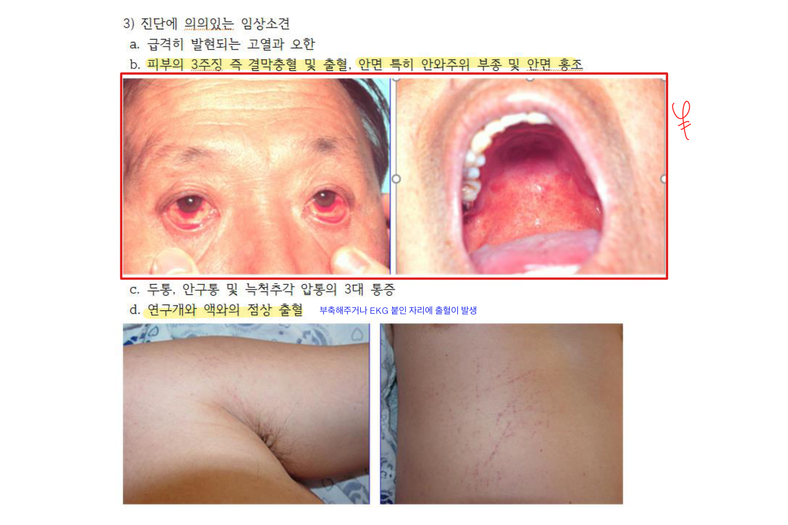{: style="width:60%"}

작년 필기: 3대 징후 **안면홍조, 결막충혈, CVA 압통**(작년 교수님: 신장과 등쪽 core muscle 출혈 때문). "부축해 주거나 **EKG 붙인 자리에 출혈**이 생긴다."

## 4-5. 검사와 진단 — 백혈구 ↑, 혈소판 ↓, IgM ELISA

| 검사 | 방향 |
|---|---|
| **백혈구** | **↑ 좌방이동, 유백혈병양** |
| 비정형 림프구 | 활성 CD8+ T세포 |
| 혈소판 | ↓ (DIC 동반) |
| Cr · 단백뇨 · 혈뇨 | ↑ / 요비중 1.010 고정 |
| Hct | ↑ 혈액농축 |

- 진단: **IgM-capture ELISA** — 입원 시 또는 24~48시간 내 양성 → 쉽게 진단. **RT-PCR** — 신장 생검, 초기 혈전, 부검 조직(원인 바이러스를 확정해야 할 때). 바이러스 분리는 어렵다.
- 교수님: "랩 WBC가 증가하면 HFRS를 생각해 볼 수는 있지만, **감소하면 SFTS, 증가하면 HFRS 이렇게 딱 떨어지게 보지 않는다** — 모든 걸 다 열어 놓는다"(수업 설명).

!!! diff "작년 필기와 다른 점 — 백혈구"
    작년: 백혈구 **정상~증가**(작년 교수님 "leukocytosis 별로 없음"), 표준검사법은 **간접 면역형광법**(1주 간격 2회 **4배 이상**), 급성기 **ELISA IgM**, PCR. 기출 21번은 HFRS 소견이 **아닌** 것으로 **leukopenia**를 냈다.
    올해: 백혈구 **↑(좌방이동, 유백혈병양)** — 방향은 같고(백혈구 감소는 아님) 올해 더 분명히 "증가"로 적었다.

작년 필기(그대로 유효): 혈소판은 발병 3일부터 감소해 3주 후 정상, PT·PTT 증가. 단백뇨는 거의 전례에서 발병 3~5일째. 생화학: 고질소혈증, 다른 신부전과 달리 **저칼슘혈증**이 심함, AST > ALT, **LDH 증가**. 심전도 동성서맥·T파·ST 변화. 전형적인 경우 95% 이상이 임상소견만으로 진단 가능 — **병력청취**(여행력·거주지·활동지역)가 중요. 감별: **렙토스피라증과 쯔쯔가무시병**.

!!! exam "기출 포인트"
    - 21번: HFRS의 검사 소견이 **아닌** 것 → **Leukopenia** (단백뇨·혈뇨·크레아티닌 상승·혈소판감소는 맞음).
    - 28번: 등산 후 결막충혈 + 양쪽 **CVA 압통** + 혈소판↓ + 신부전 + 단백뇨 → **신증후군출혈열**.
    - 11번: 직업은 중요(×), 겨울철 호발(×), 중추신경 합병증 최다(×), 서울바이러스가 진단 쉬움(× 반대) → 정답 **"보존적 치료, 필요하면 투석"**.

## 4-6. 치료 — 적절한 수액, 투석은 제때

| 상황 | 치료 |
|---|---|
| **쇼크** | **승압제와 적절한 수액(정질액)**, 정맥 알부민 — 혈압과 소변량을 보며 조절 |
| **핍뇨·체액 과다** | **적시에 신대체요법(투석)** — 폐부종 예방 |
| 고혈압 | 적극 조절 — 두개내출혈 예방 |
| Ribavirin IV | 발병 4일 이내 시작 시 중증 환자의 치명률·이환율 감소 |

- 치명률 **~15%** → 적절한 대증·중환자 치료로 **<5%**. "**이 질환의 예후는 지지요법의 질이 결정한다.**"
- 예방: **들쥐 배설물 접촉 피하기**, 풀밭에 눕거나 옷 말리지 않기, 작업 시 마스크·장갑, [국내] 고위험군 백신(한타박스) — 접종 대상·일정 확인. 교수님: "우리나라에 쥐가 많지 않아서 많이 줄지 않았을까"(수업 설명).

!!! key "수업에서 강조 — SFTS든 HFRS든 best supportive care (전사본 27:41–28:51, 37:45)"
    "수액 주고 혈압 유지하는 건 똑같다. **혈압이 유지되어야 투석**을 통해 피를 빼서 정화해 다시 넣어 줄 수 있다." "**수액을 주지 말라는 게 아니라 적절하게** 투여해서 혈압을 조절하라는 뜻." 마지막 정리에서 "제가 밑줄을 잘못 쳤어요, 여기 밑줄 쳐야 돼요 — **승압제, 수액, 대증치료**."

!!! key "수업에서 강조 — ribavirin은 안 낸다 (전사본 28:03–28:30)"
    "HFRS는 ribavirin을 쓸 수는 있는데 요새 **약품 공급이 잘 안 돼서** 실질적으로 쓰기 힘들다. **쓰기 어려운 약은 안 내겠죠.**" 한눈에 보기 표의 "초기 ribavirin"에도 "이건 밑줄 ×".

!!! diff "작년 필기와 다른 점 — 치료·예후"
    작년 교수님: "따로 항바이러스제가 없다. ribavirin은 부작용으로 **hemolysis**. 그냥 대증치료." 첫 4일 이내 투여 시 이환 기간 단축 보고가 있으나 흔히 쓰이지 않음.
    작년 필기의 병기별 대증요법: 발열기 후반·저혈압기 환자는 외상으로 혈종·장기출혈이 생길 수 있으므로 **조기진단해 입원 안정** / 갑작스런 혈압저하에 대비해 활력징후 관찰 / 쇼크가 있으면 **알부민·혈장**, 반응 없으면 **dopamine·norepinephrine** / **핍뇨기**: 단백질 섭취 제한, **탄수화물 하루 100 g 이상**, 하루 체중이 **0.5 kg** 정도 줄도록 / 안 되면 **혈액투석** / **이뇨기**: 수분균형·전해질 주의.
    예후: 작년 치사율 **2~7%**(교수님 5%), "가장 흔한 합병증은 **만성 신부전** — **20~30%**에서 신장 합병증이 남는다 → 추적관찰." 올해 필기는 치명률 ~15% → <5%, 회복기 "대부분 완전 회복, **후유증 보고 없음**"으로 다르다.

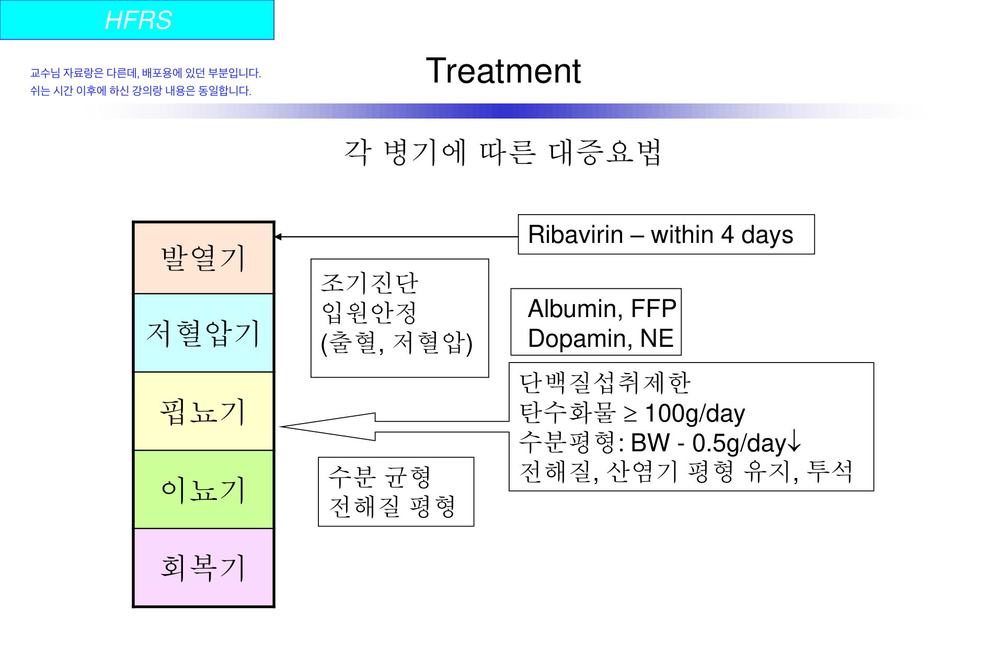{: style="width:60%"}

!!! memo "올해 필기 핵심 정리 5"
    ① 들쥐 소변 에어로졸 흡입 — 환자는 감염력 없음 ② **4단계: 발열기 → 저혈압기 → 핍뇨기 → 이뇨기** ③ 홍조·결막충혈·점상출혈·**CVA 압통** ④ 백혈구 ↑ + 혈소판 ↓ + 단백뇨, IgM ELISA ⑤ **수액 절제, 적시 투석, 혈압 조절**

!!! exam "기출 포인트"
    - 버섯 채취·산지 야외취침 + 핍뇨 + 혈소판↓ 증례(4, 9, 16번): 정답 **"대부분 수액요법 등 보존적 치료가 중요"**. 오답: 투석 안 함(×), 1인실 격리(×), doxycycline 예방(×, 렙토스피라), oseltamivir(×).
    - 40번: 한탄 항체 양성 → **대증치료** (acyclovir·ganciclovir·foscarnet·ceftriaxone 아님).
    - 19번: "저혈압기는 일과성이므로 쇼크가 있어도 알부민·승압제 **필요 없다**" → **틀림**. 작년 필기의 대증요법 문장이 그대로 보기로 나왔다.

# 5. 렙토스피라증

올해 학습목표: ① 감염경로와 고위험군 ② **중증형(Weil 증후군, 폐출혈)을 알아볼 수 있다** ③ 병기에 맞는 진단검사를 고르고 **중증도에 맞는 항생제를 선택**할 수 있다.

!!! key "수업에서 강조 — 이건 박테리아 → 항생제 (전사본 28:51–29:07)"
    "아까 HFRS, SFTS는 **바이러스**였어요. 렙토스피라는 *Leptospira interrogans*, **박테리아**입니다. 그럼 **항생제**를 쓸 수 있겠죠."

## 5-1. 병원체와 전파 — 쥐 소변에 오염된 물과 흙

- **쥐(주 보유숙주)**: 요생식관에 수년간 지속. 소·개·돼지 등도 보유 → **오염된 물·흙**: **습한 환경에서 수개월 생존**, 홍수 후 유행 가능 → **사람 피부·점막**: 상처·찰과상, 결막·구강 점막으로 침입.
- ***Leptospira***: 가늘고 꼬인 나선균(spirochete), **끝이 갈고리 모양**, 운동성 강함. 염색이 잘 안 됨(암시야현미경). 배양에 수주~수개월.
- **고위험군**: **농업 종사자**, 수의사, **하수도·도축장 작업자**, 어업 종사자, 담수 레저(카누·수영·래프팅), 열대 지역 여행자.
- 교수님: "**홍수 나고 나서 밭작업·논작업할 때** 농부들이 많이 아파서 온다 — 이게 전형적인 스토리." "좀 **습한 데서 일하는 사람**"(수업 설명).

작년 필기(그대로 유효): 길이 6~20 μm, 너비 0.1 μm. 병원성 *L. interrogans*(250개 넘는 serovar), 비병원성 *L. biflexa*. 균이 동물의 **신세뇨관**에 있다가 **오줌**으로 나온다. 작년 교수님: "**물과 관련.** 피부가 물에 불어 있을 때 균이 잘 침범. 호흡기로도 전염될 수 있다. **태풍·홍수·장마 이후** 잘 생긴다." "감염되면 균이 주로 신장으로 가서 tubular cell에서 증식해 소변으로 배출. **사람끼리의 감염은 일어나지 않는다 → 격리 필요 없다.**" 우리나라: 1975년 경기·충북 유행성 폐출혈열 대유행, 1984년 렙토스피라증으로 증명.

!!! exam "기출 포인트"
    45번: 조밀하게 꼬인 나선균, **끝이 갈고리**, 일반 염색 안 됨 → 암시야현미경 → ***Leptospira***.

## 5-2. 역학 — 과소평가된 인수공통감염병

- 국내 연간 신고: 2019년 138 → 2021년 144 → **2025년 53명**. 전 세계 연간 중증 환자 **~100만 명**, 평균 치명률 약 10%(Harrison).
- **여름·가을** — 북반구 발생 정점, 열대는 우기. 환자 대부분 남성. **국내는 9~11월**.
- 교수님: "과소평가된 것 같다. **경상도엔 많이 없고 전라도 쪽에는 꽤 있다**"(수업 설명).

## 5-3. 이상성 경과 — 시기에 따라 검사가 달라진다

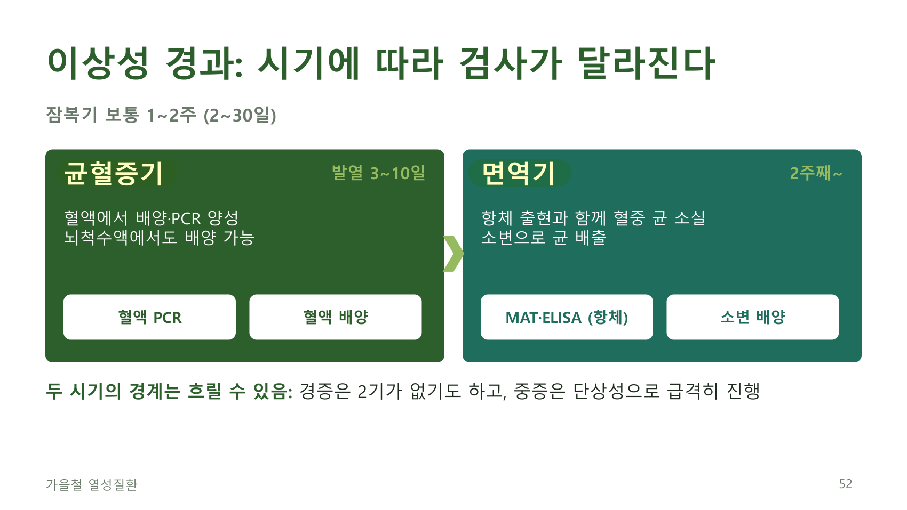{: style="width:78%"}

잠복기 보통 **1~2주(2~30일)**.

| | **균혈증기** (발열 3~10일) | **면역기** (2주째~) |
|---|---|---|
| 균 | 혈액에서 배양·PCR 양성, **뇌척수액**에서도 배양 가능 | 항체 출현과 함께 혈중 균 소실, **소변으로 균 배출** |
| 검사 | **혈액 PCR, 혈액 배양** | **MAT·ELISA(항체), 소변 배양** |

두 시기의 경계는 흐릴 수 있다 — 경증은 2기가 없기도 하고, **중증은 단상성으로 급격히 진행**.

!!! diff "작년 필기와 다른 점 — 시기별 검사"
    작년: 균 분리는 **첫 10일까지 혈액·뇌척수액, 제2주 이후 소변**. 특수 배지(Fletcher's, EMJH)에서 5~6주 걸려 치료에 도움이 안 됨 → 주로 항체검사나 PCR. 1주 간격 2회 MAT에서 **4배 이상** 오르면 확진. 작년 교수님: "**증상 시작 후 얼마나 지났느냐에 따라 검체가 달라진다.**"
    올해: 균혈증기 **발열 3~10일**, 진단은 "**첫 5일은 PCR, 이후 항체**". 큰 틀(초기 혈액·CSF → 2주 이후 소변·항체)은 같다.

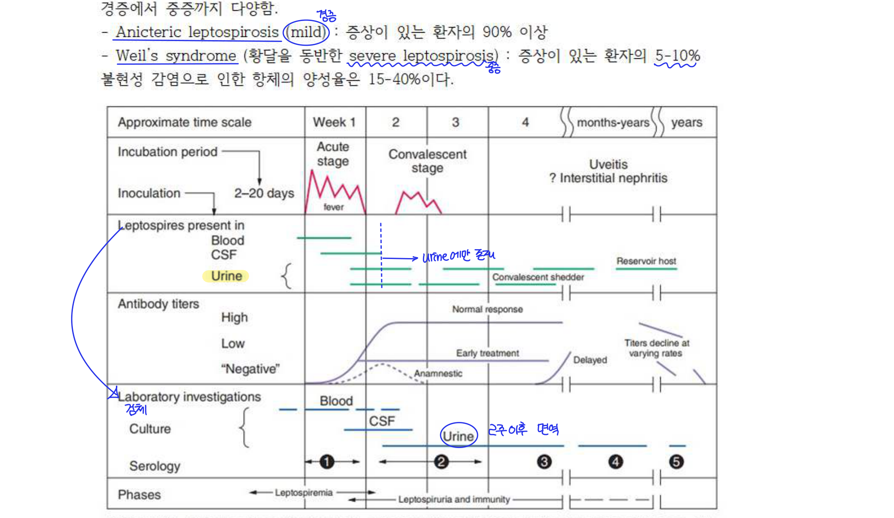{: style="width:65%"}

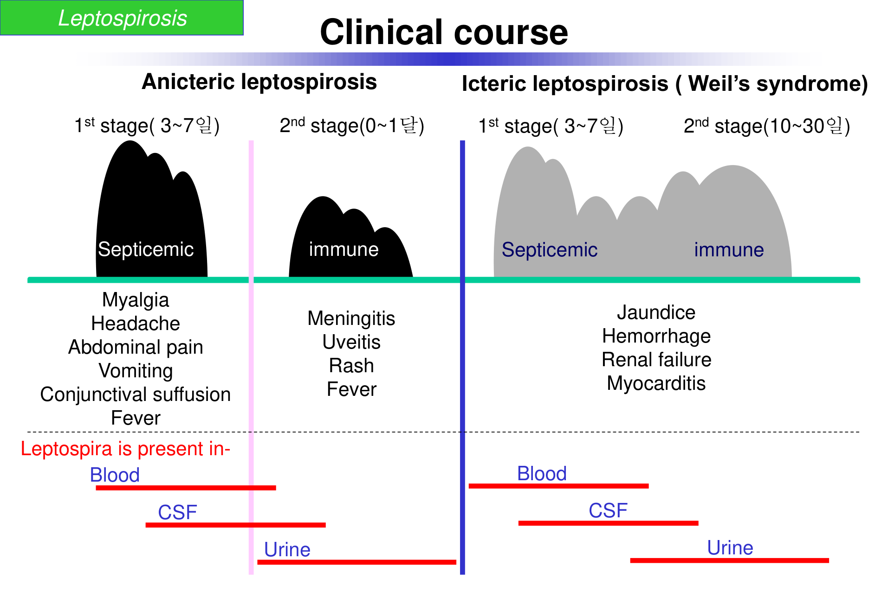{: style="width:75%"}

!!! exam "기출 포인트"
    - **검체 문제가 5번 나왔다.** 발병 10일·2주·18일·3주 → 모두 **소변** (12, 17, 22, 39번).
    - 33번 주관식: (A) 1주 이내 → **말초혈액·뇌척수액**, (B) 1주 이후 → **소변**.

## 5-4. 경증 — 갑자기 시작하는 독감 같은 열

| 소견 | 특징 |
|---|---|
| **결막충혈** | 삼출물 없는 충혈 (conjunctival suffusion) |
| **심한 근육통** | 특히 **종아리**, 허리, 복부 |
| **심한 두통** | 전두부·안와후부, 광과민 — 뎅기와 유사 |
| **무균성 수막염** | 성인보다 소아에 흔함, 대부분 양성 경과 |
| 일시적 발진 | 반점·구진·점상 → 쯔쯔가무시로 오인 가능 |
| 기타 | 인두 발적, 림프절·간·비장 비대, 경한 황달 |

어느 소견도 특이적이지 않다. 대부분 **7~10일 내 자연 회복**.

!!! key "수업에서 강조 — 양쪽 종아리가 아파서 왔다 (전사본 30:00–30:46)"
    "**종아리가 많이 아프다**고 해요. 이건 좀 신기한데." 비특이적·전신 증상을 다 가지면서 **홍수가 나고 논에 벼 세우는 작업을 하고 나서 양쪽 종아리가 아파 왔다** → 렙토스피라. "시험 문제는 그렇게 **헷갈리지 않게** 내죠."
    결막충혈은 HFRS에도 있어 **이것만으로 구분할 수 없고 참고만**. 무균성 수막염은 **쯔쯔가무시(스크럽 타이퍼스)도 가능**.

작년 필기(그대로 유효): 1단계(패혈증기) — 갑작스런 발열, 두통, **걷지 못할 정도의 근육통**, 오심·구토, 기침·객혈, **결막충혈**. 2단계(면역기) — 항체가 나오며 혈액·CSF에서 균이 사라짐, **수막염**, 포도막염, 발진. **무황달형**(anicteric)이 환자의 90% 이상. 작년 교수님: "특히 **눈으로 잘 가서 눈이 충혈**". 급성 신부전 = **간질성 신염 + 세뇨관 괴사** + 모세혈관 투과성 증가. 간손상 = 중심소엽 괴사, Kupffer세포 증식.

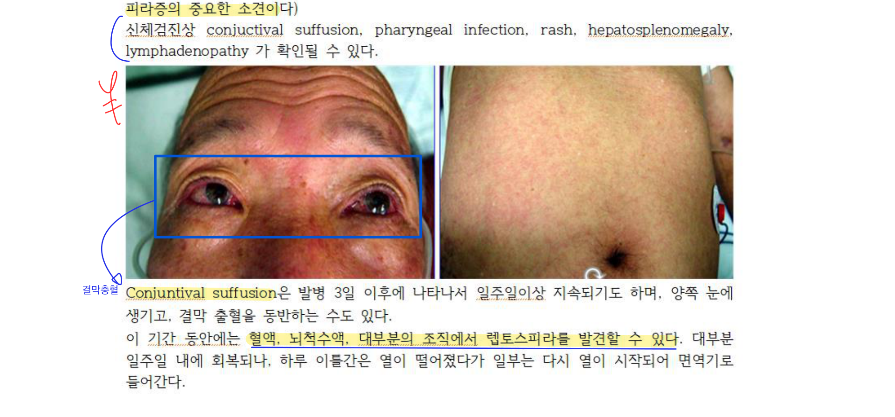{: style="width:55%"}

## 5-5. 중증 — Weil 증후군과 폐출혈

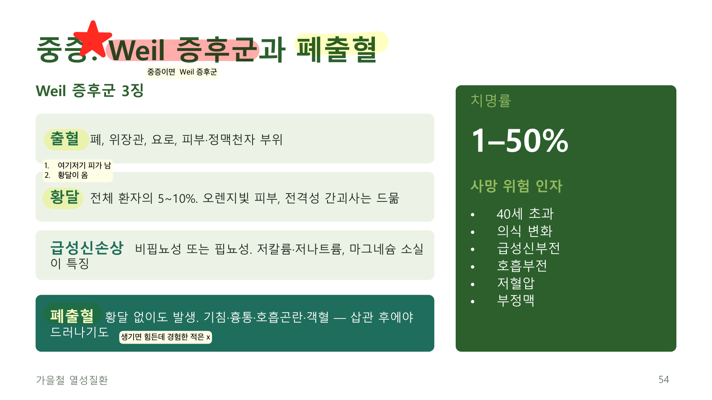{: style="width:80%"}

**Weil 증후군 3징**

1. **출혈** — 폐, 위장관, 요로, 피부·정맥천자 부위.
2. **황달** — 전체 환자의 5~10%. 오렌지빛 피부, 전격성 간괴사는 드물다.
3. **급성신손상** — 비핍뇨성 또는 핍뇨성. **저칼륨·저나트륨·마그네슘 소실**이 특징.

- **폐출혈**: 황달 없이도 발생. 기침·흉통·호흡곤란·객혈 — 삽관 후에야 드러나기도.
- 치명률 **1~50%**. 사망 위험 인자: **40세 초과, 의식 변화, 급성신부전, 호흡부전, 저혈압, 부정맥**.
- 교수님: "여기저기 피가 나고, 황달이 오고… 폐출혈이 생기면 많이 힘든데 경험은 많이 못 했다"(수업 설명).

!!! key "수업에서 강조 — 황달 + 폐출혈이면 렙토스피라 (전사본 12:45–12:54, 30:46–31:31)"
    "**황달이 갑자기 생기고 폐출혈이 생기고 피 토하고** — 그러면 렙토스피라를 생각해 보자." HFRS와 살짝 구분: **HFRS는 황달 없이 결막충혈**, 렙토스피라의 **Weil 증후군은 황달이 있으면서 결막충혈(suffusion)**.

!!! diff "작년 필기와 다른 점"
    작년 필기에서 Weil 증후군은 황달이 있는 중증형으로 환자의 **5~10%**였고, 황달(4~9일째)·신부전(2주째)·**출혈**·간부전·쇼크·의식장애·심근염, 치사율 **5~15%**. **폐출혈은 우리나라에서 발생하는 렙토스피라증의 중요한 소견.** 올해는 황달을 "전체 환자의 5~10%"로, 치명률을 **1~50%**로 적었다.

작년 교수님 증례: 39세 남자, 5일간 발열·오한·**blood-tinged sputum**, 10일 전 강에서 낚시, BP 80/50, **conjunctival injection**, 양폐 crackle, 혈소판 58K, T-bil 3.0 → 렙토스피라증(폐출혈형).

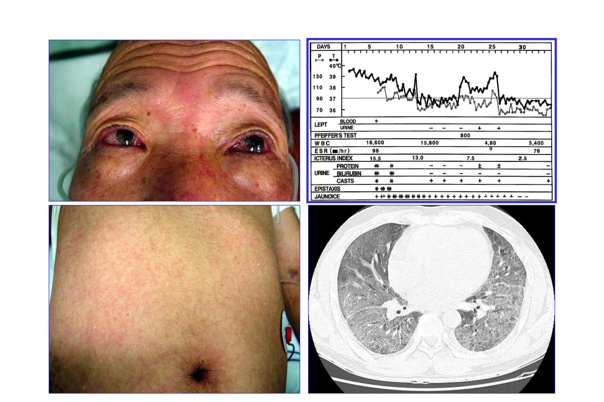{: style="width:58%"}

## 5-6. 검사와 진단 — 첫 5일은 PCR, 이후 항체

| 검사 | 방향 |
|---|---|
| 백혈구 · CRP · PCT | **↑ 좌방이동** |
| 혈소판 | **≤100,000 흔함** |
| 빌리루빈 | **↑↑** (간효소는 중등도) |
| K / 신기능 | ↓ / **비핍뇨성 신부전** |
| 아밀라제 · CK | ↑ |

- **PCR(real-time)**: 발병 5일 이내 확진에 가장 유리.
- **MAT(현미경적 응집검사)·ELISA**: 항체는 2주째부터. 급성기·회복기 **4배 이상 상승**이 표준. 단일 MAT 1:200~1:800.
- **초기 혈청검사 음성으로 치료를 미루지 말 것.**
- 교수님: "처음엔 항체가 없어서 PCR, 이후엔 항체. 실제로는 **PCR이 여의치 않아 항체검사를 한두 번** 하기도 한다. 어차피 치료는 크게 달라지지 않는다"(수업 설명).

작년 필기(그대로 유효): 요검사 단백뇨·백혈구·적혈구·유리양 과립원주(신세뇨관 파괴), ESR 상승, 백혈구 3,000~26,000/mm3 — **Weil 증후군에서는 현저한 백혈구 증가**, PT 지연, **CPK 상승**. 척수액은 초기 PMN → 후기 **단핵구** 증가, **단백 상승·당 정상** — "viral meningitis와 비슷한 소견." 감별: 말라리아, 장티푸스, 바이러스성 간염, 뎅기열, 한탄바이러스, 쯔쯔가무시, 인플루엔자.

!!! memo "백혈구 비교 (작년 교수님)"
    쯔쯔가무시, 한탄바이러스, SFTS에서는 백혈구가 **감소**하는데, 렙토스피라에서는 **증가**한다.
    올해 필기에서는 HFRS도 백혈구 **↑**로 적었다 — 올해 교수님은 "**백혈구로 딱 떨어지게 구분하지 않는다**"고 했다.

## 5-7. 치료 — 의심되는 즉시 항생제

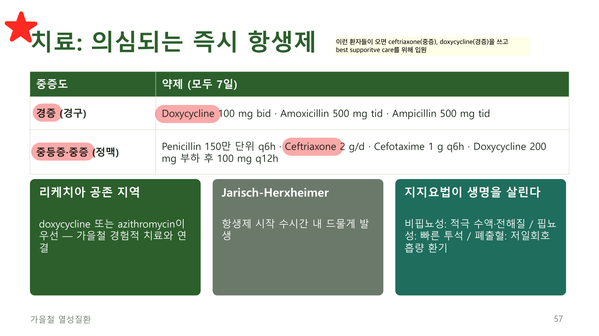{: style="width:80%"}

| 중증도 | 약제 (모두 7일) |
|---|---|
| **경증(경구)** | **Doxycycline** 100 mg bid · Amoxicillin 500 mg tid · Ampicillin 500 mg tid |
| **중등증·중증(정맥)** | **Penicillin** 150만 단위 q6h · **Ceftriaxone** 2 g/d · Cefotaxime 1 g q6h · Doxycycline 200 mg 부하 후 100 mg q12h |

- **리케치아 공존 지역**: doxycycline 또는 azithromycin이 우선 — 가을철 경험적 치료와 연결.
- **Jarisch-Herxheimer 반응**: 항생제 시작 수 시간 내 드물게 발생.
- **지지요법이 생명을 살린다**: 비핍뇨성 → 적극 수액·전해질 / 핍뇨성 → **빠른 투석** / 폐출혈 → 저일회호흡량 환기.
- 예방: **작업 시 보안경·장화 등 보호구**, 쥐 방제, 가축·반려동물 백신, 단기 고위험 노출 시 **doxycycline 200 mg 주 1회**(임신부·소아는 azithromycin). 사람 백신은 없다(작년 필기).

!!! key "수업에서 강조 — 중증 ceftriaxone, 경증 doxycycline, penicillin은 IV (전사본 31:31–31:50, 38:04–38:30)"
    "이런 환자가 오면 **세프트리악손(중증), 독시사이클린(경증)**을 쓰고 **best supportive care를 위해 입원**시킨다."
    "**페니실린도 되는데**, 매독에서 말한 **일주일에 한 번 맞는 IM 페니실린이 아니라 IV 페니실린**이다. 여기선 IM 페니실린을 쓰는 게 아니다." 예방은 물·흙·논에 들어갈 때 **보호구**.

!!! diff "작년 필기와 다른 점"
    작년: 경증 doxycycline 100 mg PO bid·amoxicillin·ampicillin / 중등증·중증 **penicillin G IV, ceftriaxone, cefotaxime, doxycycline IV** / 화학예방 doxycycline 200 mg 주 1회·azithromycin — 올해와 같다. 작년 교수님: "penicillin 계열, 특히 **amino penicillin이 잘 듣는다**." 출혈 환자는 절대 안정, 호흡부전·신부전·저혈압 대증요법이 중요. "쥐 잡아 없애면 줄어든다."

!!! memo "올해 필기 핵심 정리 5"
    ① 쥐 소변 → 물·흙 → 피부 상처·점막 ② **결막충혈 + 종아리 근육통 + 논·물 노출** ③ Weil 3징(출혈·황달·AKI)과 폐출혈 ④ 첫 5일은 PCR, 항체는 2주째 ⑤ penicillin·ceftriaxone·doxycycline, 투석은 빠르게

!!! exam "기출 포인트"
    - 홍수 논 증례(2, 6번): "**Weil 증후군일 가능성이 높다**"가 정답. 오답: 1인실 격리 필요(×, 사람 간 전파 없음), 결막충혈이면 쯔쯔가무시 배제(×), 신부전은 예후와 무관(×), 항생제 없이 회복(×).
    - 치료제 문제: 중증 → **ceftriaxone**(15번), **penicillin**(27번).

# 6. 그 밖의 감별 질환 (올해 시험 범위 밖)

필기 노트: "**이 뒤로는 시험 안 나옵니다!!!**" 교수님: "이름만 알아두세요 — 나중에 의심해서 질병을 찾아낼 수는 있었으면"(수업 설명). 공통점은 **치료가 거의 doxycycline**이라는 것.

## 6-1. 발진열과 발진티푸스 — 벼룩·이 매개

| | **발진열** (endemic murine typhus) | **발진티푸스** (epidemic louse-borne typhus) |
|---|---|---|
| 병원체 | *Rickettsia typhi* | *Rickettsia prowazekii* |
| 매개·숙주 | **벼룩**(열대쥐벼룩, 고양이벼룩) / 쥐 | **사람 몸니** / 사람(북미 날다람쥐) |
| 유행 | 따뜻한 해안, 여름~초가을 | 전쟁·재난·난민촌, 추운 빈곤 지역 |
| 임상 | 잠복기 평균 11일, 발진 약 50%(늦고 희미, 겨드랑이·팔 안쪽), 마른기침 35%, 치명률 0.4% | 잠복기 1~2주, 급격한 고열·탈진·두통, 5일째 상부 체간 발진(얼굴·손발바닥 제외), 기침 70%, 신경계 12%, 치명률 7~40% |
| 치료 | doxycycline 7일 | doxycycline (해열 후 3~5일까지) |

- 공통: 균이 든 **분변이 가려워 긁은 상처로 자가접종**, **가피 없음**, 혈관내피 감염, 혈액 PCR 민감도 낮음.
- 발진티푸스의 **Brill-Zinsser병**: 수년 후 잠복균 재활성화 → 이가 있으면 다시 유행의 불씨. 생물테러 후보.
- 교수님: "병원체가 다 R로 시작하죠. **찍으면 독시**, 중증이면 세프트리악손 하면 대부분 맞아요"(전사본 32:36).

## 6-2. 아나플라스마증과 에를리히증 — 참진드기 매개

| | **아나플라스마증(HGA)** | **에를리히증(HME)** |
|---|---|---|
| 병원체 | *Anaplasma phagocytophilum* | *Ehrlichia chaffeensis* |
| 표적세포 | **호중구**(Granulocyte) | **단핵구**(Monocyte) |
| 매개 | *Ixodes* 참진드기(라임병과 공유), *A. capra*는 작은소피참진드기 | Lone Star 진드기(*Amblyomma*), 사슴 |
| 진단 | 말초혈액 도말 **morula** 20~75%, 치료 전 혈액 PCR | morula <10% → 치료 전 혈액 PCR |
| 입원 / 치명률 | 31% / 0.3% | 77% / 2% |
| 치료 | doxycycline (임신부·소아 rifampin) | doxycycline 즉시 |

- **morula(상실배)**: 균으로 가득 찬 공포 — 혈구 안에 뽕나무 열매 모양. Anaplasmataceae는 절대 세포내 기생 세균, 진드기–포유류–진드기 순환, 사람은 우연한 숙주.
- 아나플라스마증 임상: 잠복기 4~8일, 독감 같은 열(권태감 97%, 발열 88%, 두통 82%, 근육통 73%), 혈소판감소·백혈구감소·간효소 상승 각 60~80% — **SFTS와 거의 같은 그림**. 고령·면역저하자에서 중증(신부전, ARDS, 독성쇼크·DIC 유사, HLH). 국내는 법정감염병이 아니어서 통계가 없지만 2014년 첫 인체 증례 이후 사례 보고가 있다 — 과소평가.
- **SFTS가 의심되어도 아나플라스마증을 배제할 수 없으면 doxycycline 시작** (3-5 참고).
- 교수님: "원인 모르는 열에 doxycycline **10~14일** 주고 끝내는 환자가 실제로 많다 — 이런 병 중 하나였을 수 있다"(수업 설명, 전사본 35:01).

# 7. 진드기 일반 (작년 필기)

올해 필기는 진드기를 도입(1장)에서 다뤘고, 작년의 「진드기에 물렸을 때」 단원은 없다. 작년 기출(20·29번)이 이 단원에서 나왔으므로 그대로 둔다.

!!! diff "작년 필기에만 있는 단원"
    올해 필기에는 진드기 제거 방법이 SFTS 예방의 한 줄("물린 진드기는 무리하게 떼지 말고 의료기관에서 제거")로만 남았다.

## 7-1. 진드기에 물렸을 때의 증상

작년 교수님: "진드기에 물리면 대부분 **국소 증상이거나 증상이 없다.** 감염이 일어났을 때가 아니라 물렸다는 그 자체만으로 나타나는 증상."

- 국소: 붉은 두드러기, 피부내 출혈, 탈모, **이차세균감염**(긁다가), 반성 유주성 홍반, 만성 위축성 선단피부염.
- 전신(아주 드묾): 타액 독소에 의한 발열·마비 → **진드기 제거 후 신속히 소실**. 아나필락시스처럼 올 수도 있다.

## 7-2. Tick과 Mite

- **다리 8개**, 두흉부와 복부가 하나로 융합. 알 → 유충(다리 3쌍) → 약충 → 성충.
- 사람에서는 습기 많은 **사타구니, 목덜미, 겨드랑이, 엉덩이**에서 멈추고 흡혈.

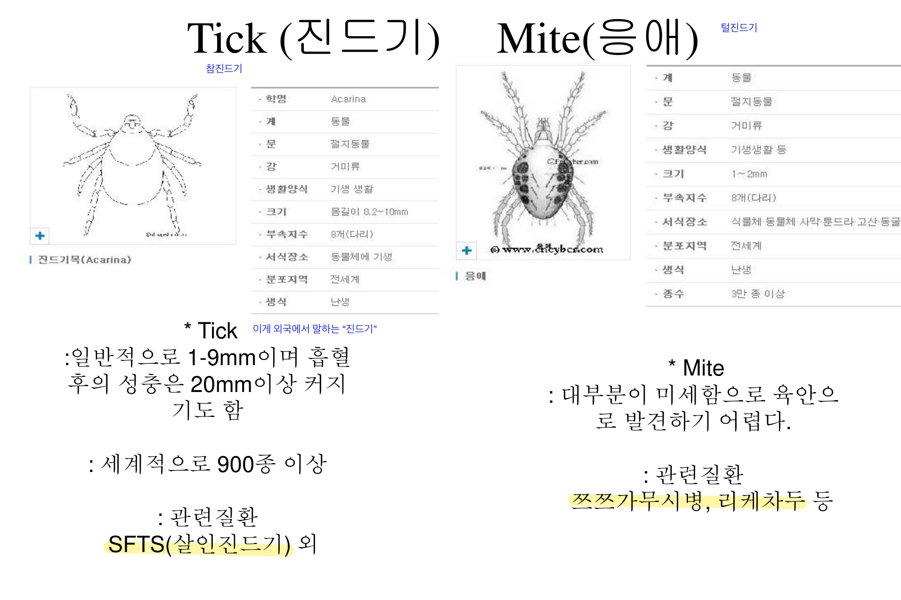{: style="width:65%"}

| | **Tick (참진드기)** | **Mite (응애·털진드기)** |
|---|---|---|
| 크기 | 1~9 mm, 흡혈 후 20 mm 이상 | 대부분 미세, 육안으로 찾기 어려움 |
| 관련 질환 | **SFTS**, 라임병, 홍반열, tularemia, 에를리히증·아나플라스마증, 바베시아증 등 | **쯔쯔가무시병**, 리케차 두창 |

!!! exam "기출 포인트"
    29번: 참진드기(tick) 사진 → 생길 가능성이 **가장 낮은** 병 = **Scrub typhus** (쯔쯔가무시는 mite).

## 7-3. 진드기에 물렸을 때 할 일

1. 진드기 충체를 제거한다.
2. 물린 자리 피부에 2차 변화가 생기는지 관찰한다.
3. **야외활동 후 1~3주 이내** 발열·오한·근육통 등이 생기는지 관찰한다. 작년 교수님: "**3주 넘어가서 아프면 이것 때문이 아니다.**"
4. 전신 피부 발진이 없는지 관찰한다.

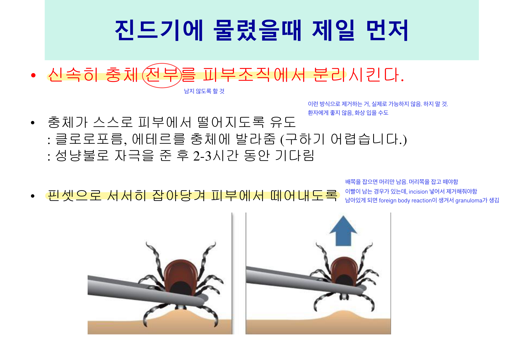{: style="width:50%"}

- 신속히 충체 **전부**를 분리한다. 클로로포름·에테르·성냥불로 떨어지게 하는 방법은 "**실제로 가능하지 않음. 하지 말 것.**"
- **핀셋으로 머리 쪽을 잡고**, 배를 쥐지 말고 비틀지 말고 똑바로 당긴다. 배를 잡으면 머리만 남는다 → 남으면 **foreign body reaction → granuloma**, incision으로 제거. 떨어지지 않으면 병원에서 외과적으로 절제.
- 물린 곳은 물과 비누로 씻고, 자극 있으면 연고, ice pack, 손 씻기. 1~3주간 알레르기 반응·감기 양 증상 관찰.

!!! exam "기출 포인트"
    20번: 목에 붙은 진드기를 발견하고 온 환자 — 머리 포함 제거, 2차 변화 관찰, 1~3주 증상 관찰, 발진 관찰은 모두 ○. **"예방 위해 doxycycline 7일 투약"이 틀림**.

# 암기 — 가을철 열성질환 한눈에

| | 쯔쯔가무시 | SFTS | HFRS | 렙토스피라 |
|---|---|---|---|---|
| 원인 | *Orientia* (세균) | SFTS virus (*Bandavirus*) | Hantaan virus | *Leptospira interrogans* (세균) |
| 전파 | 털진드기 **유충** | 작은소피참진드기, **사람 간(체액)** | 들쥐 배설물 **에어로졸 흡입** | 쥐 **소변** → 물·흙 → 피부·점막 |
| 단서 | 밭일·풀밭, 10~11월 | 고령 텃밭·벌초, 4~11월 | 군인·농업, 봄·가을 | **홍수 후 논**, 습한 작업 |
| 특징 | **가피**, 체간 발진 | **혈소판↓↓**, 위장관, 의식변화 | 홍조·결막충혈·**CVA 압통**, 4단계 | 결막충혈·**종아리 통증**, Weil |
| 백혈구 | 정상~↓ | ↓ | ↑ | ↑ |
| 진단 | 혈청(IFA), **가피 PCR** | **RT-PCR** | IgM ELISA | 첫 5일 PCR → MAT |
| 치료 | **doxycycline** (임신부 azithro, 중증 병용) | **대증치료** | **대증치료**(승압제·수액·투석) | 경증 doxy / 중증 **ceftriaxone·IV penicillin** |
| 격리 | 불필요 | **1인실**(체액 주의) | 불필요 | 불필요 |
