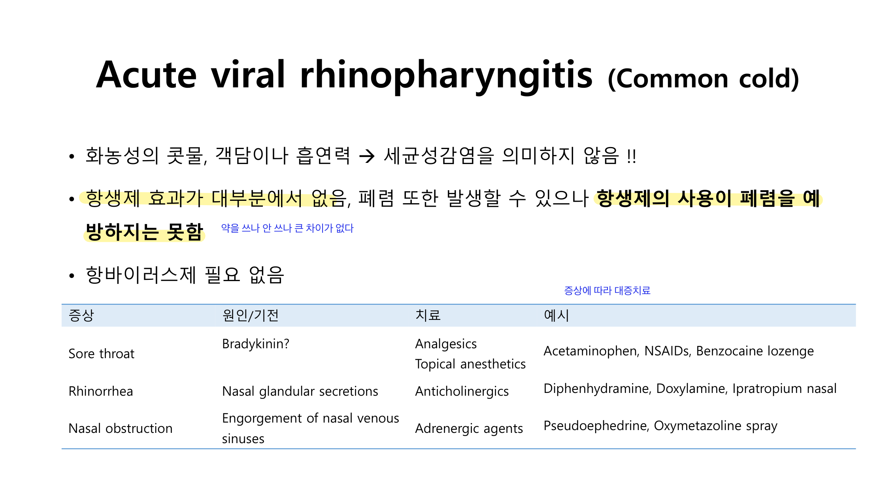
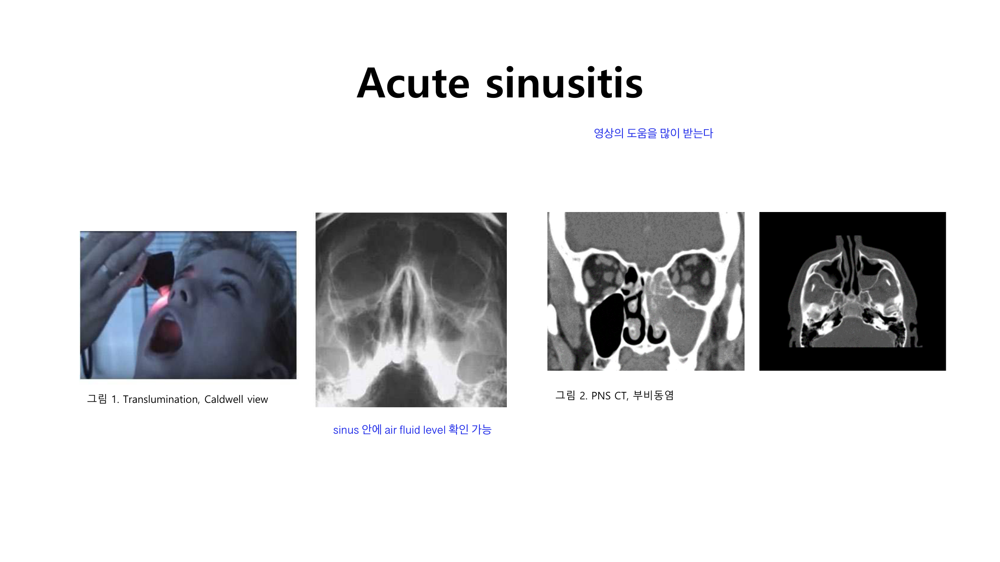
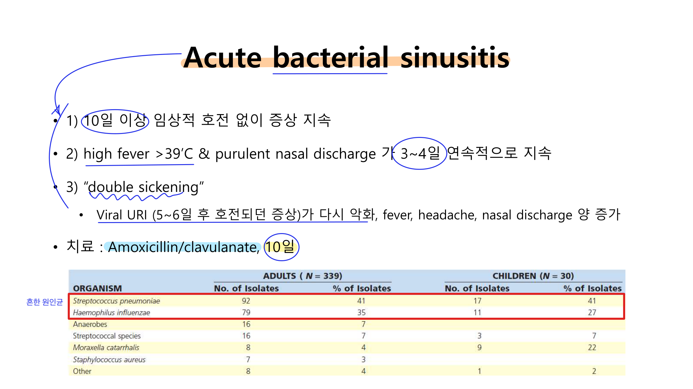
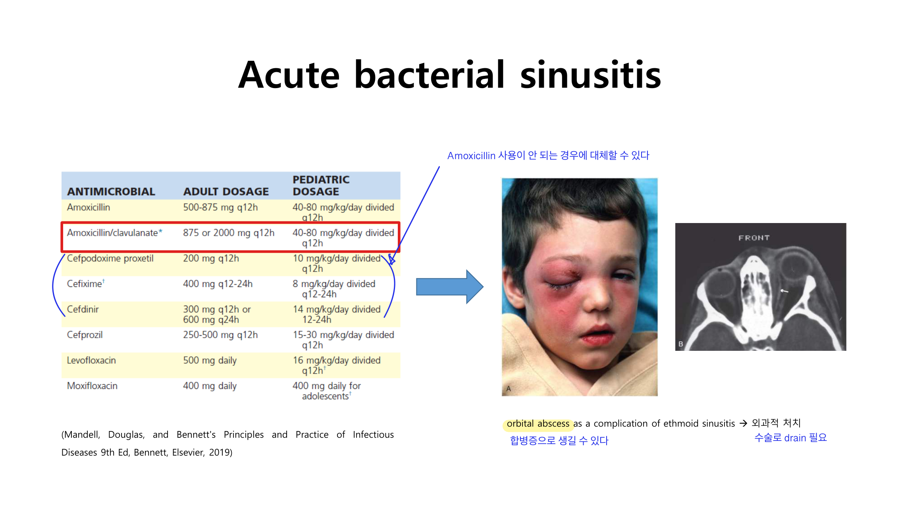
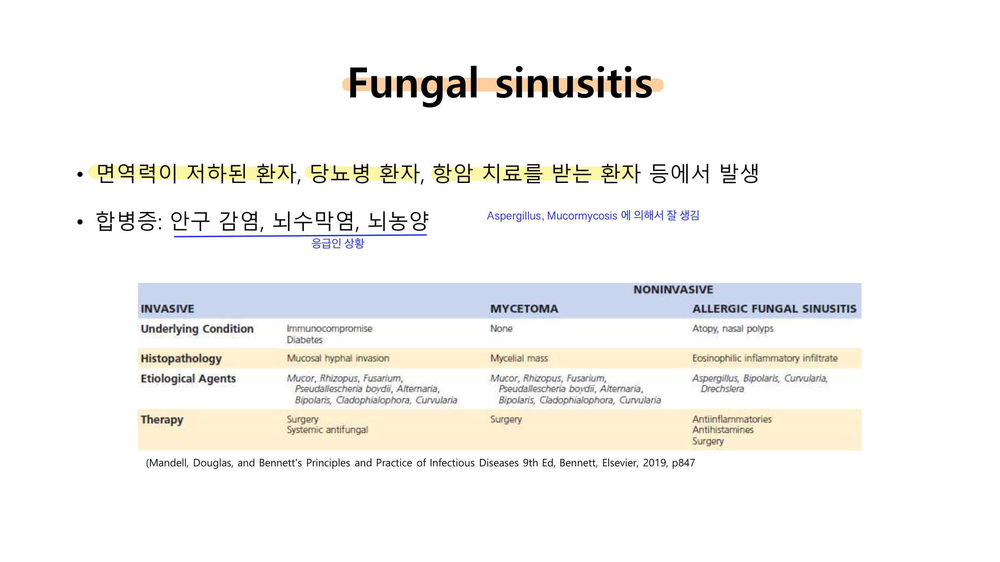
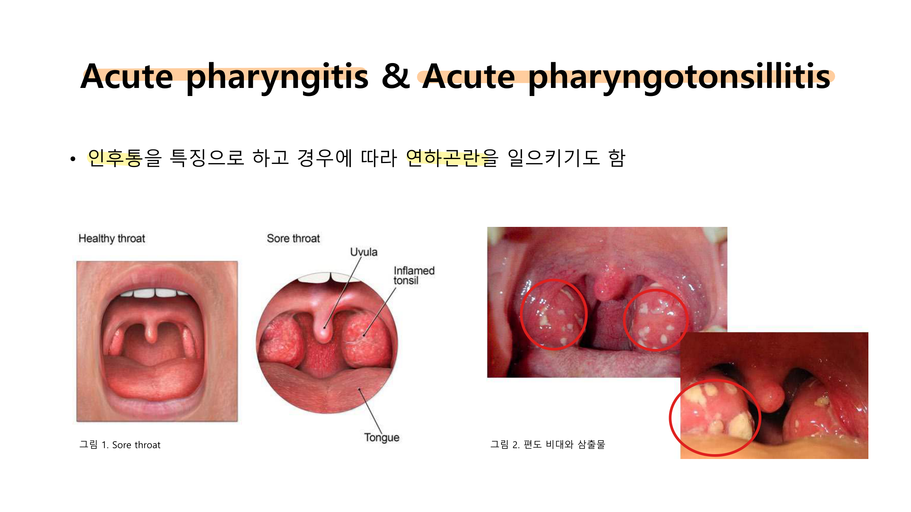
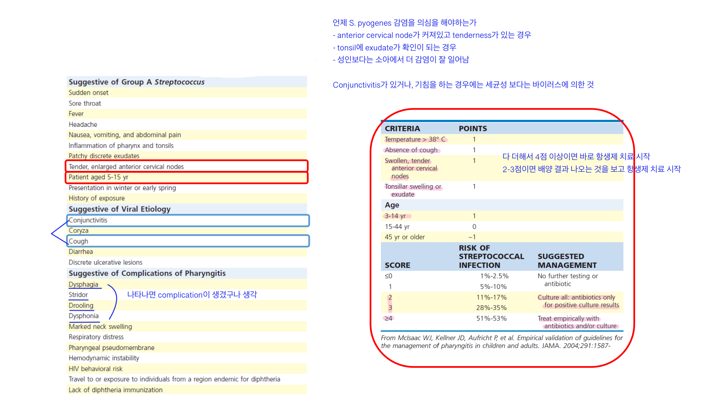
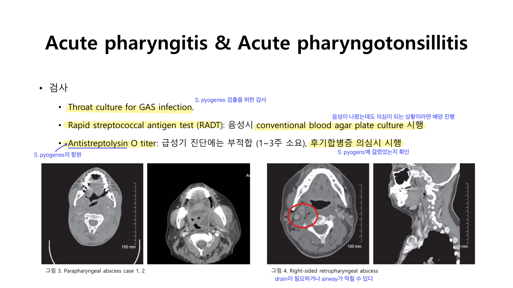
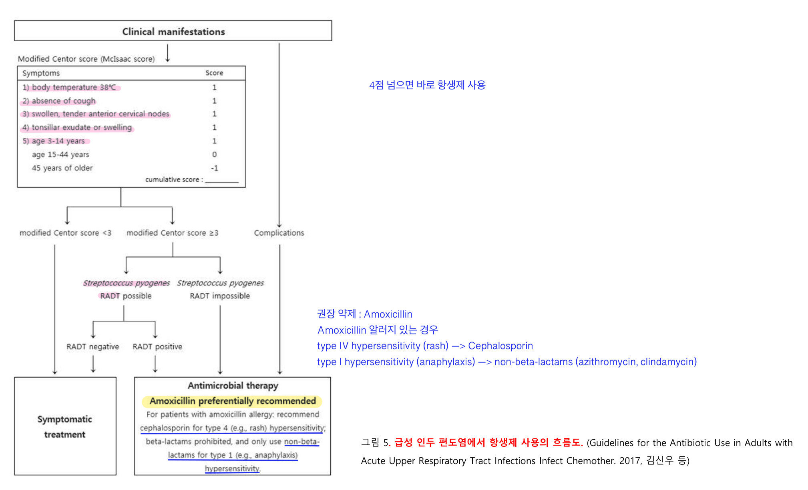
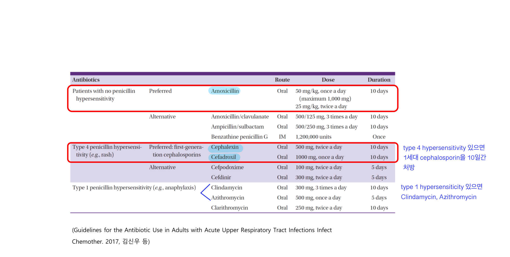

<!-- 필기본: 2025 -->
<!-- 단계: 수업 전 -->

# 0. 이 수업을 공부하는 법

경북대병원 감염내과 **배소현 교수님** 수업(작년 2025, 올해 2026 모두). 2023·2024년 기출은 김신우 교수님 출제라 문체가 조금 다르다("이전에는 교수님이 다릅니다").

교수님이 첫 장에서 직접 강조한 한 줄:

!!! key "핵심"
    "가장 중요하다고 생각하는 건, **상기도감염의 원인은 바이러스가 많다.** 그렇기 때문에 **항생제를 적절하게 사용하는 것**이 중요하다." — 항생제를 **언제, 무엇을** 쓰는지 잘 봐 두자.

학습목표

1. 상기도감염의 임상적 진단을 할 수 있다.
2. 상기도감염의 대증적 치료를 알고, 불필요한 항생제를 쓰지 않는 것의 중요성을 설명할 수 있다.

- 기출 23문항(2020–2025). 압도적으로 많은 주제는 **A군 연쇄구균(GAS) 인두편도염 — Modified Centor score, 검사, amoxicillin 10일**이다(약 13문항). 그다음이 **감기 = rhinovirus, 대증치료(항생제 X)**, **세균성 부비동염 = 폐렴알균, amoxicillin(/clavulanate)**.
- 2025년(배소현 교수님) 문항은 사례형 두 개: GAS 편도염 → amoxicillin 10일, 감기 → rhinovirus.

# 1. 상기도감염 개요

## 상기도감염의 종류 (Acute upper respiratory infection)
상기도 = 비강(nasal cavity), 인두(pharynx), 후두(larynx) (+ 후두개 epiglottis).

- 급성 비인두염(감기)
- 급성 부비동염
- 급성 인후염
- 급성 편도염
- 급성 후두개염

## 왜 중요한가
- 성인이 의료기관을 찾는 **가장 흔한 질환**. 사회경제적 부담이 매우 크다(세계 인구의 약 70%가 매년 한 번 이상 경험). 발생 건수가 많아서.
- **대부분 바이러스가 원인 → 대증치료.** 성인에서 가장 흔한 원인은 바이러스.
- 일부 인두염·후두개염·부비동염만 경우에 따라 항생제가 필요하다.
- 불필요한 항생제는 **내성균 증가, 알레르기, 부작용, 약물 상호작용, 비용**을 일으킨다.
- 감별진단: 하기도감염, 알레르기성 비염, 혈관운동성 비염, 기도 이물, 약물성 비염 등.

# 2. 급성 바이러스성 비인두염 (감기, Common cold)

## 원인 바이러스

| 바이러스 | 항원형 |
|---|---|
| **Rhinovirus** | >156형 — **가장 많다** |
| Coronavirus | 5형 |
| Parainfluenza virus | 5형 |
| RSV | 2형 |
| Influenza virus | 3형(아형 다수) |
| Adenovirus | 57형 |
| Metapneumovirus | 2형 |
| 기타 | enterovirus, bocavirus |

- **Rhinovirus가 원인의 30–50%, 가을철에는 80%** — 계절성이 있다. 감기는 대부분 바이러스 감염이고, 그중 rhinovirus가 가장 많다.
- 성인은 보통 1년에 2–4회 걸린다.
- **전파**: ① **접촉**(사람·주변 환경), 특히 어린이 접촉 ② 직접 **비말** ③ 공기 중에 비교적 오래 떠 있는 에어로졸.

## 임상양상
- 잠복기는 다양하다(rhinovirus 2–4일).
- 열, 오한, 근육통, 두통, 기침, 콧물, 코막힘, 재채기, 인후통, 쉰 목소리 — **코 증상이 가장 흔하다**.
- 성인은 소아와 달리 전신증상·귀 통증이 잘 동반되지 않는다.
- 증상은 **2–3일에 절정 → 6–7일에 걸쳐 저절로 회복**. 길어지면 세균 감염 동반을 감별한다.
- 주요 합병증: **중이염, 부비동염**.
- 감별: 급성 인두염, 후두염, 기관지염, 크룹, 세기관지염 — 항생제를 쓸지와 연결된다.
- 바이러스 상기도감염은 **COPD 악화의 가장 흔한 원인**.

## 치료 — 증상에 따른 대증치료
- **화농성 콧물·가래나 흡연력이 세균 감염을 뜻하지 않는다!!**
- **항생제는 대부분 효과가 없다.** 폐렴이 생길 수는 있지만 항생제가 폐렴을 예방하지 못한다.
- **항바이러스제도 필요 없다.**
- 약을 쓰나 안 쓰나 경과에 큰 차이는 없고, 증상에 따라 대증치료한다.

{: style="width:94%"}

| 증상 | 원인·기전 | 치료 | 예 |
|---|---|---|---|
| 인후통 | Bradykinin? | 진통제, 국소마취제 | Acetaminophen, NSAIDs, benzocaine 트로키 |
| 콧물 | 코 분비샘 분비 | **항콜린제** | Diphenhydramine, doxylamine(1세대 항히스타민), ipratropium 비강 |
| 코막힘 | 코 정맥동 충혈 | **아드레날린 작용제** | **Pseudoephedrine**, oxymetazoline 스프레이 |

기침에는 진해제(dextromethorphan), 가래에는 거담제(guaifenesin)도 쓴다.

!!! exam "기출 포인트"
    - 2부 2번(2025): 콧물·코막힘·인후통·마른기침, 미열, 삼출물·림프절 없음 → 원인 = **Rhinovirus**.
    - 2부 5번(2023)·10번(2022): 감기에 쓰는 약이 **아닌** 것 = **Cefaclor**(2세대 세팔로스포린 항생제). Pseudoephedrine, guaifenesin, chlorpheniramine, dextromethorphan, acetaminophen, 1세대 항히스타민은 모두 대증치료제.
    - 2부 8번(2022): 근거중심으로 옳은 것 = **세균성 편도염에 페니실린계 사용은 류마티스열 위험을 줄인다**. "감기는 만병의 근원", "감기가 폐렴이 됐다", "주된 전파는 공기", "콧물이면 항생제"는 모두 틀림.

# 3. 급성 부비동염 (Acute sinusitis)

## 정의와 원인
- 부비동 점막의 염증. 대부분 주변 비강 염증과 함께 오므로 **비부비동염(rhinosinusitis)**이라 한다. 부비동은 4개(상악동, 사골동, 전두동, 접형동).
- **4주**를 기준으로 급성 vs 만성.
- **대부분 바이러스성**(acute viral rhinosinusitis: rhinovirus, influenza, parainfluenza).
- 부비동 배출구가 막히거나 점액 배출이 안 되면 **2차 세균 감염** → **급성 세균성 부비동염은 약 0.5–2%** 에서만 생긴다.

## 증상과 진단

{: style="width:94%"}

- 증상: 콧물, 코막힘, 후각 저하, **안면 통증·압박감, 상악 치통**, 두통, 후비루.
- **분비물에서 악취**가 나면 혐기균 관여 → **치아 감염**과의 연관을 생각한다.
- 진단:
    - 부비동 흡인천자 배양이 정확하지만 실제로는 하기 어렵다.
    - 비경, 굴곡성 비인두경, 투조법(transillumination), 부비동 X선(Caldwell view), **부비동 CT** — 영상의 도움을 많이 받는다(sinus 안의 **공기–액체층** 확인). CT 사용이 늘고 있다.
    - **단, 영상으로 바이러스성과 세균성을 감별하기는 어렵다!**
    - 실제 임상에서는 눌렀을 때 압통이 있는지로 판단하는 경우가 많다.

## 급성 세균성 부비동염 — 언제 의심하나

{: style="width:94%"}

1. **10일 이상** 임상적 호전 없이 증상 지속
2. **39℃ 넘는 고열 + 화농성 콧물이 3–4일 연속** 지속
3. **"double sickening"** — 5–6일 뒤 좋아지던 바이러스 상기도감염이 다시 악화(열, 두통, 콧물 증가)

**흔한 원인균**: **Streptococcus pneumoniae(성인 41%) > Haemophilus influenzae(35%)** > 혐기균, 연쇄구균, Moraxella catarrhalis(소아에서 더 흔함), S. aureus.

**치료: Amoxicillin/clavulanate, 10일.**

{: style="width:94%"}

- 대안(amoxicillin을 쓸 수 없을 때): cefpodoxime, cefixime, cefdinir, cefprozil 같은 경구 세팔로스포린, levofloxacin·moxifloxacin.
- 합병증: **사골동염에 의한 안와 농양(orbital abscess)** → 외과적 처치(수술로 배농)가 필요하다.

!!! exam "기출 포인트"
    - 2부 3번(2024): 성인 급성 세균성 부비동염 1차 약 = **Amoxicillin 또는 amoxicillin/clavulanate**. Levofloxacin(대안), azithromycin·tetracycline(내성), gentamicin(X).
    - 2부 14번(2021): 경험적 항생제의 대표 표적 = **Streptococcus pneumoniae**.
    - 2부 21번(2020): **임신 3개월** 세균성 부비동염 → **Ceftriaxone**(β-lactam). Fluoroquinolone·minocycline은 임신 금기, TMP/SMX는 엽산 길항.

## 진균성 부비동염 (Fungal sinusitis)

{: style="width:94%"}

- **면역저하자, 당뇨병, 항암치료 중인 환자**에서 생긴다. **Aspergillus, Mucor(털곰팡이증)**가 잘 일으킨다.
- 합병증: **안구 감염, 뇌수막염, 뇌농양** → **응급** 상황.

| | 침습성(invasive) | 진균종(mycetoma, fungus ball) | 알레르기성 진균 부비동염 |
|---|---|---|---|
| 기저 상태 | **면역저하, 당뇨** | 없음 | 아토피, 비용종 |
| 병리 | 점막에 균사 침습 | 균사 덩어리 | 호산구성 염증 |
| 원인균 | Mucor, Rhizopus, Fusarium 등 | Mucor, Aspergillus 등 | Aspergillus, Bipolaris, Curvularia |
| 치료 | **수술 + 전신 항진균제** | 수술 | 항염증제, 항히스타민, 수술 |

# 4. 급성 인두염·인두편도염 (Acute pharyngitis & pharyngotonsillitis)

{: style="width:70%"}

- **인후통**이 특징이고, 경우에 따라 **연하곤란**.

## 원인
| 구분 | 원인 | 비고 |
|---|---|---|
| **바이러스(대부분)** | Adenovirus, influenza, parainfluenza, rhinovirus, RSV 등 | 급성 인두염의 대부분 |
| 세균(일부) | **A군 β-용혈성 연쇄구균(Streptococcus pyogenes)** | 성인에서 약 5–10% |

## 항생제를 쓰는 목적 ★
- **GAS 후기 합병증 예방**: **류마티스열**, **급성 사구체신염** 등.
- **급성 화농성 합병증 예방**: **편도주위 농양(peritonsillar abscess)**, **인두뒤 농양(retropharyngeal abscess)**.
- → 임상에서는 **S. pyogenes에 의한 세균성 인두염인지 감별**하는 것이 중요하다.

## 언제 GAS를 의심하나 — Modified Centor (McIsaac) score

{: style="width:94%"}

- GAS를 시사: 갑작스러운 발병, 인후통, 발열, 두통, 구역·구토·복통, 인두·편도 염증, 반점형 삼출물, **압통 있는 앞목 림프절 비대**, **5–15세**, 겨울·초봄, 노출력.
- **바이러스를 시사**: **결막염**, 콧물(coryza), **기침**, 설사, 궤양성 병변 → 결막염이 있거나 기침을 하면 세균보다 바이러스.
- **합병증을 시사**: 연하곤란, 그렁거림(stridor), 침 흘림, 발성장애, 목의 심한 부종, 호흡곤란 → 이런 게 나타나면 합병증이 생겼구나 생각한다.
- 교수님: 앞목 림프절이 커지고 압통이 있을 때, 편도 삼출물이 보일 때, **성인보다 소아**에서 더 잘 걸린다.

| 기준 | 점수 |
|---|---|
| 체온 >38℃ | 1 |
| 기침 없음 | 1 |
| 압통·부은 앞목 림프절 | 1 |
| 편도 부종 또는 삼출물 | 1 |
| 나이 3–14세 | 1 |
| 나이 15–44세 | 0 |
| **나이 45세 이상** | **−1** |

| 점수 | GAS 위험 | 처치 |
|---|---|---|
| ≤0–1 | 1–10% | 검사·항생제 필요 없음 |
| 2–3 | 11–35% | **배양 결과를 보고** 항생제 |
| **≥4** | 51–53% | **바로 경험적 항생제** |

!!! exam "기출 포인트"
    - 2부 6번(2023): Centor 항목이 **아닌** 것 = **Age >50**(45세 이상은 −1점이지 항목 추가가 아님).
    - 2부 13번(2021): 항목이 아닌 것 = **ASO titer**.
    - 2부 7·9·20번(2022·2020): 표·편도 사진을 보고 고르는 점수 = **Modified Centor score**(Duke = 심내막염, SOFA·SIRS·NEWS = 패혈증·중증도, CURB-65 = 폐렴, McCabe·Charlson = 동반질환).
    - 2부 4번(2024): GAS를 시사하는 소견 = **발열과 인후통이 갑자기 시작**. 기침·콧물·설사·결막염은 바이러스.
    - 2부 23번(2020): 6세, 고열·인후통·두통·구역, 앞목 림프절 압통, 편도 발적 → **A군 사슬알균**.

## 검사

{: style="width:94%"}

- **인후(편도) 배양**(throat culture) — GAS 검출의 기준.
- **신속 연쇄구균 항원검사(RADT)** — S. pyogenes 항원을 본다. **음성인데도 의심되면** 일반 혈액한천 배양을 한다.
- **ASO(antistreptolysin O) titer** — 1–3주 걸려 **급성기 진단에는 부적합**. **후기 합병증(류마티스열, 사구체신염)이 의심될 때** S. pyogenes에 걸렸었는지 확인하는 용도.
- 인두옆 농양, 인두뒤 농양(CT) — 배농이 필요하거나 기도가 막힐 수 있다.

!!! exam "기출 포인트"
    2부 12번(2022): 9세, 고열·인후통·두통, 기침·콧물 없음, 림프절 압통 → 진단 검사 = **편도 세균 배양**. 2부 16번(2021): 같은 상황 + 발진(성홍열) → **편도 신속항원검사**. ASO·anti-DNase B는 지난 감염 확인용이라 오답.

## 치료 — 급성 인두편도염 항생제 흐름도 (2017 국내 지침)

{: style="width:94%"}

1. 임상 소견 → Modified Centor score.
2. **<3점** → 대증치료.
3. **≥3점** → RADT 가능하면 시행: 양성이면 항생제, 음성이면 대증치료. RADT를 못 하면 경험적 항생제. (교수님: **4점 넘으면 바로 항생제**.)
4. 합병증이 있으면 항생제.

**권장 약: Amoxicillin (10일)**. Amoxicillin(페니실린) 알레르기가 있으면:

- **제4형 과민반응(발진)** → **1세대 세팔로스포린**(cephalexin, cefadroxil) 10일.
- **제1형 과민반응(아나필락시스)** → β-lactam이 아닌 약: **clindamycin, azithromycin**(clarithromycin).

{: style="width:94%"}

| 상황 | 약 | 기간 |
|---|---|---|
| 페니실린 알레르기 없음(우선) | **Amoxicillin** 경구 | **10일** |
| 대안 | Amoxicillin/clavulanate, ampicillin/sulbactam | 10일 |
| 대안 | Benzathine penicillin G 근주 | 1회 |
| 제4형 과민(발진) | **Cephalexin, cefadroxil**(1세대) | 10일 |
| 제4형 대안 | Cefpodoxime, cefdinir | 5일 |
| 제1형 과민(아나필락시스) | **Clindamycin**(10일), **Azithromycin**(5일), clarithromycin(10일) | |

!!! exam "기출 포인트"
    - 2부 1번(2025): 25세, 고열·연하통, 기침 없음, 편도 삼출물, 앞목 림프절 압통(Centor 4점) → **Amoxicillin 10일**. Oseltamivir, clarithromycin 3일, dexamethasone 단독, 대증요법은 오답.
    - 2부 19번(2020): RADT 양성 GAS 인두편도염 amoxicillin 기간 = **10일**(류마티스열 예방을 위해 증상이 좋아져도 채운다).

# 5. 기출에 나왔지만 작년 필기에 없는 내용

## A군 연쇄구균(S. pyogenes)의 미생물학
- Lancefield **A군**. β-용혈.
- 히알루론산 협막이 있지만 사람 조직과 같아 **면역원성이 없고, 협막 백신은 없다**(폐렴알균과 혼동 금지 — Quellung 반응 양성·협막 백신은 폐렴알균).
- 용혈소(streptolysin O)에 대한 항체(**ASO**)로 **최근 감염 여부**를 확인한다.
- 인두염 후 **류마티스열, 급성 사구체신염**.
- **용원성 파지**가 만드는 **발적독소(erythrogenic toxin, SpeA)** → **성홍열** 발진.
- 항생제 내성이 문제 되지 않는다(페니실린 내성 없음).

!!! exam "기출 포인트"
    2부 11번(2022): 옳은 것 = **용혈소 항체로 최근 감염 확인**. 2부 17번(2021): 틀린 것 = **협막 백신을 고위험군에 권장**.

## 디프테리아 (Corynebacterium diphtheriae)
- 편도·목젖에 **위막(삼출물 막)**, 불규칙한 **곤봉 모양 그람양성 막대균**, 메틸렌블루 염색의 **이염성 과립**.
- 독소: A-B 독소 → 세포 안으로 들어간 A 서브유닛이 **연장인자 2(EF-2)를 ADP-리보실화**해 불활성화 → **단백질 합성 억제** → 세포 사멸.

!!! exam "기출 포인트"
    2부 22번(2020) = **C. diphtheriae**, 2부 18번(2021) 빈칸 = **(A) elongation factor 2, (B) 단백질 합성**.

## 치성 심경부 감염
치아를 오래 방치한 당뇨 노인의 아래턱 부종·통증·**개구장애** → 구강 **혐기균을 포함한 혼합균** 감염(2부 15번). 혐기균까지 덮는 항생제 + 배농.

!!! memo "암기"
    감기 = Rhinovirus, 항생제·항바이러스제 X, 대증치료 · 세균성 부비동염 = 10일 이상 / 고열+화농성 3–4일 / double sickening → S. pneumoniae·H. influenzae → **Amoxicillin/clavulanate 10일** · 진균성 = 면역저하·당뇨, Mucor·Aspergillus, 응급 수술 · GAS 인두염 = Centor(38℃, 기침 없음, 앞목 림프절, 삼출물, 3–14세 +1 / 45세 이상 −1), ≥4 바로 항생제 → **Amoxicillin 10일** · 발진 알레르기 → 1세대 세팔로 · 아나필락시스 → clindamycin·azithromycin · ASO는 급성기 진단 X
