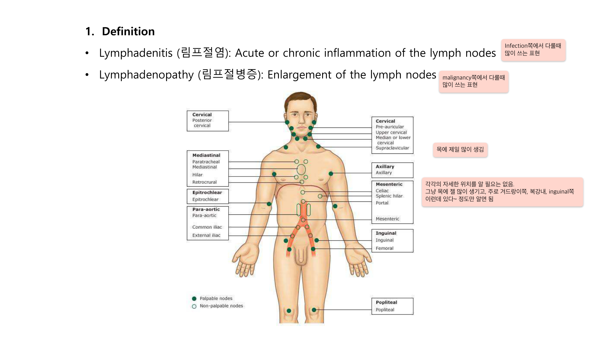
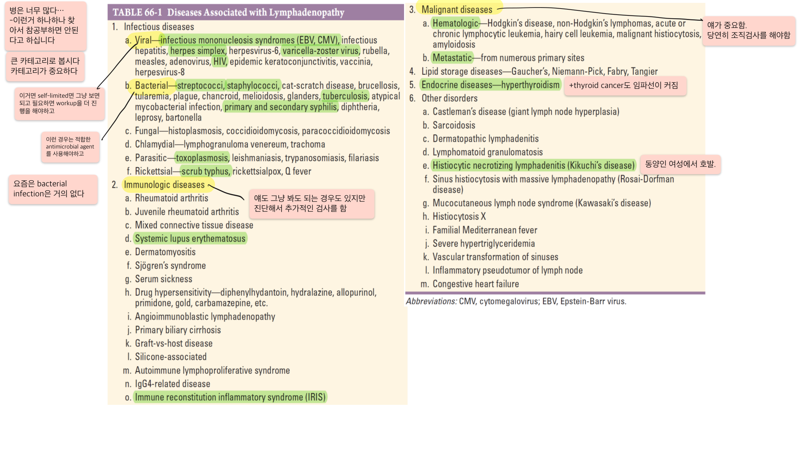
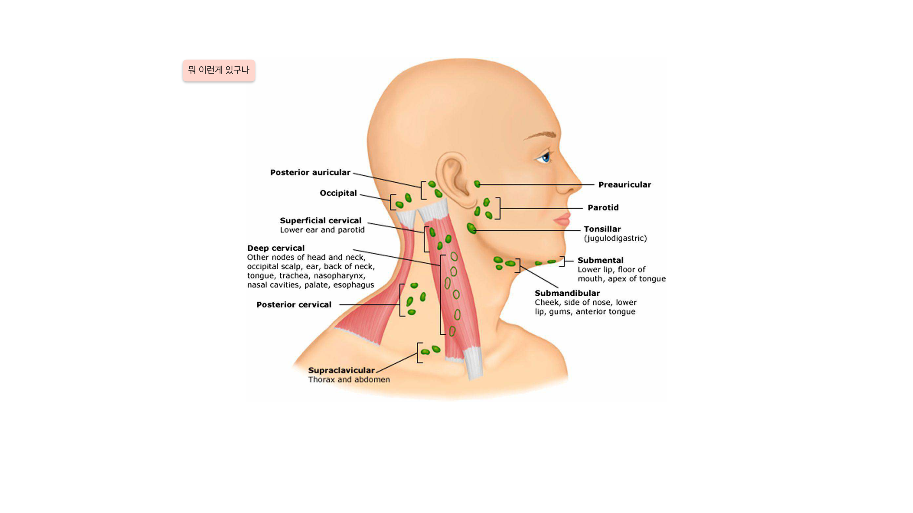
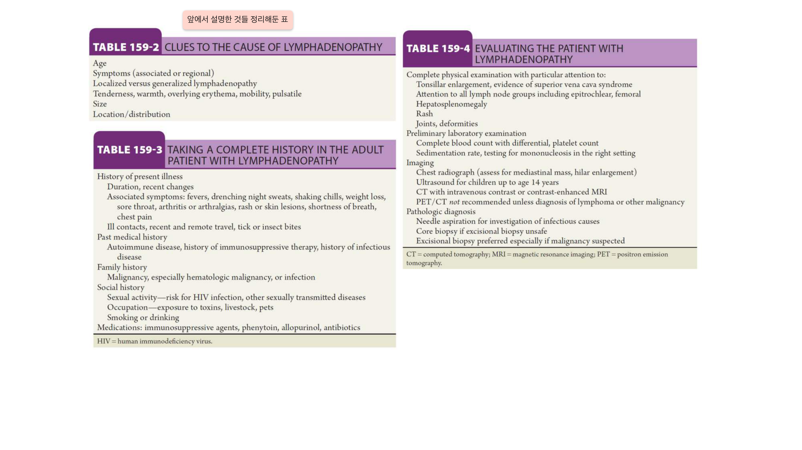

<!-- 필기본: 2025 -->
<!-- 단계: 수업 전 -->

# 0. 이 수업을 공부하는 법

**권기태 교수님** 수업(2023·2025·2026 같은 교수님). Harrison 매뉴얼 내용을 읽으면서 설명하는 방식이고, 교수님이 "**제일 뒤의 증례 2개를 자세히 알면 된다**"고 했다. 필기본 1쪽에 2022–2024 기출이 실려 있다.

학습성과

1. 림프절염(림프절병증)의 감별진단을 설명할 수 있다.
2. 림프절염(림프절병증)의 임상적 평가를 설명할 수 있다.
3. 림프절염(림프절병증)에 시행하는 검사법을 설명할 수 있다.

- 기출 15문항(2020–2025)은 거의 전부 두 증례의 변형이다:
    1. **고령·흡연자, 왼쪽 쇄골위(빗장위), 3 cm, 단단하고 고정된 무통성 림프절 → 즉시 조직검사**(5문항)
    2. **젊은 여성, 발열·인후통, 압통 있는 1 cm 다발성 경부 림프절 → 감염성 단핵구증·기쿠치병 등**, 악성(위암·전이암) 가능성이 가장 낮다(4문항)
- 그 밖에 부위–질환 짝(Virchow = 위암), 전신 림프절병증(에이즈), 대상포진 옆 림프절(acyclovir 후 관찰), 림프종(B 증상).

!!! key "핵심"
    **"그냥 지켜볼 것인가, 빨리 조직검사할 것인가"를 구분하는 게 이 수업의 전부다.**
    조직검사 쪽: **나이 >40(50), 쇄골위, 크기 >2.25 cm²(2 cm), 단단함, 무통, 고정, 둥근 모양(L/S <2)**.
    관찰 쪽: **젊음, <1 cm², 부드러움, 압통, 상기도 증상 동반** → 2–4주 간격 추적, 항생제·스테로이드 X.

# 1. 정의와 정상 림프절

{: style="width:80%"}

- **림프절염(lymphadenitis)**: 림프절의 급성·만성 **염증** — 감염 쪽에서 많이 쓰는 표현.
- **림프절병증(lymphadenopathy)**: 림프절이 **커진 것** — 악성종양 쪽에서 많이 쓰는 표현.
- **목에 가장 많이** 생기고, 그다음 겨드랑이, 복강 내, 서혜부. 각각의 자세한 위치는 알 필요 없다.

**정상 림프절** — 더 조사할 필요 없음

1. 건강한 소아·젊은 성인의 부드럽고 납작한 턱밑 림프절(**<1 cm**)
2. 건강한 성인의 **2 cm까지** 만져지는 서혜부 림프절

→ **서혜부는 2 cm, 나머지는 1 cm 아래가 정상**. 이보다 크면 일단 비정상.

# 2. 림프절병증의 원인

## 얼마나 흔하게 악성인가
- **1차 의료**: **2/3 이상은 비특이적 원인이나 상기도감염**(바이러스·세균), **악성은 1% 미만**.
- 한 연구(의뢰된 환자): **84% 양성**(감염성 단핵구증, 톡소포자충증, 결핵, 63%는 비특이·반응성), **16% 악성**(림프종, 전이성 선암).
- 1차 의료에서는 암이나 감염이 거의 없고, 지나가는 일시적 염증으로 살짝 커진 경우가 많다(감염이라도 대부분 바이러스성 상기도감염이라 조직검사·항생제가 필요 없다). 2차 이상 기관으로 가면 악성이 좀 더 있다.

## 원인 질환 — 카테고리로 본다

{: style="width:92%"}

병은 너무 많다 — 하나하나 찾아 공부하지 말고 **큰 카테고리**로 보자.

| 카테고리 | 예 | 어떻게 하나 |
|---|---|---|
| **감염** — 바이러스 | **감염성 단핵구증(EBV, CMV)**, 단순포진, **대상포진(VZV)**, **HIV**, 홍역, 아데노바이러스 등 | 자가 제한적이면 관찰, 필요하면 추가 검사 |
| 감염 — 세균 | 사슬알균, 포도알균, 고양이 할큄병, **결핵**, **1·2기 매독**, 야토병, 페스트 등 | 적절한 항균제. (요즘 세균 감염은 거의 없다) |
| 감염 — 기타 | 진균(히스토플라스마), 클라미디아(성병성 림프육아종), **기생충(톡소포자충)**, 리케치아(**쯔쯔가무시**) | |
| **면역 질환** | 류마티스 관절염, **SLE**, 약물 과민반응(phenytoin 등), 면역재구성 염증증후군(IRIS) 등 | 관찰할 때도 있지만 진단해서 추가 검사 |
| **악성 질환** ★ | **혈액암**(호지킨·비호지킨 림프종, 급·만성 림프구 백혈병), **전이암** | **당연히 조직검사** |
| 내분비 | 갑상샘항진증(+ **갑상샘암**도 림프절이 커진다) | |
| 기타 | Castleman병, 사르코이드증, **조직구괴사성 림프절염(기쿠치병) — 동양인 젊은 여성에 호발**, 가와사키병 등 | |

# 3. 임상 평가 (Clinical assessment)

자세한 병력, 신체진찰, 선택적 검사, (필요하면) 절제 생검.

## 병력
- 인후통, 기침, 발열, **야간 발한, 피로, 체중감소**, 통증
- **나이**, 성별, 직업, 반려동물 노출, 성행위, 약물 사용
- **50세 넘으면 악성 질환 빈도가 증가** — **나이가 제일 중요!**

## 신체진찰
- **분포(국소 vs 전신)**, **크기**, **질감**, **압통**, 림프절 위 염증 소견, 피부 병변, **비장비대**, (흡연력 있는 성인의 경부 림프절이면) 철저한 이비인후과 진찰.
- 해석(필기):
    - **압통이 있으면 주로 감염(염증으로 피막이 늘어난다), 없으면 악성일 가능성이 높다.**
    - **딱딱하면 악성 의심, 부드러우면 정상 쪽**. 괴사(조직 파괴)가 있으면 악성.
    - 비장비대가 함께 있으면 **전신 질환**(감염성 단핵구증, 림프종 등).

## 전신 vs 국소 림프절병증
- **전신(generalized)**: 서로 붙어 있지 않은 **3곳 이상**의 림프절 부위. **비악성 질환과 자주 연관**된다 → 전신 질환을 생각: **감염성 단핵구증(EBV, CMV), 톡소포자충증, 에이즈**, 기타 바이러스, **SLE**, 혼합결합조직병, ALL·CLL, 악성 림프종.
- **국소(localized)**: 그 주변의 문제 — 이 경우가 악성이 많다. 두경부·폐·유방 같은 **고형암은 전신 림프절병증을 잘 일으키지 않는다**.

!!! exam "기출 포인트"
    2부 4번(2024): 림프절병증이 **전신적으로** 생길 가능성이 높은 것 = **에이즈**. 폐암·난소암(국소 전이), 림프절 결핵(주로 경부), 대상포진(해당 피절)은 국소.

## 부위별 원인

{: style="width:62%"}

| 부위 | 흔한 원인 |
|---|---|
| 후두부(occipital) | 두피 감염 |
| 귀앞(preauricular) | 결막 감염, 고양이 할큄병 |
| **목(neck)** — **국소 림프절병증의 가장 흔한 부위** | 양성: 상기도감염, 구강·치아 병변, 감염성 단핵구증, 기타 바이러스 / 악성: **두경부·유방·폐·갑상샘암의 전이** |
| **쇄골위(supraclavicular, scalene)** | **항상 비정상** → **무조건 검사**. 폐와 후복막 공간을 배액 → 림프종, 그 부위의 암·감염 / **Virchow 림프절 = 왼쪽 쇄골위 → 위장관 원발암 전이(우리나라에 많은 위암)** / 폐·유방·고환·난소암 전이 / 결핵, 사르코이드증, 톡소포자충증 |
| 겨드랑이(axillary) | 같은 쪽 팔의 손상·국소 감염, 흑색종, 림프종, **유방암** |
| 서혜부(inguinal) | 하지의 감염(봉와직염)·외상, **성매개 감염**(성병성 림프육아종, 1기 매독, 생식기 포진, 연성하감), 림프종, 직장·생식기·하지(흑색종) 원발암 전이 |
| 흉부(종격동·폐문) | 기침·쌕쌕거림(기도 압박), 쉰 목소리(되돌이후두신경), 연하곤란(식도 압박), 상대정맥 압박 → 보통 다른 증상으로 찍은 영상에서 발견. **젊으면 감염성 단핵구증·사르코이드증**(젊은 여성), 고령은 **폐암(흡연자)**, 림프종, 전이암, 결핵, 진균 |
| 복강 내·후복막 | **대개 악성**. 장간막 림프절염 — 결핵, 림프종, 생식세포종 |

!!! exam "기출 포인트"
    - 2부 10번(2022): 맞는 짝 = **왼쪽 쇄골상 림프절 – 위암**. 겨드랑이–매독(X, 유방암), 서혜부–유방암(X), 종격동–충수염(X).
    - 2부 5번(2023): 오른쪽 등 피절 수포(대상포진) + 같은 쪽 겨드랑이 2 cm 림프절 → **acyclovir 투여하며 경과 관찰**(반응성).

## 크기
| 크기 | 의미 |
|---|---|
| **<1 cm²**(1.0 × 1.0 cm 이하) | 거의 항상 **양성·비특이 반응성** → 감염성 단핵구증·톡소포자충증만 배제하고 관찰(전신 질환 증상이 없으면). 대부분 정상 |
| 최대 지름 **>2 cm** | 생검에서 **악성 또는 육아종성**(결핵, 사르코이드증) 질환을 예측하는 판별 기준 |
| **2.25 cm²**(1.5 × 1.5 cm) | 악성·육아종성과 다른 원인을 가르는 **가장 좋은 크기 기준** → 이러면 조사해야 한다 |

## 질감
- 부드러움, 단단함, 고무 같음, 딱딱함, 따로 떨어짐, 엉겨 붙음, 압통, 움직임, 고정.
- **압통**: 빠르게 커지면서 피막이 늘어날 때 → 대개 **염증**(일부 급성 백혈병도).
- **림프종**: 크고, 따로 떨어져 있고, 대칭적이며, **고무 같고(rubbery)**, 단단하고, **움직이며, 압통 없음**.
- **전이암**: **딱딱하고, 압통 없고, 주변 조직에 붙어 움직이지 않는다**(섬유화 때문).
- **비장비대 동반**: 전신 질환 — 감염성 단핵구증, 림프종, 급·만성 백혈병, SLE, 사르코이드증, 톡소포자충증, 고양이 할큄병 등.

{: style="width:90%"}

원인을 찾는 단서(앞의 내용 정리): **나이, 동반 증상, 국소 vs 전신, 압통·발적·움직임, 크기, 위치**.

# 4. 검사 (Laboratory investigation)

- 가정의학과 외래의 "커졌지만 감염은 아닌" 젊은 환자 249명: **검사 안 함 51%**, CBC 33%, 인후 배양 16%, 흉부 X선 12%, monospot 10% / **생검은 8명(3%)**뿐이고 그중 절반은 정상·반응성.
- **CBC**: 바이러스면 림프구, 세균이면 호중구 증가. **감염성 단핵구증(EBV·CMV)은 비정형 림프구 증가**, **급성 백혈병은 blast 증가**, SLE 같은 면역 혈구감소는 골수 억제로 **범혈구감소**. 림프종의 백혈병 성분, 화농성 감염도 본다.
- **혈청검사**: EBV, CMV, HIV, Toxoplasma, Brucella 항체 / SLE의 항핵항체·항DNA항체. 바이러스는 세포 안에 있어 현미경으로 찾기 어려워 **대부분 항체검사**(HIV는 항원검사를 먼저 하고 양성이면 PCR로 확진).
- **흉부 X선**: 대개 음성. 폐 침윤·종격동 림프절이 있으면 결핵, 히스토플라스마증, 사르코이드증, 림프종, 폐암, 전이암.
- **영상(CT, MRI, 초음파, 컬러 도플러)**: 특히 두경부암에서 양성·악성 감별. CT와 MRI의 경부 전이 진단 정확도는 비슷(65–90%). 전체를 볼 땐 CT(예: 림프종 병기), 특정 부위를 자세히 볼 땐 MRI.
    - **초음파**: 장축/단축 비율 **L/S <2.0이면 악성**(민감도·특이도 95%) — **둥글수록 악성**, 길쭉하면 대부분 양성. 초음파를 보면서 조직검사도 할 수 있다.

!!! exam "기출 포인트"
    2부 15번(2020): 전이성 암을 의심할 소견 3가지 = **50세 이상, 왼쪽 빗장위, 초음파 단축/장축 >0.5**(= L/S <2, 둥근 모양). 발열 동반·3부위 이상 전신 림프절병증·1 cm² 이하는 양성 쪽.

## 림프절 생검
**언제 하나**(명확한 기준은 없다)

- 병력·진찰이 **악성을 시사**할 때:
    - **나이 든 만성 흡연자의 단독, 딱딱한, 무통성 경부 림프절** → 두경부 원발암이 의심되면 이비인후과 진찰을 먼저
    - **쇄골위 림프절병증**
    - 단단하고 움직이며 **림프종을 시사**하는 단독 또는 전신 림프절병증
- 원발 종양이 의심되는 **점막 병변이 있으면 그것부터** 생검. 없으면 **가장 큰 림프절을 절제 생검**.

**세침흡인(FNA)**

- 주사기로 찌르고 음압으로 세포를 빨아내 염색해서 보는 검사. 마취가 필요 없고 간편해 **가장 많이 한다**. 감염이나 암종의 침범을 진단하는 데 정확하다(**갑상샘에서는 매우 정확**).
- 그러나 세포 일부만 보므로 정확도가 낮을 수 있고, **특히 림프종에서는 첫 진단 검사로 하면 안 된다**(림프종은 종류가 많아 타입을 알 수 없다 → 대개 먼저 FNA로 림프종 의심이 나오면 절제 생검). 갑상샘 결절과 재발 확인용으로 아껴 둔다.
- **절제 생검(excisional biopsy)**: 조직·면역·유전 검사에 충분한 재료를 준다.
- **1차 의료에서 생검이 필요한 림프절병증은 5% 미만.**

**생검 알고리즘**

- 9–25세의 말초 림프절병증: **크기 >2 cm, 흉부 X선 이상 → 양성 예측**, **최근 이비인후 증상 → 음성 예측**(기침·콧물 같은 상기도 증상이면 악성 가능성이 많이 낮다).
- 5가지 변수 — **양성 예측(→ 생검)**: **나이 >40, 쇄골위, >2.25 cm², 딱딱함, 통증·압통 없음** / **음성 예측**: 나이 <40, <1.0 cm², 딱딱하지 않음, 압통·통증 있음.

## 치료 원칙
- 대부분 생검이 필요 없고, **적어도 절반은 검사도 필요 없다**.
- 병력·진찰이 양성 원인을 가리키면 → **2–4주 간격으로 주의 깊게 추적**.
- **항생제는 세균 감염의 강한 증거가 없으면 쓰지 않는다.**
- **스테로이드는 쓰지 않는다** — 림프구 용해 효과가 림프종·백혈병·Castleman병 진단을 가리고, 감염의 회복을 늦추거나 악화시킨다. **진단 전까지는 쓰지 않는다.**
    - 예외: 감염성 단핵구증에서 커진 발다이어 고리(편도)가 **생명을 위협하는 인두 폐쇄**를 일으킬 때.

!!! exam "기출 포인트"
    2부 12번(2021): 25세, 콧물·인후통 + 턱밑 1 cm, 부드럽고 압통 있는 림프절, 열 없음 → **경과 관찰**. 항생제·스테로이드·생검·혈액검사/X선은 오답.

# 5. 증례 ★ ("이 두 개를 자세히 알면 된다")

## 증례 1 — 감염성 단핵구증
- **25세 여성**, 2주간의 **발열, 인후통, 양측 경부 림프절종대**.
- 진찰: **부드럽고 압통 있는 2 cm** 경부 림프절, **비장 촉진**.
- 접근: EBV/CMV 감염 의심 → **CBC with differential, EBV VCA IgM**.
- 결과: **비정형 림프구 증가, EBV VCA IgM 양성 → 감염성 단핵구증**.

교수님이 바꿔 가며 설명한 감별:

- 감염성 단핵구증은 **인후통이 심하고**, **비장비대**는 다른 바이러스 감염에서는 잘 없는 **특징적인 소견**.
- 비정형 림프구 대신 **호중구가 증가**하고 비장비대가 없으면 → 상기도감염, **S. pyogenes 인두염** 쪽.
- 림프절이 더 많고 비장이 크고 **blast**가 보이면 → **급성 백혈병** → 골수 검사.
- **B 증상**(체중감소, 야간 발한)이 있고 한 달 넘게 38℃ 넘는 열, **고무 같은 림프절이 여러 개** → **림프종** → 절제 생검.
- 이 나이대 **동양 여성**이 비슷한 증상인데 **백혈구·혈소판 감소, AST·ALT 약간 상승** → **기쿠치병** 의심 → FNA(조직)로 진단.
- 치료: 감염성 단핵구증은 **NSAID 쓰고 경과 보면 1–2달에 좋아진다**. 비장이 너무 크거나 편도가 커서 숨쉬기 어려우면 **진단 후에** 스테로이드.

!!! exam "기출 포인트"
    - 2부 2번(2025): 28세, 발열·인후통·양측 경부, 부드럽고 움직이는 1.5 cm, 비장 2 cm, 비정형 림프구 → **EBV 항체검사**.
    - 2부 6번(2023)·9번(2022): 25세, 5일 발열 + 양측 목의 **압통 있는 1 cm** 결절 여러 개 → 가능성이 **가장 낮은** 것 = **위암**(2023) / **전이성 암종**(2022). 감염성 단핵구증·톡소포자충증·기쿠치병·급성 인두염·에이즈·SLE는 모두 가능.
    - 2부 3번(2024): 71세, 2개월간 1주씩 반복되는 열, **야간 발한, 체중 9 kg 감소**, 양쪽 목·겨드랑이 3 cm **단단한 무통성** 림프절 여러 개, 간비장비대, 빈혈, **LDH 760** → **악성림프종**.
    - 2부 8번(2022): 1달 불명열 + 간비장비대 + 골수에서 혈구를 잡아먹는 세포(혈구탐식성 림프조직구증, HLH) → **Histiocyte**의 이상.

## 증례 2 — 폐암 림프절 전이
- **62세 남성, 흡연자**, 3주간의 **좌측 쇄골위** 림프절종대.
- 진찰: **3 cm, 단단하고 고정된 무통성** 림프절.
- 접근: **고위험 → 즉각적인 CT + 생검**.
- 결과: **폐 선암의 림프절 전이**.
- 모두 악성을 시사하는 소견 → 조직검사. 먼저 폐암인지 확인하고, 아니면 **내시경으로 위암**인지 확인한다.

!!! exam "기출 포인트"
    - 2부 1번(2025): 70세, 30갑년, 좌측 쇄골위 3 cm 단단·고정·무통, 5 kg 체중감소 → **즉각적인 림프절 생검**. 경험적 항생제 후 재평가, 스테로이드, EBV 검사, 4주 후 추적은 오답.
    - 2부 7·14번(2022·2020): 같은 환자 + 흉부 X선 → **림프절 조직 생검**.
    - 2부 11번(2021): 생검 이유가 **아닌** 것 = **"왼쪽 목 부위"라는 위치**(쇄골위가 아니라 그냥 목). 흡연력, 70세, 3 cm, 딱딱·고정, 흉부 X선 종괴는 모두 이유.

# 6. 기출에 나온 그 밖의 내용

**결핵성 림프절염의 역설적 반응(paradoxical reaction)**: 감수성 결핵을 1차 약으로 잘 치료하던 중 **6–8주 무렵** 림프절이 다시 커지거나 심낭·늑막 삼출이 새로 생기는 것 — 면역 회복 때문이다. 치료 실패(배양이 다시 양성)나 약물 독성이 아니다(2부 13번).

!!! memo "암기"
    정상: 서혜부 <2 cm, 나머지 <1 cm · 1차 의료 악성 <1% · 나이가 제일 중요(>40·50) · 쇄골위는 항상 비정상, 왼쪽 = Virchow = 위암 · 압통 = 염증, 무통·딱딱·고정 = 전이암, 고무·움직임·무통 = 림프종 · >2.25 cm² 또는 >2 cm → 조사 · 초음파 둥근 모양(L/S <2) = 악성 · 전신(3곳 이상) = 감염성 단핵구증·톡소·에이즈·SLE·림프종 · FNA는 림프종 첫 검사 X → 절제 생검 · 양성 의심 → 2–4주 추적, 항생제·스테로이드 X
