<!-- 필기본: 2026 -->

# 0. 이 수업을 공부하는 법

**전영훈 교수님**(경북대병원 마취통증의학과)의 「급성 통증 치료」 수업이다. 교수님은 "시험문제는 가급적 쉽게 내겠다"고 하셨지만, 필기자 메모대로 **한 부분만 묻기보다 여러 내용을 종합해야 풀리는 문제**가 나온다. 2020–2025년 기출 10문항이 거의 같은 틀(「수술 후 통증 치료에서 옳은 것은?」, 「통증 조절에 관하여 옳은 것은?」)로 반복되고, 보기 다섯 개가 강의의 서로 다른 부분에서 하나씩 온다.

| 주제 | 2부 문항 | 매번 나오는 보기 |
|---|---|---|
| **약제 선택(NSAID · COX-2 · acetaminophen)** | 1·3·6·8·10번 | 출혈·위장관·신장·간 중 **어디에 안전한가** |
| **신경차단** | 3·6·10번 | 마취제 줄임 → **빠른 회복**, **국소순환 개선** |
| **보조진통제(항우울제·항경련제)** | 4·7·9번 | 항우울제는 **우울 없어도** 통증 억제, 항경련제는 **신경병증성**에, **단계 무관** |
| **마약제제 부작용** | 3·4·7·9번 | **변비는 지속**된다(내성 없음) → 변비약 같이 |
| **통증의 성질과 평가** | 2·5·8·10번 | 수술 후 통증 = **침해성**, 평가는 **주관적 자가보고**, 만성화 = **신경계 구조 변화** |
| **수술 후 통증 관리 원칙** | 2·8번 | **multimodal**, **preventive**(수술 전·중·후 전체), 환자 중심 |

!!! key "핵심"
    - 기출은 **"옳은 것 하나"**를 고르는 형식이고 오답은 모두 **장기(간·신장·위장관·혈소판)를 바꿔치기**하거나 **"대부분 사라진다 / 일차적으로"** 같은 단정으로 만든다. 맨 뒤 9장의 **환자 상태별 권장약제 표**를 통째로 외우면 절반이 풀린다.
    - 이 수업은 27강(만성 통증관리)과 겹친다(말초·중추 감작 슬라이드는 27강 자료를 참고로 실었다). 정의·감작·만성화는 두 수업에서 같이 나올 수 있다.

# 1. 통증이란 — 정의와 통증이 미치는 영향

## 통증의 정의 (세계통증학회)

교수님이 "**항상 정의가 중요하다**"고 강조하셨다.

> 잠재적인 또는 실질적인 조직 손상이나, 이러한 손상에 관련하여 표현되는 **감각적이고 정서적인 불유쾌한 경험** — 세계통증학회(IASP)

- **주관적·감각적**: 통증은 환자가 느끼는 경험이다. 그래서 평가도 환자의 자가보고가 기본이다(→ 4장).
- **방어와 경고 시스템**: 다치면 아프다는 경고가 있어야 몸을 피하고 손상을 최소화한다. 급성 통증의 본래 역할이다.
- **통증이 이상하게 오래 지속되면 질병으로 간주**한다. 급성에서 만성으로 넘어가면 그 자체가 문제가 되는 병이 된다. 그렇다고 급성 통증을 방치해도 된다는 뜻은 아니다 — **급성 통증도 치료해야 한다**(만성화를 막기 위해서, → 2장).

## 몸과 마음은 하나의 시스템

생리적 시스템(자율신경, 수면-각성, 내분비, 면역, 운동, 감각)과 심리적 시스템(감정, 인지, 동기, 주의, 지각, 학습·기억)이 신경망(neural network)으로 연결되어 한 사람을 이룬다. 손상(injury)으로 통증이 생기면 이 두 시스템 전체에 영향을 주고, 그 결과가 **행동(behavior)**으로 나타난다. 신체 문제가 정신 문제를 부르고, 정신 문제가 다시 통증을 키운다.

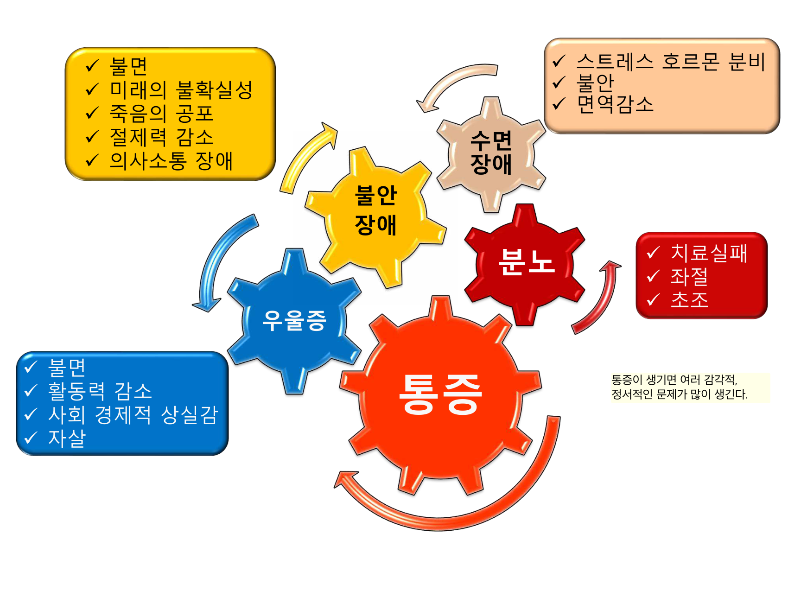{: style="width:72%"}

통증은 **우울증**(불면, 활동력 감소, 사회경제적 상실감, 자살), **불안장애**(불면, 미래의 불확실성, 죽음의 공포, 절제력 감소, 의사소통 장애), **분노**(치료 실패, 좌절, 초조), **수면장애**(스트레스 호르몬 분비, 불안, 면역 감소)와 서로 맞물려 돌아간다.

### 통증과 관련된 중복이환

통증이 심한 환자(암 환자 등)에서 중등도 이상 증상을 호소하는 비율(Meyer-Rosberg 2001, n=126):

| 수면장애 | 기운 없음 | 졸림 | 집중력 감소 | 우울증 | 불안장애 | 식욕감소 |
|---|---|---|---|---|---|---|
| 60% | 55% | 39% | 36% | 33% | 27% | 18% |

**수면장애가 가장 흔하다**는 것만 기억하면 된다.

### 통증과 정신신경학적 관계

통증 → **심리적 스트레스 유발** → **통증 유발 물질 증가** → **교감신경 활동 증가** → **인지능력 저하** → 정신신경학적 문제 유발. 스트레스가 많으면 교감신경이 활성화되고(보상적으로 부교감이 활성화되어 잠들 수도 있다), 이것이 다시 통증을 키우는 악순환이다.

!!! exam "기출 포인트"
    5번(2023): 통증이 미치는 영향 중 옳은 것 = "**신경계에 구조적 변화를 유발시켜 만성통증으로 진행**". 함정: "심리적 스트레스는 통증유발물질 분비를 **억제**"(→ 증가), "통증은 교감신경계를 **억제**"(→ 항진), "신경 가소성을 통하여 **소실**"(→ 가소성은 만성화의 기전), "시각점수 **2**이상부터 일상생활 문제"(→ **4점** 이상, 3장).

## 기능 저하의 연속선

손상 뒤 통증이 계속되면 튀는 공이 점점 낮게 튀다 멈추듯 시스템 기능이 떨어진다. 뇌 기능은 **건강 → 감각 변화 → 심리적 변화 → 부적응적 변화(maladaptive) → 시스템 실패** 순으로 나빠진다.

# 2. 급성 통증에서 만성 통증으로 — 조기치료가 중요한 이유

## 신경가소성(Neural plasticity)

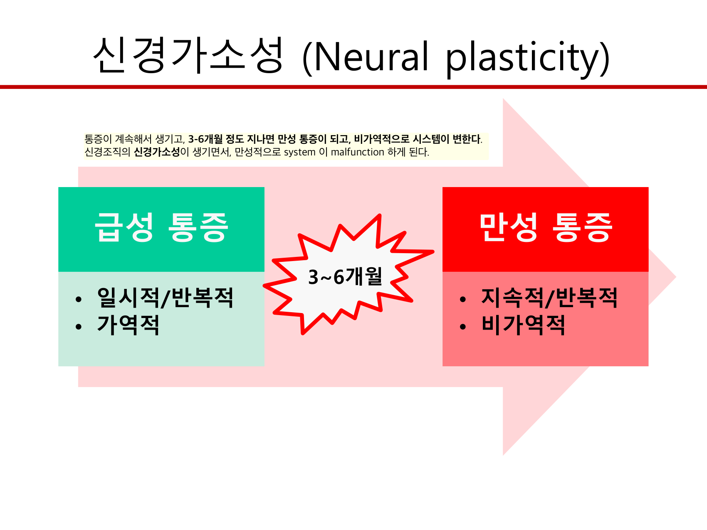{: style="width:70%"}

| | 급성 통증 | 만성 통증 |
|---|---|---|
| 양상 | 일시적 / 반복적 | **지속적** / 반복적 |
| 신경계 변화 | **가역적** | **비가역적** |
| 경계 | **3~6개월** | |

통증이 계속 반복되고 3~6개월이 지나면 신경조직에 **신경가소성** 변화가 생겨 시스템이 비가역적으로 오작동한다. 즉 만성 통증은 "오래된 급성 통증"이 아니라 **신경계가 구조적으로 바뀐 상태**다.

- **뇌의 구조 변화**: 만성 요통(CBP) 환자는 같은 나이 대조군보다 **전전두엽·시상의 회백질 밀도가 감소**한다(J Neurosci 2004). 만성 통증은 뇌에도 큰 문제를 남긴다.
- **기능 MRI**: 복합부위통증증후군(CRPS) 환자는 체성감각피질의 활성 양상이 정상과 다르지만, **치료하면 조금씩 정상으로 돌아온다**. 치료로 되돌릴 여지가 있다는 근거다.

## 조기치료의 중요성

> **만성통증으로 이환되기 전에 적극적인 조기치료가 중요하다.**

급성 통증을 빨리 치료하지 않으면 만성 통증으로 가고, 만성이 되면 뇌·신경계·정서에 문제가 생긴다(Siddall & Cousins, Persistent pain as a disease entity). 수술 후 통증을 "어차피 낫는 통증"으로 두지 않고 **적극적으로·예방적으로** 치료하는 이유다(→ 10장 preventive analgesia).

!!! key "핵심"
    급성 통증 → (조절 안 됨) → 말초·중추 감작 → 신경가소성(구조 변화) → **3~6개월** 지나 만성 통증(비가역). 그래서 **급성 통증도 적극적으로 조기치료**한다.

# 3. 통증 정도와 삶의 질 — 언제 치료하는가

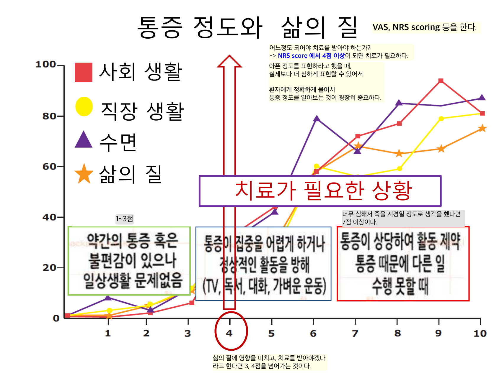{: style="width:78%"}

통증 강도는 **VAS(시각통증척도)·NRS(숫자통증척도)** 등으로 점수화한다.

| 점수 | 상태 | 의미 |
|---|---|---|
| **1~3점** | 약간의 통증·불편감이 있으나 일상생활 문제없음 | 경증 |
| **4점 이상** | 통증이 집중을 어렵게 하거나 정상 활동(TV, 독서, 대화, 가벼운 운동)을 방해 | **치료가 필요한 상황** |
| **7점 이상** | 통증이 상당하여 활동 제약, 통증 때문에 다른 일을 수행 못함("죽을 지경") | 중증 |

- **NRS 4점 이상이면 치료가 필요하다.** 3점에서 4점으로 넘어가는 지점부터 사회생활·직장생활·수면·삶의 질 점수가 함께 급격히 나빠진다.
- 환자는 아픈 정도를 실제보다 **더 심하게** 표현하기도 하므로, 정확히 물어 통증 정도를 알아내는 것이 중요하다.

!!! memo "암기"
    NRS **0** 없음 · **1–3** 경증 · **4–6** 중등도 · **7–10** 중증. **4점 이상 → 치료.**

# 4. 통증과 관련된 용어와 분류

## 통증 관련 용어

| 용어 | 뜻 |
|---|---|
| **통각과민(hyperalgesia)** | 원래 아픈 자극에 **더 심하게** 아픔 |
| **이질통(allodynia)** | 원래 **아프지 않은 자극**(옷 스침, 가벼운 접촉)에 통증 |
| **감각이상(paresthesia)** | 자극 없이 또는 자극에 대해 저림·찌릿함 같은 비정상 감각(불쾌하지 않을 수 있음) |
| **감각저하(hypoesthesia)** | 자극에 대한 감각이 **떨어짐** |
| **무감각통증(anesthesia dolorosa)** | 감각이 없는 부위에 **통증**이 있음(신경 파괴 후 등) |

통각과민·이질통·감각이상·감각저하는 모두 **신경병증성 통증**의 특징적 양상이다.

## 통증의 분류

| 기준 | 분류 |
|---|---|
| **원인** | 통각수용성(침해성, nociceptive) / 신경병증성(neuropathic) / 심인성(psychogenic) |
| **양상** | 체성통(somatic) / 내장통(visceral — 주로 암성 통증: 췌장암·위암, 흉막 삼출 등) |
| **기간** | 급성 / 만성 (**3–6개월**이 경계) |

### 원인에 따른 분류: 침해성 vs 신경병증성

- **침해성 통증(nociceptive pain)**: 유해자극에 **적절하게** 발생하는 통증. 외상·창상·**수술**. 다친 곳을 세게 누를수록 더 아프다 — 자극에 비례한다.
- **신경병증성 통증(neuropathic pain)**: **체성감각계(somatosensory system) 자체의 손상·질환**으로 생긴다. 신경이 원래 통증·감각을 전달하는 기관이므로, 신경이 망가지면 가만히 있어도 아프고, 아프지 않은 자극에도 아프다(**자극에 부적절한** 이상 반응).

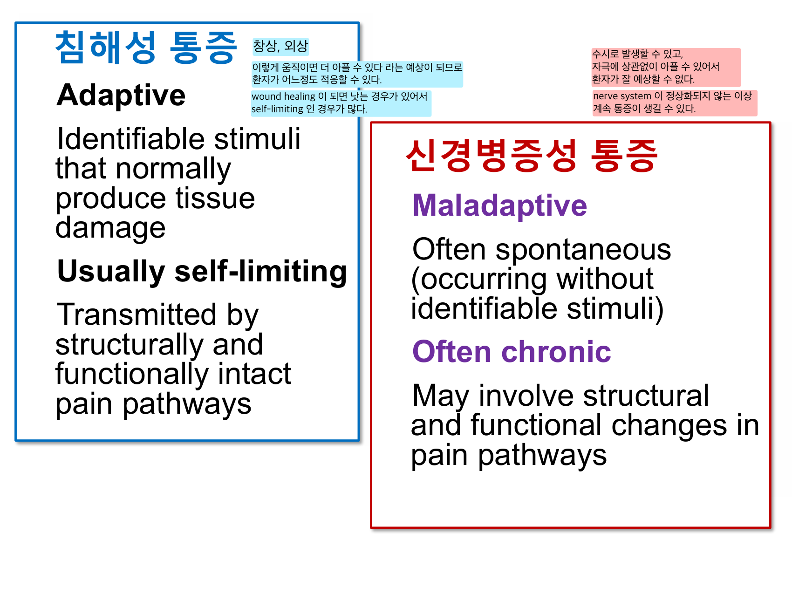{: style="width:72%"}

| | 침해성 통증 | 신경병증성 통증 |
|---|---|---|
| 적응 | **Adaptive** — "이렇게 움직이면 아프겠다" 예상 가능 | **Maladaptive** — 예상할 수 없음 |
| 자극 | 확인 가능한 자극(조직 손상) | 확인 가능한 자극 없이 **자발적**으로 |
| 경과 | 상처가 나으면 사라짐 — **self-limiting** | **흔히 만성**, 신경계가 정상화되지 않으면 계속 |
| 통증 경로 | 구조·기능이 **정상인** 경로로 전달 | 통증 경로에 **구조적·기능적 변화** |
| 치료 반응 | 일반 진통제(NSAID, 마약성)에 잘 반응 | 일반 진통제에 **반응이 떨어짐 → 보조진통제** |

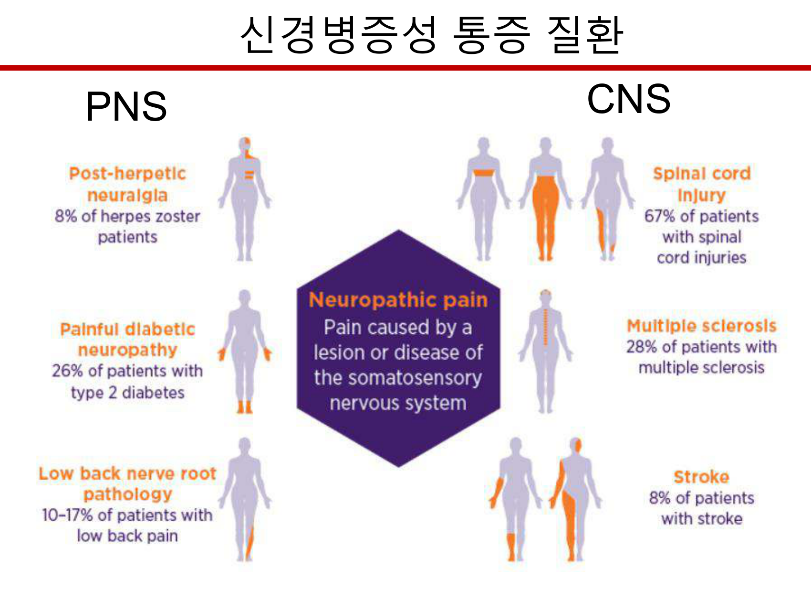{: style="width:66%"}

- 말초신경계(PNS): **대상포진후신경통**(대상포진의 8%), **당뇨병성 신경병증**(제2형 당뇨의 26%), 요추 신경근 병변(요통의 10–17%)
- 중추신경계(CNS): **척수손상**(67%), 다발성 경화증(28%), 뇌졸중(8%)

!!! exam "기출 포인트"
    10번(2020) 정답 "수술 후 통증은 주로 **통각수용성** 통증으로 자극에 비례하여 심해진다". 반대로 "수술 후 통증은 대부분 **신경병증성**"(6번 ①), "**신경병증성** 통증으로 만성화되는 경향이 크다"(1번 ⑤)는 오답이다.
    4·7번(2024·2023) 정답 "신경병증성 통증은 통증치료에 **반응이 떨어져/저항성을 가져** 만성화가 잘 된다". 9번 ② "신경병증성 통증은 상처가 회복됨에 따라 사라진다"는 오답(그건 침해성).

# 5. 통증의 전달과 조절

## 통증의 전달과정

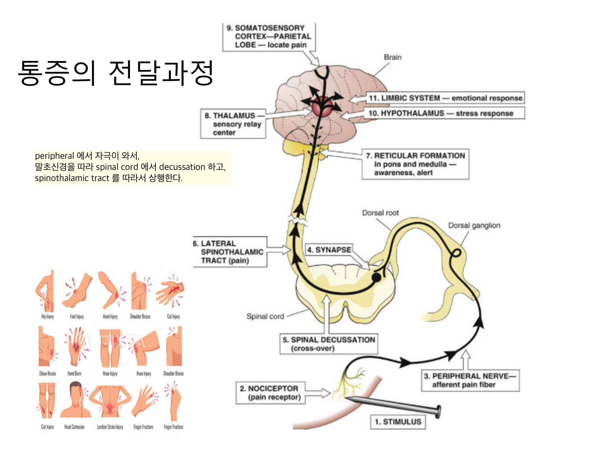{: style="width:72%"}

1. 자극(stimulus) → 2. 통각수용기(nociceptor) → 3. 말초신경(구심성 통증섬유, Aδ·C) → 후근신경절 → 4. 척수 후각에서 **시냅스** → 5. 척수에서 반대쪽으로 **교차(decussation)** → 6. **외측 척수시상로(lateral spinothalamic tract)**로 상행 → 7. 뇌간 그물체(각성·경계) → 8. **시상**(감각 중계) → 9. **체성감각피질**(통증 위치 파악) · 10. 시상하부(스트레스 반응) · 11. 변연계(감정 반응)

시상하부와 변연계가 같이 반응하기 때문에 통증은 감각이면서 동시에 스트레스·감정 반응이다(1장의 정의와 연결).

## 교감신경계와 통증

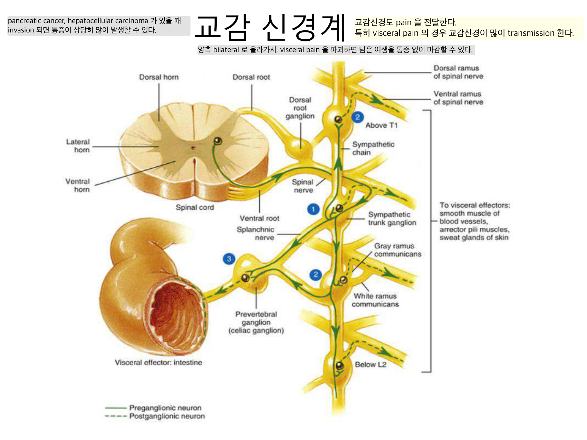{: style="width:72%"}

- **교감신경도 통증을 전달한다.** 특히 **내장통(visceral pain)**은 교감신경을 통해 많이 전달된다.
- 췌장암·간세포암이 주변을 침범하면 심한 통증이 생기는데, **양측 교감신경(예: 복강신경총)을 파괴(신경차단술)**하면 남은 여생을 통증 없이 지낼 수 있다(→ WHO 4단계, 9장).
- 통증은 **교감신경계를 항진**시킨다(통증과 자율신경계: 동공 확장, 심박 증가, 소화관 운동 억제 등). 교감신경 긴장이 높으면 혈관이 수축해 조직 혈류가 줄어든다 — 신경차단이 국소순환을 개선하는 근거(→ 6장).

## 말초 감작(Peripheral sensitization)

상처가 생기면 염증 물질이 많이 나오고 주변 통각수용기의 **역치가 낮아진다(high threshold → low threshold)**. 그래서 같은 자극에도 더 아프다.

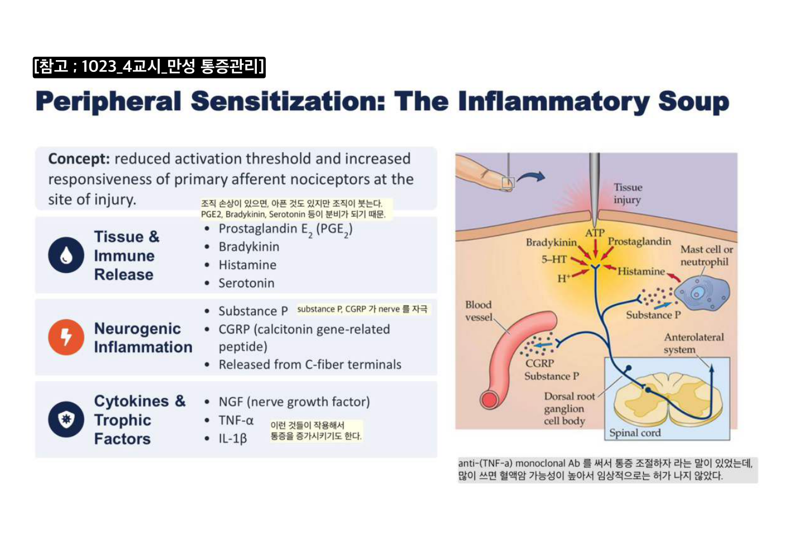{: style="width:78%"}

- 조직·면역세포에서: **PGE2, bradykinin, histamine, serotonin** — 아프기도 하고 조직이 붓는다.
- 신경성 염증: C섬유 말단에서 **substance P, CGRP** 분비 → 신경을 자극
- 사이토카인·영양인자: **NGF, TNF-α, IL-1β** — 통증을 증가시킨다. (anti-TNF-α 단클론항체로 통증을 조절하려는 시도가 있었지만, 많이 쓰면 혈액암 위험이 높아 임상적으로 허가되지 않았다.)

NSAID가 **PGE2를 줄여** 진통 효과를 내는 이유가 바로 이것이다(→ 7장).

## 중추 감작(Central sensitization)

자극이 계속 들어오면 **척수(후각)가 통증을 더 잘 일으키도록 바뀐다**. 똑같은 자극에도 자극 횟수가 늘어날수록 더 아파지는 **wind-up 현상**이 대표적이다.

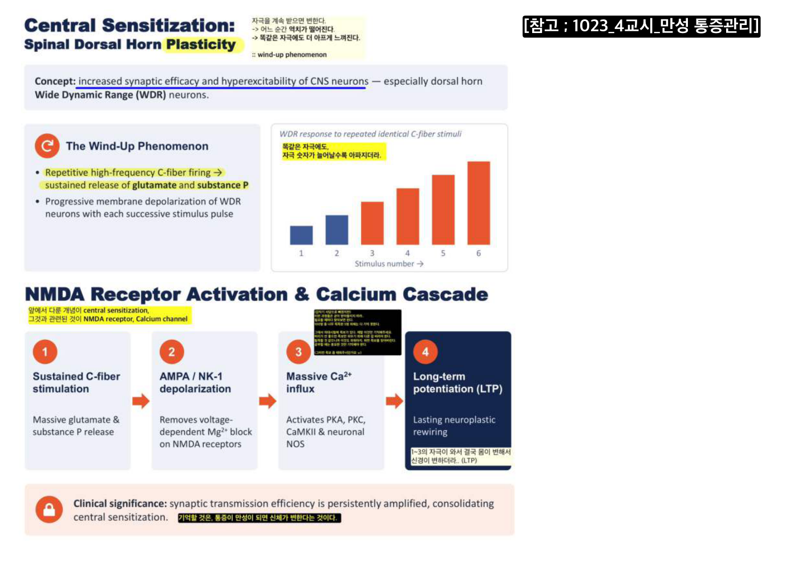{: style="width:80%"}

1. C섬유가 반복해서 고빈도로 흥분 → **glutamate, substance P** 대량 분비
2. AMPA·NK-1 수용체로 탈분극 → **NMDA 수용체의 Mg2+ 차단이 풀림**
3. 대량의 **Ca2+ 유입** → PKA, PKC, CaMKII, nNOS 활성
4. **장기강화(LTP)** — 지속적인 신경가소성 재배선

!!! key "핵심"
    "**통증이 만성이 되면 신체가 변한다.**" 말초 감작(역치 저하) + 중추 감작(NMDA, wind-up, LTP) → 신경가소성 → 만성 통증. NMDA 길항제(ketamine)가 진통 보조제로 쓰이는 이유다.

## 하행성 통증 억제경로

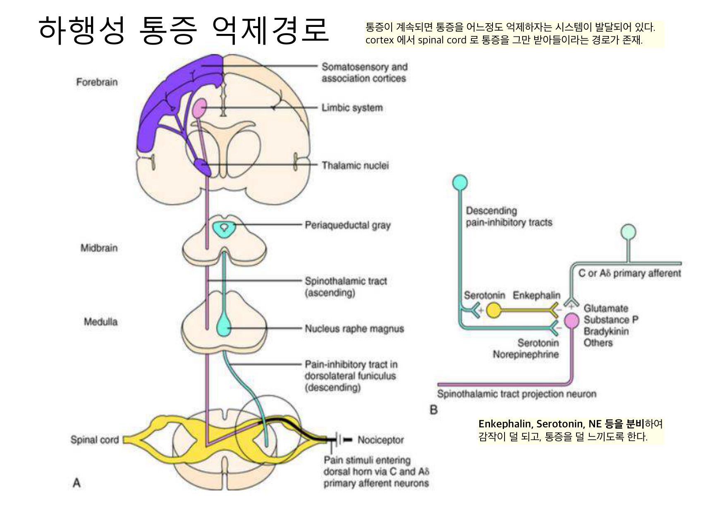{: style="width:72%"}

통증이 계속되면 이를 억제하는 시스템도 있다. 대뇌피질·변연계 → **중뇌수도관주위회색질(PAG)** → 연수 **대봉선핵(nucleus raphe magnus)** → 척수 후외측삭을 타고 내려와 후각에서 **enkephalin, serotonin, norepinephrine**을 분비해 감작을 줄이고 통증을 덜 느끼게 한다.

→ **항우울제(TCA, SNRI)와 tramadol**이 serotonin·NE 재흡수를 막아 진통 효과를 내는 근거가 바로 이 경로다(→ 8장).

## 신경가소성의 실체

- **Apoptosis — 억제 경로의 소실(loss of inhibitory tract)**: 신경 손상 후 척수 후각의 억제성 신경이 죽어 브레이크가 사라진다.
- **미세아교세포(microglia) 활성화**: 1차 구심신경 말단의 SP·ATP·fractalkine에 반응해 활성화되고(P2X4 수용체), IL-1·TNF·IL-6·NO·흥분성 아미노산·ATP·PG를 분비해 후각 신경의 흥분을 높인다.

# 6. 통증의 평가

## 통증 평가의 중요성

- **불충분한 통증 평가가 통증 관리의 가장 중요한 방해요인**이다.
- 암환자에서 통증은 **제5의 활력징후**이며, 심한 통증은 **응급상황**이다.
- 환자가 자발적으로 말하는 것에 의존하기보다 **의료인이 구체적으로 질문**해야 한다. NRS를 철저히 재고, 어느 부위가 어떤 요인으로 아픈지 "통증 지도"를 꼼꼼히 기록한다.

## 측정 방법

- **자가보고**에 의한 측정 (기본)
- **행동양상의 변화**에 의한 측정 (소아, 의사소통 불가 환자)
- **생리학적 변화**에 의한 측정
- 문진, 이학적 검사, 영상검사 등 — 원인을 찾는 데 쓰고, **통증 정도 자체는 영상으로 객관화할 수 없다**.

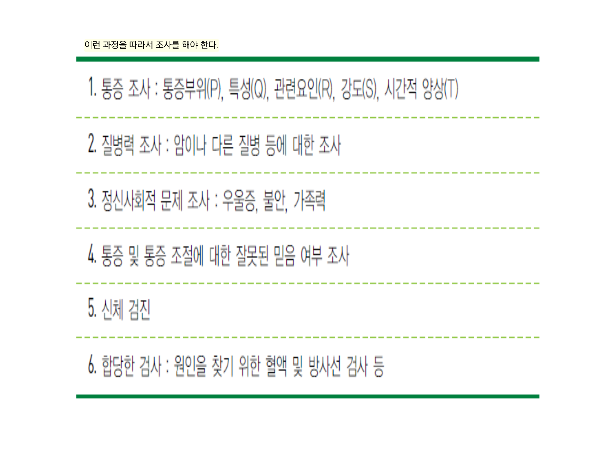{: style="width:70%"}

1. **통증 조사**: 부위(P), 특성(Q), 관련요인(R), 강도(S), 시간적 양상(T)
2. **질병력 조사**: 암이나 다른 질병
3. **정신사회적 문제 조사**: 우울증, 불안, 가족력
4. **통증 및 통증 조절에 대한 잘못된 믿음** 여부 조사
5. **신체 검진**
6. **합당한 검사**: 원인을 찾기 위한 혈액·방사선 검사

## 통증 척도

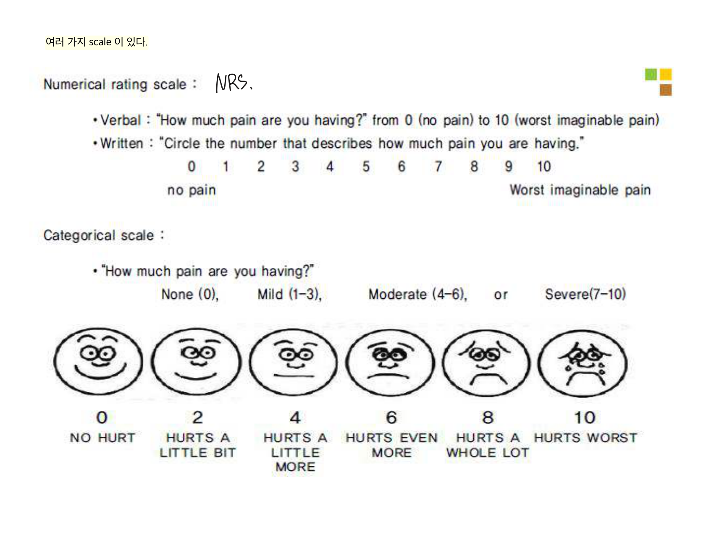{: style="width:74%"}

- **NRS(숫자통증척도)**: "0(통증 없음)~10(상상할 수 있는 최악의 통증) 중 몇 점입니까?" 말로 묻거나 숫자에 동그라미.
- **범주척도**: 없음(0) · 경증(1–3) · 중등도(4–6) · 중증(7–10)
- **얼굴통증척도**: 0·2·4·6·8·10 얼굴 그림 — 아이나 숫자를 쓰기 어려운 환자.

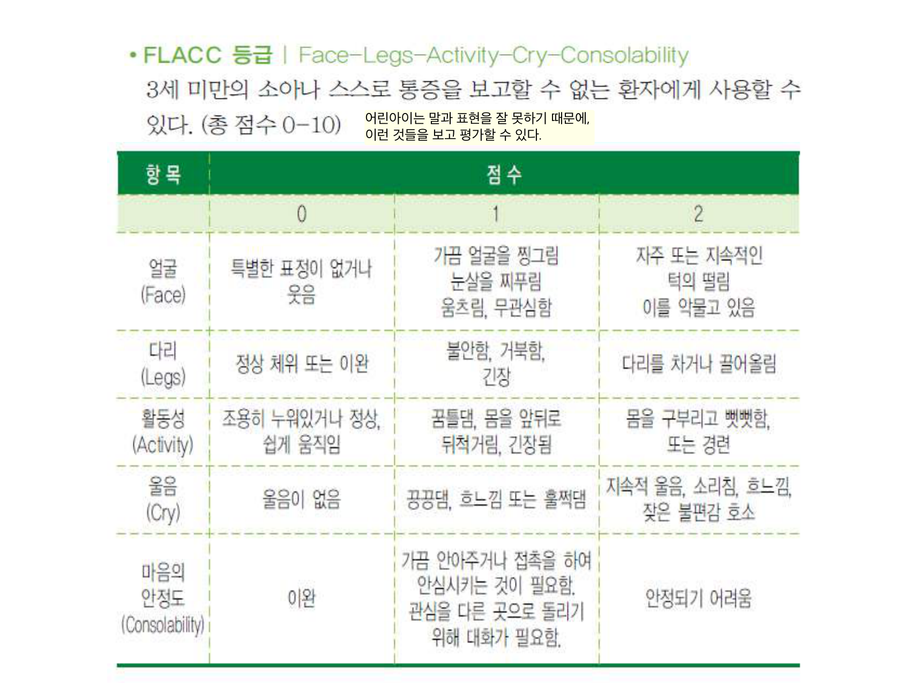{: style="width:76%"}

**FLACC**(Face-Legs-Activity-Cry-Consolability): 얼굴, 다리, 활동성, 울음, 마음의 안정도를 각 0–2점으로 매겨 총 0–10점. 말과 표현을 못 하는 **3세 미만 소아**나 스스로 통증을 보고할 수 없는 환자에게 쓴다.

!!! exam "기출 포인트"
    10번(2020) ① "통증의 평가는 **영상검사**를 통하여 객관화하는 것이 중요하다" → 오답. 통증은 주관적이므로 자가보고가 기본이다.
    2번(2025) ①·8번(2021) ① "통증 평가는 환자의 **주관적인 진술**"은 맞는 말이지만, 두 문항 모두 표시 정답은 따로 있었다(2번 ⑤ multimodal, 8번 ② 환자 요인 고려). 같은 보기가 다시 나오면 **다른 보기에 더 확실한 정답이 있는지** 먼저 본다.

# 7. 통증 치료의 개요와 신경차단

## 통증의 치료 — 다학제적 접근

완화·완치 목적의 **다학제 통증 프로그램(multidisciplinary pain program)**: 약물치료, 신경차단, 방사선치료, 정신과적 치료, 물리치료, 재활치료, 외과적 치료.

약물치료에 쓰는 약: **NSAID, 마약성 진통제, 항우울제, 항경련제, 스테로이드, 근이완제**.

## 신경차단

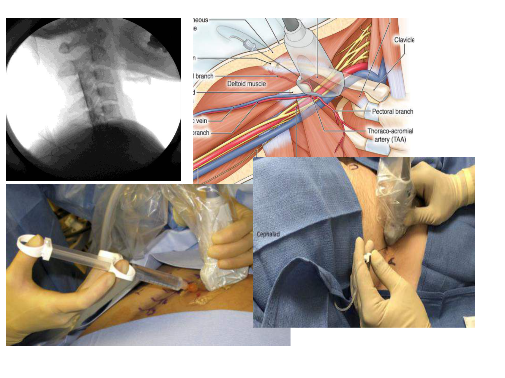{: style="width:62%"}

국소마취제(± opioid)로 신경을 차단한다: 팔신경얼기(brachial plexus) 차단, 넙다리신경(femoral nerve) 차단, 늑간신경(intercostal nerve) 차단, 경막외(epidural) 차단 등 **부위신경차단(regional nerve block)**.

> 신경차단은 **전신마취 약제 투여를 줄여 주며 빠른 의식 회복과 수술 후 통증관리에 용이하다.**

요즘은 신경차단과 전신마취를 **함께** 하는 경우가 많다.

### 신경차단의 효과

- **통각 신경 차단** — 통증 신호 자체를 막음
- **국소 순환 개선** — 교감신경 긴장이 올라가면 혈관이 수축해 혈류가 줄지만, 차단하면 혈관이 확장되어 **상처 치유가 잘 된다**.
- **통증 반사 차단** — 통증 → 근육 경련·교감 항진 → 통증의 악순환을 끊음
- 용도: **진단적** 신경차단(통증 원인 부위 확인) / **치료적** 신경차단

!!! exam "기출 포인트"
    3번(2024) 정답 "전신마취에서 신경차단법의 동반 사용은 **마취제 투여량을 줄여 빠른 회복**에 도움". 6번(2023) ④ "신경차단술은 의식 회복을 **지연**시키는 단점" → 오답. 10번(2020) ⑤ "신경차단은 국소순환을 **감소**시켜 상처 회복을 **억제**" → 오답(순환 **개선**, 치유 **촉진**).

## 약물 분류와 효과적인 통증 양태

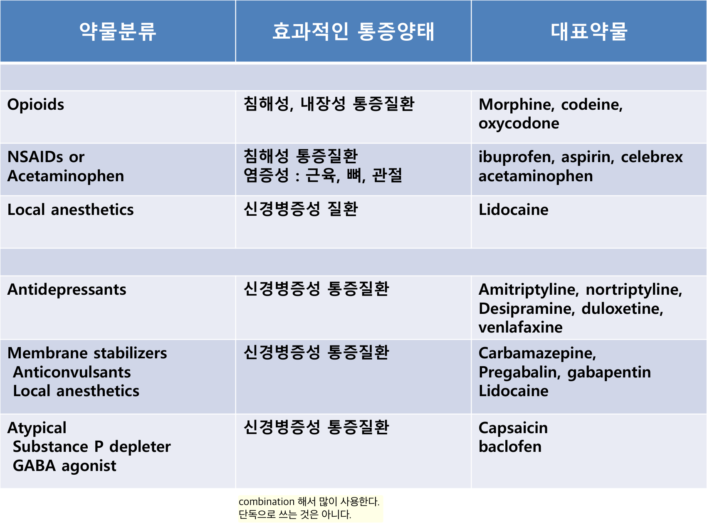{: style="width:72%"}

| 약물 분류 | 효과적인 통증 | 대표 약물 |
|---|---|---|
| Opioids | **침해성, 내장성** | morphine, codeine, oxycodone |
| NSAIDs / acetaminophen | **침해성**, 염증성(근육·뼈·관절) | ibuprofen, aspirin, celecoxib, acetaminophen |
| 국소마취제 | 신경병증성 | lidocaine |
| 항우울제 | **신경병증성** | amitriptyline, nortriptyline, desipramine, duloxetine, venlafaxine |
| 막안정제(항경련제·국소마취제) | **신경병증성** | carbamazepine, **pregabalin, gabapentin**, lidocaine |
| 비정형(substance P 고갈제, GABA 작용제) | 신경병증성 | capsaicin, baclofen |

**단독보다 조합해서 많이 쓴다**(→ multimodal, 10장).

!!! exam "기출 포인트"
    4번(2024) ③·7번(2023) ③ "수술·외상(=침해성) 통증에는 **항경련제**를 일차적으로" → 오답. 항경련제·항우울제는 **신경병증성** 통증의 약이다.

# 8. 진통제 각론

## (1) 소염진통제(NSAID)

스테로이드 계열은 아니지만 항염증 작용이 있는 약(ibuprofen, celecoxib 등). 아라키돈산에서 프로스타글란딘을 만드는 **cyclooxygenase(COX)**를 억제한다.

| | COX-1 | COX-2 |
|---|---|---|
| 발현 | 항상(constitutive) — **정상 조직의 housekeeping** | **염증 자극으로 유도** — 병적 상황 |
| 만드는 것 | **TXA2**(혈소판), PGI2·PGE2(위점막 보호, **신기능 조절**) | PGI2, **PGE2**(염증·통증·발열) |
| 억제하면 | 출혈 경향, 위장관 손상, 신기능 저하 | 진통·항염·해열 (+ 신기능, 혈전 문제) |

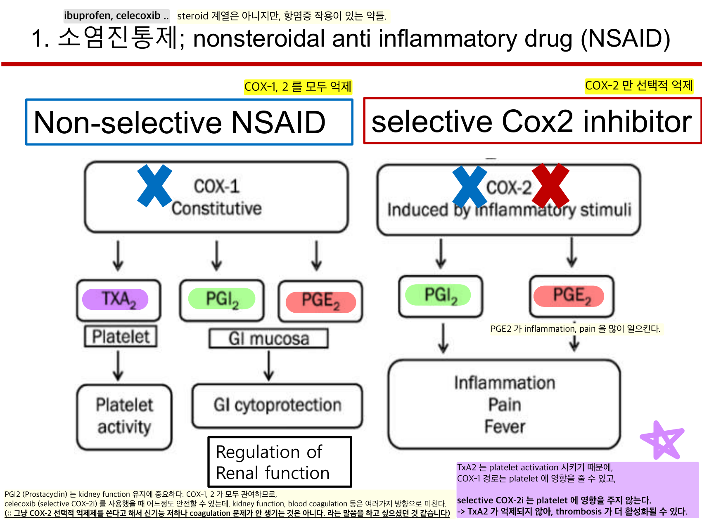{: style="width:76%"}

- **비선택적 NSAID**: COX-1, 2를 모두 억제
- **선택적 COX-2 억제제(celecoxib)**: COX-2만 억제. 혈소판의 TXA2(COX-1)는 그대로이므로 **혈소판·출혈에는 영향이 없다**. 그런데 혈관 내피의 PGI2(혈소판 응집 억제)는 줄어 **TXA2가 우세 → 혈전이 더 잘 생긴다**.
- PGI2는 신기능 유지에 중요하고 COX-1, 2가 모두 관여하므로, **COX-2 선택적 억제제를 쓴다고 신기능 저하·응고 문제가 안 생기는 것은 아니다**(필기자 해석).

### NSAID와 신장

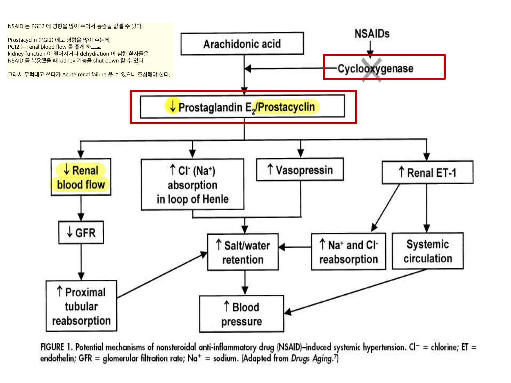{: style="width:72%"}

NSAID는 PGE2를 줄여 통증을 없애지만 **PGI2(prostacyclin)**도 줄인다. PGI2는 **신혈류를 유지**하므로, 신기능이 떨어져 있거나 **탈수가 심한** 환자가 NSAID를 먹으면 신혈류 ↓ → GFR ↓ → 신장이 멈출 수 있다(**급성 신부전**). 염분·수분 저류 → 혈압 상승도 생긴다. 무턱대고 쓰면 안 된다.

### 비선택적 NSAID의 부작용

- **위장관 합병증**: 위염, 궤양, 출혈 — COX-1의 위점막 보호(점막 형성) 기능까지 떨어뜨리기 때문. 줄이려면 **PPI를 같이 쓰거나 COX-2 선택적 억제제**를 쓴다.
- **항지혈 작용**(혈소판 TXA2 ↓ → 출혈)
- **신장 기능 억제**
- 이명, 피부 발진, 광과민

### COX-2 선택적 억제제(celecoxib)

- 장점: **위장관 부작용 감소**
- 부작용: **신장기능 감소**, **혈전 위험 → 심혈관계 부작용**(COX-1 경로는 억제하지 않아 TXA2에 의한 혈소판 응집)

!!! exam "기출 포인트"
    1번(2025) ① "COX-2 선택적 소염진통제는 **출혈** 위험도를 증가" → 오답(혈소판 영향 없음, 오히려 **혈전**). 3번(2024) ① "COX-2 선택적은 **신장기능에 영향을 미치지 않는다**" → 오답, ③ "COX-2 선택적은 **위염·위궤양** 위험 증가" → 오답(감소가 장점).
    1번 ③ "비선택적 NSAID는 **식도 정맥류** 환자에게 안전" → 오답(간경변: 응고인자 부족 + 정맥류 + 출혈 = 위험). 8번 ④·10번 ④ "NSAID는 **신기능** 장애 환자에서 안전성이 높다" → 오답.

## (2) Acetaminophen

- **중추의 COX(COX-1, 2)를 약하게 억제** — 말초보다 중추에 주로 작용한다.
- 말초 작용이 적어 상대적으로 안전하지만, 그만큼 **항염증 효과는 적다**.
- **혈소판 영향이 적다** → 출혈 위험이 낮다
- **간에서 대사**된다
- **신질환 환자에서 안전하게** 쓸 수 있다 (단, 최종 대사물이 신장으로 배설되므로 **고용량**이면 신기능이 떨어질 수 있다. 적정 용량이면 문제없다.)
- **위장관 장애가 적다**

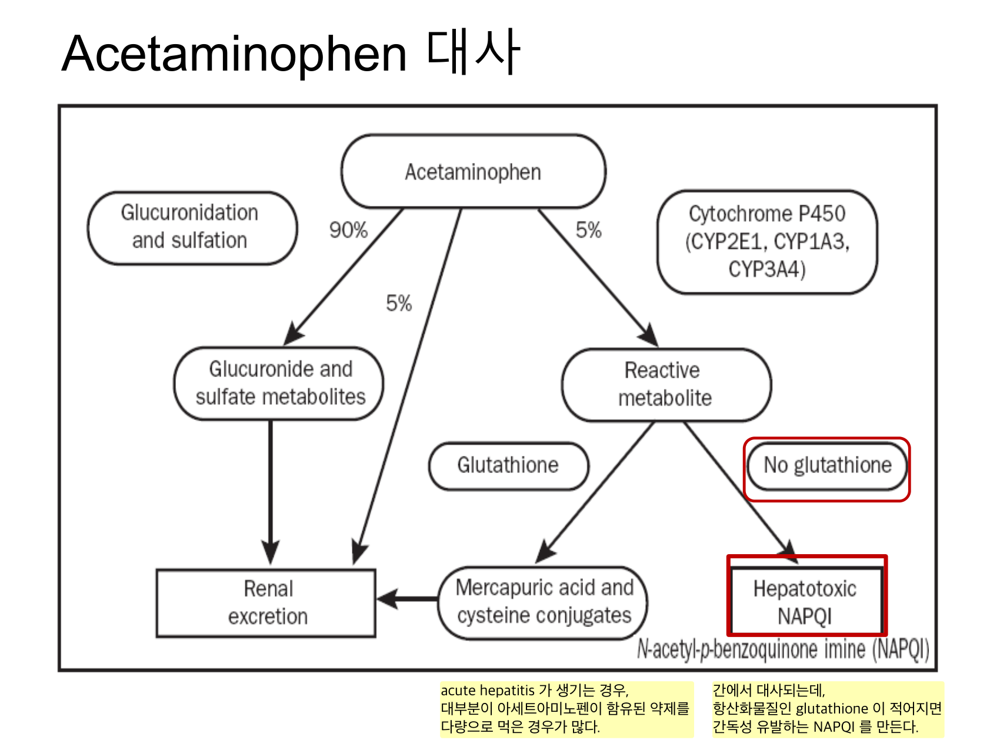{: style="width:70%"}

대부분(90%)은 글루쿠론산·황산 포합으로, 5%는 그대로 신장으로 배설된다. 나머지 5%가 **CYP450(CYP2E1 등)**에서 반응성 대사물 **NAPQI**가 되는데, 평소에는 항산화물질 **glutathione**과 결합해 해독된다. glutathione이 부족해지면 NAPQI가 쌓여 **간독성**을 일으킨다. 급성 간염의 상당수가 아세트아미노펜 함유 약을 다량 먹은 경우다.

### Acetaminophen 간독성 유발 조건

- 용량 초과: **성인 > 4 g/일(4,000 mg)**, **소아 > 75 mg/kg/일**
- **영양실조(malnutrition)** — glutathione 부족
- **간질환** 환자
- **만성 알코올 남용** (CYP2E1 유도 + 영양실조)

!!! memo "암기"
    Acetaminophen = **혈소판·위장관·신장에 안전, 간은 조심**. NSAID = **간에는 상대적으로 낫지만, 혈소판·위장관·신장에 위험**. 이 대칭 하나로 기출 보기 대부분이 풀린다.

!!! exam "기출 포인트"
    1번(2025) 정답 "Acetaminophen은 **소화기와 신장**기능 이상 환자에게 안전" vs 10번(2020) ③ "Acetaminophen은 **신기능 및 간기능** 장애 환자에게 안전성이 높다" → 오답(**간**이 섞여 있다). 장기 하나만 바꿔 정답·오답이 갈린다.
    6번(2023) 정답 "NSAID보다는 acetaminophen 사용이 **출혈 위험성을 줄일** 수 있다". 3번 ②(위장관 출혈 증가), 8번 ③(혈소판 억제로 출혈 증가)은 오답.

## (3) Opioids(마약제제)

- **μ-opioid 수용체**에 결합. Gαi 경로 → **진통 증가**, **β-arrestin** 경로 → **호흡 억제, 위장관 기능 저하**(부작용).
- 대부분 **간에서 대사(hepatic biotransformation)**되어 제거된다.

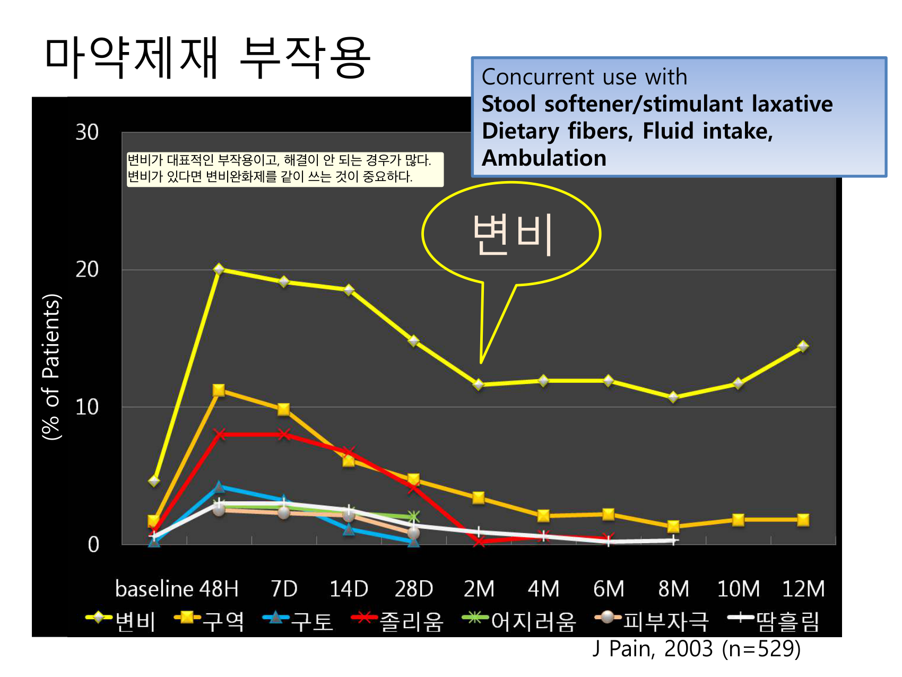{: style="width:74%"}

부작용: 변비, 구역, 구토, 졸림, 어지러움, 피부자극, 땀흘림. 구역·구토·졸림 등은 수 주가 지나면 줄어들지만(내성), **변비는 12개월까지도 계속된다 — 내성이 생기지 않는다.** 그래서 변비가 대표적이고 해결이 안 되는 경우가 많다.

→ **처음부터 함께**: 대변연화제·자극성 하제, 식이섬유, 수분 섭취, 보행(ambulation)

### 마약제의 투여 방법

- 혈중 **치료영역(therapeutic window)**을 유지한다 — 과량이면 CNS 억제 → **호흡억제**까지 온다.
- **부작용을 예측하고 치료**한다(변비약 같이).
- 투여 용량의 **25–50%**를 증감하여 조절한다.
- **시간에 맞추어 투여**한다 — 환자가 원할 때마다가 아니라 정해진 시간에. 시간을 안 맞춰 겹치면 용량이 올라간다.

!!! exam "기출 포인트"
    4번 ④·7번 ④ "마약제제로 인한 변비는 장시간 사용하면 **대부분 사라진다**" → 오답. 9번 ⑤ "변비와 가려움증은 사용시간에 따라 개선" → 오답. 1번 ④·3번 ④ "변비가 생기면 **패취형(경피투여)**을 고려" → 오답(경로를 바꿔도 변비는 남는다 → 변비약).
    9번 ③ "마약제제는 **환자가 원할 때마다**" → 오답(**시간에 맞추어**). 6번 ③ "마약제제는 수술 후 **오심·구토를 억제**" → 오답(오히려 **유발**).

## (4) 항경련제

1세대(phenobarbital, phenytoin, carbamazepine, valproate 등)와 2세대(oxcarbazepine, lamotrigine, **gabapentin, pregabalin**, topiramate, levetiracetam 등)가 있다.

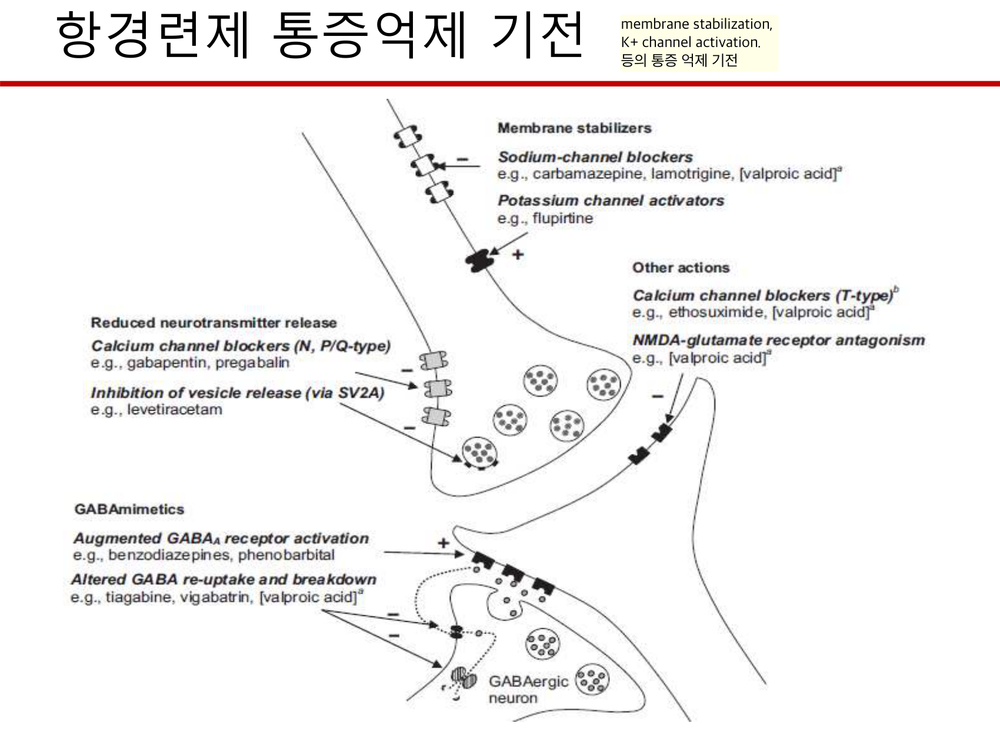{: style="width:72%"}

| 기전 | 예 |
|---|---|
| **막 안정화** — Na+ 채널 차단 | carbamazepine, lamotrigine |
| K+ 채널 활성화 | flupirtine |
| 신경전달물질 분비 감소 — **Ca2+ 채널(N, P/Q형) 차단** | **gabapentin, pregabalin** |
| 소포 분비 억제(SV2A) | levetiracetam |
| GABA 작용 강화 | benzodiazepine, phenobarbital, tiagabine, vigabatrin |
| NMDA 길항, T형 Ca2+ 차단 | valproate, ethosuximide |

**부작용** — 대부분 **CNS 억제** 때문: 어지러움(dizziness), 졸림(drowsiness), 시야장애, 운동실조, 구음장애, 떨림, 무기력, 기억장애 / 변비, 구강건조, **말초부종** / 성욕 감소, 발기부전 / **체중 증가**.

## (5) 항우울제

- **통증 억제 작용이 있다**(우울증 유무와 관계없이) — 하행성 억제경로의 serotonin·NE를 늘린다. 중추·말초 신경의 과활성을 가라앉힌다.
- **통증 환자에 동반된 질환 치료**: 우울, 수면장애, 아침 강직, 피로 — 우울이 같이 있으면 특히 좋다.

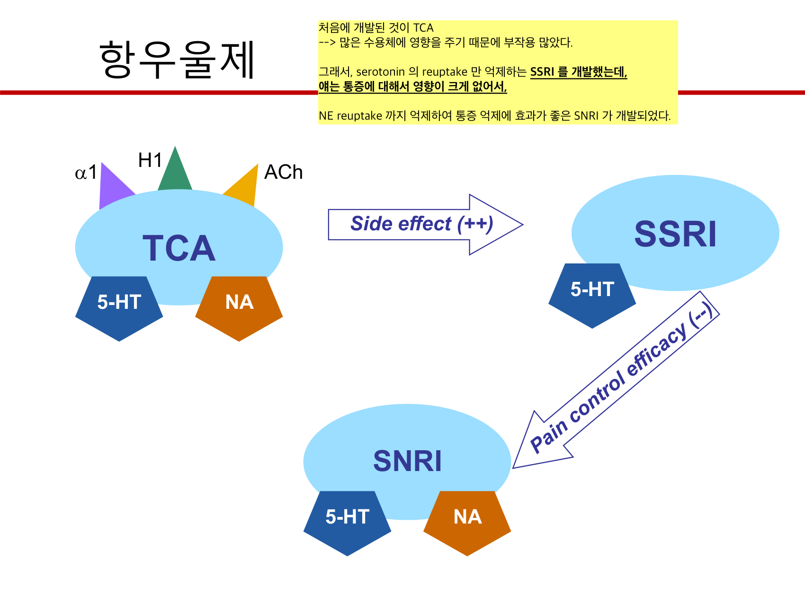{: style="width:66%"}

| 계열 | 작용 | 통증 효과 | 비고 |
|---|---|---|---|
| **TCA** (amitriptyline, nortriptyline, desipramine) | 5-HT + **NA** 재흡수 억제, + α1, H1, ACh 차단 | **좋음** | 처음 개발, **매우 저렴해 많이 씀**. 여러 수용체에 작용해 **부작용 많음** |
| SSRI | 5-HT 재흡수만 억제 | **거의 없음** | 부작용 줄이려 개발했지만 통증엔 효과가 적었다 |
| **SNRI** (venlafaxine, duloxetine) | 5-HT + **NA** 재흡수 억제 | **좋음** | 2세대. NE까지 막아 통증 효과 회복 |

→ **통증에 효과가 좋은 것은 TCA와 SNRI**(NE 재흡수 억제가 열쇠).

**부작용**: 구역, 두통, 불안, 불면, 졸림, 식욕 저하, **자살**, **혈압 상승**, 출혈, 부정맥.
**금기**: 좁은앞방각 녹내장, 임신, MAO 억제제 병용 / **심장질환·고혈압은 주의**(혈압을 올린다).

!!! exam "기출 포인트"
    9번(2021) 정답 "**삼환계 항우울제는 우울증 개선과 함께 통증억제 작용도 있다**". 4번 ② "항우울제는 통증조절능력이 **없고** 우울증치료에 사용" → 오답, 7번 ② "통증과 우울증이 **동반되는 경우에** 고려" → 오답(우울 없어도 쓴다).

## (6) Tramadol

- **codeine의 합성 유도체**, 중추성 진통제. **opioid와 TCA의 성질을 함께** 가진다.
  - **약한 μ-수용체 작용제**
  - **serotonin·norepinephrine 재흡수 억제** + 신경의 serotonin 분비 촉진
  - 척수의 시냅스후 **α2 아드레날린 수용체** 활성화
- 여러 기전을 조합해 많이 쓰이지만, 반대로 **opioid 부작용과 항우울제 부작용이 동시에** 나타날 수 있다: 구역, 구토, 어지러움, 현훈, **변비**, 졸림, 두통.

# 9. 약물 선택의 실제 — WHO 진통 사다리와 환자 상태별 약제

## WHO 3단계 진통 사다리

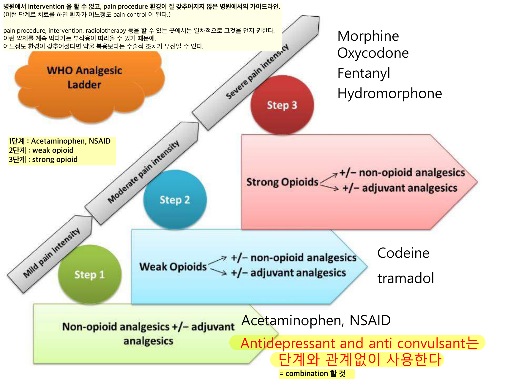{: style="width:76%"}

| 단계 | 통증 | 약 |
|---|---|---|
| **1단계** | 경증 | 비마약성: **acetaminophen, NSAID** ± 보조진통제 |
| **2단계** | 중등도 | **약한 opioid: codeine, tramadol** ± 비마약성 ± 보조진통제 |
| **3단계** | 중증 | **강한 opioid: morphine, oxycodone, fentanyl, hydromorphone** ± 비마약성 ± 보조진통제 |

> **항우울제와 항경련제(보조진통제)는 단계와 관계없이 사용한다** — 조합(combination)할 것.

이 사다리는 **신경차단 같은 중재 시술(intervention)을 할 수 없는 병원**을 위한 가이드라인이다. 시술·방사선치료가 가능한 곳에서는 약을 계속 쓰면 부작용이 따라오므로 **중재 시술을 일차적으로 먼저 권하기도 한다**.

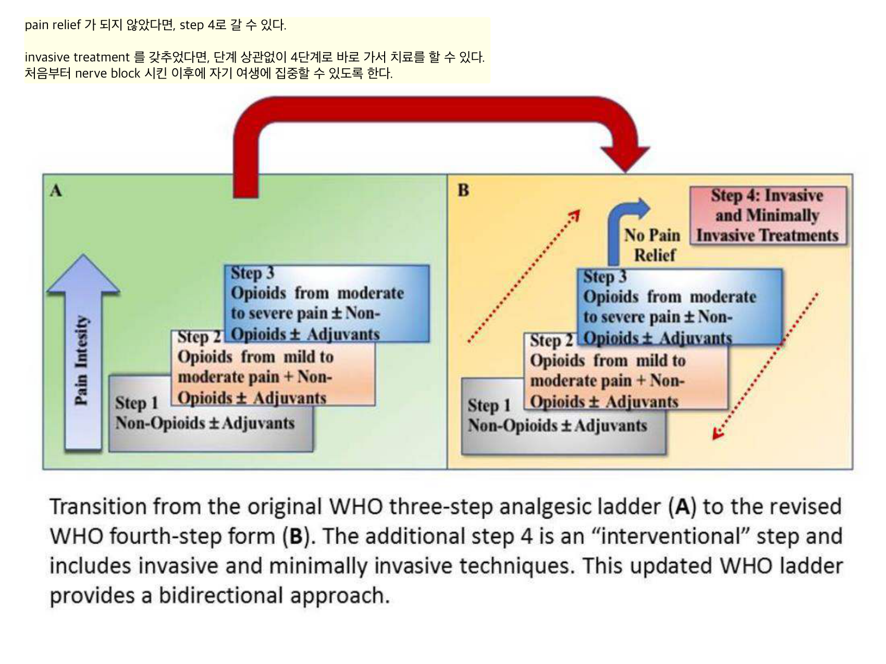{: style="width:76%"}

- 3단계로 통증이 안 잡히면 **4단계: 침습적·최소침습적 치료**(신경차단·신경파괴술 등).
- 침습적 치료를 갖춘 곳이면 **단계에 상관없이 바로 4단계**로 갈 수 있다(양방향 접근, bidirectional). 예: 처음부터 복강신경총 차단을 해 남은 여생에 집중하게 한다.

!!! exam "기출 포인트"
    9번(2021) ① "WHO 통증조절법에 따르면 **항경련제는 2단계부터** 투여" → 오답(**단계와 무관**).

## NRS에 따른 약물 조절과 재평가

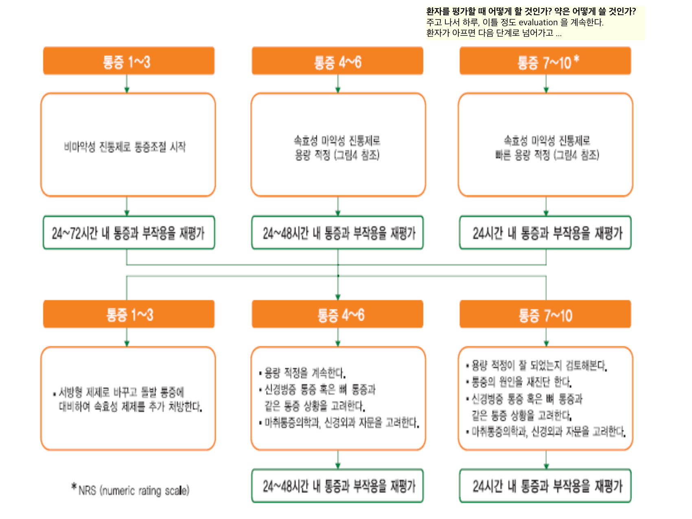{: style="width:76%"}

| 처음 통증 | 시작 | 재평가 |
|---|---|---|
| 1~3 | 비마약성 진통제 | **24~72시간** 내 |
| 4~6 | 속효성 마약성 진통제로 용량 적정 | **24~48시간** 내 |
| 7~10 | 속효성 마약성 진통제로 **빠른** 용량 적정 | **24시간** 내 |

재평가 후 1~3이면 **서방형으로 바꾸고 돌발통에 대비해 속효성을 추가**, 4~6이면 적정 계속 + 신경병증성·뼈 통증 고려 + 마취통증의학과·신경외과 자문, 7~10이면 적정이 잘 됐는지·원인 재진단·자문. **통증이 심할수록 더 자주** 재평가한다.

## 환자 상태별 권장 약제

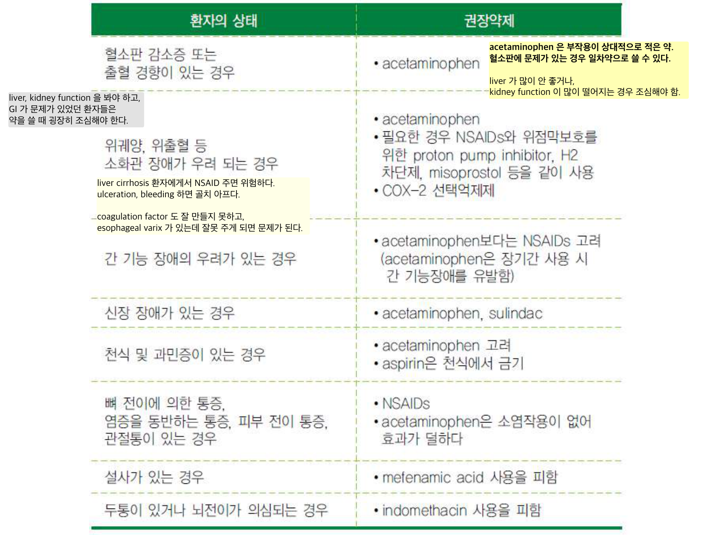{: style="width:80%"}

| 환자의 상태 | 권장 약제 |
|---|---|
| **혈소판 감소증·출혈 경향** | **acetaminophen** |
| **위궤양·위출혈 등 소화관 장애** 우려 | **acetaminophen** / 필요하면 NSAID + 위점막 보호(**PPI, H2 차단제, misoprostol**) / **COX-2 선택억제제** |
| **간 기능 장애** 우려 | acetaminophen보다 **NSAIDs** 고려 (acetaminophen은 장기간 사용 시 간 기능 장애) |
| **신장 장애** | **acetaminophen, sulindac** |
| **천식·과민증** | acetaminophen 고려, **aspirin은 천식에서 금기** |
| **뼈 전이, 염증 동반 통증, 피부 전이, 관절통** | **NSAIDs** (acetaminophen은 소염작용이 없어 효과가 덜함) |
| **설사** | **mefenamic acid** 피함 |
| **두통·뇌전이 의심** | **indomethacin** 피함 |

간경변 환자에 NSAID를 주면 위험하다: 궤양·출혈이 생기면 골치 아프고, 응고인자도 잘 못 만들며, 식도 정맥류가 있으면 큰 출혈로 이어진다. **간·신장 기능을 보고, 위장관 문제가 있었던 환자는 특히 조심**한다.

!!! exam "기출 포인트"
    4번(2024) ① "**간이나 신기능 이상** 환자는 소염진통제를 우선" → 오답. 7번(2023) ① "신장기능 저하 시 일차적으로 **마약제재나 NSAID**" → 오답(신장 → acetaminophen. 모르핀 대사물도 신부전에서 쌓인다).

# 10. 수술 후 급성 통증 관리

## 통증 경로마다 약이 다르다

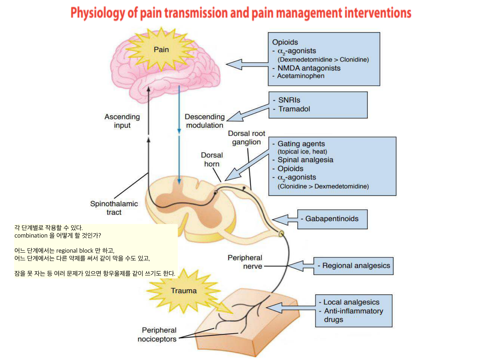{: style="width:78%"}

| 작용 부위 | 방법 |
|---|---|
| 말초 통각수용기(손상 부위) | **국소 진통제, 소염제(NSAID)** |
| 말초신경 | **부위 진통(regional analgesia, 신경차단)** |
| 후근신경절 | **gabapentinoid** |
| 척수 후각 | 냉·온찜질(gating), 척수 진통, opioid, α2 작용제(clonidine > dexmedetomidine) |
| 하행 조절 | **SNRI, tramadol** |
| 뇌 | opioid, α2 작용제(dexmedetomidine > clonidine), **NMDA 길항제**, **acetaminophen** |

어느 단계에서는 부위신경차단만 하고, 어느 단계에서는 다른 약을 더해 같이 막는다. 잠을 못 자는 등 문제가 있으면 항우울제를 함께 쓴다.

## 다중모드 진통(Multimodal pain management)

수술실에서 흔히 보는 급성 통증에는 여러 방법을 **조합**한다 — 약 조합, 부위별 국소마취제, 부위신경차단.

- **목표**: 고통 경감, **수술 후 조기 보행(early mobilization)**, **재원 기간 단축**, 환자 만족
- **조합의 효과**: 각 약을 적게 쓰니 **부작용이 줄고**, opioid를 쓰더라도 적게 쓴다.
- **치료 계획에 고려할 것**: 내과적·심리적·신체적 상태, **나이**, 두려움·불안 정도, **수술 종류**, **환자 개인의 선호**, 투여한 약에 대한 반응 — 의사의 선호가 아니라 **환자 중심**.

## 예방적 진통(Preventive analgesia)

- 급성·만성 수술 후 통증을 줄이는 **포괄적** 접근.
- **수술 전·중·후**의 유해자극에 의한 **감작을 줄이기 위해**, **주수술기(perioperative) 어느 시점에든** 치료를 한다. (예전의 "선제 진통(pre-emptive)"처럼 수술 전 한 번에 국한하지 않는다.)
- 통증이 생길 것을 뻔히 알면 예방하는 게 좋다. **심한 통증을 경험할수록 만성 통증으로 갈 확률이 높아진다**(신경계 변화, 2장).

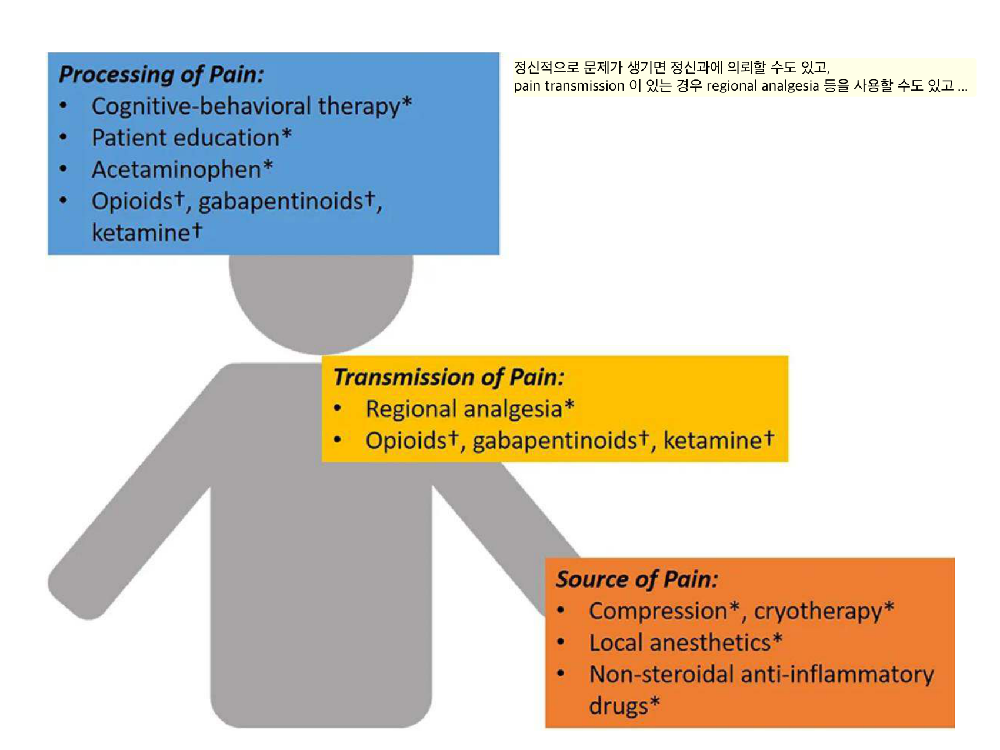{: style="width:66%"}

| 단계 | 방법 |
|---|---|
| **통증의 처리(뇌)** | 인지행동치료, 환자 교육, acetaminophen / opioid, gabapentinoid, ketamine |
| **통증의 전달** | 부위 진통 / opioid, gabapentinoid, ketamine |
| **통증의 근원** | 압박, 냉각요법, 국소마취제, NSAID |

정신적인 문제가 생기면 정신과에 의뢰하고, 전달 단계는 부위 진통으로 막는 식이다.

!!! exam "기출 포인트"
    2번(2025) 정답 "**Multimodal analgesia는 여러 진통 방법을 제공하여 수술 후 합병증을 감소**". 오답: ② "**주치의**가 선호하는 진통 방법을 먼저"(→ 환자 중심), ④ "Preventive analgesia는 **수술전** 주기동안"(→ 수술 전·중·후 전체), ③ 만성 수술 후 통증 "6개월 이상, **노인**에서 많이"(해설: 3개월 이상, 젊은 환자에서 더 많음).
    8번(2021) 정답 "**수술종류나 환자의 과거력 그리고 선호하는 약** 등을 고려". ⑤ "Multimodal 방법은 부작용을 **증가**시켜 입원기간이 **길어진다**" → 정반대.

!!! key "핵심"
    수술 후 급성 통증 = **침해성** → 평가는 **자가보고(NRS 4 이상 치료)** → **multimodal**(NSAID/acetaminophen + 신경차단 + 필요 시 opioid) + **preventive**(수술 전·중·후) → 만성화 예방. 약은 환자의 **간·신장·위장관·혈소판** 상태로 고른다.
