<!-- 필기본: 2026 -->

# 0. 이 수업을 공부하는 법

**박준모 교수님**(칠곡경북대병원 마취통증의학과)의 「침습적 통증치료」 수업이다. 교수님은 "**슬라이드 노트 중에 중요하다고 언급하는 것은 기억해 달라**"고 하셨다. 필기본에는 슬라이드 노트가 대부분 붙어 있는데, 필기자가 교수님이 실제로 말씀하신 부분에는 "언급", 말씀하지 않은 부분에는 "추가 설명 X"라고 표시해 두었다. 이 자료에서도 수업에서 설명하지 않은 노트 내용은 *(슬라이드 노트)*라고 적었다.

필기자 메모: "문제가 너무 난해하다. 선지 보다가 눈 빠지겠다. **유형은 23년도 기출 빼면 다 비슷비슷**하지만 **말장난이 심하고 시술 종류가 많으니** 헷갈리지 않게 잘 구분해 두라." 실제로 2020–2025년 기출 13문항 중 10문항이 「침습적 통증치료에 대한 설명 중 옳은 것」, 「침습적 통증치료의 부작용에 대한 설명 중 옳은 것」 두 틀이고, **같은 오답 보기가 해마다 돌아온다.** 2023년만 사례형 3문항이었다.

| 주제 | 2부 문항 | 매번 나오는 보기 (함정 → 정답) |
|---|---|---|
| **교감신경블록의 적응증·위치** | 1·4·6·8·10·12 | 교감신경블록은 **내장통**(췌장암·췌장염)에 효과적 ○ / 디스크·협착에 ✕ / 성상신경절은 **목**(복부 ✕, somatosensory ✕) |
| **척수강내 약물 주입 배수** | 1·3·7·8·11·13 | 경구의 **300배**, 정맥의 **100배** (10배·3배, 30배·10배 ✕) |
| **성상신경절블록 중 척추동맥 주입** | 2·3·5·9·11·13 | 즉시 **경련(seizure)** (심정지·호흡정지 ✕), 가장 주의할 구조물 = **척추동맥** (경동맥 ✕) |
| **의도치 않은 경막 내 주입** | 2·3·9·11·13 | **전척수마취 → 무호흡** → 호흡 관리 (심정지·EKG ✕, 경련 ✕) |
| **스테로이드 부작용** | 1·2·3·9·10·11 | **혈당↑** → 당뇨 환자는 양 줄임, **쿠싱 증후군** → 횟수 줄임 |
| **척추성형술 골 시멘트 유출** | 2·9·13 | 척추관 안으로 새면 **즉시 중단 + 신경학적 검사**, 유출은 **가장 흔한** 합병증 |
| **고주파열응고술(RF)** | 1·4·8·10·12 | **고주파 전류의 열**(화학물질 ✕), pulsed는 **42℃ 이하**(80℃ ✕), 범위 넓히기 = **cooled RF**, 시술 전 **진단적 블록** 먼저 |
| **경막외내시경술** | 4·8·10 | 진단 **+ 치료** 모두 유용 (치료 활용도 떨어진다 ✕) |
| **어느 신경을 막나** | 2·8·12·13 | 삼차신경통 → **삼차신경블록**(후두신경·얼굴신경 ✕), 정중신경 차단 = **말초** 차단 |

!!! key "핵심"
    - 오답은 거의 **숫자 바꾸기**(300→10·30, 42℃→80℃), **결과 바꾸기**(경련→심정지·호흡정지, 무호흡→심정지·경련), **위치 바꾸기**(목↔복부, 척추동맥↔경동맥), **"걱정 안 해도 된다/별 문제 없다" 단정**으로 만든다.
    - 2·3·4장(영상·접근법·약제), 5장(신경블록 부작용), 7장(교감신경블록 표), 10장(RF 세 종류), 12장(300배), 13장(시멘트 유출)을 정확히 구분하면 거의 다 풀린다.

# 1. 침습적 통증치료란

## 학습목표

1. 침습적 통증치료가 어떤 것인지 설명할 수 있다.
2. 침습적 통증치료의 종류를 설명할 수 있다.
3. 침습적 통증치료를 시행할 때 생길 수 있는 **부작용**을 설명할 수 있다.

교수님은 세 번째를 강조하셨다. 침습적 치료는 **위험(risk)과 이득(benefit)을 함께 고려**해야 하고, **risk를 먼저 고려**한다. 그래서 부작용을 잘 알고 있어야 한다 — 기출의 절반이 부작용 문제인 이유다. 참고문헌은 「통증의학 6판(메디안북, 2024)」(강조 표시), 「마취통증의학 4판(여문각, 2022)」, 「Bonica's Management of Pain 5판(2019)」이다.

침습적(invasive) 통증치료는 우리 몸에 **해로운 자극(noxious stimuli)이 되는 방법을 이용**하는 치료라고 시작하셨다. 바늘·약물·기구가 피부 안으로 들어가는 것 자체가 몸에는 손상 자극이다. 영어로는 **Interventional pain treatment(중재적 통증치료)**라고 하고, 2020·2021년 기출은 "중재적 통증치료"라는 말을 썼다 — 같은 뜻이다.

## 치료의 종류 — 침습적 치료는 어디에 있나

- **비수술적 치료**
    - **약물치료**
    - **비약물치료**
        - **비침습적**: 물리치료, 운동치료, 재활치료 — 피부 안쪽으로 약물·기구·도구가 들어가지 않는다.
        - **침습적(Interventional Treatment)** — 몸 안으로 무언가 들어온다.
    - (그 밖에 보완대체의학, 정신의학적 통증관리)
- **수술적 치료**

즉 침습적 통증치료는 **수술이 아닌 치료** 가운데 **비약물치료**이면서 **몸 안으로 들어가는** 치료다.

## 침습적 통증치료의 종류 (통증의학 5판 분류)

1. 신경블록
2. 고주파열응고술
3. 경막외 신경성형술과 내시경술
4. 척수 및 뇌자극술, 척수강내 약물 주입술
5. 경피적 척추체 성형술, 경피적 척추 후만성형술, 경피적 골성형술
6. 경피적 내시경 추간판 절제술
7. 초음파영상을 이용한 신경블록
8. 증식치료

**1 → 8로 갈수록 외래·입원 환자에게서 더 많이 하는 시술**이라고 하셨다. (6번 경피적 내시경 추간판 절제술은 이번 강의 슬라이드에 따로 나오지 않았다.)

## 침습적 통증치료를 구분하는 여섯 가지 질문

시술을 하나 만나면 다음 여섯 가지를 물어 정리하면 된다.

| 질문 | 뜻 | 예 |
|---|---|---|
| **1. Central or Peripheral?** | 표적이 중추신경(뇌·척수)인가, 그 외 모든 말초신경인가 | 척수자극·척수강내 주입 = 중추 / 정중신경 차단 = **말초** |
| **2. Somatosensory or Autonomic?** | 체성감각신경인가, 교감·부교감을 포함한 자율신경인가 | 경막외 블록 = 체성 / 성상신경절블록 = **자율(교감)** |
| **3. Fluoroscopy, CT, Ultrasound-guided?** | 어떤 영상으로 유도하나 | C-arm, CT, 초음파 |
| **4. Route?** | 표적까지 어떤 경로로 접근하나 | interlaminar, transforaminal, caudal |
| **5. Which agent?** | 어떤 약제를 쓰나 | 국소마취제, 스테로이드, 알코올, 페놀 … |
| **6. Anatomical correction or not?** | 해부학적 교정을 하는가 | 수술은 교정 ○ / 자율신경 조절은 교정 ✕ |

- 일반적으로 **통증을 느낄 수 있는 신경섬유가 있는 곳에 통증이 있다.** 표적이 신경이 아닌 시술(척추체성형술, 증식치료)도 있지만 **침습적 통증치료의 주 표적은 신경**이고, 그것이 CNS인지 PNS인지를 먼저 묻는다.
- 몸 안에 침범하는 치료이므로 더 정확하고 안전하게 하려고 **방사선학적 영상 유도 하에** 시행한다.
- **수술**은 기본적으로 해부학적 교정(anatomical correction)을 하는 치료다. 반면 **자율신경계를 표적으로 하는 시술** 중에는 **부교감–교감의 부조화를 조화롭게** 만들어 치료하는 경우가 있는데, 여기에는 해부학적 교정이 전혀 관여하지 않는다.

!!! exam "기출 포인트"
    12번(2020) ④ "초음파를 이용한 **정중신경(median nerve)** 차단술은 **중추**신경 차단술" → ✕. 정중신경은 뇌·척수 밖의 신경이므로 **말초**신경 차단이다. 1·10·12번 ② "성상신경절 차단술은 **복부**에서 시행되는 **somatosensory** nerve block" → 위치(목)와 종류(자율신경) 둘 다 틀렸다.

# 2. 영상 유도 — 투시·CT·초음파

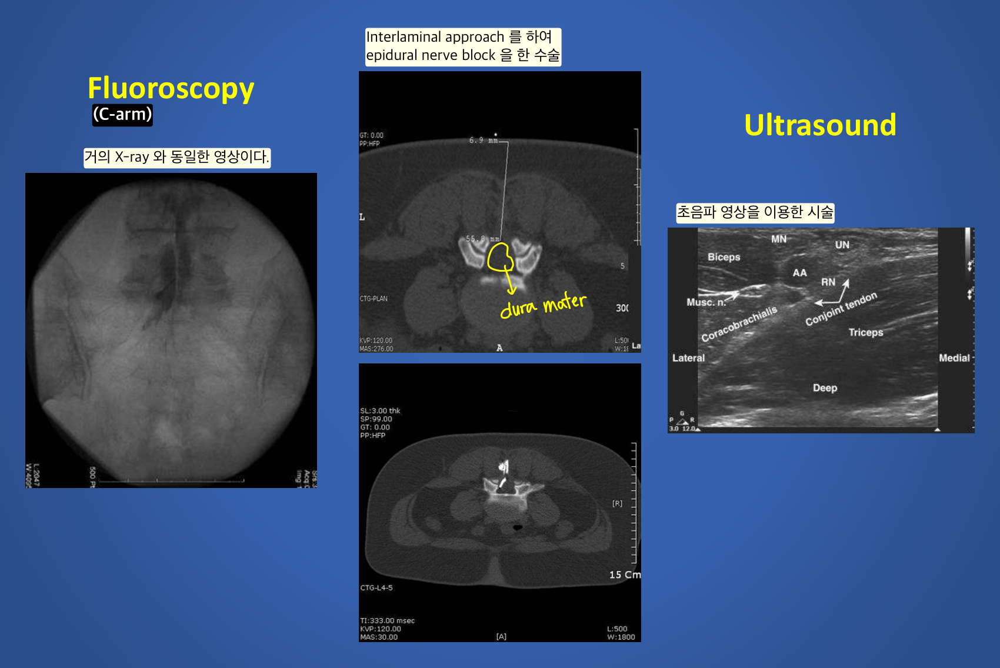{: style="width:78%"}

- **투시(Fluoroscopy, C-arm)**: X-ray와 거의 같은 영상인데 **실시간으로 빠르게** 볼 수 있다. 통증클리닉에서 가장 많이 쓴다.
- **CT**: 단면으로 바늘 끝과 경막(dura mater)의 관계를 정확히 본다(그림은 interlaminar 접근 경막외 블록).
- **초음파(Ultrasound)**: 방사선 없이 근육·혈관·신경을 실시간으로 본다.

## 투시 유도 vs 초음파 유도

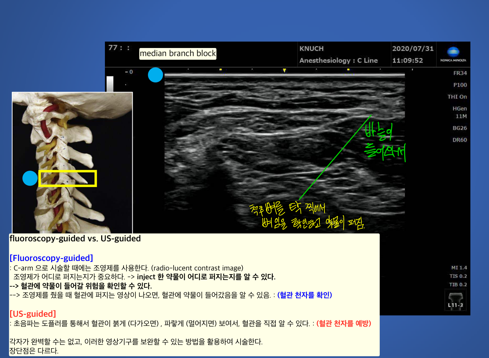{: style="width:78%"}

그림은 경추 면관절의 **내측지 블록(median branch block)**을 초음파로 하는 장면이다. 바늘이 들어와 척추뼈에 닿아 뼈임을 확인한 뒤 약물을 퍼뜨린다.

| | 투시 유도(Fluoroscopy, C-arm) | 초음파 유도(US) |
|---|---|---|
| 혈관 | **조영제**(radio-contrast)를 넣어 **약이 어디로 퍼지는지** 본다 → 조영제가 혈관 모양으로 퍼지면 혈관 안에 들어간 것 → 혈관 천자를 **확인** | **도플러**로 혈관이 붉게(다가옴)·파랗게(멀어짐) 보여 혈관을 직접 안다 → 혈관 천자를 **예방** |
| 방사선 | 환자와 **시술자 모두** 많이 노출 | 노출 없음 |
| 보이는 것 | 뼈 구조, 조영제 퍼짐 | 연부조직·혈관·신경, 바늘 |

!!! memo "암기"
    **Fluoroscopy는 혈관 천자를 확인(confirm)**할 수 있고, **Ultrasound는 혈관 천자를 예방(prevent)**할 수 있다. (교수님 언급) 각자 완벽하지 않으므로 서로 보완하는 방법을 활용해 시술한다.

### 초음파영상 신경블록이 늘어나는 이유 *(슬라이드 노트)*

이상적인 유도는 **방사선 노출 없이 정확하게** 접근하는 것이다.

- **피부 표식(surface landmark)**만으로 하면 부정확하고 혈관 천자, 중요 장기 천자, **신경 내 주입** 같은 합병증이 생길 수 있다.
- **투시**는 환자뿐 아니라 시술자도 많은 방사선에 노출된다.
- 그래서 정확한 치료, 합병증 감소, 방사선 노출 감소를 위해 초음파영상 신경블록이 확대될 것이다.
- **근막간 평면블록(Interfascial plane block)**: 두 근막 사이 공간에 국소마취제를 넣어 **신경을 정밀하게 찌르지 않고도 넓은 범위**의 통증을 안전하게 차단하는 최신 경향(TAP block, PECS block, Serratus plane block).
- **탐촉자 접근법**: 바늘 **전체**를 보며 들어가는 **In-plane** 기법 vs 바늘 **단면(점)**을 보는 **Out-of-plane** 기법.

# 3. 경막외 공간에 접근하는 세 경로 (Route)

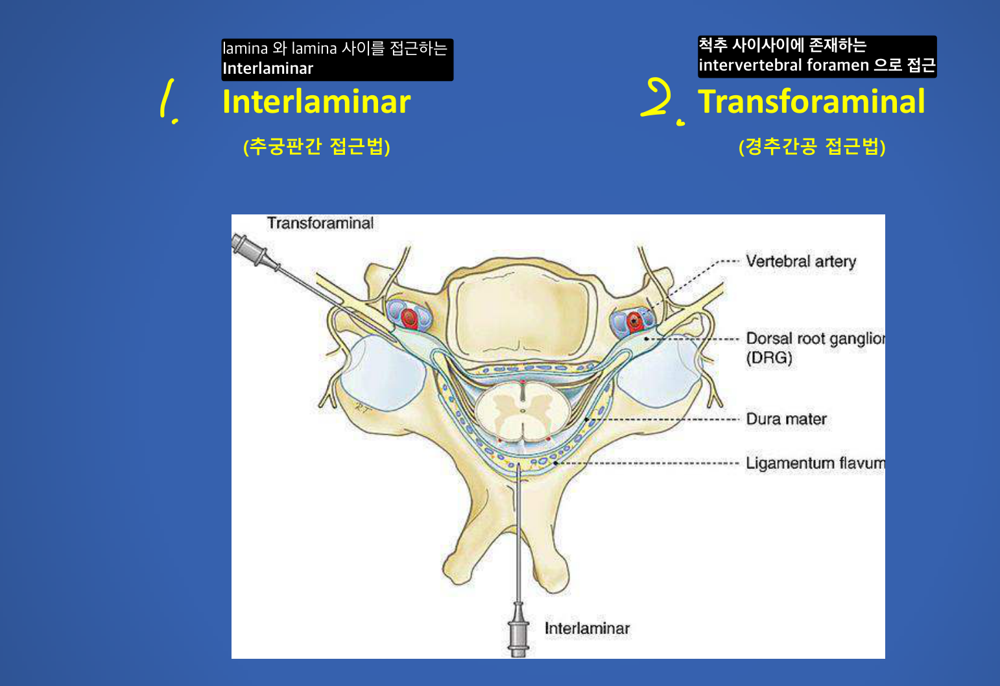{: style="width:70%"}

| 접근법 | 들어가는 곳 | 특징 |
|---|---|---|
| **1. Interlaminar (추궁판간 접근법)** | **lamina와 lamina 사이** — 뒤에서 황색인대를 지나 경막외 공간으로 | 가장 기본, 약이 양쪽·위아래로 넓게 퍼진다 |
| **2. Transforaminal (경추간공 접근법)** | 척추 사이사이에 있는 **추간공(intervertebral foramen)** — 투시상 **pedicle 아래** | 특정 신경근 바로 옆에 약을 놓는다. 주변에 **척추동맥·근수질동맥**이 지나간다(→ 5장 부작용) |
| **3. Caudal (미추강 접근법)** | 천골 아래 **천골열공(sacral hiatus)** | 아래에서 위로 올라간다. 신경성형술·내시경도 이 길로 들어간다(11장) |

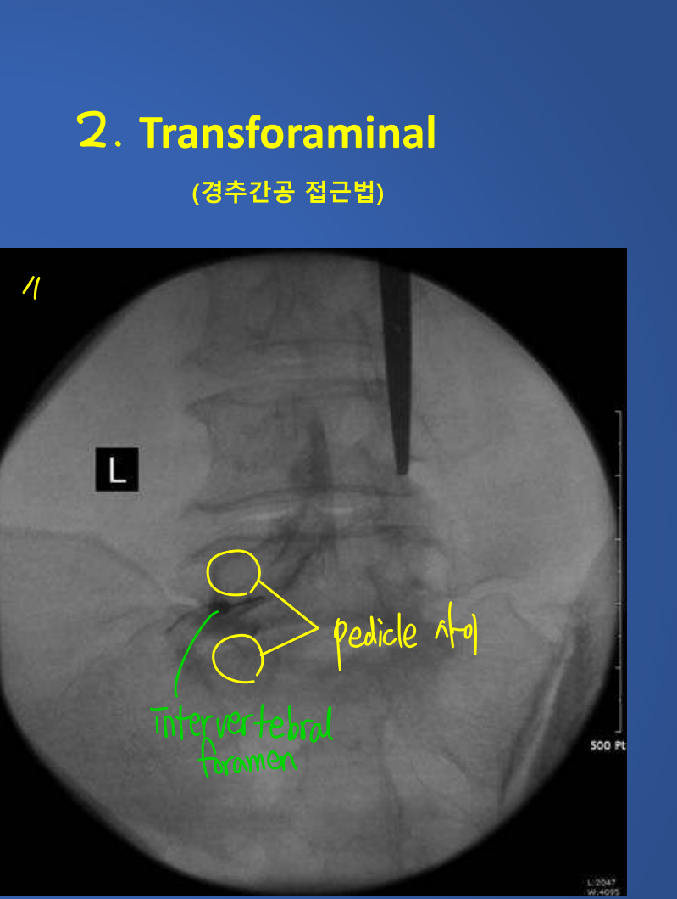{: style="width:52%"}

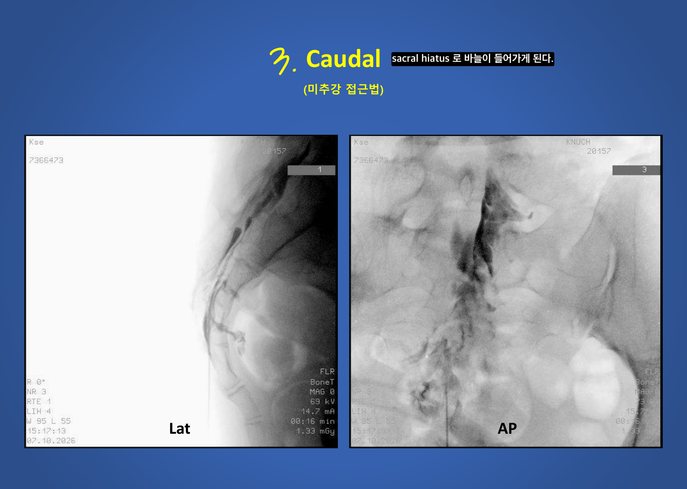{: style="width:70%"}

!!! exam "기출 포인트"
    5번(2023, 사례형): **경추 5–6번 transforaminal** 블록 중 조영제 확인·음압 흡인까지 했는데 0.5% 리도카인+덱사메타손 주입 중 **갑자기 경련** → **척추동맥(vertebral artery) 내 국소마취제 주입**. 그림에서 경추 추간공 바로 옆에 척추동맥이 지나가는 것을 보라. 함정: "음압 흡인에서 피가 안 나왔으니 혈관 내 주사 가능성 없다"(✕ — 흡인 음성이어도 배제 못 함), "덱사메타손 때문"(✕), "지주막내 투여 때문"(✕ — 그건 전척수마취), "**심혈관계 부작용이 중추신경계보다 먼저**"(✕ — 국소마취제 독성은 보통 **CNS가 먼저**).

# 4. 어떤 약제·방법을 쓰는가 (Which agent?)

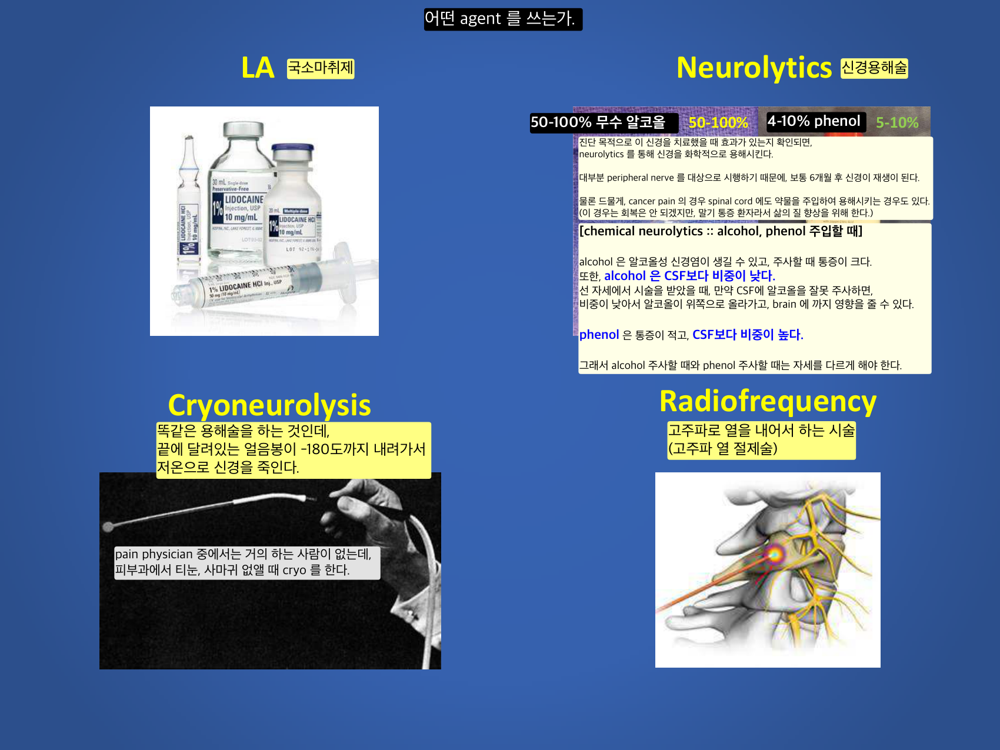{: style="width:80%"}

| 방법 | 원리 | 메모 |
|---|---|---|
| **국소마취제(LA)** | 일시적 신경 차단 | 진단·치료 모두. 스테로이드와 섞어 씀(5장) |
| **화학적 신경파괴제(chemical neurolytics)** | **50–100% 무수 알코올**, **4–10% 페놀**(글리세롤도 있음)로 신경을 화학적으로 용해 | 진단 블록으로 효과를 확인한 뒤 시행 |
| **냉동신경파괴술(Cryoneurolysis)** | 끝의 얼음봉(냉동 탐침)이 아주 낮은 온도로 내려가 **저온으로 신경을 죽인다** | 통증의사는 거의 안 하고, 피부과에서 티눈·사마귀 없앨 때 쓴다 |
| **고주파(Radiofrequency)** | **고주파로 열**을 내어 신경을 응고 | 10장. "고주파 열 절제술" |

※ 확인 필요: 필기에는 냉동 탐침 온도가 "−180도"로 적혀 있다. 교과서에서 통증 치료용 냉동 탐침은 보통 −50~−70℃ 정도로 설명한다.

## 신경파괴술의 원칙

- **진단 목적**으로 그 신경을 차단해 보고 효과가 확인되면 **신경파괴제**로 신경을 화학적으로 용해시킨다.
- 대부분 **말초신경**을 대상으로 하므로 보통 **6개월쯤 뒤 신경이 재생**된다.
- 드물게 **암성 통증**에서는 척수(spinal cord)에도 약물을 넣어 용해시킨다 — 회복은 안 되지만 **말기 환자의 삶의 질**을 위해서 한다.
- 영구 손상 위험 때문에 **주로 암성 통증이나 불응성 만성 내장통 환자에게 제한적으로** 시행한다 *(슬라이드 노트)*.

## 알코올 vs 페놀

교수님이 슬라이드 노트의 노란 글씨 부분을 언급하셨다.

| | **알코올(무수 에탄올)** | **페놀** |
|---|---|---|
| 농도 | **50–100%** | **4–10%** (글리세린이나 물에 녹임) |
| 주사 시 통증 | **크다** | **거의 없다** — 저농도에선 국소마취 효과, 고농도에선 신경파괴 |
| 뇌척수액(CSF) 대비 비중 | **저비중(hypobaric)** → 위로 뜬다 | **고비중(hyperbaric)** → 아래로 가라앉는다 |
| 대표 문제 | **알코올성 신경염** — 심한 둔통·화상통·작열통, 수 주~수 개월 | 혈관에 우선 작용 → **큰 혈관이 많은 곳(복강신경총 주변)에는 잘 안 씀** |
| 기타 | 신경염이 가장 흔한 곳은 **흉부 교감신경의 방척추 부위**(교감신경절이 늑간신경 같은 체성신경과 붙어 있어서) | 작용 시간이 알코올보다 **짧다**. **5% 페놀 ≈ 40% 알코올**. 축삭·신경주위혈관의 단백 변성, **약 14주 후 재생** |

- 비중 차이 때문에 **알코올과 페놀은 주사할 때 환자 자세를 반대로** 한다. 예를 들어 앉은 자세에서 CSF에 알코올을 잘못 넣으면 가벼워서 **위로 올라가 뇌까지** 영향을 줄 수 있다. (교과서적으로 척수강 내 신경파괴 때 알코올은 아픈 쪽을 **위로**, 페놀은 아픈 쪽을 **아래로** 둔다.)
- 알코올성 신경염 때문에 환자들은 원래 통증은 잘 줄었는데도 **새로 생긴 신경염에 불만**을 갖는 경우가 흔하다.

## 냉동 vs 고주파 vs 박동성 고주파 *(슬라이드 노트)*

- 대표적인 치료적 신경블록은 신경파괴제(글리세롤, 에탄올, 페놀) 주사 또는 신경파괴술이다.
- **냉동신경파괴술**은 **넓은 부위**에 작용하고, **고주파 열응고술(RF thermocoagulation)**은 그보다 **좁은 부위**의 신경을 파괴한다.
- **박동성 고주파(pulsed RF)**는 열응고술보다 **낮은 온도**를 쓰고 효과도 **보통 떨어지지만**, **부작용 가능성이 낮아 여러 부위에 널리** 쓸 수 있다.

!!! exam "기출 포인트"
    1·4·10번 ① "고주파 열 응고술은 **알콜이나 페놀 같은 화학 물질의 발열반응**을 이용한 치료" → ✕. 알코올·페놀은 **화학적** 신경파괴, 고주파는 **전류로 생긴 열**이다. 표의 네 줄을 섞어 내는 말장난이다.

# 5. 신경블록 (Nerve block)

**신경블록**: 말초에서 생긴 통증 자극이 **중추신경계로 전달되는 것을 막아** 통증을 줄이는 방법.

| | **진단적 신경블록** | **치료적 신경블록** |
|---|---|---|
| 목적 | 통증을 전달하는 말초신경이나 원인으로 의심되는 신경종·관절·통증유발점에 소량을 놓고 **통증 호전 여부로 원인인지 확인** | 통증과 관련된 신경·신경얼기에 약을 넣어 **통증을 조절** |
| 약물 | **국소마취제만** (여러 종류) — 예: **0.5% lidocaine** | **국소마취제 + 스테로이드(부신피질호르몬제)** |
| 해석 | 신경을 국소적으로 마취시켰다가 효력이 줄어 다시 아프면, 그 신경이 이 통증에 얼마나 작용하는지 알 수 있다 | |

## 진단적 신경블록의 역할

1. **통증의 해부학적 요인 파악** — 예: **L5 dermatome**에 통증이 있는데 디스크는 L5가 아니라 **L3**에 생겼다면, 어느 쪽이 원인인지 진단적 블록으로 확인한다.
2. **연관통 진단** — 어깨가 아픈 것이 어깨 근육 문제인지 **협심증의 연관통**인지. 협심증은 심장 허혈인데 통증이 팔로 간다(아픈 곳은 심장, 통증은 팔 = 연관통). 반대쪽 팔로는 잘 안 뻗치고, **왼팔**로는 팔꿈치 정도까지 뻗친다.
3. **내장통과 체성통, 교감신경 매개성 통증의 구분** — 암성 통증은 여러 통증이 동시다발로 생길 수 있어 **기원이 하나가 아닐 수 있다**. 예: 췌장암이 척추로 전이되어 병적 골절로 **허리 통증**이 생긴 경우.
4. **중추성 통증의 구분** — 예: **뇌졸중 후 중추성 통증(central post-stroke pain)** 환자가 다리가 땡겨 찍어 보니 디스크 탈출이 있다. 뇌경색 때문에 예전부터 있던 통증인지, 디스크 때문에 새로 생긴 통증인지 감별한다.

## 신경블록에 쓰는 약물

- **국소마취제**
    - **단시간형: lidocaine (0.5%)** — 이 농도는 **체성감각신경은 끊지만 운동신경섬유까지는 차단하지 못하는** 정도다.
    - **장시간형: bupivacaine, ropivacaine, levobupivacaine**
- **부신피질호르몬제(스테로이드)**
    - 국소마취제의 급성 진통 효과를 **강화**
    - 신경의 **과흥분성(hyperexcitability)을 예방·감소**
    - **이차적·중추성 과민(central hypersensitivity)을 감소**
    - → **병변 부위의 강력한 항염증 작용 + 신경 안정화(nerve stabilization) 작용**

!!! key "핵심"
    진단 목적의 0.5% lidocaine은 **길어야 2시간** 가는데, 진단 목적으로 했는데도 **2년 동안 괜찮은 사람**도 있다. 신경블록은 약물의 작용 시간 동안만 효과가 있는 것이 아니라 **통증의 악순환(vicious cycle)을 끊어 주는 것**이고, 그때 누가 더 크게 효과를 보느냐의 문제다.

!!! exam "기출 포인트"
    10번(2021) ⑤ "신경차단술에 쓰는 가장 주요한 2가지 약물은 **생리식염수**와 스테로이드" → ✕ (**국소마취제**와 스테로이드). 3번(2024) ② "**국소마취제**는 혈당을 올리는 경우가 많아 당뇨 환자에 주의" → ✕ (혈당을 올리는 것은 **스테로이드**).

## 경막외 스테로이드 주사의 부작용

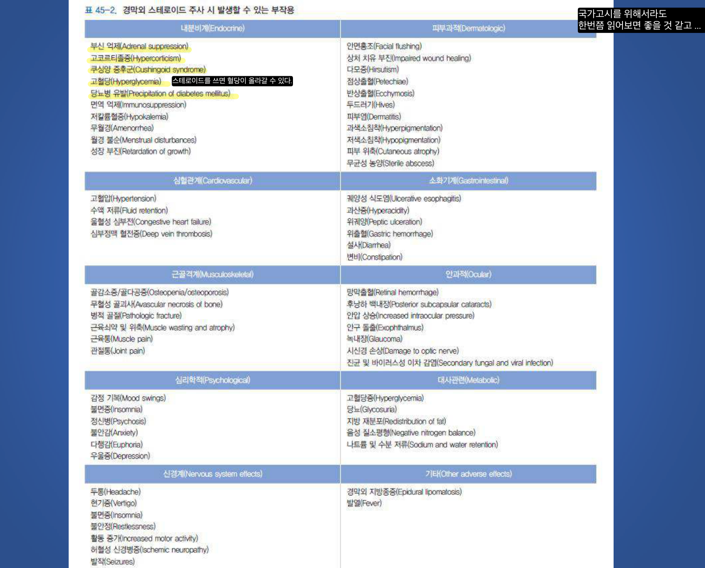{: style="width:76%"}

"**국가고시를 위해서라도 한 번쯤 읽어 보면 좋겠다**"고 하셨고, 형광펜은 내분비계 다섯 줄에 있다.

| 계통 | 부작용 |
|---|---|
| **내분비** | **부신 억제, 고코르티솔증, 쿠싱양 증후군, 고혈당, 당뇨병 유발**, 면역 억제, 저칼륨혈증, 무월경·월경 불순, 성장 부진 |
| 심혈관 | 고혈압, 수액 저류, 울혈성 심부전, 심부정맥 혈전증 |
| 근골격 | 골감소증·골다공증, 무혈성 골괴사, 병적 골절, 근육 쇠약·위축, 근육통, 관절통 |
| 심리 | 감정 기복, 불면, 정신병, 불안, 다행감, 우울 |
| 신경 | 두통, 현기증, 불면, 불안정, 활동 증가, 허혈성 신경병증, 발작 |
| 피부 | 안면홍조, 상처 치유 부진, 다모증, 점상·반상출혈, 두드러기, 피부염, 과·저색소침착, 피부 위축, 무균성 농양 |
| 소화기 | 궤양성 식도염, 과산증, 위궤양, 위출혈, 설사, 변비 |
| 안과 | 망막출혈, 후낭하 백내장, 안압 상승, 안구 돌출, 녹내장, 시신경 손상, 이차 감염 |
| 대사 | 고혈당, 당뇨, 지방 재분포, 음성 질소평형, 나트륨·수분 저류 |
| 기타 | **경막외 지방종증(epidural lipomatosis)**, 발열 |

!!! exam "기출 포인트"
    스테로이드 보기는 두 방향으로 나온다. **혈당**: 1번(2025) ④ "혈당 올리는 부작용 크지 않아 당뇨 환자에게도 별 차이 없이 사용 가능" ✕ ↔ 9번(2022) ⑤ "혈당을 올리기 때문에 당뇨 환자에게는 **양을 줄여서**" ○. **쿠싱**: 2·9·11번 "스테로이드 양은 미미해서 쿠싱 증후군 걱정 안 해도 되고 **여러 번 자주 시술해도** 문제없다" ✕ — 쿠싱 증후군 가능성이 늘 있어 **시술 횟수를 줄이는 것**이 좋다.

## 신경블록의 부작용 — 네 가지 분류

"**effect보다 부작용이 더 중요할 수 있다**." 교수님은 특히 **전신효과(LAST)가 정말 중요하다**고 하셨다.

| 분류 | 내용 | 설명 |
|---|---|---|
| **1. 주입 약물의 전신효과** (Systemic effects of the drugs injected) | **과량(overdose)**, **혈관 내 일시 주입(intravascular bolus injection)** → **CNS, CVS 독성, 사망** | 국소마취제 전신독성(**LAST**, local anesthetic systemic toxicity). 과량 썼거나 혈관 안으로 많은 양이 한 번에 들어갔을 때 |
| **2. 시술의 생리적 효과** (Physiologic effects of the procedure) | 일시적 **기립성 저혈압**, **설사**, 남성 **성기능 장애**, 탈신경 과민통, 심한 다한증, 패혈증 | **교감신경 차단술**의 경우 체위성 저혈압, 설사, **역행성 사정**(retrograde ejaculation, 사정이 뒤쪽 방광으로 들어감) |
| **3. 신경 외 구조물 손상** (Damage to non-neural structures) | 감염, 출혈, **기흉**, **유미흉**, 척수 경색, 장 천공 | 폐를 찌르면 기흉, 림프계를 찌르면 유미흉, 주변 혈관이면 출혈, 장을 찌르면 장 천공 |
| **4. 신경 손상** (Damage to nerves) | 바늘에 의한 **직접 신경 손상** | |

### 특히 중요한 것 *(슬라이드 노트 — 전신독성·전척수마취 "강조", 기흉·사정장애 "언급")*

- **전신 독성 및 마비**: **국소마취제 전신독성(LAST)**, 우발적 **지주막하 주입**으로 인한 **전척수마취(total spinal anesthesia)**.
- **해부학적 위험 혈관 손상**
    - **경추간공(transforaminal) 블록** 시 **척추동맥·구역동맥** 손상 → **뇌색전증**, **전척수동맥 증후군**
    - **T9–L2** 추간공 접근 시 **Adamkiewicz 동맥** 손상 → 척수 허혈로 **하지마비**
- **시술 부위별 특이 합병증**
    - 흉부·**성상신경절 블록** → **기흉**
    - **요부 교감신경 차단** → **음부넙다리신경염(genitofemoral neuritis)**, **남성 사정장애**

## 목 부위 블록에서 약이 엉뚱한 곳으로 가면

| 잘못 들어간 곳 | 결과 | 기전 |
|---|---|---|
| **뇌로 가는 동맥**(척추동맥·경동맥) | **대발작 경련(grand mal seizure)** | 중요한 혈관에 들어가면 **아주 적은 양**도 바로 뇌로 가서 경련 |
| **지주막하 공간(CSF)** | **높은 척수마취(high spinal) → 호흡근 마비, 순환 허탈** | CSF로 들어가 뇌까지 올라가면 **전척수마취** — 마취가 되어 **숨을 안 쉴 수 있다** |

국소마취제는 작용 시간에 한계가 있어 시간이 지나면 차츰 회복되므로, **호흡근이 다시 기능할 때까지 기계환기 등으로 호흡을 보조**해 주면 되지만 어쨌든 위험하다.

!!! exam "기출 포인트"
    이 표 두 줄이 기출 13문항 중 7문항에 나온다.
    - **척추동맥 → 경련**: 3번(2024) ④ ○. 2·11번 "즉각적인 **심정지**" ✕, 13번 "즉각적인 **호흡 정지**" ✕. 9번(2022) ④ 성상신경절블록에서 가장 주의할 구조물은 "**경동맥**" ✕ → **척추동맥**.
    - **경막 내(지주막하) → 전척수마취·무호흡**: 2·3·11·13번 "**심정지**를 가장 주의해야 하므로 **EKG monitoring**이 가장 중요" ✕ → **호흡**(무호흡) 관리가 중요. 9번 ① "경막 내 주입 시 **경련**" ✕.
    - 3번 ③ "혈관 내 다량 주입 시 **무호흡**이 가장 흔함" ✕ — 혈관 내는 **경련(CNS)·부정맥(CVS)**, 무호흡은 지주막하 주입.

## 진단적 신경블록의 해석 *(슬라이드에만 있음, 언급 X)*

1. **위양성과 위음성** — 주변으로 퍼진 약, 위약 효과 등으로 결과가 틀릴 수 있다.
2. **통증의 만성화로 인한 신경계의 변화** — 만성 통증에서는 중추 감작 때문에 말초 블록으로 기대만큼 안 줄 수 있다.

## 신경블록 시 주의사항

- 말초신경의 **해부학**과 국소마취제의 **약리**를 알아야 한다.
- 바늘·카테터를 정확히 놓기 위해 **신경자극기, 초음파, 방사선 영상 유도** 하에 시행한다.
- 지속 주입 시 **국소마취제 용량을 감시**한다 — 많은 양이 한 번에 들어가면 문제가 된다.
- **최대 용량을 지키고(respect maximum doses)**, 예기치 않은 경련·순환 허탈·호흡 정지를 치료할 준비를 한다. 하루에 쓸 수 있는 양이 정해져 있다.
- 화학적·고주파·수술적 교감신경절제 전에는 **국소마취제로 진단적 블록을 반복**한다 — 신경파괴는 영향이 **6개월** 정도 가므로 **최소 2회 이상**의 진단 목적 블록을 한다.
- **충분히 설명하고 동의서**를 받는다(well-informed patient).

!!! exam "기출 포인트"
    4번(2024) ② "고주파열응고술은 시술 시 통증·불편감을 줄이기 위해 **진단적 신경차단술을 하지 않고 바로** 시술하는 것이 권장" → ✕. 파괴술 전에는 반드시 진단적 블록으로 효과를 확인한다.

# 6. 경막외 블록 (Epidural block)

통증클리닉 외래에서는 주로 **경막외 공간(epidural space)**에 **국소마취제와 스테로이드**를 넣어 **신경과 신경주위 조직의 염증을 억제**할 목적으로 쓴다. 접근 경로는 3장의 **interlaminar, transforaminal, caudal** 세 가지다.

*(슬라이드 노트, 언급 X)* 경막외 블록이 수술을 대체할 수 있는지, 언제 수술을 권할지는 아직 논란이지만, 요·하지통 환자에서 **수술을 줄이는 효과(surgery-sparing)는 확실**하고, 시술로 미뤘다가 수술한 경우와 바로 수술한 경우의 경과 차이도 없었다는 보고가 있다. 그래서 **응급이 아닌 척추 질환**은 경막외 블록을 보존적 치료로 적극 시행한 뒤 수술 여부를 정하는 것이 적절하다.

!!! exam "기출 포인트"
    1·12번 "추간판 탈출증이나 척추관 협착증 환자에게는 **교감신경 차단술**이 효과가 좋다 / 주로 시술된다" → ✕. 디스크·협착의 신경근 통증은 **체성신경** 문제이므로 **경막외 (스테로이드) 블록**을 한다. 교감신경 차단은 **내장통**에 쓴다(7장).

# 7. 교감신경블록 (Sympathetic block)

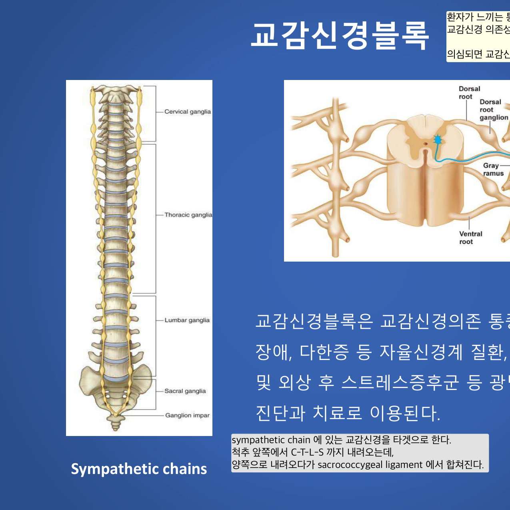{: style="width:72%"}

교감신경블록은 **교감신경 의존 통증 질환, 혈액순환 장애, 다한증** 등 자율신경계 질환, 면역계 질환, **외상 후 스트레스 증후군**까지 넓은 영역에서 **진단과 치료**에 쓰인다.

- 표적은 **교감신경 사슬(sympathetic chain)**에 있는 교감신경이다. 척추 앞쪽에서 **경추–흉추–요추–천추(C–T–L–S)**까지 양쪽으로 내려오다가 **천미골 인대(sacrococcygeal ligament) 앞에서 하나로 합쳐진다**(→ ganglion impar).
- 환자 통증의 기전에 **교감신경 의존성 통증이 포함되었는가?** 의심되면 교감신경블록을 해 봐야 한다.

## 위에서 아래로 — 다섯 가지 교감신경블록

| 블록 | 위치 | 주 적응증 |
|---|---|---|
| **성상신경절블록** (Stellate ganglion block, SGB) | **목**(C6–7, 하경부 신경절+제1흉부 신경절) | **머리·목·팔·가슴 상부**의 교감신경 의존 통증, **혈류 증가**. 비통증성: 다한증, 메니에르, 망막폐쇄, 이명, 퀴니딘 중독 약시, (돌발성 난청) |
| **복강신경얼기블록** (Celiac plexus block) | 복강동맥 주변, 대동맥 앞(T12–L1) | **상복부 내장통** — **췌장암**, **급·만성 췌장염** |
| **내장신경블록** (Splanchnic nerves block) | 그보다 **위쪽 흉추**, 척추 양옆(T11–12) | 복강신경얼기블록과 **같은 적응증**. **기흉 위험이 더 크다** |
| **상하복신경얼기블록** (Superior hypogastric plexus block) | **L5–S1** 추간판 앞 | **골반 내장** — 직장·자궁·난소·전립선·고환에서 오는 **하복부·회음부** 통증 |
| **외톨이신경절블록** (Ganglion impar block) | **천미골 접합부** 앞 | **회음부** — 회음부 암성통증, 항문주위 다한증, 항문이급후증, 난치성 꼬리뼈 통증 |
| **요부교감신경절차단술** (Lumbar sympathetic ganglia block) | **L2–L3** (요추 앞외측) | **양 하지** — 혈관질환, 하지 **CRPS**, 다한증·수족냉증 |

!!! memo "암기"
    **목 = 성상**, **윗배 = 복강·내장**, **아랫배·골반 = 상하복**, **회음·꼬리뼈 = 외톨이(impar)**, **다리 = 요부**. 몸통의 높이와 블록 이름을 짝지어 외운다.

## 성상신경절블록 — 가장 흔하게 쓴다

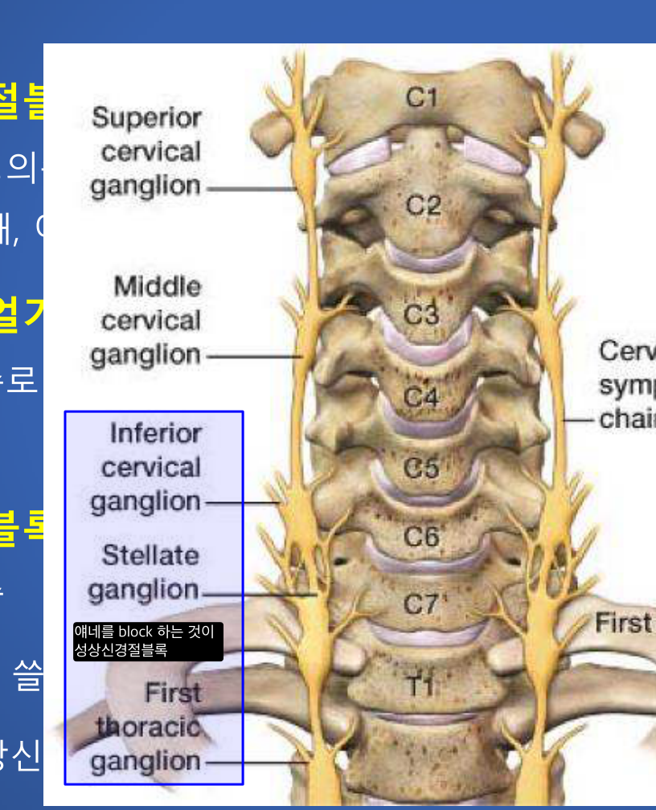{: style="width:52%"}

- **하경부 신경절(inferior cervical ganglion)과 제1흉부 신경절(first thoracic ganglion)**이 합쳐진 것이 **성상신경절(stellate ganglion)**이고, 이것을 블록하는 것이 성상신경절블록이다. 교감신경블록 중 **가장 흔하게** 쓴다.
- 주로 **머리, 목, 팔, 가슴 상부**의 교감신경 의존 통증 완화와 **혈류 증가**를 위해 시행한다.
- 비통증성 질환에도 쓴다: **다한증, 메니에르 증후군, 망막폐쇄, 이명, 퀴니딘 중독 약시**.

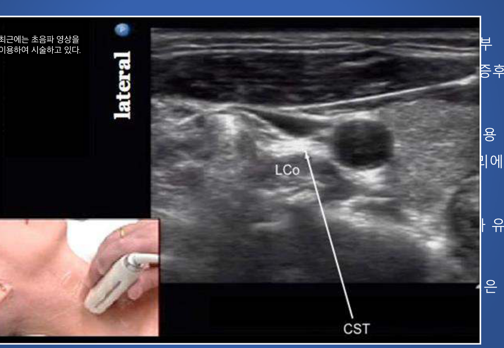{: style="width:62%"}

*(슬라이드 노트, 추가 설명 X)*

- **성공 판정 지표**: **호너 증후군**(축동, 안검하수, 무땀증), **얼굴·팔 피부 온도 상승**, 적외선 체열촬영(DITI) 변화.
- **적응증 확장**: CRPS·상지 혈류 장애 외에 **PTSD**, 메니에르병, 다한증 등 비통증성 자율신경 질환.

!!! exam "기출 포인트"
    - 성상신경절블록은 **목**에서 하는 **교감신경(자율신경)** 블록이다 — 1·10·12번 "복부에서 시행되는 somatosensory nerve block" ✕.
    - 4번(2024) ③ "**복강신경총블록**은 환자의 **목** 부위에 시행되며 **돌발성 난청** 치료에 활용" ✕ — 목에서 하고 난청 등에 쓰는 것은 **성상신경절블록**이다(이름 바꿔치기).
    - 목 부위 블록이라 **척추동맥** 주입 → 경련 (5장 표).

## 복강신경얼기블록과 내장신경블록

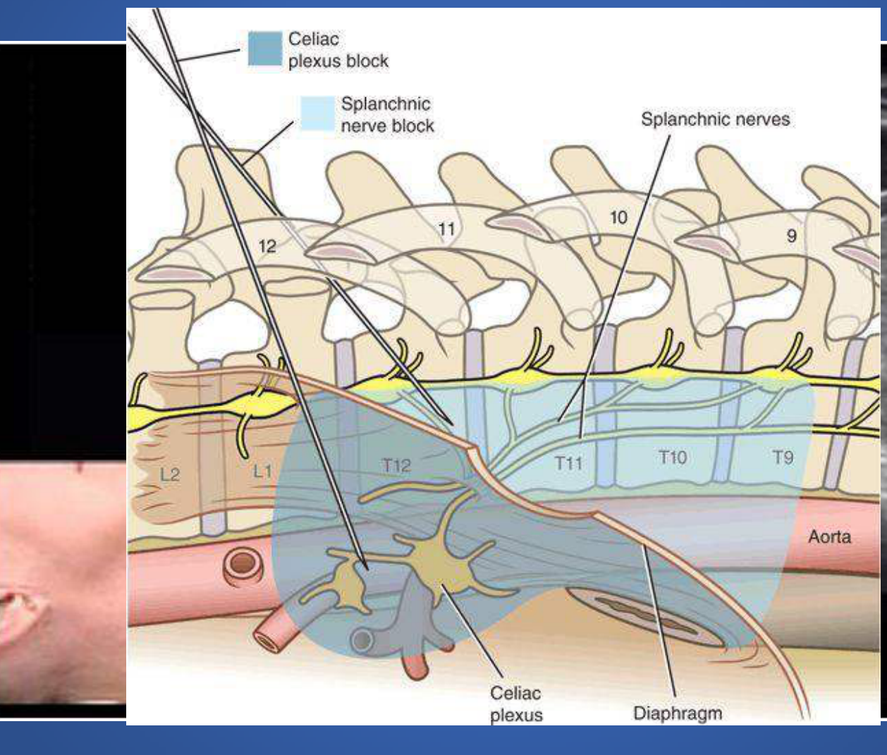{: style="width:66%"}

- **복강신경얼기블록**: **대부분의 복부 통증**에 쓸 수 있고, 주로 **악성 종양에 의한 상복부 내장통**이나 **급·만성 췌장염** 통증에 쓴다. **가장 대표적인 적응증 = 췌장암, 급성·만성 췌장염.**
- **내장신경블록**: 복강신경얼기와 **유사한 적응증**. 배 속 여러 교감신경섬유가 모인 것이 celiac plexus라면, 그것이 교감신경 사슬로 갈 때 **척추 쪽에 있는 것이 splanchnic nerve**다 → **척추 양쪽에 하는 시술**.
- 간, 췌장, 쓸개, 위, 콩팥, 작은창자와 부신, 횡행결장에 분포하는 자율신경은 **모두 내장신경과 복강신경얼기에 연결**되므로 대부분의 복부 통증 관리에 쓸 수 있다.
- *(슬라이드 노트)* 내장신경은 해부학적으로 복강신경얼기와 구별되어 바늘이 복강신경얼기블록의 후복막각 접근법보다 **위쪽 흉추**에 놓이고 **기흉 위험이 크다**는 차이가 있으나, 임상적으로는 비슷한 적응증으로 써 왔다.

!!! exam "기출 포인트"
    교감신경블록 = **내장통**. 4번(2024) ⑤, 10번(2021) ②, 12번(2020) ③ "교감신경블록은 **암성통증 특히 내장통**(암·췌장염)에 효과적인 경우가 많다" ○, 8번(2022) ④ "**췌장암**에 의한 상복부 통증 → **복강신경얼기블록**" ○. 이 수업에서 가장 자주 정답이 된 문장이다.

## 상하복신경얼기블록 · 외톨이신경절블록 · 요부교감신경절차단술

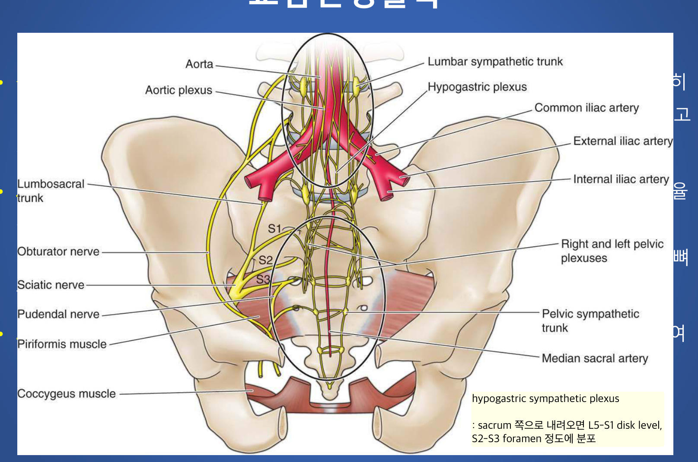{: style="width:64%"}

- **상하복신경얼기블록**: 골반 내 장기, 특히 **직장·자궁·난소·전립선·고환**에서 오는 **하복부 또는 회음부 통증**을 진단·치료한다. 투시 하에 **L5–S1 추간판을 뚫고 들어가서**(경추간판 접근) 조영제를 주고 약물을 준다.
- **외톨이신경절블록(ganglion impar)**: 골반강·회음부 통증은 **체신경과 자율신경이 섞여** 있고 방광·직장·성기능에 복합적으로 관계해서 치료가 어렵다. 1990년 Plancarte가 **회음부 전이성 암성통증**에 처음 소개했고, 지금은 **회음부 암성통증, 항문주위 다한증, 항문이급후증, 난치성 꼬리뼈 통증**에 자주 쓴다. **천미골 인대(sacrococcygeal ligament)를 뚫고** 들어간다.
    - ※ 확인 필요: 필기에 "peroneal pain에 주로 효과"라고 적혀 있다. 슬라이드 내용(회음부 통증)으로 보면 **perineal(회음부) pain**을 받아 적은 것으로 보인다 — peroneal(종아리 바깥쪽 비골신경)은 요부 교감신경 쪽이다.
- **요부교감신경절차단술**: **양 하지**와 관련된 여러 통증·비통증 질환에 쓴다. **교감신경 사슬에 직접 약물을 주입**하고, 주로 **L2–L3 level**에서 **양쪽 콩팥을 피해서** 들어간다.

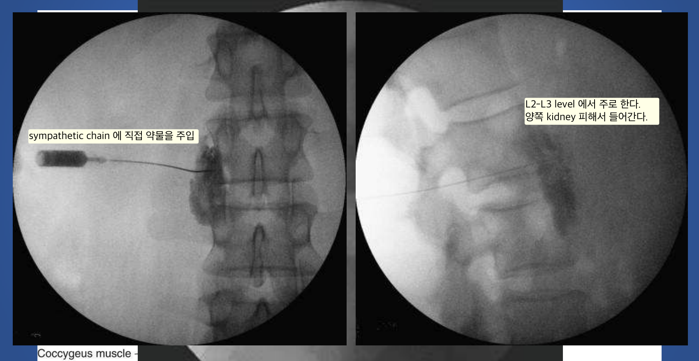{: style="width:70%"}

요부교감신경절차단술의 적응증 *(슬라이드 노트, 추가 설명 X)*:

| 분류 | 질환 |
|---|---|
| 혈관 확장·혈류 증대가 필요한 질환 | **동맥경화성 혈관질환, 당뇨병 괴저, 버거병, 레이노 증후군**, 혈관재건술 후 순환장애 |
| 통증 질환 | **하지 복합부위통증증후군(CRPS)**, 비뇨생식기 통증, 절단 후 단단통 |
| 비통증성 질환 | 다한증, 수족 냉증 |

!!! exam "기출 포인트"
    6번(2023, 사례형): 추락 후 **발목** 복합골절 수술 뒤 **발목 아래 부종·이질통** → **CRPS** 의심 → **요부교감신경절차단술** ○. 다른 보기는 모두 실제 있는 교감신경블록이므로 위 표의 "높이"로 구분해야 한다: 복강·내장신경 = 윗배, 상하복 = 골반, 외톨이 = 회음부.

# 8. 뇌신경블록 — 삼차신경블록

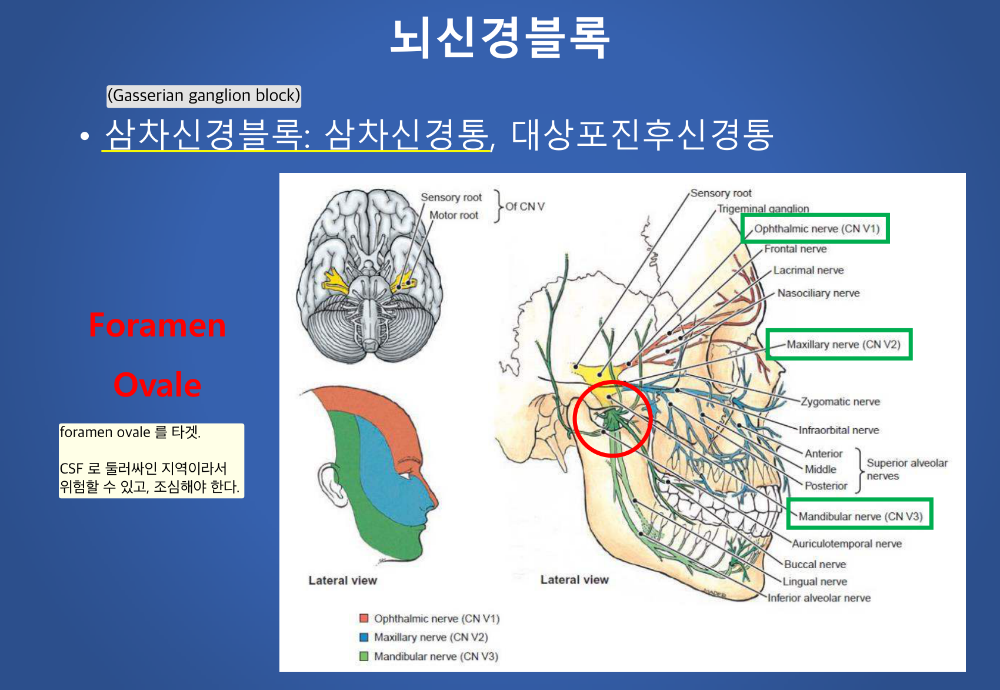{: style="width:76%"}

- **삼차신경블록(Gasserian ganglion block)**: **삼차신경통**, **대상포진 후 신경통**에 쓴다.
- **난원공(foramen ovale)**을 표적으로 바늘을 넣어 삼차신경절(Gasserian ganglion)에 도달한다.
- 삼차신경절은 **CSF로 둘러싸인 지역**(Meckel's cave)이라 약이 CSF로 들어갈 수 있어 **위험하고 조심해야** 한다.

!!! exam "기출 포인트"
    "**삼차**신경통"에는 **삼차**신경블록이다. 2·13번 "삼차신경통에 초음파로 **후두신경(occipital nerve)** 차단" ✕ (후두신경 차단은 **후두신경통**에), 8번(2022) ② "삼차신경통에는 **얼굴신경블록**(facial nerve block)" ✕ (얼굴신경은 **운동신경**이다).

# 9. 경막외 진통과 자가통증조절(PCA)

- **경막외 진통(Epidural analgesia)**: 산모가 아기를 낳을 때 **무통분만**. 경막외 공간에 관(카테터)을 넣어 두고 약을 넣으면 **분만할 때 힘을 주는 수축력을 떨어뜨리지 않으면서 통증을 줄인다.**
    - ※ 확인 필요: 필기에 "0.5% lidocaine"으로 적혀 있다. 무통분만에는 보통 **저농도 ropivacaine·bupivacaine**(+ 아편유사제)을 쓴다.
- **자가통증조절(Patient-controlled analgesia, PCA)**: **환자가 버튼을 눌러** 약물을 직접 주입한다. **암성 통증**을 줄일 때, **돌발성 통증에 대한 예방책**으로 쓴다.

# 10. 고주파열응고술 (Radiofrequency, RF)

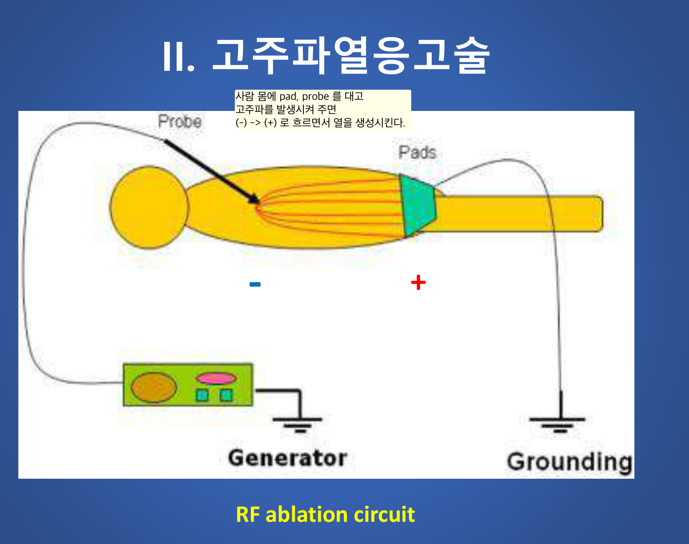{: style="width:62%"}

**고주파열응고술**: 고주파를 이용해 **열로 응고**시키는 기술. 바늘(probe)을 신경 주변에 두고 열을 가해 **단백질 변성**을 일으켜 신경의 이상 신호를 차단한다. 몸에 **패드(pad)와 탐침(probe)**을 대고 발생기(generator)로 고주파를 흘리면 전류가 (−)→(+)로 흐르며 탐침 끝 주변 조직에 열이 생긴다.

| | **Conventional RF** | **Pulsed RF (박동성)** | **Cooled RF (냉각)** |
|---|---|---|---|
| 온도 | **78–80℃** (필기: 70–80도) | **40–42℃ 이하** 유지 | 전극 주변은 덜 뜨거움 |
| 원리 | 열로 신경을 **태운다(응고)** | **전자기장** 이용, 신경을 태우지 않음 | 전극 안으로 **증류수(찬물)가 순환** → 인접 조직의 열 흡수 → 높은 임피던스·조직 탄화가 없음 |
| 병소 모양 | **tip을 따라(옆으로)** 생김 → 바늘을 신경에 **평행**하게 | **tip 앞쪽으로** 생김 → 신경에 **수직**으로 | 병소 범위가 **커진다** |
| 장점 | 효과 확실 | 42℃ 이상 안 올라가므로 **운동신경에도 적용 가능**, 부작용 적어 널리 사용 | **더 넓은 부위**를 태울 수 있다 |
| 단점 | 운동신경 근처는 위험 | 효과가 conventional보다 **떨어진다** | |

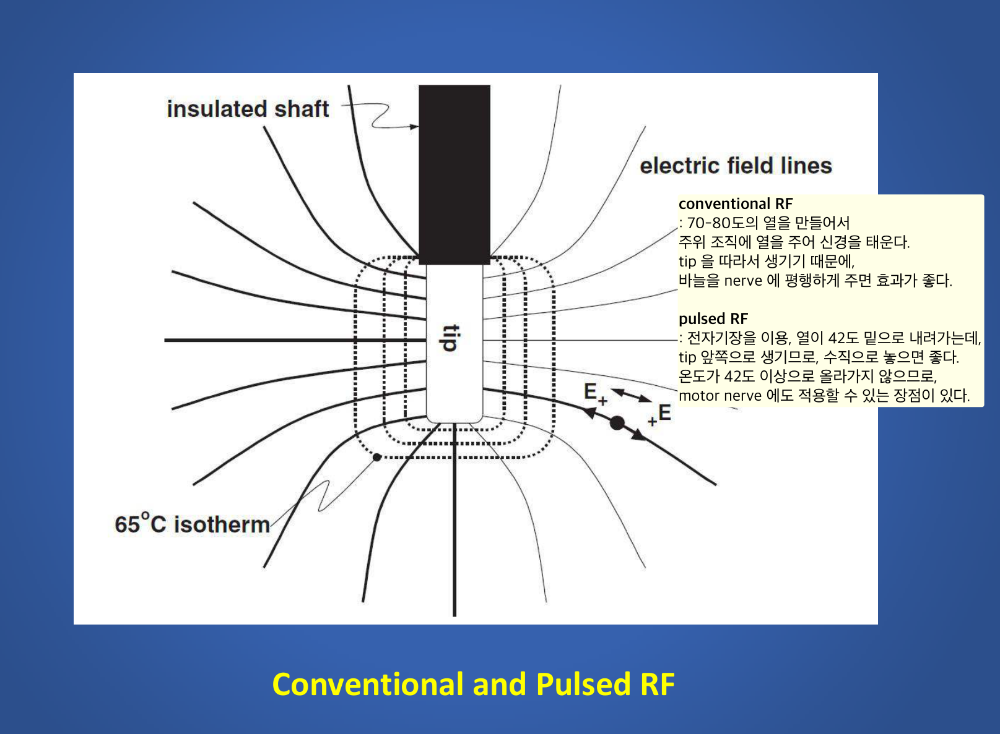{: style="width:70%"}

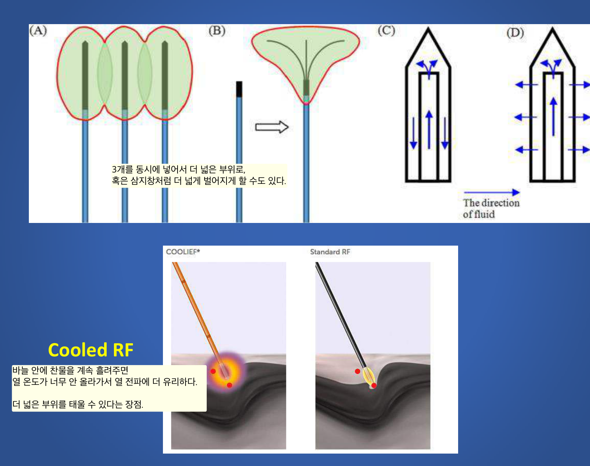{: style="width:70%"}

- **Cooled RF**: 바늘 안에 찬물을 계속 흘려 주면 바늘 주변 온도가 너무 높이 오르지 않아(탄화가 안 생겨) **열 전파에 더 유리**하고 **더 넓은 부위를 태울 수 있다.** 탐침 3개를 동시에 넣어 더 넓은 범위로 하거나, 삼지창처럼 벌어지게 할 수도 있다.

!!! exam "기출 포인트"
    - 12번(2020) ⑤ "**박동성** 고주파의 효과를 최대로 하려면 바늘 끝 온도를 **80도**로 유지" ✕ — 80℃는 **conventional**, pulsed는 **42℃ 이하**.
    - 8번(2022) ③ "대상포진 후 신경통에 **박동성 고주파**를 하면 **치료 범위를 넓힐 수 있어**" ✕ — 범위를 넓히는 것은 **냉각 고주파(cooled RF)**.
    - 1·4·10번: RF는 화학물질이 아니라 **전류의 열**(4장).

# 11. 경막외 신경성형술과 내시경술

**왜 필요한가**: 신경블록 등은 일부만 파악할 수 있어 **전체적인 진단에는 적합하지 않다.** 어떤 기구로 원인이 되는 부위만 정확하게 볼 수 있다면 정확하게 그 부위만 공략할 수 있다(슬라이드: 코끼리 더듬기 → 저격수 조준경 비유).

*(슬라이드 노트, 추가 설명 X)* 병력·이학적·신경학적 검사, 단순촬영·CT·MRI·초음파를 하고도 증상과 맞지 않아 병소를 못 찾는 경우가 많다. 신경근을 **직접 눌러** 방사통이 생기는 경우에는 **MRI**가 정확했지만, 신경근 압박과 **상관없는** 통증은 **경막외내시경**이 더 유용했다. 특히 **척추수술후통증증후군** 환자 중 경막외내시경으로 **경막외강 섬유화**를 본 환자의 **80% 이상에서 MRI는 아무 소견이 없었다** → 섬유화는 MRI만으로는 진단 못 하고 내시경으로 진단한다.

## 경막외 신경성형술 (Epidural neuroplasty)

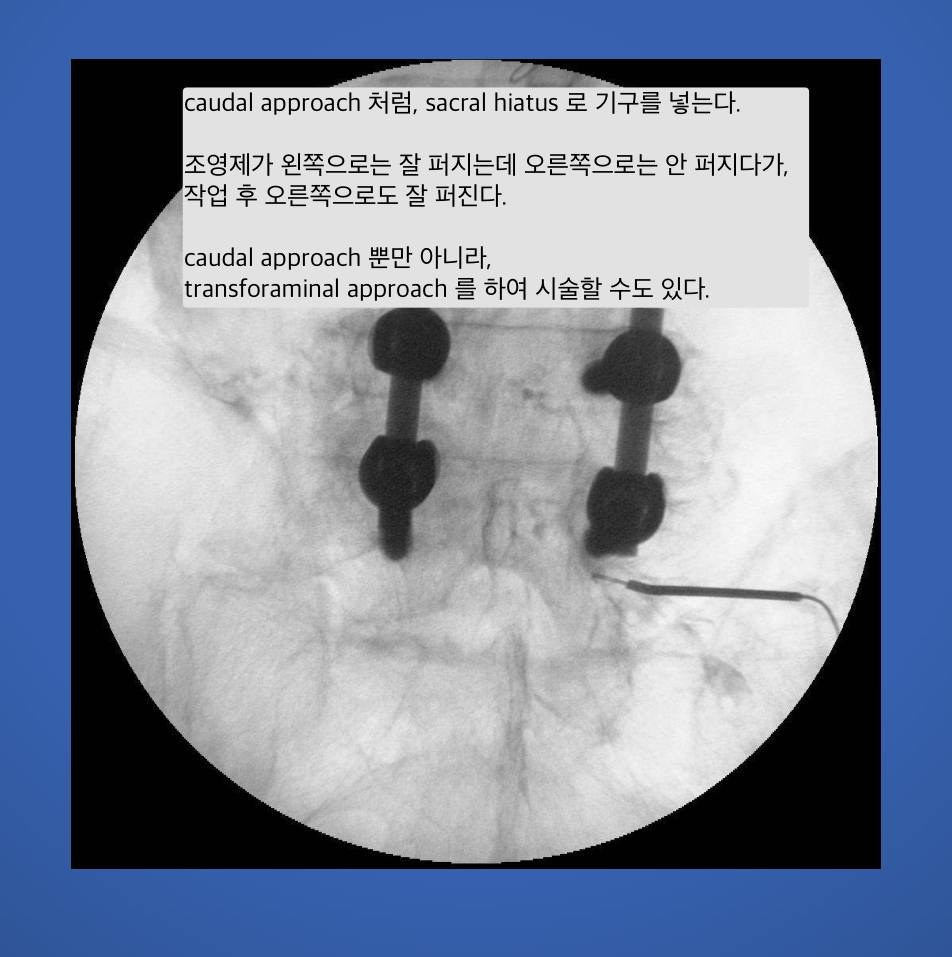{: style="width:48%"}

- **caudal approach처럼 천골열공(sacral hiatus)**으로 기구(카테터)를 넣는다.
- 조영제가 **왼쪽으로는 잘 퍼지는데 오른쪽으로는 안 퍼지다가**(유착), **작업 후 오른쪽으로도 잘 퍼진다**(유착 박리).
- caudal뿐 아니라 **transforaminal** 접근으로도 할 수 있다.

## 경막외 내시경술 (Epiduroscopy)

- **천골열공을 통해 굵은 카테터**를 넣어 **직접 화면으로 조직을 보면서** 하는 시술이다.

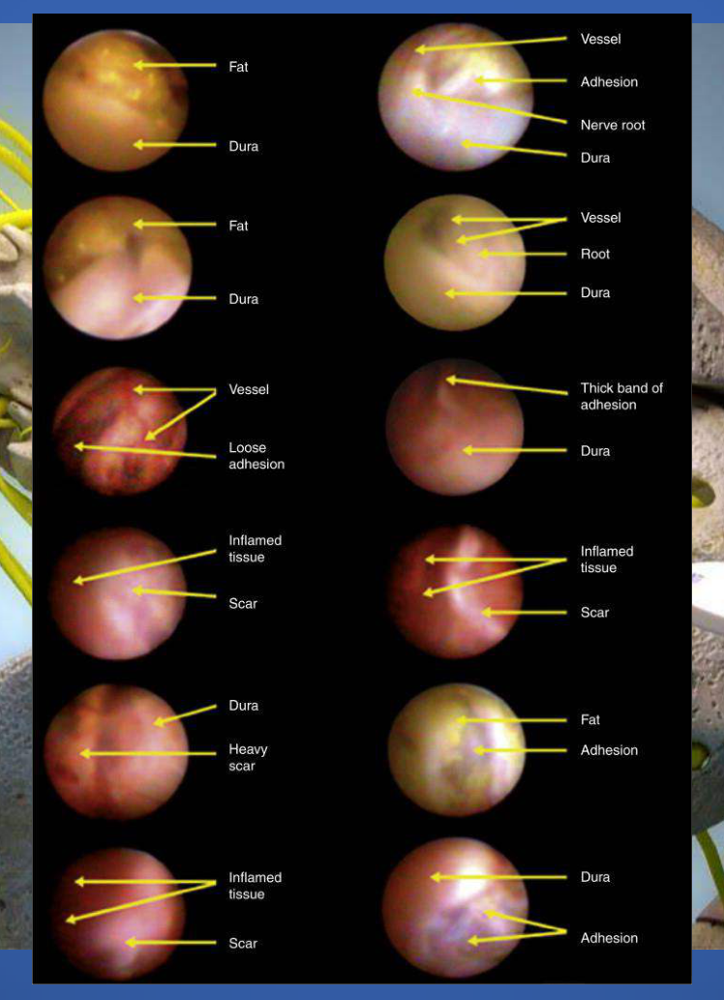{: style="width:46%"}

*(슬라이드 노트, 추가 설명 X)*

| 용도 | 내용 |
|---|---|
| **진단** (주 적응증) | 경막외강의 해부학적 구조 관찰, **디스크 돌출·염증·섬유화·반흔·유착** 확인, **통증유발검사**로 통증 부위 확인, 조직 생검·도말 |
| **치료** | 병소에 **약물 직접 주입**, 반흔·유착을 **기계적·약물·레이저로 제거**, 경막외·지주막하 **카테터나 척수자극기 삽입**을 보면서, 디스크 탈출·척추관 협착 부위를 **레이저로 제거**, 이물질 제거, 최소침습수술 보조 |
| 앞으로 | 척추 수술 결과 평가, 어떤 치료에도 반응 없는 통증, 다른 부위 통증 의심, 만성 염증성 질환 관찰, 시술 후 관찰 |

면관절 비후 부위 제거도 이론상 가능하지만 실제로 면관절 접근은 아직 기술적 한계가 있다. 일부 경험 많은 의사는 경막외내시경술을 척추 통증 환자에게 **일차적으로** 적용해 만성화를 막아야 한다고 주장하기도 한다.

!!! exam "기출 포인트"
    4번(2024) ④, 8번(2022) ①, 10번(2021) ④ "경막외내시경술은 **진단적 목적으로는 아주 유용하나 치료 목적의 활용도는 떨어진다**" → ✕ (세 번이나 나온 함정). 위 표처럼 **진단과 치료 모두**에 유용하다. 앞부분("눈으로 직접 확인할 수 있어 진단에 유용")은 맞아서 더 헷갈리게 만든다.

# 12. 신경자극술과 척수강내 약물 주입술

## 척수자극기 (Spinal cord stimulator, SCS)

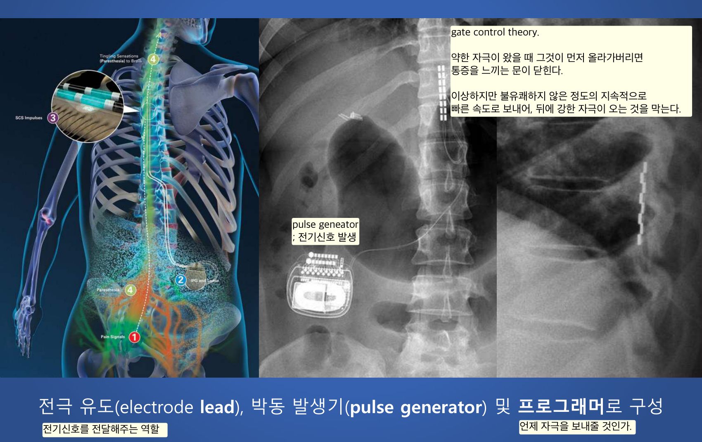{: style="width:76%"}

- 구성: **전극 유도(electrode lead)** — 전기신호를 전달 / **박동 발생기(pulse generator)** — 전기신호 발생 / **프로그래머** — 언제 자극을 보낼지 정한다.
- 원리: **관문조절설(gate control theory)**. 약한 자극이 먼저 올라가 버리면 통증을 느끼는 문이 닫힌다. **이상하지만 불유쾌하지 않은 정도**의 자극을 지속적으로 빠르게 보내서, 뒤에 오는 강한(통증) 자극을 막는다.

*(슬라이드 노트 — 관문조절설 부분은 "언급은 했음")*

- **1965년 Melzack과 Wall**의 관문조절설 → **1967년 Shealy** 등이 암 환자에서 **후방기둥(dorsal column)**을 전기 자극해 통증을 줄였다 → "후방기둥자극술"이라 불렀으나, 척수의 모든 부분에서 여러 기전으로 통증을 억제한다는 것이 알려져 **척수자극술**로 바뀌었다. 1970년대엔 성공률이 낮았고 1980년대부터 환자 선택과 기술 발달(4·8·16극 lead, 8채널 발생기, 무선 조정)로 성적이 좋아졌다.
- 기전: 자극 전류가 **굵은 Aβ 구심성 섬유를 역행성(antidromic)으로 활성화** → 척수 후각에서 **가는 C섬유**의 통증 신호를 **연접 전(presynaptic)** 단계에서 억제. 그 밖에 척수시상로 전도 차단, 척수상부 억제, 교감신경 유출 감소, 신경전달물질(GABA, 아데노신, 세로토닌, 콜린계) 활성화.
- **신경병성 통증(neuropathic pain)**에 주로 효과적이고 **침해성 통증(nociceptive)**에는 반응이 저조 → **요통보다 상·하지 방사통**에 더 효과적이다.

## 뇌자극술 (Deep-brain stimulation, DBS)

**신경외과**에서 하는 시술. 시상하핵(subthalamic nucleus) 등에 전극을 넣어 자극하며, **파킨슨병**이 있을 때 한다.

## 척수강내 약물 주입술 (Intrathecal drug delivery)

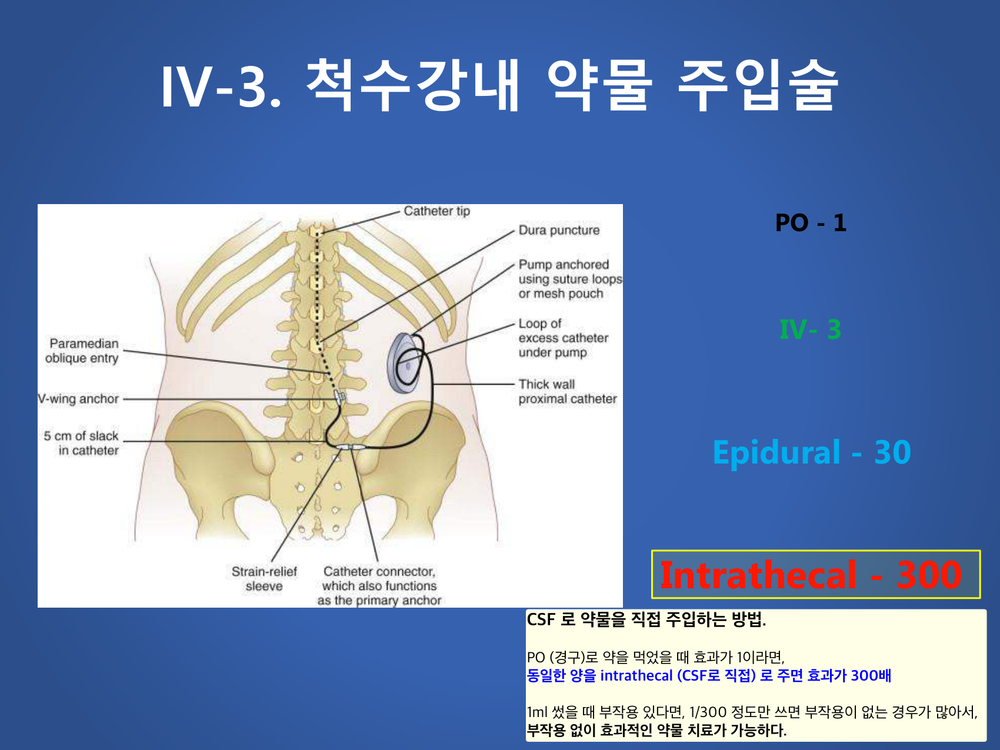{: style="width:76%"}

**CSF로 약물을 직접 주입**하는 방법. 같은 양의 진통제(모르핀)를 줄 때 효과의 비:

| 경로 | 경구(PO) | 정맥(IV) | 경막외(Epidural) | **척수강내(Intrathecal)** |
|---|---|---|---|---|
| 효과 | **1** | **3** | **30** | **300** |

- 경구로 먹었을 때 효과가 1이라면, 같은 양을 척수강내로 주면 **300배**다. 정맥 대비로는 300 ÷ 3 = **100배**.
- 거꾸로 말하면 경구로 1 mL 써서 부작용이 있던 환자도 **1/300 정도만** 쓰면 되므로 **부작용 없이 효과적인 약물 치료**가 가능하다.
- 1980년대부터 주로 **암성 통증**에 쓰였고, 점차 기존 치료에 반응하지 않는 **비암성 난치성 통증**에도 쓴다.

!!! memo "암기"
    **1 : 3 : 30 : 300** (경구 : 정맥 : 경막외 : 척수강내). 척수강내 = **경구의 300배, 정맥의 100배**.

*(슬라이드 노트 — "설명은 안 했는데 노트에 강조되어 있었음")* 척수강내 주입술의 가장 큰 문제는 **돌발통 조절이 어렵다**는 점이었다.

1. **프로그래밍**으로 시간대마다 들어가는 용량을 다르게 설정할 수 있다(밤에 심하면 밤 용량 증량).
2. 환자가 아플 때 휴대 장치 버튼을 눌러 지주막하 모르핀을 추가하는 **myPTM®**(Medtronic)이 있다.
3. 의사가 PCA처럼 폐쇄 간격·일회 주입 횟수를 정하고, 환자는 그 한도 안에서 버튼으로 추가한다 → 돌발통 해결.
4. 단점: **인지기능이 떨어진 노인**은 쓰기 어렵고, **수면 중 통증**은 버튼으로 해결하기 어렵고, 버튼을 얼마나 누르냐에 따라 **약물 재충전 시간을 맞추기 어렵다.**

!!! exam "기출 포인트"
    가장 많이 나온 숫자다. 7번(2023) "경구 대비 몇 배?" → **300배**. 1번(2025) ③, 11번(2021) ③ "경구의 300배, 정맥의 100배" ○. 오답 숫자: 3번 "경구 10배·정맥 3배", 13번 "경구 30배·정맥 10배", 8번 "정맥 10배" — 모두 ✕. 표의 3·30을 끌어와 만든 함정이다.

# 13. 척추체성형술 · 척추후만성형술 · 골성형술

## 경피적 척추체성형술 (Percutaneous vertebroplasty)

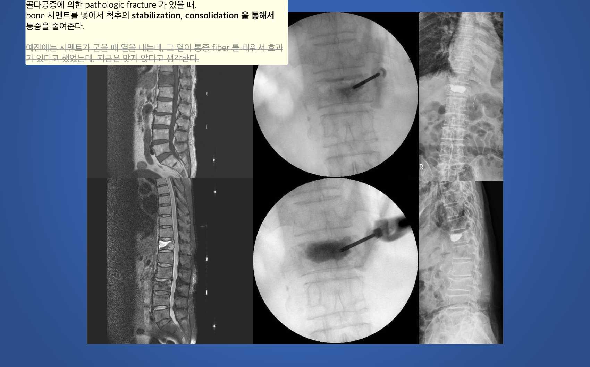{: style="width:76%"}

**골다공증**에 의한 **병적 골절(pathologic fracture)**이 있을 때 **골 시멘트**를 넣어 척추의 **안정화(stabilization)·경화(consolidation)**로 통증을 줄인다.

- 교수님: 예전에는 **시멘트가 굳을 때 내는 열이 통증 섬유를 태워서** 효과가 있다고 했는데, **지금은 맞지 않다고 생각한다.**

*(슬라이드 노트 — 교수님은 "정의만 언급", 열 기전은 "요새는 맞지 않다고 생각된다" 하심)*

| 항목 | 내용 |
|---|---|
| 정의 | **C-arm 투시** 유도 하에 골다공증성 압박골절이나 종양에 의한 병적 골절 부위에 골 시멘트를 주입해 척추체를 안정화하는 **미세침습 시술** |
| 통증 완화 기전 (노트) | 미세 골절 조각의 경화(안정화) + 시멘트 중합 반응 열에 의한 골막 내 침해성 통증섬유 파괴 → **열 기전은 교수님이 부정** |
| 우선순위 | **1차 목적 = 통증 완화·기능 개선**, 골절 안정화·구조적 지지는 2차 |
| 시멘트 양 | 골다공증성 압박골절은 추체 용적의 **약 24%**면 충분한 힘을 얻고 유출 가능성도 줄인다 |
| PMMA | 분말(PMMA 중합체, benzoyl peroxide 개시제, ZrO₂/BaSO₄ 조영제) + 액체(MMA 단일체, DmpT 촉진제, hydroquinone 안정제) → 중합 반응. 경화 때 열이 나서 **유출 시 인접 신경에 열 손상** 가능 |
| 적응증 | **2주 이상** 보존적 약물치료에도 지속되는 통증성 골다공증성 골절, 골전이·다발성 골수종의 병적 골절, 쿰멜병(골괴사 관련 골절), 척추 내 진공 현상 |
| 절대 금기 | 약물치료로 호전되는 골절, **척수 압박**, 교정 불가능한 출혈 장애, 골수염·추간판염·활동성 전신 감염, 시멘트 알레르기 |
| 상대 금기 | **편평척추(vertebra plana, 70% 이상 함몰)**, 후방 기둥 골절, 불안정성 골절, 종양의 척추관 확장 |
| **합병증 1: 골 시멘트 유출** | **가장 흔한 합병증**. 정맥 유출 → **폐색전증**, 추간판·추간공 유출 → 신경근 자극 **방사통** |
| 합병증 2: 인접 분절 골절 | 치료한 척추체가 단단해져 **인접 척추체에 압축력**이 몰려 생긴다 |
| 국소마취·국소진정의 중요성 | 환자가 **깨어 있으면** 시멘트 유출 때 생기는 방사통을 **즉시 호소**하므로 치명적 신경 손상을 막는 안전장치가 된다 |

!!! exam "기출 포인트"
    2번(2025) ④, 13번(2020) ⑤ "척추성형술 중 **척추관 안으로 bone cement leakage**가 생기면 **즉시 시술을 중단하고 신경학적 검사**" ○. 9번(2022) ③ "척추관 안쪽으로의 시멘트 유출은 **매우 드물고 그다지 위험하지 않다**" ✕ — 유출은 **가장 흔한** 합병증이고 척수·신경근을 누를 수 있다.

## 경피적 척추후만성형술 (Percutaneous kyphoplasty)

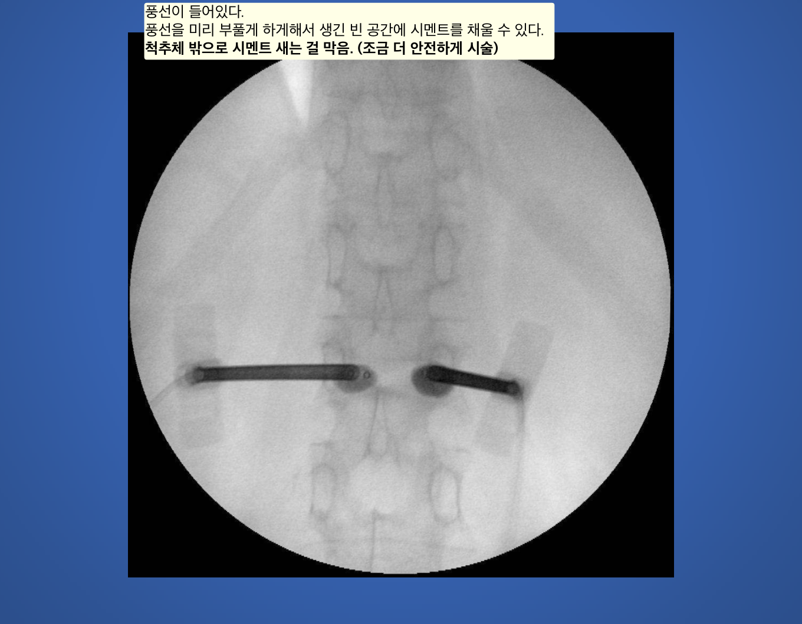{: style="width:52%"}

- 기구 안에 **풍선**이 들어 있다. 풍선을 미리 부풀려 생긴 **빈 공간에 시멘트를 채운다** → **척추체 밖으로 시멘트가 새는 것을 막는다**(조금 더 안전한 시술).
- 장점 *(설명함)*: 추체 수질을 팽창시켜 다진 뒤 넣으므로 시멘트가 **혈관·경막외강으로 유출될 위험은 줄이면서**, 척추체성형술보다 시멘트를 **많이** 넣을 수 있다.
- 단점 *(슬라이드 노트)*: (1) 압박골절이 오래되어 추체 피질을 들어 올릴 수 없으면 장점이 없다, (2) **시멘트 주입량과 통증 개선은 무관**하다, (3) 시간이 지나면 만든 공간 안에서 시멘트가 **공처럼 따로 분리**되기도 한다, (4) 시술 시간이 더 길다, (5) **비싸다**.

## 경피적 골성형술 (Percutaneous osteoplasty, POP)

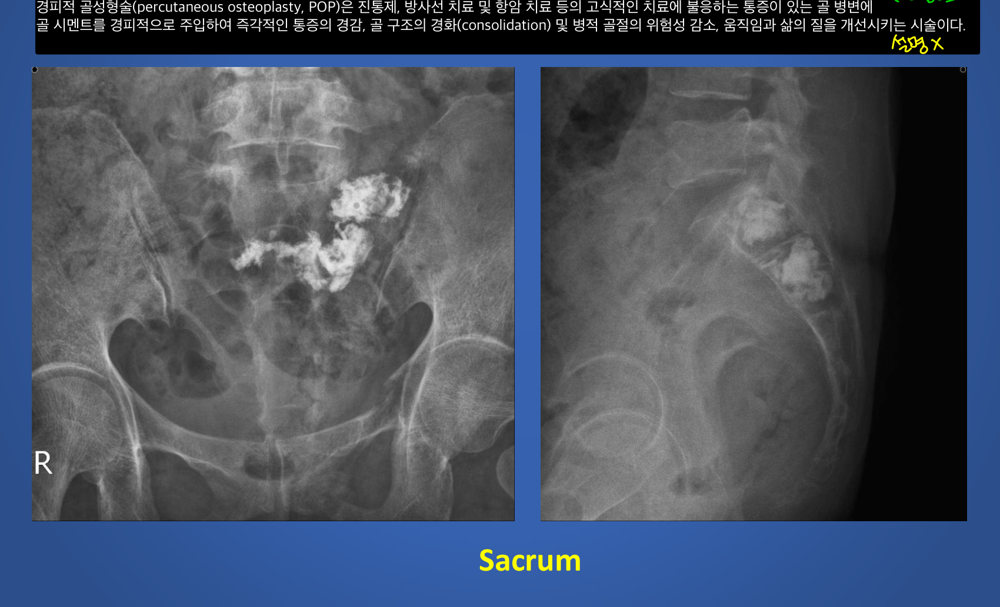{: style="width:70%"}

진통제·방사선·항암 치료 등 고식적 치료에 **불응하는 통증성 골 병변**(주로 암 전이)에 골 시멘트를 경피적으로 넣어 **즉각적인 통증 경감, 골 구조의 경화, 병적 골절 위험 감소, 움직임과 삶의 질 개선**을 노린다. 척추가 아닌 **다양한 부위**에 할 수 있다 — 슬라이드 예시: **천골(sacrum), 대퇴골(femur), 장골(ilium, 고주파 절제술 RFA와 같이), 좌골결절(ischial tuberosity), 상완골(humerus), 늑골(rib)**.

| 시술 | 부위 | 핵심 |
|---|---|---|
| 척추체성형술 | 척추체 | 시멘트 직접 주입 |
| 척추후만성형술 | 척추체 | **풍선**으로 공간 먼저 → 유출 ↓, 비쌈 |
| 골성형술 | 척추 **외** 뼈(천골·대퇴골·장골·상완골·늑골) | 암 전이 골 병변 |

# 14. 증식치료 (Prolotherapy)

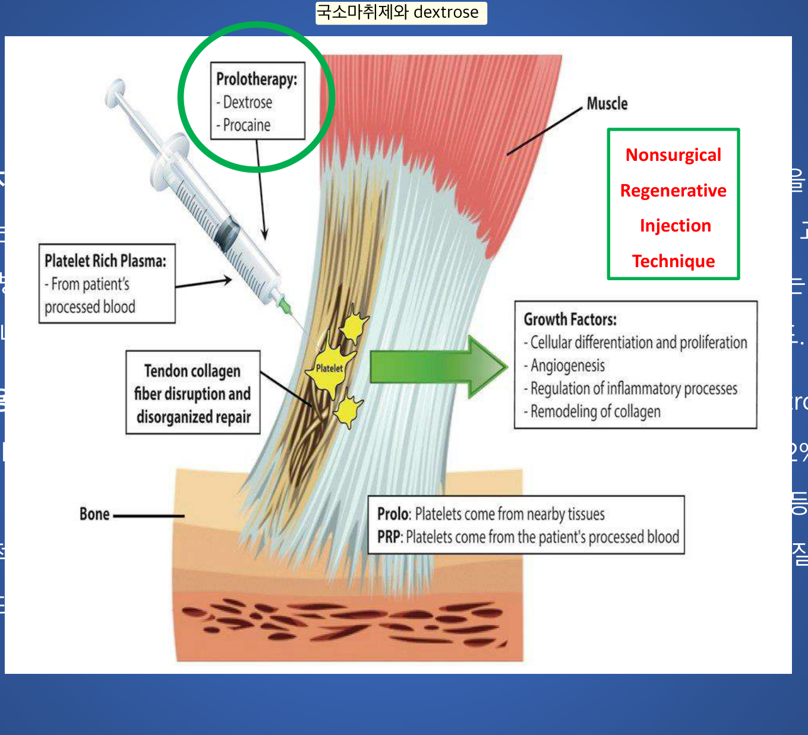{: style="width:62%"}

- **정의**: 만성 통증의 원인이 되는 **약하거나 늘어난 인대와 건**에 **자극 용액을 주사**하는 치료. 자극 용액으로 **정상적인 회복 과정을 모방**해 **치료 목적의 염증 반응을 유도**한다. 인대만이 아니라 관절 내 연골·관절막 등을 포괄적으로 자극해 회복을 유도한다. (Nonsurgical Regenerative Injection Technique)
- 교수님 설명: 국소마취제에 **포도당(dextrose) 용액**을 섞어 인대·건 손상 부위에 주어 **일부러 염증 반응을 더 많이 일으킨다** → 인대·건이 재생될 때 **더 강하고 두껍게** 재생된다.
- **자극 용액**: 가장 많이 쓰는 것은 **dextrose** — 가장 중요한 이유는 **안전성**(교수님 언급).
    - 표준: **15% dextrose + 0.2% lidocaine**, 관절 내 주사는 **25% dextrose + 0.2% lidocaine**.
    - dextrose 과민반응은 지극히 드물고(국소마취제 보존제로 드물게 과민반응), 부작용이 거의 없다.
    - 그 밖에 P2G, 소디움 모루에이트, **혈소판 풍부 혈장(PRP)**, 줄기세포 — 효과적이지만 치유 반응이 더 강하고, 혈관·신경·지주막하에 잘못 들어가면 dextrose만큼 안전하지 않아 **경험 있는 의사**가 해야 한다.
- 그림: 프롤로(dextrose)는 **주변 조직의 혈소판**, PRP는 **환자 자신의 처리된 혈액의 혈소판**이 성장인자(세포 증식, 혈관신생, 염증 조절, 콜라겐 재형성)를 낸다.

!!! exam "기출 포인트"
    11번(2021) ⑤ "인대강화치료라고 알려진 prolotherapy는 **국소마취제의 항염증 효과**를 이용한 치료" → ✕. 반대로 **dextrose로 염증을 일부러 유도**해 증식(재생)시키는 치료다.

# 15. 정리 — Take Home Messages

- 침습적 통증치료(Interventional Pain Treatment)는 **신경 및 통증 발생 부위에 직접 접근**해 통증을 진단·치료하는 방법이다.
- 신경블록은 원인을 확인하는 **진단적 목적**(국소마취제만)과 통증을 줄이는 **치료적 목적**(국소마취제 + 스테로이드)으로 한다.
- 방법: **신경블록, 고주파치료, 경막외 신경성형술, 신경자극술, 척추체성형술** 등.
- **영상유도(Fluoroscopy, Ultrasound, CT)**는 목표에 정확히 접근하고 안전성을 높이는 데 중요하다.
- **고주파치료**는 신경에 **열 손상**을 주거나(conventional) **전기장 자극**(pulsed)으로 통증 신호를 조절한다. 최근엔 범위를 넓히는 **cooled RF**도 있다.
- 침습적 통증치료는 **출혈, 감염, 신경손상, 국소마취제 전신독성(LAST)** 등 심각한 합병증을 일으킬 수 있어 정확한 해부학 지식과 안전한 시술이 필수다. (필기: "**LAST!**")
- 핵심은 환자의 통증 원인과 기전에 맞는 치료법을 고르고 **효과와 위험을 함께** 고려하는 것이다.

!!! memo "암기"
    시험 직전 한 줄씩:
    - 교감신경블록 = **내장통**(췌장암·췌장염 → 복강신경얼기), 성상신경절 = **목**, 다리 CRPS = **요부**
    - 척수강내 = 경구 **300**배, 정맥 **100**배
    - 척추동맥 주입 = **경련** / 지주막하 주입 = **전척수마취·무호흡**
    - 스테로이드 = **혈당↑·쿠싱** → 당뇨 환자 양 줄이고 횟수 줄이기
    - RF = **열**(화학 ✕), conventional 80℃ / pulsed **42℃↓** / cooled = **범위↑**
    - 경막외내시경 = 진단 **+ 치료**
    - 시멘트 유출 = **가장 흔함** → 즉시 중단 + 신경학적 검사
    - 프롤로 = dextrose로 **염증 유도**
