<!-- 필기본: 2026 -->

# 0. 이 수업을 공부하는 법

**이동언 교수님**의 CP(임상추론) 「심정지」 수업이다(2026.10.30, 6–8교시). 1교시는 강의 — 심정지 인지, 심정지 리듬과 제세동, **2025 AHA 가이드라인** 전문소생술(ACLS) 알고리듬과 약물 — 이고, 2교시는 개인 퀴즈(IRAT)와 조별 토의(GRAT), 3교시는 GRAT 해설·증례 해설·**제세동 술기(OSCE)**·드라마 속 CPR 오류 찾기다. 하나의 증례(하프마라톤에서 쓰러진 26세 여자)가 수업 전체를 따라간다.

필기 작성자 메모: 이동언 교수님이 낸 문제는 아니지만 **기출 내용에 빨간색 표시**를 했고, 2·3교시는 강의록을 주지 않아 화면 캡처로 만들었다. 2부의 기출 15문항은 대부분 여인환·조연주 교수님 등 다른 교수님 출제(2021–2025)이고, 2023·2020년에는 이 주제 기출이 없다.

| 주제 | 기출(2부 번호) | 경향 |
|---|---|---|
| **리듬 보고 첫 처치** | 1, 3, 11, 14 | VF → **즉시 제세동**, 무수축 → **압박 + 에피네프린** |
| **맥박을 확인해야 하는 리듬** | 4, 6 | 정돈된 리듬(**pVT·PEA**)만 맥박 확인 (2가지 고르기) |
| **리듬 이름** | 7 | 규칙적인 QRS + 맥박 없음 = **PEA** |
| **약물과 용량** | 2, 5, 9, 13 | 3번째 제세동 후 **아미오다론 300mg / 리도카인 1–1.5mg/kg**, 아트로핀은 심정지에 안 씀 |
| **2분 규칙** | 8 | 2분마다 리듬 확인 + **압박자 교대** |
| **전문기도 후 환기** | 12 | 압박 계속 + **6초에 1회(분당 10회)** |
| **ETCO₂** | 10, 15 | CPR 질의 실시간 지표, **10mmHg 미만 = 압박 불량** |

!!! key "핵심"
    - 알고리듬은 **리듬 확인(충격 필요 / 불필요)**에서 갈린다. 리듬 → 처치 → 약물 시점 순서로 외운다.
    - 숫자: **2분**(리듬 확인·교대), **3–5분**(에피네프린), **300 → 150mg**(아미오다론), **1–1.5 → 0.5–0.75mg/kg**(리도카인), **5cm·100–120회**(압박), **6초 1회**(전문기도 후), **10초 이내**(맥박 확인).
    - 기출은 AHA **2020**, 수업은 **2025** 기준이다. 약물·용량은 같고, 2025에서는 **정맥로 우선(골내는 차선)**, **기관내 투약 삭제**가 바뀐 점이다.

## 학습목표

최종학습성과는 두 가지다. ① 심정지로 발견된 사람에게 **제세동이 필요한지 판단하고 심폐소생술을 시행**할 수 있다. ② 소생된 사람에게서 **심정지 원인에 따라 재발을 막는 치료계획**을 세울 수 있다.

세부 학습목표는 여섯 가지다.

1. 심정지를 인지하고 초기 대응과 고품질 심폐소생술의 원칙을 설명한다 — 기본소생술(BLS) 강의에서 다룬 내용.
2. 심정지 심전도 리듬을 구분하고 제세동이 필요한지 판단한다.
3. 리듬에 따라 전문소생술 알고리듬을 선택한다.
4. 전문소생술 주요 약물의 적응증과 투여 시점을 설명한다.
5. 교정 가능한 심정지 원인을 추정하고 치료 방향을 제시한다.
6. 임상 증례에서 심폐소생술이 적절했는지 평가하고 개선점을 제시한다.

# 1. 심정지란?

## 증례 장면 1

26세 여자가 하프마라톤 결승선을 약 500m 앞두고 갑자기 쓰러졌다. 불러도 **반응이 없고 간헐적으로 헐떡이는 호흡**만 있다. 이것은 심근경색(heart attack)이 아니라 **심정지(cardiac arrest)**다 — 반응이 없고 정상 호흡이 없기 때문이다.

## 심정지 vs 심근경색

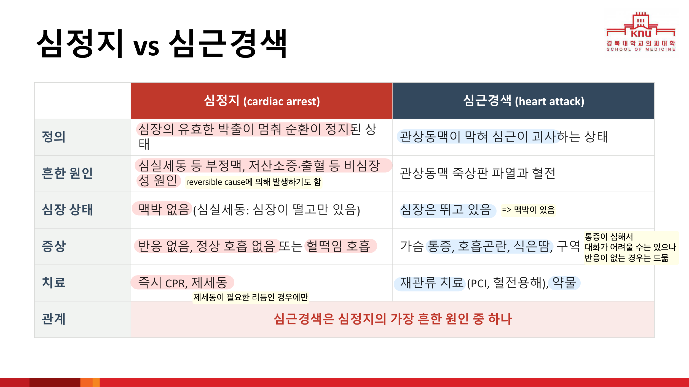{: style="width:76%"}

| | 심정지 (cardiac arrest) | 심근경색 (heart attack) |
|---|---|---|
| 정의 | 심장이 유효하게 피를 **내보내지 못해 순환이 멈춘** 상태 | **관상동맥이 막혀 심근이 괴사**하는 상태 |
| 흔한 원인 | 심실세동 등 부정맥, 저산소증·출혈 등 비심장성 원인 — **가역적 원인(reversible cause)**으로도 생긴다 | 관상동맥 죽상판 파열과 혈전 |
| 심장 상태 | **맥박 없음** (심실세동이면 심장이 떨고만 있다) | 심장은 뛰고 있다 → **맥박 있음** |
| 증상 | **반응 없음, 정상 호흡 없음 또는 헐떡임 호흡** | 가슴 통증, 호흡곤란, 식은땀, 구역. 통증이 심해 대화가 어려울 수는 있어도 반응이 없는 경우는 드물다 |
| 치료 | **즉시 CPR, 제세동**(제세동이 필요한 리듬일 때만) | 재관류 치료(PCI, 혈전용해), 약물 |

둘의 관계: **심근경색은 심정지의 가장 흔한 원인 중 하나**다. 심근경색 → 허혈성 심실세동 → 심정지로 이어질 수 있다.

## 생존사슬 — 오늘은 어디?

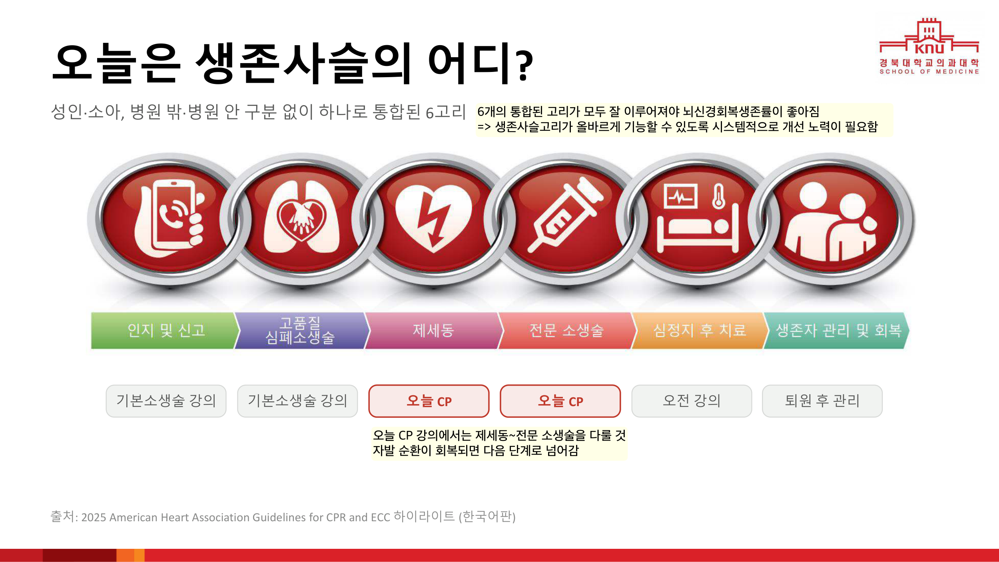{: style="width:76%"}

2025 AHA 생존사슬은 **성인·소아, 병원 밖·병원 안 구분 없이 하나로 통합된 6고리**다.

| 고리 | 다루는 곳 |
|---|---|
| 1 인지 및 신고 | 기본소생술 강의 |
| 2 고품질 심폐소생술 | 기본소생술 강의 |
| **3 제세동** | **오늘 CP** |
| **4 전문 소생술** | **오늘 CP** |
| 5 심정지 후 치료 | 오전 강의 |
| 6 생존자 관리 및 회복 | 퇴원 후 관리 |

자발순환이 회복되면(ROSC) 다음 고리로 넘어간다. 여섯 고리가 모두 잘 이어져야 **신경학적 회복을 동반한 생존율**이 좋아지므로, 사슬이 제대로 돌아가도록 **시스템 차원에서 개선**해야 한다.

# 2. 심정지 인지와 리듬 구분

## 모니터에 규칙적인 리듬이 보이면 심정지가 아닐까?

아니다. 모니터에 규칙적인 리듬이 보여도 **무맥성 심실빈맥(pVT)**이나 **무맥성 전기활동(PEA)**일 수 있다. 증례 환자는 **반응이 없고 헐떡임 호흡**만 있으므로 심정지로 판단한다. **진단은 모니터가 아니라 환자 상태로** 한다.

## 심정지를 인지하는 방법 — 일반인과 의료인은 다르다

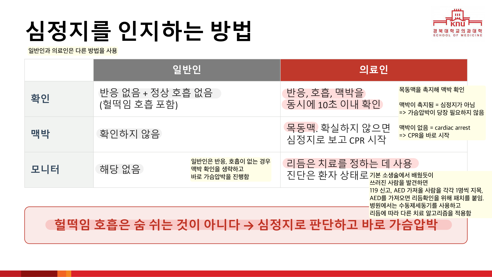{: style="width:76%"}

| | 일반인 | 의료인 |
|---|---|---|
| 확인 | **반응 없음 + 정상 호흡 없음**(헐떡임 호흡 포함) | **반응·호흡·맥박을 동시에 10초 이내** 확인 |
| 맥박 | 확인하지 않음 → 바로 가슴압박 | **목동맥** 촉지. 확실하지 않으면 **심정지로 보고 CPR 시작** |
| 모니터 | 해당 없음 | 리듬은 **치료를 정하는 데** 사용, 진단은 환자 상태로 |

- 맥박이 만져지면 심정지가 아니다 → 당장 가슴압박은 필요 없다.
- 맥박이 없으면 심정지 → 바로 CPR.
- 기본소생술에서 배운 대로: 쓰러진 사람을 발견하면 **119 신고할 사람, AED 가져올 사람을 각각 1명씩 지목**하고, AED가 오면 리듬 확인을 위해 패드를 붙인다. 병원에서는 **수동 제세동기**를 쓰고 리듬에 따라 알고리듬을 고른다.

!!! memo "암기"
    **헐떡임 호흡(gasping)은 숨 쉬는 것이 아니다** → 심정지로 판단하고 바로 가슴압박.

## 증례: 이 리듬은?

가슴압박을 하는 동안 의무요원이 AED 패드를 붙였다. 모니터에 **불규칙하고 일정한 모양이 없는 파형** — **심실세동(VF)**이다. **충격이 필요하다.**

## 심정지 리듬 4가지 — 충격이 필요한가? ★

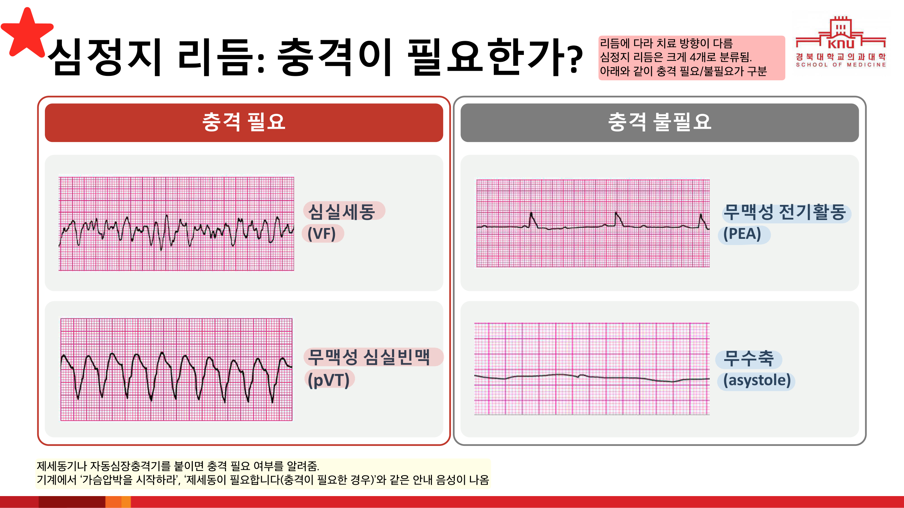{: style="width:76%"}

심정지 리듬은 크게 4개이고, **충격 필요 여부로 둘씩 나뉘어 치료 방향이 달라진다.**

| 구분 | 리듬 | 모양 |
|---|---|---|
| **충격 필요** (shockable) | **심실세동 (VF)** | 불규칙하고 일정한 모양이 없는 파형, QRS 구분 불가 |
| | **무맥성 심실빈맥 (pVT)** | 넓은 QRS가 규칙적으로 빠르게 반복, 맥박 없음 |
| **충격 불필요** (non-shockable) | **무맥성 전기활동 (PEA)** | 정돈된 QRS가 보이지만 맥박 없음 |
| | **무수축 (asystole)** | 거의 평탄한 선 |

제세동기나 AED를 붙이면 충격이 필요한지 알려준다("가슴압박을 시작하세요", 충격이 필요하면 "제세동이 필요합니다" 같은 안내 음성).

### 맥박을 확인해야 하는 리듬 (BLS 내용)

리듬 분석 때 **맥박을 확인해야 하는 리듬**과 **확인하지 않고 바로 다음 처치로 가는 리듬**이 있다.

- 모니터에 **VF** → 맥박이 있을 수 없다 → 맥박 확인 생략하고 **바로 제세동**.
- 모니터에 **VT** → 맥박 유무에 따라 치료가 달라진다(맥박 있으면 빈맥 알고리듬, 없으면 pVT로 즉시 충격) → **맥박 확인 필요**.
- 모니터에 **정돈된 리듬(PEA처럼 보이는 리듬)** → 맥박이 있으면 심정지가 아니라 서맥·빈맥·정상 리듬이다 → **맥박 확인 필요**.
- **무수축·미세 VF** → 맥박이 있을 수 없다 → 확인하지 않는다.

!!! exam "기출 포인트"
    4번·6번(여인환, 2024·2025 연속 출제): 2분 CPR 후 리듬 분석에서 **맥박을 촉지해야 하는 리듬 2가지** = **pVT(넓은 QRS 빈맥)와 PEA(규칙적 QRS)**. VF·무수축·미세 VF는 맥박 확인 대상이 아니다.
    7번: 투석 환자, 맥박 없음 + 규칙적 QRS = **PEA**. 심방세동·VF로 착각하지 않기.

# 3. 제세동

## 증례 장면 2

리듬은 심실세동, AED가 "제세동이 필요합니다"라고 안내한다. 충격 후에는? → **바로 가슴압박**, 리듬 확인은 **2분 후**.

## 제세동의 원리

| 원리 | 시간이 생명 | 가슴압박의 역할 |
|---|---|---|
| **강한 전류로 심근 전체를 동시에 탈분극** → 떨고 있던 전기 활동(VF·pVT)을 한 번에 멈춤 → **동결절이 정상 리듬을 다시 만들 기회** | 심실세동의 가장 효과적인 치료는 **제세동**. **늦어질수록 성공률이 떨어지고**, 방치하면 **무수축으로 진행** | 뇌·심장에 혈류를 일부 보낸다(뇌 혈류가 없으면 **저산소성 뇌손상**). **리듬을 되돌리지는 못한다** → **압박과 제세동은 함께**: 압박하면서 제세동을 준비한다 |

## 제세동: 꼭 기억할 두 가지

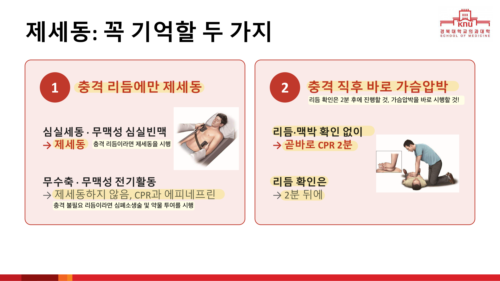{: style="width:72%"}

1. **충격 리듬에만 제세동.** VF·pVT → 제세동. 무수축·PEA → **제세동하지 않고 CPR과 에피네프린**.
2. **충격 직후 바로 가슴압박.** 리듬·맥박 확인 없이 **곧바로 CPR 2분**, 리듬 확인은 **2분 뒤**.

!!! exam "기출 포인트"
    1번·11번: 쓰러진 뒤 모니터가 **VF** → 답은 **제세동**. 오답 함정: 기관내삽관, 목동맥 촉지, 아미오다론·에피네프린 먼저 — 모두 제세동을 늦춘다.

# 4. 전문소생술 알고리듬과 약물

## 증례 장면 3

구급대가 **제세동을 2회** 하며 응급실로 왔다(약물은 투여 안 함). 도착 때 반응·맥박이 없고 모니터는 여전히 **VF**다. → 이미 두 번째 충격을 받았으므로 **에피네프린 1mg**을 주고 CPR을 계속하며, **전문기도 확보**도 한다(알고리듬 6번 상자).

## 2025 AHA 성인 심정지 알고리듬

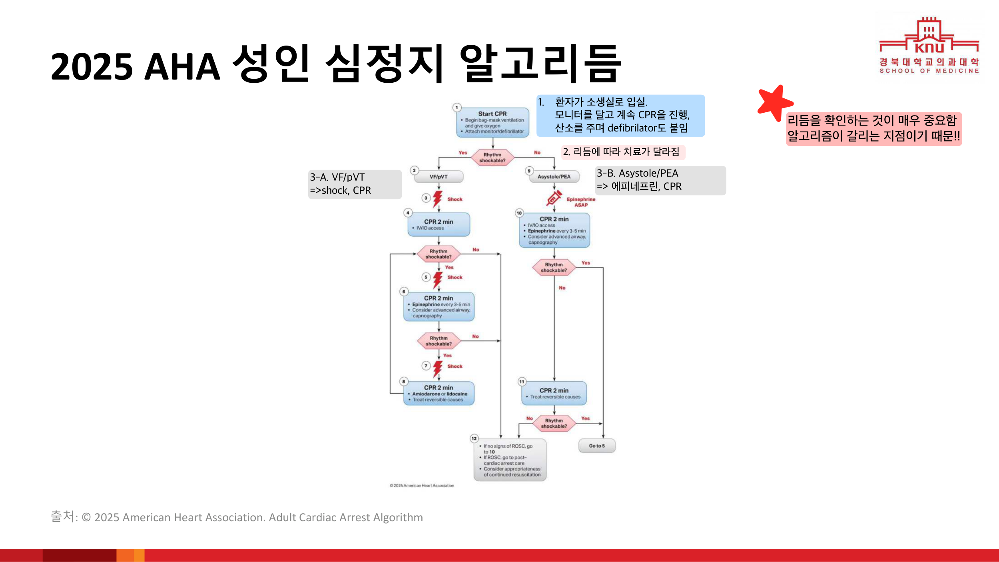{: style="width:76%"}

1. 환자가 소생실에 들어오면 **CPR을 계속하며 백마스크 환기·산소, 모니터/제세동기 부착**.
2. **리듬이 충격 필요한가?** — 여기서 치료가 갈린다. 리듬 확인이 가장 중요한 이유다.
3. 갈래 A **VF/pVT** → 충격 + CPR. 갈래 B **무수축/PEA** → 에피네프린 + CPR.

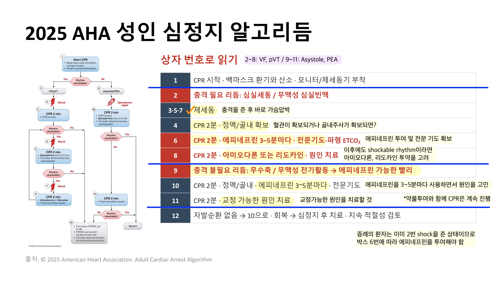{: style="width:76%"}

| 상자 | 내용 |
|---|---|
| 1 | CPR 시작 · 백마스크 환기와 산소 · 모니터/제세동기 부착 |
| 2 | 충격 필요 리듬: VF / pVT |
| 3·5·7 | 제세동 → 충격 후 바로 가슴압박 |
| 4 | CPR 2분 · 정맥/골내 확보 |
| 6 | CPR 2분 · **에피네프린 3–5분마다** · 전문기도 · 파형 ETCO₂ |
| 8 | CPR 2분 · **아미오다론 또는 리도카인** · 원인 치료 |
| 9 | 충격 불필요 리듬: 무수축 / PEA → **에피네프린 가능한 빨리** |
| 10 | CPR 2분 · 정맥/골내 · 에피네프린 3–5분마다 · 전문기도 |
| 11 | CPR 2분 · **교정 가능한 원인 치료** |
| 12 | 자발순환 없음 → 10으로 · 회복 → 심정지 후 치료 · 소생술 지속의 적절성 검토 |

약물을 주는 동안에도 **CPR은 계속**한다.

## ① 충격 리듬 경로 (VF / pVT)

제세동 → CPR 2분 → 리듬 확인을 반복한다.

| 단계 | 할 일 |
|---|---|
| 3 | 첫 번째 제세동 |
| 4 | CPR 2분 · **정맥로 확보, 어려우면 골내(IO)** |
| 5 | 두 번째 제세동 |
| 6 | **에피네프린 1mg 시작, 3–5분마다** · 전문기도(기관삽관)·파형 ETCO₂ 고려 |
| 7 | 세 번째 제세동 (2분 뒤에도 충격 리듬이면) |
| 8 | **아미오다론 300mg 또는 리도카인** (항부정맥제) · 교정 가능한 원인 치료 |
| 반복 | 충격 리듬이 계속되면 5로 돌아가 반복 |
| → | 충격 불필요 리듬이면 12로 |

## ② 충격 리듬: 주기별로 할 일

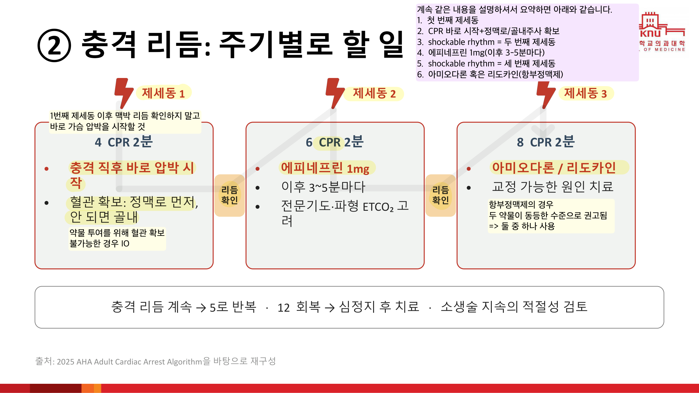{: style="width:76%"}

교수님이 계속 같은 내용을 반복하셨다. 순서로 외운다.

1. **첫 번째 제세동** → 맥박·리듬 확인하지 말고 바로 압박
2. **CPR 2분 + 정맥로/골내 확보** (약을 주기 위해)
3. 리듬 확인 → 충격 리듬이면 **두 번째 제세동**
4. **에피네프린 1mg** (이후 3–5분마다), 전문기도·파형 ETCO₂ 고려
5. 리듬 확인 → 충격 리듬이면 **세 번째 제세동**
6. **아미오다론 또는 리도카인** — 두 약은 **동등한 수준으로 권고**되므로 둘 중 하나, 교정 가능한 원인 치료

## ③ 충격 리듬: 약물 투여 시점

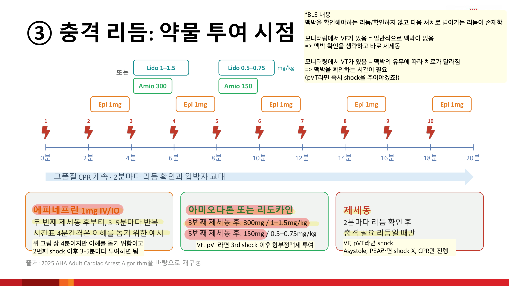{: style="width:76%"}

| 약 | 언제 | 용량 |
|---|---|---|
| **에피네프린** IV/IO | **두 번째 제세동 후부터**, 3–5분마다 반복 | 1mg |
| **아미오다론** 또는 **리도카인** | **3번째 제세동 후** | 300mg / 1–1.5mg/kg |
| | **5번째 제세동 후** | 150mg / 0.5–0.75mg/kg |
| 제세동 | 2분마다 리듬 확인 후 **충격 리듬일 때만** | VF·pVT면 충격, 무수축·PEA면 충격 없이 CPR |

시간표에 에피네프린이 4분 간격으로 그려진 것은 이해를 돕기 위한 예시다 — 두 번째 충격 후 **3–5분마다** 주면 된다.

아미오다론이 자주 언급되는 이유: 20년 전부터 쓰여 의사들 손에 익숙하기 때문이다. 최근 가이드라인에서는 **리도카인과 동등**하게 권고된다.

!!! exam "기출 포인트"
    5번: VF, 200J 제세동 **3차례 후** 필요한 약 → **아미오다론 300mg**. 함정: 에피네프린 1mg(계속 주긴 하지만 '추가로 필요한' 약이 아님), 리도카인 **1mg**(용량이 틀림 — mg/kg).
    9번·13번: 제세동 + 에피네프린 후에도 VF → **아미오다론**, 보기에 아미오다론이 없으면 **리도카인 100mg**(70kg × 1–1.5mg/kg). 마그네슘(torsades), 아트로핀(서맥), 아데노신(상심실성 빈맥)은 오답.
    2번: 아트로핀 1mg은 **심정지에서 쓰지 않는다**(틀린 것 고르기의 답).

## ④ 항부정맥제: 아미오다론 또는 리도카인

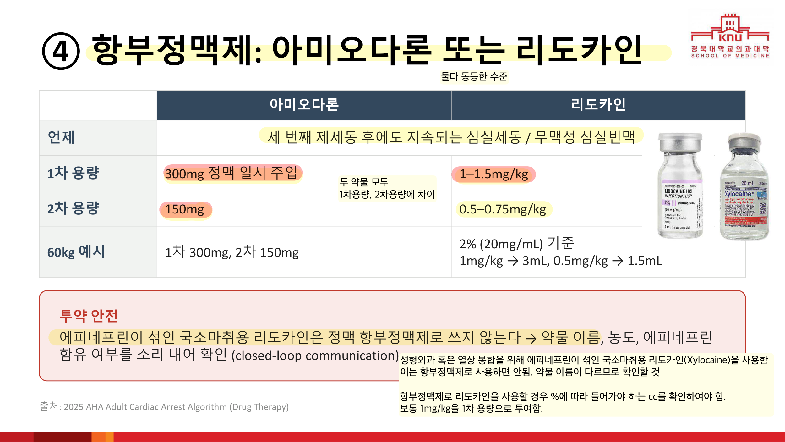{: style="width:76%"}

| | 아미오다론 | 리도카인 |
|---|---|---|
| 언제 | **세 번째 제세동 후에도 지속되는 VF/pVT** (둘 다 동등) | |
| 1차 용량 | **300mg** 정맥 일시 주입 | **1–1.5mg/kg** (보통 1mg/kg) |
| 2차 용량 | **150mg** | **0.5–0.75mg/kg** |
| 60kg 예시 | 1차 300mg, 2차 150mg | 2%(20mg/mL) 기준 1mg/kg → **3mL**, 0.5mg/kg → **1.5mL** |

리도카인은 농도(%)에 따라 넣어야 할 mL가 달라지므로 꼭 계산한다.

!!! memo "투약 안전"
    성형외과·열상 봉합에 쓰는 **에피네프린이 섞인 국소마취용 리도카인(Xylocaine with epinephrine)**은 정맥 항부정맥제로 쓰면 안 된다. **약 이름, 농도, 에피네프린 함유 여부를 소리 내어 확인**한다(closed-loop communication).

## ⑤ 비충격 리듬 경로 (Asystole / PEA)

제세동 없이 **에피네프린과 원인 찾기**가 핵심이다.

| 단계 | 할 일 |
|---|---|
| 9 | 무수축 / PEA 확인 → **에피네프린 가능한 빨리** (빨리 줄수록 좋다) |
| 10 | CPR 2분 · 정맥/골내 확보 · 에피네프린 3–5분마다 · 전문기도 고려 |
| 11 | CPR 2분 · **교정 가능한 원인 치료** — 원인을 알아내 교정하려고 노력 |
| → | 리듬 확인에서 충격 필요 리듬이면 5로(제세동) |
| 12 | 자발순환 없음 → 10으로 반복 |

## ⑥ 비충격 리듬: 주기별로 할 일

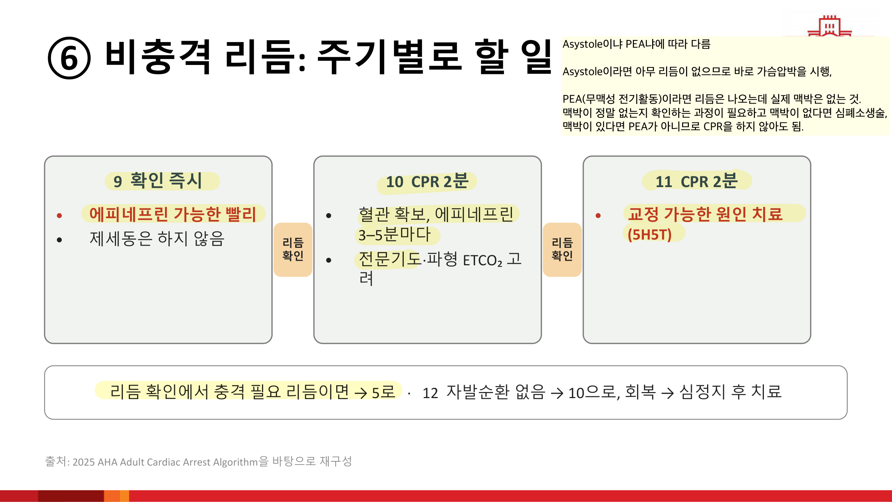{: style="width:76%"}

무수축이냐 PEA냐에 따라 조금 다르다.

- **무수축**: 아무 리듬이 없으므로 바로 가슴압박.
- **PEA**: 리듬은 나오는데 맥박이 없는 것 → **맥박이 정말 없는지 확인**한다. 없으면 CPR, **있으면 PEA가 아니므로 CPR을 하지 않는다.**

## ⑦ 비충격 리듬: 약물 투여 시점

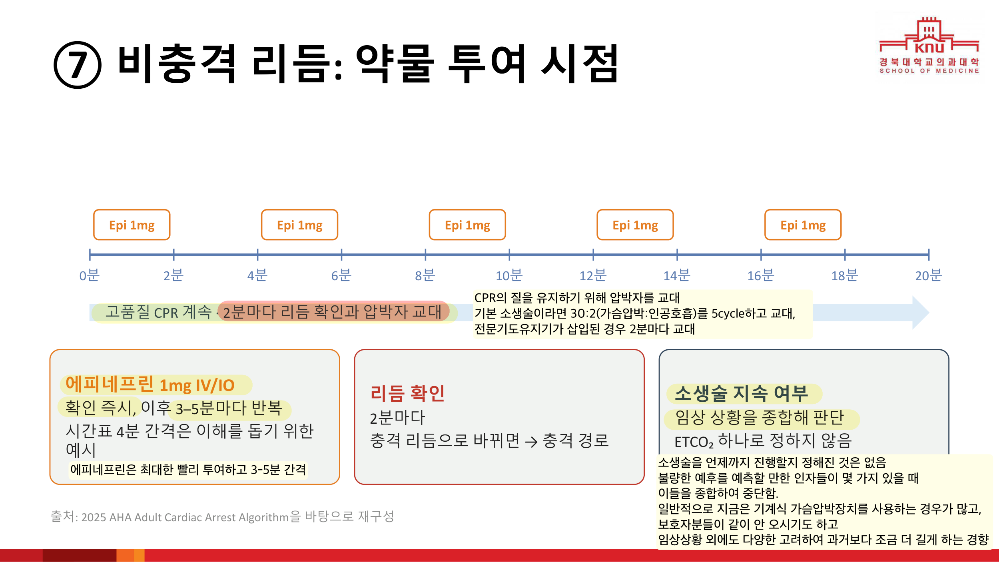{: style="width:76%"}

| 항목 | 내용 |
|---|---|
| **에피네프린** 1mg IV/IO | **확인 즉시**, 이후 3–5분마다 (4분 간격 그림은 예시) |
| 리듬 확인 | 2분마다. 충격 리듬으로 바뀌면 충격 경로로 |
| 압박자 교대 | CPR 질을 유지하려고 교대. 기본소생술은 30:2를 **5주기** 후 교대, 전문기도가 있으면 **2분마다** 교대 |
| 소생술 지속 여부 | **임상 상황을 종합해 판단**. ETCO₂ 하나로 정하지 않는다 |

소생술을 언제까지 할지 정해진 기준은 없다. 불량한 예후를 예측하는 인자가 여러 개 있을 때 종합해 중단한다. 요즘은 기계식 가슴압박장치를 많이 쓰고, 보호자가 함께 오지 않기도 하는 등 여러 이유로 **과거보다 조금 더 길게** 하는 경향이다.

!!! exam "기출 포인트"
    3번·14번: 반응·맥박 없음 + 평탄한 선 = **무수축** → **가슴압박 + 에피네프린 1mg**. 함정: 제세동, 심율동전환, 경피적 심박조율기, 아트로핀, 아미오다론.
    8번: 무수축으로 CPR 시작 후 다음 리듬 확인·**압박자 교대는 2분 후**.

## 골내(IO) 투여

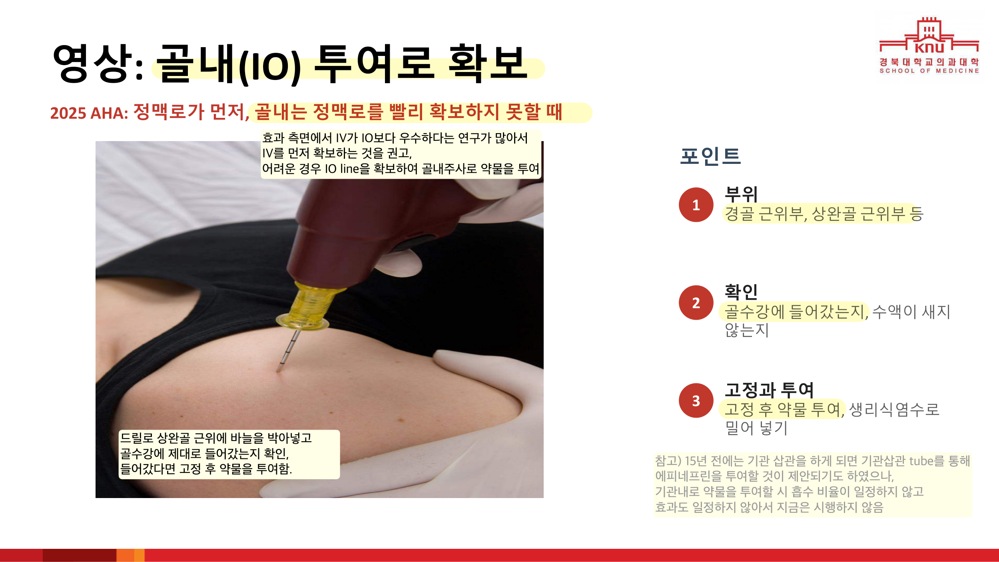{: style="width:72%"}

**2025 AHA: 정맥로가 먼저, 골내는 정맥로를 빨리 확보하지 못할 때.** 효과 면에서 IV가 IO보다 낫다는 연구가 많아서다.

1. **부위**: 경골 근위부, 상완골 근위부 등.
2. **확인**: 골수강에 들어갔는지, 수액이 새지 않는지. (드릴로 상완골 근위에 바늘을 박아 넣고 확인한다.)
3. **고정과 투여**: 고정 후 약물 투여, 생리식염수로 밀어 넣는다.

참고: 15년 전에는 기관삽관 튜브로 에피네프린을 주는 방법도 제안됐지만, 흡수가 일정하지 않고 효과도 일정하지 않아 **지금은 하지 않는다(기관내 투약 삭제)**.

## ⑧ 무수축·PEA에서 꼭 할 것

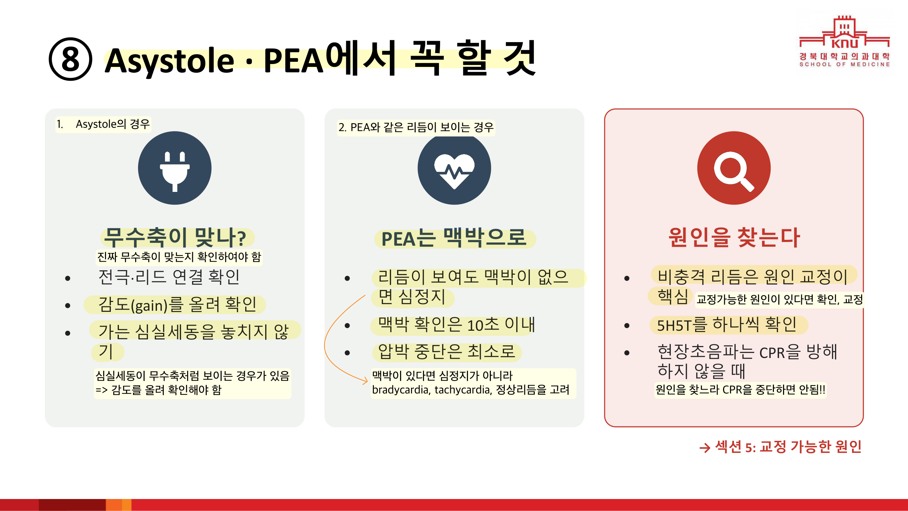{: style="width:76%"}

| 무수축이 맞나? | PEA는 맥박으로 | 원인을 찾는다 |
|---|---|---|
| **전극·리드 연결 확인**, **감도(gain)를 올려** 확인 — **가는(미세) 심실세동이 무수축처럼 보일 수 있다** | 리듬이 보여도 **맥박이 없으면 심정지**. 맥박 확인은 **10초 이내**, 압박 중단은 최소로. 맥박이 있으면 심정지가 아니라 서맥·빈맥·정상 리듬을 생각한다 | 비충격 리듬은 **원인 교정이 핵심** — **5H5T**를 하나씩 확인. 현장초음파는 **CPR을 방해하지 않을 때만** — 원인을 찾느라 CPR을 멈추면 안 된다 |

## ⑨ 전문기도와 환기

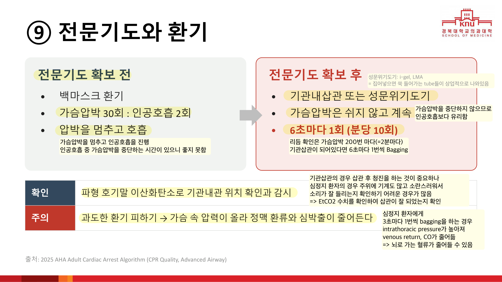{: style="width:76%"}

| | 전문기도 확보 **전** | 전문기도 확보 **후** |
|---|---|---|
| 기도 | 백마스크 환기 | **기관내삽관** 또는 **성문위기도기**(i-gel, LMA처럼 넣으면 쑥 들어가는 상용 튜브) |
| 압박:호흡 | **30:2** — 압박을 멈추고 호흡 → 압박이 끊기는 시간이 있어 불리 | **가슴압박은 쉬지 않고 계속**, **6초마다 1회(분당 10회)** |
| 리듬 확인 | 2분마다 | 압박 200회마다(=2분마다) |

- **확인**: **파형 호기말 이산화탄소(ETCO₂)**로 기관내관 위치를 확인하고 감시한다. 원래 삽관 후 청진이 중요하지만 심정지 현장은 기계가 많고 시끄러워 소리를 듣기 어렵다 → ETCO₂로 확인.
- **주의**: **과도한 환기 금지**. 예를 들어 3초마다 1번씩 백을 짜면 흉강 내압이 올라 **정맥 환류와 심박출이 줄고** → 뇌 혈류도 줄어든다.

!!! exam "기출 포인트"
    12번: 기관내삽관 후 → **압박을 멈추지 않고 분당 10회 환기**. 함정: 30:2 유지, 과환기(분당 20회), 백을 75% 짜기, '더 많은 산소화'.

## ⑩ 지금 CPR을 잘 하고 있나?

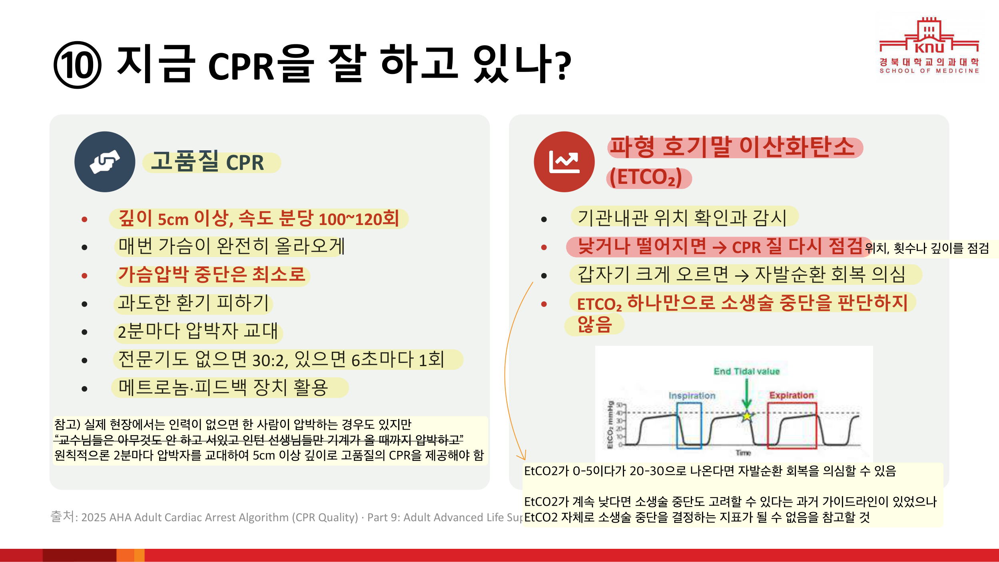{: style="width:76%"}

### 고품질 CPR

- **깊이 5cm 이상, 속도 분당 100–120회**
- 매번 가슴이 **완전히 올라오게**(완전 이완)
- **가슴압박 중단은 최소로**
- 과도한 환기 피하기
- **2분마다 압박자 교대**
- 전문기도 없으면 30:2, 있으면 6초마다 1회
- 메트로놈·피드백 장치 활용

실제 현장에서는 인력이 없으면 한 사람이 계속 압박하기도 하지만, 원칙은 2분마다 교대해 5cm 이상 깊이로 고품질 CPR을 하는 것이다.

### 파형 호기말 이산화탄소 (ETCO₂)

| ETCO₂ | 의미 |
|---|---|
| 삽관 직후 파형이 나타남 | 기관내관이 **기관에** 있다 |
| **낮거나 떨어짐** | **CPR 질을 다시 점검** — 위치, 횟수, 깊이, 교대 |
| **갑자기 크게 오름** | **자발순환 회복(ROSC) 의심** → 맥박 확인. 필기: 0–5mmHg이던 것이 20–30mmHg로 나오면 의심 (교과서적으로는 35–40mmHg 이상으로 급상승) |
| 계속 낮음 | 예전 지침에는 소생술 중단 근거로 쓰자는 내용이 있었지만, **ETCO₂ 하나만으로 중단을 판단하지 않는다** |

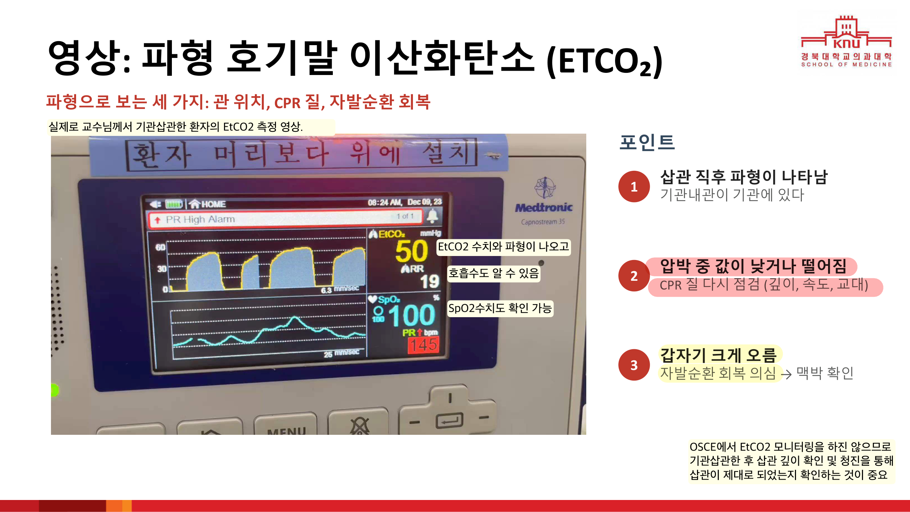{: style="width:70%"}

교수님이 직접 삽관한 환자의 모니터 영상: ETCO₂ 수치와 파형, 호흡수, SpO₂를 함께 볼 수 있다. **OSCE에서는 ETCO₂ 모니터링을 하지 않으므로** 삽관 후 **삽관 깊이 확인과 청진**으로 위치를 확인하는 것이 중요하다.

!!! exam "기출 포인트"
    10번: 고품질 CPR을 실시간으로 감시하는 지표 = **ETCO₂** (산소포화도·혈압·뇌파·12유도 심전도 아님).
    15번: VF로 CPR 중 ETCO₂ 그래프가 **10mmHg 미만** → **가슴압박이 효과적이지 않음**. 함정: '자발순환 상태'(→ 급상승해야 함), '심폐소생술 중단 고려'(→ ETCO₂만으로 중단하지 않음), 식도 삽관(→ 파형이 거의 없음).

### 피드백 장치로 CPR 질 확인

메트로놈, 시청각 피드백 장치, **CPR 미터**(압박 속도·깊이·이완을 실시간 표시), **제세동기 화면**에도 깊이·속도·이완·위치가 표시된다(AI로 압박 잡음을 걸러주기도 한다). CPR 미터는 가슴에 놓고 압박하는데 딱딱하고 아파서 실제로는 잘 안 쓰고, **제세동기에 연결된 장치**로 보거나 **팀원끼리 피드백**하는 것이 더 현실적이다.

## ⑪ 에피네프린은 왜 주나?

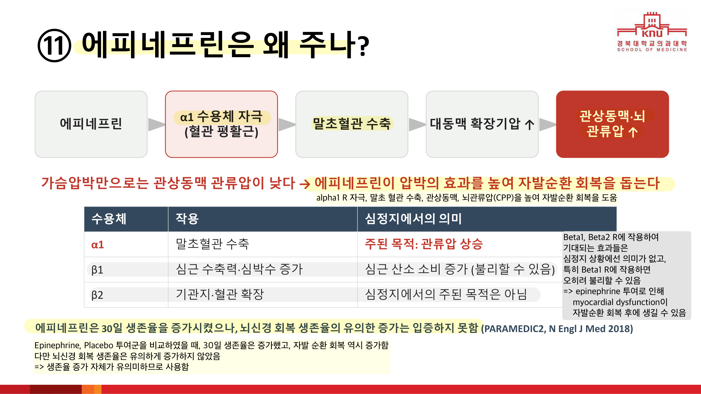{: style="width:76%"}

**에피네프린 → α1 수용체 자극(혈관 평활근) → 말초혈관 수축 → 대동맥 확장기압 ↑ → 관상동맥·뇌 관류압 ↑.** 가슴압박만으로는 관상동맥 관류압이 낮다 → 에피네프린이 압박의 효과를 높여 **자발순환 회복을 돕는다**.

| 수용체 | 작용 | 심정지에서의 의미 |
|---|---|---|
| **α1** | 말초혈관 수축 | **주된 목적: 관류압 상승** |
| β1 | 심근 수축력·심박수 증가 | 심근 산소 소비 증가 — **불리할 수 있다** (자발순환 회복 후 **심근 기능 이상**이 생길 수 있음) |
| β2 | 기관지·혈관 확장 | 주된 목적 아님 |

**PARAMEDIC2 (N Engl J Med 2018)**: 에피네프린 vs 위약 — **30일 생존율과 자발순환 회복은 증가**했지만 **신경학적 회복을 동반한 생존율의 유의한 증가는 입증하지 못했다.** 생존율 증가 자체가 의미 있으므로 사용한다.

## ⑫ 전문소생술 참조표 (2025 AHA) ★

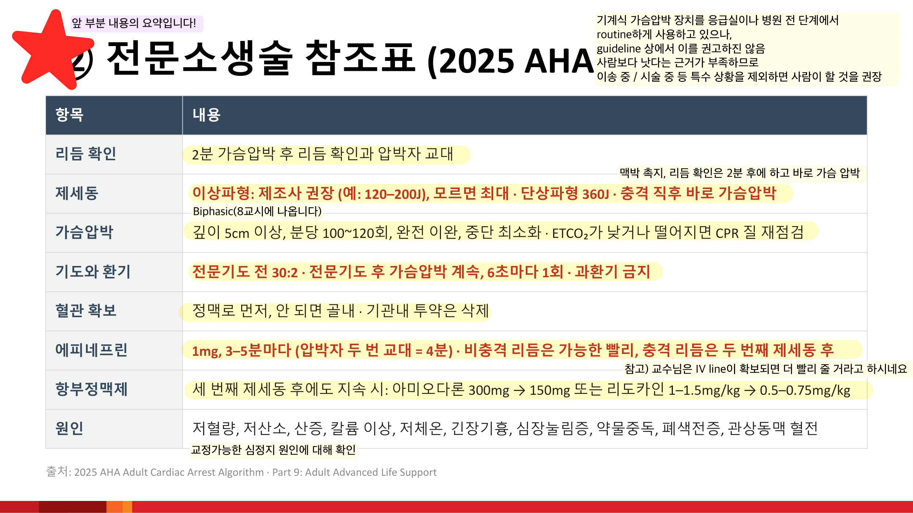{: style="width:76%"}

| 항목 | 내용 |
|---|---|
| 리듬 확인 | **2분** 가슴압박 후 리듬 확인과 압박자 교대 |
| 제세동 | **이상파형: 제조사 권장(예: 120–200J), 모르면 최대 · 단상파형 360J · 충격 직후 바로 가슴압박** (맥박·리듬 확인은 2분 후) |
| 가슴압박 | 깊이 5cm 이상, 분당 100–120회, 완전 이완, 중단 최소화 · ETCO₂가 낮거나 떨어지면 CPR 질 재점검 |
| 기도와 환기 | **전문기도 전 30:2 · 전문기도 후 압박 계속, 6초마다 1회 · 과환기 금지** |
| 혈관 확보 | 정맥로 먼저, 안 되면 골내 · 기관내 투약은 삭제 |
| 에피네프린 | **1mg, 3–5분마다(압박자 두 번 교대 = 4분) · 비충격 리듬은 가능한 빨리, 충격 리듬은 두 번째 제세동 후** — 교수님은 IV가 확보되면 더 빨리 주겠다고 하셨다 |
| 항부정맥제 | 세 번째 제세동 후에도 지속 시: 아미오다론 300 → 150mg 또는 리도카인 1–1.5 → 0.5–0.75mg/kg |
| 원인 | 저혈량, 저산소, 산증, 칼륨 이상, 저체온, 긴장기흉, 심장눌림증, 약물중독, 폐색전증, 관상동맥 혈전 |

**기계식 가슴압박장치**: 응급실·병원 전 단계에서 일상적으로 쓰고 있지만 가이드라인은 이를 **권고하지 않는다** — 사람보다 낫다는 근거가 부족하다. 이송 중·시술 중 같은 특수 상황 외에는 **사람이 압박**하는 것을 권장한다.

# 5. 교정 가능한 원인

제세동과 약물에도 자발순환이 돌아오지 않으면 **교정 가능한 원인(5H5T)**을 찾는다.

## 심정지의 맥락과 5H5T

| 계통 | 질환 | 5H5T |
|---|---|---|
| 심혈관 이상 | 급성심근경색, VF/VT, 굴정지·완전방실차단, 심장눌림증 | **T**hrombosis(관상동맥), **T**amponade |
| 폐 이상 | 폐색전증, 긴장기흉 | **T**hrombosis(폐), **T**ension pneumothorax |
| 전신성 | 대량 출혈, 대사이상 | **H**ypovolemia, **H**ydrogen ion, **H**ypo/Hyperkalemia, **H**ypothermia |
| 기타 | 기도폐쇄, 급성약물중독 | **H**ypoxia, **T**oxins |

## 5H5T: 찾고 고치기

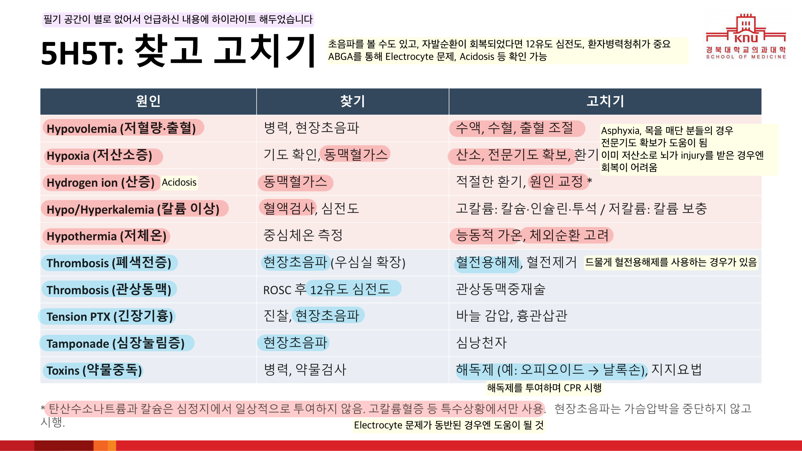{: style="width:76%"}

| 원인 | 찾기 | 고치기 |
|---|---|---|
| **Hypovolemia** (저혈량·출혈) | 병력, 현장초음파 | **수액, 수혈, 출혈 조절** |
| **Hypoxia** (저산소증) | 기도 확인, **동맥혈가스** | **산소, 전문기도 확보**, 환기 |
| **Hydrogen ion** (산증) | **동맥혈가스** | 적절한 환기, **원인 교정** |
| **Hypo/Hyperkalemia** (칼륨 이상) | **혈액검사**, 심전도 | 고칼륨: **칼슘·인슐린·투석** / 저칼륨: 칼륨 보충 |
| **Hypothermia** (저체온) | 중심체온 측정 | **능동적 가온, 체외순환 고려** |
| **Thrombosis** (폐색전증) | **현장초음파(우심실 확장)** | **혈전용해제**, 혈전제거 |
| **Thrombosis** (관상동맥) | ROSC 후 **12유도 심전도** | 관상동맥중재술 |
| **Tension PTX** (긴장기흉) | 진찰, **현장초음파** | 바늘 감압, 흉관삽관 |
| **Tamponade** (심장눌림증) | **현장초음파** | 심낭천자 |
| **Toxins** (약물중독) | 병력, 약물검사 | **해독제**(예: 오피오이드 → 날록손), 지지요법 — 해독제를 주면서 CPR |

- 초음파를 볼 수 있고, 자발순환이 회복되면 **12유도 심전도**와 **병력 청취**가 중요하다. **동맥혈가스(ABGA)**로 전해질 문제·산증을 확인한다.
- 질식(asphyxia, 목을 맨 경우 등)은 **전문기도 확보**가 도움이 되지만, 이미 저산소로 뇌손상을 받았으면 회복이 어렵다.
- 폐색전증에는 드물게 혈전용해제를 CPR 중에 쓰기도 한다.
- **탄산수소나트륨과 칼슘은 심정지에서 일상적으로 투여하지 않는다** — 고칼륨혈증 등 전해질 문제가 동반된 특수 상황에서만.
- 현장초음파는 **가슴압박을 중단하지 않고** 한다.

## 증례 장면 4 — 그다음은? (심정지 후 치료)

응급실에서 **세 번째 제세동과 아미오다론** 후 자발순환이 회복되었지만 여전히 불러도 반응이 없다.

- 자발순환 회복 후 **ABC 순서로 목표(산소·혈압)를 확인하고 교정**
- 환자 상태에 따라 **체온 조절**, 집중 치료
- **12유도 심전도, CT, 초음파**로 교정 가능한 원인을 찾아 교정
- 계속 의식이 없으면 **예후 평가**

(자세한 심정지 후 치료는 오전 강의 범위.)

# 6. 2교시 GRAT 6문항 해설

조별 토의 문제(IRAT·GRAT)는 수업 증례를 따라간다. 교수님 해설 요지:

| 문항 | 상황 | 정답과 근거 |
|---|---|---|
| 1 | 26세 하프마라톤, 반응 없음·헐떡임, AED에 **불규칙하고 일정한 파형 없는 리듬** | **심실세동 → 즉시 제세동**. 압박하면서 제세동 준비. 무수축·PEA는 제세동하지 않고 에피네프린 |
| 2 | 제세동 1회 직후 다음 행동 | **즉시 가슴압박 재개**. 맥박·호흡·리듬 확인, 인공호흡 먼저는 오답 — 리듬 확인은 2분 후 |
| 3 | 구급대가 제세동 2회(약물 없음), 여전히 VF, 정맥로 확보 | **에피네프린 1mg**. 아미오다론은 세 번째 제세동 후. 아트로핀은 서맥 알고리듬 약(예: 맥박 40회, 어지러움, 가슴 답답), 탄산수소나트륨은 일상적으로 쓰지 않음, **바소프레신**은 스테로이드·비타민과 함께 연구됐으나 효과가 입증되지 않아 쓰지 않음 |
| 4 | 세 번째 제세동 후에도 VF | **아미오다론 300mg**(또는 리도카인 1–1.5mg/kg). 150mg은 두 번째 투여. 아데노신·베라파밀은 **맥박 있는 빈맥**의 약 |
| 5 | 기관내삽관 후 압박·호흡 | **압박 지속하며 6초에 1회**. 30:2는 전문기도 전, 3초에 1회는 과환기 |
| 6 | 65세 혈액투석 환자, **3일간 투석 못 함**, 쓰러지기 직전 심전도 **높고 뾰족한 T파**, 지금 PEA | **고칼륨혈증** — 심정지의 교정 가능한 원인. 치료: 맥박이 없으니 압박, 비충격 리듬 경로대로 정맥로 확보 후 에피네프린 ASAP + 고칼륨 교정(칼슘·인슐린·투석) |

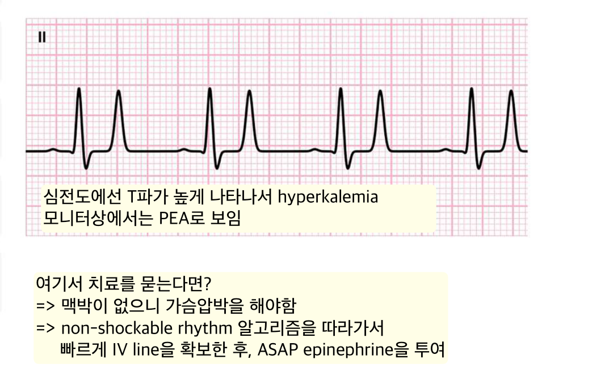{: style="width:62%"}

!!! key "핵심"
    GRAT 흐름이 곧 충격 리듬 알고리듬이다: **VF → 제세동 → 즉시 압박 → (2번째 충격 후) 에피네프린 → (3번째 충격 후) 아미오다론 → 삽관 후 6초 1회 → 원인(5H5T)**.

# 7. 증례 해설 — 왜 26세에게? 무엇이 생존을 가르나

## 젊은 사람의 심정지: 무엇을 생각하나

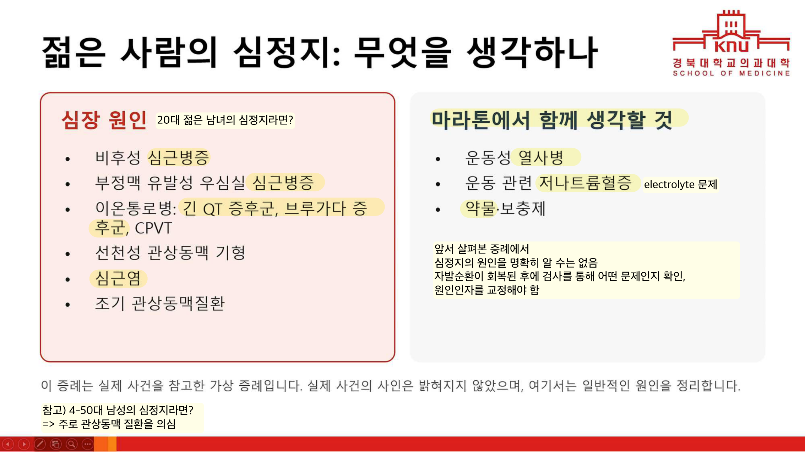{: style="width:76%"}

| 심장 원인 (20대 젊은 남녀) | 마라톤에서 함께 생각할 것 |
|---|---|
| **비후성 심근병증** | 운동성 **열사병** |
| **부정맥 유발성 우심실 심근병증** | 운동 관련 **저나트륨혈증** (전해질 문제) |
| **이온통로병**: **긴 QT 증후군, 브루가다 증후군**, CPVT(카테콜아민성 다형성 심실빈맥) | **약물**·보충제 |
| 선천성 관상동맥 기형 | |
| **심근염** | |
| 조기 관상동맥질환 | |

- 참고: **40–50대 남성**의 심정지라면 주로 **관상동맥질환**을 의심한다.
- 증례는 실제 사건을 참고한 가상 증례이고 실제 사인은 밝혀지지 않았다. 증례만으로 원인을 알 수 없으므로 **자발순환 회복 후 검사로 원인을 확인하고 교정**해야 한다.

## 무엇이 생존을 가르는가

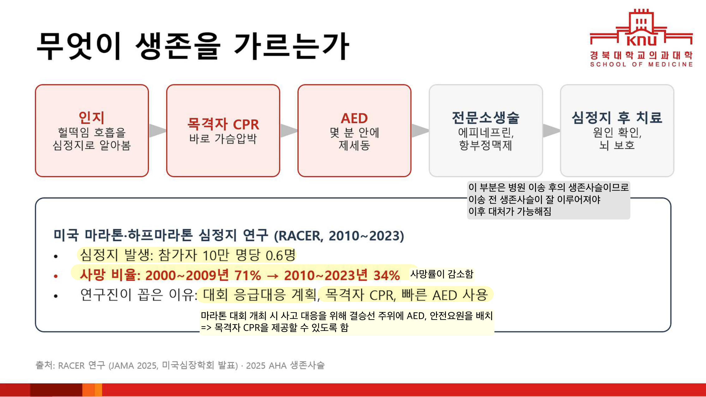{: style="width:76%"}

**인지**(헐떡임 호흡을 심정지로 알아봄) → **목격자 CPR**(바로 가슴압박) → **AED**(몇 분 안에 제세동) → 전문소생술(에피네프린, 항부정맥제) → 심정지 후 치료(원인 확인, 뇌 보호). 뒤의 두 고리는 병원에 온 뒤의 일이므로, **이송 전 고리가 잘 이어져야** 병원에서도 손쓸 수 있다.

**RACER 연구**(미국 마라톤·하프마라톤 심정지, 2010–2023, JAMA 2025):

- 심정지 발생: **참가자 10만 명당 0.6명**
- 사망 비율: **2000–2009년 71% → 2010–2023년 34%**로 감소
- 연구진이 꼽은 이유: **대회 응급대응 계획, 목격자 CPR, 빠른 AED 사용** — 결승선 주위에 AED와 안전요원을 배치해 목격자 CPR이 가능하게 했다.

# 8. 제세동 술기 (OSCE)

1교시에서 "무엇을, 언제"를 배웠다면 이제 "어떻게"다.

## 제세동의 원리: 한꺼번에 리셋

1. **심실세동**: 심근 세포가 제각각 흥분 → 심장이 떨기만 하고 피를 못 보낸다.
2. **충격**: 강한 전류로 심근 대부분을 동시에 탈분극 → 모두 잠시 멈춤(리셋).
3. **회복**: 동방결절이 다시 주도권을 잡아 정상 리듬이 나올 기회.

제세동은 심장을 "뛰게" 하는 것이 아니라 **"멈추게" 하는 것**이고, **심장을 지나는 전류**가 핵심이다 → 전류가 심장을 관통해야 하므로 **패드 위치가 매우 중요**하다.

## 단상파 vs 이상파

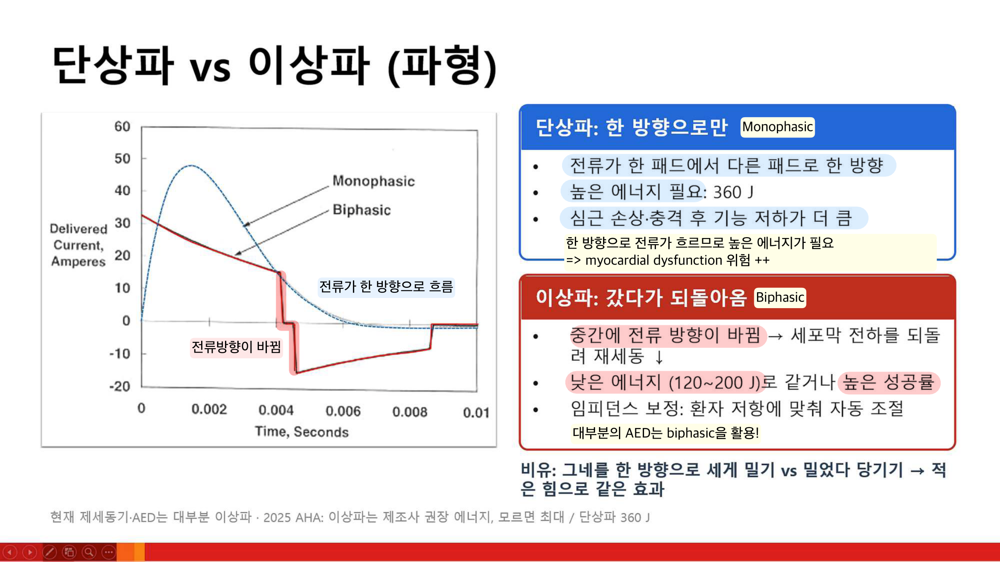{: style="width:76%"}

| | 단상파 (monophasic) | 이상파 (biphasic) |
|---|---|---|
| 전류 | 한 패드에서 다른 패드로 **한 방향으로만** | 중간에 **방향이 바뀌어** 갔다가 되돌아옴 → 세포막 전하를 되돌려 **재세동 ↓** |
| 에너지 | **높은 에너지 필요: 360J** | **낮은 에너지(120–200J)**로 같거나 **높은 성공률** |
| 부작용 | **심근 손상·충격 후 기능 저하가 더 큼** | **임피던스 보정**: 환자 저항에 맞춰 자동 조절 |

비유: 그네를 한 방향으로 세게 밀기 vs 밀었다 당기기 — 적은 힘으로 같은 효과. **현재 제세동기·AED는 대부분 이상파**다.

## 제세동 에너지 ★

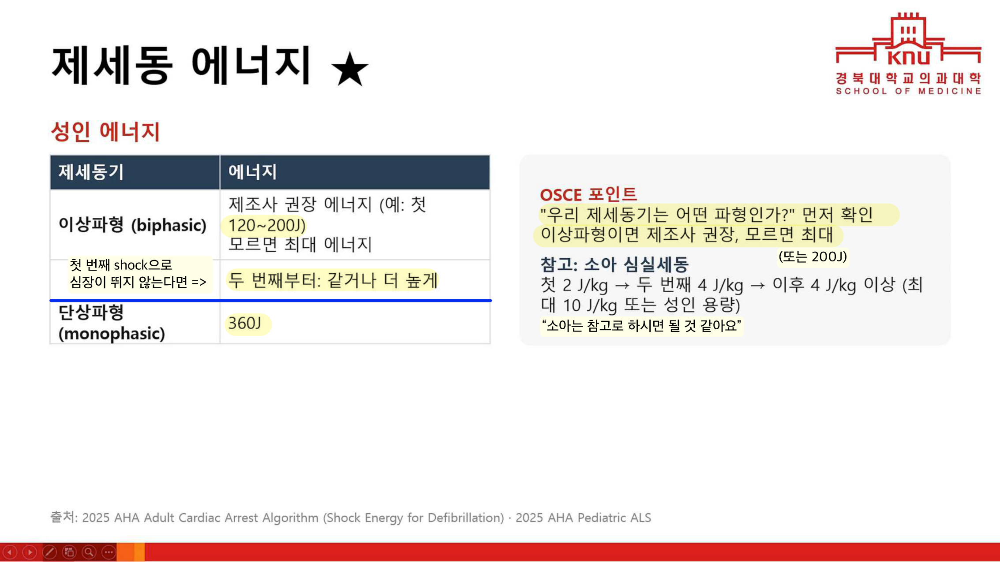{: style="width:76%"}

| 제세동기 | 에너지 |
|---|---|
| **이상파형** | **제조사 권장 에너지**(예: 첫 120–200J), **모르면 최대 에너지**(또는 200J) · 첫 충격으로 안 되면 **두 번째부터 같거나 더 높게** |
| **단상파형** | **360J** |

- **OSCE 포인트**: "우리 제세동기는 어떤 파형인가?" 먼저 확인 → 이상파형이면 제조사 권장, 모르면 최대.
- 참고(소아 심실세동): 첫 **2J/kg** → 두 번째 **4J/kg** → 이후 4J/kg 이상(최대 10J/kg 또는 성인 용량). 교수님: "소아는 참고로."

## 패드(패들) 위치 ★

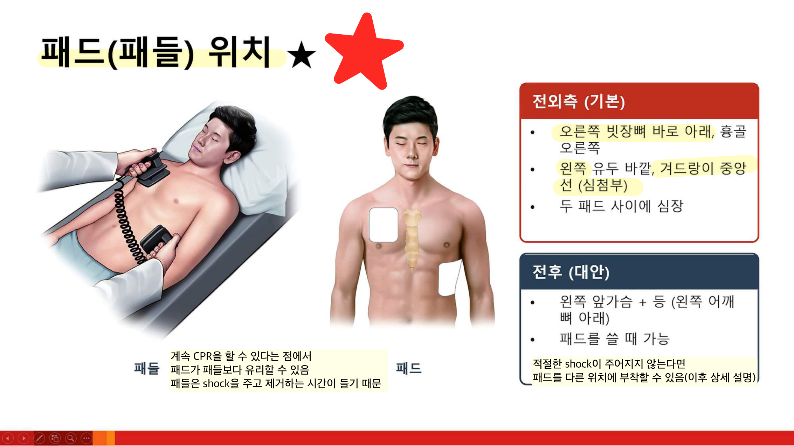{: style="width:76%"}

| 위치 | 붙이는 곳 |
|---|---|
| **전외측 (기본)** | **오른쪽 빗장뼈 바로 아래, 흉골 오른쪽** + **왼쪽 유두 바깥, 겨드랑이 중앙선(심첨부)** → 두 패드 사이에 심장 |
| **전후 (대안)** | **왼쪽 앞가슴 + 등(왼쪽 어깨뼈 아래)** — **패드**를 쓸 때 가능. 충격이 잘 안 들어가면 위치를 바꿀 수 있다 |

**패드가 패들보다 유리할 수 있다** — 패들은 충격을 주고 떼는 시간이 들지만, 패드는 붙여 둔 채 CPR을 계속할 수 있다.

### 실제로 흔한 실수

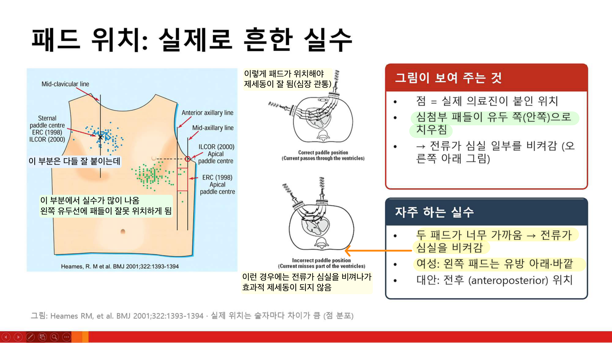{: style="width:76%"}

- 그림의 점 = 실제 의료진이 붙인 위치(Heames 등, BMJ 2001). 흉골 쪽은 다들 잘 붙이는데, **심첨부 패들이 유두 쪽(안쪽)으로 치우친다** → **전류가 심실 일부를 비켜 간다** → 효과적인 제세동이 안 된다.
- 자주 하는 실수: **두 패드가 너무 가까움**. 여성은 왼쪽 패드를 **유방 아래·바깥**에. 대안은 전후 위치.

## 경흉저항 (transthoracic impedance)

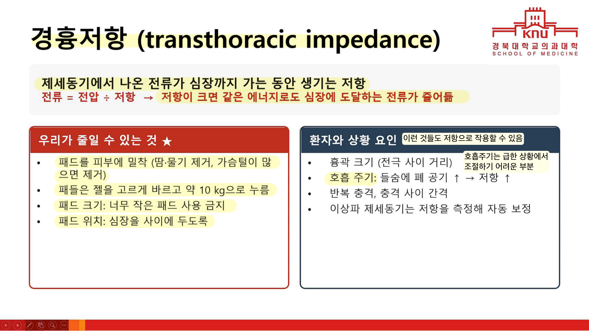{: style="width:76%"}

제세동기에서 나온 전류가 심장까지 가는 동안 생기는 저항. **전류 = 전압 ÷ 저항** → 저항이 크면 같은 에너지로도 심장에 닿는 전류가 줄어든다.

| 우리가 줄일 수 있는 것 ★ | 환자와 상황 요인 |
|---|---|
| 패드를 피부에 **밀착**(땀·물기 제거, 가슴털이 많으면 제거) | 흉곽 크기(전극 사이 거리) |
| 패들은 **젤을 고르게** 바르고 **약 10kg으로 누름** | 호흡 주기: **들숨에 폐 공기 ↑ → 저항 ↑** (급한 상황에서는 조절하기 어렵다) |
| 패드 크기: 너무 작은 패드 금지 | 반복 충격, 충격 사이 간격 |
| 패드 위치: 심장을 사이에 두도록 | 이상파 제세동기는 저항을 측정해 **자동 보정** |

## 제세동 순서: 전부에젤충격 ★

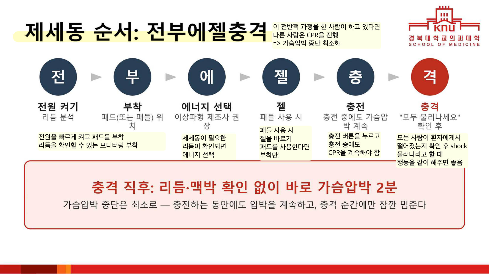{: style="width:76%"}

| 순서 | 할 일 |
|---|---|
| **전**원 켜기 | 빨리 켜고 패드를 붙여 리듬 분석 |
| **부**착 | 패드(또는 패들) 위치 |
| **에**너지 선택 | 제세동이 필요한 리듬이 확인되면, 이상파형은 제조사 권장 |
| **젤** | 패들을 쓸 때 젤 바르기 (패드는 붙이기만) |
| **충**전 | 충전 버튼을 누르고 **충전 중에도 가슴압박 계속** |
| **격**(충격) | **"모두 물러나세요"** — 모두 떨어졌는지 눈으로 확인 후 충격. 물러나라고 할 때 몸짓도 같이 하면 좋다 |

**충격 직후: 리듬·맥박 확인 없이 바로 가슴압박 2분.** 한 사람이 제세동 과정을 하는 동안 다른 사람은 CPR — **압박 중단은 충격 순간에만 잠깐**.

## 제세동: 자주 하는 실수

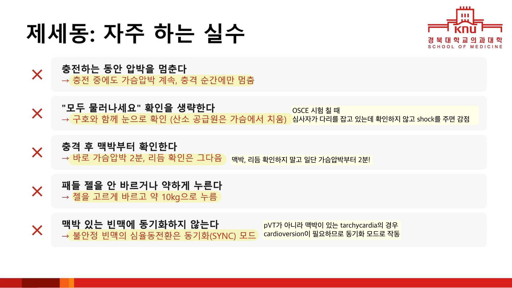{: style="width:76%"}

| 실수 | 올바른 방법 |
|---|---|
| 충전하는 동안 압박을 멈춘다 | **충전 중에도 압박 계속**, 충격 순간에만 멈춤 |
| "모두 물러나세요" 확인을 생략한다 | **구호와 함께 눈으로 확인**, 산소 공급원은 가슴에서 치움. OSCE에서 심사자가 다리를 잡고 있는데 확인 안 하고 충격하면 **감점** |
| 충격 후 맥박부터 확인한다 | **바로 가슴압박 2분**, 리듬 확인은 그다음 |
| 패들 젤을 안 바르거나 약하게 누른다 | 젤을 고르게, 약 10kg으로 누름 |
| 맥박 있는 빈맥에 동기화하지 않는다 | 맥박이 있는 **불안정 빈맥의 심율동전환은 동기화(SYNC) 모드** (pVT가 아니면 제세동이 아니라 심율동전환) |

## 참고: 불응성 심실세동의 제세동 (OSCE 범위 아님)

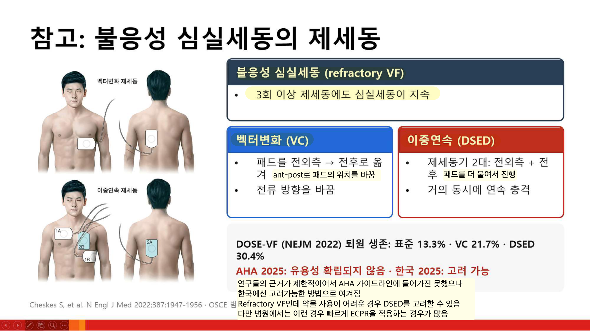{: style="width:76%"}

**불응성 심실세동(refractory VF)**: **3회 이상** 제세동에도 VF가 지속.

| 벡터변화 (VC) | 이중연속 (DSED) |
|---|---|
| 패드를 **전외측 → 전후**로 옮겨 **전류 방향을 바꿈** | 제세동기 **2대**: 전외측 + 전후 패드, **거의 동시에 연속 충격** |

- **DOSE-VF (NEJM 2022)** 퇴원 생존: 표준 **13.3%** · VC **21.7%** · DSED **30.4%**.
- **AHA 2025: 유용성 확립되지 않음 · 한국 2025: 고려 가능** — 근거가 제한적이어서 AHA에는 들어가지 못했지만 한국에서는 고려할 수 있는 방법이다. 약물 사용이 어려운 불응성 VF에서 DSED를 생각할 수 있지만, 병원에서는 이런 경우 빠르게 **ECPR(체외순환 심폐소생술)**을 적용하는 경우가 많다.

## 실습 (제세동 실습에서 한 것)

- 전부에젤충격 순서로 시행, 에너지 **200J**
- 젤을 바른 뒤 충전 — 충전 버튼은 **기계와 패들 모두**에 있다
- 패들이 적절한 위치에 가도록, 젤은 골고루
- 충격 전 **모두 떨어지라고 경고**

# 9. 응용문제: 드라마 속 CPR 오류 찾기

조별로 장면을 보고 **"장면 시간 → 오류 → 올바른 처치"**로 한 줄 답, 맞힌 조부터 귀가.

## 체크포인트 (오늘 배운 것)

1. **심정지 인지**: 반응, 호흡(헐떡임), 맥박 확인은 10초 이내
2. **가슴압박**: 위치, 깊이 5cm 이상, 분당 100–120회, 중단 최소화
3. **제세동**: 충격 리듬에만, "물러나세요", 충격 직후 바로 압박
4. **약물**: 에피네프린 시점, 아미오다론 또는 리도카인
5. **전문기도 후**: 압박 계속하며 6초마다 1회 환기
6. **팀**: 리더의 지시, 압박자 교대, 큰 소리로 확인

## 몸풀기 — 《원티드》 9화

구조된 환자에게 한 CPR의 **위치·속도·깊이가 잘못됨** → **흉골 아래 1/2**을 **분당 100–120회**, **5cm 이상** 깊이로 압박해야 한다. 고품질 CPR이 제공되지 못했다.

## 본 과제 — 《태양의 후예》 (총상 환자 심정지)

교수님이 답안을 따로 주지 않아, 필기 작성자 조가 통과한 답변 기준이다.

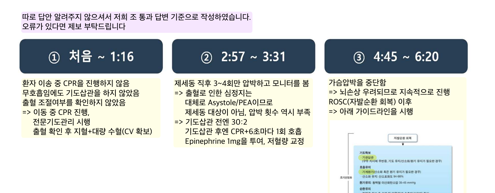{: style="width:76%"}

| 구간 | 오류 | 올바른 처치 |
|---|---|---|
| ① 처음–1:16 | 이송 중 **CPR을 하지 않음**, 무호흡인데 **기도삽관 안 함**, **출혈 조절 여부 확인 안 함** | 이동 중에도 CPR, 전문기도 관리, 출혈 확인 후 **지혈 + 대량 수혈**(중심정맥 확보) |
| ② 2:57–3:31 | 제세동 직후 **3–4회만 압박하고 모니터를 봄** | 출혈(저혈량)로 인한 심정지는 대체로 **무수축/PEA → 제세동 대상이 아님**. 충격 후라도 **2분 압박**. 삽관 전 30:2, 삽관 후 압박 + 6초 1회. **에피네프린 1mg**, **저혈량 교정** |
| ③ 4:45–6:20 | **가슴압박을 중단함** | 뇌손상이 우려되므로 계속 압박. 자발순환 회복 후 **심정지 후 치료 지침**(기도·호흡·순환 목표, 12유도 심전도·CT·초음파, 관상동맥조영술 고려, 의식 없으면 목표체온유지 33–37.5°C 최소 24시간·뇌파·예후 예측) |

# 10. Take-home message

교수님: "정리된 내용이고 계속 이야기한 내용이라 참고하시면 되겠습니다."

1. **반응 없고 정상 호흡이 없거나 헐떡이면 → 심정지, 바로 가슴압박**
2. **VF·pVT에만 제세동, 충격 직후 바로 CPR 2분**
3. **에피네프린 1mg (3–5분)**: 비충격 리듬은 가능한 빨리, 충격 리듬은 두 번째 제세동 후
4. **세 번째 제세동 후에도 지속되면 아미오다론 300mg (또는 리도카인)**
5. **전문기도 확보 후: 압박을 계속하며 6초마다 1회 환기**
6. **소생술 중 교정 가능한 원인(5H5T)을 계속 평가하고 치료**

!!! memo "암기 — 숫자 한 줄"
    맥박 확인 **10초** · 압박 **5cm, 100–120회** · 리듬 확인·교대 **2분** · 에피 **1mg/3–5분** · 아미오 **300→150mg** · 리도 **1–1.5→0.5–0.75mg/kg** · 전문기도 후 **6초 1회(10회/분)** · 이상파 **120–200J(모르면 최대)** · 단상파 **360J** · 패들 **10kg**
