<!-- 필기본: 2026 -->

# 0. 이 수업을 공부하는 법

**최재영 교수님**(응급의학교실)의 「소아응급의학」 수업이다(2026.10, 2시간). 첫째 시간은 **개론** — 소아응급이 성인응급과 무엇이 다른지, 소아 환자 평가, 소아 기본소생술(BLS)과 전문소생술(PALS) — 이고, 둘째 시간은 **증례** 위주(복통·호흡곤란·심정지·빈맥·경련·실신·아동학대·이물 삼킴·중독)다.

교수님 말씀: **시험은 4문제, PPT 안에서 낸다.** 아동학대 발견(FIND·TEN-4) 슬라이드에서는 "여기서 한 문제 낼 것 같아요"라고 하셨다. 필기 작성자는 올해 새로 생긴 수업 같다고 했지만, 2020–2022년 시험에 이 주제의 문항이 12개 있어 2부에 모았다(당시 담당 교수는 다르다).

| 주제 | 기출(2부 번호) | 경향 |
|---|---|---|
| **소아는 작은 성인이 아니다** | 1, 6, 12 | 약 용량은 **체중** 기준, 비전형적 증상, 박출량 고정 |
| **소아 심정지의 특징** | 2, 7 | 원인은 **호흡부전·쇼크**(부정맥 아님), 영아 vs 1세 이후 원인 |
| **소아 기본소생술** | 3, 5, 7, 9, 10 | **15:2 / 30:2 / 3:1**, 맥박 있을 때 인공호흡, 서맥+관류불량 → 압박 |
| **열성 경련** | 4 | 예방적 항경련제 쓰지 않음 |
| **아동학대** | 8, 11 | 의심 부위의 멍(TEN-4), 영아 골절 → 다른 손상 확인, 의심만으로 신고 |

!!! key "핵심"
    - 기출은 거의 다 **"소아가 성인과 다른 점"**을 묻는다: 심정지 원인, 압박:호흡 비율, 연령 구분, 약 용량 기준.
    - 2025 가이드라인으로 바뀐 숫자를 정확히: **연령 구분(영아 <1세, 소아 1–8세 미만, 성인 8세~)**, **인공호흡 빈도(영아 30회/분, 소아 20–30회/분)**, **두 손가락법 삭제**.
    - 교수님이 예고한 **아동학대(FIND·TEN-4)**는 반드시 본다.

# 1. 소아응급의학이란? — 작은 성인이 아니다

## 소아응급의 범위

응급실 이용자의 약 **17.7%(2024년 전국)**, 대구에서는 약 **19%**가 0–19세다. 소아응급은 **나이**로 구분하는데 병원마다 기준이 다르다 — 칠곡경북대병원은 **18세 미만**을 모두 소아로 받고, 동인동 경북대병원은 **15세**를 기준으로 한다. 즉 소아응급은 신생아부터 고등학생까지 나이 폭이 매우 넓다.

소아응급실은 **소아청소년과와 응급의학과의 교집합** 같은 곳이다.

## 대구시 소아응급의료체계

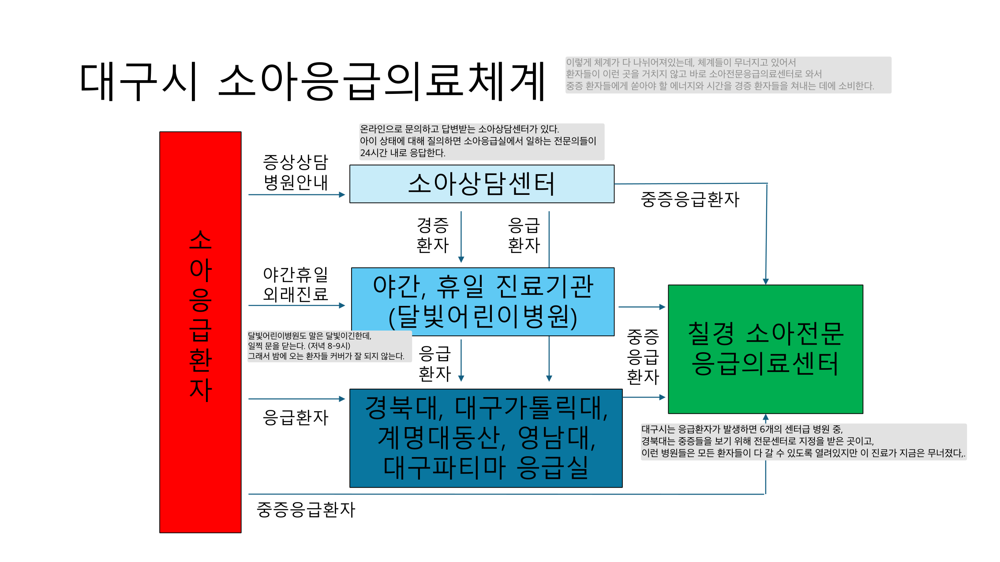{: style="width:72%"}

| 단계 | 기관 | 역할 |
|---|---|---|
| 상담 | **소아상담센터** | 온라인으로 문의하면 소아응급실 전문의가 **24시간 내** 답변(증상 상담·병원 안내) |
| 경증·야간·휴일 | **달빛어린이병원** | 야간·휴일 외래 진료. 실제로는 저녁 8–9시에 일찍 닫아 밤 환자를 다 받지 못한다 |
| 응급 | 경북대·대구가톨릭대·계명대동산·영남대·대구파티마 응급실 | 센터급 응급실 |
| 중증 응급 | **칠곡경북대 소아전문응급의료센터** | 중증 소아를 보기 위해 지정된 전문센터 |

원래는 이렇게 단계가 나뉘어 있지만 체계가 무너지면서 경증 환자도 바로 소아전문응급의료센터로 와서, 중증 환자에게 써야 할 시간과 자원을 경증 환자에게 쓰는 문제가 생기고 있다.

## 작은 성인이 아닌 이유 — 여섯 가지

> "Children are not just small adults."

| 영역 | 성인과 다른 점 |
|---|---|
| **해부·생리** | 기도·흉벽·대사율·순환 보상 방식이 다르다 → 어른 대하듯 할 수 없다 |
| **발달** | 연령마다 의사소통과 진찰 방법이 다르다. 어떤 나이에는 정상인 소견이 다른 나이에는 비정상이다 |
| **역학** | 원인 질환이 다르다: **선천·감염·손상** 중심 |
| **병력과 증상** | 병력은 **보호자**에게서(3–4세 미만은 직접 병력 청취가 어렵다), 증상은 **관찰**로 추정. 진찰할 때도 울고 협조가 안 된다 |
| **약물·장비** | 약 용량은 **체중(키) 기반**, 장비는 **크기별로** 준비 |
| **가족 중심** | 환아와 함께 보호자의 불안도 다룬다 |

!!! exam "기출 포인트"
    1번·6번: **약 용량은 나이가 아니라 체중(또는 체표면적)**으로 정한다 — "나이를 기반으로 한다"가 오답 함정. 6번의 다른 오답: "전형적인 병적 징후가 많다"(→ 적다), "박출량을 늘린다"(→ 심박수로 보상), "뼈막이 얇아 완전 골절이 흔하다"(→ 소아는 뼈막이 두껍고 뼈가 유연해 **불완전 골절(생나무 골절)**이 흔하다), "소생술은 체중으로 구분"(→ **나이**로 구분).
    12번: 소아는 **모호한 증상과 제한된 검사**로 진단이 늦어지기 쉽다. 진찰은 보는 것(시진)·듣는 것(청진)부터 하고 아픈 곳 만지기(촉진)는 마지막에, 보호자 정보는 매우 중요하다.

## 연령 구분과 접근 전략

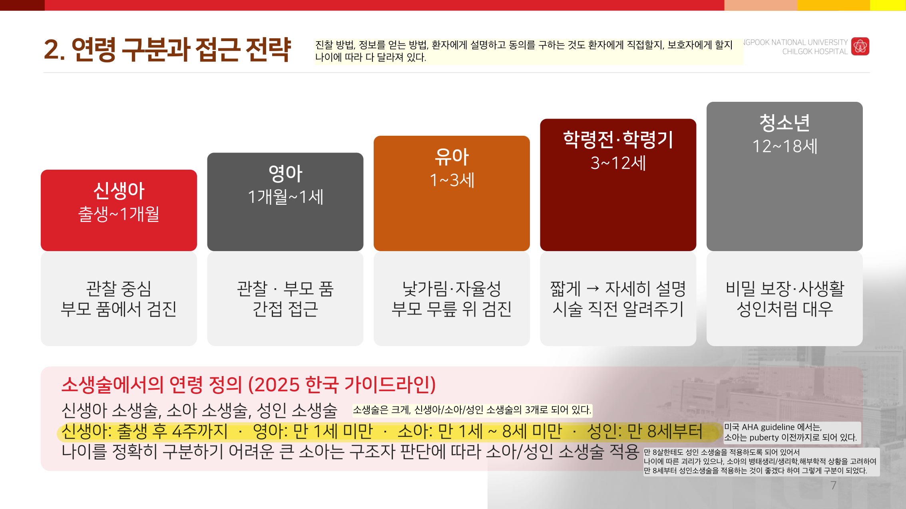{: style="width:72%"}

| 구분 | 나이 | 접근 |
|---|---|---|
| 신생아 | 출생–1개월 | 관찰 중심, 부모 품에서 진찰 |
| 영아 | 1개월–1세 | 관찰, 부모 품에서 간접 접근 |
| 유아 | 1–3세 | 낯가림·자율성 → 부모 무릎 위에서 진찰 |
| 학령전·학령기 | 3–12세 | 짧게 → 자세히 설명, 시술 직전에 알려 주기 |
| 청소년 | 12–18세 | 비밀보장·사생활, 성인처럼 대우 |

진찰 방법, 정보를 얻는 대상, 설명하고 동의를 구하는 상대(환아 본인 vs 보호자)가 나이에 따라 모두 달라진다.

### 소생술에서의 연령 정의 (2025 한국 가이드라인)

소생술은 **신생아 / 소아 / 성인 소생술** 세 가지다.

- **신생아**: 출생 후 **4주까지**
- **영아**: 만 **1세 미만**
- **소아**: 만 **1세 ~ 8세 미만**
- **성인**: 만 **8세부터**
- 나이를 정확히 알기 어려운 큰 소아는 구조자 판단에 따라 소아/성인 소생술을 적용한다.

미국 AHA 가이드라인은 소아를 **사춘기(puberty) 이전**까지로 정의한다. 한국은 소아의 해부·생리학적 상황을 고려해 **만 8세부터 성인 소생술**을 적용하기로 했다.

!!! memo "암기"
    신생아 4주 · 영아 1세 미만 · 소아 1–8세 미만 · 성인 8세~. 신생아 소생술은 **분만 직후(분만실)** 신생아에 쓰는 별도 알고리즘이다 — 생후 40일 영아는 **영아(소아) 소생술** 대상(2부 7번).

※ 확인 필요: 둘째 시간 증례 슬라이드(소생술)에는 이전 기준인 "신생아 0–28일 · 소아 1달–7세 · 성인 8세~"가 실려 있다. 영아/소아 구분을 물으면 첫째 시간의 2025 기준(영아 1세 미만, 소아 1–8세 미만)을 따른다.

## 활력징후는 나이에 따라 달라진다

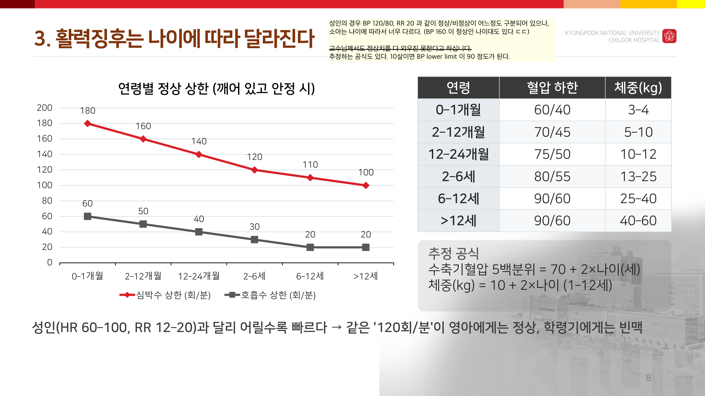{: style="width:76%"}

성인은 HR 60–100, RR 12–20, BP 120/80처럼 정상/비정상이 어느 정도 정해져 있지만, 소아는 **어릴수록 심박수·호흡수가 빠르다.** 같은 120회/분이 영아에게는 정상, 학령기에게는 빈맥이다. 교수님도 정상치를 다 외우지는 못한다고 하셨다 — 대신 **추정 공식**을 쓴다.

| 연령 | 심박수 상한 | 호흡수 상한 | 혈압 하한 | 체중(kg) |
|---|---|---|---|---|
| 0–1개월 | 180 | 60 | 60/40 | 3–4 |
| 2–12개월 | 160 | 50 | 70/45 | 5–10 |
| 12–24개월 | 140 | 40 | 75/50 | 10–12 |
| 2–6세 | 120 | 30 | 80/55 | 13–25 |
| 6–12세 | 110 | 20 | 90/60 | 25–40 |
| >12세 | 100 | 20 | 90/60 | 40–60 |

!!! memo "암기"
    - **수축기 혈압 5백분위(하한) = 70 + 2 × 나이(세)** → 10세면 약 90
    - **체중(kg) = 10 + 2 × 나이** (1–12세)

## 기도: 작고, 좁고, 쉽게 막힌다

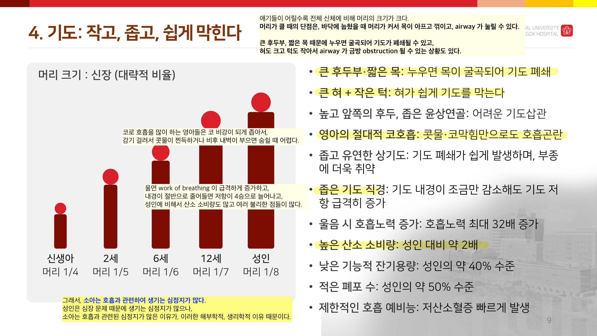{: style="width:76%"}

어릴수록 몸 전체에 비해 머리가 크다(신생아 1/4 → 2세 1/5 → 6세 1/6 → 12세 1/7 → 성인 1/8).

- **큰 후두부·짧은 목**: 바닥에 눕히면 목이 앞으로 꺾여(굴곡) 기도가 눌린다.
- **큰 혀 + 작은 턱**: 혀가 쉽게 기도를 막는다.
- **높고 앞쪽에 있는 후두, 좁은 윤상연골**: 기관내삽관이 어렵다.
- **영아는 절대적으로 코로 숨쉰다**: 비강이 좁아 콧물이 찐득하거나 점막이 부으면 그것만으로 호흡곤란.
- **좁고 유연한 상기도**: 쉽게 막히고 부종에 취약하다.
- **좁은 기도 직경**: 내경이 조금만 줄어도 저항이 급격히 증가 — 내경이 절반이 되면 저항은 **4제곱(16배)**으로 커진다(저항 ∝ 1/반지름4).
- **울면** 호흡노력이 최대 **32배** 증가.
- **산소 소비량은 성인의 약 2배**, **기능적 잔기용량은 성인의 약 40%**, **폐포 수는 약 50%** → 호흡 예비능이 적어 **저산소혈증이 빨리** 온다.

!!! key "핵심"
    이런 해부·생리 때문에 **성인은 심장 문제로, 소아는 호흡 문제로** 심정지가 오는 경우가 많다.

## 호흡과 순환: 예비력이 적다

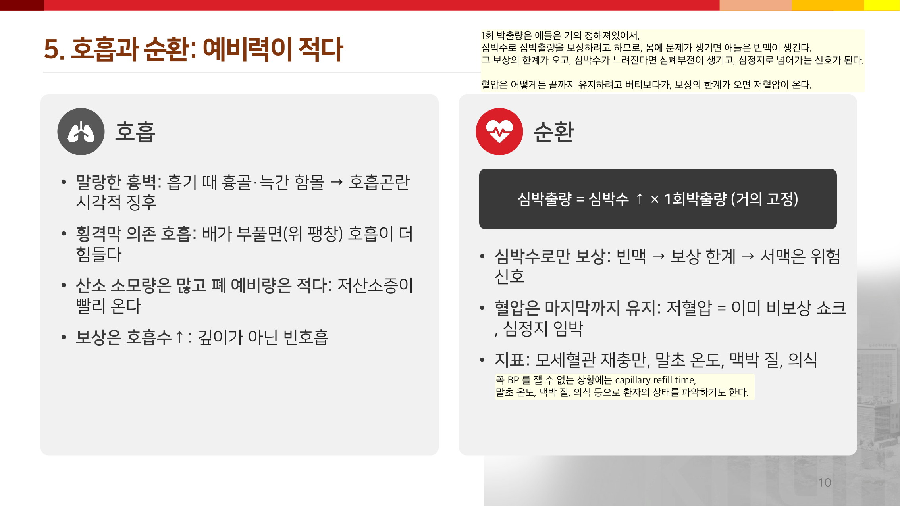{: style="width:72%"}

**호흡**

- 말랑한 흉벽: 숨을 들이쉴 때 흉골·늑간이 움푹 들어간다(함몰) → 호흡곤란의 눈에 보이는 징후.
- 횡격막 의존 호흡: 배가 부풀면(위 팽창) 숨쉬기가 더 힘들다.
- 산소 소모량은 많고 폐 예비량은 적다 → 저산소증이 빨리 온다.
- 보상은 **호흡수 증가**: 깊이가 아니라 빈호흡으로 보상한다.

**순환**

- **심박출량 = 심박수 ↑ × 1회박출량(거의 고정)** → 소아는 **심박수로만** 보상한다. 문제가 생기면 먼저 **빈맥**.
- 보상의 한계가 오면 심박수가 느려진다 → **서맥은 심폐부전·심정지 직전의 위험 신호**.
- 혈압은 끝까지 버티다가 한계가 오면 떨어진다 → **저혈압 = 이미 비보상 쇼크, 심정지 임박**.
- 혈압을 잴 수 없으면 **모세혈관 재충만 시간, 말초 온도, 맥박의 질, 의식**으로 판단한다.

## 체온·수분·혈당·면역의 차이

| 영역 | 특징 | 임상 |
|---|---|---|
| **체온** | 체중당 체표면적이 커서 열 손실이 빠르다 | 소생·진찰 중에도 **보온**(저체온 방지) |
| **수분** | 체수분 비율과 회전율이 높다 | 구토·설사만으로 빠르게 **탈수** |
| **혈당** | 근육이 적어 글리코겐 저장이 적다 | 감염·금식 시 **저혈당** → **처진 아이는 혈당부터** |
| **면역·신경** | 면역이 미성숙, 경련 역치가 낮다 | 세균감염 위험 ↑, **열성경련** |

아침에 119로 오는 아이 중 잘 못 일어나고 축 처지고 식은땀 흘리고 불러도 대답 못 하고 피부가 차가운 아이는 혈당이 40–50인 경우가 많다. 소아가 응급실에 오는 가장 많은 이유는 **열**이고(어린이집에서 옮아 오는 경우가 많다), 열과 함께 오는 **열성경련도 매우 흔하다**.

## 연령별 응급 질환과 사망 원인

| 영아(1세 미만) | 소아(1세 이후) | 청소년 |
|---|---|---|
| 선천이상·조산 합병증·유전/대사 질환 | **외상**(교통사고·익사·추락)이 주된 사망 원인 | 손상, 자살, 타살이 주요 사망 원인 |
| **영아돌연사증후군(SIDS)** | 악성종양, 선천성 심질환 | **10세 이후 고의적 자해(자살) 1위**, 증가 추세 |
| 호흡부전, 학대·사고 | **5세 미만 사고사 2위: 익사** | 정서적 지지와 개입 필요 |
| 심정지 원인: **호흡부전·SIDS** | **1–9세 사망원인 3위: 가해(타살)** | |

!!! key "핵심"
    소아 심정지의 상당 부분은 **예방 가능한 원인**(SIDS·사고·익사·학대·자해)에서 시작한다. 성인(주로 심장 문제)과 달라서 **예방이 법률화**되고 있다.

!!! exam "기출 포인트"
    2번: "1–8세 소아 심정지의 가장 흔한 원인은 **외상**", "영아는 **선천성 기형·호흡부전·SIDS**"는 맞는 보기. 7번 ③ "1세 이전 심정지는 외상이 가장 흔하다"는 오답.

# 2. 소아 환자 평가 — 시진 → 평가 → 처치

## 소아 평가삼각형 (Pediatric Assessment Triangle, PAT)

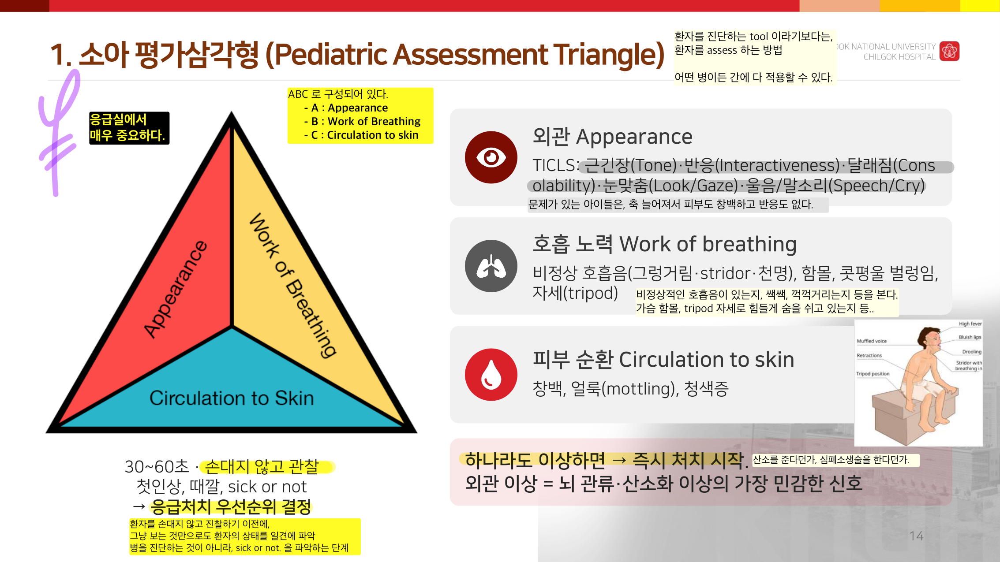{: style="width:76%"}

PAT는 병을 **진단**하는 도구가 아니라 환자를 **평가(assess)**하는 방법이다. 환자에게 **손대지 않고 30–60초 관찰**만으로 첫인상("때깔")을 보고 **sick or not**을 판단해 **응급처치 우선순위**를 정한다. 어떤 병이든 적용할 수 있고 응급실에서 매우 중요하다.

| 요소 | 보는 것 |
|---|---|
| **A — 외관(Appearance)** | **TICLS**: 근긴장(Tone)·반응(Interactiveness)·달래짐(Consolability)·눈맞춤(Look/Gaze)·울음/말소리(Speech/Cry). 문제가 있는 아이는 축 늘어지고 반응이 없다 |
| **B — 호흡노력(Work of breathing)** | 비정상 호흡음(그렁거림·stridor·천명), 함몰, 콧평울 벌렁임, 자세(tripod — 앞으로 기대 팔을 짚고 숨쉬는 자세) |
| **C — 피부 순환(Circulation to skin)** | 창백, 얼룩덜룩함(mottling), 청색증 |

!!! key "핵심"
    - **하나라도 이상하면 즉시 처치 시작**(산소 공급, 심폐소생술 등).
    - **외관 이상 = 뇌 관류·산소화 이상의 가장 민감한 신호.**

## 호흡곤란에서 호흡부전으로

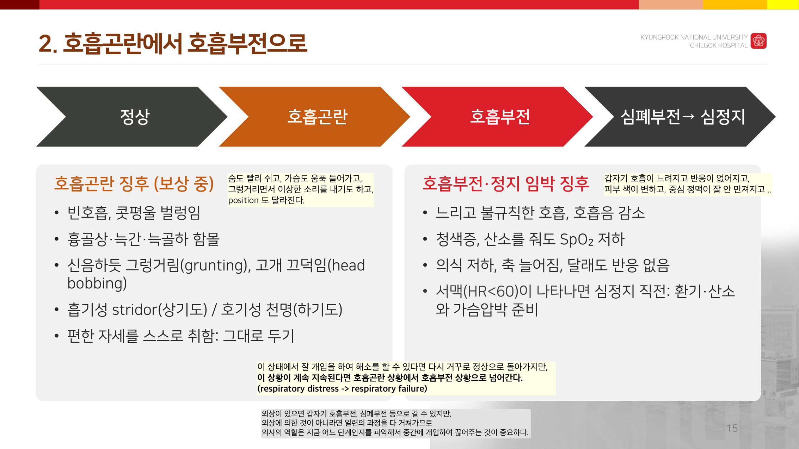{: style="width:72%"}

| 호흡곤란 징후 (보상 중, respiratory distress) | 호흡부전·정지 임박 징후 (respiratory failure) |
|---|---|
| 빈호흡, 콧평울 벌렁임 | **느리고 불규칙한 호흡**, 호흡음 감소 |
| 흉골상·늑간·늑골하 함몰 | 청색증, **산소를 줘도 SpO2 저하** |
| 신음하듯 그렁거림(grunting), 고개 끄덕임(head bobbing) | 의식 저하, 축 늘어짐, 달래도 반응 없음 |
| 흡기성 stridor(상기도) / 호기성 천명(하기도) | **서맥(HR < 60)** → 심정지 직전: 환기·산소와 가슴압박 준비 |
| 편한 자세를 스스로 취함 → **그대로 두기** | |

호흡곤란 단계에서 잘 개입하면 정상으로 돌아가지만, 지속되면 호흡부전으로 넘어간다. 외상은 갑자기 호흡부전·심폐부전으로 갈 수 있지만, 외상이 아니면 대개 이 과정을 **차례로** 거치므로 **의사의 역할은 지금 어느 단계인지 파악해 중간에 끊어 주는 것**이다.

## 쇼크: 저혈압은 늦은 징후

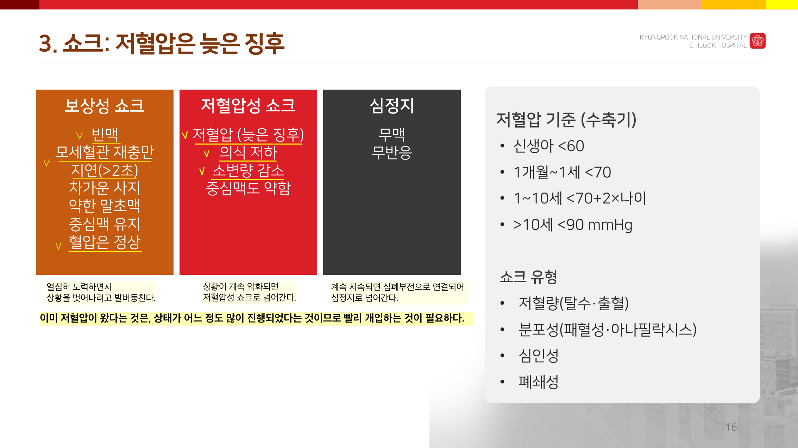{: style="width:76%"}

| 보상성 쇼크 | 저혈압성 쇼크 | 심정지 |
|---|---|---|
| **빈맥** | **저혈압(늦은 징후)** | 무맥 |
| 모세혈관 재충만 지연(> 2초) | 의식 저하 | 무반응 |
| 차가운 사지, 약한 말초맥 | 소변량 감소 | |
| 중심맥 유지 | 중심맥도 약함 | |
| **혈압은 정상** | | |

보상성 쇼크에서는 아이가 열심히 버티며(빈맥 등) 벗어나려 하고, 악화되면 저혈압성 쇼크 → 심폐부전 → 심정지로 간다. **이미 저혈압이 왔다는 것은 상당히 진행된 것**이므로 빨리 개입해야 한다.

!!! memo "암기"
    **저혈압 기준(수축기)**: 신생아 < 60 · 1개월–1세 < 70 · 1–10세 < 70 + 2 × 나이 · 10세 초과 < 90 mmHg.
    **쇼크 유형**: 저혈량(탈수·출혈) · 분포성(패혈성·아나필락시스) · 심인성 · 폐쇄성.

## 일차평가: ABCDE

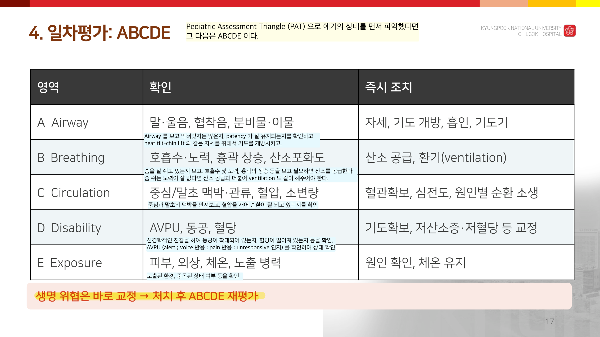{: style="width:76%"}

PAT로 상태를 먼저 파악한 다음 ABCDE로 평가한다. **생명을 위협하는 문제는 바로 교정 → 처치 후 ABCDE 재평가.**

| 영역 | 확인 | 즉시 조치 |
|---|---|---|
| **A** Airway | 말·울음, 협착음, 분비물·이물 — 막혀 있지 않은지(patency) | 자세(머리기울임-턱들어올리기), 기도 개방, 흡인, 기도기 |
| **B** Breathing | 호흡수·노력, 흉곽 상승, 산소포화도 | 산소 공급, 호흡노력이 없으면 **환기(ventilation)**까지 |
| **C** Circulation | 중심/말초 맥박·관류, 혈압, 소변량 | 혈관 확보, 심전도, 원인별 순환 소생 |
| **D** Disability | **AVPU**(Alert / Voice에 반응 / Pain에 반응 / Unresponsive), 동공, **혈당** | 기도 확보, 저산소증·저혈당 등 교정 |
| **E** Exposure | 피부, 외상, 체온, 노출 병력(환경·중독) | 원인 확인, **체온 유지** |

# 3. 소아 기본소생술 (BLS, 2025 한국 가이드라인 기준)

## 소아 심정지는 성인과 어떻게 다른가

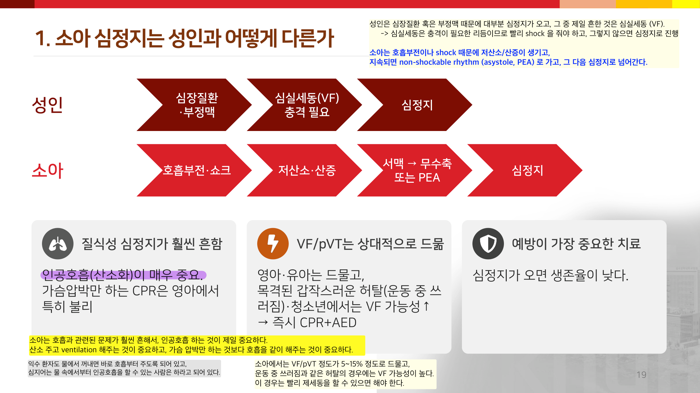{: style="width:76%"}

| | 성인 | 소아 |
|---|---|---|
| 원인 | 심장질환·부정맥 | **호흡부전·쇼크** |
| 경로 | **심실세동(VF)** → 심정지 | 저산소·산증 → **서맥 → 무수축 또는 PEA** → 심정지 |
| 리듬 | 충격 필요 리듬 → 빨리 제세동 | 충격 불필요 리듬이 대부분 |

- **질식성(asphyxial) 심정지가 훨씬 흔하다** → **인공호흡(산소화)이 매우 중요.** 가슴압박만 하는 CPR은 영아에서 특히 불리하다. 익수 환자도 물에서 꺼내면 바로 호흡부터, 가능하면 물속에서부터 인공호흡을 하라고 되어 있다.
- **VF/pVT는 상대적으로 드물다(5–15%).** 영아·유아는 드물고, **목격된 갑작스러운 허탈(운동 중 쓰러짐)·청소년**에서는 VF 가능성 ↑ → 즉시 CPR + AED.
- **예방이 가장 중요한 치료**: 심정지가 오면 생존율이 낮다.

!!! exam "기출 포인트"
    2번: "소아 심정지의 발생 경로는 대부분 **급성 부정맥**에 의한 것이다"가 틀린 보기(정답). 증례 슬라이드의 그림처럼 **호흡부전·쇼크 → 심폐부전 → 심정지**가 주 경로이고, 급성 부정맥에 의한 것은 5–15%뿐이다. 7번 ② "호흡보다 심장 문제가 많다"도 오답.

## 예방이 중요

| 원인 | 예방 |
|---|---|
| **영아돌연사(SIDS)** | 푹신한 바닥·**엎드려 재우기 피하기**, 보호자 금연 |
| **교통사고** | 카시트: 9 kg 미만 **후방** · 1–4세 소아용 · 4–7세 보조의자 / **12세 미만 뒷좌석** |
| **익사** | 5세 미만 사고사 2위. 수영 시 구명장비, 보호자의 시선 |
| **아동학대** | 1–9세 사망원인 3위(가해). 관심과 적극적 신고 |
| **청소년 자살** | 10세 이후 자해 1위, 증가 추세. 정서적 지지와 중재 |
| **병원 내 악화** | **소아조기경고체계(PEWS)**, 신속대응팀으로 조기 발견 |

!!! exam "기출 포인트"
    5번(11개월, 엎드려 이불에 얼굴을 파묻고 발견 — SIDS·질식 상황): 맥박·호흡이 없으면 **119 신고 후 구급대가 올 때까지 CPR**. 다리 올리기·손가락으로 목 안 휘젓기·설탕물은 오답.

## 소아 기본소생술 순서

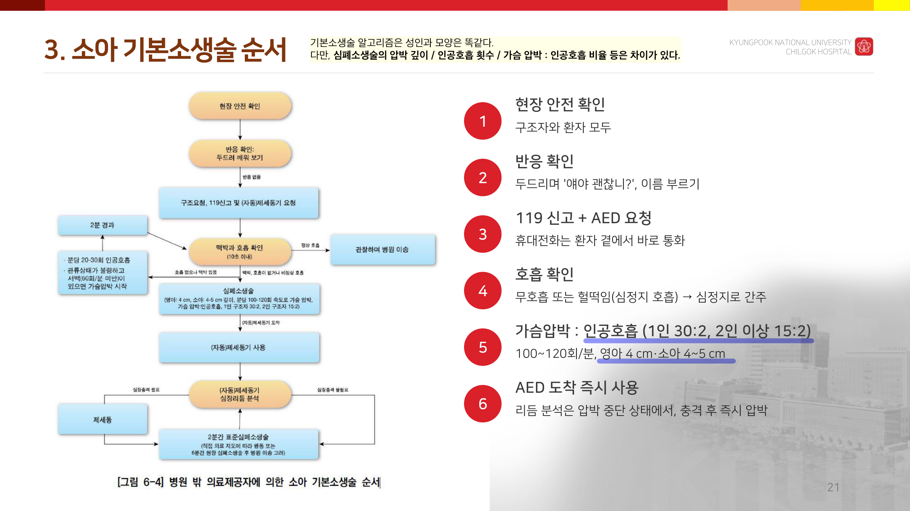{: style="width:76%"}

기본소생술 알고리즘의 **모양은 성인과 같다.** 다른 것은 압박 깊이, 인공호흡 횟수, 압박:호흡 비율이다.

1. **현장 안전 확인** — 구조자와 환자 모두
2. **반응 확인** — 두드리며 "얘야 괜찮니?", 이름 부르기
3. **119 신고 + AED 요청** — 휴대전화는 환자 곁에서 바로 통화
4. **호흡 확인** — 무호흡 또는 헐떡임(심정지 호흡) → 심정지로 간주
5. **가슴압박 : 인공호흡 = 1인 30:2, 2인 이상 15:2** — 100–120회/분, 영아 4 cm · 소아 4–5 cm
6. **AED 도착 즉시 사용** — 리듬 분석은 압박을 멈춘 상태에서, 충격 후 즉시 압박

### 의료제공자: 맥박과 호흡을 동시에 확인

- **10초 이내**에 무호흡(또는 비정상 호흡)과 맥박을 동시에 확인한다.
- 맥박 위치: **영아는 위팔동맥(brachial a.)**, **소아는 목동맥 또는 대퇴동맥** — 소아는 목이 짧아 경동맥 촉지가 어렵다.
- **맥박(+)인데 호흡이 불충분** → **구조호흡 2–3초마다**(영아 분당 30회, 1–8세 분당 20–30회).
- **맥박이 있어도 서맥(< 60회/분)이면서 전신관류가 불량** → **가슴압박 시작.**

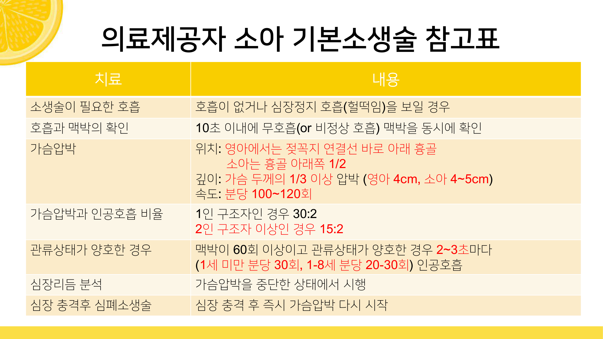{: style="width:72%"}

!!! exam "기출 포인트"
    9번(2020, 5세): **관류가 불량하고 서맥이 있으면 가슴압박을 시작**한다가 정답. 오답: "3–5초마다 인공호흡"(→ 2–3초), 택시로 이송, 무조건 제세동.
    3번(2022): 정답 **2인 15:2**. 오답 함정: "BLS에 제세동이 없다"(→ AED 포함), "1인 3:1"(→ 3:1은 신생아), "맥박 있으면 6초마다 인공호흡, 5분마다 재평가"(→ 6초는 성인 전문기도 후 환기; 소아는 2–3초, 2분마다 재평가), "6 cm 이상"(→ 6 cm 초과 금지는 성인).

## 가슴압박: 영아 · 소아 · 성인 비교

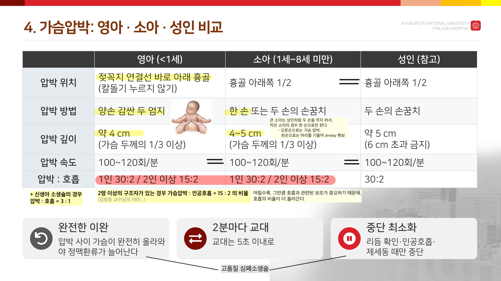{: style="width:78%"}

| | 영아(< 1세) | 소아(1세 ~ 8세 미만) | 성인(참고) |
|---|---|---|---|
| 압박 위치 | **젖꼭지 연결선 바로 아래 흉골**(칼돌기 누르지 않기) | 흉골 아래쪽 1/2 | 흉골 아래쪽 1/2 |
| 압박 방법 | **양손 감싼 두 엄지** | **한 손 또는 두 손의 손꿈치** | 두 손의 손꿈치 |
| 압박 깊이 | **약 4 cm** (가슴 두께의 1/3 이상) | **4–5 cm** (가슴 두께의 1/3 이상) | 약 5 cm (6 cm 초과 금지) |
| 압박 속도 | 100–120회/분 | 100–120회/분 | 100–120회/분 |
| 압박 : 호흡 | **1인 30:2 / 2인 이상 15:2** | **1인 30:2 / 2인 이상 15:2** | 30:2 |

- 큰 소아는 성인처럼 두 손을 깍지 껴서, 작은 소아는 **한 손**으로 압박하고 다른 손으로는 머리를 기울여 기도를 확보한다.
- **신생아 소생술은 압박 : 호흡 = 3 : 1.** 어릴수록 호흡 보조가 중요해서 호흡의 비율이 올라간다.
- 고품질 심폐소생술: **완전한 이완**(압박 사이 가슴이 완전히 올라와야 정맥환류가 늘어난다), **2분마다 교대**(5초 이내), **중단 최소화**(리듬 확인·인공호흡·제세동 때만 중단).

### 영아는 '두 엄지', 소아는 '손꿈치'

- 영아: **구조자 수와 무관하게 양손 감싼 두 엄지법**(encircling two-thumb). 불가능하거나 1세에 가까운 체구면 한 손 손꿈치를 고려한다.
- **두 손가락법은 관상동맥 관류압·압박의 질이 낮아 가이드라인 개정으로 빠졌다.**
- 공통: 매 압박 후 완전 이완(지치면 불완전 이완이 흔하다), 2분마다 교대, 칼돌기·갈비뼈 압박 피하기.

!!! memo "암기"
    **성인 30:2 · 소아/영아 1인 30:2, 2인 15:2 · 신생아 3:1.** 영아 4 cm · 소아 4–5 cm · 성인 5 cm(6 cm 초과 금지).

!!! exam "기출 포인트"
    10번(2020, 생후 2주 신생아): 신생아는 **3:1**, 압박 깊이 약 4 cm(가슴 앞뒤 지름의 1/3), 소생술 진행은 **심박수**로 평가(정답), 마스크는 입과 코를 덮되 **눈은 덮지 않는다**. 15:2(소아 2인)·30:2·5 cm·"눈까지 덮는다"가 함정.
    ※ 확인 필요: 2부 해설 일부에는 "소아 약 5 cm"로 적혀 있으나, 이 수업(2025 한국 가이드라인)의 기준은 **소아 4–5 cm**다.

## 인공호흡과 백마스크 환기

- **기도 개방**: 머리기울임-턱들어올리기. 외상·경추 손상이 의심되면 턱 밀어올리기(jaw thrust) — 그래도 기도 유지가 안 되면 경추 손상 환자라도 머리기울임법을 한다.
- **호흡 방법**: 1초에 걸쳐 가슴이 올라올 만큼만.
- **의료인 백밸브마스크(BVM)**: 마스크가 **입·코·턱**을 덮고 **눈은 덮지 않게.**
- **산소**: 소생 중 100% 산소(저장백, 10–15 L/min).
- **과환기 금지**: 흉강 내압 ↑ → 정맥환류 ↓ → 심박출량·뇌혈류 ↓. 정해진 횟수에 맞춘다.
- **병원 밖 심정지**: 기관내삽관을 할 수 있는 상황이어도 **BVM 환기가 합리적**.
- **인공호흡 빈도(개정)**: **영아 분당 30회, 소아 분당 20–30회**. (성인은 분당 10회 = 6초에 한 번)

## 이물에 의한 기도폐쇄 (질식)

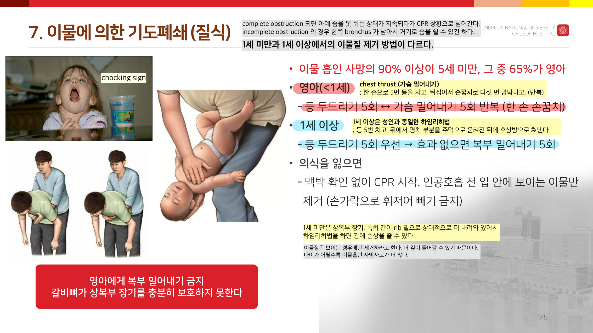{: style="width:76%"}

- **이물 흡인 사망의 90% 이상이 5세 미만, 그중 65%가 영아.** 어릴수록 이물 흡인 사망이 많다.
- 목을 움켜쥐는 **choking sign**. 완전 폐쇄(complete obstruction)는 아예 숨을 못 쉬다가 CPR 상황으로 넘어가고, 불완전 폐쇄는 한쪽 기관지로 숨을 쉴 수 있다.

| | 영아(< 1세) | 1세 이상 |
|---|---|---|
| 방법 | **등 두드리기 5회 ↔ 가슴 밀어내기 5회** 반복(가슴 밀어내기는 한 손 손꿈치) | **등 두드리기 5회 우선 → 효과 없으면 복부 밀어내기 5회**(하임리히법, 성인과 같음) |
| 금기 | **복부 밀어내기 금지** | |

- 영아에게 복부 밀어내기를 하지 않는 이유: **갈비뼈가 상복부 장기를 충분히 보호하지 못한다** — 특히 간이 갈비뼈 아래로 상대적으로 더 내려와 있어 손상된다.
- 이물이 나올 때까지 또는 의식을 잃을 때까지 반복한다.
- **의식을 잃으면**: 맥박 확인 없이 CPR 시작. 인공호흡 전 **입안에 보이는 이물만** 제거한다 — **손가락으로 휘저어 빼기 금지**(더 깊이 들어갈 수 있다).

!!! exam "기출 포인트"
    5번 ② "손가락으로 목 안에 이물이 있는지 확인한다"는 오답 — 맹목적인 손가락 제거는 하지 않는다.

## 2025 AHA·AAP 소아 기본소생술 지침 요점

1. 호흡기 질환은 여전히 영유아·소아 심정지의 주요 원인 → 환기·산소 공급을 신속히.
2. 병원 밖 심정지에서 **흉부압박에 호흡을 병행하면 생존율이 향상** → 일반인도 가능하면 호흡을 제공한다.
3. 전문기도를 장착한 CPR 중이거나, 맥박이 있으면서 인공호흡을 받는 경우: **영아 분당 30회, 소아 분당 20–30회.**
4. 심한 이물 기도폐쇄(FBAO) 영아: **등 두드리기 5회 + 손꿈치 흉부 밀어내기 5회** 반복. 복부 압박은 권장하지 않는다.
5. 심한 FBAO 소아: 등 두드리기 5회 + 복부 압박 5회 반복(1세 이상은 성인과 같은 하임리히법).
6. 반응이 없고 호흡이 비정상(헐떡임 포함)이면 즉시 신고하고 **흉부압박부터** 고품질 CPR.
7. 고품질 CPR: 적절한 압박 속도·깊이, 중단 최소화, 완전 이완, **과도한 인공호흡 피하기**.
8. 영아 압박: 한 손 기법 또는 **두 엄지손가락으로 감싼 양손 기법**. 가슴을 감쌀 수 없으면 한 손 손꿈치. **두 손가락 기법은 제외.**
9. 가능한 한 빨리 AED 부착(소아용 감쇠기·패드가 있으면 사용).
10. VF/pVT에서는 신속한 제세동이 매우 중요하며 제세동 후 일시정지를 최소화.

# 4. 소아 전문소생술 (PALS)

전문소생술이 기본소생술과 다른 점은 크게 두 가지 — **전문기도기 사용**과 **약물 사용**이다.

## 제세동과 AED: 체중 기반 에너지

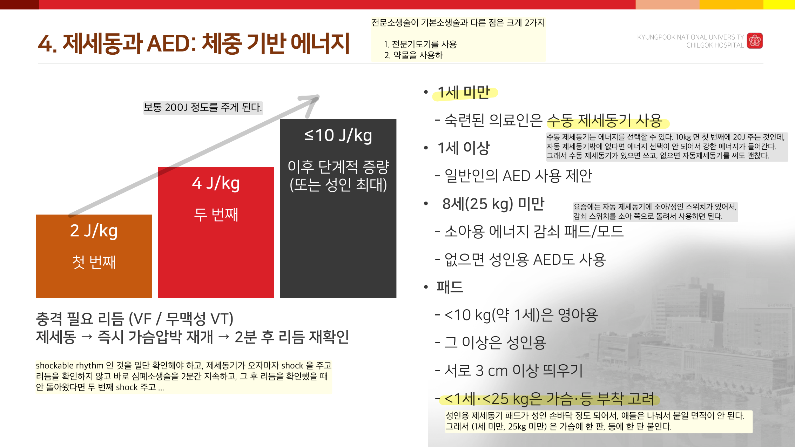{: style="width:76%"}

- 충격 필요 리듬(**VF / 무맥성 VT**)을 확인하면 제세동기가 오자마자 충격 → **리듬 확인 없이 즉시 가슴압박 재개** → **2분 후 리듬 재확인** → 안 돌아왔으면 두 번째 충격.
- 에너지: **첫 번째 2 J/kg → 두 번째 4 J/kg → 이후 단계적 증량, 최대 10 J/kg(또는 성인 최대).** 예) 10 kg이면 첫 충격 20 J (성인은 보통 200 J).
- **1세 미만**: 숙련된 의료인은 **수동 제세동기**(에너지를 선택할 수 있다).
- **1세 이상**: 일반인의 AED 사용 제안.
- **8세(25 kg) 미만**: 소아용 에너지 감쇠 패드/모드. 요즘 AED에는 소아/성인 스위치가 있다. **없으면 성인용 AED도 사용**한다(에너지가 강하게 들어가지만 안 쓰는 것보다 낫다).
- **패드**: 10 kg(약 1세) 미만은 영아용, 그 이상은 성인용. 서로 **3 cm 이상** 띄운다. 성인용 패드는 손바닥만 해서 작은 아이 가슴에 두 장을 붙일 면적이 없으므로 **1세 미만·25 kg 미만은 가슴 한 장 + 등 한 장** 부착을 고려한다.

## 전문소생술 알고리즘

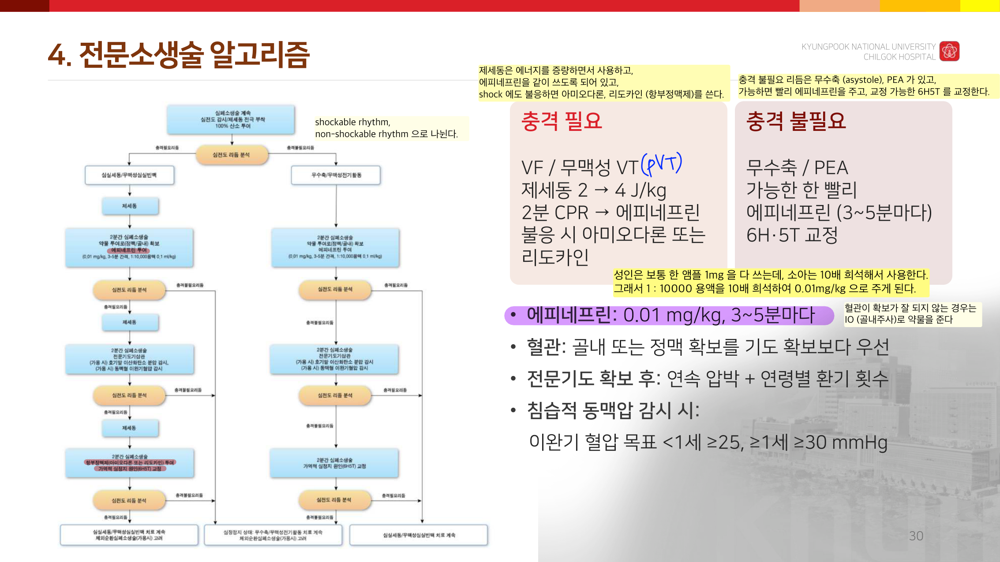{: style="width:76%"}

| 충격 필요 리듬 | 충격 불필요 리듬 |
|---|---|
| **VF / 무맥성 VT(pVT)** | **무수축(asystole) / PEA** |
| 제세동 2 → 4 J/kg | **가능한 한 빨리 에피네프린** (3–5분마다) |
| 2분 CPR → 에피네프린 | **6H·5T 교정** |
| 불응 시 **아미오다론 또는 리도카인**(항부정맥제) | |

- **에피네프린 0.01 mg/kg, 3–5분마다.** 성인은 1 mg 한 앰플을 다 쓰지만 소아는 **1:10,000 용액**(1 mg/10 mL)으로 0.01 mg/kg = **0.1 mL/kg**을 준다.
- **혈관: 골내(IO) 또는 정맥 확보를 기도 확보보다 우선.**
- 전문기도 확보 후: **연속 압박 + 연령별 환기 횟수.**
- 침습적 동맥압 감시(A-line, 주로 병원 내 심정지) 중이면 **이완기 혈압 목표: 1세 미만 ≥ 25, 1세 이상 ≥ 30 mmHg.**

## 소생술 약물과 용량

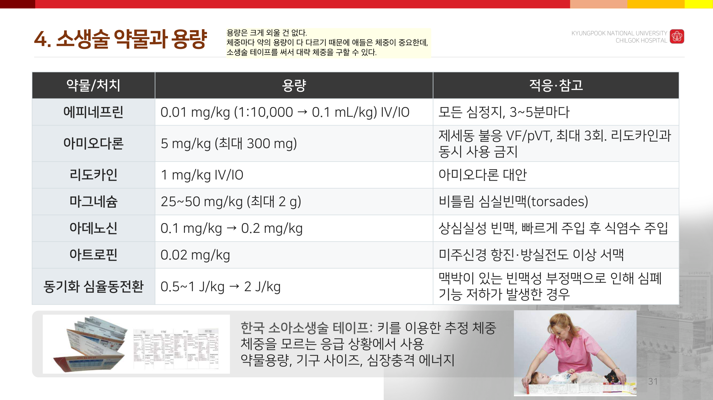{: style="width:76%"}

| 약물/처치 | 용량 | 적응·참고 |
|---|---|---|
| **에피네프린** | 0.01 mg/kg (1:10,000 → 0.1 mL/kg) IV/IO | 모든 심정지, 3–5분마다 |
| **아미오다론** | 5 mg/kg (최대 300 mg) | 제세동 불응 VF/pVT, 최대 3회. **리도카인과 동시 사용 금지** |
| **리도카인** | 1 mg/kg IV/IO | 아미오다론 대안 |
| **마그네슘** | 25–50 mg/kg (최대 2 g) | 비틀림 심실빈맥(torsades de pointes) |
| **아데노신** | 0.1 mg/kg → 0.2 mg/kg | **상심실성 빈맥**, 빠르게 주입 후 식염수 밀어주기 |
| **아트로핀** | 0.02 mg/kg | 미주신경 항진·방실전도 이상에 의한 서맥 |
| **동기화 심율동전환** | 0.5–1 J/kg → 2 J/kg | 맥박이 있는 빈맥성 부정맥으로 심폐기능 저하가 생긴 경우 |

교수님: **용량은 크게 외울 건 없다.** 다만 소아는 체중마다 용량이 다르므로 체중이 중요하고, 체중을 모르는 응급 상황에서는 **한국 소아소생술 테이프**(키로 체중을 추정 → 약물 용량, 기구 크기, 심장충격 에너지를 바로 읽음)를 쓴다.

## 골내주사와 기관내삽관 크기

- **골내주사(IO)**: 정맥 확보가 어려운 쇼크·심정지 소아는 **주저 없이** 뼈(경골 조면 아래 등)에 바늘을 넣어 IO로 약물·수액을 준다.
- **기관 튜브 계산(2세 이상)** — 교수님: tube size는 외울 필요 없다.
    - 커프 있는 튜브 내경(mm) = 3.5 + 나이/4
    - 삽입 깊이(cm) = 내경 × 3 (또는 나이/2 + 12)
    - 항상 ±0.5 mm 튜브를 함께 준비. 예) 4세: 커프 튜브 4.5 mm, 깊이 약 14 cm

## 가역적 원인 찾기: 6H와 5T

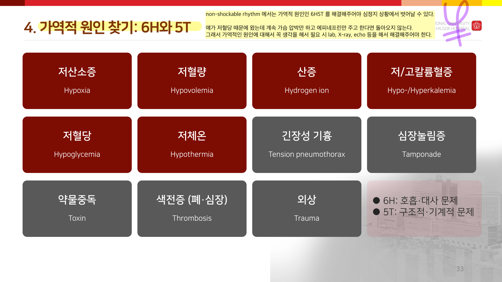{: style="width:72%"}

| 6H — 호흡·대사 문제 | 5T — 구조적·기계적 문제 |
|---|---|
| 저산소증 Hypoxia | 긴장성 기흉 Tension pneumothorax |
| 저혈량 Hypovolemia | 심장눌림증 Tamponade |
| 산증 Hydrogen ion | 약물중독 Toxin |
| 저/고칼륨혈증 Hypo-/Hyperkalemia | 색전증(폐·심장) Thrombosis |
| 저혈당 Hypoglycemia | 외상 Trauma |
| 저체온 Hypothermia | |

충격 불필요 리듬은 가역적 원인을 해결해야 벗어날 수 있다. 저혈당으로 온 아이에게 압박과 에피네프린만 계속하면 돌아오지 않는다 → 필요하면 검사(lab), X-ray, 심장초음파로 원인을 찾아 교정한다.

## 자발순환 회복(ROSC) 후 치료

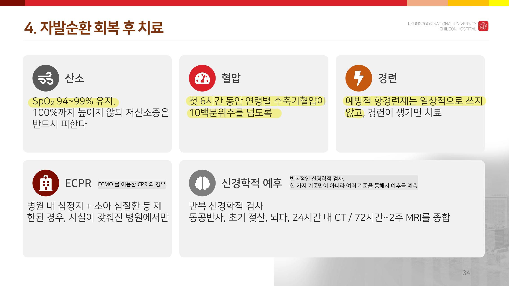{: style="width:72%"}

| 항목 | 목표 |
|---|---|
| **산소** | **SpO2 94–99%** 유지. 100%까지 올리지 않되 저산소증은 반드시 피한다 |
| **혈압** | 첫 6시간 동안 연령별 수축기 혈압이 **10백분위수를 넘도록** |
| **경련** | **예방적 항경련제는 일상적으로 쓰지 않고**, 경련이 생기면 치료 |
| **ECPR**(ECMO를 이용한 CPR) | 병원 내 심정지 + 소아 심질환 등 제한된 경우, 시설이 갖춰진 병원에서만 |
| **신경학적 예후** | 반복 신경학적 검사, 한 가지가 아니라 동공반사·초기 젖산·뇌파·24시간 내 CT / 72시간–2주 MRI를 **종합** |

## 2025 AHA·AAP 소아 전문소생술 지침 요점

1. 고품질 CPR이 전문소생술의 기초(적절한 속도·깊이, 중단 최소화, 완전 이완, 과도한 환기 피하기).
2. **초기 충격 불필요 리듬**: 가능한 한 빨리 에피네프린 → 양호한 결과와 연관.
3. **초기 충격 필요 리듬**: 신속한 제세동이 최우선. 제세동이 즉시 불가능하면 에피네프린.
4. 침습적 동맥혈압 감시 중이면 이완기 혈압 **영아 ≥ 25, 1세 이상 ≥ 30 mmHg** 목표.
5. 호기말 이산화탄소(ETCO2)는 CPR 질의 지표가 될 수 있으나, **소생술 종료를 결정하는 특정 ETCO2 기준값은 권장하지 않는다.**
6. **고열 예방**: 중심 체온이 **37.5℃를 넘지 않게** 하면 혼수 상태 영유아의 신경학적 예후 개선.
7. 심정지 후 수축기·평균 동맥압을 연령·성별 **10백분위수 이상**으로 유지.
8. 신경학적 예후는 여러 시점에 **여러 검사**로 평가(단일 검사는 부정확).
9. 생존자는 퇴원 후에도 신체·인지·행동 문제가 많아 지속적 평가가 필요.
10. 미주신경 자극·아데노신·동기화 전환에 반응하지 않는 SVT에는 (전문가 상담이 불가능할 때) **IV 소탈롤**을 쓸 수 있다.

# 5. 증례: 복통 — 충수염과 장중첩증

둘째 시간은 증례 중심이다("부담 없이 들으면 된다"). 응급실에서 제일 골치 아픈 병 두 개가 **충수염(appendicitis)과 장중첩증(intussusception)**이다.

## Case 1-1: 10세 남아, 복통 → 급성 충수염

어제 낮부터 복통, 아침부터 열. 개인의원에서 장염 진단받고 약 복용 중. 밤에 구토, **걷거나 배에 힘을 줄 때 더 아프다**. **우하복부 복통 & 압통.**

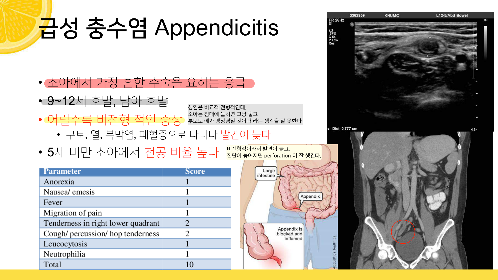{: style="width:76%"}

- **소아에서 가장 흔한 수술을 요하는 응급.**
- **9–12세** 호발, 남아 호발.
- **어릴수록 비전형적인 증상** — 구토, 열, 복막염, 패혈증으로 나타나 **발견이 늦다.** 성인은 비교적 전형적이지만, 소아는 침대에 눕히면 그냥 울고 부모도 맹장염을 생각하지 못한다.
- **5세 미만에서 천공 비율이 높다**(진단이 늦어지면 천공).
- 슬라이드의 점수표(**Alvarado 점수**, 총 10점): 식욕부진 1, 오심/구토 1, 발열 1, 통증 이동 1, **우하복부 압통 2**, 기침/타진/뛰기 시 압통 2, 백혈구증가 1, 호중구증가 1. 진단은 초음파·CT(충수 비대·염증).

## Case 1-2: 3세 남아, 주기적 복통 → 장중첩증

1일 전부터 **10분 간격 복통**(cyclic abdominal pain). 개인의원 복부 X-ray에서 특이 소견 없어 귀가했으나 10분 간격으로 보채고 구토해서 내원. 혈변을 보기도 한다.

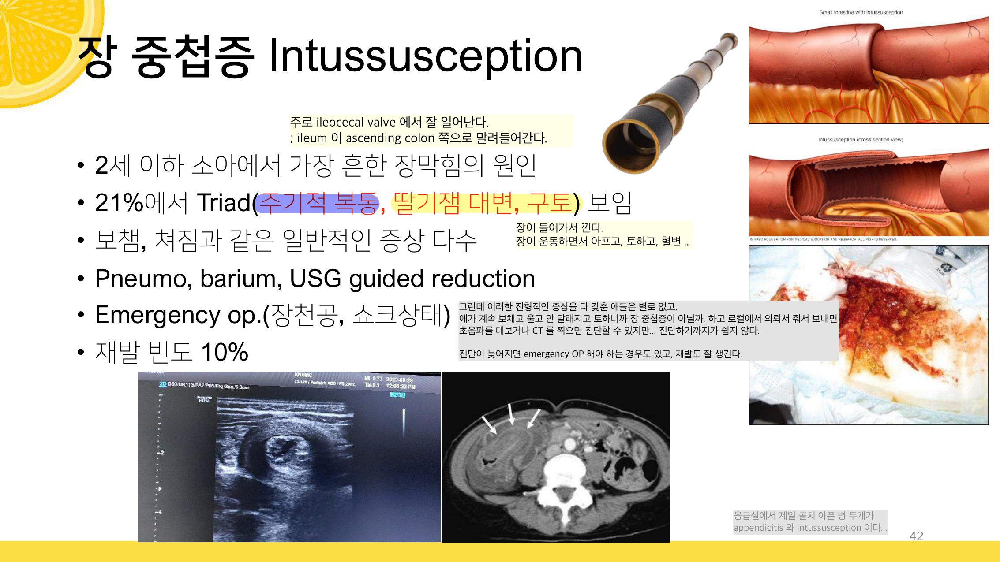{: style="width:76%"}

- 주로 **회맹판(ileocecal valve)**에서: 회장(ileum)이 상행결장 쪽으로 말려 들어가 낀다. 장이 운동하면서 아프고, 토하고, 혈변.
- **2세 이하 소아에서 가장 흔한 장막힘(장폐색)의 원인.**
- **Triad(주기적 복통, 딸기잼 대변, 구토)는 21%에서만** 보인다 → 대부분 **보챔, 처짐** 같은 일반적 증상뿐이라 진단이 쉽지 않다. 초음파(과녁 모양, target sign)나 CT로 진단.
- 치료: **공기(pneumo)·바륨·초음파 유도 정복술(reduction)**. 장천공, 쇼크 상태면 **응급 수술**. 진단이 늦어지면 응급 수술이 필요해지기도 한다.
- **재발 약 10%.**

!!! exam "기출 포인트"
    12번(2020, 3세, 초음파 target sign = 장중첩증): 정답은 "**모호한 증상과 제한된 검사로 진단이 늦어지는 경우가 많다**". 오답: "병적 징후가 전형적", "촉진부터 시작", "**응급수술을 해야 한다**"(→ 먼저 공기·바륨 정복), "보호자 정보는 신뢰할 수 없다".

# 6. 증례: 호흡곤란 — 크룹, 천식, 이물

## Case 2-1: 5세 남아 → 크룹(후두염, croup)

내원 30분 전 **자다가** 호흡곤란과 **컹컹 기침(barking cough)**, 목 쉰 소리, **흡기 시 꺽꺽거림(inspiratory stridor)**. 응급실 도착 시 좀 호전. 주로 **밤**에 온다.

- **3개월–5세** 호발, **상기도 감염 증상이 선행.** 후두(larynx)에 염증이 생겨 길이 좁아진다 → barking cough, 흡기성 stridor, 쉰 목소리.
- 원인은 바이러스: **parainfluenza virus**, influenza virus, RSV 등.
- **연하통이나 침흘림, 진행하는 고열과 호흡곤란**이 있으면 **급성 후두개염**을 고려(크룹과 감별해야 할 위험한 상기도 질환).
- 치료: 염증을 가라앉혀 기도를 넓혀 준다.
    - **전신 스테로이드** IM 또는 PO
    - **산소 치료**(기도 유지, 저산소증 교정)
    - **흡입 치료(budesonide, epinephrine inhalation)**

## Case 2-2: 10세 남아 → 천식 급성 악화

천식 발작 병력 2회. **체육 활동 중** 심한 호흡곤란, 안절부절, **단어로만 대화**(숨이 차서 문장을 말하지 못함), **SpO2 88%, RR 40** → 운동 유발성 천식의 급성 악화(asthma exacerbation).

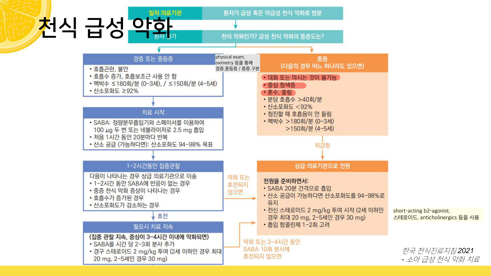{: style="width:76%"}

진찰과 산소포화도로 **경증·중등증 / 중증**을 나눈다(한국 천식진료지침 2021, 5세 이하 기준 흐름도).

| 경증·중등증 | 중증(하나라도 있으면) |
|---|---|
| 호흡곤란, 불안 | **대화 또는 마시는 것 불가능** |
| 호흡수 증가, 호흡보조근 사용 안 함 | **중심 청색증**, 혼수·혼돈 |
| SpO2 ≥ 92% | 호흡수 > 40/분, **SpO2 < 92%** |
| | 청진 시 호흡음이 안 들림(silent chest), 빈맥 |

- 치료: **속효성 β2 작용제(SABA)** 흡입(정량흡입기+스페이서 또는 네뷸라이저, 첫 1시간 20분마다 반복), **산소(SpO2 94–98%)**, **전신 스테로이드**, 중증이면 **흡입 항콜린제** 추가.
- 1–2시간 집중 관찰 후 SABA에 반응이 없거나 악화되면 상급 의료기관으로 전원.

## Case 2-3: 4세 여아 → 이물에 의한 기도폐쇄

언니와 뛰어놀다 갑자기 켁켁거리며 **목을 움켜쥐고(choking sign)** 안절부절, 이후 숨을 못 쉬고 청색증, 쓰러짐. 사탕을 먹고 있었다 → **완전 폐쇄.**

- 1세 이상이므로 **등 두드리기 5회 + 복부 밀어내기 5회** 반복 → 이물이 나오거나 의식을 잃을 때까지.
- **반응이 없으면 심폐소생술 시작.** 가슴압박 후 인공호흡 전에 **이물이 보일 때만** 제거.
- (영아라면 등 두드리기 5회 + **가슴** 압박 5회 — 3장 참고)

# 7. 증례: 심정지(Case 3)와 소아 기본소생술 다시 보기

## Case 3: 7세 여아

미끄럼틀에서 **줄넘기 줄이 목에 걸린 채** 발견, 119가 심폐소생술을 하며 내원 → **질식성(호흡성) 심정지.** "심정지는 앞에서 다 했던 내용이니까 넘어가겠다" — 증례 슬라이드에서 다시 짚은 핵심만 정리한다.

- **원인**: 신생아·영아(0–1세)는 선천성 기형, 호흡부전, 영아돌연사증후군 / 소아(1–8세)는 **외상**.
- **경로**: **호흡부전·쇼크 → 심폐부전 → 심정지**가 **급성 부정맥 → 심정지(5–15%)**보다 훨씬 많다.
- **순서**: 반응 확인 → 119 신고 → **맥박과 호흡 동시 확인**(영아 위팔동맥, 소아 목동맥/대퇴동맥) → 맥박(+)·불충분한 호흡 = **구조호흡 2–3초마다** / **서맥(< 60회/분) 또는 불량한 전신관류 = 흉부압박 시작** → 흉부압박 + 인공호흡.

!!! exam "기출 포인트"
    7번(생후 40일, 무호흡·무맥): 정답 "**2인 구조자 15:2**". 오답: "신생아 소생술 적용"(→ 영아 소생술), "심장 문제가 많다", "1세 이전은 외상이 가장 흔하다", "6초에 한 번 인공호흡".

# 8. 증례: 빈맥 — 상심실성 빈맥(SVT)

## Case 4: 12세 남아, 두근거림

3시간 전부터 두근거림, 개인의원 심전도에서 **심박수 234회/분**으로 의뢰. 병적 빈맥을 의심하는 기준: **영아 220회 이상, 소아·청소년 180회 이상.**

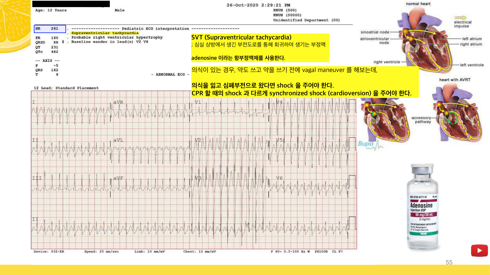{: style="width:72%"}

- **상심실성 빈맥(SVT)**: 심실 상방에 생긴 **부전도로(accessory pathway)**를 통해 회귀(re-entry)하여 생기는 부정맥.
- 심박수: **영아 220–280회/분, 소아·청소년 180–240회/분.**

| 상태 | 치료 |
|---|---|
| **불안정**(의식 변화, 저혈압, 쇼크 상태) | **동기화 심장율동전환**(synchronized cardioversion) — CPR의 제세동과 달리 **동기화** 충격 |
| **안정** | **미주신경 자극술**(찬 수건 얼굴에 얹기, 발살바법, 쪼그려 앉기, 숨 참기) → **아데노신**(기본 치료) |
| **완치** | **고주파 도관 절제술**(실시간 X-ray를 보며 카테터를 넣어 부전도로를 전기로 소작) |

# 9. 증례: 경련 — 열성 경련과 간질중첩증

## Case 5-1: 3세 남아

아침부터 열, 개인의원에서 **편도염** 진단. 어린이집에서 **전신이 뻣뻣해지는 경련 5분** → 119로 내원. 전형적인 열성 경련(전신 강직, 눈이 위로 올라감).

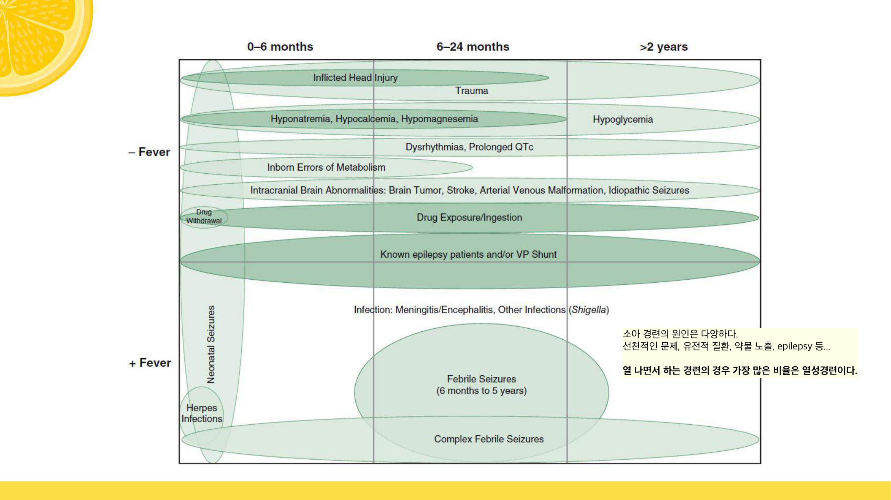{: style="width:70%"}

소아 경련의 원인은 다양하다(선천적 문제, 유전 질환, 대사이상, 약물 노출, 뇌전증, 외상 등). **열이 나면서 하는 경련 중 가장 많은 것은 열성 경련**이다(6개월–5세). 단, 수막염·뇌염 같은 **중추신경계 감염**도 열과 경련으로 오므로 주의한다.

## 열성 경련 (Febrile convulsion)

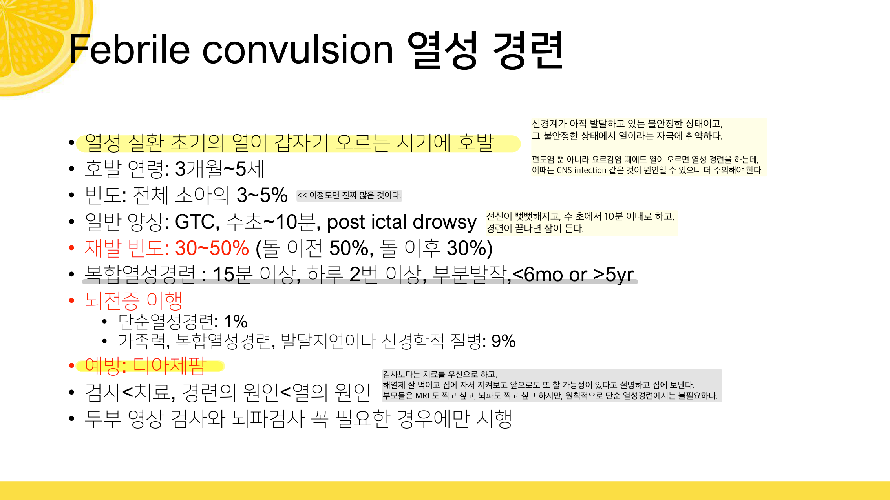{: style="width:72%"}

| 항목 | 내용 |
|---|---|
| 시기 | **열성 질환 초기, 열이 갑자기 오르는 시기**에 호발 |
| 호발 연령 | **3개월–5세** |
| 빈도 | 전체 소아의 **3–5%** ("이 정도면 진짜 많은 것") |
| 양상 | **전신 강직간대(GTC), 수 초–10분**, 끝나면 잠이 든다(post-ictal drowsy) |
| 재발 | **30–50%** (돌 이전 50%, 돌 이후 30%) |
| **복합 열성 경련** | **15분 이상, 하루 2번 이상, 부분발작, 6개월 미만 또는 5세 초과** |
| 뇌전증 이행 | 단순 열성 경련 **1%** / 가족력·복합 열성 경련·발달지연이나 신경학적 질병이 있으면 **9%** |
| 예방 | (필요한 경우) 디아제팜 |

신경계가 아직 발달 중인 불안정한 상태에서 열이라는 자극에 취약해서 생긴다. **양성 질환**이라 크면서 저절로 좋아지고 열이 없을 때는 경련하지 않는다. 편도염뿐 아니라 요로감염으로 열이 올라도 열성 경련을 한다.

### 진단과 치료

- **검사 < 치료, 경련의 원인 < 열의 원인.**
    - 단순 열성 경련은 많은 검사를 권하지 않는다. **두부 영상 검사와 뇌파 검사는 꼭 필요한 경우에만.** (부모는 MRI·뇌파를 원하지만 원칙적으로 불필요)
    - **경련의 원인보다 열의 원인**을 찾는 데 주력한다.
- **항경련제를 권하지 않는다** — 항경련제의 부작용 > 열성 경련 재발의 위험성.
- 민간요법으로 시간을 지체하거나 손상을 주지 말 것. **경련을 멈추는 방법은 항경련 약물 외에는 없다.**
- 해열제를 잘 먹이고 집에서 지켜보며, 또 할 수 있다고 설명하고 귀가시킨다.

!!! exam "기출 포인트"
    4번(2022): 틀린 것은 "**열성 경련 예방약이 없으므로 항경련제를 복용해야 한다**". 열이 갑자기 오를 때 호발, 3개월–5세, 재발 30–50%, MRI·뇌파 안 함은 모두 맞는 보기 — 필기의 숫자와 그대로 일치한다.

## Case 5-2 → 간질중첩증 (Status epilepticus)

병원에서 경련이 재발해 **lorazepam**을 투약했으나 경련 지속. 항경련제를 맞으면 보통 사그라드는데, 계속되면 **치료적 응급인 간질중첩증**이다.

- **진단 < 치료적 응급** — 보통 **5분 이상** 넘어가면 지속될 가능성이 높다.
- 경련을 빨리 멈추면 **영구적 신경학적 손상을 방지**한다.
- **경련 시작 후 10분 이내에 벤조디아제핀**에 가장 잘 반응한다.
- 빠른 치료는 경련을 멈출 뿐 아니라 추후 반복 경련도 예방한다.
- 간질중첩증을 자주 겪는 아이는 **집에서 코에 뿌리는 항경련제**(비강 분무 미다졸람, 점막 분무 장치)를 쓰기도 한다.

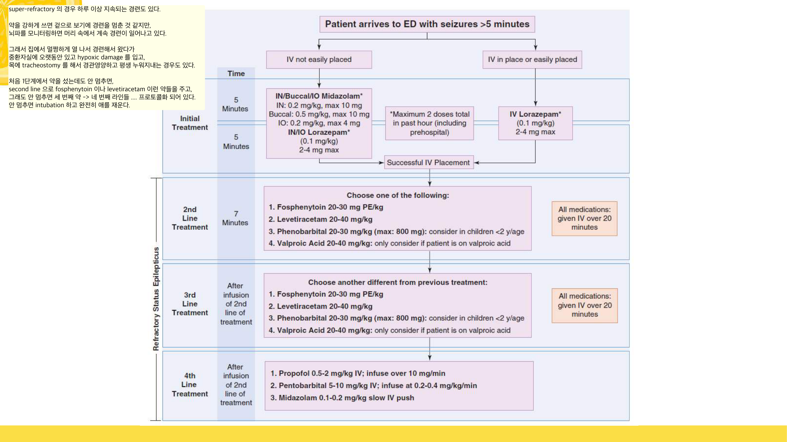{: style="width:72%"}

치료는 **프로토콜화**되어 있다.

1. **1차(초기 5분)**: 벤조디아제핀 — 정맥이 있으면 **IV lorazepam**, 없으면 **비강·협측·IO 미다졸람**(최대 2회).
2. **2차**: **fosphenytoin** 또는 **levetiracetam** 등(phenobarbital, valproic acid 중 택1).
3. **3차**: 2차에서 쓰지 않은 다른 약.
4. **4차(불응성)**: propofol, pentobarbital, midazolam 지속 주입 → **기관내삽관 후 완전히 재운다.**

하루 이상 지속되는 경련(super-refractory)도 있다. 약을 강하게 쓰면 겉으로는 멈춘 것 같아도 **뇌파를 보면 머릿속에서 계속 경련**하고 있을 수 있다. 열 나서 경련해 왔다가 중환자실에 오래 있으며 저산소 손상을 입고, 기관절개·경관영양으로 평생 누워 지내는 경우도 있다.

# 10. 증례: 실신 (Syncope)

## Case 6: 15세 여아

학교 체육시간에 운동장에 **오래 서 있다가** 쓰러짐. 의식 소실 후 **30초 정도 뒤 회복.** 쓰러지기 전 힘이 빠지고 **시야가 좁아지다가 앞이 안 보였다**(전조 증상).

- **실신**: 뇌혈류량이 순간적으로 감소해 **갑작스럽게, 일시적으로 의식이 완전히 소실**되는 것.
- **실신 전 단계**: 현기증, 터널 시야, 일시적 시력 상실(blackout) 등 **전조 증상**은 있지만 의식 소실까지는 가지 않은 상태.
- 청소년기까지 **15–50%**가 최소 한 번 실신을 경험. **소아 응급실 방문의 3%**, **경련과 감별** 필요. **15–19세 여아**에서 흔하다.

| 분류 | 특징 |
|---|---|
| **반사성 실신** | 자율신경계 반사를 과도하게 유발. **가장 흔하고 예후 양호.** 미주신경성 실신, 상황성 실신, 목동맥굴 증후군 등 |
| 기립성 저혈압에 의한 실신 | 기립 자세에서 혈압이 떨어지며 증상. **소아에서는 드물다** |
| **심장 기인성 실신** | 부정맥, 기질적 심질환 — 놓치면 안 되는 원인 |

- 치료: **양성임을 안심시키기**, 유발 요인 인지 및 회피, **전조 증상 시 앉거나 눕도록**(주변에 도움 청하기), **적절한 수분 및 염분 섭취.**
- 대부분 반사성(미주신경성)이고 검사해도 이상이 없는 경우가 많지만, 필요하면 여러 검사로 원인을 감별한다.

# 11. 증례: 아동학대 (Child abuse)

## Case 7: 17개월 여아, 의식 변화

저녁 8시부터 갑자기 처져 개인의원에 갔다가 **심박수 60회/분 서맥**으로 전원. 최근 열이나 아픈 적은 없고 잘 안 먹었다고 한다.

- 원래 밥을 잘 안 먹고 우유·분유·과자만 좋아한다고 함 / 얼굴의 멍은 **한 달 전** TV 테이블에 부딪혔다고 함
- **이마와 눈 주변, 몸통에 다발성 멍**, 심박수 68회/분, 체온 35.2℃, **마르고 심한 탈수**
- **왼쪽 동공 축소, 오른쪽 동공 확장**, 자발 호흡 미약, 의식 없음
- 보호자는 구급차에서 내릴 때 다리 삔 것에 짜증내고, 둘째 아이만 안고 달래며, 환아 상태가 심각하다고 해도 **감정 동요가 없어 보임**

※ 확인 필요: 슬라이드에 최종 진단은 적혀 있지 않다. 설명되지 않는 멍(몸통·눈 주변), 영양 불량, 병력과 맞지 않는 손상, 의식 저하·서맥·동공 부등(두개내압 상승을 시사), 부적절한 보호자 반응이 **아동학대(학대성 머리손상)를 의심해야 하는 단서**로 제시된 증례다.

## 초기 진단의 어려움

아동학대는 생각보다 진단하기 어렵다.

- 학대성 머리손상 아동 173명 중 54명(**31.2%**)은 이미 의사를 만났지만 진단되지 않았다(JAMA 1999).
- 학대성 골절 258명 중 54명(**20.9%**)은 학대를 놓친 이전 진료가 1번 이상 있었다(Pediatrics 2010).

## 신고 현황과 특징

- 신고 접수와 아동학대 사례 판단 건수는 2010년 이후 크게 늘었다(2023년 신고접수 약 4.9만 건). 학대가 많아졌다기보다 여러 사건을 계기로 **더 잘 알게 되고 교육**이 늘어서다.
- 피해 아동은 **남녀가 비슷**하고 연령도 고르게 분포한다.
- 학대 행위자는 **대부분 부모(약 82%)**.
- 학대 유형: **중복학대(약 48%)**가 가장 많고, 정서학대(약 28%), 신체학대(약 12%), 방임(약 9%), 성학대(약 2%) 순.

!!! exam "기출 포인트"
    11번(2020, 6주 영아 대퇴골 골절, 기저귀 간 뒤부터 보챔): 정답 "**두개골, 안저 등 다른 부위 손상 동반 여부를 확인**". 오답: "기저귀를 조심해 갈도록 교육", "**학대가 명확히 확인된 후 신고**"(→ **의심만으로도 신고**), "신고가 줄고 있다"(→ 늘고 있다), "**신체학대가 가장 많다**"(→ 중복학대가 가장 많다).

## 학대를 발견하기 위한 노력

교수님: **"여기서 한 문제 낼 것 같아요."**

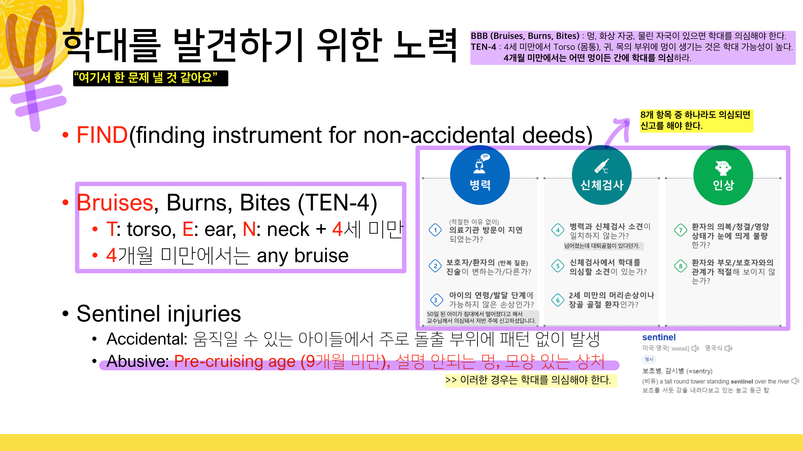{: style="width:78%"}

### FIND (Finding Instrument for Non-accidental Deeds)

**8개 항목 중 하나라도 의심되면 신고해야 한다.**

**병력**

1. (적절한 이유 없이) **의료기관 방문이 지연**되었는가?
2. 보호자/환자의 진술이 (반복 질문 시) **변하는가/서로 다른가**?
3. 아이의 **연령·발달 단계에 가능하지 않은 손상**인가? (예: 50일 아이가 침대에서 떨어졌다 — 교수님이 실제로 신고하신 사례)

**신체검사**

4. **병력과 신체검사 소견이 일치하지 않는가**? (넘어졌는데 대퇴골절)
5. 신체검사에서 학대를 의심할 소견이 있는가?
6. **2세 미만의 머리손상이나 장골 골절** 환자인가?

**인상**

7. 환자의 의복/청결/영양 상태가 눈에 띄게 **불량**한가?
8. 환자와 부모/보호자의 **관계가 적절해 보이지 않는가**?

### BBB와 TEN-4

- **Bruises, Burns, Bites (BBB)**: 멍, 화상 자국, 물린 자국이 있으면 학대를 의심한다.
- **TEN-4**: **4세 미만**에서 **T**orso(몸통), **E**ar(귀), **N**eck(목)에 생긴 멍은 학대 가능성이 높다.
- **4개월 미만에서는 어떤 멍(any bruise)이든** 학대를 의심한다.

### Sentinel injuries (보초 손상 — 더 큰 학대를 미리 알리는 작은 손상)

| 우연한 손상(Accidental) | 학대성 손상(Abusive) |
|---|---|
| **움직일 수 있는** 아이에서 | **Pre-cruising age(9개월 미만**, 붙잡고 걷기 전) |
| 주로 **뼈가 돌출된 부위**(이마·무릎·정강이·팔꿈치)에 | **설명되지 않는 멍** |
| **패턴 없이** 발생 | **모양 있는 상처**(손바닥·도구 모양) |

!!! exam "기출 포인트"
    8번(2021, 사진 보고 학대 의심 2개 고르기): 정답은 **걷지 못하는 아기의 윗입술 소대 찢어짐**과 **귓바퀴의 멍(TEN-4의 E)**. 이마·무릎·팔꿈치처럼 **뼈가 돌출된 부위의 멍**은 놀다가 생기는 흔한 손상이다.

!!! memo "암기"
    **TEN-4**: 4세 미만 몸통·귀·목의 멍 / **4개월 미만은 모든 멍** / **9개월 미만(pre-cruising)**의 설명 안 되는 멍 / FIND **8개 중 하나라도** → 신고. 의료인은 **의심만으로** 신고 의무가 있다.

# 12. 증례: 이물 삼킴

## Case 8: 3세 남아

**3시간 전 장난감 속 디스크(단추형) 배터리**를 삼켜 의원 방문 후 이물 제거를 위해 의뢰.

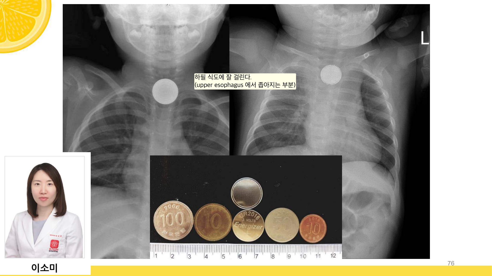{: style="width:70%"}

- 디스크 배터리는 하필 **식도에 잘 걸린다**(상부 식도의 좁아지는 부분).
- **2시간만 지나도** 식도 점막이 손상될 수 있어 **응급 내시경**. 빼내 보면 화상 입은 것처럼 헐어 있고, 나중에 **협착(stricture)**이 와서 고형식을 먹으면 자꾸 토해 스텐트·풍선으로 넓혀야 한다.
- **자석(네오디뮴) 여러 개**: 장벽(또는 하부식도괄약근)을 사이에 두고 서로 붙어 천공·누공을 만든다. 자력이 세서 떼기 어렵고 구형이라 내시경으로 잡히지도 않아 **수술**로 가기도 한다.
- **긴 이물**(바늘, 막대사탕 스틱)도 수술이 필요했던 사례가 있다.
- **고흡수성 폴리머(super absorbent polymer)**: 기저귀·탐폰·장난감 등에 쓰이며 **자기 질량의 100배 물을 흡수해 30–60배 부피로 팽창** → 급속 팽창으로 **장폐색**, 사망 보고도 있다 → **삼켰거나 의심되면 응급 내시경.**

### 이물 삼킴 정리

- 소아 이물 섭취는 **매우 흔하다.**
- 섭취가 의심되나 목격하지 못한 경우, 섭취 후 **증상이 없는** 경우, X-ray에서 **방사선 투과성(radiolucent)**인 경우(플라스틱·나무·비닐·스티커는 X-ray에 잘 안 나온다) **주의**가 필요하다.
- **동전인지 확실치 않은 둥근 이물은 항상 디스크 배터리를 의심**한다.
- **응급: 증상이 있는 경우, 자석(여러 개), 식도의 디스크 배터리.** 증상이 있으면 내시경을 한다.
- 이런 경우가 아니면 대부분 **대변으로 나온다.**

# 13. 증례: 약물 중독

## Case 9: 16세 여아, 오심

우울증으로 정신과 치료 중, 어제 19시경 복용하던 약 **20봉지를 한꺼번에** 복용. 어제는 증상이 없었는데 오늘 아침 어지럼, 오심, 구토, 가슴 불편감으로 내원 — **늦게 증상이 나타날 수 있다.** 청소년 사망 원인에서 자해가 1위라는 1장 내용과 이어진다.

### 약물중독 치료

- **Decontamination(제독)**
    - **위세척**: 1시간 이내, 독성이 강하거나 **활성탄에 흡착되지 않는** 물질인 경우
    - **활성탄**: 삼킨 후 **1시간 이내**가 가장 효과적
- **해독제(antidote)**: 먹은 약에 해독제가 있으면 쓴다 — 아세트아미노펜 → **N-acetylcysteine(NAC)**, 철 → **deferoxamine** 등
- **소변 알칼리화**: 약산성 물질의 제거
- **보존적 치료가 기본.**
- **무증상 & 비의도적** → 응급실에서 경과 관찰 / **독성 증상 발생** → 입원, 필요하면 **ICU**. 사망 사례도 있다.

## Case 9-1: 15세 여아, 경련

경련 병력이 없던 아이가 휴대폰을 보다 "윽, 윽" 소리와 함께 얼굴 청색증, 눈이 위로 돌아감, 팔다리 강직, 고개가 왼쪽으로 돌아가는 양상으로 **30초 경련**. 119 도착 시 **동공반사(−), 통증에도 무반응**. 이후 30초 경련이 두 번 더 있었다. 1주일 전 학업·교우관계 스트레스로 3주째 점심을 거르고 "살고 싶지 않다"고 했고, 이날 혼난 뒤 낮잠에서 깼을 때 옆에 문구용 칼이 있었다.

- 이전 경련 병력 없는 청소년의 새 경련 + 정서적 위기 신호 → **의도적 약물 과다복용**을 반드시 생각한다.
- 슬라이드에 소개된 약: **diphenhydramine 성분의 일반의약품 수면유도제.** 많이 먹으면 **환각** 효과가 있어 이를 노리고 대량 복용하는 경우가 있고(SNS의 "Benadryl Challenge", "OD 파티"), **경련**이나 여러 의식 변화로 온다.
- 청소년 과다복용은 일반의약품 오남용으로 늘고 있어 사회적 문제가 되고 있다. 신체 치료와 함께 **정서적 지지와 정신건강 개입**이 필요하다(1장 "청소년 자살 — 정서적 지지와 중재").
