<!-- 필기본: 2026 -->

# 0. 이 수업을 공부하는 법

**안재윤 교수님**(응급의학교실)의 「재난의학」 수업이다(11/2 월 3·4교시). 2025년까지는 **문성배 교수님**이 맡던 파트라 2부 기출 22문항(2020–2025)은 모두 문성배 교수님 강의에서 나왔고, 올해는 처음으로 안재윤 교수님이 출제한다. 필기본은 "슬라이드는 많지만 **야마 페이지는 정해져 있고 거기서만 반복 출제**된다", "환경응급 기출을 보면 스타일을 알 수 있다(사례 위주)"고 정리했다.

교수님이 직접 말한 강의 목표는 *재난의학 전문가가 되는 것이 아니라, 의사로서 현장에서 요구되는 기본 원칙을 아는 것* — 즉 **의사가 재난 현장에서 뭘 해야 하고 뭘 할 수 있는지**다. "나머진 몰라도 된다"고 했다. 마지막 Summary 슬라이드에서 짚은 것은 세 가지다.

1. **우리나라 재난의료 인력의 대응** — 현장지휘(incident command) 체계, 누가 지휘하고 DMAT은 언제·어떻게 나가는가
2. **제염/제독법과 PPE** — 제염·제독을 *어디서* 하고, 각 구역(hot/warm/cold)에서 *뭘 하고*, *어디에 뭘 설치*하는가
3. **환자분류법(MASS, START, SALT)** — 이 환자를 어떤 분류법으로 *무슨 색*으로 분류하고, *어떤 순위*로 이송하는가

필기본은 "**여기서 3문제 출제**"라고 예상했다.

| 주제 | 기출 연도(2부 번호) | 경향 / 필기본 예상 |
|---|---|---|
| **중증도 분류**(MASS·METTAG) | 매년(4, 8, 13, 14, 16, 21) | 왕야마. MASS와 METTAG가 번갈아 나옴 → 올해는 **SALT·START 등 새 분류법**이 나올 수도 |
| **의료 인력**(DMAT·신속대응반) | 매년(2, 6, 10, 18, 20) | 국내 체계가 2023. 11. 매뉴얼로 바뀌어 **새로 추가된 내용** — 교수님 반복 강조 |
| **제독/제염** | 2023·2024 그림 문제(7, 11), 2025 습식 순서(3) | **공간(구역) 중심**으로 나올 가능성 높음 |
| **현장 안전 우선순위** | 2023·2024(5, 9) | "나 자신이 가장 중요" |
| **DISASTER 패러다임** | 2020·2022·2025(1, 15, 22) | 올해는 미지수 |
| **개인보호장비(PPE)** | 2020·2022·2023(12, 17, 19) | 최근 출제 없음 |

!!! key "핵심"
    - 출제 1순위: **환자 분류**(MASS 3단계 질문, SALT 2단계, METTAG 색깔), **제염 구역**(hot/warm/cold에서 각각 무엇을 하는가, 제염 시설·환자 집결지 위치), **국내 체계**(현장응급의료소장 = 보건소장, 의료 역할은 DMAT에 위임 가능, DMAT 10분 내 출동, 의료지도하 CPR 유보).
    - 교수님이 **반복 강조**한 것: 이태원 참사 이후 바뀐 원칙 — *의료지도하 CPR 유보*, *현장응급의료소 의료 역할의 DMAT 위임*, *DMAT 의사 = 응급의학과 등 전문의*.

## 올해 강의록에서 달라진 점

필기본은 문성배 교수님(2025) 강의록과 안재윤 교수님(2026) 강의록을 비교해 두었다. 기출은 작년 강의에서 나왔으므로, 기출 답과 올해 강의 내용이 다를 수 있는 곳을 알아 두어야 한다.

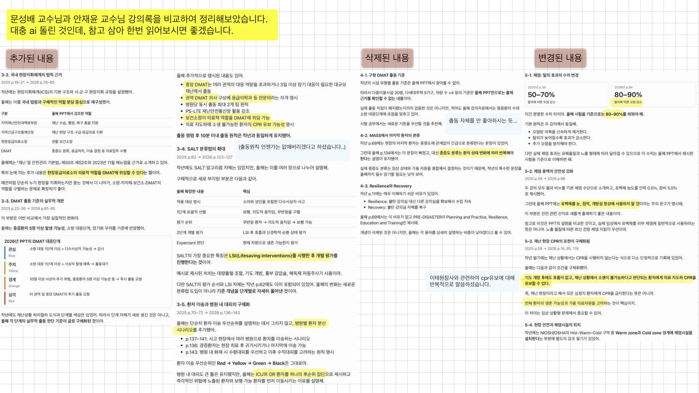{: style="width:100%"}

| 구분 | 내용 |
|---|---|
| **추가** | 국내 현장지휘체계의 법적 근거(재난안전법 50·52조, 2023. 11. 매뉴얼) / 현장응급의료소의 의료 역할을 DMAT에 위임 가능 / DMAT 출동 기준이 소방 대응단계(관심·주의·경계·심각)와 연동 / 중앙·권역 DMAT 역할, 권역 DMAT 의사 = 응급의학과 등 **전문의**, 거점병원당 동시 출동 **최대 2팀** / PS-LTE 활용 / **의료지도하 CPR 유보** / SALT 분류법 확대(1단계 포괄적 선별 → 2단계 개별 평가, LSI) / 병원별 환자 분산 시나리오, 병원 내 대피 우선순위(ICU·OR은 4순위) |
| **삭제** | 구형 DMAT 출동 기준(다중이용시설 20명, 다세대주택 5가구, 차량 4대×4 등) / MASS에서 "마지막 환자"는 중증도와 관계없이 긴급으로 분류한다는 문장 / Resilience와 Recovery의 비유(Recovery는 별도로 남음) |
| **변경** | **탈의의 오염 제거 효과 50–70% → 80–90%** (올해 시험은 80–90%로 외운다) / 표백제는 눈·점막·개방성 창상에 금기 명시 / 재난 현장 CPR 원칙이 "하지 않는다"에서 "기도 개방 후에도 호흡이 없고 소생 불가능하다고 판단되면 **의료 지도하에 유보할 수 있다**"로 구체화 / Warm–Cold zone 경계에 제염 시설, Cold zone에 현장응급의료소 |

!!! diff "작년 필기와 다른 점"
    교수님은 **출동 원칙 자체를 별로 좋아하지 않는다** — "굉장히 괴상한 법이 있는데 제가 언젠간 없앨 겁니다"라고 했다. 또 2023. 11. 개정판(재난응급의료 비상대응매뉴얼)도 "교수님은 별로 안 좋아하시는 개정판"이라는 메모가 있다. 그래도 개정된 내용(위임·CPR 유보·전문의)은 **반복 강조**했으므로 시험 대상이다.

# 1. 재난의학의 기초

## 재난(Disaster)의 정의

일반적 정의: *지역사회 기능에 심각한 붕괴를 초래하고, 인명 구조·재산 보호·피해 지역의 안정과 원래 모습을 유지하는 데 필요한 **외부 지원 없이 대응할 수 있는 피해 지역의 능력을 초과**하는 광범위한 인적·물질적·경제적·환경적 피해가 발생하는 사건과 그 결과.*

핵심은 "피해가 얼마나 큰가"보다 **"그 지역이 혼자 감당할 수 있는가"**다. 같은 사고라도 자원이 많은 도시에서는 일상 사고, 자원이 적은 곳에서는 재난이 된다.

## 의학적 재난과 다수사상자 발생 사고(MCI)

- **의학적 재난**: 의료 **수요 >> 자원 공급**. 요구되는 의료의 규모가 지역사회의 자체 대응 역량을 초과하는 상태.
- **다수사상자 발생 사고**(Mass Casualty Incident, **MCI**): 동시에 다수의 사상자가 발생하여 보건의료 대응 역량을 **일시적으로** 초과하는 사고.
    - 국내 기준(DMAT 출동): **사상자 10명 이상 또는 중증 5명 이상**
    - 단, 절대적 수치보다 **"현재 가용 의료자원 대비 환자 수요의 불균형 여부"**가 핵심 판단 기준이다. (교수님: "요즘 응급실은 항상 이렇다네요~")

간단히 쓰면 **Disaster: Resources < Demands**, **MCI: Medical Supply < Medical Demands**. 재난은 사회 전체 자원의 부족, MCI는 의료 자원의 부족이다.

| | Disaster | MCI |
|---|---|---|
| 미국 CDC | 모든 종류의 공중보건 비상사태 | 사상자 **6명 이상** |
| 한국 | **사망 ≥ 10명 또는 총 사상자 ≥ 50명** | 사상자 **6명 이상** |

이 수치는 피해 규모에 따른 **조작적 정의**이고 절대적 기준이 아니다 — 현장 역량에 따라 상대적이다.

### 사고 → MCI → 재난 (그림 예시)

강의는 병원 세 곳 그림으로 개념을 보여 주었다.

- **사고 1**: 환자가 몇 명 → 가까운 병원 1이 감당 → 일상 응급.
- **다수사상자 발생 사고**: 환자가 늘어 병원 1이 버거워짐 → "이 정도까진 커버 가능".
- **사고 2**: 병원 1이 감당 불가 → **MCI**.
- **재난**: 환자가 너무 많아 여러 병원으로 **잘 분산**하는 것이 핵심이 된다 — "어떤 기준을 가지고 어떤 병원에 보낼지".

## 재난 유형 분류

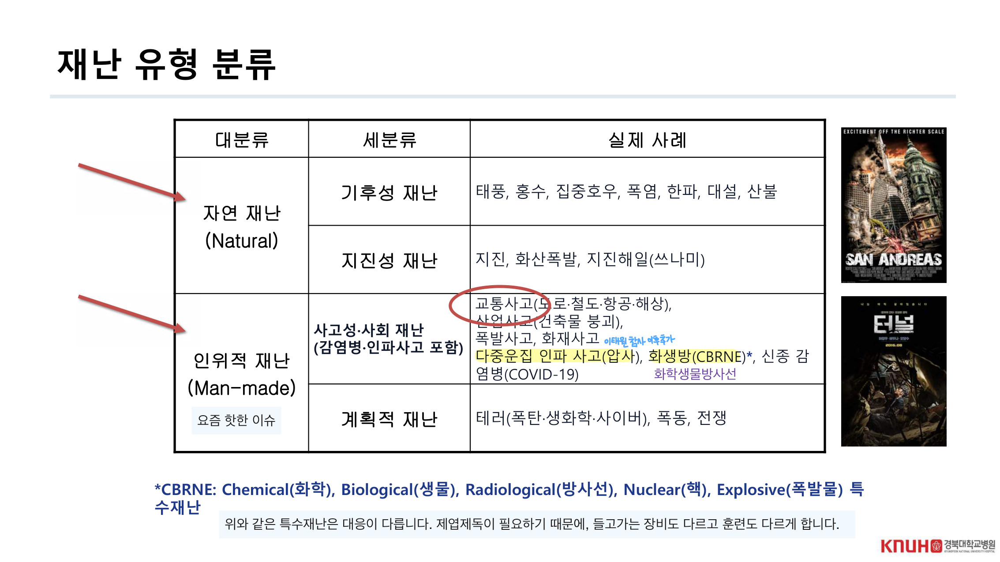{: style="width:72%"}

| 대분류 | 세분류 | 실제 사례 |
|---|---|---|
| **자연 재난**(Natural) | 기후성 재난 | 태풍, 홍수, 집중호우, 폭염, 한파, 대설, 산불 |
| | 지진성 재난 | 지진, 화산폭발, 지진해일(쓰나미) |
| **인위적 재난**(Man-made) | 사고성·사회재난 (감염병·인파사고 포함) | 교통사고(도로·철도·항공·해상), 산업사고(건축물 붕괴), 폭발, 화재, **다중운집 인파사고(압사)**, 화생방(CBRNE), 신종 감염병(COVID-19) |
| | 계획적 재난 | 테러(폭탄·생화학·사이버), 폭동, 전쟁 |

- **다중운집 인파사고**는 **이태원 참사 이후 추가**된 항목이다.
- **CBRNE** = Chemical(화학), Biological(생물), Radiological(방사선), Nuclear(핵), Explosive(폭발물) — **특수재난**. "요즘 핫한 이슈". 특수재난은 **제염·제독이 필요**하기 때문에 대응이 다르다 — 들고 가는 장비도, 훈련도 다르다.

국내 다수사상자 사고(MCI) 2,849건을 유형별로 보면 **교통사고가 77.99%(2,222건)로 압도적 1위**, 다음이 **화재 5.34%(152건)**, 폭발 2.35%, 건물 붕괴 0.98% 순이다.

## 의료기관의 입장 — 원외 재난 vs 원내 재난

- **원외 재난**: 병원 밖에서 생긴 재난 → 환자를 받는 쪽
- **원내 재난**: 병원 자체에 생긴 재난(예: 최근 세브란스 병원 화재) → 병원 안의 환자를 대피시켜야 함(6단원 "병원 내 대피" 참고)

어느 쪽이든 핵심 질문은 "**우리가 어떻게 대응할 것인가**"다.

## 재난 주기 (Disaster Cycle)

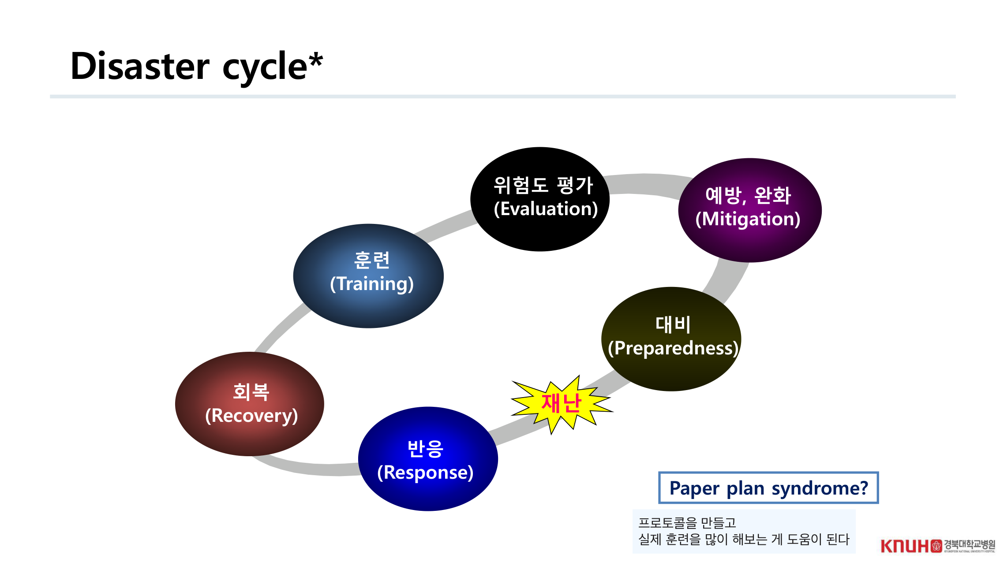{: style="width:62%"}

**위험도 평가**(Evaluation) → **예방·완화**(Mitigation) → **대비**(Preparedness) → *재난 발생* → **반응**(Response) → **회복**(Recovery) → **훈련**(Training) → 다시 평가. 재난 대응은 사고가 났을 때만 하는 것이 아니라 계속 도는 순환이다.

**Paper plan syndrome**: 계획서(프로토콜)만 있고 실제로는 작동하지 않는 상태. 교수님은 *프로토콜을 만들고 실제 훈련을 많이 해 보는 것*이 도움이 된다고 했다.

## 일상 응급의료 vs 재난 응급의료

교수님: "**일상적인 상황과의 차이점을 잘 봐야 합니다.**" (야마 표시)

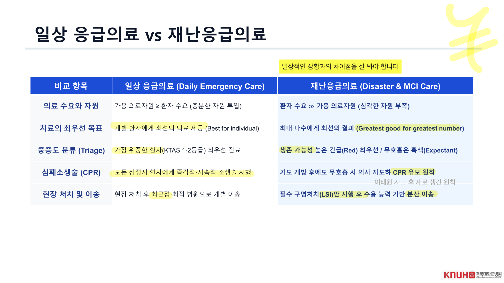{: style="width:85%"}

| 비교 항목 | 일상 응급의료 | 재난 응급의료(Disaster & MCI) |
|---|---|---|
| 의료 수요와 자원 | 가용 의료자원 ≥ 환자 수요 (충분한 자원 투입) | 환자 수요 >> 가용 의료자원 (심각한 자원 부족) |
| 치료의 최우선 목표 | 개별 환자에게 최선의 의료 (**Best for individual**) | 최대 다수에게 최선의 결과 (**Greatest good for greatest number**) |
| 중증도 분류(Triage) | **가장 위중한 환자**(KTAS 1·2등급) 최우선 진료 | **생존 가능성 높은 긴급(Red)** 최우선 / 무호흡은 **흑색(Expectant)** |
| 심폐소생술(CPR) | 모든 심정지 환자에게 즉각적·지속적 소생술 | 기도 개방 후에도 무호흡이면 **의사 지도하 CPR 유보 원칙** (이태원 이후 새로 생긴 원칙) |
| 현장 처치 및 이송 | 현장 처치 후 최근접·최적 병원으로 개별 이송 | **필수 구명처치(LSI)만** 시행 후 **수용 능력 기반 분산 이송** |

!!! memo "암기"
    일상 = "가장 아픈 사람부터(Most seriously ill)" / 재난 = "**살릴 수 있는 사람부터**, 최대 다수에게 최선(Greatest good for greatest number)". 그래서 재난에서는 가장 위중한 환자라도 살릴 가망이 없으면 **흑색**이 된다.

# 2. 국내 주요 재난 사례와 교훈

교수님은 "**쭉 읽고 넘어갈 겁니다. 여기서 출제 ×**"라고 했다. 사례 자체보다 *각 사례가 어떤 제도 변화를 낳았는가*, *반복되는 문제가 무엇인가*만 정리해 둔다.

| 사례 (날짜) | 원인 · 피해 | 교훈 |
|---|---|---|
| 와우 아파트 붕괴 (1970. 4. 8.) | 불안정한 지반, 지반공사 없음, 완공 3개월 만에 붕괴 / 34명 사망 | 부실 공사 |
| 대연각 호텔 화재 (1971. 12. 25.) | 1층 커피숍 LP가스 폭발, 가연성 물질, 소화 장비·대피로 부족 / 163명 사망 | 고층 화재 대응 장비 부족 |
| 이리역 열차 폭발 (1977. 11. 11.) | 40톤 TNT 화약상자에 촛불 / 59명 사망, 1,343명 부상, 이재민 9,973명 | 위험물 운송 관리 |
| 구포역 열차 전복 (1993. 3. 28.) | 노반 밑 발파 작업을 임의로 시행 / 78명 사망 | |
| 서해 훼리호 침몰 (1993. 10. 10.) | 정원 초과·화물 과적·악천후 강행 / 292명 사망 | |
| 성수대교 붕괴 (1994. 10. 21.) | 설계·시공 미흡, 유지보수 미비 / 32명 사망 | |
| 상인동 가스 폭발 (1995. 4. 28.) | 굴착 중 도시가스 배관 천공 → 지하철 공사장 폭발 / 101명 사망 | |
| **삼풍백화점 붕괴 (1995. 6. 29.)** | 부실 공사·관리 / 502명 사망, 937명 부상 | 지휘·관할 혼란, 현장 분류·분산 이송 부재(강남성모·영동세브란스로 환자 집중) → **재난관리법(1995) 제정, 응급의료법 개편, 응급의학 전문의 제도 도입** 계기 |
| 중국국제항공 129편 추락 (2002. 4. 15. 김해) | 돗대산 추락 / 129명 사망 | 이동형 응급의료세트 첫 출동, 접근이 취약한 현장, 현장응급의료소 설치에 3시간 |
| **대구 지하철 화재 (2003. 2. 18.)** | 방화 + 부적절한 열차 관제, 비상구 봉쇄 / 192명 사망 | 경북대병원: "다 나가세요"(병상 비우기) → 구역별 분산 계획 → 환자 수용. **환자 분산을 잘했던** 사례. 화상·호흡기 증상·정신과적 문제(PTSD) |
| 우면산 산사태 (2011. 7.) | 집중호우 / 18명 사망 | 재난 담당 연락처 미갱신으로 경고 문자 못 받음 |
| **경주 마우나 리조트 붕괴 (2014. 2. 17.)** | 폭설 하중으로 체육관 붕괴, 제설 안 함, 비상구 봉쇄 / 10명 사망, 100여 명 부상 | 교수님이 직접 출동한 사례. 보건소장(현장 대장)이 연락을 늦게 받음, 의료진이 현장에 **못 들어감**(출입 권한 없음), 현장응급의료소 설치 2시간 34분(소방과 협의 없이 단독), 사고 1시간 뒤 기관 간 통화 불능(**Babel effect**), 구조대가 의료소를 거치지 않고 바로 병원 이송 |
| 밀양 세종병원 화재 (2018. 1. 26.) | 누전 / 47명 사망 | 환자 집결지와 현장응급의료소가 **반대 방향**, 노령·요양 환자라 분류 의미 낮음, 화재 진압하다 환자 생기면 바로 이송, 사상자 집계 어려움 |

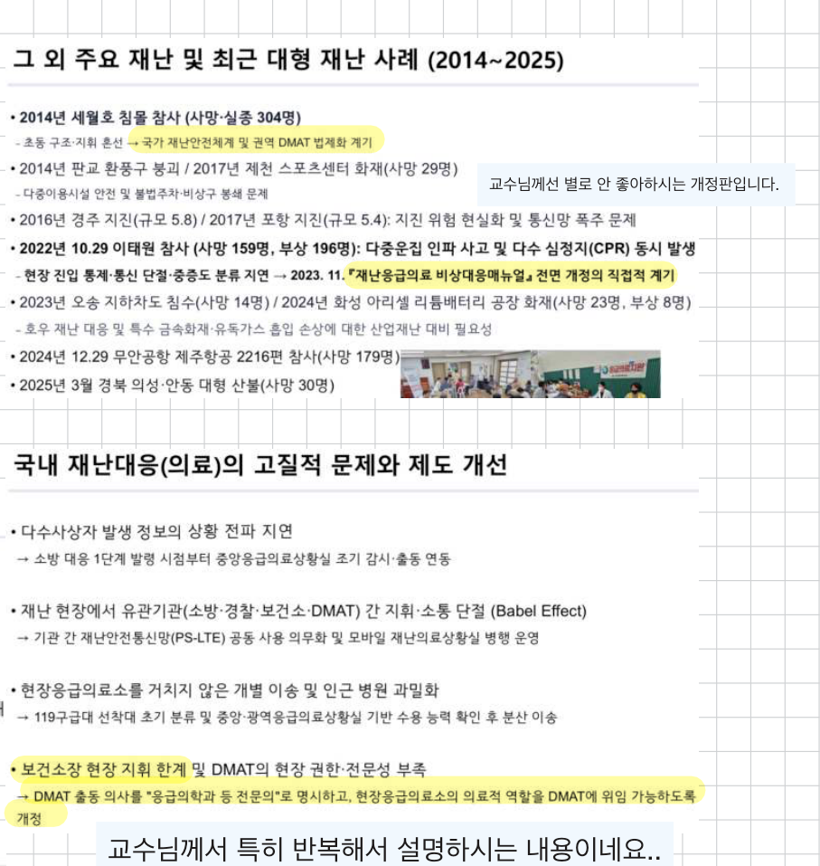{: style="width:58%"}

그 외 최근 사례: **2014 세월호**(304명) → 국가재난안전체계·**권역 DMAT 법제화** 계기 / 2014 판교 환풍구, 2017 제천 스포츠센터 화재 / 2016 경주·2017 포항 지진(통신망 폭주) / **2022. 10. 29. 이태원 참사**(사망 159명, 부상 196명) — 다중운집 인파사고 + **다수 심정지(CPR) 동시 발생**, 현장 진입 통제·통신 단절·중증도 분류 지연 → **2023. 11. 『재난응급의료 비상대응매뉴얼』 전면 개정의 직접적 계기** / 2023 오송 지하차도, 2024 화성 아리셀 공장 화재 / 2024. 12. 29. 무안공항 제주항공 참사(179명) / 2025. 3. 경북 의성·안동 산불(30명).

### 국내 재난대응(의료)의 고질적 문제와 제도 개선 (교수님 반복 강조)

| 고질적 문제 | 제도 개선 |
|---|---|
| 다수사상자 발생 정보의 상황 전파 지연 | **소방 대응 1단계 발령 시점부터** 중앙응급의료상황실이 조기 감시·출동 연동 |
| 유관기관(소방·경찰·보건소·DMAT) 간 지휘·소통 단절(**Babel effect**) | 기관 간 **재난안전통신망(PS-LTE) 공동 사용 의무화**, 모바일 재난의료상황실 병행 |
| 현장응급의료소를 거치지 않은 개별 이송, 인근 병원 과밀화 | 119 구급대 선착대 초기 분류 + 중앙·광역 응급의료상황실 기반 수용 능력 확인 후 **분산 이송** |
| 보건소장 현장 지휘의 한계, DMAT의 현장 권한·전문성 부족 | DMAT 출동 의사를 **"응급의학과 등 전문의"로 명시**, 현장응급의료소의 **의료적 역할을 DMAT에 위임 가능**하도록 개정 |

!!! key "핵심"
    사례들에서 반복되는 실패는 거의 같다: **늦은 인지·전파**, **기관 간 통신 두절(Babel effect)**, **현장 통제 실패**(차량·보호자·취재진 난입), **현장응급의료소를 거치지 않은 이송**과 특정 병원 과밀, **사상자 집계·추적 실패**. 2023. 11. 개정은 이것을 고치려는 것이다.

# 3. 재난 대응의 기본 모형 — DISASTER 패러다임

미국 NDLS(National Disaster Life Support) 교육과정에서 만든 재난 대응 모형으로, 구성 요소 영어 낱말의 첫 글자를 모은 것이다. **반드시 따라야 하는 순서를 의미하지는 않는다.**

재난 전 단계는 **PRE-DISASTER Paradigm**: **P**lanning and Practice(계획 및 실행), **R**esilience(회복력), **E**ducation and training(교육 및 훈련).

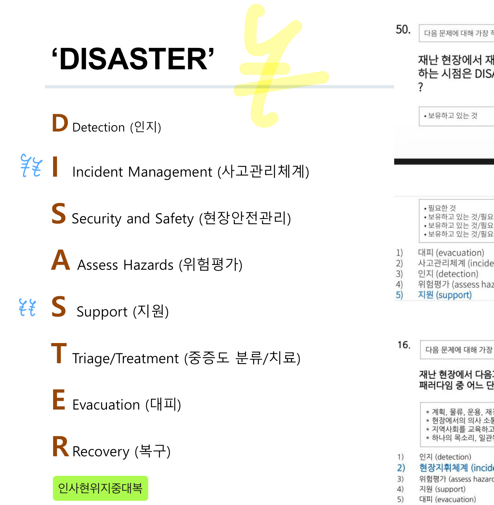{: style="width:50%"}

| 글자 | 단계 | 핵심 질문 / 내용 |
|---|---|---|
| **D** | Detection (인지) | 재난 상황인가? 무슨 일이 일어났는가? 지금 필요한 것은? 누구에게 연락? |
| **I** | Incident Management (사고관리체계·현장지휘체계) | 지휘·계획·물류·운영·재정 담당 설정, 의사소통, "하나의 목소리" |
| **S** | Security and Safety (현장안전관리) | 진입구·출구 확보, 안전 우선순위(나 → 대중 → 사상자 → 환경) |
| **A** | Assess Hazards (위험평가) | 잠재적 원인 인식, 추가 사상자 가능성, tunnel vision 조심 |
| **S** | Support (지원) | 가진 것·필요한 것·그 위치·도착 시점·못 쓸 때의 대안 |
| **T** | Triage/Treatment (중증도 분류/치료) | MASS, SALT, START, METTAG |
| **E** | Evacuation (대피) | 이송 우선순위, 분산 이송, 병원 내 대피 |
| **R** | Recovery (복구) | 장기 목표, 구호·재활·복구·평가 |

!!! memo "암기"
    필기본 암기법: **인·사·현·위·지·중·대·복** (인지–사고관리–현장안전–위험평가–지원–중증도 분류–대피–복구).

!!! exam "기출 포인트"
    보기에 나열된 항목을 보고 단계를 고르는 형식이 3번 나왔다. **1번(2025)·22번(2020)**: "보유하고 있는 것 / 필요한 것 / 그 위치 / 도착 시점 / 사용할 수 없을 때 대처" → **지원(Support)**. **15번(2022)**: "계획·물류·운용·재정 담당 설정 / 의사소통의 어려움 해소 / 지역사회 교육·정보 제공 / 하나의 목소리, 일관된 메시지" → **현장지휘체계(Incident management)**. 오답으로 인지·위험평가·대피가 섞여 나온다.

## D — Detection (인지)

- **모든 재난의 발생이 명백한 것은 아니다.** 생물학적 재난이 대표적(COVID-19) — 사건 발생 초기에 다른 기관과 효율적인 소통이 필요하다.
- 사건의 발생은 **점진적**일 수 있다(예: 생물학적 vs 화학적).
- 사건의 **잠재적 원인을 인지**해야 한다 — 재난 유형에 따라 특별한 장비·인력이 필요할 수 있다. (예: "구미? 어, 화학사고인가?")
- 소모될 자원을 파악하고, **다른 이들에게 재난 상황임을 알려야** 한다 → 누구에게 알릴지 미리 알고 있어야 한다.

**초기 인지가 중요한 이유 — 1995 도쿄 지하철 사린 테러**: 옴진리교가 신경작용제 사린(유기인계, organophosphate)을 살포했는데, 초기에 화학 테러로 인지하지 못해 **제염 없이** 환자를 병원에 들였고, 그 결과 **의료진이 2차 중독**되었다. 화학 재난을 일찍 알아채야 제염과 보호구를 준비할 수 있다.

## I — Incident Management / Incident Command System (현장지휘체계)

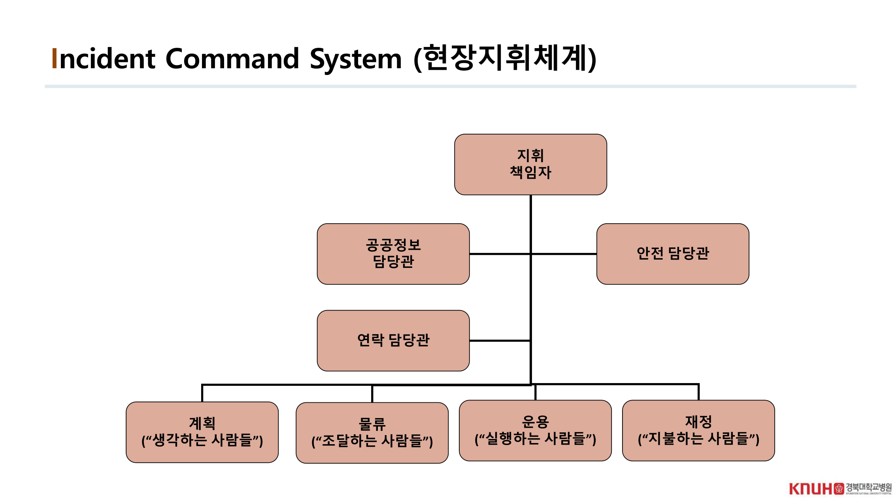{: style="width:62%"}

- **지휘 책임자** 아래 참모로 공공정보 담당관, 안전 담당관, 연락 담당관
- 4개 부서: **계획**("생각하는 사람들"), **물류**("조달하는 사람들"), **운용**("실행하는 사람들"), **재정**("지불하는 사람들")
- 더 간단한 기본 모형: **단일화된 명령체계(Unified Command)** 아래 Planning · Operations · Finance · Logistics

**필요성**: 현장에서는 의사소통이 어렵다 → 계획과 프로토콜 수립, 핵심 관계 구축, 장비에 대한 이해, 반복 훈련과 연습.
**목적**: 지역사회를 교육하고 정보를 제공한다 / 두려움과 공포를 줄인다 / 안내하고 방향을 제시한다 / 통제된 메시지를 내보낸다 — **"하나의 목소리, 일관된 메시지"**. 교수님: "**컨트롤 타워가 중요!**"

# 4. 국내 재난응급의료체계 (새로 추가 — 교수님 반복 강조)

## 국내 현장지휘체계의 법적 근거

교수님: "**이런 걸 아실 필요가 있습니다.** 어려운 용어는 몰라도 되는데, *이런 걸 설치한다, 지휘 권한은 누가 가진다* 이런 걸 알고 있어야 합니다."

1. **지역긴급구조통제단 설치**(「재난 및 안전관리 기본법」 제50조): 시·도 소방본부에 **시·도긴급구조통제단**(단장: **소방본부장**), 시·군·구 소방서에 **시·군·구긴급구조통제단**(단장: **소방서장**)을 둔다.
2. **재난현장 긴급구조 현장지휘**(같은 법 제52조): 재난현장에서는 **시·군·구긴급구조통제단장(소방서장)**이 인명 탐색·구조, 사상자 응급처치와 의료기관 이송, 현장 접근통제 등 긴급구조활동을 **총괄 지휘**한다.
3. **현장응급의료소의 설치와 위임**(「긴급구조대응활동 및 현장지휘에 관한 규칙」 제20조, 2023. 11. 매뉴얼):
    - **통제단장(소방)이 현장응급의료소를 설치**하고, **현장응급의료소장은 관할 보건소장**이 맡는다(분류반·응급처치반·이송반 편성).
    - 단, 전문적 의료 대응을 위해 현장응급의료소의 **의료적 역할(중증도 분류·응급처치·이송 결정)은 재난의료지원팀(DMAT, 응급의학과 전문의)에게 위임 가능**(2023. 11. 개정).

!!! memo "암기"
    **지휘 = 소방**(통제단장 = 소방서장/소방본부장) · **현장응급의료소 설치 = 소방(통제단장)** · **현장응급의료소장 = 보건소장** · **의료 역할(분류·처치·이송 결정) → DMAT에 위임 가능**.

## 한국의 현장 재난대책반 조직도

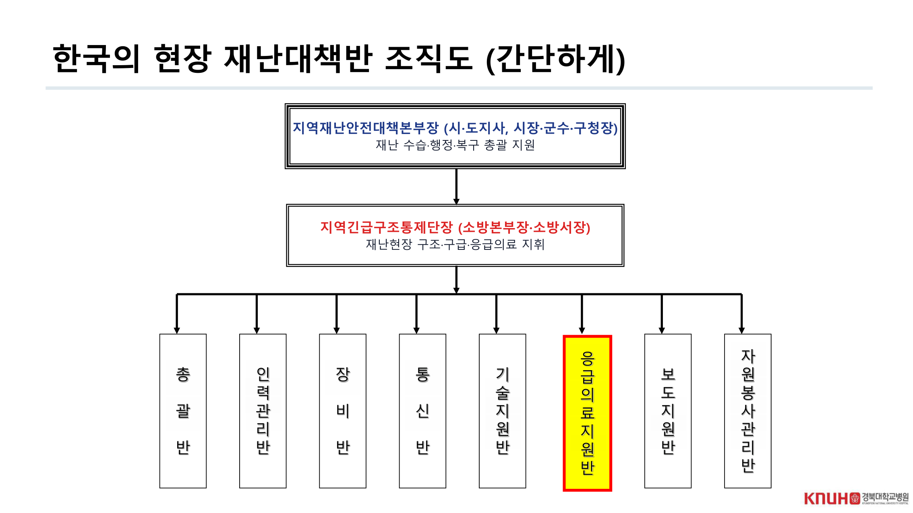{: style="width:62%"}

- **지역재난안전대책본부장**(시·도지사, 시장·군수·구청장): 재난 수습·행정·복구 **총괄 지원**
- **지역긴급구조통제단장**(소방본부장·소방서장): 재난현장 **구조·구급·응급의료 지휘**
- 그 아래 총괄반·인력관리반·장비반·통신반·기술지원반·**응급의료지원반**·보도지원반·자원봉사관리반

긴급구조통제단 상세 조직도에서도 응급의료반은 맨 아래쪽의 한 반이다 — "**의료반은 저~ 밑에 있다.**" 재난 현장에서 의료진은 지휘하는 위치가 아니라 소방 지휘 체계 안에서 움직인다는 뜻이다.

## 재난대응 의료 인력 (2023. 11. 매뉴얼 기준)

| 조직 | 운영 주체 | 구성 | 출동 |
|---|---|---|---|
| **중앙 DMAT** | 국립중앙의료원 중앙응급의료센터 | | 여러 권역 DMAT의 역량을 초과하거나 **3일 이상 장기 대응**이 필요한 대규모 재난. **보건복지부가 출동 결정** |
| **권역 DMAT** | 전국 40여 개 **재난거점병원**(권역응급의료센터 중심) | **팀당 4명**: 의사 1명(응급의학과 등 **"전문의"**로 명시), 간호사·응급구조사 2명, 행정요원 1명 | 거점병원당 **동시 출동 최대 2개 팀** 원칙(초과 시 인근 거점병원·중앙 DMAT 순차 출동). 중앙응급의료상황실·긴급구조통제단(소방)·지자체 요청 또는 거점병원 재난의료책임자 판단 |
| **지역 DMAT** | 재난거점병원 **외** 응급의료기관 | 시도 DMAT: **의료인 5–6명, 의료보조요원 2–3명** | |
| **보건소 신속대응반** | 관할 시·군·구 **보건소** | 보건소장(현장응급의료소장) + 의사·간호사·행정인력 | 현장응급의료소 설치·행정 지원, **경증 환자 관리** |

필기본 메모: "평소엔 나갈 일이 없다. 세월호 참사를 제외하고 나간 적 없다네요", "(지역 DMAT은) 없는 지역도 많다."

!!! exam "기출 포인트"
    조직의 특징을 나열하고 이름을 고르는 문제가 매년 나왔다. **6번(2024)**: 재난거점병원 **이외** 응급의료기관 운영 + 의료인 5–6명·보조 2–3명 + 시·도 단위 → **지역 DMAT**. **10번(2023)**: **보건소**에서 구성 + 의료인 2–3명·행정 2–3명 → **신속대응반**. **20번(2020)**: 재난거점병원 운영 + 팀당 4명(의사 1·간호사/구조사 2·행정 1) → **권역 DMAT**. 운영 주체(중앙응급의료센터 / 재난거점병원 / 그 외 응급의료기관 / 보건소)로 구별하면 된다.

!!! diff "작년 필기와 다른 점"
    2020년 기출(20번)은 권역 DMAT을 "**병원당 3팀**"으로 두었지만, 올해 강의록은 "재난거점병원당 **동시 출동 최대 2개 팀** 원칙"이다. 또 올해는 권역 DMAT 의사를 "응급의학과 등 **전문의**"로 명시했다. 신속대응반의 "의료인 2–3명, 행정 2–3명"(10번)은 올해 슬라이드에 숫자가 없다.

## 재난 시 보고체계와 재난 상황처리 절차

재난 현장(현장응급의료소: 신속대응반·DMAT) ↔ **중앙응급의료센터 중앙응급의료상황실** ← 사건 발생 보고, 응급의료기관(병상 정보·환자 내원 현황) → 보건복지부. 보고체계는 "넘어가겠습니다."

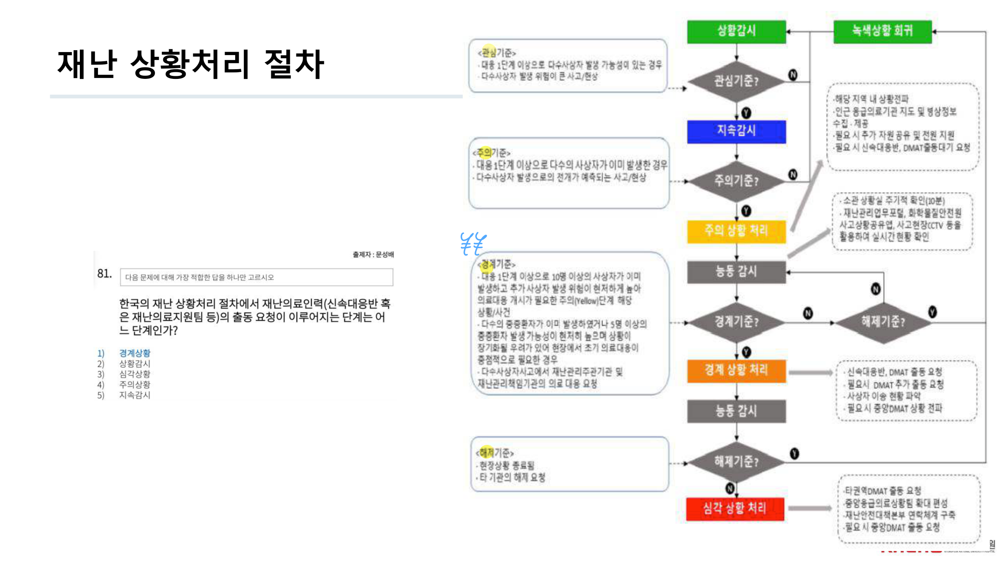{: style="width:85%"}

절차도의 흐름: **상황감시** → 관심 기준? → **지속감시** → 주의 기준? → **주의 상황 처리** → 능동 감시 → 경계 기준? → **경계 상황 처리**(**신속대응반·DMAT 출동 요청**, 필요시 DMAT 추가 출동, 사상자 이송 현황 파악, 필요시 중앙 DMAT 상황 전파) → 해제 기준? → 아니면 **심각 상황 처리**(타 권역 DMAT 출동 요청, 중앙응급의료상황실 확대 편성 등).

!!! exam "기출 포인트"
    **2번(2025)**: 재난 상황처리 절차에서 재난의료인력(신속대응반·DMAT)의 출동 요청이 이루어지는 단계 → **경계상황**. 오답 보기(상황감시·주의상황·지속감시·심각상황)가 모두 절차도의 이름이라 단계 순서와 각 단계의 행동을 함께 외워야 한다.

## DMAT 출동 기준 — 소방 대응단계 연동, 중증환자 중심 개편

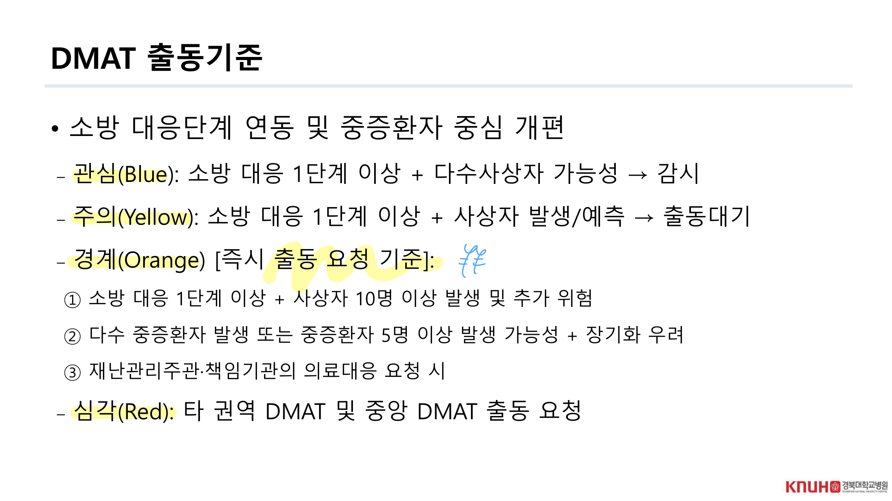{: style="width:62%"}

| 단계 | 기준 | 행동 |
|---|---|---|
| **관심**(Blue) | 소방 대응 1단계 이상 + 다수사상자 **가능성** | **감시** |
| **주의**(Yellow) | 소방 대응 1단계 이상 + 사상자 발생/예측 | **출동 대기** |
| **경계**(Orange) — **즉시 출동 요청 기준** | ① 소방 대응 1단계 이상 + **사상자 10명 이상** 발생 및 추가 위험 ② 다수 중증환자 발생 또는 **중증환자 5명 이상** 발생 가능성 + 장기화 우려 ③ 재난관리주관·책임기관의 의료대응 요청 시 | **DMAT 출동 요청** |
| **심각**(Red) | | **타 권역 DMAT 및 중앙 DMAT** 출동 요청 |

## DMAT 출동 요청권자와 현장 대응 원칙 (야마)

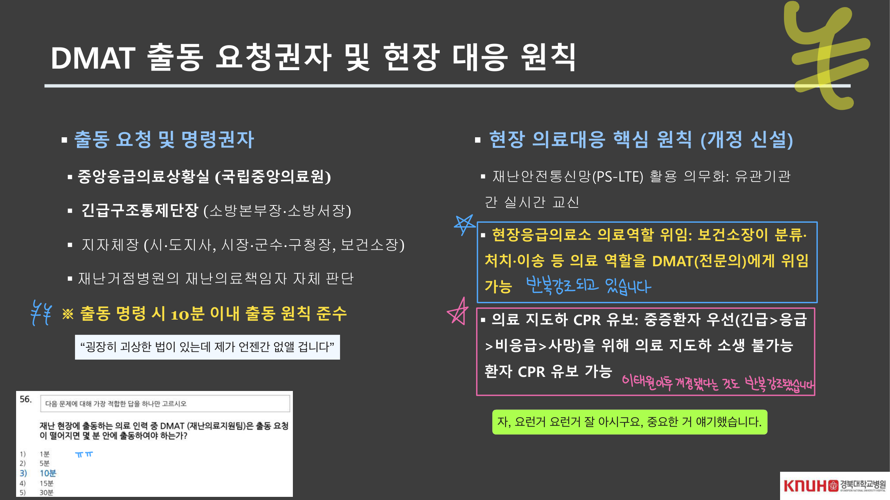{: style="width:70%"}

**출동 요청 및 명령권자**

- 중앙응급의료상황실(국립중앙의료원)
- 긴급구조통제단장(소방본부장·소방서장)
- 지자체장(시·도지사, 시장·군수·구청장, 보건소장)
- 재난거점병원의 재난의료책임자 자체 판단
- ※ **출동 명령 시 10분 이내 출동 원칙** 준수 (교수님이 "굉장히 괴상한 법"이라고 한 것 — 언젠가 없애겠다고 함)

**현장 의료대응 핵심 원칙 (개정 신설)**

- **재난안전통신망(PS-LTE) 활용 의무화**: 유관기관 간 실시간 교신
- **현장응급의료소 의료 역할 위임**: 보건소장이 분류·처치·이송 등 의료 역할을 **DMAT(전문의)에게 위임 가능** — 반복 강조
- **의료지도하 CPR 유보**: 중증환자 우선(긴급 > 응급 > 비응급 > 사망)을 위해, **의료 지도하에 소생 불가능 환자의 CPR 유보 가능** — **이태원 이후 개정**되었다는 것도 반복 강조

!!! exam "기출 포인트"
    **18번(2022)**: DMAT은 출동 요청이 떨어지면 몇 분 안에 출동? → **10분**(1·5·15·30분이 오답). 올해 교수님이 이 원칙을 싫어한다고 했지만 아직 현행 원칙이다.

!!! key "핵심"
    *의료지도하 CPR 유보*의 정확한 의미: 재난 현장이라고 모든 심정지 환자에게 CPR을 금지하는 것이 **아니다**. **기도 개방 후에도 호흡이 없고 재난 상황에서 소생이 불가능하다고 판단되는 환자**에 대해 **의료 지도하에** CPR을 유보할 **수 있다**는 것이다. 판단의 기준은 *전체 환자의 생존 가능성과 가용 의료자원*이다.

# 5. 현장 안전, 제염·제독, 개인보호구

## 재난 현장 배치 상황

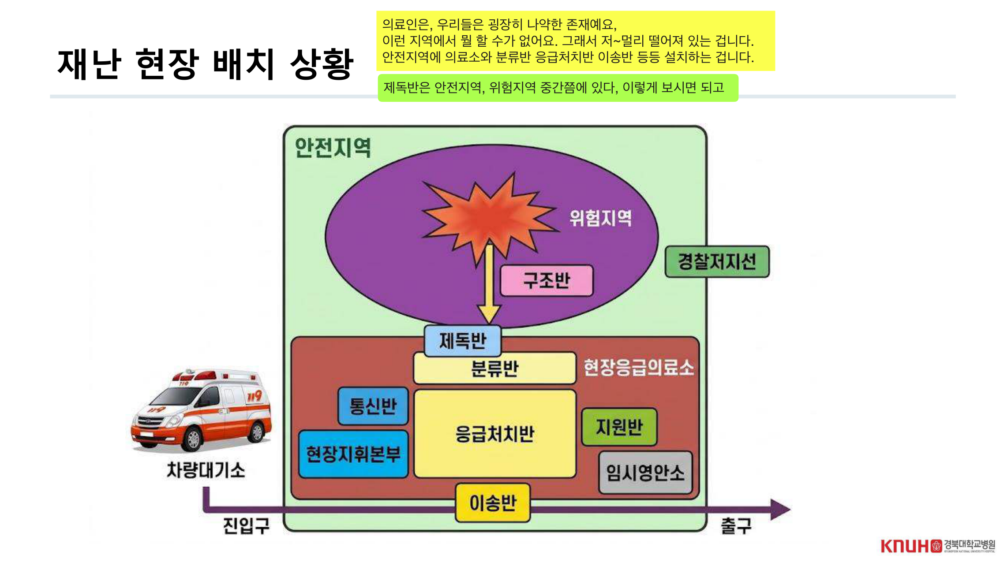{: style="width:62%"}

교수님: "**의료인은, 우리들은 굉장히 나약한 존재예요.** 이런 (위험) 지역에서 뭘 할 수가 없어요. 그래서 저~ 멀리 떨어져 있는 겁니다."

- **위험지역**: **구조반**(소방 구조대원)만 들어간다.
- **제독반**: 위험지역과 안전지역의 **중간쯤**.
- **안전지역**: **현장응급의료소** — 분류반, 응급처치반, 이송반, 통신반, 현장지휘본부, 지원반, 임시영안소. 차량대기소에서 진입구로 들어와 출구로 나가는 **일방향 동선**, 바깥에 경찰 저지선.

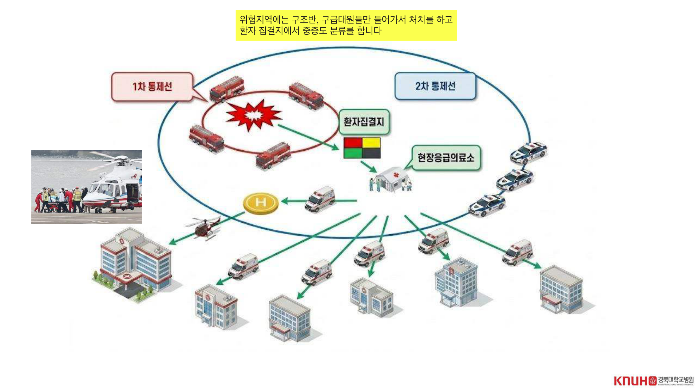{: style="width:62%"}

**위험지역에는 구조반·구급대원들만 들어가서 처치**를 하고, **환자 집결지에서 중증도 분류**를 한 뒤 현장응급의료소를 거쳐 여러 병원(헬기 포함)으로 분산 이송한다.

## S — Security and Safety (현장안전관리)

- **진입구 및 출구 안전 확보** — 현장과 의료기관 모두
- **재난 현장에서 안전의 우선순위**: **① 본인과 팀원 → ② 피해를 입지 않은 일반 대중 → ③ 사상자 → ④ 환경**
- 이유: *내가 다치면 다른 구조자들이 더 위험해질 수 있다* — 구조자가 추가 사상자가 되면 자원이 줄고 구조할 사람이 늘어난다.

!!! exam "기출 포인트"
    **5번(2024)·9번(2023)**: 안전 순위에서 가장 우선 고려할 대상 → **본인과 대응 인력(재난의료대응팀)**. 함정은 "피해를 입은 사상자"(실제로는 3순위)와 "피해를 입지 않은 일반 대중"(2순위). 필기본: "나 자신이 가장 중요하죠 네."

**통제 및 안내의 중요성**

- **경증 환자들의 개인적 이동 방지**: 현장에서 진료를 받지 못하면 **경증 환자의 약 80%**가 스스로 병원에 간다 → 가까운 병원이 경증 환자로 마비된다.
- **안전 위협의 확인 및 완화**: 2차 위험 장치(예: 2차 폭발물), 범인의 계속되는 위험 행동, 전선·가스 누출·건물 붕괴, 인파.

## NIOSH/OSHA 제염 구역 (중요 — 야마)

NIOSH = 미국 산업안전보건연구원, OSHA = 미국 산업안전보건청. 교수님: "**요것도 알아야 합니다.**"

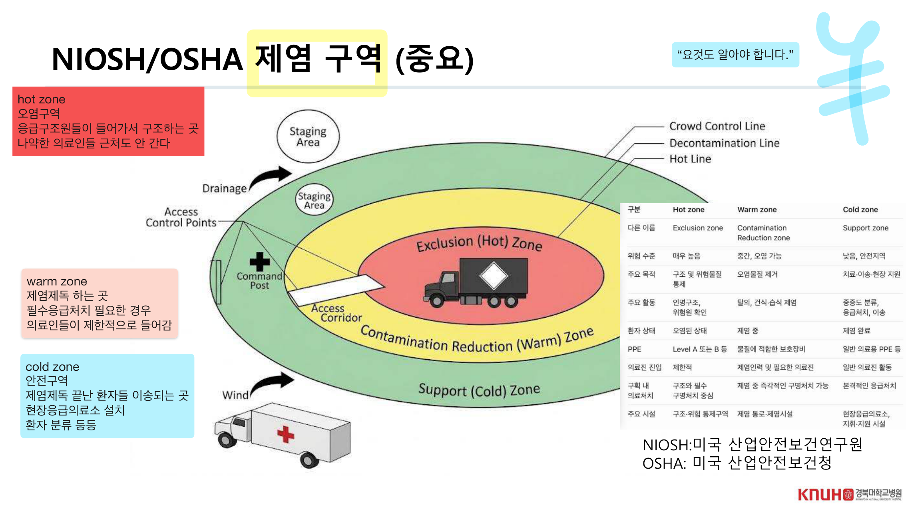{: style="width:75%"}

| 구역 | 다른 이름 | 무엇을 하나 | 누가 들어가나 |
|---|---|---|---|
| **Hot zone** | 오염구역, Exclusion zone | 오염원이 있는 곳. **구조** | **응급구조원(구조대)만** — "나약한 의료인들 근처도 안 간다" |
| **Warm zone** | 준오염구역, Contamination Reduction zone | **제염·제독**하는 곳. 필수 응급처치(LSI)가 필요한 경우 | **의료인은 제한적으로** 들어감 |
| **Cold zone** | 안전구역, Support zone | 제염·제독 끝난 환자를 받는 곳. **현장응급의료소 설치**, 환자 분류 등 | 의료진 대부분 |

- 경계선: Hot zone 둘레가 **Hot line**(Exclusion line), Warm–Cold 경계가 **Decontamination line**, 바깥이 Crowd control line.
- 올해 강의록은 **Warm zone과 Cold zone 경계에 제염 시설**, **Cold zone에 현장응급의료소**를 둔다고 명시했다.

## 환자 집결지는 어디에? (야마)

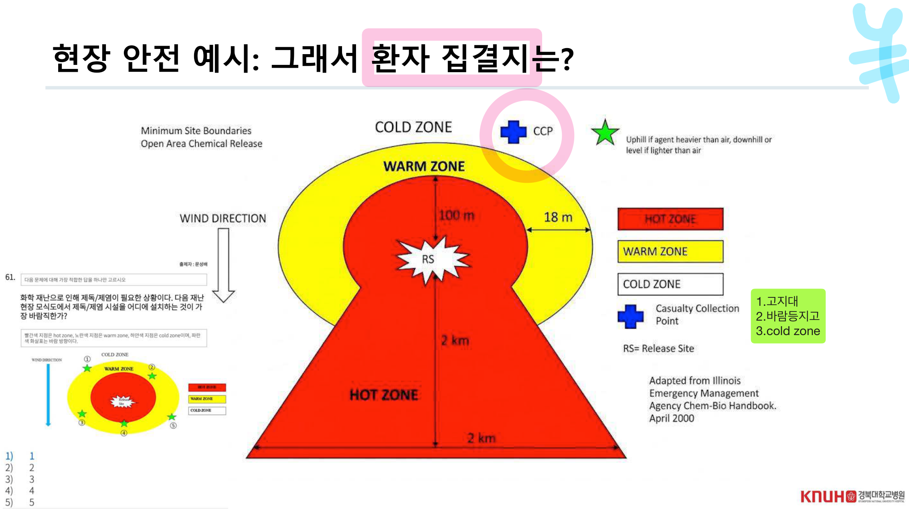{: style="width:62%"}

환자 집결지(CCP)와 제염 시설은 **① 고지대**(슬라이드: 유해물질이 공기보다 무거우면 언덕 위, 가벼우면 낮거나 평평한 곳 — 무거운 기체는 낮은 곳에 고이므로) **② 바람을 등진 곳(풍상측, upwind)** **③ cold zone**에 둔다. 화학물질 유출 시 최소 경계는 Hot zone 반경 약 100 m, 바람이 불어가는 쪽(풍하측)으로 2 km까지 위험 구역이 길게 뻗는다.

!!! exam "기출 포인트"
    **7번(2024)·11번(2023)** 그림 문제: 빨강 = hot, 노랑 = warm, 하양 = cold, 파란 화살표 = 바람 방향(위 → 아래)일 때 제독·제염 시설의 위치 → **①**(바람이 불어오는 위쪽, warm–cold 경계). ②는 warm zone 안이지만 바람 방향에서 옆으로 비껴 있고, ③·④·⑤는 바람이 불어가는 쪽이라 오염 공기가 흘러온다. 2024년 원본 표시는 ②였지만 **필기본이 "정답 1번으로 정정"**했고 2023년 정답도 ①이어서, 2부 7번 정답을 **①로 고쳤다**. 필기본 예상: 올해도 **"공간 중심으로, 기존 그림 문제와 비슷한 형식"**이 유력하다.

## 제염(Decontamination)이란?

- **유해물질**(Hazardous material, **HazMat**): 건강·재산·환경에 위해를 끼치는 물질 — 화학물질, 방사능물질, 감염성물질 / 고체·액체·기체.
- **제염**(Medical decontamination, **Decon**): **인체로부터 유해물질을 제거**하는 것.

**제염의 종류**: **탈의**(disrobing) · **건식 제염**(dry decon) · **습식 제염**(wet decon). 그 외 보행자용 제염(ambulatory), 들것 제염(litter), 제염인력 제염(personnel), 장비 제염(equipment).

### 탈의 (Disrobing) — 가장 먼저, ASAP

- 오염된 **모든 의복을 제거** — 자르거나, 단추를 풀거나, 당기거나
- **오염 감소 효과 80–90%**로 간주
- **늦을수록 효과가 반감** → **ASAP**

!!! diff "작년 필기와 다른 점"
    탈의의 오염 감소 효과가 작년 강의록(2025 p.35)은 **50–70%**, 올해(2026 p.94)는 **80–90%**다. **올해 시험은 80–90%**로 외운다.

### 건식 제염 (Dry decon)

- **흡착재**를 이용한 물리적 제거·흡수·중화
- **한꺼번에 많은 환자**를 제염할 때 습식보다 유리
- 방향: **얼굴·모발 → 아래 방향**

### 습식 제염 (Wet decon)

- **따뜻한 물과 비누로 샤워** — 너무 뜨겁거나 차가운 물은 자제(뜨거우면 혈관 확장으로 흡수 증가, 차가우면 저체온), **물과 반응하는 물질은 주의**, 제염 후 건조
- **액체·에어로졸·먼지에 유리**. **기체는 효과 미미** — 단, 증기형이라도 **피부·점막에 손상이 있으면 습식 제염 필요**
- 순서: **상처 → 얼굴 → 머리카락 → 머리 → 나머지 체부**
- 가능하면 사용한 물을 방출하지 말고 **저장**(환경 오염 방지)
- 2단계: **Gross**(1차, "ladder pipe" — 소방 사다리차 물줄기로 대량 세척) → **Secondary**(세제 사용, 필요시 도우미). 교수님은 뿌리는 입장인데, 훈련하면 다들 춥다고 한다.

!!! exam "기출 포인트"
    **3번(2025)**: 습식 제염 시 가장 먼저 제염할 부위 → **상처와 그 주변부**(오염물질이 몸 안으로 흡수되는 통로). 함정은 얼굴(2순위)·머리카락. 건식 제염의 "얼굴·모발 → 아래"와 헷갈리지 않는다.

**제염 용액**(넘어감): **물과 비누**가 가장 널리 권장(적절한 수압·온도 유지). 표백제는 **눈·점막·개방성 창상에 금기**, 사람용 **0.5%**(가정용 표백제를 물과 1:9 희석), 장비용 **5.0%**(가정용 표백제 원액).

### 제염/제독 시 유의점

- 환자 **프라이버시** 고려, **대량의 의복** 준비
- **유해물질에 대한 정보**가 필요
- **취약 인구**(노인, 소아, 외국인) 고려
- **거동 가능하면 스스로** 제염
- 눈: **식염수로 10–15분 이상** 직접 세척

### 들것 동원한 제염 (Litter decon)

- **보행이 불가능한 환자**, 환자 1명당 **최소 3명**의 인력 필요
- 의복 제거, **얼굴에서 발 쪽으로** 진행
- 관절 마디를 지날 때마다 **가위를 세척**
- **피부에서 멀어지는 방향으로 말아서** 의복 제거
- 눈에 띄는 오염물질은 반드시 제거

### 제염은 어디서?

가능한 **병원 바깥**에서, **편평하고 포장된 바닥**, **바람이 불어가는 방향에서 멀어지는 곳**, **조명**이 있는 곳, **진입·출구 통제**가 가능한 곳.

### 제염 중 즉각적 치료 (야마)

- **제염 장소(Warm zone)**에서 시행
- **생명을 즉각 위협하는 손상은 제염보다 치료가 우선!**
- **생명 유지에 필수적인 처치만**: A/B/C(기도 관리 등), **해독제 투여**, **바늘 흉강감압술**, **기관삽관술**
- 나머지는 **cold zone**에서 치료

## 개인보호구 (PPE)

**Personal Protective Equipment**: 심각한 작업장 손상·질병을 일으키는 위해 요인에 대한 노출을 최소화하기 위해 착용하는 장비(미국 노동부 OSHA). 한마디로 **"나"를 보호하기 위한 수단**이다. 의학에서는 표적이 병원체(pathogens)이고 주로 **피부·호흡기 PPE**에 초점, **4 levels, 5 types**.

| Level | 호흡 보호 | 피부·보호복 | 적응증 / 쓰는 곳 |
|---|---|---|---|
| **A** | **자가호흡장치(SCBA)** | 외부 증기로부터 **완전 차단**된 보호복 + 내화학 장갑·장화 | **가장 높은 수준**. 화학재난 **hot zone 들어갈 때**. 고가, 착용 시간 제한(산소통) |
| **B** | **SCBA 또는 공기공급 호흡장치(SAR)** — **공기통이 보호복 바깥** | 화학물질 비산 방지 **후드 일체형** 보호복 + 내화학 장갑·장화 | **호흡기 보호는 최고 수준(A와 동일)**, 피부·증기 차단은 A보다 낮음. **Agent known; life threatening (IDLH)** |
| **C** | **공기정화장치(APR)** / 전기 공기정화장치(**PAPR**) | 내화학 안면보호구·보호복·장갑·장화 | 낮은 수준의 호흡기 보호, 비산물질 방어. **Agent known; non-life threatening (= IDLH 대기가 확실히 아님)**. **의료기관에서 쓰는 최고 등급**(예: 코로나19 ICU에서 suction) |
| **D** | 없음 | 수술용 장갑, 방수 가운, 보호경, 안면보호기, 장화/덧신 | **최소한의 통상적 보호**. 독성 액체·증기·가스로부터 보호 안 됨 |

!!! memo "암기"
    필기본 요약: **A** = 피부·호흡 최고 방어 / **B** = A에서 **피부만** 한 단계 아래 / **C** = B에서 **호흡이** 한 단계 아래(SCBA → 공기정화) / **D** = 그냥 마스크에 비닐. "**IDLH면 Level B 이상**", "**의료기관 최고 = C**".

**IDLH**(Immediately Dangerous to Life & Health, 미연방규정집 CFR): **30분 이내에 구출되지 않으면 건강 상태를 회복할 수 없는 대기**. 독성·자극성·질식성 물질이 포함되어 즉시 생명에 위협이 되거나, 위험한 대기를 빠져나가려는 노력을 방해할 수 있는 상태. 예: 공기 입구가 제한된 곳, 산소 결핍, 폭발 가능성, 안개처럼 보이는 증기, 사망한 동물, **HazMat 종류·농도를 확인하기 전까지**.

!!! exam "기출 포인트"
    특징을 나열하고 Level을 고르는 문제가 3번. **12번(2023)·19번(2020)**: 공기정화장치 + 내화학 보호복 + 물질을 알고 IDLH가 아님 + **의료기관 최고 등급** → **Level C**. **17번(2022)**: **보호복 바깥의 SCBA 또는 SAR** + 후드 달린 보호복 + 높은 호흡 보호 → **Level B**. 구별 포인트는 *SCBA냐 공기정화냐*(B vs C), *SCBA가 보호복 안이냐 밖이냐*(A vs B). 보기의 "Level E"는 없는 등급이다.

## A — Assess Hazards (위험평가)

- **잠재적 원인**을 인식
- **추가 사상자 발생 가능성**을 평가
- 부상자에게만 관심을 보이는 좁은 시야(**tunnel vision**)를 조심하자 — 눈앞의 환자에게만 몰두하다 2차 폭발·붕괴를 놓친다.

## S — Support (지원)

- 핵심 질문 5가지: **가지고 있는 것**은? **무엇이 필요**한가? **그것이 어디에** 있는가? **언제 도착**하는가? **사용할 수 없다면** 어떻게 되는가?
- 어떤 자원이 필요한지 알아야 하고, **지원 계획은 평소에 미리 수립**되어 있어야 한다 — 예: 임시 병상 확보 계획, 의료 인력 지원, **생물학 재난: 백신·보호장구**, **화학재난: 해독제**.
- 지역 내 자체 보유 자원 vs 광역자치단체·국가 보유 자원을 구분한다.

# 6. 중증도 분류 (Triage) — 왕야마

## Triage의 개념과 목표

- **Triage**: 프랑스어 동사 *trier* = sort(분류하다). 나폴레옹 시대 외과의사 **Dominique Jean Larrey**(1766–1842)가 시작.
- **가장 긴급하면서, 가장 살릴 가능성이 높은 사람 우선** — 제한된 의료자원에서 최대한의 효과를 얻고, 응급처치와 병원 이송의 우선권을 배정하기 위해 환자를 중증도별로 구분하는 것.
- 목표를 다시 강조: 병원에서는 **Most seriously ill**, 재난 현장에서는 **The greatest good for the greatest number**.
- 재난 상황에서 CPR 시행? → **일반적으로 ×**(의료지도하 유보, 4단원 참고).
- 의학적 최종 진단을 내리는 것이 **아니다** → **비의료인·일반인도 할 수 있다.**

## METTAG — 색상을 이용한 중증도 분류체계 (중요)

교수님: "**이건 이제 아셔야 합니다.**" — 기출 단골.

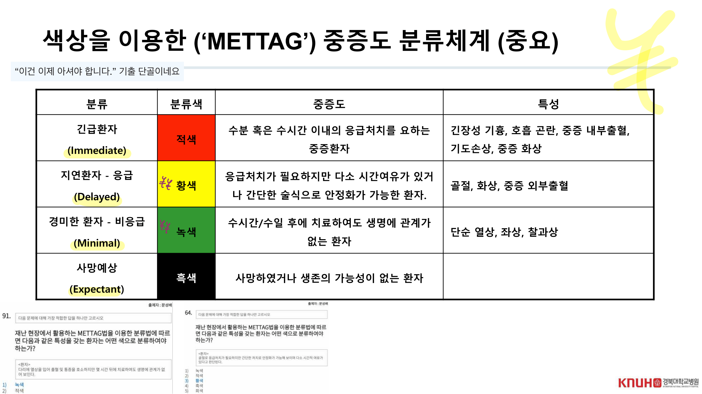{: style="width:80%"}

| 분류 | 색 | 중증도 | 예 |
|---|---|---|---|
| **긴급**(Immediate) | **적색** | 수분~수시간 이내 응급처치를 요하는 중증 | 긴장성 기흉, 호흡곤란, 중증 내부출혈, 기도손상, 중증 화상 |
| **응급**(Delayed, 지연) | **황색** | 응급처치가 필요하지만 다소 **시간 여유**가 있거나 **간단한 술식으로 안정화** 가능 | 골절, 화상, 중증 외부출혈 |
| **비응급**(Minimal, 경미) | **녹색** | 수시간/수일 후 치료해도 생명에 관계없음 | 단순 열상, 좌상, 찰과상 |
| **사망예상**(Expectant) | **흑색** | 사망하였거나 생존 가능성이 없음 | |

!!! exam "기출 포인트"
    **14번(2023)**: 골절, 처치 필요하지만 간단한 처치로 안정화·시간 여유 → **황색**. **8번(2024)**: 다리 열상, 출혈·통증 있지만 몇 시간 뒤 치료해도 생명에 관계없음 → **녹색**("출혈"이라는 단어에 끌려 황색·적색을 고르면 틀림 — 기준은 *시간 여유와 생명 위협*). 보기의 "회색"은 METTAG에 없는 색이다.

## 재난 시 사용되는 환자분류법

"어떤 환자를 어떤 '색'으로 분류할 것인가"를 정하는 방법. 이외에도 다수 있다.

| 분류법 | 구성 | 쓰는 곳 |
|---|---|---|
| **MASS** | **M**ove(환자 이동) – **A**ssess(평가) – **S**ort(분류) – **S**end(이송) | 미국, **한국식** |
| **SALT** | **S**ort(분류) – **A**ssess(평가) – **L**ifesaving interventions(인명구조 중재) – **T**reatment/transport(치료/이송) | 미국식 |
| **START** | **S**imple **T**riage **A**nd **R**apid **T**reatment: Respiration(호흡) – Perfusion(순환) – Mental status(의식) | 미국, 일본식(한국에서도 사용) |

## SALT 분류법 (올해 확대된 내용)

소아·성인 등 **모든 환자**, **모든 상황**의 다수손상사고 초기 중증도 분류에 적용 가능.

### 1단계: 포괄적 선별 (Global sort)

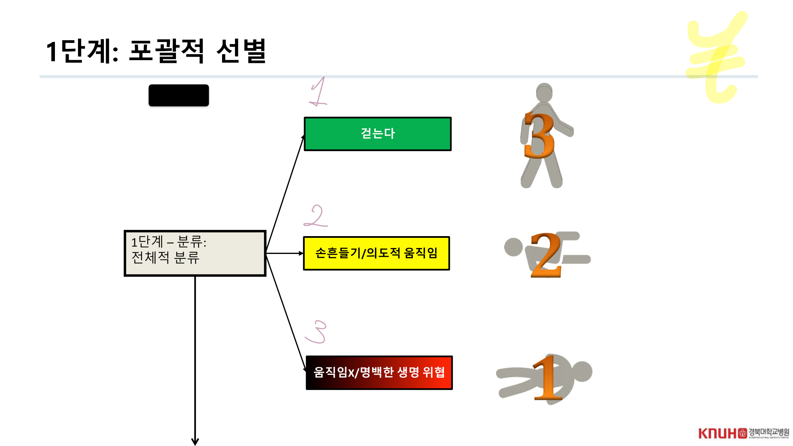{: style="width:62%"}

1. "**제 말이 들리고 치료가 필요하신 분은 이쪽으로 이동해 주세요**" → 예정된 구역으로. 목적: **비응급을 우선 구별**. 이 집단은 **3번째(마지막)**로 개별 재평가.
2. "**못 걸으시는 분은 팔이나 다리를 흔들어 주시면 저희가 가서 도와드리겠습니다**" → 목적: 긴급과 응급을 구별, **응급으로 우선 분류**. 이 집단은 **2번째**로 개별 재평가.
3. 두 질문에 **반응이 없는** 환자 → 생존 위협 상황 가능. **1번째**로 개별 재평가(긴급 or 사망예상/사망).

### 2단계: 개별 평가 (Individual assessment)

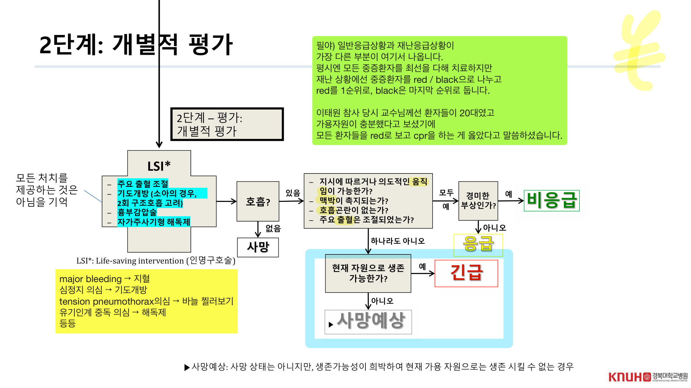{: style="width:85%"}

1. **LSI**(Life-Saving Interventions, 인명구호술)를 먼저 한다 — **모든 처치를 제공하는 것은 아님을 기억**:
    - **주요 출혈 조절**(major bleeding → 지혈)
    - **기도 개방**(심정지 의심 → 기도 개방, **소아는 2회 구조 호흡 고려**)
    - **흉부 감압술**(tension pneumothorax 의심 → 바늘 감압)
    - **자가주사기형 해독제**(유기인계 중독 의심 → 해독제)
2. **호흡?** — 없음 → **사망**
3. 있으면 네 가지 질문: **지시에 따르거나 의도적인 움직임이 가능한가? 맥박이 촉지되는가? 호흡곤란이 없는가? 주요 출혈은 조절되었는가?**
    - **모두 예** → 경미한 부상인가? 예 → **비응급**(녹색) / 아니오 → **응급**(황색)
    - **하나라도 아니오** → **현재 자원으로 생존 가능한가?** 예 → **긴급**(적색) / 아니오 → **사망예상**(흑색)
- **사망예상**: 사망 상태는 아니지만 생존 가능성이 희박하여 **현재 가용 자원으로는 생존시킬 수 없는** 경우.

!!! key "핵심"
    필기본: *일반 응급 상황과 재난 응급 상황이 가장 다른 부분이 여기다.* 평시엔 모든 중증 환자를 최선을 다해 치료하지만, 재난에서는 중증 환자를 **red / black으로 나누고**, red를 1순위, black을 마지막 순위로 둔다. 그 갈림길이 "**현재 자원으로** 생존 가능한가?"다 — 자원이 바뀌면 답도 바뀐다. 이태원 참사 때 교수님은, 환자들이 **20대**였고 **가용 자원이 충분**했다고 보았기 때문에 **모든 환자를 red로 보고 CPR을 하는 것이 옳았다**고 말했다.

## START 분류법 (한/미/일)

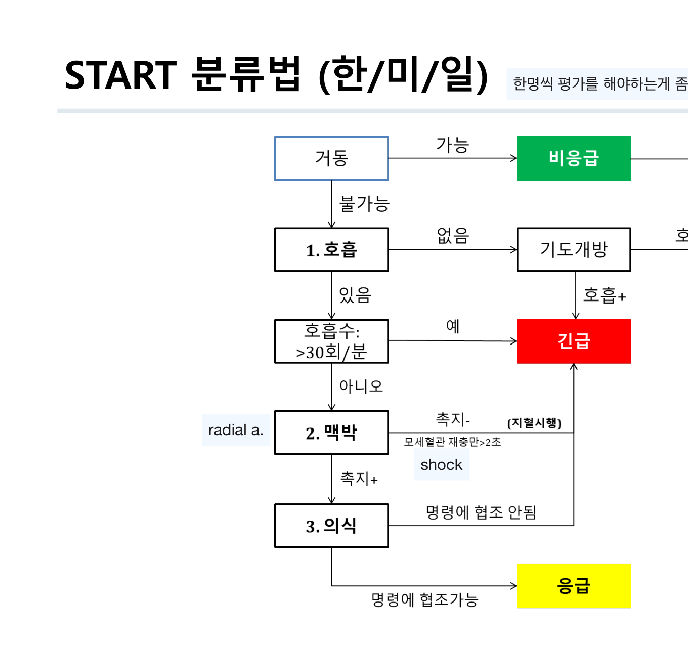{: style="width:55%"}

1. **거동 가능** → **비응급**(녹색) → 재평가
2. 거동 불가 → **호흡**: 없음 → 기도 개방 → 그래도 없으면 **사망**(흑색), 생기면 **긴급**(적색)
3. 호흡 있음 → **호흡수 > 30회/분** → **긴급**
4. 아니면 **맥박**(요골동맥, radial a.): 촉지 안 됨(또는 모세혈관 재충만 > 2초 — shock) → 지혈 시행, **긴급**
5. 맥박 촉지 → **의식**: 명령에 협조 안 됨 → **긴급** / 협조 가능 → **응급**(황색)

**RPM(Respiration·Perfusion·Mental status)**과 **30–2–명령**으로 외운다. 단점은 **한 명씩 평가**해야 한다는 것 — 교수님은 잘 안 쓴다.

## MASS 분류법 (미, 한)

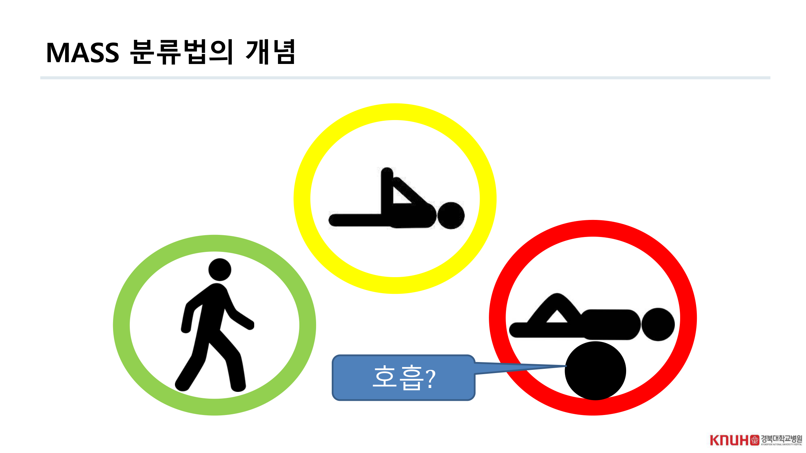{: style="width:55%"}

- **M – Move(이동)**: 이동할 수 있는 환자는 **비응급**, 팔다리를 움직일 수 있는 환자는 우선 **응급**, 그 외는 **긴급·사망(사망예상)**
- **A – Assess(평가)**
- **S – Sort(분류)**: 좁은 의미의 중증도 분류, **ID-me!** — **I**mmediate(즉시/긴급), **D**elayed(지연/응급), **M**inimal(경미/비응급), **E**xpectant(사망예상)
- **S – Send(이송)**
- 1차 현장에서 **긴급환자 파악**에 중점

### Move (이동)

- 목적: 다수 사상자 중 **거동 가능한 경증 환자를 가장 먼저 신속히 분리**
- **첫 번째 단계(보행 가능 여부)**: 확성기 등으로 "**제 말이 들리시는 분 중 걸을 수 있는 분은 파란 깃발(지정 장소) 아래로 모여 주십시오!**" — 스스로 걸어 이동할 수 있다면 최소한 **기도(A)·호흡(B)·순환(C)·의식이 유지**되고 있다는 뜻 → **비응급으로 우선 분류**
- **두 번째 단계**: "**제 말이 들리시는 분 중 도움이 필요하신 분은 팔이나 다리를 들어 보십시오!**" — 의식이 있고 지시에 따라 의도적 움직임이 가능하지만 걸을 수 없는 환자 → **응급으로 우선 분류**
- **세 번째 단계**: **전혀 움직이지 않거나 명백한 생명 위협**이 있는 환자에게 **1순위로 다가가** 개별 평가(Assess) → 기도 개방 후 호흡 유무와 치명적 손상 여부에 따라 **긴급** 또는 **사망예상**

### Assess (평가)

개별 평가: 우선 **기도·호흡·순환 유지**를 평가한다. 기도가 확보되고 호흡이 있더라도 **의식 상태를 평가해 반응이 없으면** 손상 정도에 따라 긴급 또는 사망예상으로 분류.

1. **긴급환자군 분류** — 보행이나 지시 수행이 불가능한 경우 신속히 ABC 평가
    - 기도가 열려 있는가? 가능하면 **손으로 기도 확보** 시도 → 열리지 않으면 **'사망예상'**, 다음 환자로
    - 지혈이 불가능한 출혈이 있는가? 있으면 **직접 압박** 시도(예: active massive bleeding)
    - **치명적 손상**을 입었는가?(예: 머리 관통상) → **'사망예상'**, 다음 환자로
2. 사망예상군이 아니라면 **생명을 위협하는 상황을 치료**한다.
3. **긴급 환자군의 수를 파악**한다.
4. 환자군에 따라 **이송을 결정**한다.

### Sort (분류)

이동·평가 결과를 토대로 **ID-me**에 따라 분류:

- **Red**: 생명을 위협하지만 **치료 가능**한 손상, 빠른 처치 필요
- **Yellow**: 잠재적으로 심각하지만 잠시 기다릴 만큼 안정
- **Green**: 더 오래 기다려도 되는 경미한 손상
- **Black**: 사망, 또는 생명 징후는 있지만 열악한 조건에서 생존할 수 없는 손상

긴급환자 치료가 끝났어도 **응급군 환자가 악화되어 긴급으로 재분류**될 수 있다 → **중증도 분류는 계속, 반복되는 작업**이다. 범주를 정한 뒤에도 사망예상·응급·비응급 환자를 **재평가**한다(1차 → 2차 → 3차 중증도 분류) — 환자 상태나 현장 자원이 바뀔 수 있기 때문이다.

!!! diff "작년 필기와 다른 점"
    작년 강의록(p.68)에는 "현장의 **마지막 환자**는 중증도와 관계없이 긴급으로 분류한다"는 문장이 있었는데 올해는 빠지고, 대신 "중증도 분류는 환자 상태 변화에 따라 **반복**해야 한다"를 강조했다.

!!! exam "기출 포인트"
    MASS 초기 분류는 **움직임으로 먼저 나눈다**. **16번(2022)**: 혼자 걸어 다니며 지시를 안 따르고 겨드랑이에 깊은 열상 → 초기 분류는 **비응급(녹색)**(걸을 수 있으니까 — 이후 재평가에서 올라갈 수는 있다). **21번(2020)**: 대화 가능, 몇 걸음 못 가고 주저앉음, 허벅지 부종·화상 → **응급(황색)**(걷지 못하지만 지시에 따름). **13번(2023)**: 거동·흔들기 안 되고 반응 없음, 목 자상, 얕은 호흡 → **긴급(적색)**(호흡이 있으니 사망예상 아님). **4번(2025)**: 의식 혼미, 통증에만 반응, 호흡 36회·맥박 140회 → **긴급**. 보기의 "지연"·"사망예정" 같은 이름에 흔들리지 말고 **긴급/응급/비응급/사망예상** 네 칸으로 생각한다.

## 분류 연습 — 필기본 예제

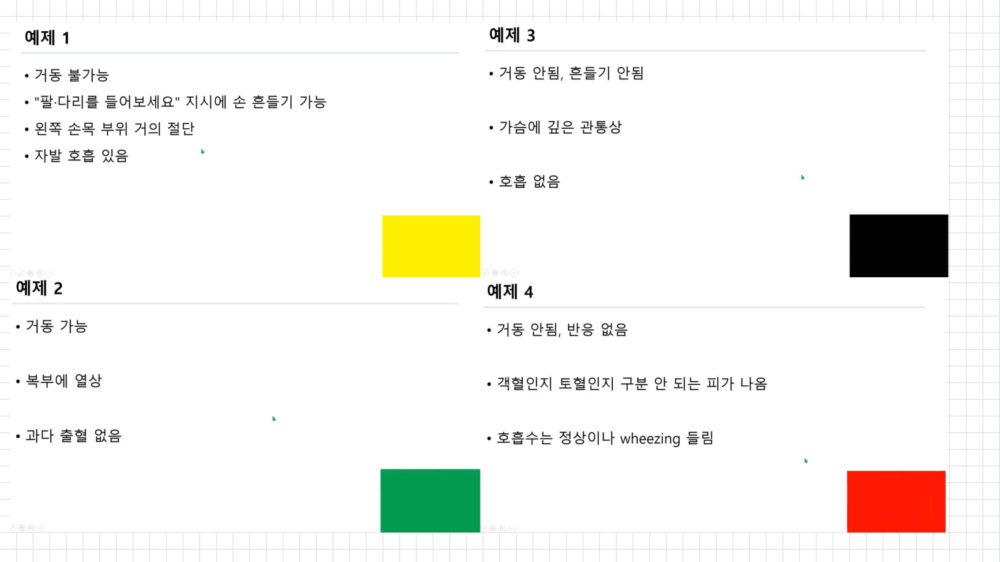{: style="width:72%"}

| 예제 | 환자 | 분류 | 이유 |
|---|---|---|---|
| 1 | 거동 불가, "팔·다리를 들어보세요"에 손 흔들기 가능, 왼쪽 손목 거의 절단, 자발 호흡 있음 | **황색** | 걷지 못하지만 지시에 따른 의도적 움직임 → 응급으로 우선 분류 |
| 2 | 거동 가능, 복부 열상, 과다 출혈 없음 | **녹색** | 걸을 수 있음 → 비응급 |
| 3 | 거동·흔들기 안 됨, 가슴에 깊은 관통상, **호흡 없음** | **흑색** | 기도 개방 후에도 호흡 없음 → 사망(예상) |
| 4 | 거동 안 됨, 반응 없음, 객혈·토혈인지 모를 피, 호흡수 정상이나 wheezing | **적색** | 반응이 없지만 호흡이 있고 생명 위협 → 긴급 |

# 7. Evacuation (대피) — 이송과 분산

계획 단계에서 필수적인 부분이다.

- 환자를 현장에서 의료기관·치료시설로 — **경로, 이송 수단, 환자 분류 장소** 고려
- **현장에서의 이송 우선순위: 긴급 → 응급 → 비응급 → 사망예상** (Red → Yellow → Green → Black)
- **분산 이송**이 필요하다
- **경증 손상은 치료하고 현장에서 벗어나게** 한다 — 현장 치료 후 귀가시키거나, 긴급·응급 환자 이송이 끝난 뒤 **마지막에** 병원 이송("집에 가세요, 혹은 마지막에 이송")

## 병원별 환자 분산 시나리오 (사고 3)

환자 24명이 생겼고, 병원이 세 곳 있다.

- **시나리오 1**: 병원 1에 16명, 병원 3에 8명, 병원 2는 0명 → 두 병원에만 몰리고 한 병원은 비어 있다.
- **시나리오 2**: 병원 1에 10명, 병원 3에 8명, 병원 2에 6명 → 숫자로는 고르게 분산.

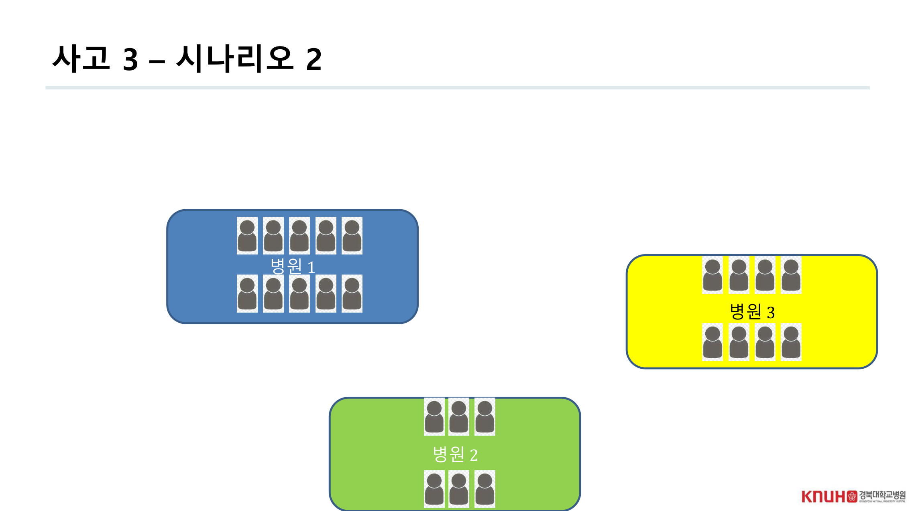{: style="width:50%"}

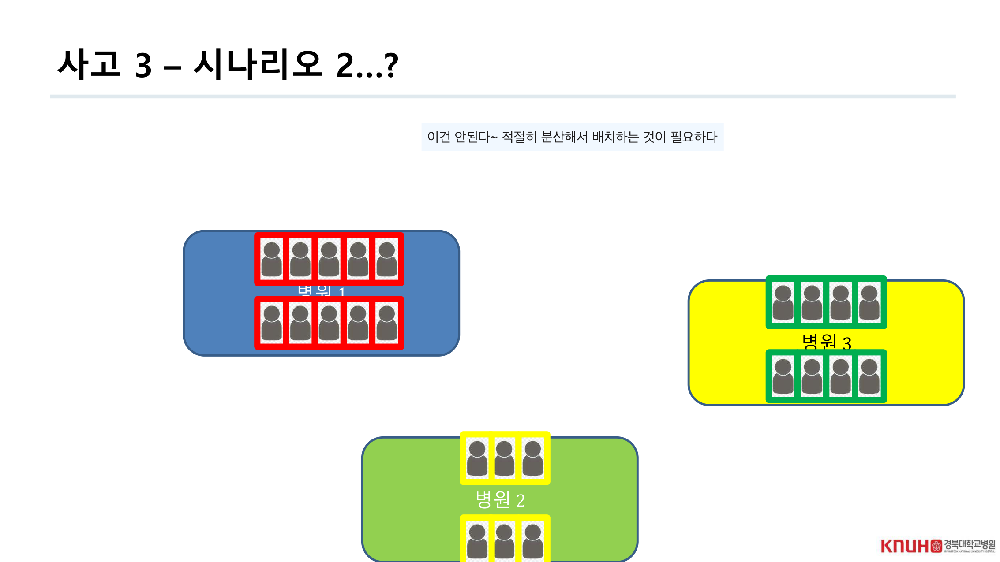{: style="width:50%"}

- **시나리오 2…?**: 숫자는 같아도 병원 1에 **적색(긴급) 10명 전부**, 병원 2에 황색 6명, 병원 3에 녹색 8명을 몰았다면 → **"이건 안 된다~"** 병원 1의 수술실·중환자실이 감당할 수 없다. **중증도와 각 병원의 수용 능력을 함께 고려해 적절히 분산**해야 한다.

## 특수 상황

- **특별한 도움이 필요한 환자**: 노인, 빈민, 요양시설 등 공공시설에서의 대피 / 거동 불가, 장애인, 산모, 소아
- **대형 재해 시 병원에서의 대피**: 홍수, 전력 중단, 병원 시설 오염, 화재

## 병원 내 재난 발생 시 환자 대피 우선순위 (Evacuation in Hospital)

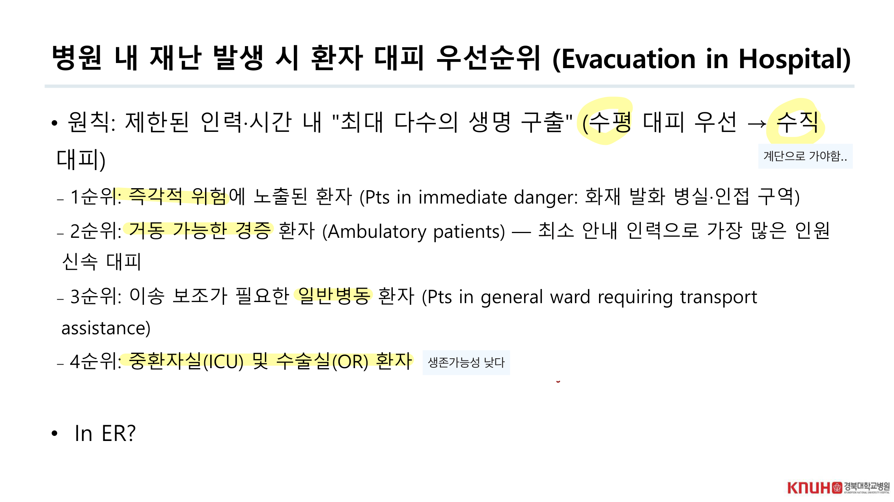{: style="width:62%"}

- 원칙: 제한된 인력·시간 안에 **"최대 다수의 생명 구출"** — **수평 대피 우선 → 수직 대피**(같은 층의 안전 구역으로 먼저, 그다음 계단으로 다른 층 — 엘리베이터 ×, "계단으로 가야 함")
    1. **1순위: 즉각적 위험에 노출된 환자** (화재 발화 병실·인접 구역)
    2. **2순위: 거동 가능한 경증 환자**(Ambulatory) — 최소 안내 인력으로 가장 많은 인원을 신속히 대피
    3. **3순위: 이송 보조가 필요한 일반병동 환자**
    4. **4순위: 중환자실(ICU)·수술실(OR) 환자** — 옮기는 데 인력이 가장 많이 들고, 생존 가능성도 낮다
- 응급실(ER)이라면? — 같은 원칙으로 생각해 본다.

!!! key "핵심"
    직관과 반대인 점이 포인트다 — 병원 내 대피에서 **ICU·OR 환자가 마지막(4순위)**, **걸을 수 있는 환자가 2순위**다. 현장 이송(긴급 먼저)과 헷갈리지 않는다. 대피는 "가장 위중한 사람부터"가 아니라 **"같은 인력으로 가장 많은 사람을 살리는 순서"**다.

# 8. Recovery (복구)

- **재난의 장기적 목표** — 사전 계획에 포함되어야 한다.
- 재난 후 지역사회에 필요한 것: **구호물자, 재활, 복구, 평가(보고서·백서)**
- 재난의 영향을 최소화할 대상: 부상자·가족·구조 인력과 그 가족 / 지역사회와 국가 / 환경
- 시작은 **재난 발생 시점**, 끝은 대부분 **몇 년이 지난 뒤**.

# 9. 정리 — Summary

| 주제 | 꼭 알아야 할 것 |
|---|---|
| 재난의 개념 | 수요 > 자원, MCI(국내 DMAT 기준 사상자 10명·중증 5명), 일상 vs 재난(Greatest good for greatest number) |
| 인지와 현장 안전 | 사린 테러(제염 부재 → 의료진 2차 중독), 안전 순위 **나 → 대중 → 사상자 → 환경** |
| 국내 재난의료 인력 | 지휘 = 소방(긴급구조통제단장), 현장응급의료소장 = **보건소장**, 의료 역할 **DMAT 위임 가능**, **10분 내 출동**, 경계 단계에서 출동 요청, 권역 DMAT 4명(의사는 전문의), 지역 DMAT 5–6+2–3, 보건소 신속대응반, **의료지도하 CPR 유보** |
| 제염/제독과 PPE | Hot(구조) / **Warm(제염·LSI)** / Cold(현장응급의료소), 집결지는 **고지대·풍상측·cold zone**, 탈의 **80–90%**, 습식 **상처 → 얼굴 → 머리카락 → 머리 → 몸**, Level A–D(IDLH면 B 이상, 의료기관 최고 C) |
| 환자분류법 | METTAG 4색, MASS(걷기 → 녹, 팔다리 → 황, 무반응 → 1순위 평가), SALT(LSI → 네 질문 → 자원으로 생존 가능?), START(RPM, 30·2초·명령) |
| 이송 | 긴급 → 응급 → 비응급 → 사망예상, **중증도와 수용 능력을 고려한 분산**, 원내 대피 1 위험 → 2 보행 → 3 일반병동 → 4 ICU·OR |
