<!-- 필기본: 2026 -->

# 0. 이 수업을 공부하는 법

**안재윤 교수님**(응급의학교실)의 「환경손상(Environmental Injuries)」 수업이다(11/2, 2시간). 다루는 주제는 여섯 가지 — ① 체온 조절(temperature regulation) ② 한랭질환(cold-related illness: 참호족·동창·동상·저체온증) ③ 온열질환(heat-related illness: 열부종·열경련·열실신·열탈진·열사병) ④ 익수(drowning) ⑤ 일산화탄소 중독(CO poisoning) ⑥ 뱀교상(snakebite). 감압병·잠수병·고산병 같은 다른 환경손상도 있지만 이번 강의에서는 다루지 않았다.

2부의 기출 26문항(2020–2025)을 보면 다음과 같다(필기본 2의 기출 분석 참고).

| 주제 | 출제 연도 | 경향 |
|---|---|---|
| **저체온증** | 2020·2021·2022·2023·2025 (거의 매년) | 예전엔 "옳은 것" 개념형, 2025년부터 **사례 + 치료** 형 |
| **열사병·열탈진** | 2020·2021·2022·2023(열사병), 2024(열탈진) | 냉각 방법, 열탈진 vs 열사병 감별 |
| **동상** | 2023·2024·2025 | **치료**(물 온도, 수포, 알로에) |
| **일산화탄소 중독** | 2020·2021·2022·2023·2024 | 고압산소치료 적응증, 지연성 신경학적 후유증 |
| **뱀교상** | 2020·2023·2025 | 항독소 적응증, 금기 응급처치 |
| **익수** | 2023·2025 | 가벼운 익수 환자의 귀가 기준 |

!!! key "핵심"
    - 2022년부터 2시간 강의로 바뀌며 문제 수가 늘었고, 2025년 기준 이 수업에서 **4문제**가 나왔다. 여섯 주제에서 골고루 나오므로 빠짐없이 봐야 한다.
    - 최근(2023·2025, 안재윤 교수님 출제)에는 개념보다 **임상 사례에서 치료를 고르는 문제**가 늘었다. 각 주제의 **management / treatment 슬라이드**를 가장 꼼꼼히 본다.
    - 출제 1순위: **저체온증 단계별 치료**, **동상 치료**, **열사병 냉각**, **CO 중독 고압산소 적응증**, **뱀교상 항독소 적응증**.

# 1. 체온 조절 (Temperature Regulation)

이 단원 자체는 거의 출제되지 않지만(2024년 수용기 문제 1개), 뒤의 한랭·온열질환이 "이 조절이 무너진 상태"이므로 생리학 복습이라 생각하고 본다.

## 체온 항상성 (Thermoregulation)

체온은 항상 일정한 온도로 유지되도록 세팅되어 있다(항상성). 체온 조절 중추는 **시상하부 앞쪽의 시각앞핵**(preoptic anterior hypothalamus)이다. 체온이 오르면 피부 혈관 확장과 땀 분비로 열을 버리고, 체온이 내려가면 떨림(shivering)과 혈관 수축으로 열을 만들고 지킨다. 저체온증·열사병은 이 기전이 깨져 체온 조절에 실패한 상태다.

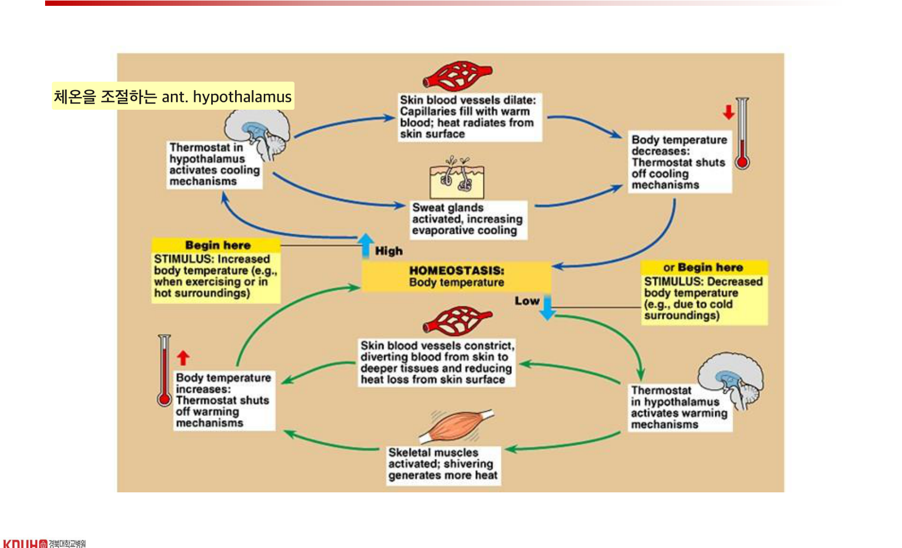{: style="width:62%"}

## 온도 수용기 (Thermoreceptor)

| | 중추 온도 수용기(central) | 말초 온도 수용기(peripheral) |
|---|---|---|
| 위치 | 시상하부, 척수, 복부 내장, 대정맥(great veins) | **피부**와 점막 |
| 냉각 : 온난 수용기 비 | **냉각 < 온난 (1 : 50)** | **냉각 > 온난 (10 : 1)** |
| 역할 | 심부 체온을 일정하게 유지 → **고체온 방지** | 내려가는 상황에서 온도를 감지 → **저체온 방지** |

!!! exam "기출 포인트"
    2부 5번(2024): "온난 수용기보다 냉각 수용기의 비율이 더 높은 곳" → **피부**. 내장·뇌하수체·대정맥·척수는 중추 수용기라 온난 수용기가 훨씬 많다.

## 체온의 두 가지 — 심부 체온과 표면 체온

- **심부 체온**(core temperature): 뇌·심장·간·콩팥 같은 깊은 생명 장기의 온도. 대부분 일정하게 유지된다. **원위 식도**(distal esophagus, 가장 정확), 직장(rectum), 방광(bladder)에서 측정한다. **한랭·온열질환에서 보는 것은 심부 체온**이다. 기출 사례에 "식도 체온", "직장 체온"이 나오면 심부 체온이라고 읽으면 된다.
- **표면(피부) 체온**(shell temperature): 흔히 말하는 체온(피부·고막 온도). 피부 혈류와 외부 온도에 따라 민감하게 변하며, 심부 체온을 지키는 **완충(buffer)** 역할을 한다.

## 체온 조절의 효과기 (Effectors)

자극(심부 체온 ↑/↓) → 감지기(피부 + 심부 온도 수용기) → 통합(시각앞 시상하부) → 효과기(열 손실 ↔ 열 생산) 순서로 작동한다.

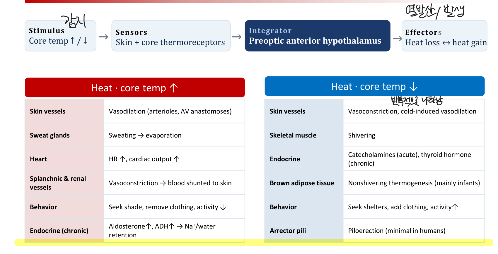{: style="width:80%"}

| 기관 | 더울 때(체온 ↑) | 추울 때(체온 ↓) |
|---|---|---|
| 피부 혈관 | 혈관 확장(세동맥, 동정맥 문합) | 혈관 수축 + **한랭유발 혈관확장**(cold-induced vasodilation) |
| 땀샘 / 골격근 | 땀 → 증발 | **떨림**(shivering) |
| 심장 / 내분비 | 심박수·심박출량 ↑ | 카테콜아민(급성), 갑상샘호르몬(만성) |
| 내장·콩팥 혈관 / 갈색지방 | 혈관 수축 → 혈액을 피부로 보냄 | **비떨림 열생산**(nonshivering thermogenesis, 주로 영아) |
| 행동 | 그늘 찾기, 옷 벗기, 활동 ↓ | 피할 곳 찾기, 옷 껴입기, 활동 ↑ |
| 내분비(만성) / 털세움근 | 알도스테론 ↑, ADH ↑ → Na+·물 저류 | 털세움(piloerection, 사람에선 미미, "닭살") |

- 추울 때 혈관이 수축만 계속하면 말초 조직에 허혈이 생기므로, **수축과 확장이 반복적으로** 일어난다(한랭유발 혈관확장).
- 호르몬은 "더우면 알도스테론, 추우면 카테콜아민·갑상샘호르몬"으로 묶어 기억한다(필기본의 암기법: HACCT — Hot: Aldosterone / Cold: Catecholamine, Thyroid).
- 노인과 영아는 이 기전이 약해 취약하다.

## 환경과의 에너지 교환 (Exchange of Energy)

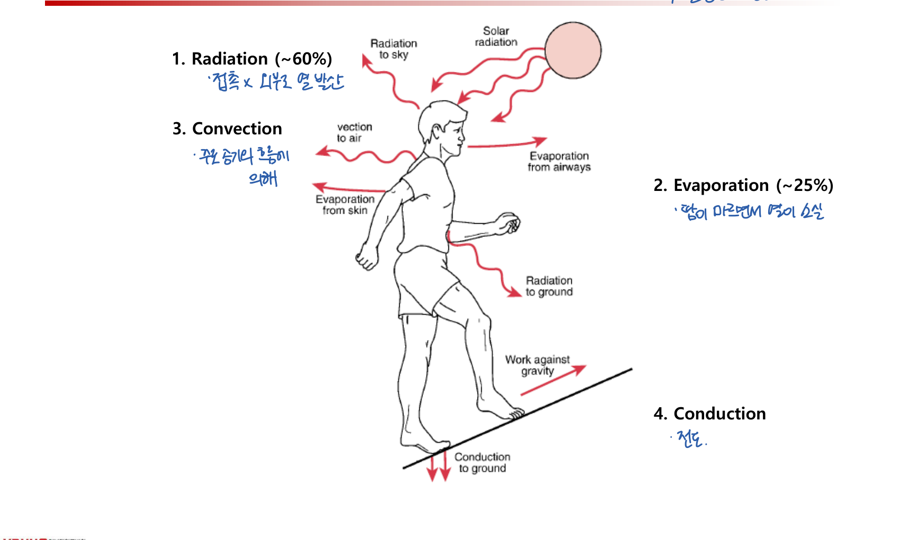{: style="width:62%"}

| 방법 | 내용 |
|---|---|
| 1. **복사**(radiation, ~60%) | 접촉 없이 열을 발산. 체온이 높고 외부 온도가 낮으면 자연히 빠져나가지만 **외부 온도가 너무 높으면 잘 안 된다** |
| 2. **증발**(evaporation, ~25%) | 땀이 마르면서 열을 잃는다. **덥고 습한 환경에서는 잘 안 되고** 그러면 열사병이 올 수 있다 |
| 3. **대류**(convection) | 공기의 흐름에 열을 빼앗긴다 |
| 4. **전도**(conduction) | 두 물체가 맞닿을 때 열이 이동. 차가운 물체(얼음팩 등)를 대는 치료에 쓰인다 |

복사 + 증발 = 열 손실의 약 85%로 대부분을 차지한다.

# 2. 한랭질환 (Cold-related Illness)

## 분류

| 구분 | 종류 | 온도 조건 | 치료 원칙 |
|---|---|---|---|
| 국소 — **비동결 손상**(non-freezing) | 참호족(trench foot), 동창(chilblains) | 영상(0–15℃), **젖고(wet)** 차가운 환경 | **실온에서 천천히 수동적 재가온**(slow passive rewarming) — 염증 기전이라 실온으로 충분 |
| 국소 — **동결 손상**(freezing) | 동상 전단계(frostnip) → **동상**(frostbite) | **영하**(< 0℃) | **37–39℃ 물에서 빠르게 능동적 재가온**(rapid active rewarming) |
| 국소 — 기타 | 한랭 지방층염(cold panniculitis), 한랭 두드러기(cold urticaria) | | |
| **전신** | **우발적 저체온증**(accidental hypothermia) | | 단계별 재가온 |

저체온증 앞에 "우발적(accidental)"을 붙이는 것은 심정지 후 일부러 체온을 낮추는 치료적 저체온(목표체온관리, TTM)과 구분하기 위해서다.

!!! memo "암기"
    **비동결(참호족·동창) = 천천히·수동적·실온** / **동결(동상) = 빠르게·능동적·37–39℃ 물**. 비동결 손상에서 능동적으로 데우면 통증만 심해지고, 동상은 상태가 나빠지기 전에 빨리 녹여야 한다.

## 참호족 (Trench Foot, Immersion Foot)

**병태생리**: 여러 요인이 겹친다(추운 지역, 습도, 바람, 기저 혈관질환, 음주·흡연). 핵심은 **젖고 차가운 환경에 오래 노출**되는 것이다. 가장 흔한 환자는 **군화를 계속 신고 있던 군인** — 행군 중엔 신발·양말을 자주 갈아 신기 어렵다(나폴레옹의 모스크바 퇴각, 1차 대전 참호전).

**임상 양상 — 4단계**

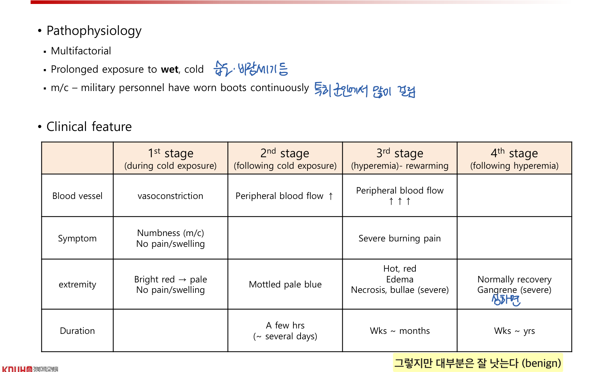{: style="width:72%"}

| 단계 | 혈관 | 증상·사지 소견 | 기간 |
|---|---|---|---|
| 1단계(노출 중) | 혈관 수축 | **감각 저하(numbness, 가장 흔함)**, 밝은 빨강 → 창백, 통증·부종 없음 | |
| 2단계(노출 후) | 말초 혈류 ↑ | 얼룩덜룩한 창백한 푸른색(mottled pale blue) | 수 시간–수일 |
| 3단계(충혈기, 재가온) | 말초 혈류 ↑↑↑ | **심한 화끈거리는 통증**, 뜨겁고 붉음, 부종, (심하면) 괴사·수포 | 수 주–수 개월 |
| 4단계(충혈 후) | | 대부분 회복, (심하면) 괴저 | 수 주–수 년 |

흐름은 "감각 없음 → 피부 얼룩 → 통증·부종 → 회복"이고, **대부분 잘 낫는다(benign)**. 발바닥이 쭈글쭈글하고 창백한 것이 전형적 모습이다.

**치료**
- **실온에서 천천히** 재가온한다.
- 젖은 신발을 벗기고 **건조하게, 다리를 올려** 둔다. 충혈기에는 통증이 있으므로 **선풍기로 시원하게** 말려 준다.
- 신경병증성 통증에는 NSAID가 잘 듣지 않아 **amitriptyline, gabapentin**을 쓴다.
- 피부에 열린 상처가 있으면 **파상풍 예방**.
- **예방**: 잘 맞는 신발, 젖은 양말 매일 갈아 신기 — 간단하지만 현실적으로 어렵다.

## 동창 (Chilblains, Pernio)

- **병태생리**: 국소적 **염증성 혈관병증**(localized inflammatory vasculopathy). 기전 자체는 참호족과 비슷하다.
- **역학**: 젊은 여성, 소아, 야외 근로자, 군인.
- **호발 부위**: 손가락, **발가락(가장 흔함)**, 귀, 코, 뺨 — 바깥에 노출된 말단.
- **위험인자**: **레이노 현상**(Raynaud phenomenon, 말초혈관의 발작적 수축), **전신홍반루푸스**(SLE).
- **증상**: **가려움**(pruritus)과 화끈거리는 통증 → **보랏빛 판**(violaceous plaques), 부종. 손가락·발가락 끝이 보랏빛으로 붓는다.

**치료** — 참호족과 같이 보존적 치료다.
- 실온에서 **수동적 재가온**, 다리 올리기, 느슨한 드레싱.
- **문지르기·마사지·직접 열 금지**(오히려 손상을 악화시킨다), 금연.
- 약물: 가려움·홍반에 **국소 스테로이드**, 통증에 **NSAID**(참호족과 달리 쓸 수 있다), 심하거나 재발하면 혈관확장제 **nifedipine**.
- 피부가 깨졌으면 파상풍 예방.

| | 참호족 | 동창 |
|---|---|---|
| 본질 | 젖은 냉기에 장시간 노출(군화) | 국소 염증성 혈관병증 |
| 잘 걸리는 사람 | 군인 | 젊은 여성, 소아, 레이노·SLE 환자 |
| 증상 | 감각 저하 → 충혈기 심한 통증 | 가려움·화끈거림 → 보랏빛 판 |
| 통증 약 | amitriptyline, gabapentin (NSAID 효과 적음) | NSAID, 국소 스테로이드, 심하면 nifedipine |
| 공통 | 실온에서 천천히 재가온, 문지르지 않기, 파상풍 예방 | |

## 동상 (Frostbite)

### 정의·역학·위험인자
- **조직이 얼어서 생기는 손상**으로 4단계를 거친다: 동결 전(prefreeze) → 동결–해동(freeze-thaw) → 정체(stasis, 혈전) → 허혈(ischemia).
- **고위험군**: 군인, 등산가, 야외 근로자, **노숙인**(특히 많다), 노인. 호발 부위: 귀·코·뺨·손가락·발가락.
- **위험인자**: 바람(windchill), 고지대, 젖거나 꽉 끼는 옷, 음주·흡연, 레이노, **말초혈관질환, 당뇨**.

!!! exam "기출 포인트"
    2부 4번(2025)·14번(2023)의 "30대 **군인**이 야간 산행 후 …" — 군인은 참호족·동창·동상 모두에 해당하므로 직업만으로는 감별할 수 없다. **추위 노출 + 출혈성·자줏빛 수포**를 보고 **심부(3도) 동상**으로 판단해야 한다.

### 병태생리 — 직접 손상(얼음 결정) + 간접 손상(미세혈관 혈전)

**1) 조직 동결(tissue freezing)**

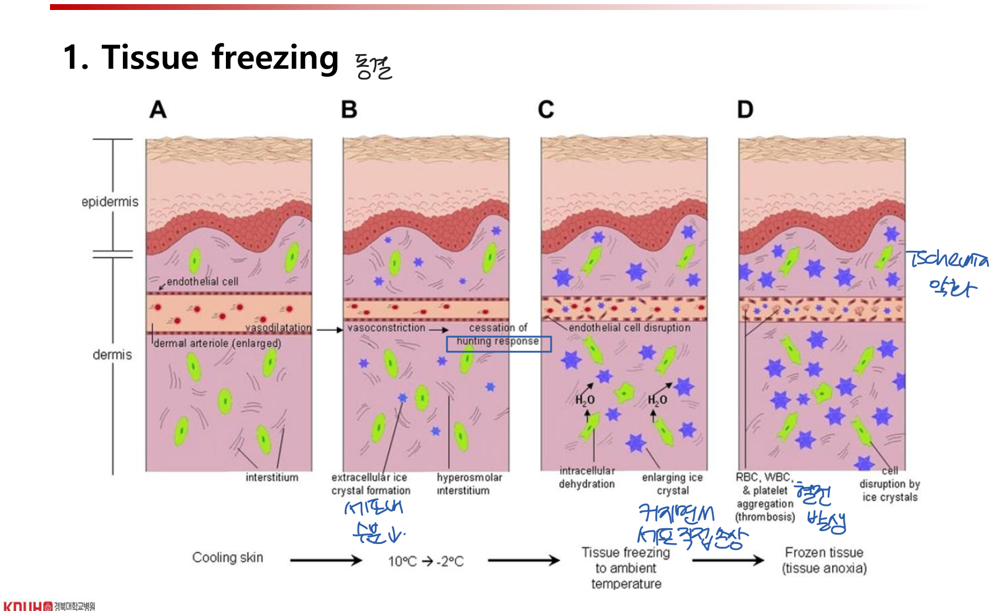{: style="width:78%"}

- 추우면 혈관이 수축하고, 국소적으로 확장(보상 반응, hunting response)이 반복된다.
- 0℃ 이하에서 조직이 얼면 이 보상 반응이 멈추고(cessation of hunting response) **혈관 수축만 계속** → 허혈이 시작된다.
- 세포 밖에 얼음 결정이 생기면 세포 안의 물이 빠져나가(**세포 내 탈수**) 얼음 결정이 커지고, 커진 결정이 혈관 내피세포 등을 직접 파괴한다 → 혈전 → 허혈·경색 악화.

**2) 조직 해동(tissue thawing)**

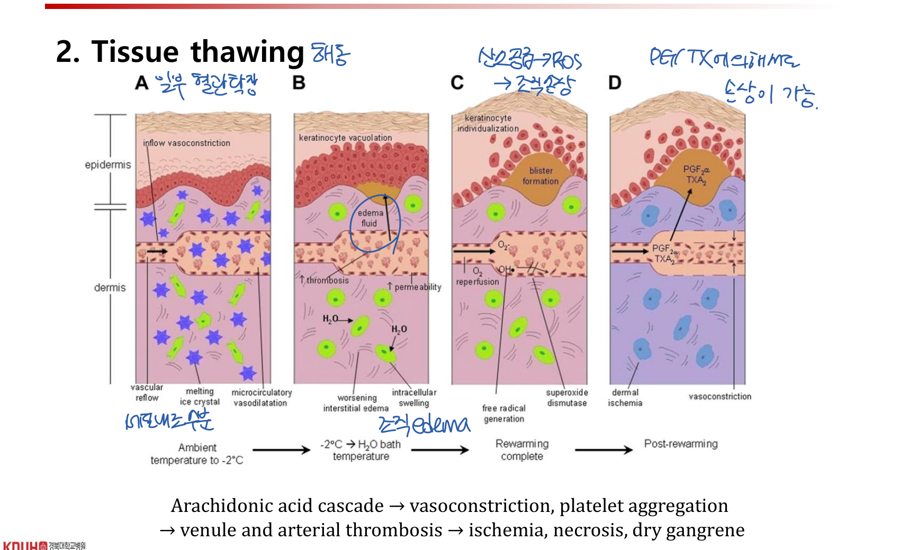{: style="width:78%"}

- 얼음 결정이 녹으면서 혈관이 다시 열리지만, 이미 죽은 조직과 깨진 세포 찌꺼기가 새어 나와 **부종·수포**를 만든다.
- 혈류가 돌아오며 **활성산소**(재관류 손상)가 이차 손상을 일으키고,
- **아라키돈산 경로**(PGF2α, 트롬복산 TXA2) → 혈관 수축·혈소판 응집 → 세정맥·동맥 혈전 → 허혈·괴사·**건성 괴저**.

**동결과 해동이 모두 손상을 일으킨다** — 그래서 한 번 녹였다가 다시 얼면(refreeze) 최악이고, 녹이는 것은 가급적 한 번에 끝내야 한다.

### 임상 양상과 분류

- **동상 전단계(frostnip)**: 가역적 혈관 수축만 있고 깊은 얼음 결정이나 조직 손실이 없다.
- **임상적 4도 분류** — **재가온한 뒤에** 평가한다. 처음엔 몇 도인지 구분하기 어려워 실제로는 표재성(1–2도)/심부(3–4도)로 크게 나누기도 한다. 화상 분류와 비슷하다.

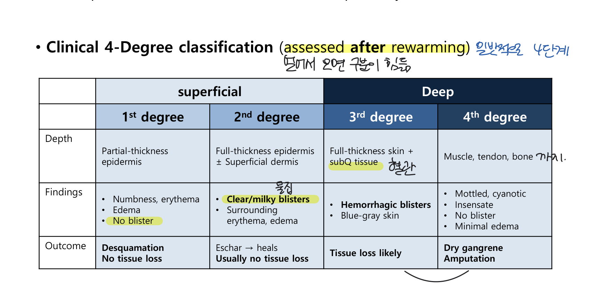{: style="width:80%"}

| | 1도 | 2도 | 3도 | 4도 |
|---|---|---|---|---|
| 깊이 | 표피 일부 | 표피 전층 ± 얕은 진피 | 피부 전층 + **피하조직**(혈관 많음) | **근육·힘줄·뼈** |
| 소견 | 감각 저하, 홍반, 부종, **수포 없음** | **투명/우윳빛 수포**, 주변 홍반·부종 | **출혈성 수포**, **청회색 피부** | 얼룩덜룩·청색, 감각 없음, 수포 없음, 부종 적음 |
| 결과 | 표피 벗겨짐, 조직 손실 없음 | 가피 → 치유, 대개 조직 손실 없음 | **조직 손실 가능성 높음** | **건성 괴저, 절단** |

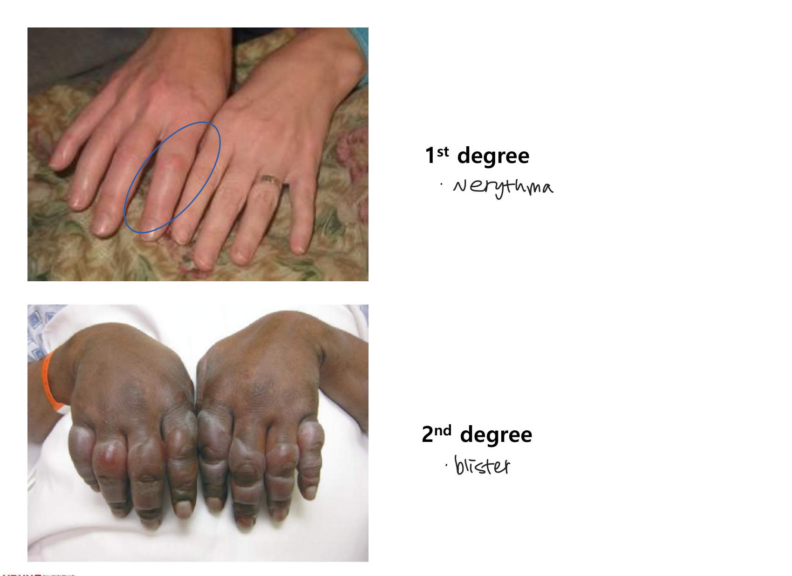{: style="width:62%"}

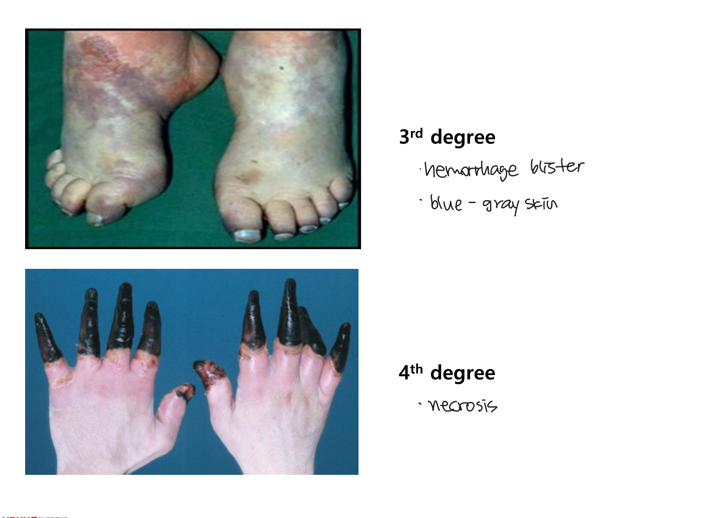{: style="width:62%"}

1·2도(표재성)는 예후가 좋고, 3·4도(심부)는 조직 손실이 생긴다.

### 병원 전 처치 (Prehospital Management)
- 중등도 이상 **저체온증과 외상을 먼저** 치료하고 수분을 보충한다.
- 반지·꽉 끼는 장비를 뺀다(부종이 심해질 수 있다).
- 언 발을 **문지르거나 그 발로 걷지 않는다** — 얼음 결정이 혈관을 직접 손상시킨다.
- **다시 얼 위험이 있으면 녹이지 말고 언 채로** 둔다.
- 현장에서 물로 녹이는 것(37–39℃)은 **병원까지 2시간 넘게 걸리고 다시 얼 위험이 없을 때만**. 웬만하면 병원에서 녹인다.
- 경구 **ibuprofen**과 아편유사제 진통.
- 저산소증(SpO2 < 88%)이나 고도 4,000 m 이상이 아니면 **일상적 산소 투여는 하지 않는다**(활성산소가 이차 손상을 일으킨다).

### 응급실 치료 (ED Management)

!!! key "핵심"
    **37–39℃의 순환하는 물에 약 30분** 담가, 조직이 **말랑해지고 붉은 자주색**이 돌 때까지 급속 재가온한다. **건열(dry heat) 금지** — 물이 미지근하면 재가온이 느리고, 뜨거우면 감각 없는 부위에 화상이 생긴다.

- **통증 조절**: 정맥 아편유사제, 경구 ibuprofen.
- **수포·상처 관리**
    - **투명하고 팽팽한 수포는 선택적으로 배액**(바늘로 흡인)한다.
    - **출혈성 수포는 터뜨리지 않고 그대로 둔다** — 제거하면 아래 조직이 건조해진다.
    - 해동 후 **알로에베라(aloe vera)를 6시간마다** 바른다(트롬복산 억제).
    - 느슨하고 두툼한 드레싱, 거상, 파상풍 예방.

!!! exam "기출 포인트"
    - 2부 6번(2024): 담글 물의 가장 적정한 온도 → **37도**(보기 31·34·37·40·43도). 40·43도는 너무 뜨겁다.
    - 2부 4번(2025): 출혈성·자줏빛 수포 군인 → **38℃ 물에 담그기**. 함정: 수포 제거, 문지르기, 발열팩(건열), 혈전용해제.
    - 2부 14번(2023): 같은 사례에서 정답은 **알로에베라 도포**였다(보기에 "41℃ 물"이 있었다). 39℃를 넘는 물은 오답 처리된 셈이니, 물 온도는 **37–39℃**로 정확히 기억한다.

### 재관류 치료와 처리 (Perfusion Deficit Therapy & Disposition)
- **심부 동상(3·4도)의 재관류 치료** — 혈전 관리
    - 정맥 또는 동맥 내 **tPA**: 해동 후 **24시간 이내(가장 좋기는 12시간 이내)**, heparin/LMWH(저분자량 헤파린) 병용. 출혈 위험이 있다.
    - 정맥 **iloprost**(혈관확장제): 해동 후 **72시간 이내**, 2–4도. tPA를 쓸 수 없을 때의 대안.
- **영상과 수술 시기**
    - 조직 생존 평가: 도플러, 혈관조영, 99mTc 뼈 스캔, SPECT/CT.
    - **절단은 1–3개월 미룬다** — 처음엔 몇 도인지, 어디까지 살아 있는지 알 수 없으므로 경계(demarcation)가 생길 때까지 기다린다. 단 **패혈증·습성 괴저**처럼 상태가 나쁘면 기다리지 않고 바로 절단한다.
    - **심부 동상은 모두 입원**(3·4도).
    - 구획증후군이 있으면 긴급 근막절개술.

## 저체온증 (Hypothermia)

### 정의와 단계 — Revised Swiss System

**심부 체온 < 35.0℃**인 전신 한랭 손상이다. 현장에서는 심부 체온을 재기 어려우므로 **의식 수준으로 간접적으로** 단계를 판단한다.

| 단계 | 심부 체온 | 의식 | 떨림 |
|---|---|---|---|
| **경도**(Stage I) | 32–35℃ | **명료**(alert) | **심한 떨림**(vigorous shivering) |
| **중등도**(Stage II) | 28–32℃ | **말에 반응**(verbal) | **떨림 감소/소실** |
| **중증**(Stage III) | < 28℃ | **통증에 반응/무의식**, 활력징후 있음 | |
| **심정지**(Stage IV) | < 24–28℃ | 무의식, **활력징후 없음** | |

4단계는 온도와 크게 상관없이 **활력징후가 없으면 바로 4단계**다.

### 원인 (Etiology)
- **일차성**: 압도적인 환경 추위 노출.
- **이차성**: 체온 조절 장애 — 여러 이유로.
    - 내분비: 갑상샘저하증, 부신저하증, 뇌하수체저하증, **저혈당**
    - 신경: 척수 절단, 머리 외상, 뇌졸중
    - 약물: **에탄올**, 진정수면제, 아편유사제, phenothiazine
    - 패혈증, 심한 화상, 박탈피부염
    - **의인성: 과도한 수액 소생**(외상 환자에게 차가운 수혈·수액을 대량으로) — 교수님 말씀으로는 **가장 흔하다**.

### 임상 양상

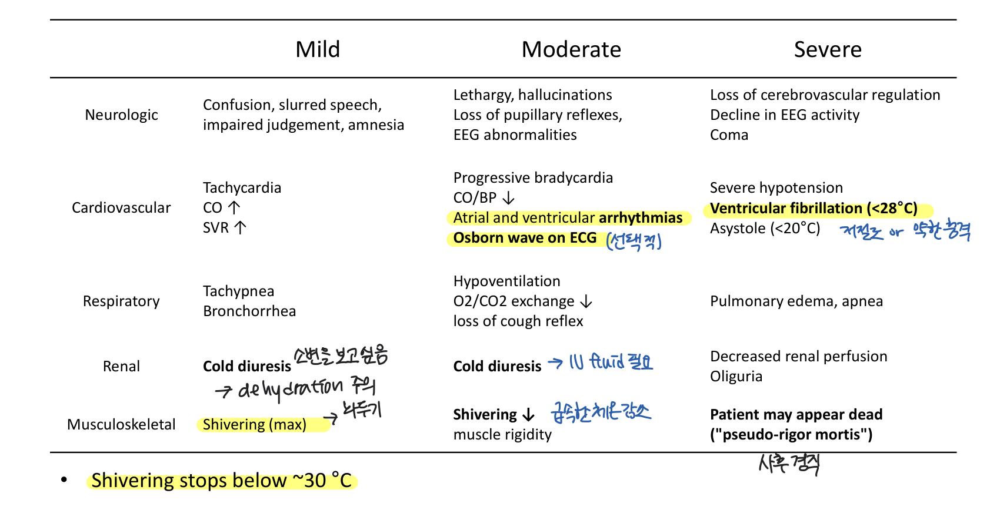{: style="width:80%"}

| | 경도 | 중등도 | 중증 |
|---|---|---|---|
| 신경 | 혼동, 말 어눌, 판단력 저하, 기억상실 | 기면, 환각, **동공반사 소실**, 뇌파 이상 | 뇌혈관 자동조절 소실, 뇌파 감소, 혼수 |
| 심혈관 | 빈맥, 심박출량 ↑, 말초혈관저항 ↑ | 진행성 서맥, 심박출량·혈압 ↓, **심방·심실 부정맥**, **Osborn파** | 심한 저혈압, **심실세동(< 28℃)**, 무수축(< 20℃) |
| 호흡 | 빈호흡, 기관지 분비물 증가 | 저환기, 가스교환 ↓, 기침반사 소실 | 폐부종, 무호흡 |
| 콩팥 | **한랭이뇨**(cold diuresis) | 한랭이뇨 | 콩팥 관류 감소, 핍뇨 |
| 근골격 | **떨림 최대** | 떨림 감소, 근육 강직 | **죽은 것처럼 보임**("가성 사후경직") |

- **떨림은 약 30℃ 아래에서 멈춘다.** 떨림이 없어지면 체온이 급속히 떨어진다. 경도 단계에서 덜덜 떠는 환자는 스스로 열을 만들고 있으니 젖은 옷만 벗기고 보온하면 알아서 회복할 수 있다.
- **한랭이뇨**(추우면 소변이 마려운 것): "콩팥 기능이 정상이구나"가 아니라 **"탈수가 생기니 수액으로 보충해야겠구나"**로 읽어야 한다. → 뒤의 "승압제보다 수액 먼저"와 이어진다.
- 중증 저체온의 심실세동은 저절로도, **환자를 옮기는 아주 약한 충격으로도** 생길 수 있다.
- 중증 환자는 뻣뻣하게 굳어 사후경직처럼 보이지만 살아 있을 수 있고, 치료하면 명료하게 회복되기도 한다.

### Osborn(J) 파

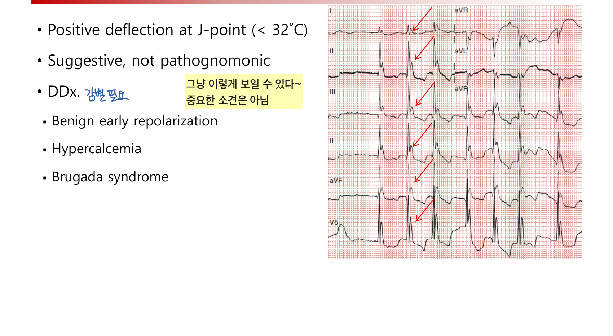{: style="width:72%"}

- J점(QRS 끝)에서 위로 솟는 굴절, **32℃ 미만**에서 보인다. 낙타 등처럼 보여 camel's hump sign이라고도 한다.
- **시사 소견일 뿐 특징적(pathognomonic) 소견이 아니다.** 감별진단: 양성 조기 재분극, **고칼슘혈증**, Brugada 증후군. 그냥 "이렇게 보일 수 있다" 정도이고 이것만으로 확진할 수 없다.

### 심부 체온 측정
- **저체온용(low-reading) 온도 탐침**이 필요하다(대부분의 일반 기계는 34℃ 밑으로 측정이 안 된다).
- **식도 탐침(아래 1/3)**: 심장 바로 뒤에 있어 가장 정확 — **삽관 환자의 표준**(gold standard)이자 가장 많이 쓴다.
- **방광·직장 탐침**: 삽관하지 않은 환자의 대안. **반응이 느린 것(time lag)이 단점**이고, 직장은 약 10 cm 깊이로 넣어야 하며 따뜻한 물로 세척 치료 중에는 부정확하다.
- 구강, 일반 적외선 고막 체온계: 저체온증에서 **믿을 수 없다**.

### 치료 — 일반 원칙
- 기본·전문 소생술
- 추가 열 손실 방지
- **가능한 빨리 재가온**, 다시 얼지 않게(대부분의 저체온증은 동상을 동반한다)
- 적절한 병원으로 이송 — ECMO가 필요하면 **ECMO-CPR이 가능한 의료기관**으로
- 원인 치료

### 재가온 방법 (Rewarming Technique)

| 방법 | 속도 | 적용 | 내용 |
|---|---|---|---|
| **수동적 외부 재가온**(passive external) | 0.5–2℃/h | 경도(Stage I) | **마른 옷, 담요** |
| **능동적 외부 재가온**(active external) | 1–2.5℃/h | Stage II–IV | **강제공기 가온**(forced-air warming) — 반드시 **몸통(trunk)**에 |
| **능동적 심부 재가온**(active internal) | | 중증 Stage II–IV | 가온 수액(40–42℃)·가온 가습 산소(II–IV), 가온 생리식염수 세척(흉강·복강·방광, III–IV), **ECLS**(4–10℃/h): **VA-ECMO(1차 선택)** 또는 심폐우회술 — 심정지·불안정 환자 |

- 아래로 갈수록(중증일수록) 더 침습적이고 효과가 크다.
- **사지를 먼저 데우면 afterdrop과 심실세동**이 생긴다. 차가운 말초 혈액이 갑자기 심장으로 돌아와 심부 체온이 더 떨어지기 때문이다. 그래서 강제공기는 **반드시 몸통 쪽으로**.

### 단계별 치료 (Treatment by Staging) — 가장 중요

!!! key "핵심"
    - **Stage I (32–35℃, 명료, 심한 떨림)**: 젖은 옷 벗기기 + **수동적 외부 재가온**(담요)이면 충분. 의식이 명료하고 삼킬 수 있으면 따뜻하고 단 음료, 움직여도 된다.
    - **Stage II (28–32℃, 말에 반응, 떨림 감소/소실)**: **수평으로 조심스럽게 다루기**(gentle horizontal handling) → '구조 후 허탈'(rescue collapse, 심실세동) 예방. **능동적 외부 재가온(몸통) + 가온 수액(40–42℃)**. **초기 승압제는 피하고**, 한랭이뇨로 생긴 저혈량부터 교정한다(혈관이 이미 수축해 있어 (nor)epinephrine 효과가 적고, 수액 보충이 더 중요).
    - **Stage III (< 28℃, 무의식, 활력징후 있음)**: 안정 → 능동적 외부 + 최소침습 심부 재가온. **불안정(수축기 혈압 < 90, 부정맥)** → **ECLS 센터로 이송(VA-ECMO)**.
    - **Stage IV (60초 확인해도 활력징후 없음)**: 아래 저체온 심정지 원칙.

**저체온 심정지(Stage IV)** — 교수님은 유럽소생협의회(ERC) 지침을 가져오셨다. 나라마다 대응이 조금 다르다.
- 맥박·호흡 확인: 일반 BLS는 10초 이내지만, 저체온증은 **60초 동안** 확인한다(맥박이 매우 느리고 약하다).
- **체온 < 30℃**: 제세동은 **최대 3번**, **에피네프린 등 ACLS 약물은 보류** — 대사가 떨어져 약이 쌓였다가 회복될 때 부작용이 커진다.
- **30–35℃**: 약물 **간격을 두 배로**(6–10분마다; 원래 에피네프린은 3–5분마다), **35℃ 이상이면 표준 ACLS**.
- **체온이 32–35℃ 이상 될 때까지 CPR을 계속** — "따뜻해지고 나서 죽어야 죽은 것이다(Nobody is dead until warm and dead)".

!!! exam "기출 포인트"
    - 2부 2번(2025): 식도 체온 31.4℃, 떨림 없음, 이름 부르면 겨우 눈 뜸, 부정맥 없음 → **중등도(Stage II)** → **강제공기 가온 + 가온 수액**. 함정: 수동 보온만(떨림이 없어 부족), 즉시 ECMO(불안정·심정지에서), 예방적 항부정맥제, 차가운 수액.
    - 2부 11번(2023): 옳은 것 → **혈역학적으로 안정된 중증 저체온에 따뜻한 생리식염수 방광 세척이 효과적**. 오답: Osborn파는 저체온에서만(×, 고칼슘혈증 등), 재가온 중 혈압 급상승(×, 오히려 떨어질 수 있음), 28℃ 이하에서도 대광반사 유지(×, 소실), 20분 소생술에 무반응이면 중단(×).
    - 2부 16·21·26번(2020–2022, 같은 문제): 옳은 것 → **32℃ 이상 경도라도 동반질환이 있거나 이차성 저체온이 의심되면 중등도 지침에 준해 치료**. 오답: 재가온 중 **저칼륨혈증**(× — 칼륨이 세포 밖으로 나와 **고칼륨혈증**), 30–32℃ 이하에서 대사는 오히려 증가(×, 감소), 20분 무반응이면 중단(×).

# 3. 온열질환 (Heat-related Illness)

## 개요와 병태생리

- **연속적인 스펙트럼**: 열부종·열경련·열탈진(경증) → **열사병(중증)**. 체온 조절이 무너진 상태로, 고온다습한 기후·여름 폭염(대구 같은 곳)에서 생긴다.
- **열 전달의 물리적 한계**
    - 주된 냉각 기전은 **증발**인데, **습도 > 75%**면 실패한다.
    - **외부 온도 > 35℃**면 복사·대류가 실패한다(오히려 열을 받는다).
- **열 스트레스에 대한 반응**: 피부 혈관 확장, 땀, 행동(그늘 찾기). **노인**은 땀이 나기 시작하는 문턱이 높고 심장 예비력이 적다.
- **약물의 영향** — 약물로도 체온이 오를 수 있어 감별이 필요하다.

| 약물 | 기전 |
|---|---|
| 항콜린제, phenothiazine | **땀 억제** |
| 이뇨제, 알코올 | 체액 고갈 |
| β차단제, 칼슘통로차단제 | 심혈관 반응 ↓, 땀 ↓ |
| 코카인, 암페타민, LSD, PCP | 근육 활동 ↑ / 과대사 |

- **위험인자**: 노인, 영아, 비만, 체력 저하, 에어컨 없음, 열사병 과거력.
- **열순응**(heat acclimatization): 더운 곳에서 지내면 **7일–수 주**에 걸쳐 생기고, **1–2주면 사라진다**. 땀이 더 일찍·두 배로 나지만 **알도스테론 ↑로 Na+는 보존**하고, 혈장량 증가·심박수 감소·운동 내성 증가가 생긴다.

## 고전형 · 운동형 · 밀폐형

| | 고전형(비운동성, classic) | 운동형(exertional) | 밀폐 고열(confinement hyperpyrexia) |
|---|---|---|---|
| 기전 | 열 **발산 ↓** | 열 **생산 ↑** | 밀폐 공간 |
| 누가 | **노인·만성질환자**, 폭염 때 | **젊은 운동선수**, 군인, 야외 근로자 | 차 안에 오래 방치된 아이, 술 먹고 차에 누워 있던 성인 |
| 비고 | | "대구 국제마라톤에서 매년 한 명씩 열사병이 생긴다" | 닫힌 차 안은 **10분 안에 54–60℃** (최근 새로 추가) |

어차피 **치료는 같아서** 크게 의미 있는 분류는 아니다.

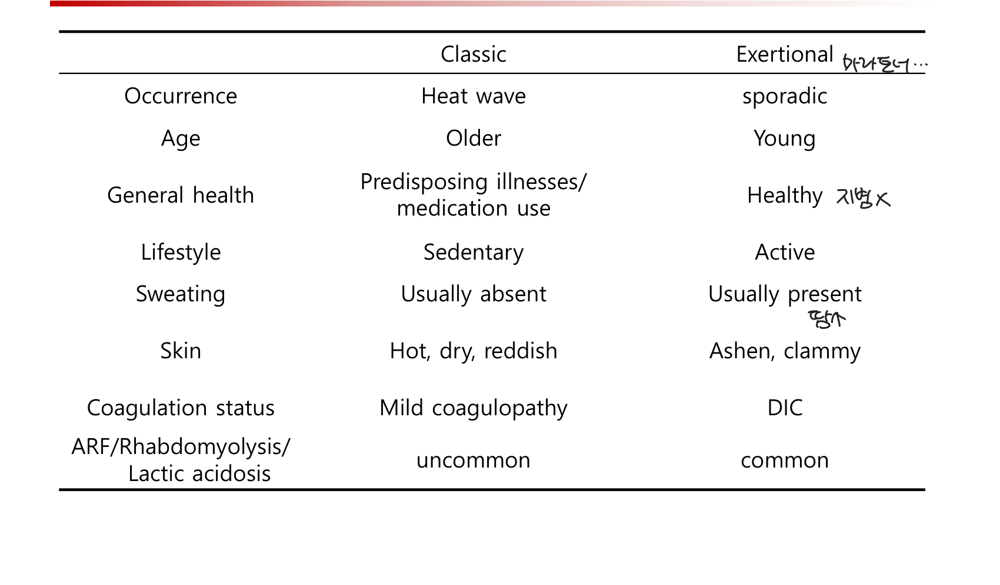{: style="width:65%"}

| | 고전형 | 운동형 |
|---|---|---|
| 발생 | 폭염 | 산발적 |
| 나이·건강 | 고령, 기저질환·약물 | 젊고 건강 |
| 땀 | 대개 없음 | **대개 있음** |
| 피부 | 뜨겁고 건조, 붉음 | 잿빛, 축축함 |
| 응고 | 경한 응고장애 | **DIC** |
| 급성신부전·횡문근융해·젖산증 | 드묾 | **흔함** |

## 발열 vs 고체온 (Fever vs Hyperthermia)

- **발열**: 감염·사이토카인으로 시상하부 **설정점이 올라간** 상태.
- **고체온**(열사병 등): 설정점은 **정상**인데 열 생산과 발산의 **균형이 깨진** 상태.
- 그래서 **해열제(acetaminophen, NSAID)는 고체온에 효과가 없다** — 설정점을 내리는 약인데 설정점은 이미 정상이다.

## 각론 — 경증 온열질환

필기본: "여기서부터 각론. 별로 중요한 내용 아니니 이런 게 있다 정도만 알아두면 된다." 단 **열탈진**은 2024년에 출제되었다.

### 열부종 (Heat Edema)
- 더위에 노출되어 **손·발·발목이 붓는 것**. 피부 혈관 확장 + 기립 시 간질액 고임.
- 감별: **심부전, 심부정맥혈전증** — 병력으로 감별.
- **저절로 좋아진다**(self-limited). 치료: 사지 거상, 압박 스타킹. **이뇨제는 효과 없다.**

### 열경련 (Heat Cramp)
- 운동 중·후 **종아리·허벅지의 통증성 근육 경련**("다리에 쥐 난다").
- 기전: 땀으로 Na+ 손실 + **맹물만 마심** → **희석성 저나트륨혈증**.
- 치료·예방: 시원한 곳에서 휴식 + 경구 **0.1–0.2% 식염수(스포츠음료)** 또는 심하면 정맥 0.9% 생리식염수. **희석하지 않은 소금 알약은 권하지 않는다**(물에 타서 먹는다).

### 열실신 (Heat Syncope)
- 기전: 체액 고갈, 말초 혈관 확장, 혈관운동 긴장도 ↓.
- **노인, 열순응이 덜 된 사람**에게.
- 넘어져 생긴 **이차 손상**과, 다른 실신 원인(급성관상동맥증후군, 부정맥 등)을 평가해야 한다.
- 치료: 휴식, 경구·정맥 수액.

### 열탈진 (Heat Exhaustion, "더위 먹음")
- **물과 Na+ 고갈** — **열사병의 전 단계**(precursor).
- 증상: 피로, 어지럼, 두통, 구역·구토, **땀을 많이 흘림**, 빈맥, 기립성 저혈압.
- **열사병과의 핵심 감별 두 가지**: ① 심부 체온이 대개 **< 40℃** ② **중추신경계 이상이 없다** ← 핵심.
- 치료: 시원한 그늘에서 휴식, 옷 벗기기, 경구 전해질 용액 또는 정맥 등장성 결정질액(의식이 있으면 경구).
- 처리: 대부분 좋아지며 **2–3시간 관찰 후 회복되면 귀가**. 노인·동반질환·증상 지속이면 입원.

!!! exam "기출 포인트"
    2부 7번(2024): 여름 공사장, 체온 39도, 구역·구토·두통, **땀을 많이 흘리고 의식 명료** → **열탈진**. 함정은 열사병 — 40℃ 이상 + **의식 변화(중추신경계 이상)**가 있어야 열사병이다.

## 열사병 (Heat Stroke)

- **생명을 위협하는 응급**. 과거엔 사망률이 매우 높았으나 최근엔 5% 미만으로 잘 치료된다.
- **진단 기준(hallmarks)**
    - **중추신경계 이상(필수)**: 운동실조(ataxia, 휘청거림), 섬망, 경련, 혼수 — 적어도 하나. 심해지면 의식 변화.
    - **심부 체온 > 40℃** — 단, **미리 식혔으면 절대 기준이 아니다**(구급차에서 냉각해 오면 40℃ 아래일 수 있음).
- **전신 손상**: 횡문근융해, 급성 콩팥손상, 간부전, DIC, ARDS.
- **함정**: **땀이 안 나는 것(무한증)은 필수가 아니다** — 땀으로 감별하지 않는다(특히 운동형은 땀이 난다).

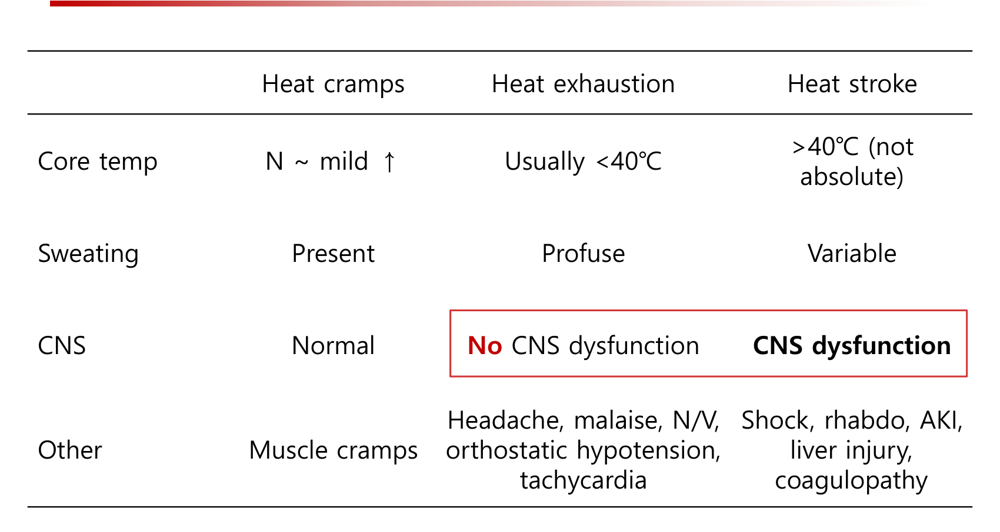{: style="width:72%"}

| | 열경련 | 열탈진 | 열사병 |
|---|---|---|---|
| 심부 체온 | 정상–약간 ↑ | 대개 < 40℃ | > 40℃ (절대 아님) |
| 땀 | 있음 | **많음** | 다양 |
| **중추신경계** | 정상 | **이상 없음** | **이상 있음** |
| 기타 | 근육 경련 | 두통, 권태, 구역·구토, 기립성 저혈압, 빈맥 | 쇼크, 횡문근융해, 급성 콩팥손상, 간 손상, 응고장애 |

### 진단과 감별
- **임상 진단**: 중추신경계 이상 + **더위 노출 병력**(야외 활동). 열사병을 확진하는 검사는 없다 → 다른 질환을 감별해서 제외한다.
- 심부 체온은 **직장 또는 식도**에서 잰다.
- **감별진단**(모두 감별한 뒤 열사병으로 진단)
    - 약물 중독: 항콜린제, 교감신경흥분제, 살리실산
    - 약물 증후군: 세로토닌 증후군, 신경이완제 악성증후군(NMS), **악성고열증**, 알코올 금단
    - 감염: 패혈증, 뇌수막염·뇌염, 말라리아
    - 내분비: 갑상샘 폭풍, DKA, 갈색세포종
    - 신경: 뇌전증지속상태, 뇌출혈

### 치료

!!! key "핵심"
    - **능동적 냉각 > 수동적 냉각** — 최근(작년) 가이드라인이 바뀌어 **무조건 능동적 냉각**이다.
    - 냉각 속도 **≥ 0.155℃/분** → 증상을 알아챈 뒤 **30분 안에 심부 체온 < 39.0℃**. 냉각을 멈춘 뒤에도 체온이 계속 떨어지므로(afterdrop) 목표를 살짝 높게 잡는다.
    - **1차: 물에 담그기(water immersion)** — 얼음물(1–5℃, 0.178℃/분) 또는 찬물(9–12℃, 0.154℃/분).

- **소생과 장기 지지**: A-B-C, **차가운 정맥 결정질액**(4℃ 냉장 보관 생리식염수), 경련·떨림에는 **benzodiazepine**(소량).
- **피해야 할 약**
    - **dantrolene 금지** — 악성고열증 치료제지 열사병에는 효과가 없다.
    - **해열제 금지**(acetaminophen, NSAID, aspirin) — 설정점 문제가 아니라 효과가 없고, 오히려 간 손상(acetaminophen)·콩팥 손상(NSAID)을 일으킬 수 있다.
    - 예방적 항경련제·항생제를 일상적으로 쓰지 않는다.

**냉각 방법 (Cooling Techniques)**

| 구분 | 방법 |
|---|---|
| **1차 우선** | **물에 담그기**(목까지): 얼음물(1–5℃) 또는 찬물(9–12℃) — 이 둘만 30분 목표를 확실히 달성 |
| 담글 수 없을 때 대안 | **방수포 냉각**(TACO, Tarp-Assisted Cooling: 방수포에 얼음물과 환자를 넣고 흔들기), 찬물 샤워, 얼음 시트, **증발 + 대류 냉각**(물 분무 + 큰 선풍기) — 병원에 욕조가 없어 병원에서 주로 쓰는 방법 |
| 보조(주 방법과 함께) | 차가운 정맥 생리식염수, 목·겨드랑이·사타구니 얼음팩 |

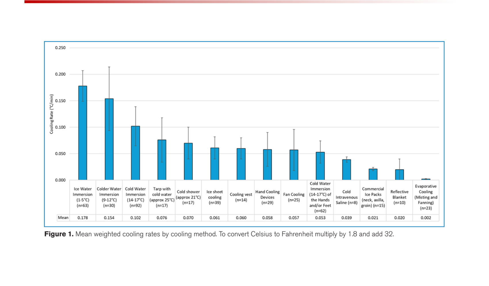{: style="width:78%"}

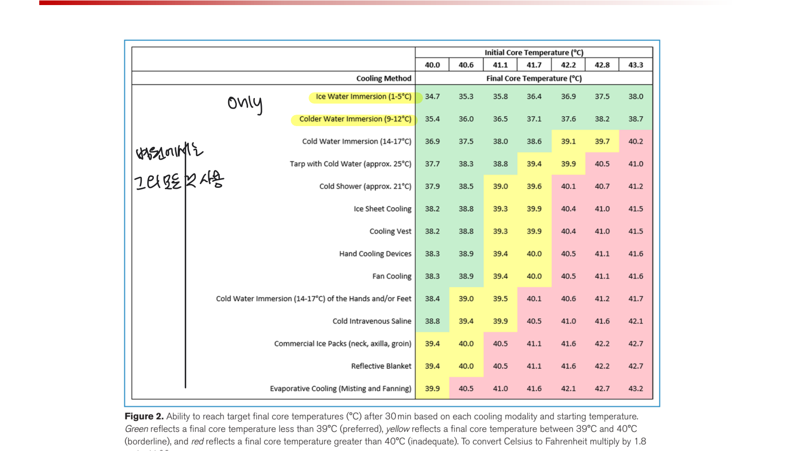{: style="width:72%"}

교수님: "이 두 개(얼음물·찬물 담그기)가 제일 좋더라. 그런데 병원엔 욕조가 없다. 그래서 그 외 할 수 있는 방법은 다 하는 편."

!!! exam "기출 포인트"
    - 2부 18·20·25번(2020–2022, 같은 문제): 마라톤 중 의식 소실, 직장 체온 42도 → 옳은 것 **"15℃ 정도의 물을 뿌린 뒤 선풍기를 돌려 체온을 낮춘다"**(증발 냉각). 오답: 아세트아미노펜(×), 담금 냉각은 떨림을 유발하지 않는다(×), dantrolene(×).
    - 2부 13번(2023): 마라톤 중 혼미, 41℃, 뜨겁고 건조한 피부 → "가장 효과적인 치료"로 **증발 냉각(evaporative cooling)**이 정답이었다.
    - **주의**: 올해 슬라이드는 가이드라인 변경을 반영해 **물에 담그기가 1차**이고, 위 그래프에서 증발 냉각(물 분무 + 선풍기)은 단독으로 가장 느리다(0.002℃/분). 올해 같은 문제가 나오면 보기 구성을 보고 판단해야 한다 — "가장 빠르고 효과적인 1차 냉각"을 물으면 **얼음물·찬물 담그기**, 담그기가 보기에 없고 "병원에서 흔히 쓰는 방법"을 물으면 증발 냉각.

※ 확인 필요: 2023년 기출(2부 13번)의 정답(증발 냉각)은 올해 강의의 "1차는 물에 담그기" 원칙과 어긋난다. 같은 문제가 그대로 나오면 어느 쪽으로 채점할지 확인이 필요하다.

### 열사병의 합병증 — 초기 vs 후기

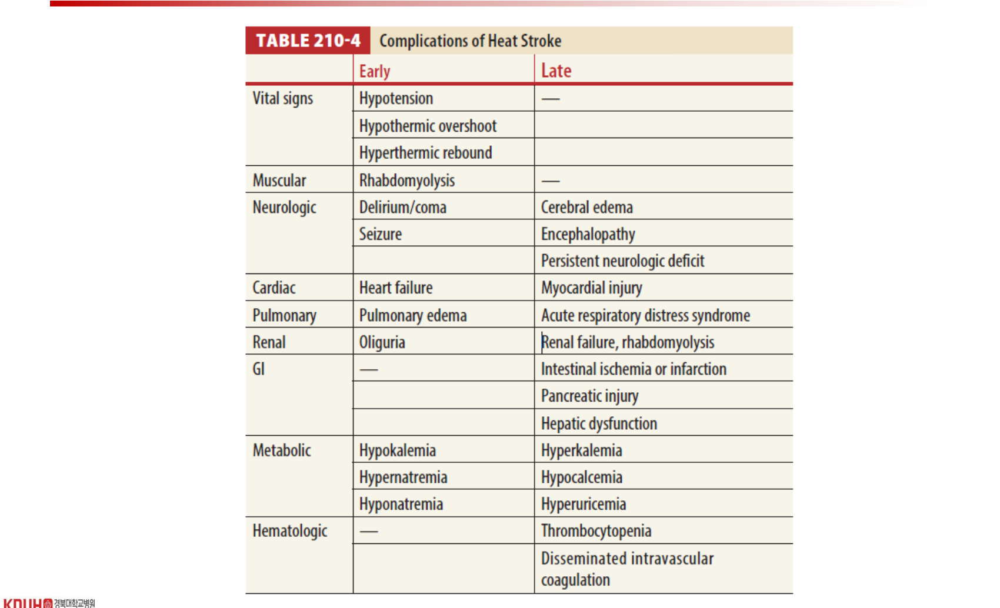{: style="width:62%"}

| 계통 | 초기 | 후기 |
|---|---|---|
| 활력징후 | 저혈압, 저체온 과교정(overshoot), 고체온 반동(rebound) | — |
| 근육 / 신경 | 횡문근융해 / 섬망·혼수, 경련 | — / 뇌부종, 뇌병증, 지속 신경학적 결손 |
| 심장 / 폐 | 심부전 / 폐부종 | 심근 손상 / ARDS |
| 콩팥 / 위장관 | 핍뇨 / — | 신부전·횡문근융해 / 장 허혈·경색, 췌장 손상, 간 기능 장애 |
| 대사 | **저칼륨혈증**, 고나트륨혈증, 저나트륨혈증 | **고칼륨혈증**, 저칼슘혈증, 고요산혈증 |
| 혈액 | — | 혈소판감소증, **DIC** |

대부분 회복되지만, 의식만 돌아오고 후유증이 남을 수도 있다.

# 4. 익수 (Drowning)

## 정의와 역학
- **물에 잠기거나(submersion, 머리까지) 빠져서(immersion, 머리는 밖) 생기는 일차 호흡 장애**.
- 분류는 **사망(fatal) vs 비사망(non-fatal)**으로 단순하게 한다. **'near/wet/dry drowning' 같은 용어는 쓰지 않는다.**
- 전 세계 연 23.6만–37만 명 사망, **15세 미만 손상 사망 1위**. 호발 나이: **5세 미만(가장 많음, 욕실)**, 15–24세(2위, 바닷가), 노인(3위).

## 병태생리
- **예후는 중추신경계가 받은 저산소 손상 정도에 비례**한다. 물의 온도·오염도보다 **저산소증이 얼마나 길었느냐**가 가장 중요하다.
- **잠수 반사**(diving reflex): 서맥, 무호흡, 말초혈관 수축, 혈류를 중심으로 몰기 → 잠긴 동안 일시적 보호. **6개월 미만 영아에서 가장 강하고 성인에서는 보호 효과가 없다.**
- 찬물 익수의 예후가 더 좋은 이유는 잠수 반사가 아니라 **뇌가 빨리 식기 때문**이다.
- 폐: **계면활성제 씻김** → 폐포 허탈, 환기-관류 불일치, ARDS.
- 저산소혈증·대사성 산증 → 다장기·중추신경 손상.
- 물·위산·오염된 물 흡인 → 화학적 폐렴, 세균성 폐렴.
- 전해질 변화·용혈은 생존자에선 드물고, 심한 저산소 손상 뒤 DIC가 생길 수 있다.

## 병원 전 처치
- **소생 순서**: 훈련된 구조자·의료인은 **A-B-C — 인공호흡 2회 먼저**, 그다음 30:2 CPR. 저산소증이 심정지 원인이기 때문이다(일반인 구조자는 C-A-B).
- **하임리히법(복부 밀어내기)은 금기** — 흡인한 물은 큰 문제가 아니고, 보통 저산소증·후두 경련 등이 원인이다.
- **응급실로 보내야 하는 경우**: 의식 소실이 있었거나, 무호흡, 구조호흡을 했거나, 청색증, 호흡곤란.

## 응급실 치료
- **폐 지지**: 고유량 산소(목표 SpO2 ≥ 94–95%), 유지되지 않으면 **조기 CPAP/BiPAP 또는 삽관 + PEEP**(기계환기 적극 고려).
- **경추 고정은 일상적으로 하지 않는다** — 다이빙, 고충격 수상 스포츠, 외상 징후가 있을 때만.
- 예방적 항생제·스테로이드를 일상적으로 쓰지 않는다.
- **경증은 4–6시간 관찰 후 귀가** — 지연성 폐부종이 생길 수 있기 때문.

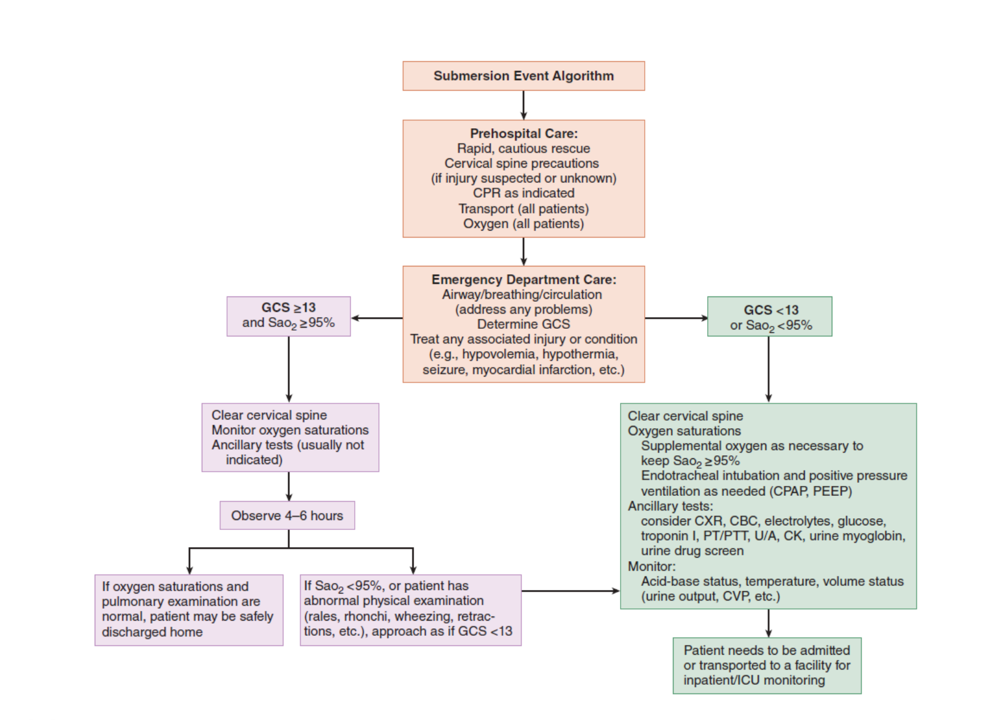{: style="width:68%"}

- **GCS ≥ 13 그리고 SaO2 ≥ 95%** → 경추 확인, 산소포화도 감시, 보조 검사는 대개 불필요 → **4–6시간 관찰** → 산소포화도와 폐 진찰이 정상이면 **안전하게 귀가**. SaO2 < 95%이거나 진찰 이상(수포음, 천명, 함몰 등)이면 GCS < 13처럼 다룬다.
- **GCS < 13 또는 SaO2 < 95%** → 산소(SaO2 ≥ 95% 유지), 필요하면 삽관·양압환기, 흉부 X선·혈액검사·트로포닌·CK·소변 마이오글로빈 등, 산염기·체온·체액 감시 → **입원(병실/중환자실)**.

!!! exam "기출 포인트"
    2부 3번(2025)·12번(2023, 같은 문제): 계곡에서 물에 빠진 20대, 기침·가슴통증만 있고 의식 명료, SpO2 98%, 흉부 X선 정상, **6시간 동안 변화 없음** → **귀가 및 외래 추적**. 함정: 추가 6시간 관찰(이미 4–6시간 관찰 끝), 고농도 산소, 입원.

# 5. 일산화탄소 중독 (CO Poisoning)

교수님: "중독 응급과 범위가 겹쳐서 빨리 넘어가겠습니다." — 그래도 2020–2024년 매년 나왔으므로 꼭 본다.

## 역학과 출처
- 미국: 약물 과다복용 다음 2위의 치명적 중독, 약물 외 중독 사망 1위. **한국: 독성 가스 중독 원인 1위**(사고 + 의도적).
- **출처**: 화재, 고장 난 가스보일러·난방기, 캠핑용 숯·프로판 난로, **연탄·번개탄**(자살 목적), 밀폐 공간의 차량·발전기 배기가스, **methylene chloride**(페인트 제거제 → 간에서 CO로 대사).

## CO의 특성
- **무색·무취·비자극성** 가스 — 마셔도 티가 안 나서 잘 모른다.
- 공기 중 정상 농도 10 ppm 이하(도시 > 시골).
- 정상 COHb: 건강한 비흡연자 ~2%(대개 < 1%), **흡연자 4–10%**.

## 독성 기전

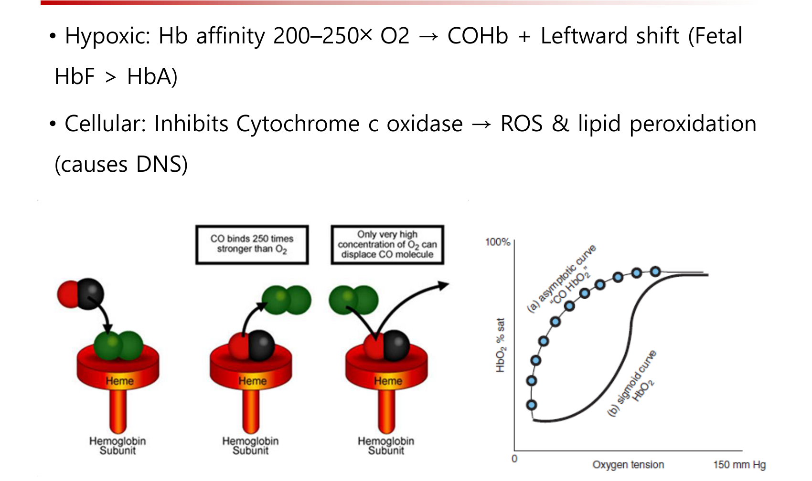{: style="width:72%"}

- **저산소성**: 헤모글로빈 친화도가 산소의 **200–250배** → COHb 형성 + 산소해리곡선 **왼쪽 이동**(산소를 놓아주지 않는다). **태아 헤모글로빈(HbF)은 더 잘 결합**하므로 **임신부는 기준이 더 엄격**하다.
- **세포성**: **사이토크롬 c 산화효소 억제** → 활성산소, 지질 과산화 → **지연성 신경학적 후유증(DNS)**의 원인. 직접 세포 손상 기전이 있어 환자 증상과 CO 농도가 정확히 일치하지 않을 수 있다.

## 임상 양상

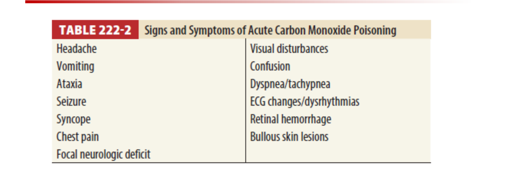{: style="width:62%"}

- 두통, 구토, 운동실조, 경련, 실신, 흉통, 국소 신경학적 결손, 시야 장애, 혼동, 호흡곤란, 심전도 변화·부정맥, 망막 출혈, 수포성 피부 병변 — **뇌와 심장 증상이 중심**이다.
- **병력이 진단의 열쇠**(화재, 번개탄, 보일러 등). 혼수·의식 변화, **음이온차 증가 대사성 산증·젖산증**의 감별진단에 CO 중독을 넣어야 한다.
- **체리 빛 붉은 피부**(cherry-red skin): 고전적 징후지만 살아 있는 환자에선 드물다(< 2–3%, 주로 사후). 중요한 징후가 아니고 병력이 더 중요하다.

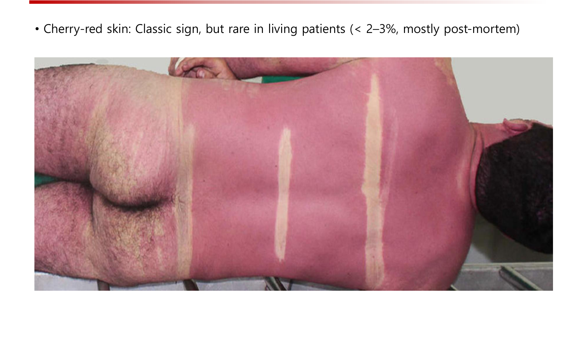{: style="width:55%"}

## 진단
- **CO 산소측정법(CO-oximetry, 정맥 또는 동맥혈)으로 COHb를 측정해 확진**한다.
    - **맥박산소측정(SpO2)은 거짓 정상** — 산소포화도만 보고 "괜찮네" 하면 큰일 난다.
    - **일반 동맥혈가스의 PaO2도 정상**(녹아 있는 산소를 재므로).
    - **COHb 수치 ≠ 임상 중증도**.
- 표적 장기 평가: 심전도, 트로포닌, 젖산, CPK, 뇌 MRI/CT.

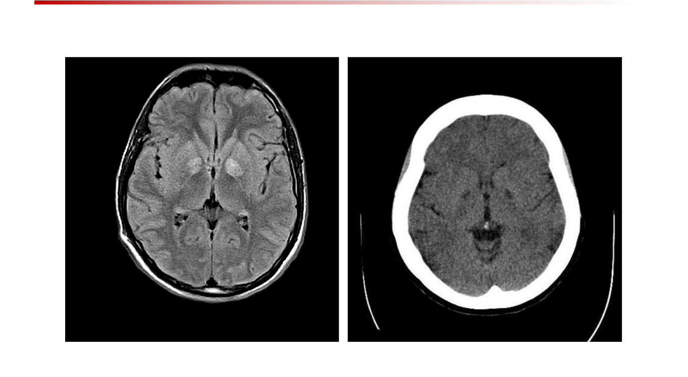{: style="width:62%"}

양쪽 기저핵·**창백핵**(globus pallidus)에 대칭적 신호 변화가 보인다. CO 중독뿐 아니라 대사성 뇌병증에서도 자주 보이는 소견이니 **뇌경색으로 오인하지 않는다**.

## 치료

!!! key "핵심"
    - **즉시 100% 정상압 산소(비재호흡 마스크)** 시작 — 최대한 높게.
    - **경증(고위험 소견 없음)**: 증상이 없어지고 **COHb < 3%**가 될 때까지 100% 산소, **응급실 4–6시간 관찰 후 귀가 가능**.
    - **고위험 소견(뇌·심장 증상)**: **고압산소치료(HBOT)** 또는 고유량 정상압 산소. ("필수"가 아니라 "권고"인 이유는 비싸서가 아닐까 하는 필기본 추측이 있다.)

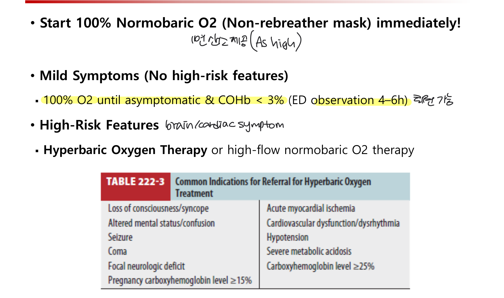{: style="width:62%"}

| 고압산소치료 적응증 | |
|---|---|
| **의식 소실·실신** | 급성 심근 허혈 |
| 의식 변화·혼동 | 심혈관 기능 이상·부정맥 |
| 경련, 혼수 | 저혈압 |
| 국소 신경학적 결손 | 심한 대사성 산증 |
| **임신부 COHb ≥ 15%** | **COHb ≥ 25%** |

**고압산소치료(HBOT)**: 2–2.5기압. COHb 반감기를 크게 줄인다 — **실내 공기 4–5시간 → 100% 산소 60–90분 → 고압산소 20–30분**. 지질 과산화를 억제해 **지연성 신경학적 후유증(DNS)을 예방**한다.

## 지연성 신경학적 후유증 (Delayed Neurologic Sequelae, DNS)
- 생존자의 **15–40%**에서 **2–40일의 '명료기(lucid interval)'** 뒤에 생긴다 — 치료받고 집에 갔는데 갑자기 헛소리를 시작한다.
- 증상: 인지 저하, 성격 변화, 파킨슨증, 보행 실조, 실금.
- **위험인자**: 나이 > 36–50세, 노출 > 6시간, **내원 시 의식 소실/GCS < 9**, 경련, 백혈구증가증.
- 퇴원 시 환자·가족에게 교육하고 **2–4주 뒤 외래 추적**을 잡는다 — 경과를 반드시 봐야 한다.

!!! exam "기출 포인트"
    - 2부 8번(2024): 화재 환자 중 HBOT 먼저 → **실신한 42세 남자**. 함정: COHb 10%인 29주 임신부(임신부 기준 15% 미만), 두통·복통 소아, 급성신부전 노인.
    - 2부 15번(2022): HBOT를 해야 하는 경우 → **의식 저하, 심근경색 의심, 부정맥**(가·나·라). "COHb 15% 이상"은 임신부 기준이라 일반인에겐 틀린 보기.
    - 2부 9번(2023): 연기 흡입 후 두통·어지럼, 의식 명료, COHb 15% → **비재호흡 마스크로 산소 15 L/분**(경증, HBOT 적응증 아님).
    - 2부 17번(2022): 밀폐된 차 안 번개탄, 혼수, 붉은 피부 → **CO 중독, 회복해도 DNS가 40%까지**.
    - 2부 19번(2021): 번개탄 + 혼수 + COHb 33% → **고압산소치료**. 함정: SpO2 98%라 환기 문제없다(×, 거짓 정상), 회복되면 후유증 걱정 없다(×).
    - 2부 23번(2020): 옳지 **않은** 것 → **일반 ABGA로 CO 중독 정도를 파악한다**(CO-oximetry로 COHb를 재야 한다).

# 6. 뱀교상 (Snakebite)

## 국내 독사 4종

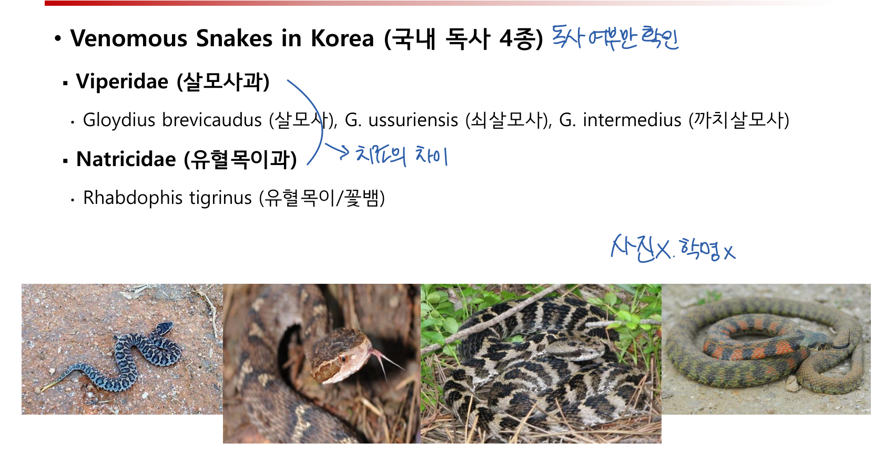{: style="width:72%"}

- **살모사과**(Viperidae): 살모사(*Gloydius brevicaudus*), 쇠살모사(*G. ussuriensis*), 까치살모사(*G. intermedius*)
- **유혈목이과**(Natricidae): **유혈목이(꽃뱀, *Rhabdophis tigrinus*)**

사진이나 학명을 외울 필요는 없고, **독사인지 아닌지**, 그리고 **살모사과 vs 유혈목이**(독니 위치와 치료가 다르다)만 구분하면 된다. 교수님도 "봐도 모른다"고 하셨다.

## 임상 양상
- **국소 조직 손상**: 통증, 부종, 반상출혈, **독니 자국**(fang marks), 출혈성 물집.
- **전신 증상**
    - 일반: 구역, 구토, 쇠약, 어지럼, 근육 다발수축
    - **출혈(응고장애)**: 잇몸 출혈, 피눈물, 위장관 출혈, 뇌출혈
    - 장기 손상: 횡문근융해, 급성 신부전
    - 호흡곤란, 빈호흡, 빈맥, 저혈압, 의식 저하, 쇼크
- 증상이 애매하면 독사에 물렸다고 보고 치료한다.

## 독사 vs 무독사 감별

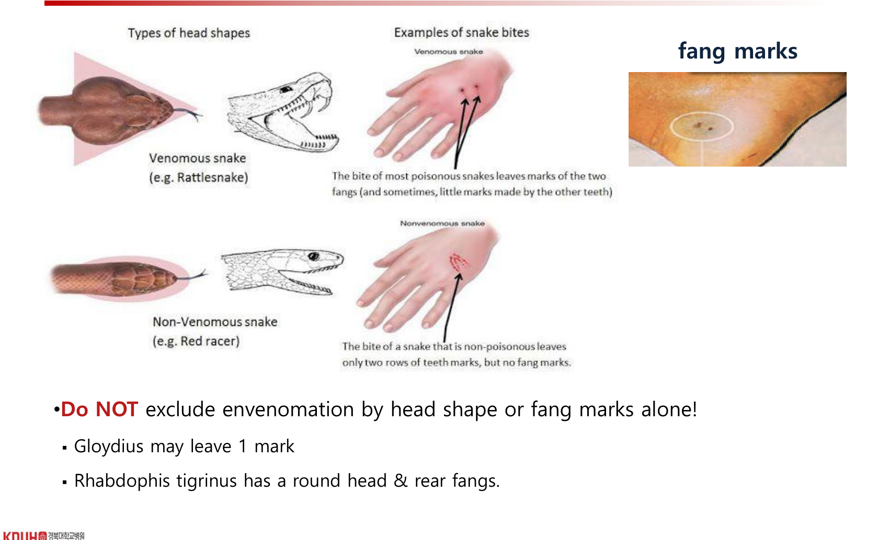{: style="width:78%"}

- 교과서적으로 독사는 머리가 삼각형이고 독니 자국 2개, 무독사는 머리가 둥글고 이빨 자국이 두 줄로 남는다.
- **그러나 머리 모양이나 독니 자국만으로 독사 교상을 배제하지 않는다!**
    - 살모사는 **자국을 1개만** 남길 수도 있다.
    - **유혈목이는 머리가 둥글고 독니가 뒤쪽**(rear fangs)에 있다 — 독니 자국이 잘 안 보인다.
    - 환자는 경황이 없어 뱀 모양을 잘 모른다.

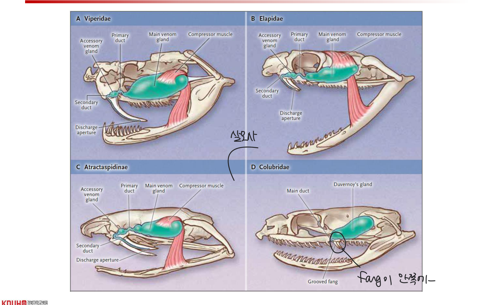{: style="width:65%"}

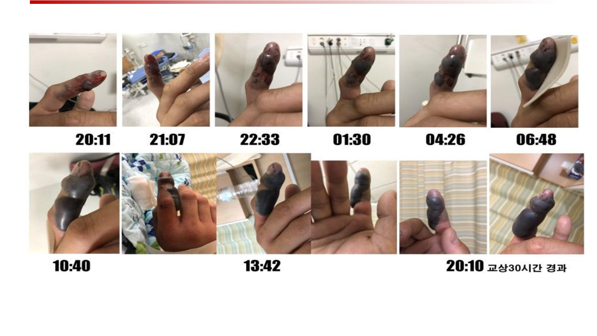{: style="width:72%"}

독니 자국 주변을 관찰하며 **부종이 물린 부위에만 있는지, 관절을 넘어 퍼지는지** 시간에 따라 추적한다.

## 현장 응급처치 (First Aid)

!!! memo "암기"
    - **권장**: 환자를 진정시키고 **걷지 못하게** 한다 / 붓기 전에 반지·시계·꽉 끼는 신발을 뺀다 / **중립 자세로 부목**, **심장 높이 또는 그보다 낮게** 두고 응급실로 이송.
    - **절대 금기**: **절개, 빨기(흡입), 동맥 지혈대, 얼음팩, 알코올** — "째고 빨고 묶고, 다 하지 마라."

## 응급실 치료 — 항독소 (Antivenom)

**코박스 건조살무사항독소주** — **살모사과에만 효과**가 있다. 항독소를 쓸지 말지 결정하는 것이 가장 중요하다.

| 항목 | 내용 |
|---|---|
| **적응증** | **진행하는 부종**(물린 부위가 점점 커질 때, 관절을 넘어 퍼질 때, 사지의 절반 이상이 부을 때), **응고장애**(PT/aPTT ↑, INR ↑, fibrinogen ↓, **혈소판 ↓**), 전신·신경 증상 |
| 시기·경로 | **3–4시간 이내가 최적**(ASAP, 하지만 늦어도 써야 한다) / 정맥(1순위), 골내(2순위) |
| 초기 용량 | 경도–중등도 **1 vial**, 중증 **2 vials** |
| 소아 | **성인과 같은 용량** — 뱀독을 중화하는 것이 목적이므로 |
| **유혈목이** | **항독소 효과 없음** → **신선동결혈장(FFP)/동결침전제제(cryo)** 등 보존적 치료 |

**보조 치료**
- 사지 고정, **파상풍 추가접종**.
- **항생제·스테로이드·NSAID를 일상적으로 쓰지 않는다.**

**뱀교상의 구획증후군**
- **1차: 항독소**(± 거상, mannitol).
- **근막절개술은 항독소와 지혈을 했는데도 구획 압력 > 30–40 mmHg일 때만** — 이것저것 다 했는데 안 될 때 수술한다.
- 외상(골절) 환자의 부종은 **근육 안** → 근막절개 우선 / 뱀독의 부종은 **연부조직** → 항독소 우선. 발가락 끝 저림·심한 통증·마비가 오면 의심한다.

## 처리 (Disposition)
- **모든 교상은 최소 6–8시간 관찰**하며 **응고 검사를 반복**한다.
- **귀가**: 무독 교상(dry bite) — 6–8시간 뒤 진행이 없고 검사가 정상일 때(독이 없다는 확신이 있을 때).
- **입원**: 경도–중등도 독주입 → 일반 병실 / **중증 또는 항독소를 투여했으면 → 중환자실**.
- **추적**: 감염, **혈청병**(항독소 투여 1–2주 뒤).

!!! exam "기출 포인트"
    - 2부 1번(2025)·10번(2023): 손등을 물려 **부종·홍반·물집이 아래팔까지(또는 손등 전체로) 퍼지고 혈소판 70,000–80,000** → **항독소 투여**. 함정: 신선동결혈장·혈소판 수혈(독이 남아 있으면 효과 적음), **동맥압박 지혈대**(금기), 경험적 항생제(일상적 사용 ×).
    - 2부 24번(2020): 머리가 삼각형이고 독니 자국 2개 → **독사로 보고 즉시 119로 치료 가능한 병원에 이송**. 오답: 물린 발을 심장보다 높게(×, 심장 높이 또는 아래), 지혈대를 묶고 풀지 않기(×).

## (기출에만 있는 내용) 벌 쏘임

2020–2021년 기출에는 벌 쏘임이 나왔지만, 2022년 강의 개편 뒤 곤충독 부분은 삭제되어 올해 필기에는 없다. 기출에 나온 핵심만 정리한다.

- 침이 남아 있으면 빨리 제거한다(**침을 남기는 것은 꿀벌**, 말벌은 침을 남기지 않는다).
- 비누와 물로 씻고, 얇은 수건에 싼 얼음으로 냉찜질, 쏘인 부위 **거상**, 필요하면 진통제·항히스타민제.
- **벌독에는 해독제가 없다.**
- 대부분 국소 반응이며 아나필락시스는 일부에서만 생긴다. 숨참·가슴 답답함 같은 **전신 증상이 있으면 즉시 병원**(에피네프린).

!!! exam "기출 포인트"
    2부 22번(2021): 옳지 **않은** 것 → **"말벌에 쏘였으니 당장 해독제를 맞아야 한다"**. 2부 24번(2020): "말벌에 쏘이면 항상 아나필락시스가 온다"(×), "두피의 벌침을 샅샅이 뒤져 뺀다"(×, 말벌은 침을 남기지 않음).
