<!-- 필기본: 2026 -->

# 0. 이 수업을 공부하는 법

**이준석 교수님**(성형외과)의 「흉터교정술(Scar Revision)」 수업이다(11/3 화 4교시, 1시간). 참고문헌은 **표준성형외과학 3판**이고, 시험 문제는 **강의록에서** 출제된다고 하셨다. 작년(2025)까지는 류정엽 교수님이 맡으셨고 올해부터 이준석 교수님이 새로 맡으셨다. 필기본 뒷부분에는 이준석 교수님의 「창상치유(Wound healing, I-Ch.5)」 내용도 함께 정리되어 있어 이 자료에도 2부(5장)로 넣었다.

강의 내용 자체는 작년 강의록과 크게 다르지 않지만, **"중요 표시"(빨간 별) 슬라이드가 바뀌었다.** 필기본 작성자가 정리한 올해 중요 표시는 다음 네 곳이다.

| 중요 표시 | 내용 | 이 자료 위치 |
|---|---|---|
| 비후성 흉터 vs 켈로이드 | 상처 범위 안/밖, 기전, 호발 부위 | 1장 4절 |
| 집중보습 · Triamcinolone 병변내 주사 | 실리콘 젤시트, 희석 비율·간격·부작용 | 2장 3절 |
| Z-성형술 | 2개 삼각피판 자리바꿈, 각도별 길이 연장 | 3장 4절 |
| 창상치유 과정 | 지혈(0–15분)·염증(3–5일)·증식·성숙(1년~) | 5장 |

2부의 기출 10문항(2020–2025)은 모두 류정엽 교수님 시절 문제다. 반복된 주제는 **켈로이드 정의**(2023·2024·2025), **상처 장력 80% 회복 시점**(2023·2024·2025), **Z-성형술 각도와 연장 길이**(2023·2024), **흉터 예방 원칙**(2020·2021)이다.

!!! key "핵심"
    - 올해는 교수님이 바뀌었고 중요 표시도 바뀌었다. 필기본 작성자의 예측은 "상처치유 그래프 문제가 빠지고 **triamcinolone**이 새로 들어올 것", "켈로이드·Z-성형술도 **문제 형식이 바뀔** 가능성이 높다"이다. 기출 답만 외우지 말고 슬라이드 내용 자체를 알아 둔다.
    - 창상치유는 이준석 교수님이 2023 **성숙**, 2024 **염증**, 2025 **지혈** 단계를 틀린 보기로 냈다. 필기본 작성자는 올해 **증식** 단계 차례라고 예상했다(5장 3절).

# 1. 흉터 (Scar)

## 흉터란

흉터는 상처가 낫는 과정(상처치유과정, wound healing process)에서 **콜라겐(collagen) 섬유조직이 쌓여** 남은 자국이다. 피부가 원래 구조로 재생되지 못하고 섬유조직으로 "땜질"된 결과라서, 수술로도 흉터를 완전히 없앨 수는 없다(3장 "흉터 제거술은 없다").

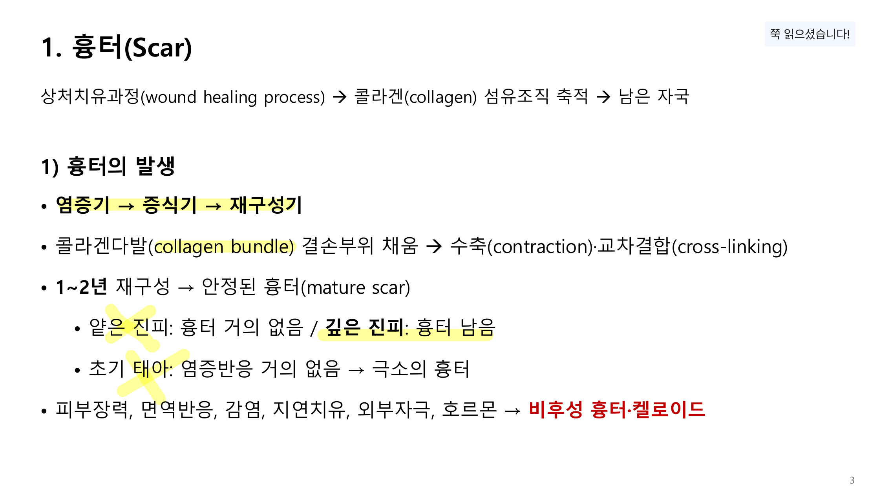{: style="width:70%"}

## 흉터의 발생

1. **염증기 → 증식기 → 재구성기(성숙기)**를 거친다. 각 단계의 자세한 내용은 5장에서 다룬다.
2. 콜라겐 다발(collagen bundle)이 결손 부위를 채우고, 이것이 **수축(contraction)**하고 **교차결합(cross-linking)**하면서 흉터가 단단해진다.
3. **1–2년** 동안 재구성되어 안정된 흉터(성숙 흉터, mature scar)가 된다. 그래서 흉터 상태는 최소 수개월~1년은 지켜봐야 판단할 수 있다.
4. 흉터가 남는지는 **손상 깊이**가 결정한다.
    - **얕은 진피** 손상: 흉터가 거의 없다. 털주머니·땀샘 같은 피부 부속기에 남은 상피세포가 올라와 덮어 주기 때문이다.
    - **깊은 진피** 손상: 흉터가 남는다.
5. **초기 태아**의 상처는 염증반응이 거의 없어 흉터가 극히 적다(흉터 없는 치유, scarless healing). 이는 거꾸로 "염증이 흉터를 만든다"는 뜻이며, 흉터 예방의 기본 개념(염증 차단)으로 이어진다.
6. **피부장력, 면역반응, 감염, 지연치유, 외부자극, 호르몬**은 흉터를 키워 **비후성 흉터·켈로이드**를 만든다.

!!! exam "기출 포인트"
    9번(2021)은 흉터 형성 과정, 얕은 진피 손상, 초기 8주 예방 처치, NSAID를 모두 맞는 설명으로 두고 **"봉합사 제거 후 1년 이상 콜라겐 결합력이 증가하므로 skin taping이 효과적"**을 틀린 보기로 냈다. 테이핑은 발사 후 약 2개월이다(2장 2절).

## 흉터의 종류 ①

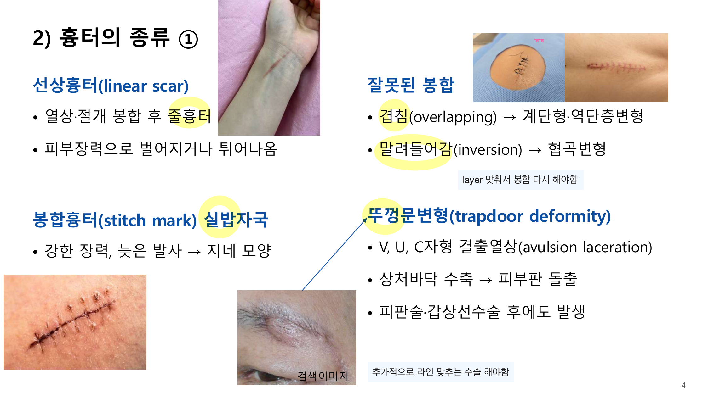{: style="width:76%"}

### 선상흉터 (linear scar)
열상(찢어진 상처)이나 절개를 봉합한 뒤 남는 **줄 모양 흉터**다. 피부장력을 받으면 넓게 벌어지거나(widened scar) 튀어나온다.

### 봉합흉터 (stitch mark) — 실밥자국
봉합할 때 **장력이 강했거나 발사(실밥 제거)가 늦으면** 실이 지나간 자리마다 점·가로줄이 남아 **지네(기찻길) 모양**이 된다. 그래서 얼굴은 4–5일, 몸통은 7일쯤 일찍 발사한다(2장 1절).

### 잘못된 봉합
- **겹침(overlapping)** → 한쪽 상처 가장자리가 다른 쪽 위로 올라가 **계단형·역단층 변형**이 생긴다.
- **말려들어감(inversion)** → 상처 가장자리가 안으로 말려 **협곡(골짜기) 변형**이 생긴다.
- 둘 다 층(layer)을 정확히 맞춰 **다시 봉합**해야 한다(3장 2절 "조기 교정봉합").

### 뚜껑문변형 (trapdoor deformity)
- V, U, C자 모양의 **결출열상**(피부가 반쯤 떨어져 나간 피판 모양 상처, avulsion laceration)에서 생긴다.
- 상처 바닥의 흉터가 **수축**하면서 피판이 뚜껑처럼 **볼록 튀어나온다.**
- 피판술·갑상선 수술 뒤에도 생긴다.
- 교정: 바닥의 흉터막을 제거하고 층을 맞춰 다시 봉합한다(추가로 라인을 맞추는 수술).

## 흉터의 종류 ②

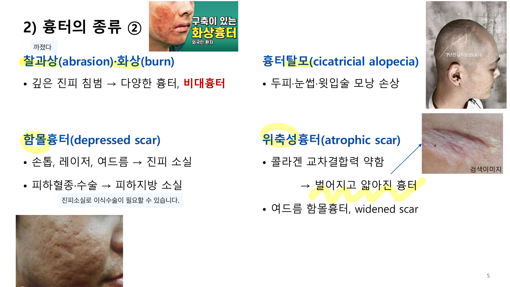{: style="width:76%"}

### 찰과상(abrasion)·화상(burn) 흉터
찰과상은 피부가 "까진" 상처다. 손상이 **깊은 진피까지 침범**하면 다양한 흉터가 생기고, 특히 **비대흉터(비후성 흉터)**가 잘 생긴다. 깊은 화상은 비후성 흉터와 구축의 대표 원인이다.

### 함몰흉터 (depressed scar)
- 손톱(긁음), 레이저, 여드름 → **진피 소실**
- 피하혈종·수술 → **피하지방 소실**
- 빠진 부피를 채워야 하므로 진피·지방 이식이 필요할 수 있다(3장 6절).

### 흉터탈모 (cicatricial alopecia)
두피·눈썹·윗입술처럼 털이 나는 부위의 흉터로 **모낭이 손상**되어 털이 다시 나지 않는다. 모발·모낭 이식(3장 6절)이나 조직확장술(3장 7절)로 교정한다.

### 위축성흉터 (atrophic scar)
- 콜라겐 **교차결합력이 약해서** 흉터가 벌어지고 얇아진다.
- 예: 여드름 함몰흉터, widened scar(넓어진 흉터)

## 비후성 흉터(비대흉터) vs 켈로이드 ★

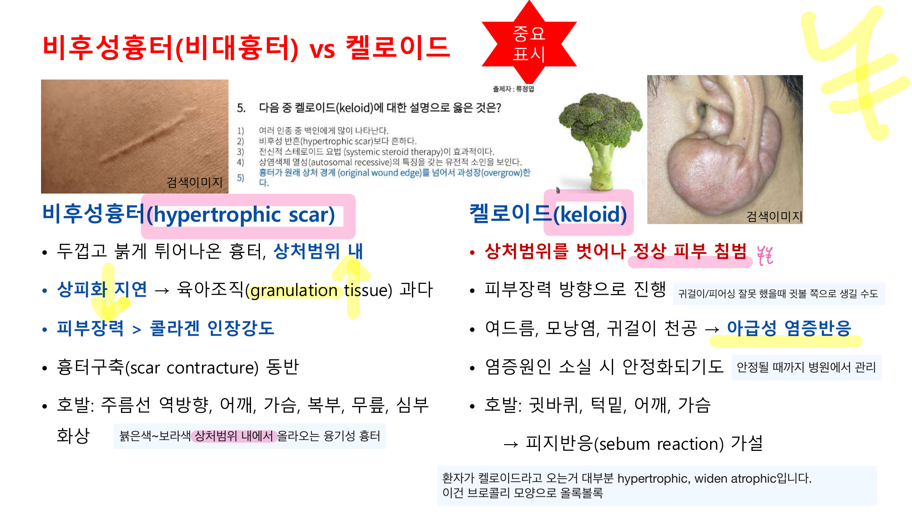{: style="width:78%"}

둘 다 콜라겐이 과도하게 만들어져 두껍고 붉게 튀어나온 흉터지만, **원래 상처 범위를 넘느냐**로 구별한다. 교수님 말씀으로는 "켈로이드라고 오는 환자 대부분은 사실 hypertrophic이나 widened atrophic scar"이고, 진짜 켈로이드는 **브로콜리처럼 올록볼록** 자란다.

| 구분 | 비후성 흉터 (hypertrophic scar) | 켈로이드 (keloid) |
|---|---|---|
| 경계 | **상처 범위 안** (붉은색~보라색 융기) | **상처 범위를 벗어나 정상 피부 침범** |
| 기전 | **상피화 지연** → 육아조직(granulation tissue) 과다; **피부장력 > 콜라겐 인장강도** | 귀걸이 천공·여드름·모낭염 등 → **아급성 염증반응**; 피부장력 방향으로 진행 |
| 동반 | **흉터구축(scar contracture)** 동반 | 염증 원인이 없어지면 안정화되기도 함(안정될 때까지 병원에서 관리) |
| 호발 | 주름선 역방향, 어깨, 가슴, 복부, 무릎, **심부 화상** | **귓바퀴, 턱밑, 어깨, 가슴** → 피지반응(sebum reaction) 가설 |
| 경과 | 시간이 지나며 가라앉을 수 있음 | 계속 자라고 저절로 줄지 않음, 절제 후 재발 많음 |

- **비후성 흉터**: 상피화가 늦어지면 그동안 육아조직이 계속 쌓인다. 또 상처를 당기는 피부장력이 새 콜라겐이 버티는 힘(인장강도)보다 크면 콜라겐이 더 많이 만들어진다. 깊은 진피까지 다친 화상·외상 뒤에 잘 생기고, 구축을 동반해 관절 운동을 막기도 한다.
- **켈로이드**: 귀걸이 피어싱을 잘못하면 귓볼에 생길 수 있다. 피지선이 많은 부위(귓바퀴·턱밑·가슴)에 잘 생겨 **피지반응 가설**이 있다(피지 성분이 진피에 새어 들어가 면역·염증반응을 일으킨다는 설명).

!!! exam "기출 포인트"
    2·4·7번(2023·2024·2025 같은 문제)의 정답은 **"흉터가 원래 상처 경계(original wound edge)를 넘어서 과성장한다"**. 함정 보기: 백인에 많다(틀림 — 흑인·아시아인에 많음), 비후성 반흔보다 흔하다(틀림 — 더 드묾), 전신 스테로이드가 효과적(틀림 — **병변 내** 스테로이드 주사), 상염색체 열성(틀림 — 우성 경향의 유전 소인).

!!! memo "암기"
    비후성 = **경계 안**, 상피화 지연·장력, 구축, 화상. 켈로이드 = **경계 밖**, 아급성 염증, 귓바퀴·턱밑·어깨·가슴, 피지반응.

### 참고: 비교 그림과 병리 (필기본 13–16쪽, 참고용)

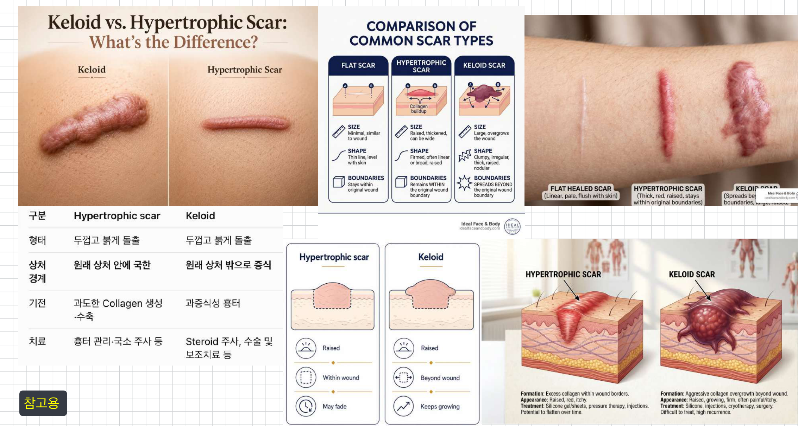{: style="width:76%"}

병리학 슬라이드(참고용)도 같은 내용이다. 켈로이드는 흉터 조직이 **원래 상처 경계 밖으로 자라고 줄어들지 않으며 개인 소인(individual predisposition)**이 있고, 비후성 흉터는 **진피 깊은 층까지 침범한 열·외상 손상** 뒤에 생긴다. 현미경에서 켈로이드는 굵고 유리질화된 **분홍빛 콜라겐 다발**(빨간 동그라미)이 보이고, 육아조직은 혈관과 세포가 많은 하얀 조직으로 보인다.

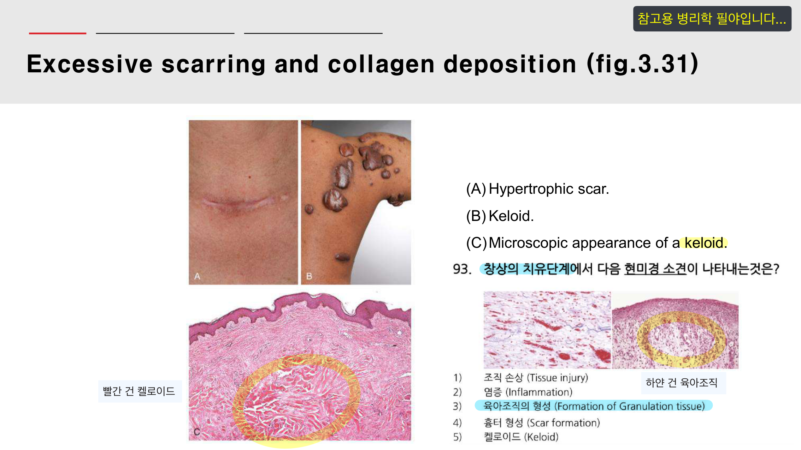{: style="width:70%"}

이차유합(healing by second intention)은 큰 결손이 봉합 없이 낫는 방식이다. 섬유소 덩어리·삼출물·괴사조직이 많아 **염증이 더 강하고 육아조직이 훨씬 많이** 생기며, 상처가 너무 커 덮이지 않으니 **상처수축(wound contraction)**으로 크기를 줄이면서 움푹 팬 흉터가 남는다. 병리 기출에서 "일차유합과 달리 이차유합에서 중요한 특징"의 답이 **상처수축**이었다.

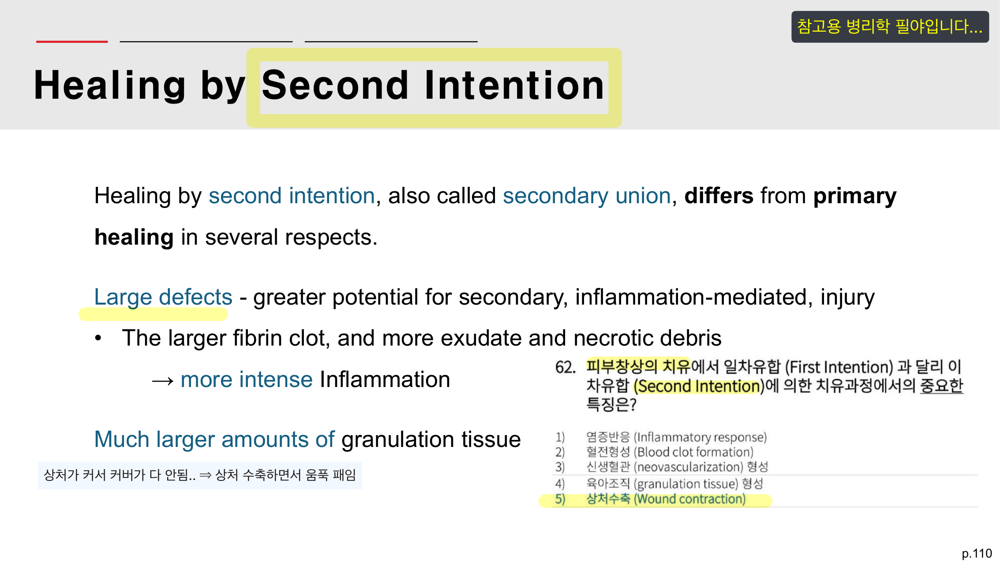{: style="width:70%"}

## 흉터 관리 (Scar management)

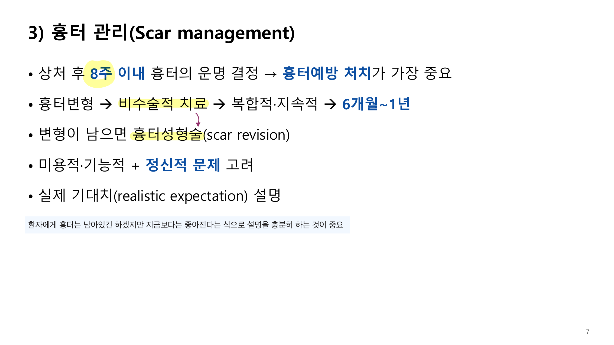{: style="width:68%"}

1. **상처 후 8주 이내**가 흉터의 운명을 결정한다 → 이 시기의 **흉터 예방 처치**가 가장 중요하다.
2. 흉터가 변형되면 → 먼저 **비수술적 치료**를 복합적·지속적으로 **6개월–1년** 한다.
3. 그래도 변형이 남으면 → **흉터성형술(scar revision)**(3장).
4. 미용적·기능적 문제와 함께 **정신적 문제**도 고려한다.
5. **실제 기대치(realistic expectation)**를 설명한다. 환자에게 "흉터는 남지만 지금보다는 좋아진다"는 식으로 충분히 설명하는 것이 중요하다.

# 2. 흉터 예방 및 치료 (Scar prevention and treatment)

기본 개념: **염증·염증유발 원인·피부장력을 차단**하고, **복구세포를 활성화**한다. 1장에서 본 것처럼 염증과 장력이 흉터를 키우기 때문이다.

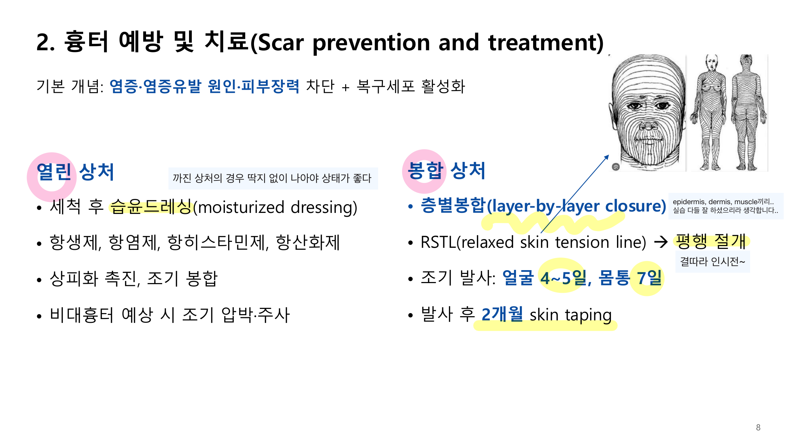{: style="width:76%"}

## 열린 상처 vs 봉합 상처

| 열린 상처 | 봉합 상처 |
|---|---|
| 세척 후 **습윤드레싱**(moisturized dressing) — 까진 상처는 **딱지 없이** 나아야 좋다 | **층별봉합**(layer-by-layer closure): 표피·진피·근육끼리 맞춰 봉합 |
| 항생제, 항염제, 항히스타민제, 항산화제 | **RSTL**(relaxed skin tension line, 이완피부긴장선)과 **평행하게 절개** — "결 따라 incision" |
| 상피화 촉진, 조기 봉합 | **조기 발사: 얼굴 4–5일, 몸통 7일** |
| 비대흉터가 예상되면 조기 압박·주사 | 발사 후 **2개월 skin taping** |

- 습윤드레싱이 좋은 이유: 딱지가 생기면 상피세포가 그 아래로 파고들어야 해서 상피화가 늦어지고, 상피화가 늦으면 비후성 흉터가 생긴다(1장 4절).
- RSTL은 피부를 편하게 두었을 때 생기는 주름 방향의 선이다. 이 선과 평행한 상처는 덜 벌어지고, 수직이면 가장 많이 벌어진다.

!!! exam "기출 포인트"
    10번(2020) 정답은 **"수술 절개는 피부긴장선과 평행하게 절개한다"**. 함정: 콜라겐 합성이 늘수록 흉터가 작아진다(틀림), 봉합실을 세게 묶는다(틀림 — 봉합흉터), 긴장선을 가로지르는 상처가 흉터가 덜 남는다(틀림 — 더 벌어짐), 반창고는 상처의 수평방향으로 모아 준다(틀림).

## 1) 항염증·항섬유제 투약

과도한 염증·콜라겐 형성을 억제 → 흉터 예방, 조기 안정.

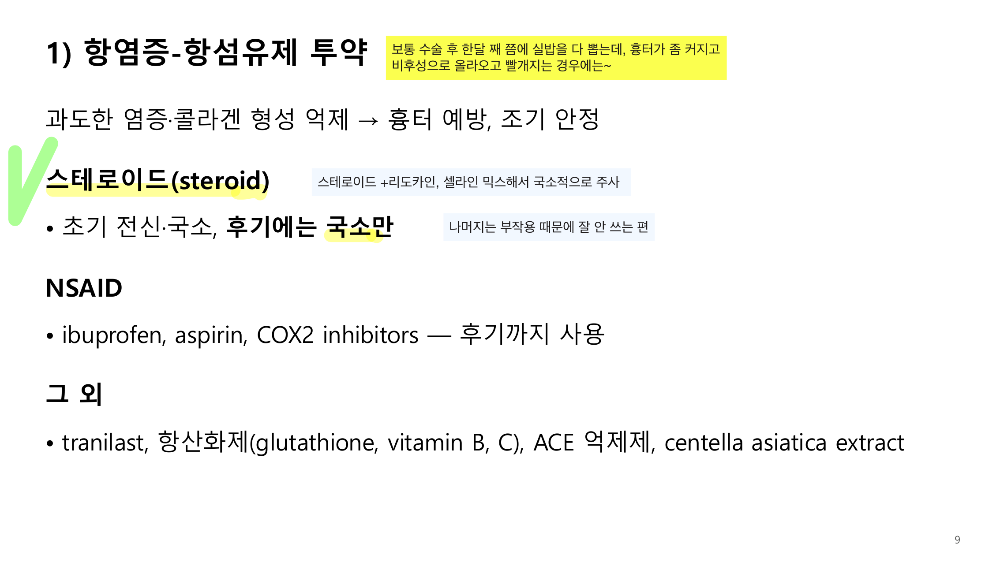{: style="width:66%"}

| 약 | 사용법 |
|---|---|
| **스테로이드**(steroid) | 초기에는 전신·국소, **후기에는 국소만** |
| **NSAID** | ibuprofen, aspirin, COX-2 억제제 — **후기까지 사용** |
| 그 외 | tranilast, 항산화제(glutathione, vitamin B, C), ACE 억제제, centella asiatica extract(병풀 추출물) |

교수님 설명: 보통 수술 후 한 달쯤 실밥을 다 뽑는데, 흉터가 커지고 비후성으로 올라오며 빨개지는 경우에는 **스테로이드 + 리도카인 + 생리식염수**를 섞어 국소적으로 주사한다. 나머지 약은 부작용 때문에 잘 쓰지 않는 편이다.

## 2) 피부 반창고 고정 (Skin taping)

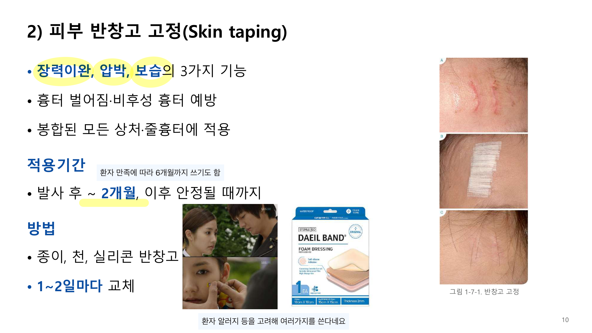{: style="width:70%"}

- **장력이완, 압박, 보습**의 3가지 기능 → 흉터가 벌어지는 것과 비후성 흉터를 예방한다.
- 봉합된 **모든** 상처·줄흉터에 적용한다.
- 적용기간: **발사 후 ~2개월**, 이후 안정될 때까지(환자가 만족하면 6개월까지 쓰기도 한다).
- 방법: 종이·천·실리콘 반창고(환자 알레르기 등을 고려해 고른다), **1–2일마다 교체**.

## 3) 집중보습 · 4) Triamcinolone 병변내 주사 ★

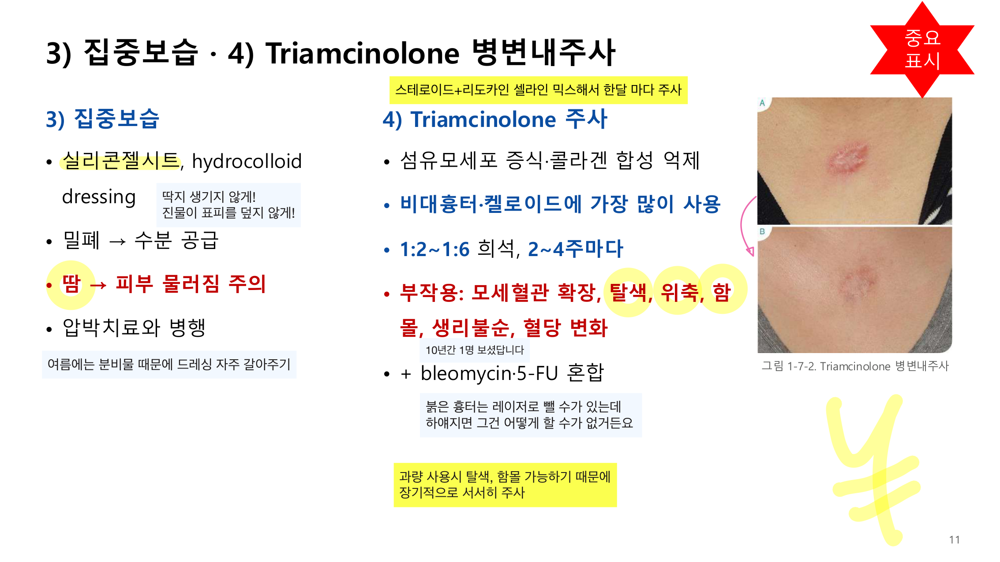{: style="width:78%"}

흉터 치료의 기본 축은 **드레싱(보습) + 스테로이드**다.

### 3) 집중보습
- **실리콘 젤시트**, hydrocolloid dressing
- **밀폐 → 수분 공급**: 딱지가 생기지 않게, 진물이 표피를 덮지 않게 한다. 각질층의 수분이 유지되면 섬유모세포 자극 신호가 줄어 콜라겐 과생성이 줄어든다.
- **땀 → 피부 물러짐(maceration) 주의**: 여름에는 분비물이 많으니 드레싱을 자주 갈아 준다.
- 압박치료와 병행한다.

### 4) Triamcinolone 주사
- 기전: **섬유모세포 증식·콜라겐 합성 억제**
- **비대흉터·켈로이드에 가장 많이 사용**한다(켈로이드 1차 치료).
- **1:2–1:6 희석**(리도카인·생리식염수와 섞어), **2–4주마다** 주사(교수님은 한 달마다).
- **부작용: 모세혈관 확장, 탈색, 위축, 함몰, 생리불순, 혈당 변화**
    - 붉은 흉터는 레이저로 뺄 수 있지만 **하얗게 탈색되면 되돌릴 방법이 없다.** 그래서 과량을 쓰지 않고 오랜 기간에 걸쳐 **서서히** 주사한다.
    - 생리불순·혈당 변화는 흡수된 스테로이드의 전신 효과다(교수님은 10년간 1명 보셨다).
- **+ bleomycin·5-FU(5-fluorouracil) 혼합**: 세포 증식을 억제하는 항암제를 섞어 효과를 높이기도 한다.

!!! memo "암기"
    Triamcinolone: 섬유모세포·콜라겐 억제 / 비대흉터·켈로이드 1순위 / **1:2–1:6, 2–4주** / 부작용 **모세혈관 확장·탈색·위축·함몰·생리불순·혈당** / bleomycin·5-FU 혼합.

!!! exam "기출 포인트"
    올해 새로 중요 표시된 부분이라 기출은 없다. 다만 켈로이드 기출의 함정 "전신적 스테로이드 요법이 효과적"(틀림)과 짝을 이루어, **병변 내** 주사가 정답이 되는 형태로 나올 수 있다.

## 5) 압박치료 · 6) 세포치료

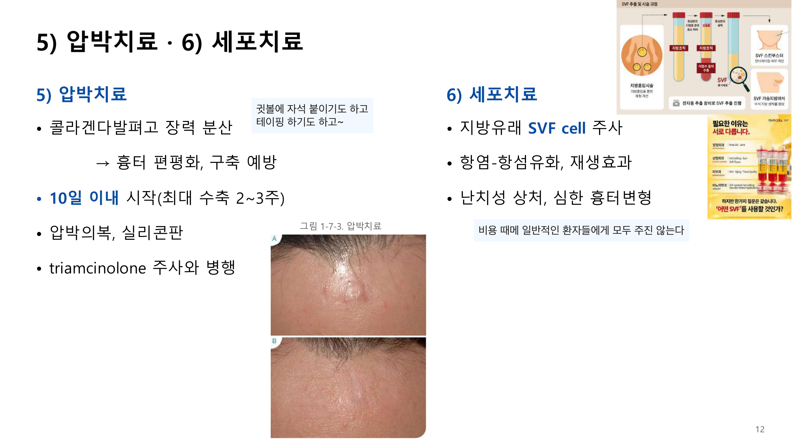{: style="width:74%"}

### 5) 압박치료
- 콜라겐 다발을 펴고 장력을 분산 → 흉터 편평화, 구축 예방(귓볼에 자석을 붙이거나 테이핑을 하기도 한다).
- **10일 이내 시작**(최대 수축이 2–3주에 일어나므로 그 전에).
- 압박의복, 실리콘판.
- triamcinolone 주사와 병행.

### 6) 세포치료
- **지방유래 SVF cell**(stromal vascular fraction, 지방조직에서 뽑은 줄기세포 포함 세포군) 주사
- 항염·항섬유화, 재생 효과
- 난치성 상처, 심한 흉터변형에 쓴다. 비용 때문에 일반 환자에게 모두 쓰지는 않는다.

## 7) 레이저 치료 (Laser treatment)

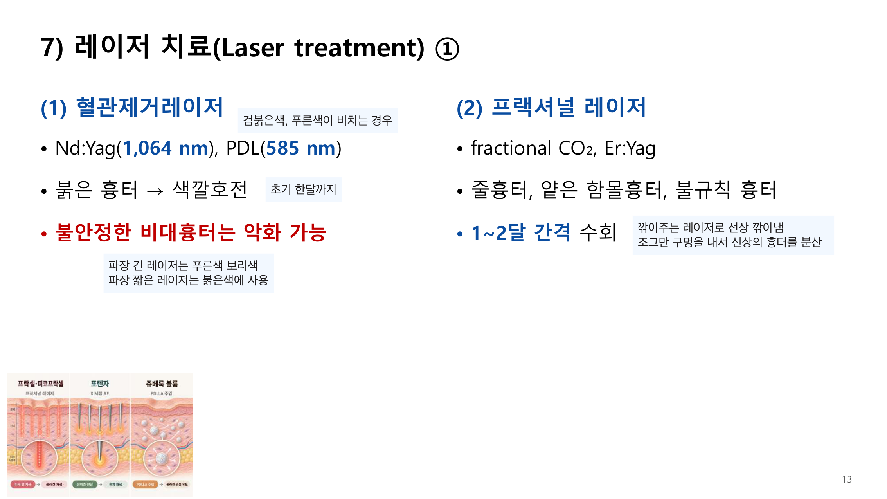{: style="width:70%"}

| 종류 | 장비 | 대상 | 주의·간격 |
|---|---|---|---|
| (1) **혈관제거레이저** | **Nd:YAG(1,064 nm), PDL(585 nm)** | 붉은 흉터(검붉은·푸른색이 비침) → 색깔 호전, 초기 한 달 무렵 | **불안정한 비대흉터는 악화 가능** |
| (2) **프랙셔널 레이저** | fractional CO2, Er:YAG | 줄흉터, 얕은 함몰흉터, 불규칙 흉터 | **1–2달 간격** 수회 |
| (3) **레이저절제술** | 비분획 CO2·Er:YAG | 돌출·불규칙 흉터 제거 | **켈로이드는 재발률 높음** |
| (4) **레이저홀 치료** | CO2로 **1–3 mm 구멍** | 하얀 흉터, 얕은 함몰흉터 | **1–2개월 간격 2–3회** |

- 혈관제거레이저는 헤모글로빈에 흡수되어 흉터 속 늘어난 혈관을 없앤다. 파장이 긴 레이저(Nd:YAG)는 깊은 푸른·보라색에, 짧은 레이저(PDL)는 붉은색에 쓴다.
- 프랙셔널 레이저는 피부에 미세한 구멍을 촘촘히 내서 선 모양 흉터를 깎아 내고 분산시킨다.
- 레이저절제술은 점 빼는 CO2 레이저로 흉터를 깎아 내는 것이다.
- 레이저홀은 흉터에 작은 구멍을 내어 흉터가 모공처럼 보이게 하며 예후가 좋다.

## 8) 방사선조사치료

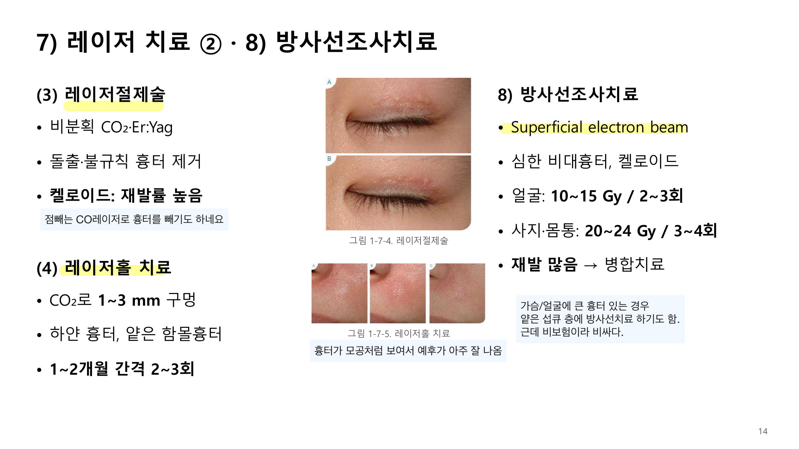{: style="width:74%"}

- **표재성 전자선(superficial electron beam)** — 얕은 피하층까지만 닿게 한다.
- 대상: **심한 비대흉터, 켈로이드**(주로 켈로이드 절제 후 재발 방지)
- 선량: **얼굴 10–15 Gy / 2–3회**, **사지·몸통 20–24 Gy / 3–4회**
- **재발이 많아 병합치료**(수술 + 방사선 + 주사)한다. 비보험이라 비싸다.

# 3. 흉터성형술 (Scar revision)

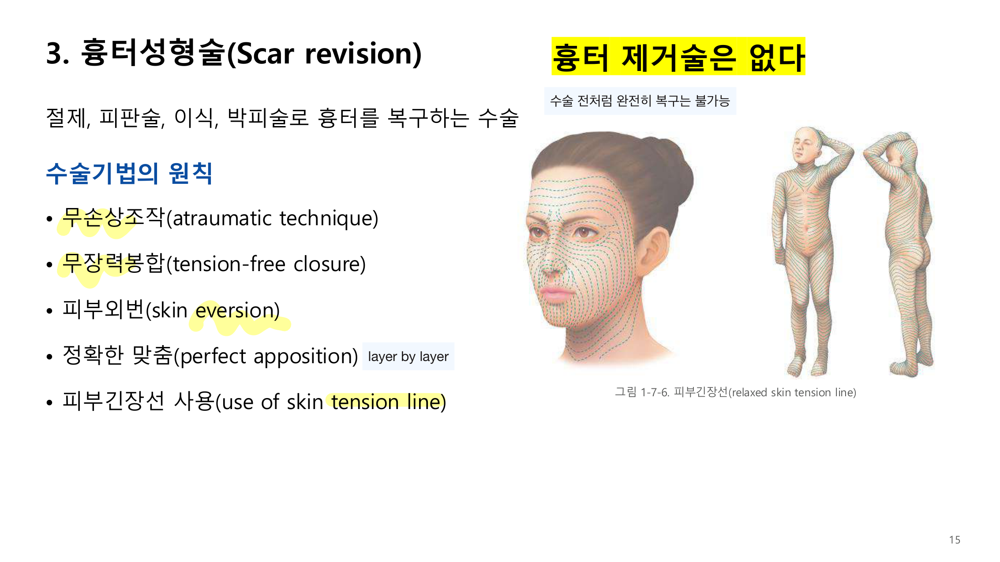{: style="width:76%"}

절제, 피판술, 이식, 박피술로 흉터를 **복구(개선)**하는 수술이다. **"흉터 제거술은 없다"** — 수술 전처럼 완전히 복구하는 것은 불가능하고, 눈에 덜 띄게 바꾸는 것이 목표다.

## 수술기법의 원칙
- **무손상조작**(atraumatic technique): 조직을 거칠게 집거나 짓누르지 않는다.
- **무장력봉합**(tension-free closure)
- **피부외번**(skin eversion): 상처 가장자리를 살짝 바깥으로 뒤집어 봉합 → 아물며 평평해진다(안으로 말리면 골이 생김).
- **정확한 맞춤**(perfect apposition): 층별(layer by layer)로 정확히 맞춘다.
- **피부긴장선 사용**(use of skin tension line): RSTL 방향으로 흉터를 놓는다.

## 흉터성형술 시 고려사항

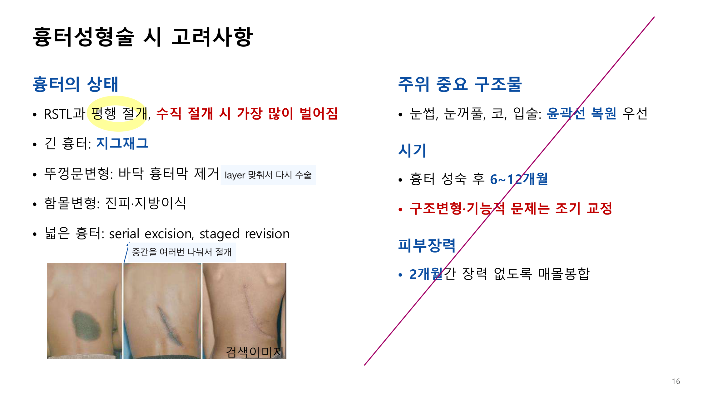{: style="width:74%"}

### 흉터의 상태
- RSTL과 **평행 절개**가 기본. **RSTL과 수직으로 절개하면 가장 많이 벌어진다.**
- **긴 흉터**: **지그재그**로 바꿔 장력을 분산하고 눈에 덜 띄게 한다(Z·W-성형술).
- **뚜껑문변형**: 바닥의 흉터막을 제거하고 층을 맞춰 다시 수술.
- **함몰변형**: 진피·지방 이식.
- **넓은 흉터**: **연속절제(serial excision), 단계적 교정(staged revision)** — 한 번에 다 떼면 장력이 너무 커지므로 중간을 여러 번 나눠 절제한다.

### 주위 중요 구조물 · 시기 · 피부장력
(필기본에서 이 부분은 사선으로 그어져 있다 — 강의에서 넘어간 것으로 보이나 내용은 알아 둔다.)
- 눈썹, 눈꺼풀, 코, 입술: **윤곽선 복원**이 우선.
- 시기: 흉터 **성숙 후 6–12개월**에 교정. 단 **구조변형·기능적 문제는 조기 교정**.
- 피부장력: **2개월간** 장력이 없도록 매몰봉합(피부 속 봉합).

## 1) 조기 교정봉합 · 2) 절제성형술

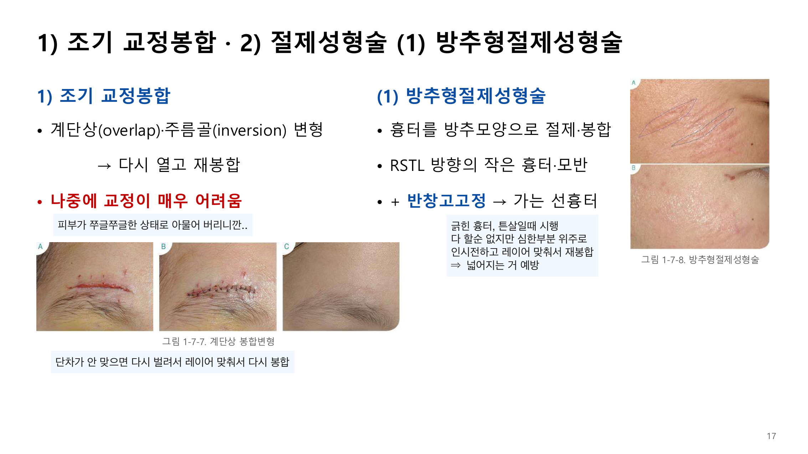{: style="width:78%"}

### 1) 조기 교정봉합
- **계단상(overlap)·주름골(inversion)** 변형 → 다시 열고 재봉합(단차가 맞지 않으면 다시 벌려 층을 맞춰 봉합).
- **나중에는 교정이 매우 어렵다** — 피부가 쭈글쭈글한 상태로 아물어 버리기 때문이다.

### 2) 절제성형술 (1) 방추형절제성형술
- 흉터를 **방추형(양 끝이 뾰족한 타원)**으로 절제·봉합한다. 끝을 뾰족하게 해야 봉합 후 양 끝이 솟는 dog-ear가 생기지 않는다.
- 대상: **RSTL 방향의 작은 흉터·모반**(긁힌 흉터, 튼살에서 심한 부분 위주로).
- **+ 반창고 고정** → 가는 선흉터(넓어지는 것 예방).

### (2) W-성형술 (W-plasty)

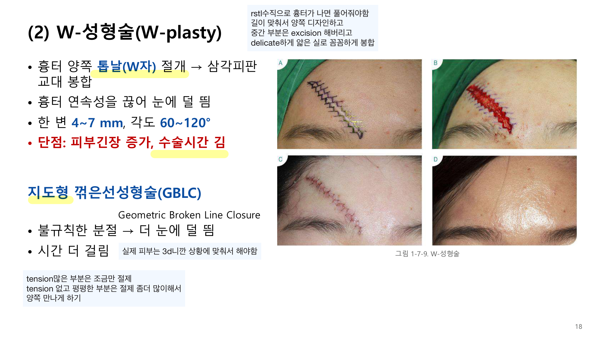{: style="width:76%"}

- 흉터 양쪽을 **톱날(W자)** 모양으로 절개 → 삼각피판을 서로 맞물리게 봉합.
- 흉터의 **연속성을 끊어 눈에 덜 띈다**(길이 연장 목적이 아니다).
- 한 변 **4–7 mm**, 각도 **60–120°**.
- **단점: 피부긴장 증가, 수술시간 김.**
- RSTL에 수직인 흉터를 풀어줄 때 쓴다. 양쪽 길이를 맞춰 디자인하고 가운데는 절제, 얇은 실로 꼼꼼히 봉합한다. 실제 피부는 입체적이라 장력이 큰 쪽은 조금만, 평평한 쪽은 많이 절제해 양쪽을 맞춘다.

### 지도형 꺾은선성형술 (GBLC, Geometric Broken Line Closure)
- 사각형·삼각형·반원 등을 **불규칙하게** 이어 분절 → W보다 **더 눈에 덜 띈다.**
- 시간이 더 걸린다.

| 구분 | W-성형술 | GBLC |
|---|---|---|
| 모양 | 규칙적 톱날 | 불규칙 꺾은선 |
| 눈에 띄는 정도 | 덜 띔 | 더 덜 띔 |
| 단점 | 피부긴장↑, 시간↑ | 시간 더 걸림 |

## 3) Z-성형술 (Z-plasty) ★

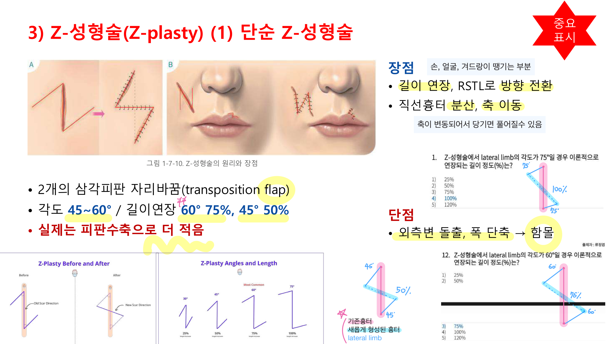{: style="width:82%"}

### (1) 단순 Z-성형술
- 흉터(중심지, central limb) 양 끝에서 같은 길이의 측지(lateral limb)를 그어 **2개의 삼각피판을 자리바꿈**(transposition flap)한다.
- 결과: 중심지 방향의 **길이가 늘어나고**, 흉터의 **방향(축)이 약 90° 바뀐다.**
- **각도 45–60°**를 쓴다. 이론적 길이 연장: **60° 75%, 45° 50%** (30° 25%, 75° 100%, 90° 120%).
- **실제는 피판 수축으로 이론보다 더 적게** 늘어난다.

| 측지 각도 | 30° | 45° | **60°** | 75° | 90° |
|---|---|---|---|---|---|
| 이론적 연장 | 25% | **50%** | **75%** | 100% | 120% |

- **장점**: 길이 연장, **RSTL로 방향 전환**, 직선흉터 분산, 축 이동 — 손, 얼굴, 겨드랑이처럼 **당기는(구축) 부위**에 쓴다.
- **단점**: 외측변 돌출, **폭 단축** → 함몰. (길이가 늘어난 만큼 가로 폭은 줄어든다.)

!!! exam "기출 포인트"
    3번(2024) "lateral limb 75°일 때 연장 길이" → **100%**, 8번(2023) "60°일 때" → **75%**. 올해 슬라이드는 45°(50%)와 60°(75%)를 강조했고 "실제는 피판수축으로 더 적음"을 빨갛게 표시했으니, 각도 숫자뿐 아니라 **실제와 이론의 차이**, **장단점**을 묻는 형태도 대비한다.

!!! memo "암기"
    30-45-60-75-90° → **25-50-75-100-120%** (15°마다 25%씩, 90°만 120%).

### (2) 다중 Z-성형술 · (3) 4피판 Z-성형술

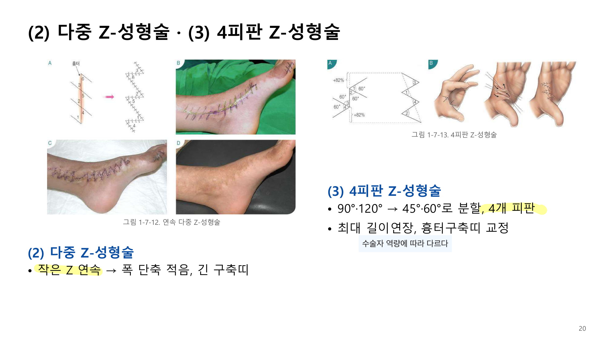{: style="width:78%"}

- **다중 Z-성형술**: 작은 Z를 **연속**으로 → 하나의 큰 Z보다 **폭 단축이 적고**, **긴 구축띠**에 쓴다.
- **4피판 Z-성형술**: 90°·120° 피판을 다시 **45°·60°로 분할해 4개 피판**을 만든다 → **최대 길이 연장**, 흉터구축띠 교정(손가락 사이 물갈퀴 구축 등). 결과는 수술자 역량에 따라 다르다.

## 4) 연속 Y-V 성형술 (Running Y-V plasty)

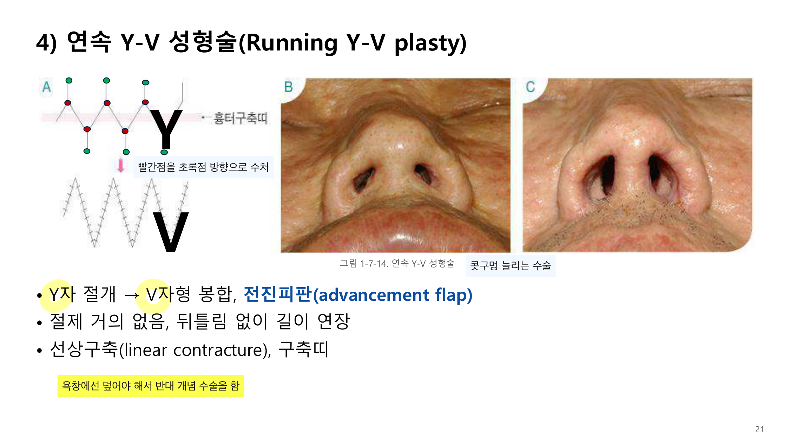{: style="width:76%"}

- **Y자 절개 → V자형 봉합**: 빨간 점을 초록 점 방향으로 끌어와 봉합하는 **전진피판(advancement flap)**이다.
- **절제가 거의 없고**, 뒤틀림 없이 **길이를 연장**한다.
- **선상구축(linear contracture), 구축띠**에 쓴다. 사진은 콧구멍을 넓히는 수술이다.
- 욕창처럼 결손을 덮어야 할 때는 반대 개념(V-Y 전진피판)을 쓴다.

## 5) 이식술 (Grafting)

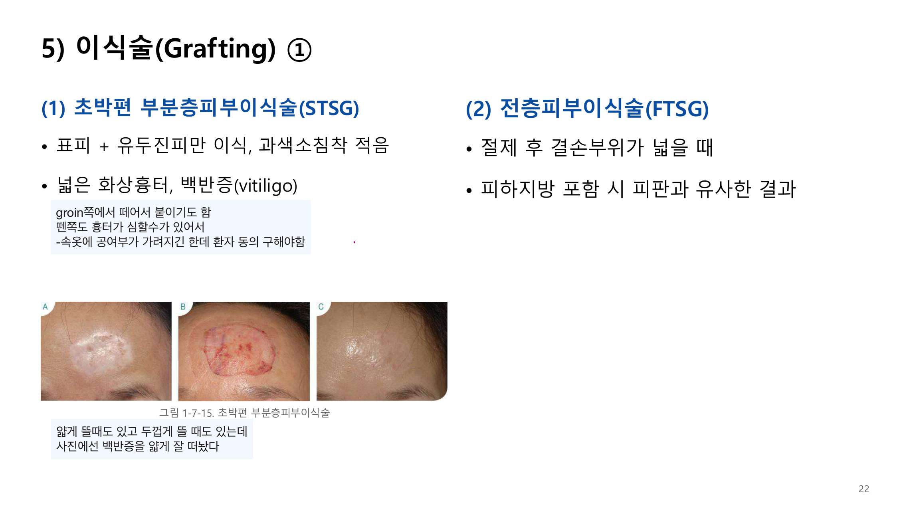{: style="width:74%"}

| 종류 | 내용 | 대상 |
|---|---|---|
| (1) **초박편 부분층피부이식(STSG)** | 표피 + 유두진피만 이식 → **과색소침착 적음** | 넓은 화상흉터, **백반증(vitiligo)** |
| (2) **전층피부이식(FTSG)** | 진피 전층 이식 | 절제 후 결손이 넓을 때; **피하지방을 포함하면 피판과 비슷한 결과** |
| (3) **진피지방이식, 지방이식** | 함몰흉터는 **subcision**(흉터 밑을 박리해 끌어당기는 섬유띠를 끊음) 후 이식 | 함몰흉터. 공여부: 귀 뒤, 쇄골 위 / **사타구니, 천골부** |
| (4) **모발이식, 모낭이식** | 두피 모낭을 옮겨 심음 | 탈모흉터. **눈썹은 관리문제 고려**(두피 털이라 계속 자람) |

- STSG 공여부는 사타구니(groin) 등에서 떼며, 공여부에도 흉터가 생길 수 있어 속옷에 가려지는 곳을 쓰고 환자 동의를 구한다.
- 지방이식은 본인 지방이라 한 번 붙어 살면 계속 유지된다.

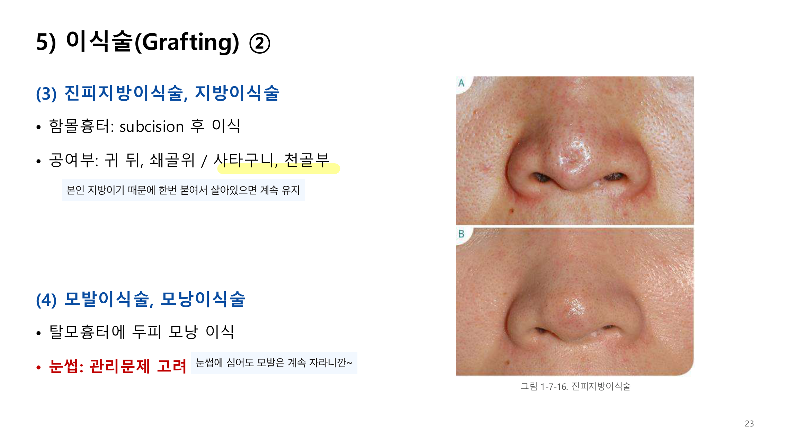{: style="width:66%"}

## 6) 기계 박피술 · 7) 조직확장술

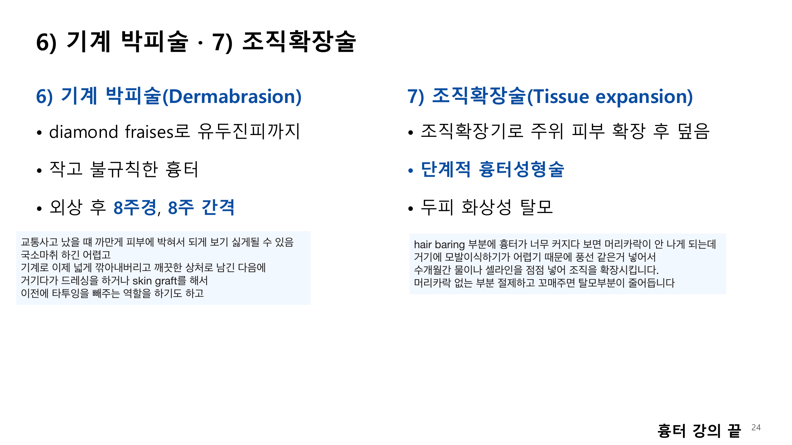{: style="width:76%"}

### 6) 기계 박피술 (Dermabrasion)
- **diamond fraises**(다이아몬드 연마 날)로 **유두진피까지** 깎는다.
- 작고 불규칙한 흉터. 교통사고로 피부에 까만 이물이 박힌 외상문신을 넓게 깎아 내고, 깨끗한 상처로 만든 뒤 드레싱이나 피부이식을 한다.
- **외상 후 8주경**, **8주 간격**.

### 7) 조직확장술 (Tissue expansion)
- 조직확장기(풍선)를 넣고 수개월간 생리식염수를 조금씩 넣어 **주위 피부를 확장한 뒤 덮는다.**
- **단계적 흉터성형술**에 해당한다.
- **두피 화상성 탈모**: 털이 나는 피부를 늘려 털 없는 흉터를 절제하고 덮는다.

!!! key "핵심"
    흉터성형술 정리 — 길이 연장·방향 전환은 **Z**(각도별 %), 연속성 끊기는 **W·GBLC**, 선상구축은 **Y-V**, 넓은 흉터는 **연속절제·조직확장**, 함몰은 **진피지방이식**, 탈모흉터는 **모발이식·조직확장**, 작고 불규칙한 흉터는 **박피**.

# 4. 창상 (Wound) — I-Ch.5 창상치유

여기서부터는 이준석 교수님의 창상치유 장 내용이다. 필기본 작성자는 "별표 페이지만 봐도 풀 수 있지만 내용이 많지 않으니 쭉 읽어 보라"고 했다.

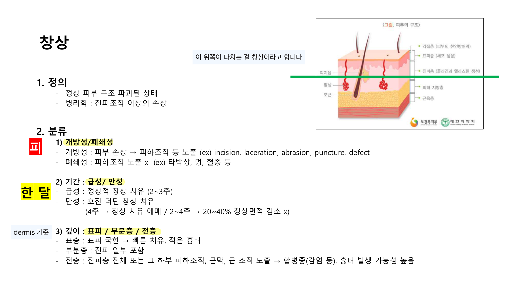{: style="width:76%"}

## 정의
- 정상 피부 구조가 파괴된 상태.
- 병리학적으로는 **진피조직 이상의 손상**(그림의 초록선 아래까지 다친 것)을 창상이라 한다.

## 분류

| 기준 | 분류 | 내용 |
|---|---|---|
| **피부 손상 여부** | 개방성 | 피부 손상 → 피하조직 등 노출 (incision, laceration, abrasion, puncture, defect) |
| | 폐쇄성 | 피하조직 노출 없음 (타박상, 멍, 혈종 등) |
| **기간** | 급성 | 정상적으로 치유 (**2–3주**) |
| | 만성 | 호전이 더딘 창상 (**4주**에도 치유가 애매하거나, **2–4주에 창상 면적이 20–40% 감소하지 않음**) — 대략 "한 달" |
| **깊이**(dermis 기준) | 표층 | 표피에 국한 → 빠른 치유, 적은 흉터 |
| | 부분층 | 진피 일부 포함 |
| | 전층 | 진피층 전체 또는 그 아래 피하조직·근막·근육 노출 → 합병증(감염 등), 흉터 발생 가능성 높음 |

!!! exam "기출 포인트"
    50강 기출(2020)에 **이차유합(secondary intention)** = **육아조직 형성, 창상수축, 상피화**로 낫는 것이 나왔다. 상피화만으로 낫는 얕은 부분층 창상(표재성 치유)이나 봉합으로 가장자리를 붙이는 수술 절개(일차유합)와 구별한다.

# 5. 창상치유 과정 ★

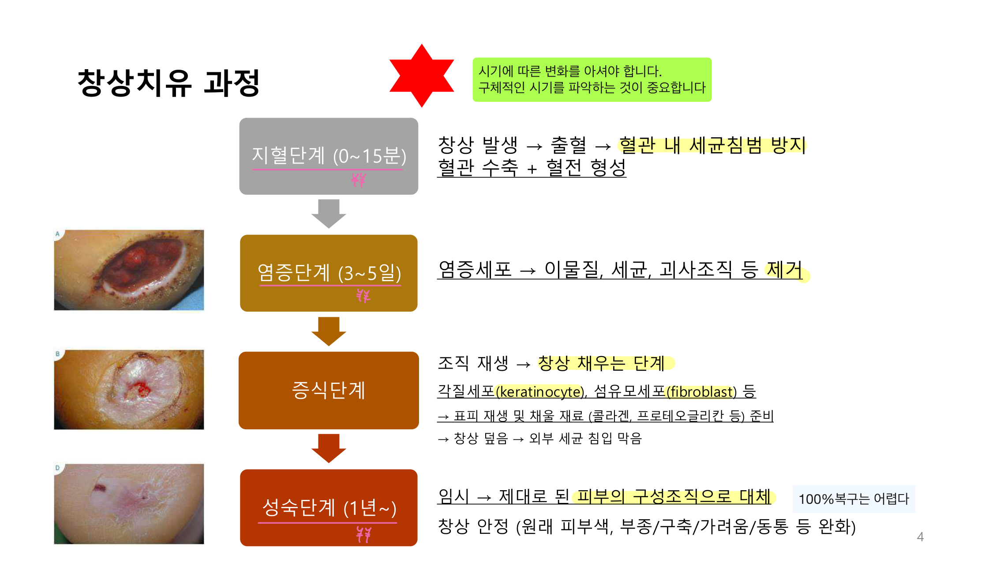{: style="width:80%"}

교수님 강조: **시기에 따른 변화**를 알아야 하고, **구체적인 시기**를 파악하는 것이 중요하다.

| 단계 | 시기 | 핵심 |
|---|---|---|
| **지혈** | **0–15분** | 출혈 → 혈관 내 세균침범 방지, **혈관 수축 + 혈전 형성** |
| **염증** | **3–5일** | 염증세포 → 이물질, 세균, 괴사조직 **제거** |
| **증식** | 수일~수주 | 조직 재생 → 창상을 **채우는** 단계: 각질세포(keratinocyte), 섬유모세포(fibroblast) → 표피 재생, 채울 재료(콜라겐, 프로테오글리칸) 준비 → 창상을 덮어 외부 세균 침입 막음 |
| **성숙** | **1년~** | 임시 조직 → **제대로 된 피부의 구성조직으로 대체**(100% 복구는 어렵다); 원래 피부색, 부종·구축·가려움·동통 완화 |

!!! exam "기출 포인트 (50강 기출, 이준석 교수님)"
    "창상치유에 관한 설명 중 **틀린** 것" 같은 형식이 매년 나왔고, 매번 다른 단계를 틀리게 만들었다.

    - 2023: **성숙단계는 3개월 이내로 마무리된다**(틀림 — 1년 이상)
    - 2024: **염증단계는 3일에서 길게는 수개월까지 지속된다**(틀림 — 3–5일) / 2021: 염증단계 **7일 이상**(틀림)
    - 2025: **지혈단계는 출혈이 혈관 내 세균침범을 가장 많이 일으키는 단계**(틀림 — 출혈은 세균을 씻어 내고, 혈관 수축·혈전이 침범을 막는다)
    - 필기본 작성자의 예상: 올해는 **증식단계** 보기를 틀리게 만들 차례.

## 1) 지혈단계 (0–15분)

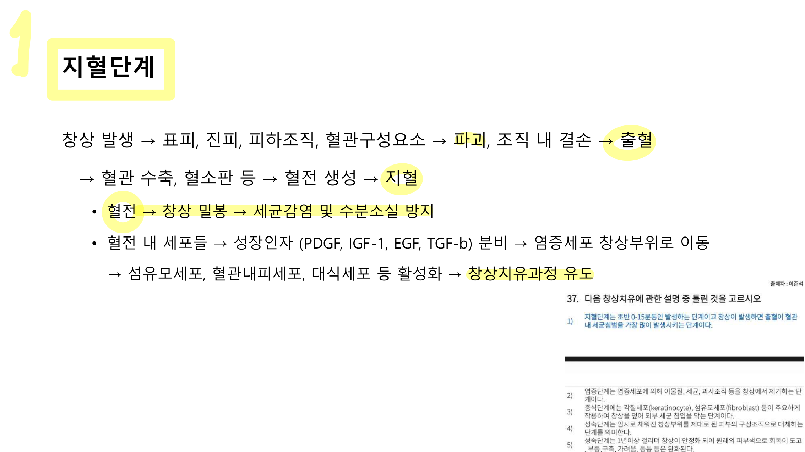{: style="width:74%"}

창상 발생 → 표피·진피·피하조직·혈관 구성요소 **파괴**, 조직 내 결손 → **출혈** → **혈관 수축**, 혈소판 등 → **혈전 생성** → **지혈**.

- **혈전 → 창상 밀봉** → 세균감염 및 수분 소실 방지.
- 혈전 안의 세포(혈소판)들이 **성장인자**(PDGF, IGF-1, EGF, TGF-β)를 분비 → 염증세포가 창상 부위로 이동 → 섬유모세포, 혈관내피세포, 대식세포 등 활성화 → **창상치유과정 유도**.

즉 지혈단계는 피를 멈추는 데서 끝나지 않고, 다음 단계를 시작시키는 신호를 내보낸다.

## 2) 염증단계 (3–5일)

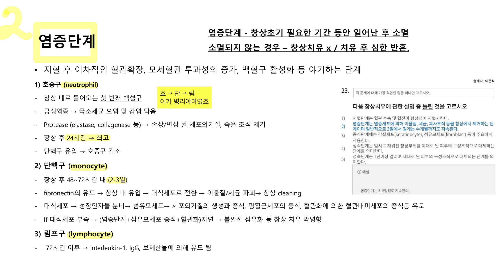{: style="width:80%"}

지혈 후 이차적인 혈관확장, 모세혈관 투과성 증가, 백혈구 활성화 등이 일어나는 단계다. **창상 초기에 필요한 기간 동안 일어난 후 소멸**해야 한다. **소멸되지 않으면** 창상이 낫지 않거나(만성 창상), 낫더라도 심한 반흔이 남는다.

| 세포 | 시기 | 역할 |
|---|---|---|
| **호중구**(neutrophil) | **첫 번째** 백혈구, **24시간에 최고** | 급성 염증 → 국소 세균 오염·감염 막음; protease(elastase, collagenase 등)로 손상·변성된 세포외기질, 죽은 조직 제거. 단핵구가 들어오면 감소 |
| **단핵구**(monocyte) | **48–72시간(2–3일)** | fibronectin의 유도로 창상에 들어와 **대식세포로 전환** → 이물질·세균 파괴, 창상 cleaning; **성장인자 분비** → 섬유모세포, 세포외기질 생성·증식, 평활근세포 증식, 혈관내피세포 증식(혈관화) 유도 |
| **림프구**(lymphocyte) | **72시간 이후** | interleukin-1, IgG, 보체산물에 의해 유도 |

- 순서: **호 → 단 → 림** (병리에서도 나온 내용).
- **대식세포가 부족하면** 염증단계·섬유모세포 증식·혈관화가 지연 → 불완전한 섬유화 등 창상 치유에 악영향. 대식세포는 청소부이자 증식단계로 넘어가게 하는 지휘자다.

## 3) 증식단계

사이토카인과 성장인자 → 세포들의 증식·이동·합성 촉진 → 섬유모세포가 손상 부위에 일시적 기질을 만들어 창상 내 세포 밀도가 높아진다. 실제로 **창상이 닫히는 과정**이며, 네 가지가 함께 일어난다: **상피화, 세포외기질 침착(육아조직 형성), 창상 수축, 혈관화**.

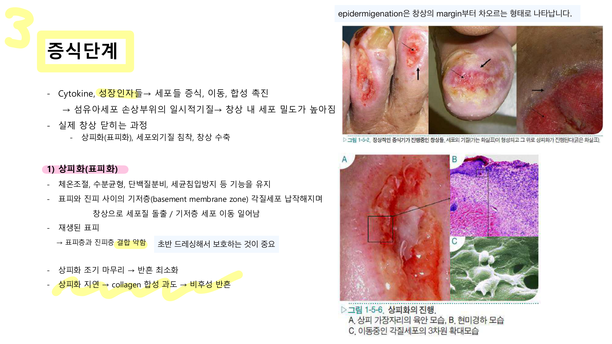{: style="width:80%"}

### (1) 상피화 (표피화)
- 표피가 회복되어 체온조절, 수분균형, 단백질 분비, 세균침입 방지 기능을 다시 한다.
- 표피와 진피 사이의 기저층(basement membrane zone)의 **각질세포가 납작해지며** 세포질이 돌출 → 기저층 세포가 창상 쪽으로 **이동**한다. 상피화는 창상의 **가장자리(margin)부터 차오르는** 형태로 나타난다.
- 재생된 표피는 **표피층과 진피층의 결합이 약하다** → 초반에 드레싱으로 보호하는 것이 중요하다.
- 상피화가 **일찍 마무리되면 반흔이 최소화**되고, **지연되면 collagen 합성이 과도해져 비후성 반흔**이 된다(1장 4절과 연결).

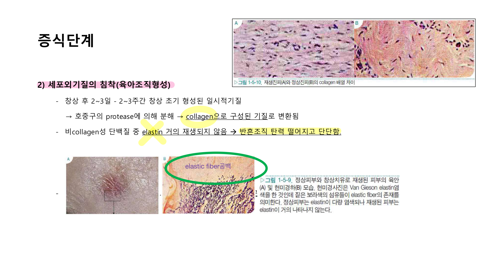{: style="width:80%"}

### (2) 세포외기질의 침착 (육아조직 형성)
- 창상 후 **2–3일부터 2–3주간** 창상 초기에 일시적 기질이 형성된다.
- 이 기질은 호중구의 protease에 의해 분해되고 **collagen으로 구성된 기질**로 바뀐다.
- 콜라겐이 아닌 단백질 중 **elastin은 거의 재생되지 않는다** → 반흔조직은 **탄력이 떨어지고 단단하다.** (Van Gieson 염색에서 정상 피부는 elastic fiber가 많지만 재생 피부에는 거의 없다.)

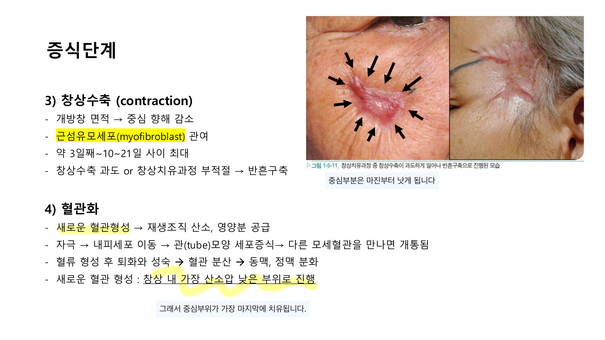{: style="width:80%"}

### (3) 창상수축 (contraction)
- 개방 창상의 면적이 **중심을 향해 줄어든다.**
- **근섬유모세포(myofibroblast)**가 관여한다(수축하는 섬유모세포).
- 약 **3일째부터 시작해 10–21일 사이 최대**.
- 수축이 과도하거나 치유과정이 부적절하면 **반흔구축**이 된다.

### (4) 혈관화
- **새로운 혈관 형성** → 재생조직에 산소·영양분 공급.
- 자극 → 내피세포 이동 → 관(tube) 모양 세포 증식 → 다른 모세혈관과 만나면 개통.
- 혈류가 생긴 뒤 퇴화와 성숙 → 혈관 분산 → 동맥·정맥으로 분화.
- 새 혈관은 **창상 내 산소압이 가장 낮은 부위로** 진행한다 → 그래서 **중심부가 가장 마지막에 치유**된다(가장자리부터 낫는 상피화와 같은 방향).

!!! memo "암기"
    증식단계 = **상피화**(가장자리부터, 지연 시 비후성 반흔) + **육아조직**(2–3일~2–3주, elastin 재생 안 됨) + **수축**(myofibroblast, 3일~, 10–21일 최대) + **혈관화**(산소압 낮은 곳으로, 중심부 마지막). 주인공 세포는 **각질세포·섬유모세포**.

## 4) 성숙단계 (1년~)

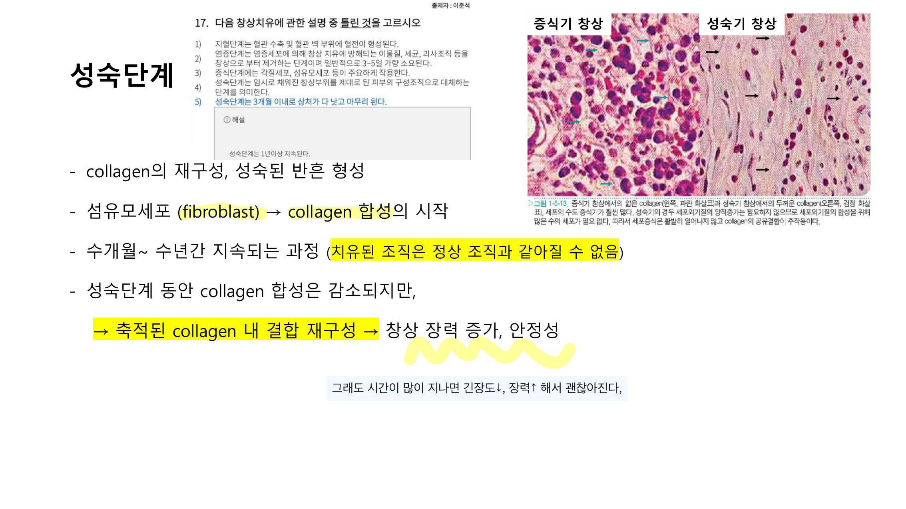{: style="width:80%"}

- collagen의 **재구성**, 성숙된 반흔 형성.
- 섬유모세포(fibroblast) → collagen 합성으로 시작된다. 증식기에는 세포가 많고 얇은 콜라겐이, 성숙기에는 세포가 적고 두꺼운 콜라겐 다발이 보인다.
- **수개월~수년간** 지속된다. **치유된 조직은 정상 조직과 같아질 수 없다.**
- 성숙단계 동안 collagen **합성 자체는 감소**하지만, **축적된 collagen 내 결합이 재구성**되어 창상 **장력이 증가하고 안정**된다. 그래서 시간이 많이 지나면 긴장도는 줄고 장력은 늘어 괜찮아진다.

!!! exam "기출 포인트"
    1·5·6번(2023·2024·2025 같은 문제)은 상처치유 그래프에서 **상처 장력(wound strength, 검은 실선)이 수상 전 강도의 80%를 회복하는 시점**을 물었고 답은 **6주**였다(보기 48시간·1주·6주·6개월·1년). 장력은 증식기 이후 콜라겐이 쌓이고 교차결합하며 빠르게 늘지만 원래 강도(100%)에는 끝내 이르지 못한다. 2020 50강 기출의 함정 "성숙단계 — collagen 합성이 증가된다"(틀림)도 함께 기억한다.
    ※ 확인 필요: 교과서에 따라 "3개월에 약 80%"로 쓰기도 한다(9번 해설). 이 시험의 기출 정답은 **6주**였다.

!!! key "핵심"
    시기 4개는 꼭 외운다 — **지혈 0–15분, 염증 3–5일, 성숙 1년 이상**, 증식 안의 **육아조직 2–3일~2–3주, 수축 10–21일 최대**. 세포 순서는 **호중구(24시간) → 단핵구(48–72시간) → 림프구(72시간 이후)**.
