<!-- 필기본: 2026 -->

이 수업(성형외과 이준석 교수님)은 **강의록에서 출제**되며, 해마다 같은 틀의 문제가 보기만 조금 바뀌어 반복된다.
필기본 첫 쪽의 별표 모음(★)이 곧 출제 범위라고 보면 된다 — ① 창상치유 4단계와 기간, ② 당뇨성족부궤양의 4가지
발생기전과 "특화된 재건 방법은 없다", ③ 욕창 Grade 분류·호발 부위·발생 요인, ④ 미세혈관 연결술 기본 원칙과
정맥이식 적응증. 아래 설명은 강의록 순서(창상치유 → 당뇨성족부궤양 → 욕창 → 미세수술)를 따른다.

# 1. 창상치유 (Wound healing)

## 창상의 정의와 분류

### 정의
창상(wound)은 **정상 피부 구조가 파괴된 상태**다. 병리학적으로는 **진피조직 이상의 손상**을 창상이라고 한다.
표피만 살짝 벗겨진 것은 엄밀한 의미의 창상에 들지 않고, 진피까지 내려가야 흉터와 치유 과정이 문제가 된다.

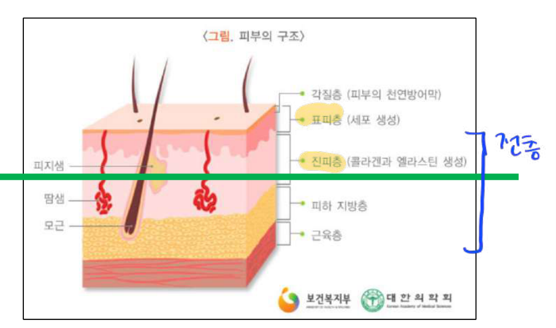{: style="width:55%"}

### 분류
| 기준 | 종류 | 내용 |
|---|---|---|
| 개방 여부 | 개방성 | **피부가 손상**되어 피하조직 등이 노출 — 절개(incision), 열상(laceration), 찰과상(abrasion), 자상(puncture), 결손(defect) |
| | 폐쇄성 | 피하조직 노출 없음, 외부 출혈 없이 피가 안에 고임 — 타박상, 멍, 혈종 |
| 기간 (기준 **한 달**) | 급성 | 정상적인 창상 치유 과정을 밟아 2–3주에 낫는 창상 |
| | 만성 | 호전이 더딘 창상 — 4주가 지나도 치유가 애매하거나, 2–4주 동안 창상 면적이 20–40%도 줄지 않는 경우 |
| 깊이 | 표층 | 표피에 국한 → 빨리 낫고 흉터가 적다 |
| | 부분층 | 진피 일부까지 포함 |
| | 전층 | 진피 전체 또는 그 아래 피하조직·근막·근육까지 노출 → 감염 등 합병증과 흉터 가능성이 높다 |

## 창상치유 과정 — 4단계

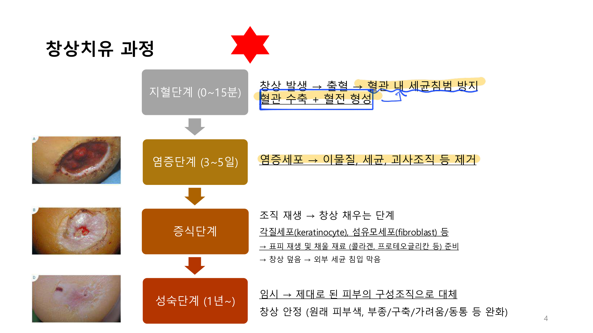{: style="width:78%"}

| 단계 | 기간 | 핵심 |
|---|---|---|
| 지혈단계 | **0–15분** | 혈관 수축 + 혈전 형성 → 지혈, 혈전이 창상을 밀봉해 **혈관 내 세균 침범 방지** |
| 염증단계 | **3–5일** | 염증세포가 이물질·세균·괴사조직 제거 |
| 증식단계 | 수일–수주 | 각질세포(keratinocyte)·섬유모세포(fibroblast) → 표피 재생, 콜라겐·프로테오글리칸으로 결손 채움, 창상을 덮어 외부 세균 차단 |
| 성숙단계 | **1년 이상** | 임시로 채운 조직 → 제대로 된 피부 구성조직으로 대체, 창상 안정(원래 피부색, 부종·구축·가려움·동통 완화) |

!!! memo "암기"
    지혈 **0–15분** · 염증 **3–5일** · 성숙 **1년~**. 기간 숫자를 바꿔 내는 보기가 매년 정답이다.

!!! exam "기출 포인트"
    매년 "창상치유에 관한 설명 중 틀린 것" 한 문제. 1번(2025)은 "출혈이 혈관 내 세균침범을 **가장 많이 발생**시킨다"(→ 지혈은 세균 침범을 **막는** 단계), 5번(2024)은 염증단계 "수개월까지"(→ 3–5일), 9번(2023)은 성숙단계 "3개월 이내"(→ 1년 이상), 15번(2021)은 염증단계 "7일 이상"이 틀린 보기였다. 20번(2020)은 옳은 것 고르기로 "염증단계가 조직 결손에 대한 최초의 생리적 반응"이 정답.

### 지혈단계
창상이 생기면 표피·진피·피하조직과 혈관 구성요소가 파괴되어 조직 내 결손과 출혈이 생긴다. 곧바로 **혈관이 수축**하고
혈소판 등이 모여 **혈전**을 만들어 피를 멈춘다.

- 혈전은 창상을 **밀봉**해 세균 감염과 수분 소실을 막는다.
- 혈전 속 세포(주로 혈소판)가 성장인자 — PDGF(혈소판유래성장인자), IGF-1, EGF(표피성장인자), TGF-β — 를 분비해
  염증세포를 창상으로 불러들이고, 섬유모세포·혈관내피세포·대식세포를 활성화해 다음 치유 단계를 시작시킨다.

즉 지혈단계는 단순히 피를 멈추는 데서 끝나지 않고 치유 전체의 "신호탄" 역할을 한다.

### 염증단계
지혈 뒤 이차적인 **혈관 확장, 모세혈관 투과성 증가, 백혈구 활성화**가 일어나는 단계다. 들어오는 세포 순서를 기억한다.

| 세포 | 시기 | 역할 |
|---|---|---|
| 호중구(neutrophil) | **첫 번째** 백혈구, 24시간에 최고 | 급성염증으로 국소 세균 오염·감염 차단, protease(elastase, collagenase)로 손상된 세포외기질·죽은 조직 제거. 단핵구가 들어오면 감소 |
| 단핵구(monocyte) | 48–72시간(2–3일) | fibronectin에 이끌려 들어와 **대식세포**로 전환 → 이물질·세균 파괴(창상 cleaning) + 성장인자 분비 |
| 림프구(lymphocyte) | 72시간 이후 | interleukin-1, IgG, 보체산물에 의해 유도 |

대식세포는 성장인자를 분비해 섬유모세포의 세포외기질 생성·증식, 평활근세포 증식, 혈관내피세포 증식(혈관화)을 이끈다.
그래서 **대식세포가 부족하면** 염증단계·섬유모세포 증식·혈관화가 모두 늦어져 불완전한 섬유화 등 치유에 악영향이 생긴다.

!!! key "핵심"
    염증단계는 창상 초기에 **필요한 기간만** 일어나고 소멸해야 한다. 소멸하지 않으면 창상이 낫지 않거나(만성 창상), 나아도 심한 반흔이 남는다.

### 증식단계
사이토카인·성장인자가 세포의 증식·이동·합성을 촉진해, 섬유모세포가 손상 부위의 일시적 기질에 모여 창상 내 세포 밀도가
높아진다. **실제로 창상이 닫히는 단계**이며 네 가지 과정이 함께 진행된다: 상피화, 세포외기질 침착, 창상수축, 혈관화.

#### 1) 상피화(표피화)
- 표피는 체온 조절, 수분 균형, 단백질 분비, 세균 침입 방지를 담당하므로 빨리 덮여야 한다.
- 표피와 진피 사이 기저층(basement membrane zone)의 각질세포가 납작해지며 창상 쪽으로 세포질을 내밀고 이동한다.
  상피화는 **창상 가장자리(margin)부터** 진행된다.
- 재생된 표피는 표피층–진피층 결합이 약하다.
- **상피화가 일찍 끝나면 반흔이 최소화**되고(치료 목적), **상피화가 늦어지면 콜라겐이 과도하게 합성되어 비후성 반흔**(흉터 증가, 켈로이드 등)이 생긴다.

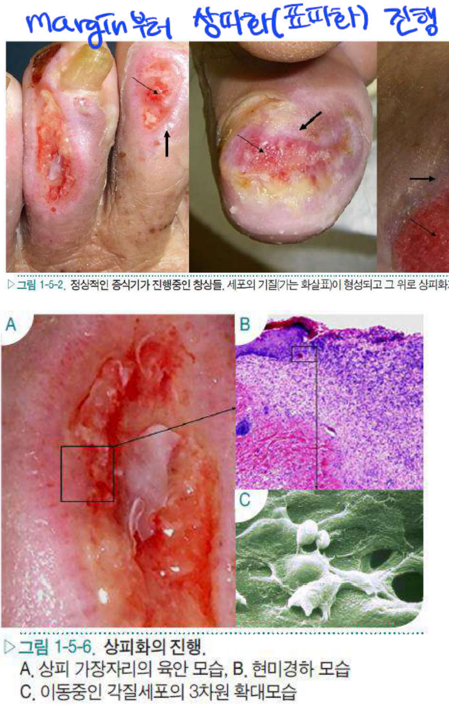{: style="width:52%"}

#### 2) 세포외기질 침착(육아조직 형성)
- 창상 후 2–3일부터 2–3주 동안, 초기에 만들어진 일시적 기질이 호중구의 protease로 분해되고 **콜라겐 기질로 바뀐다.**
- 콜라겐이 아닌 단백질 중 **elastin(탄력섬유)은 거의 재생되지 않는다** → 반흔조직은 탄력이 떨어지고 단단하다.
- 혈관내피세포의 이동·증식과 모세혈관 증식으로 신생혈관화도 함께 일어난다.

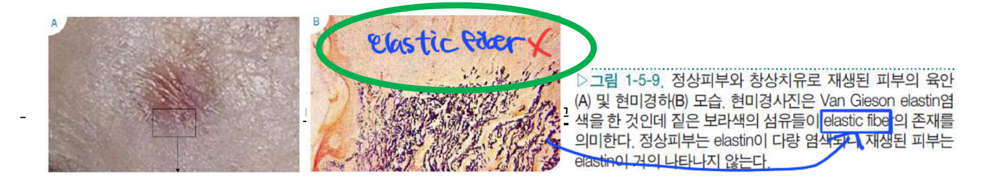{: style="width:80%"}

#### 3) 창상수축(contraction)
- 개방창의 면적이 중심을 향해 줄어드는 현상으로, **근섬유모세포(myofibroblast)**가 담당한다.
- 약 3일째 시작해 10–21일 사이에 최대.
- 수축이 과도하거나 치유 과정이 부적절하면 **반흔구축**이 된다(예: 눈 주위 흉터가 당겨 눈꺼풀이 뒤집힘).

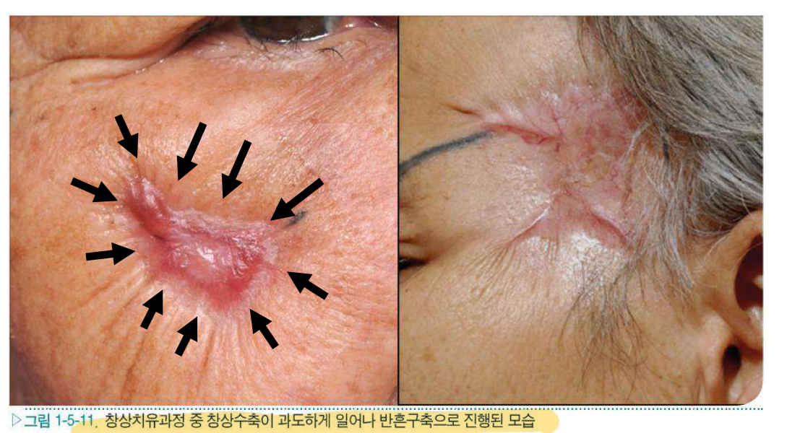{: style="width:62%"}

#### 4) 혈관화
- 새 혈관이 재생조직에 산소와 영양분을 공급한다.
- 자극 → 내피세포 이동 → 관(tube) 모양으로 증식 → 다른 모세혈관과 만나면 개통 → 혈류가 생긴 뒤 퇴화·성숙하며 동맥·정맥으로 분화.
- 새 혈관은 **창상 내 산소압이 가장 낮은 부위**로 자란다(저산소가 혈관 신생의 신호).

### 성숙단계 (1년~)
- 콜라겐이 재구성되어 성숙된 반흔이 만들어진다. 콜라겐 합성은 섬유모세포가 시작한다.
- **수개월–수년** 지속되며, 치유된 조직은 결코 정상 조직과 같아지지 않는다.
- 이 시기 **콜라겐 합성 자체는 줄지만**, 이미 쌓인 콜라겐의 결합이 재구성(교차결합)되면서 **창상 장력과 안정성은 증가**한다.
  증식기 창상은 얇은 콜라겐 사이에 세포가 많고, 성숙기 창상은 두꺼운 콜라겐에 세포가 적다.

!!! exam "기출 포인트"
    20번(2020) 오답 ⑤ "성숙단계 – collagen 합성이 증가된다"는 틀린 보기다(합성은 감소, 결합 재구성으로 장력 증가). ④ "일단 창상이 채워진다"는 염증이 아니라 증식단계.

### 일차유합과 이차유합 (기출에만 나온 내용)
필기본에는 없지만 19번(2020)에 나왔다. **일차유합**(primary intention)은 봉합 등으로 창상 가장자리를 붙여 낫게 하는 것(대부분의
수술 절개창). **이차유합**(secondary intention)은 창상을 열어둔 채 **육아조직 형성 → 창상수축 → 상피화**로 바닥부터 채워 낫는 것이다.
얕은 부분층 창상이 상피화만으로 낫는 것은 표재성 치유로 구분한다.

# 2. 당뇨성족부궤양 (Diabetic foot ulcer)

## 서론
**당뇨발**은 당뇨 합병증으로 발에 나타나는 모든 현상(궤양, 골성 변형, 피부 변화, 혈관계·신경학적 증상 등)을 말한다.
당뇨 환자의 약 25%에서 생기며, 난치성 창상에 이차 감염이 겹치면 절단에 이를 수 있다.

치료의 큰 틀
- 심각한 감염을 시기적절하게 치료해 **절단을 예방**한다.
- 환자의 전반적인 **대사장애를 교정**한다(혈당 조절).
- 심혈관계·골격계·창상관리가 모두 관련되므로 **여러 분과의 협업이 필수**다.
- 창상에 맞는 처치·술기·재건술을 고르고, 창상 감염은 조기에 관리한다.

## 병태생리
당뇨성족부궤양은 **두 가지 이상의 요인이 복합적으로** 작용해 생긴다. 신경병증이 있다고 저절로 궤양이 생기지는 않는다.

1. **외적 요소** — 맨발 걷기, 날카로운 물체 밟기, 잘 맞지 않는 신발
2. **내적 요소** — 감각 소실(그래서 외적 손상을 못 느낌), 발의 변형

여기에 백혈구와 면역반응의 기능 저하로 **감염에 취약**하고, 폐쇄성 혈관질환과 혈액유변학적(hemorheologic) 이상이 겹쳐
궤양이 만성·난치가 된다.

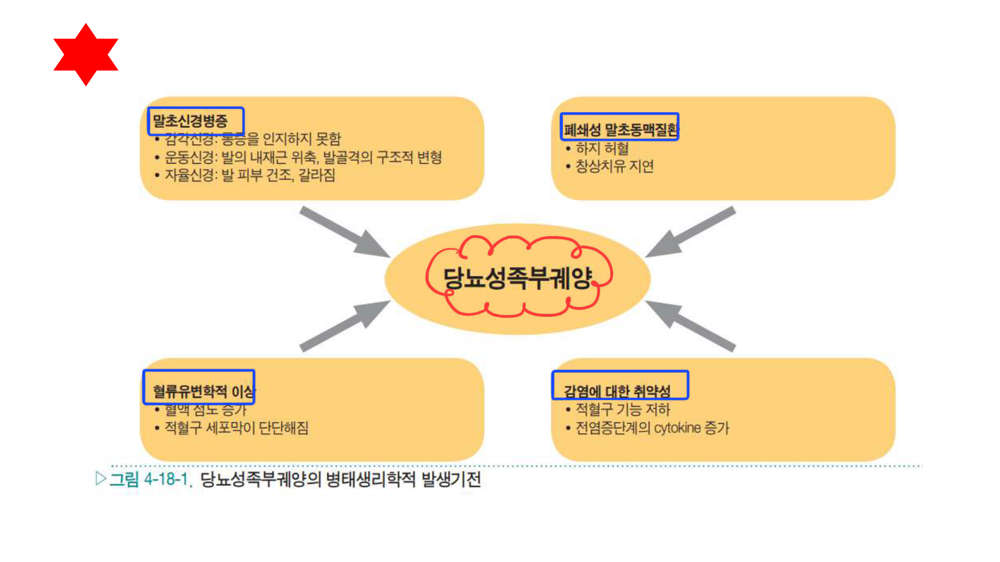{: style="width:78%"}

| 요인 | 내용 |
|---|---|
| 말초신경병증 | 감각신경: 통증을 인지 못함 / 운동신경: 발 내재근 위축, 발 골격의 구조적 변형 / 자율신경: 발 피부 건조, 갈라짐 |
| 폐쇄성 말초동맥질환 | 하지 허혈, 창상치유 지연 |
| 혈류유변학적 이상 | 혈액 점도 증가, 적혈구 세포막이 단단해짐 |
| 감염에 대한 취약성 | 혈구 기능 저하(그림에는 "적혈구"), 전염증단계 cytokine 증가 |

※ 확인 필요: 교과서 그림에는 감염 취약성의 첫 항목이 "적혈구 기능 저하"로 적혀 있지만, 본문(4) 감염 취약성)은 **백혈구** 기능 저하라고 설명한다. 내용상 백혈구가 맞다.

!!! exam "기출 포인트"
    4번(2025)·6번(2024)·10번(2023) 모두 이 그림의 4요인을 맞는 보기로 깔고, 정답(틀린 것)은 매번 **재건** 보기다 — "세동맥 내피세포 과증식 때문에 수술적 치료가 거의 어렵다"(2025), "유리피판술이 유일한 특화 방법"(2024·2023). 6번은 사진이 **Charcot deformity**라는 보기도 맞는 보기로 나왔다.

### 1) 말초신경병증
감각·운동·자율신경 모두에 신경학적 이상이 생긴다.
- **자율신경(특히 교감신경)** 이상 → 땀이 나지 않아 피부가 매우 건조 → 가벼운 외상에도 쉽게 갈라지고 상처가 난다.
- **감각신경** 기능 저하 → 통증을 못 느껴 발을 보호하지 못하고 상처도 모른다 → 부적절한 체중 부하가 반복되어 발이 무너지는
  **Charcot 변형**(Charcot deformity, 발 중간부 아치가 내려앉은 모양)이 생긴다.

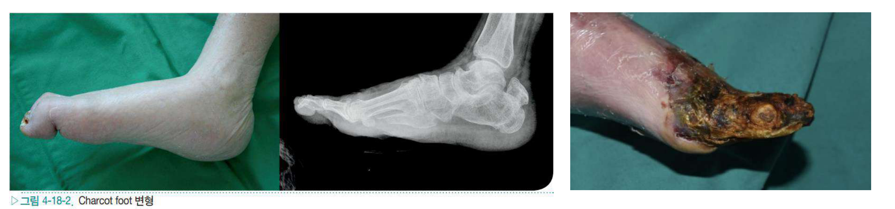{: style="width:80%"}

### 2) 폐쇄성 말초동맥질환 (★)
이 부분이 재건 보기의 근거라서 가장 중요하다.

| 시기 | 생각 | 결과 |
|---|---|---|
| 과거 (1959, Goldenberg) | 당뇨 환자 절단 하지의 생검에서 **세동맥 내피세포 과증식**(hyperplasia)을 특징 소견으로 발표 → 세동맥 증식성 폐쇄가 허혈의 주원인 | 당뇨 환자는 미세혈관이 막혀 있으니 수술(유리피판)은 안 된다고 봄 |
| 70년대 초반 이후 | 세동맥 **기저막은 두꺼워지지만 내경(lumen)은 당뇨·비당뇨 환자 간 차이가 없다** | 허혈의 원인은 세동맥이 아니라 **근위부 동맥의 동맥경화** |

그래서 유리피판술은 문제가 되는 근위부 동맥을 건너뛰어 피판 혈관을 **건강한 원위부 혈관에 문합**하면 되고, 피판 자체의
미세혈관은 내경이 유지되므로 당뇨 환자에서도 **생존율이 높다** — 이것이 유리피판술이 가능한 근거다.

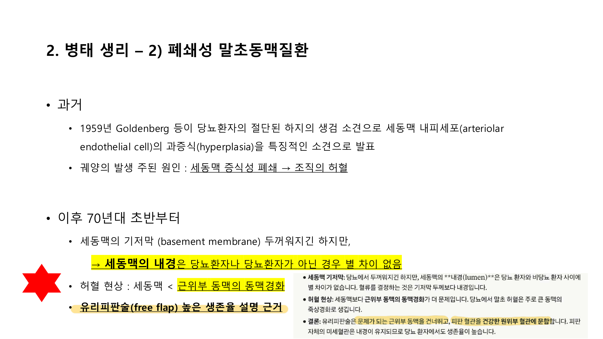{: style="width:78%"}

!!! key "핵심"
    "세동맥 내피세포 과증식 때문에 수술이 어렵다"는 **1959년의 옛 생각**이다. 지금은 세동맥 내경 차이 없음 → 유리피판술 가능.

### 3) 혈액유변학적(hemorheologic) 이상
- **혈액 점도 증가**: 적혈구 세포막의 spectrin이 당화(glycosylation)되어 세포막이 단단해짐 → 모세혈관을 지날 때 모양을
  바꾸지 못함 → 보상적으로 혈압이 더 오름 → 액체 성분이 혈관 밖으로 누출(transudation) → 점도가 더 올라감 → **허혈**.
- **혈색소 당화**(혈당에 비례): 당화혈색소는 산소를 더 단단히 붙잡아 조직에서 산소를 덜 내놓으므로 조직 허혈을 일으킨다.
- 이런 변화가 망막질환(retinopathy)·신질환(nephropathy) 같은 **미세혈관병증**(microangiopathy)의 주원인이다.

### 4) 감염에 대한 취약성
- 혈당이 오르면 백혈구 기능이 떨어지고 전염증단계 cytokine이 늘어 세균의 이차 감염에 대한 저항성이 낮아진다.
- 고혈당 조직 자체가 세균의 좋은 번식처다.
- 혈액유변학적 변화로 허혈이 있으면 전신 항생제가 창상까지 잘 도달하지 못해 효과가 떨어진다.

결국 여러 요인이 겹쳐 궤양이 난치가 되므로 **다학제적 접근이 필수**다.

## 당뇨성족부궤양의 재건

### 유념할 사항
- 당뇨는 이미 오래 진행된 **만성 대사성 질환**이라는 점을 잊지 않는다.
- 환자 전신 상태부터 확인: **혈당부터 조절**, 심혈관계·신장 기능은 적절히 치료, 환자의 **재건에 대한 의지**도 확인.

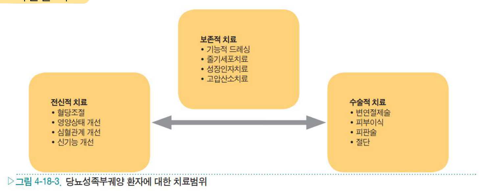{: style="width:70%"}

| 전신적 치료 | 보존적 치료 | 수술적 치료 |
|---|---|---|
| 혈당 조절, 영양 상태 개선, 심혈관계 개선, 신기능 개선 | 기능적 드레싱, 줄기세포치료, 성장인자치료, 고압산소치료 | 변연절제술, 피부이식, 피판술, 절단 |

### 1) 재건의 알고리즘 (★)
- **당뇨성족부궤양에 특화된 재건 방법은 없다.** 창상에 맞춰 일반적인 재건 방법을 골라 쓴다.
- 대상 환자를 잘 고른다(patient selection).
- 혈당 조절, 영양 보충, 심혈관계·신장계 등 **전신 상태**에 영향을 주는 문제를 먼저 해결한다.
- 궤양 상태, 혈관 상태, 혈류 공급의 평가가 필수다.
- 감염·괴사 조직이 있으면 감염을 조절하고 **변연절제술**(debridement)을 한다.
- 필요하면 **경피혈관성형술**(percutaneous transluminal angioplasty, PTA; 풍선·스텐트로 좁아진 동맥을 넓힘) 또는
  **우회술**(bypass surgery; 자가정맥이나 인조혈관으로 우회로를 만듦)로 혈류를 먼저 개선한다. 허혈의 원인이 근위부 동맥경화이므로
  이것을 뚫어주지 않으면 창상 치유나 피판 생착에 필요한 혈류가 확보되지 않는다. 항상 성공하지는 않지만, **수술이 불가능한 상태를
  가능한 상태로 바꿔 주기도** 한다.
- 수술이 불가능하면 여러 보존적 요법(conservative management)을 쓴다.

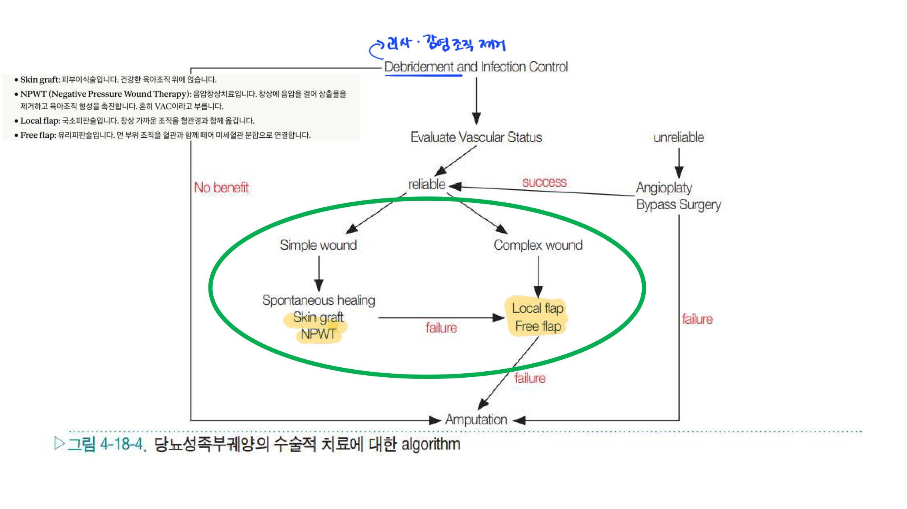{: style="width:80%"}

알고리즘 흐름: 변연절제·감염 조절 → 혈관 상태 평가 → 혈류가 믿을 만하면(reliable) 창상 종류로 나눈다.
**단순 창상**은 자연치유·피부이식·NPWT(음압창상치료, VAC), **복잡 창상**은 국소피판·유리피판. 단순 창상 치료가 실패하면 피판으로,
피판이 실패하면 절단. 혈류가 믿을 수 없으면(unreliable) 혈관성형술·우회술 → 성공하면 reliable로 돌아가고 실패하면 절단.

!!! exam "기출 포인트"
    "특화된 재건 방법은 없다"가 6번(2024)·10번(2023) 해설 그대로다. "유리피판술이 유일한/특화된 방법"이라는 보기는 무조건 틀린 보기.

### 2) 수술 전 평가 및 준비
1. **전신 상태의 평가와 준비** — 내분비내과, 심장·신장내과, 감염내과, 혈관외과, 재활의학과, 영상의학과, 성형외과 등 다학제 진료 필수.
2. **궤양의 평가와 처치** — 최초 궤양 평가 결과로 치료 계획을 정한다. 평가 도구는 **Wagner classification**과
   **University of Texas Diabetic Wound Classification**. 감염 관리 필수(균 동정, 적절한 항생제).
3. **혈관 상태의 평가 및 재관류**(revascularization) — 혈관외과와 협진해 "같이 치료"한다.

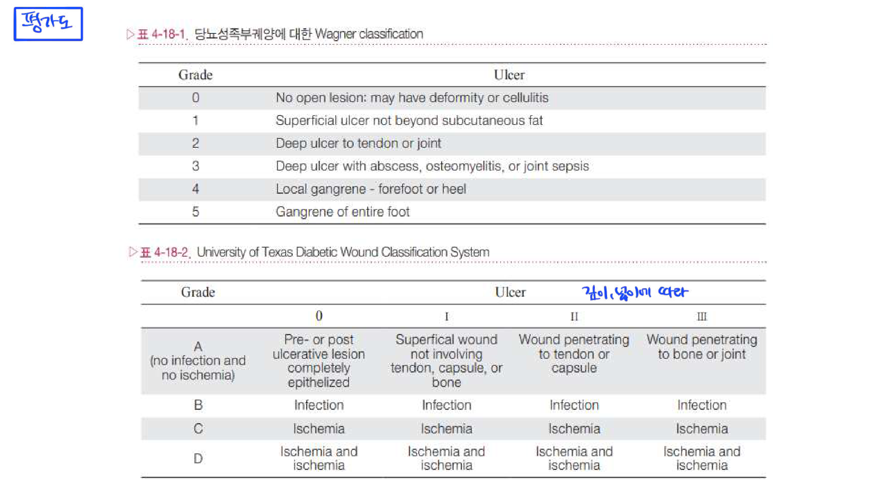{: style="width:78%"}

| Wagner Grade | 궤양 |
|---|---|
| 0 | 개방 병변 없음(변형이나 봉와직염은 있을 수 있음) |
| 1 | 피하지방을 넘지 않는 표재성 궤양 |
| 2 | 건·관절까지 이르는 깊은 궤양 |
| 3 | 농양, 골수염, 관절 패혈증을 동반한 깊은 궤양 |
| 4 | 국소 괴저 — 전족부 또는 발뒤꿈치 |
| 5 | 발 전체의 괴저 |

University of Texas 분류는 **깊이**(0: 상피화된 궤양 전후 병변, I: 표재성, II: 건·관절낭까지, III: 뼈·관절까지)와
**감염·허혈 여부**(A: 둘 다 없음, B: 감염, C: 허혈, D: 감염과 허혈)를 조합한다.

### 3) 수술 방법
| 방법 | 언제 | 요점 |
|---|---|---|
| 일차봉합(primary repair) | 피부 결손이 없거나, 긴장 없이 닫히고 혈류가 풍부할 때 | 봉합을 쉽게 하려고 **변연절제 범위를 줄이면 절대 안 된다** — 괴사·감염 조직이 남으면 봉합부가 벌어지거나 감염이 재발. 출혈하는 건강한 조직까지 충분히 절제하고, 결손이 커 긴장이 생기면 피부이식·피판으로 넘어간다 |
| 피부이식(skin graft) | 어느 정도 넓지만 **깊지 않은** 궤양 | 건·뼈가 노출되어 있으면 이식편이 생착하기 어려우므로 **육아조직이 충분히 덮일 때까지 기다렸다가** 시행 |
| 국소피판술·도서형피판술 | 발바닥 결손 등 | 가장 큰 장점: **가장 비슷한 조직으로 재건**. 발바닥 피부는 두껍고 체중 부하를 견디는 특수한 피부라 발바닥 외에는 비슷한 조직을 얻을 수 없다. 예: V-Y 전진피판 |
| 유리피판술 | 큰 결손 | 1980년대 초반엔 당뇨 환자에게 비적응증 → 하지 허혈이 미세혈관질환 때문이 아니라는 보고들 → 80년대 후반 **Colen**이 유용성 보고 후 발전 |

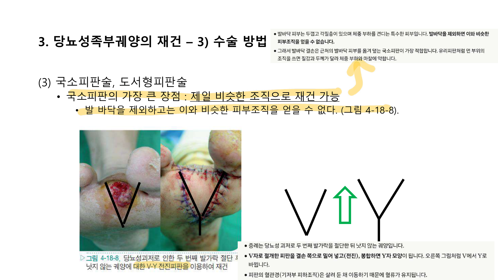{: style="width:72%"}

V-Y 전진피판은 피판 아래 혈관경(기저부 피하조직)을 살려 둔 채 옮기므로 혈류가 유지된다. 유리피판술의 순서는
① 혈관 평가 — 허혈이 있으면 PTA나 bypass로 혈류부터 확보 → ② 큰 결손에 유리피판 → ③ 피판 혈관은 건강한 원위부 혈관에 문합.

### 4) 수술 후 관리와 예후
- 재건 방법과 상관없이 **엄격한 혈당 관리**(필수).
- 동반 질환을 관련 과와 협진하며 지속적으로 관리.
- 당뇨 환자는 창상 치유가 늦으므로 **봉합사 제거는 충분히 나은 뒤**에 한다(일반적으로 얼굴 5–7일, 배·가슴 7–10일보다 늦게).
- 보조기는 보통 **한 달** 정도 착용.
- 환자 교육에 각별히 신경 쓴다 — **예방이 가장 중요하고 효과적**이다.

# 3. 욕창 (Pressure injury, Pressure sore)

## 정의·발생기전·역학·분포
**용어**: decubitus ulcer, bed sore, pressure injury, pressure sore는 모두 같은 말이다.

**발생기전**: 만성적·반복적 압력 → 혈액순환 장애 → 피부조직 손상·괴사 → 궤양. **40 mmHg 이상의 압력**이 조직 혈액공급을
떨어뜨리고, 이것이 **2시간 이상** 지속되면 허혈(ischemia)로 영구 손상이 생긴다.

**역학**
- 비교적 장기간 입원이 필요하고, 치료가 끝나도 **재발률이 높아** 대부분 재수술(같은 부위 또는 다른 부위)이 필요하다.
- 척추 손상 환자: 1년에 약 15%, 20년에 약 26%에서 욕창 발생.
- 척추장애인의 약 65%가 욕창을 겪고, 그중 48%가 사망.

**해부학적 분포** (★)
- 주로 체표면의 아래쪽(뼈가 튀어나온 압박 부위).
- **천골 부위(28%) > 발뒤꿈치(23.6%) > 엉덩이(17.2%)** 순.
- 척추손상 후 **급성기**(누워 지냄) → **천골** 부위.
- 척추손상이 안정된 **만성기**(휠체어로 이동, 앉아 지냄) → **좌골**(ischium) 부위.

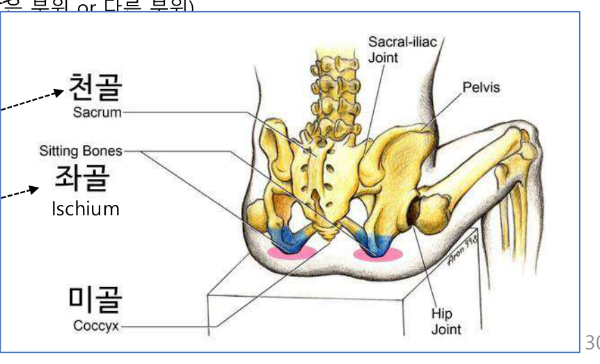{: style="width:55%"}

!!! exam "기출 포인트"
    12번(2023) 정답은 "엉덩이가 가장 흔하고 그다음 천골, 발뒤꿈치"라는 **순서 바꾸기** 보기(→ 천골 28% > 발뒤꿈치 23.6% > 엉덩이 17.2%). 21번(2020)은 "척추손상 급성기에는 좌골에 호발"이 틀린 보기(급성기는 천골, 좌골은 만성기).

## 발생 기전 및 요인 (★)
| 요인 | 내용 |
|---|---|
| 1) 압력 | 평균 모세혈관 폐쇄압력 **20–30 mmHg**. 그 **약 2배를 2시간** 받으면 비가역적 조직 허혈 손상. 손상을 피하려면 압력을 **5분마다** 해제 |
| 2) 마찰력 | 침구, 시트, 교정장치·기구 등에 의해 발생. 과도한 마찰 → 찰과상·수포 등 피부 손상 → 피부 수분 손실 증가. 습기는 마찰계수를 높이고 접촉면 접착을 촉진 |
| 3) 전단력 | 팔꿈치·발뒤꿈치를 밀면서 일어나는 자세, **Semi-Fowler 자세**(눕지도 앉지도 않은 어정쩡한 자세), 휠체어에 똑바로 앉지 않을 때 |
| 4) 습윤 | 과도한 수분은 위험 인자(요실금 피부염, 회음부 피부염, 습기 병변). 요실금·대변 실금이 특히 중요 — **소변**: 질소 유도체가 피부의 산성 pH를 무력화, **대변**: 대장균 부하로 욕창 **5배** 증가. **과도한 건조**도 위험 — 균열 증가, 인장 강도·지질 함량 감소 → 장벽 기능 손상 → 궤양 |
| 5) 영양부족 | 영양실조 → 패혈증·감염·원내 사망률·재원 기간 증가. 영양실조와 욕창은 **확실한 상관관계**가 있다 |
| 6) 신경학적 손상 | 척수손상(spinal cord injury, SCI) 환자의 부동성 → 압력·마찰·전단력 증가. 감각 손상 → 오래 눌려도 자세를 바꾸도록 하는 보호감각 저하. 욕창은 SCI 환자 입원 중 **두 번째로 흔한** 원인 |

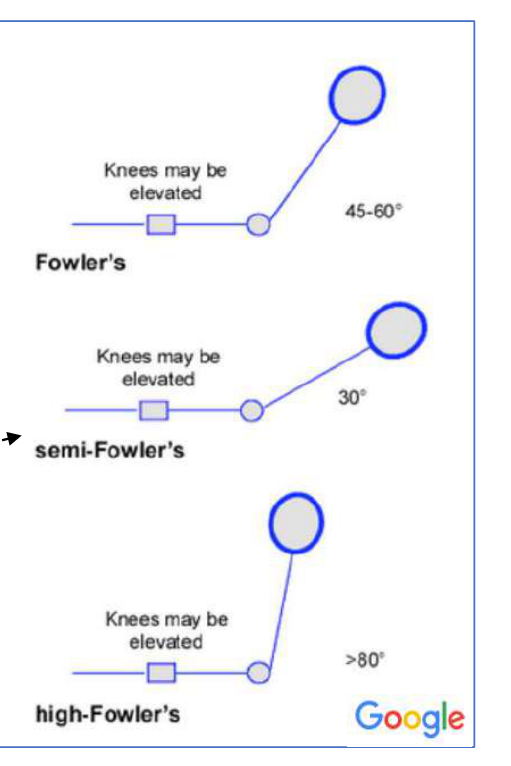{: style="width:38%"}

전단력은 피부는 침대에 붙어 있는데 몸(뼈)은 아래로 미끄러지면서 그 사이 조직과 혈관이 비틀려 끊기는 힘이다. 그래서
"침대에서 미끄러지듯 움직이면 전단력이 **커진다**"(21번 오답 ②는 "감소한다"였다).

요인별 대책을 짝지어 기억한다: 습윤 → **적절한 습도 유지**, 영양부족 → **적절한 영양 공급**, 신경학적 손상 → **적절한 자세**.

!!! exam "기출 포인트"
    12번(2023)의 맞는 보기 ①(20–30 mmHg의 2배·2시간), ②(압력·전단력 지속시간 줄이기가 가장 효과적인 예방), ③(소변 pH 무효화·대변 5배), ⑤(SCI 부동성 → 압력·마찰·전단력 증가)는 필기 문장 그대로다. 21번(2020) 정답 "건조한 피부는 위험 인자"도 습윤 항목.

## 욕창의 평가 — Grade 분류 (★, 매년 사진 출제)
EPUAP 욕창 분류 체계. 교수님 말씀: "Grade의 의미와 임상 상처를 연관시켜서 생각해보자" — 매년 사진을 주고 단계를 묻는다.

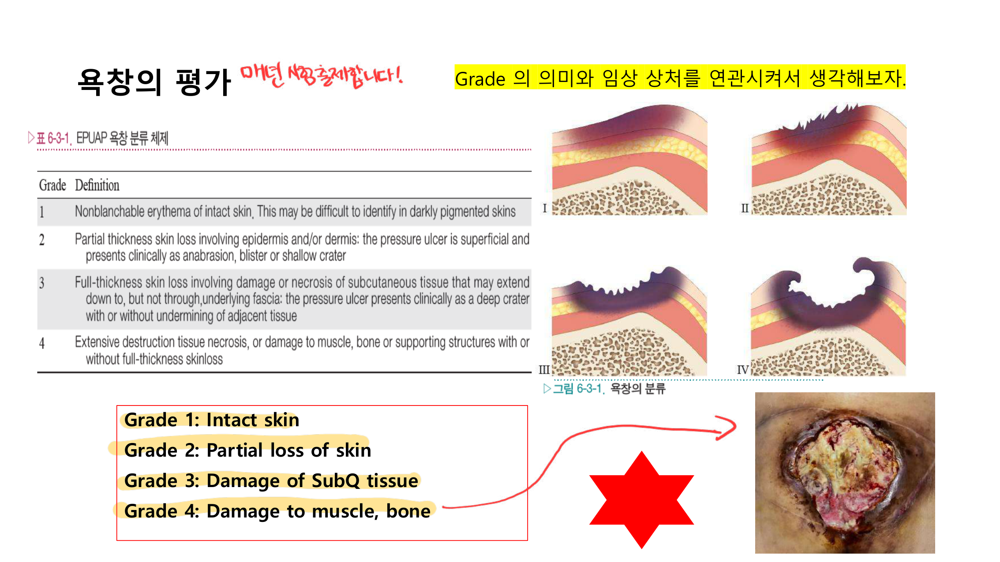{: style="width:80%"}

| Grade | 한 줄 요약 | 정의 |
|---|---|---|
| 1 | **Intact skin** | 피부는 온전, 눌러도 하얘지지 않는 홍반(nonblanchable erythema). 피부색이 어두우면 알아보기 어려움 |
| 2 | **Partial loss of skin** | 표피 및/또는 진피의 부분층 손실 — 찰과상, 수포, 얕은 분화구 |
| 3 | **Damage of SubQ tissue** | 전층 피부 손실 + 피하조직 손상·괴사, 근막까지 내려갈 수 있으나 **뚫지는 않음** — 깊은 분화구 |
| 4 | **Damage to muscle, bone** | 광범위한 조직 괴사 또는 근육·뼈·지지구조 손상 |

!!! memo "암기"
    "근육층까지 손상, 뼈 일부 노출" = **Grade 4**. "피하조직까지 괴사, 근막은 침범 안 함" = **Grade 3**. Grade 5는 없다.

!!! exam "기출 포인트"
    2번(2025)·7번(2024)·11번(2023)은 같은 문제 — 근육층 손상 + 뼈 일부 노출 사진 → Grade 4(오답 "드레싱만 자주 하면 낫는다", "드레싱으로 치료 불가능한 Grade 5"). 16번(2021)은 글로 "피하조직층까지 괴사, 근막층 침범 안 함" → Stage III.

## 욕창의 예방 (★)
예방의 핵심은 **압력·전단력의 강도와 지속시간을 줄이는 것**이며, 이는 대증요법이다.

### 1) 자세 변화
- **가장 효과적** — 압박 부위를 **2–3시간마다** 바꾼다.
- 평평하게 눕는 자세 또는 **30도 Semi-Fowler** 자세 → 압력이 가장 낮다.
- 옆으로 누울 때는 **30도 기울여** 골반 접촉 면적을 넓히고 압력을 분산한다.
- 엎드린 자세는 작용하는 압력이 매우 낮다.
- 앉은 자세는 압력이 크므로 자주 자세를 바꾼다.
- 쿠션이나 폼 패드 대신 시트·수건을 접어 쓰지 않는다(너무 단단해 피부 손상의 원인).

※ 확인 필요: 필기는 Semi-Fowler 자세를 전단력 유발 자세로도, 압력이 가장 낮은 자세로도 적었다. 강의록 그대로이니 둘 다 기억해 둔다(30도 정도로 낮게 올리면 압력은 낮지만, 그보다 높게 올려 미끄러지면 전단력이 생긴다).

### 2) 피부 관리
- 노화 → 진피·표피가 얇아져 층끼리 분리되기 쉬움 → 피부 손상이 쉽다.
- 피하지방·지방조직 감소 → 완충 역할 감소.
- 삼출물 관리로 적절한 습도를 유지하고 피부 손상을 최소화(적절한 드레싱이 중요).
- 짓무름 → 염증 → 스테로이드 제제를 1–2일 정도.
- 보호 필름은 접착성 드레싱의 부착을 돕고, 뗄 때 외상을 막는다.

### 3) 영양 관리
- 욕창 환자는 적절한 영양 평가가 필요하다.
- 영양 중재의 일차 목표: **단백–열량 불균형 교정**.
- 정상 식사로도 영양결핍이면 관을 통한 영양 공급을 시도할 수 있다.
- 단백·열량 보충과 함께 아르기닌, 항산화 비타민, 미세영양소를 같이 섭취하면 긍정적 효과.

## 욕창의 치료

### 1) 효과적인 변연절제(debridement)
- 괴사(죽은) 조직을 제거해 상처 치유와 육아조직 형성을 촉진하고 감염 위험을 낮춘다.
- 죽은 조직은 세균이 자라는 배지가 되어 염증 반응을 일으킨다. 그래서 괴사조직은 **적극적으로** 제거한다.
- 방법: 수술적 처치(가장 좋음), 국소 효소 적용, 구더기(괴사조직만 먹음, 현재는 사용 안 함), 식염수 기계적 세척, 초음파 기계.

### 2) 비수술적 치료
- 수술이 불가능하면 상처 소독, 감염 방지, 이차 치유를 목적으로 드레싱한다.
- 최근 드레싱 재료는 흡수력이 높아 교환 횟수와 처치 시간이 줄어 환자·의료진의 고통이 줄었다.
- **은(silver) 함유 드레싱**: 아쿠아셀(Aquacel Ag), acticoat 등 → 욕창 등 개방 상처에 쓴다.
- **VAC**(vacuum assisted closure, 음압창상치료): 음압으로 불순물·혈액 등을 흡입 → 부종·세균 감염 감소, 혈관 생성으로 혈류·산소 공급
  증가 → 치료 기간과 2차 수술 빈도 감소.

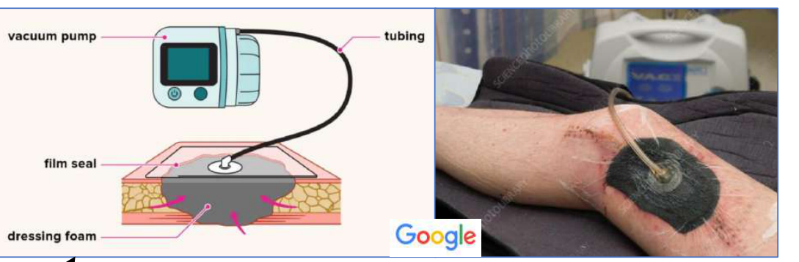{: style="width:65%"}

### 3) 수술적 치료
- 수술 방법이 제한적이고 재발 가능성이 높다. 환자 상태를 전체적으로 파악한 뒤 수술을 결정한다(전신 상태가 나쁘면 수술을 먼저 하지 않는다).
- 방법: 부분층 또는 전층 **피부이식**, 각종 **피판 수술**(flap surgery). 수술 후에도 재발률이 높다.
- 재발성 욕창도 일차성과 같은 재건 방법을 쓰되, **추후 가능한 재건 수술을 방해하지 않도록** 계획한다.

!!! exam "기출 포인트"
    21번(2020) 오답: "괴사조직은 욕창을 보호하기 위해 천천히 제거한다"(→ 적극 제거), "전신상태가 좋지 않을수록 수술을 최우선"(→ 전신상태부터 교정).

### 4) 욕창의 다른 측면과 요약
- 젊은 척추손상 환자는 급격한 환경 변화로 사회적 고립을 겪고, 인터넷·스마트폰 중독 등으로 오래 같은 자세로 지내 회복이 늦어진다 →
  심리적·정신적 지지가 필요하다.
- 인구 노령화로 욕창 인구와 사회적 비용이 늘고 있다. 정상화에 오랜 시간과 비용이 들므로 발생 예방을 위한 1차 의료가 중요하다.
  **최선의 치료는 욕창 예방**이다.

# 4. 미세수술 (Microsurgery)

## 정의와 장비
**미세수술**은 현미경으로 매우 작은 것을 보며 하는 모든 수술이다 — 미세혈관수술, 미세신경수술, 미세림프관수술, 미세관수술 등.

장비와 기구
- 수술 현미경(operating microscope), 수술 확대경(magnifying loupe)
- 미세수술 기구: scissors, forceps, needle holders, **clamps**, bipolar coagulator, 혈관 연결기
- **미세봉합사: 8-0 ~ 12-0** — 숫자가 클수록 얇은 실이다.

## 미세혈관 연결술 (Microvascular anastomosis) — 기본 원칙 (★)

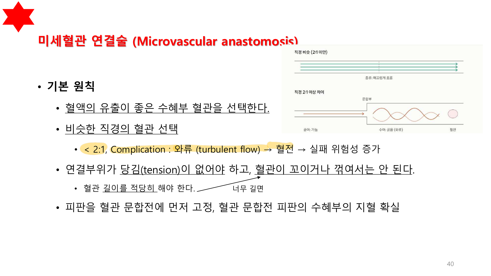{: style="width:78%"}

1. **혈액의 유출이 좋은 수혜부 혈관을 선택**한다.
2. **비슷한 직경의 혈관**을 고른다 — 직경 차이는 **2:1 미만**. 2:1 이상이면 문합부에서 **와류**(turbulent flow) → 혈전 → 실패 위험 증가.
3. **연결 부위에 당김(tension)이 없어야** 하고, **혈관이 꼬이거나 꺾여서는 안 된다.** 혈관 길이를 적당히 해야 한다 — 너무 짧으면
   당기고, **너무 길면** 꼬이거나 꺾인다.
4. **피판을 혈관 문합 전에 먼저 고정**하고, 문합 전에 피판 수혜부의 **지혈을 확실히** 한다.

!!! exam "기출 포인트"
    5개년 모두(3·8·13·17·22번) "기본원칙에 어긋나는 것" 같은 문제. 정답은 둘 중 하나로 돌아간다 — **당김**("단단하게 잘하면 당김이 있어도 된다/강하게 있어야 오래 유지된다/팽팽하게 당기도록": 3·13·17번) 또는 **직경 차이**("2:1 이상 차이 나도 혈행만 좋으면/별 문제 없다": 8·22번). 필기본의 기출모음(2022로 표시된 해)에는 "혈압이 있기 때문에 꼬이거나 꺾여도 상관없다"가 정답인 해도 있었다.

## 미세혈관 연결술 방법
- **끝끝 연결법**(end-to-end anastomosis): 양 혈관 끝을 혈관 클램프 사이에 고정하고 외막주위조직을 당겨 잘라낸 뒤, 120° 또는 180° 간격으로
  주 봉합 → 전벽 봉합 → 클램프를 뒤집어 후벽 봉합.
- **끝옆 연결법**(end-to-side anastomosis): 한 혈관의 끝을 다른 혈관의 옆면에 연결. **혈관 직경 차이가 클 때도 적용 가능**하고,
  후벽 봉합을 먼저 하는 것이 유리하다. 끝끝 연결보다 훨씬 어렵다.

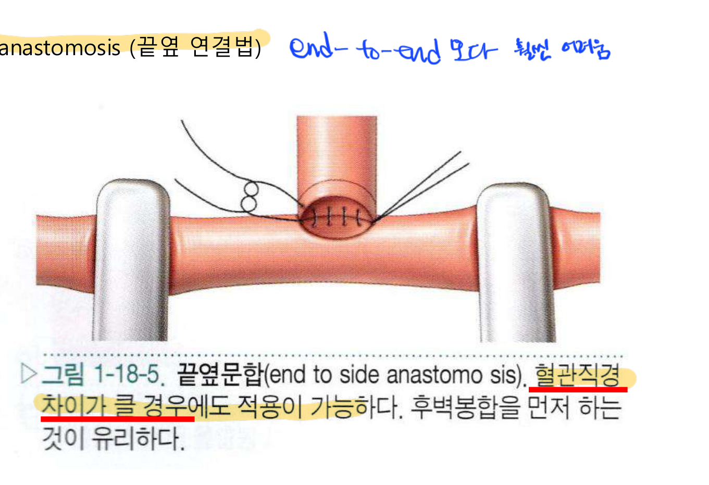{: style="width:55%"}

## 정맥 이식 (Vein graft) — 적응증 (★)
1. 연결할 혈관의 **길이 부족**
2. 연결 부위의 **과도한 긴장 감소**
3. 혈관 **직경 차이 해결**
4. 손상 구역이나 방사선 치료 부위 같은 **해부학적 문제 부위 회피**
5. 한 혈관에 **여러 개의 연결 또는 우회**

!!! exam "기출 포인트"
    14번(2023): 두피 박리 절단 — 손상된 혈관 끝을 잘라 정리하면 간격(gap)이 생겨 그대로 이으면 긴장이 걸린다 → "**길이가 부족하고 과도한 긴장을 줄이기 위해**". 18·23번(2021·2020): "직경 차이가 크게 날 때는 하기 **어렵다**"가 틀린 보기(직경 차이 해결도 적응증). 필기본 기출모음(2022)에는 "길이가 부족한 경우에는 **금기**"가 틀린 보기였다.

## 혈관 개존 검사 (Testing for patency)
문합한 혈관으로 피가 잘 흐르는지 확인하는 검사.
- **우유짜기 검사**(milking test): 문합부 원위부를 두 개의 겸자로 잡고, 아래쪽 겸자를 밀어 그 사이 혈관을 비운 뒤, 문합부 쪽 겸자를
  놓았을 때 빈 구간이 빠르게 다시 차면 개존.
- **들어올리기 검사**(uplift test): 연결 부위보다 원위부 혈관 밑에 기구를 받치고 혈류가 부분적으로 멈출 정도로 들어 올려 흐름을 확인.
  우유짜기 검사를 하기 어려울 때 쓴다(혈관을 덜 손상).

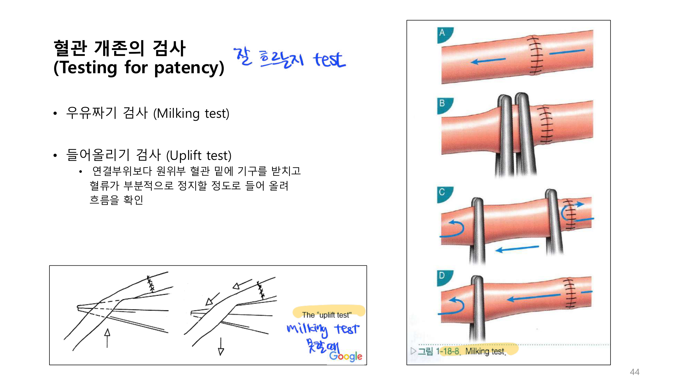{: style="width:75%"}

## 혈관 경련 (Vasospasm)
- 약 **5–10%**에서 수술 중 또는 수술 후 **72시간 내** 발생.
- 원인: 전신적 — 저체온, 저혈압, 얕은 마취 심도로 인한 통증에 대한 교감신경 반응 / 국소적 — 혈관 손상·건조, 국소 출혈과 혈액 접촉, 혈관 외벽의 긴장, 혈관 이상.
- 해결: 혈관을 **따뜻하게** 유지 → 수 분간 놔두고 관찰 → 그래도 안 되면 **약물**(리도카인 등) 또는 물리적 확장.

## 혈관 직경 차이 해결책
- **물리적 확장**: 작은 혈관 끝을 늘린다.
- **비스듬하게 절단**: 작은 혈관을 사선으로 잘라 둘레를 늘린다(30° 이하).
- **작은 혈관의 측면 절개**(fish-mouth 모양).
- (그리고 앞의 끝옆 연결법, 정맥 이식)

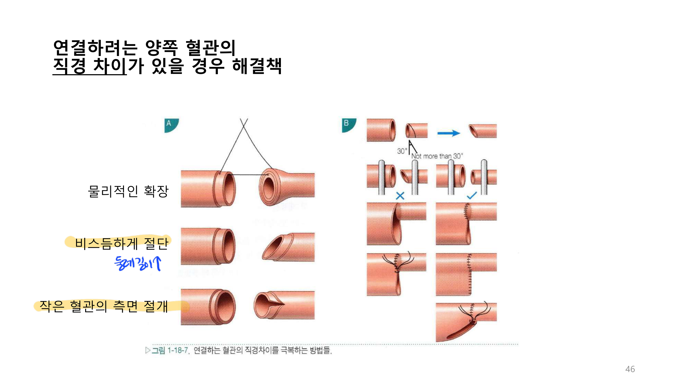{: style="width:72%"}

## 미세혈관수술의 실패 원인
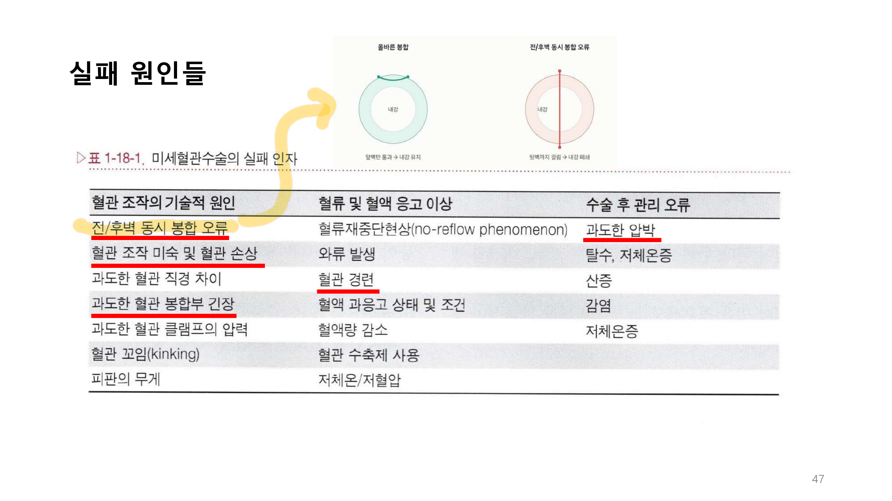{: style="width:78%"}

| 혈관 조작의 기술적 원인 | 혈류·혈액 응고 이상 | 수술 후 관리 오류 |
|---|---|---|
| **전/후벽 동시 봉합 오류**(뒷벽까지 바늘이 걸려 내강 폐쇄), **혈관 조작 미숙·혈관 손상**, 과도한 직경 차이, **과도한 봉합부 긴장**, 과도한 클램프 압력, 혈관 꼬임(kinking), 피판의 무게 | 혈류재중단현상(no-reflow phenomenon), 와류, **혈관 경련**, 혈액 과응고 상태, 혈액량 감소, 혈관수축제 사용, 저체온·저혈압 | **과도한 압박**, 탈수·저체온증, 산증, 감염 |

## 임상적 적용과 미래
- **유리피판술**(free flap surgery): 먼 부위의 조직을 혈관째 떼어 미세혈관 문합으로 연결 — 유방전절제 후 아랫배 조직(심하복벽 천공지피판)으로
  유방 재건, 당뇨성 족관절 결손을 전외측대퇴천공지피판으로 재건, 족부 괴사성 근막염 결손을 광배근 피판으로 재건, 하인두암 절제 후 요골전완부
  피판으로 식도 재건 등.
- 피판 **괴사**(necrosis)가 생기면 2차 수술(다른 피판)로 다시 재건한다.
- 미래: super microsurgery(더 작은 혈관·림프관), robotic microsurgery, 인공 조직공학.
