<!-- 필기본: 2026 -->

# 0. 이 수업을 공부하는 법

이 수업은 정호윤 교수님(성형외과)의 강의로, 강의 자료가 **표준성형외과학 교과서 다섯 장**이다 — 8장 급성 화상 치료, 8장 피부이식, 15장 피판의 분류와 적용 및 천공지 피판, 13장 조직공학·인공삽입물과 생체재료, 6장 줄기세포 재생의학. 강의 순서는 **화상 → 피부이식·피판이식 → 조직공학 → 줄기세포**였다. 치료의 기본 이론 강의의 마지막 수업이다.

!!! key "핵심"
    - 필기에 따르면 기출은 **교수님이 "접어 주신" 페이지에서 모두 출제**되었다. 이 설명서는 그 페이지(화상 깊이·9의 법칙·Parkland 공식·흡입손상·화학/전기화상, 부분층/전층 피부이식·복합이식·생착 조건·드레싱·합병증, 천공지 피판 장단점, 조직공학 3요소, 줄기세포 정의·ESC/iPSC)를 중심으로 쓰고, 나머지 교과서 내용은 짧게 정리했다.
    - 매년 거의 같은 문제가 반복된다: **피부이식 생착 조건**(6년 연속), **천공지 피판 장단점**(6년 연속), **Parkland 첫 8시간 수액량**(3년 연속), **줄기세포 특징**, **tie-over 드레싱**, **고압 전기화상 처치**.
    - 16장 「피판의 병태생리학과 약리학」은 필기본에서 **사선으로 지워져** 있다(강의에서 제외). 이 설명서에서도 다루지 않는다.

# 1. 화상(열화상)

## 화상 후 병태생리

열에 의한 화상은 국소 조직 손상에 그치지 않고, 범위가 넓으면 혈역학·대사·영양·면역 전반에 변화를 일으킨다. 원인은 화염(flame, flash), 열탕(scald), 접촉(contact), 화학물질(chemical), 전기(electric) 등이다.

### 전신 변화
- **대사항진(hypermetabolic response)**: catecholamine, glucocorticoid, glucagon, dopamine이 증가해 이화(catabolic) 상태가 된다. 안정 시 대사율이 크게 늘고 근단백이 분해되어 제지방량(lean body mass)이 줄며, 상처 치유가 늦어진다.
- **염증과 부종**: 염증 매개물질이 나와 **혈관 수축 및 확장, 모세혈관 투과성 증가**가 일어나 국소·전신 부종이 생긴다.
- **순환기 변화**: 혈장 손실(loss of plasma volume)로 심박출량이 감소한다(화상 쇼크). 수액을 충분히 주면 화상 3–4일째에는 오히려 정상의 1.5배까지 심박출량이 는다.
- **신장 변화**: 초기에 혈류량 감소와 스트레스 호르몬(angiotensin, aldosterone, vasopressin)으로 신장 혈류와 사구체 여과율이 줄어 소변량이 감소한다. 수액이 부족하면 급성신부전으로 진행하고, 전기화상·근손상 시에는 미오글로빈·혈색소가 세관을 막는다.
- **소화기 변화**: 장점막 위축, 흡수 감소, 장벽 투과성 증가 → 세균전위(bacterial translocation)의 원인. 대개 48–72시간 내 회복된다.
- **면역계 변화**: 중증화상 환자는 감염에 취약하다. 대식세포·T세포 기능이 떨어지고, 화상 범위가 20%를 넘으면 면역 저하가 뚜렷해진다.

### 국소 변화 — 화상의 세 구역(Jackson)
- **응고대(zone of coagulation)**: 가장 중심, 비가역적으로 괴사된 부분.
- **정체대(zone of stasis)**: 조직 관류가 감소한 부분. 적절히 소생하면 살아나지만 감염·저관류가 있으면 괴사로 진행한다 → **수액치료의 목표가 이 구역을 살리는 것**.
- **충혈대(zone of hyperemia)**: 가장 바깥, 혈관 확장으로 붉으며 대개 회복된다.

## 화상 깊이(Burn depth)

화상 깊이는 손상된 층(표피, 진피, 피하지방, 근육·뼈)에 따라 나눈다. 시간이 지나면서 깊어질 수 있어 초기에 정확히 판단하기 어렵다.

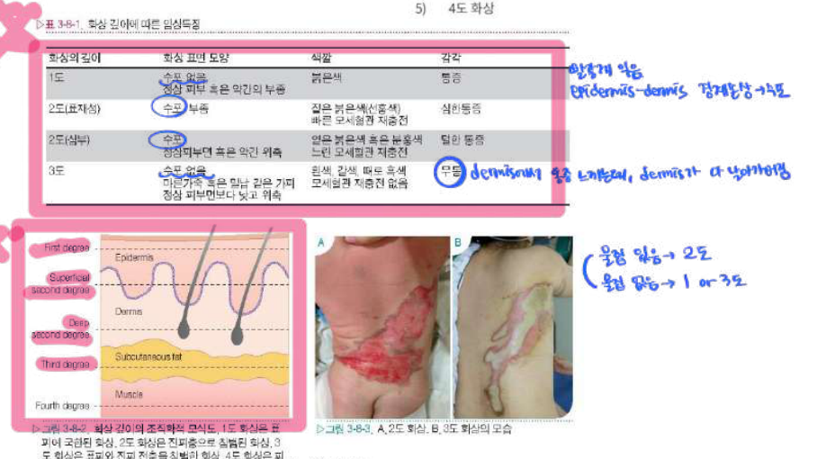{: style="width:90%"}

| 깊이 | 손상 범위 | 표면 | 색깔 | 통증 | 치유 |
|---|---|---|---|---|---|
| 1도 | 표피 | **수포 없음**, 건조 | 붉은색 | 통증 | 수일 내, 반흔 없음(일광화상) |
| 표재성 2도 | 표피 + 진피 상부(유두층) | **수포**, 부종 | 짙은 붉은색(선홍색), **빠른 모세혈관 재충전** | **심한 통증** | 2주 내, 반흔 거의 없음 |
| 심부 2도 | 진피 망상층(약 3/4)까지 | 수포 | 얼룩진 붉은색·창백, **느린 재충전** | 덜한 통증 | 2–4주, 비후성 반흔, 3도로 진행 가능 |
| 3도 | 진피 전층 | **수포 없음**, 가죽 같은 가피(eschar) | 흰색, 갈색, 검은색, 재충전 없음 | **무통**(진피의 신경 소실) | 자연 치유 안 됨 → 피부이식 |
| 4도 | 근육·건·뼈 | | | | 절단이 필요할 수 있음 |

- 필기: 2도까지는 진피 일부가 남아 **표피–진피 경계(epidermis–dermis junction)에서 재생**이 가능하다("2도까지만 상피화"). 3도는 진피가 다 타서 신경이 없어 통증을 못 느낀다.
- 구별 요령: **수포가 있으면 2도, 없으면 1도 또는 3도**. 1도와 3도는 색깔·통증으로 가른다.

!!! exam "기출 포인트"
    - 12번(2023): 뜨거운 물, **수포 + 선홍색 + 빠른 모세혈관 재충전 + 심한 통증** → **표재성 2도**. 심부 2도(창백·느린 재충전·통증 덜함)와 헷갈리게 냈다.

## 화상 크기(Burn size)

**2도 이상**의 화상을 입은 부위를 전체 체표면적(total body surface area, **TBSA**)의 %로 나타낸다(1도는 계산에 넣지 않는다).

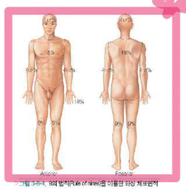{: style="width:48%"}

- **9의 법칙(rule of nines)** — 성인: 머리·목 9%, 한쪽 팔 전체 9%, 몸통 앞면 18%(가슴 9 + 배 9), 몸통 뒷면 18%, 한쪽 다리 전체 18%, 회음부 1%.
- **Lund and Browder chart**: 소아는 몸 크기에 비해 머리가 크고 다리가 작아(나이에 따라 비율이 변함) 9의 법칙보다 이 표가 정확하다.
- 작은 화상은 **환자 손바닥(손가락 포함) ≈ 1%**로 어림한다.

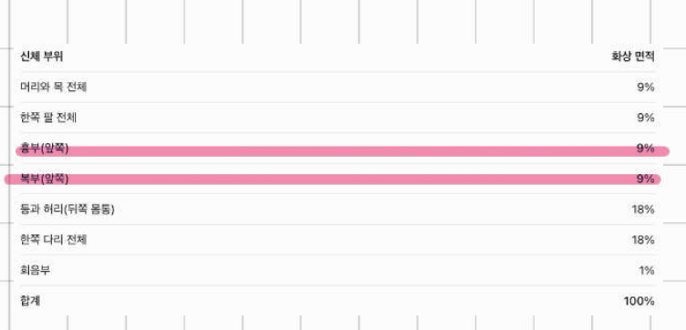{: style="width:60%"}

## 치료

### 초기평가와 초기처치
- 화상 환자도 외상 환자다: 기도·호흡·순환(ABC)부터, 동반 손상(두부·척수·골절·장기 손상)과 **흡입화상**을 평가한다.
- 흡입화상 의심 소견(그을린 코털, 탄소 섞인 객담, 빈호흡, 쉰 목소리)이 있으면 호흡을 면밀히 감시하고, 쉰 목소리가 진행하면 기도폐쇄가 임박한 것이므로 **기관삽관**한다. 사지 둘레(circumferential) 화상은 맥박·도플러로 순환을 확인한다.
- 초기에는 삼출액이 많으므로 **건조드레싱(dry dressing)**을 하고 습윤드레싱은 피한다(체온 손실). 진통제는 근주·피하 대신 **정맥**으로 준다(초기 혈관수축으로 흡수가 불확실하고, 나중에 한꺼번에 흡수되어 과다 투여될 수 있다).

### 수액치료(Resuscitation)
- 적응: **성인은 TBSA 20% 이상, 소아는 10% 이상**이면 정맥 수액치료.
- 말초정맥 2개 확보(어려우면 소아는 골내(intraosseous), 대복재정맥 cut-down, 중심정맥).
- 수액: **포도당 없는 Lactated Ringer's solution**이 가장 흔히 쓰인다(세포외액과 가장 비슷한 정질액). 첫 24시간에는 정질액을 쓰고, 모세혈관 투과성이 높아 교질액(알부민)은 피한다(오히려 간질로 새어 부종을 늘림). 생리식염수는 Cl이 많아 과다 투여 시 대사성 산증, 고장성 식염수는 고나트륨혈증·신부전 위험이 있다. 2세 미만 소아는 저혈당 예방으로 LR에 5% 포도당을 섞는다.

!!! memo "암기"
    **Parkland 공식**: 첫 24시간 수액량 = **4 mL × 체중(kg) × 화상면적(%TBSA)** (Lactated Ringer's)
    → 이 중 **1/2을 첫 8시간**에, 나머지 1/2을 다음 16시간에 나누어 준다. 시간은 **화상을 입은 시점**부터 센다.
    소변량 목표: **성인 0.5–1.0 mL/kg/hr(약 30–40 mL/hr), 소아 1.0–2.0 mL/kg/hr**

교과서 예: 60 kg, 2도 이상 40% → 4 × 60 × 40 = 9,600 mL / 24시간, 첫 8시간 4,800 mL, 다음 16시간 4,800 mL.

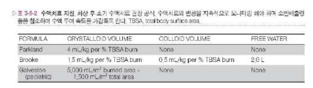{: style="width:72%"}

| 공식 | 정질액 | 교질액 | 비고 |
|---|---|---|---|
| Parkland | 4 mL/kg/%TBSA | 없음 | 가장 널리 사용 |
| Brooke | 1.5 mL/kg/%TBSA | 0.5 mL/kg/%TBSA | 자유수 2 L |
| Galveston(소아) | 5,000 mL/m² 화상면적 + 1,500 mL/m² 전체 체표면적 | 없음 | 소아는 체중당 더 많은 수액 필요 |

공식은 **권고치**일 뿐이며, 실제로는 소변량을 보며 주입 속도를 조절한다.

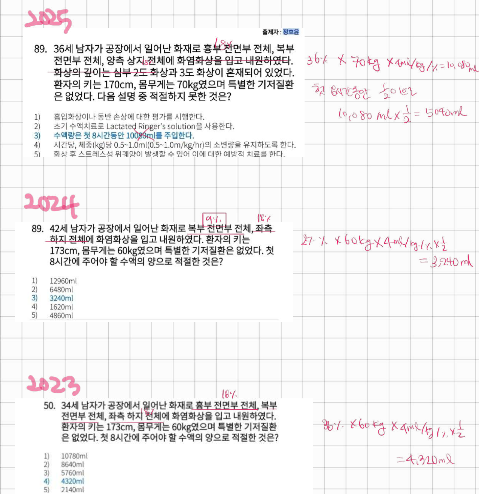{: style="width:72%"}

!!! exam "기출 포인트"
    - 3번(2025): 가슴 앞 + 배 앞 + 양팔 = 18+18 = **36%**, 70 kg → 24시간 10,080 mL, **첫 8시간 5,040 mL**. 보기 ③ "첫 8시간 10,080 mL"가 틀린 것(24시간 총량을 8시간에 넣는 함정).
    - 8번(2024): 배 앞 9% + 한쪽 다리 18% = 27%, 60 kg → 6,480 mL의 절반 **3,240 mL**.
    - 13번(2023): 가슴 앞 + 배 앞 + 한쪽 다리 = 36%, 60 kg → 8,640 mL의 절반 **4,320 mL**.
    - 보기에는 24시간 총량(6,480·8,640), 2배(12,960), 1/4(1,620)이 함정으로 늘 들어간다. 2025년은 키(170 cm)와 "심부 2도와 3도 혼재"를 일부러 넣었지만 계산에는 쓰지 않는다(2도 이상은 모두 포함).

### 모니터링(Monitoring)
- 가장 간단하고 유용한 지표는 **맥박과 시간당 소변 배출량**. Foley 카테터를 넣어 측정한다.
- 성인 0.5–1.0 mL/kg/hr, 소아 1.0–2.0 mL/kg/hr. 48시간 내 소변량이 이보다 적으면 수액이 부족한 것. 성인 맥박 120회/분 이상은 저혈량, 110회 미만이면 정상 혈량.
- 소변이 검으면 혈색소뇨·미오글로빈뇨 → 신기능 예후와 관련.
- 비침습적 혈압계는 부종 때문에 실제보다 낮게 나와 동맥관 혈압이 가장 정확하다. 중심정맥압(CVP)·Swan-Ganz는 이득은 적고 감염·혈전 위험이 있어 조심스럽게 쓴다.

### 영양(Nutrition)
- 중증 화상은 이화 상태 → 체중 감소, 면역 저하, 치유 지연. TBSA 40% 화상이면 기초대사 에너지의 약 2배가 필요하다.
- 성인 Curreri 공식: **25 kcal/kg + 40 kcal/% burn**, 소아(<12세) Davies: 60 kcal/kg + 35 kcal/% burn. 칼로리:질소 비 100–150:1로 단백질을 넉넉히.
- 위장관 기능은 3–5일에 돌아오므로 가능하면 **조기 경장영양**(비위관)을 한다. 정맥영양(TPN)보다 감염이 적다. 혈당은 인슐린으로 80–110 mg/dL로 관리.

### 가피절개술(Escharotomy)
심부 2도·3도 화상이 사지나 몸통을 **둘러싸고(circumferential)** 있으면, 딱딱한 가피(eschar) 아래로 부종이 생겨 정맥 유출을 막고 조직 압력이 높아져 말단 동맥 혈류까지 막힌다 → **구획증후군(compartment syndrome)**.

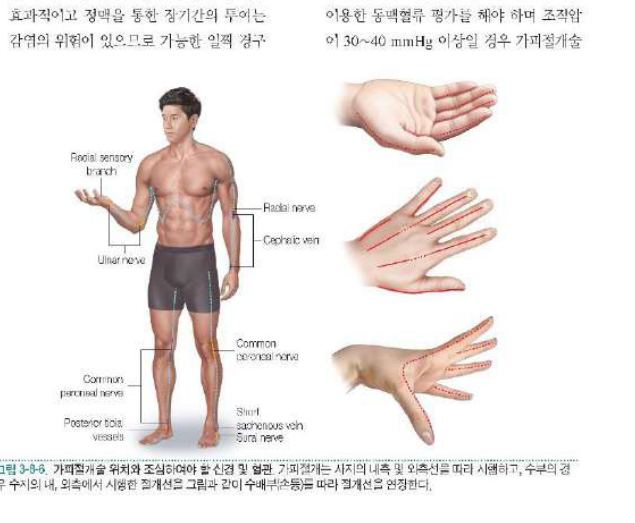{: style="width:65%"}

- 방법: 칼이나 전기소작기로 사지의 **내측과 외측에 세로(longitudinal)로** 절개(손가락은 측면, 손등은 중수골 사이). 근육 구획 압력이 높으면 근막절개술(fasciotomy)까지 한다.
- 적응증: 청색증, 느린 모세혈관 재충전, 진행하는 신경학적 변화, 촉지되지 않는 맥박, 도플러 맥박 소실, **구획압 30–40 mmHg 이상**.
- 몸통 둘레 가피가 흉곽 운동을 막아 환기가 안 될 때도 몸통 가피절개를 한다.
- 필기: 절개(incision) = 째기만 하는 것(조직 제거 없음), 절제(excision) = 잘라 내는 것. 가피절개술은 **절개로 압력을 푸는 것**이다.

### 흡입손상 치료(Treatment of inhalation injury)
중증 화상 사망의 50% 이상이 흡입손상과 관련되며, 흡입화상이 동반되면 사망률이 **두 배**가 된다. 밀폐된 공간에서의 화상, 얼굴 화상, 입·인두의 탄소 찌꺼기는 흡입손상을 의심한다.

종류
1. **불완전 연소 물질의 흡입(smoke burn)**: 흡입화상의 가장 흔한 원인. 열보다 연기 속 알데히드·케톤·유기산 같은 **화학물질**에 의한 손상 → 기관지 섬모 기능 저하, 폐부종, 호흡부전, 폐렴.
2. **상기도의 직접 열손상(direct thermal injury to upper airway)**: 공기는 열전도율이 낮고 비인두에서 식으므로 열손상은 주로 **성문상부(supraglottic)**에 국한된다. 상기도 부종은 **18–24시간에 최고**, 4–5일에 가라앉는다.
3. **일산화탄소 중독(carbon monoxide poisoning)**: CO는 산소보다 헤모글로빈 친화력이 **약 210배** 높고, cytochrome oxidase에도 결합해 세포 호흡을 막는다. 흡입화상 사망의 80%가 CO 중독.

진단
- 밀폐 공간 화재, 얼굴·코털 그을림, **검은 가래, 쉰 목소리, 협착음(stridor), 천명(wheezing), 공기부족(air hunger)**.
- 흡입화상이 의심되면 **COHb**(carboxyhemoglobin)를 잰다: 10% 이상이면 강하게 의심(흡연자 기준치 고려), 50%를 넘으면 사망.
- 맥박산소측정기는 COHb를 산소헤모글로빈으로 읽어 **산소포화도가 정상처럼 나온다**(함정).
- 표준진단: **기관지내시경(bronchoscopy)**. 흉부 X선은 초기에 정상인 경우가 많다.

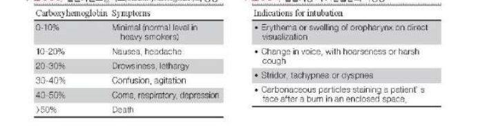{: style="width:80%"}

| COHb | 증상 |
|---|---|
| 0–10% | 거의 없음(흡연자 정상) |
| 10–20% | 오심, 두통 |
| 20–30% | 졸림, 기면 |
| 30–40% | 혼돈, 초조 |
| 40–50% | 혼수, 호흡 억제 |
| >50% | 사망 |

치료
- 의심되면 즉시 facial mask나 nasal cannula로 **100% 산소** → COHb 반감기를 단축.
- 상기도 부종이 진행하면 부종이 심해지기 전에 **조기 기관삽관**과 기도유지(필기: intubation & ventilation). 다만 뚜렷한 적응증 없이 예방적 삽관은 하지 않는다.
- 저산소혈증이 있으면 **호기말양압(PEEP)**이 도움이 된다.
- 예방적 항생제는 쓰지 않고, 폐렴이 생기면 MRSA, Pseudomonas, Klebsiella를 고려해 항생제를 쓴다.

### 상처치료
- **화상상처 드레싱**: 넓은 화상은 체온 저하를 막고, 작은 화상은 냉수로 식혀 통증을 줄인다. 수포는 작으면 두고, 크거나 터지면 제거한다. 화상 부위를 고정(splint)해 관절 구축을 막는다.
- **국소 항균제**:
  - 연고(salve or cream): **Silver sulfadiazine(Silvadene)** — 가장 널리 사용, 통증이 적고 그람음성·양성·Candida에 효과, 가피 투과력은 약함, **일시적 백혈구 감소증**, G6PD 결핍 시 주의. **Mafenide acetate(Sulfamylon)** — **가피 투과력이 좋아** 깊은 화상·귀 연골에, 통증이 있고 탄산탈수효소를 억제해 **대사성 산증**. 바시트라신·폴리믹신 등 석유 기반 연고는 얼굴 등 작은 화상에.
  - 용액(soak or solution): **0.5% silver nitrate**(넓은 스펙트럼, 가피 투과 못함, 저나트륨·저염소혈증, 검게 착색), Dakin solution(0.025% sodium hypochlorite).
- **생물학적 드레싱(biologic dressing)**: 돼지피부(xenograft), 사체피부(homograft), 인공진피, 양막 등으로 임시로 덮어 수분·단백 손실과 통증·감염을 줄인다.
- **화상창상 변연절제술(burn wound excision)**: 3주 안에 낫지 않을 심부 2도·3도는 **조기(대개 2–7일) 절제 후 피부이식**이 원칙(Janzekovic). 감염과 비후성 반흔을 줄이고 입원 기간을 줄인다.
  - 접선절제(tangential excision): 얇게 여러 번 깎아 점상출혈(punctate bleeding)이 보이는 건강한 진피까지.
  - 피부 전층 절제(full thickness excision): 지방층이 노출될 때까지.
  - 근막 위 절제(fascial excision): 지방층까지 깊은 화상, 생명을 위협하는 침습성 감염 때. 출혈은 적지만 윤곽 변형·림프부종이 남는다.
  - 출혈이 많다(TBSA 1% 절제당 100 mL 이상) → 한 번에 15–20%를 넘지 않게, 지혈대·에피네프린 거즈·fibrin spray 사용.
- **창상피복(burn wound coverage)**: 변연절제 후 **판상(sheet) 부분층 자가 피부이식**이 표준. 공여부가 모자라면(TBSA 40% 이상) **망상이식(mesh graft)**, 임시로 **동종(allograft)·이종(xenograft)** 이식, 장기적으로 **배양 상피세포(cultured epithelial autograft)** — 생착률 50–60%, 약하고 구축이 심하다. 진피를 보충하는 **인공진피**: Alloderm(사체 무세포 진피), Integra(소 콜라겐+GAG + 실리콘층, 2단계로 진피 형성 후 얇은 자가이식), Terudermis.
  - 대개 TBSA 15% 미만 전층화상은 조기 절제와 동시 자가이식.
  - 비후성 반흔 예방: 상처가 아물면 최소 6개월–1년 **압박의복**과 물리치료.

## 합병증

### 국소 합병증
- **구획증후군(compartment syndrome)**: 둘러싸인 폐쇄 공간에서 **조직압이 30–40 mmHg 이상** 증가 → 혈류·산소공급이 줄어 즉각 해결하지 않으면 조직이 괴사한다. 사지 둘레 전층화상에서 모세혈관 재충전 지연, 감각 이상, 맥박 감소 → 예방적 가피절개·근막절개. 복부구획증후군은 몸통 화상에서 과다 수액 시 복압 20 mmHg 이상 → 복부 긴장, 소변 감소, 환기 장애.
- **피부이식편 소실**: 혈종·감염·전단력(graft shear). 드레싱 교환은 대개 수술 후 3일째부터, 혈종이 있으면 빨리 째서 뺀다.
- **화상창상감염(infected burn)**: 창상이 변하거나 냄새·고름 → 생검·배양, 경험적 항생제. 침습성 감염은 변연절제가 필수.
- **반흔 구축과 비후성 반흔**: 심부 2도 이상, 3주 넘게 치유가 늦은 상처에서. 부목·압박치료·스테로이드 주사, 기능 장애가 있으면 반흔구축 해제술(대개 1년 후, 급하면 조기).

### 장기부전(Organ failure)
- **신부전(renal failure)**: 초기 혈량 감소, 화상 독소, 미오글로빈·혈색소 세관 침착. 필기: 신부전 → **신장으로 공급되는 혈액량 감소 → 사구체여과율(GFR) 감소**.
- **폐부전**: 흡입화상·폐렴·ARDS. 산소포화도 92% 이상 유지, 필요하면 인공호흡.
- **간부전**, **혈액 응고부전**(희석성 응고장애, DIC, 혈소판감소 → FFP·cryoprecipitate·혈소판).
- **스트레스 위궤양(Curling ulcer)**: 위점막 허혈 → 위산 분비 억제제(H2 차단제·PPI)와 조기 경장영양으로 **예방적 치료**.
- **패혈증(sepsis)**: 중증화상 사망의 가장 흔한 원인. 필기: **감염에 걸리지 않도록 조심**. 원인은 호흡기 감염, 창상감염, 카테터(정맥관 3–5일마다 교체) 감염.

!!! exam "기출 포인트"
    - 3번(2025) 보기 ①②④⑤(흡입화상·동반손상 평가, LR 사용, 소변량 0.5–1.0 mL/kg/hr, 스트레스 위궤양 예방)는 모두 옳은 처치였다 — 위 내용 그대로다.

# 2. 화학화상(Chemical burns)

## 특징 및 병태생리

화학물질에 노출되는 시간이 길어지고 중화·세척이 늦어지면 조직 손상이 계속 진행된다는 점이 열화상과 다르다. 손상 정도는 화학물질의 종류·농도·접촉 시간·조직 침투력에 따라 달라진다.

- **알칼리 화상(alkali burns)**: 수산화칼륨(KOH), 가성소다(NaOH), 석회(CaO), 표백제. 지방조직을 **비누화(saponification)**시켜 열 방출을 막고, 흡습성으로 세포 수분을 빼앗으며, 단백과 결합한 수산화이온이 더 깊이 침투해 **액화괴사(liquefactive necrosis)** → **깊고 넓게 진행**. 필기: **산화상보다 더 안 좋음**.
- **산 화상(acid burns)**: 단백이 응고되는 **응고괴사(coagulative necrosis)** → 응고된 가피가 장벽이 되어 상대적으로 덜 깊다. 단, **불산(hydrofluoric acid)**은 저칼슘혈증으로 치명적 부정맥, 포름산은 대사성 산증·용혈·ARDS, 탄화수소는 호흡억제와 간독성을 일으킨다.

## 치료

!!! key "핵심"
    화학화상의 손상을 줄이는 **가장 중요한 초기 치료는 즉각적이고 지속적인 창상 세척(물)**이다.

- 오염된 옷·장갑을 즉시 벗기고, 가루 형태면 먼저 털어 낸 뒤 물로 씻는다. 수돗물로 충분하며 대개 **15–20 L 이상**, 통증이 사라질 때까지 세척한다.
- 세척액의 pH를 재서 효과를 확인한다: 산은 pH 7 미만이면, 알칼리는 7.5 초과면 계속 세척 → **pH 7–7.5**에 이르면 종료. 알칼리는 조직 속에서 다시 배어 나오므로 변연절제 후 pH를 다시 확인한다.
- **알칼리 화상을 산(약산)으로 중화하지 않는다** — 중화반응의 **열**로 조직 손상이 더 심해진다. 필기: 산화상이니까 알칼리로 세척? **NO!** 가장 중성(neutral)인 **물**로 세척.
- 넓은 범위면 수액치료(열화상 원칙). 알칼리는 보기보다 깊어 수액을 더 주고, 산은 보기보다 얕아 덜 준다.
- 수술적 치료: 안정되면 괴사조직 변연절제, 국소 항생제, 이후 피부이식·피판술.

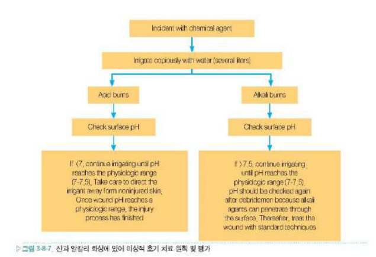{: style="width:62%"}

# 3. 전기화상(Electrical burns)

## 병태생리

전기에너지가 몸을 지나며 열로 바뀌어 조직을 손상시킨다. 눈에 보이는 피부 손상은 작지만 **저항이 낮은 심부조직**으로 전류가 흘러 속이 크게 다친다.

- 우리 몸에서 저항이 낮은 순서: **신경 < 혈관 < 근육 < 피부**(필기: 저항 낮은 조직 순서 = 신경–혈관–근육–피부). 피부는 저항이 커서 입구·출구를 빼면 손상이 적고, 전류는 근육·혈관을 따라 흐른다.
- 혈관으로 많이 흐르면 시간이 지나며 혈전 → 허혈성 조직 손상(필기: ischemia, 혈관 막혀서 2차적 괴사).
- 근육 손상 → **미오글로빈 방출 → 신부전(renal failure)**.
- 필기 check 포인트: **① EKG ② 혈관 ③ 근육**.

### 저전압 손상(Low-voltage, 1,000 V 이하)
- 낮은 전압에서는 **교류가 직류보다 위험**하다. 교류는 근육 강직(tetanizing) 효과로 전선을 잡은 손을 놓지 못한다(15 mA 이상).
- 가정용 전기(110–220 V) 화상은 대개 피부에 국한된 국소 손상.

### 고전압 손상(High-voltage, 1,000 V 이상)
- 입구·출구의 피부 손상 + **심부조직 손상**.
- 초기 심전도 이상이나 심정지가 있었다면 지속적인 심장 모니터링과 부정맥 치료가 필요하고, 대개 첫 24시간 내 재발한다. **심정지가 없었고 초기 심전도가 정상이면 심장 모니터링은 필요 없다.**
- 아크방전(arc)은 2,000–4,000℃로 옷에 불이 붙어 화염화상을 함께 입는다.

## 진단
병력을 들으면 쉽게 진단한다. 전류가 몸을 통과하면 반드시 **입구상처(entry wound)와 출구상처(exit wound)**가 생기며, 이 상처는 3도 이상으로 깊다(전류가 한 곳에 모이고 피부 저항이 높아 열이 많이 난다). 아크화상·섬광화상(flash burn)만 있으면 입구·출구가 없다.

## 치료

### 기도유지 및 심폐소생술
호흡중추 손상으로 무호흡·심실세동이 있으면 기관삽관과 심폐소생술.

### 수액치료(Fluid resuscitation)
- 겉보기 피부 손상보다 심부 손상이 훨씬 커서 **Parkland 공식으로 예측하면 수액이 모자란다**(대략 7 mL/kg/%TBSA 권고).
- 그래서 공식보다 **소변량**이 중요하다: 성인 **75–100 mL/hr**, 소아 2 mL/kg/hr 이상. 육안적으로 색소침착이 없는 맑은 소변이 나올 때까지 수액을 늘린다.
- 미오글로빈·혈색소가 사구체에서 걸러져 **색소침착(pigment precipitation) → 폐쇄성 신병증 → 급성신부전**을 막기 위해:
  1. 소변량을 높게 유지,
  2. **sodium bicarbonate로 소변을 알칼리화**(미오글로빈이 녹도록),
  3. 신관류를 늘리는 **삼투성 이뇨제 mannitol**(성인 25 g 6시간마다).

### 가피절개술이나 근막절개술(Escharotomy or fasciotomy)
심부조직 손상과 혈관 손상 → 시간이 지나며 부종·혈전증으로 조직 괴사가 진행 → **사지 말단 혈액순환을 지속 관찰**하고, 감소하면 즉각 **가피절개술이나 근막절개술**. 필요하면 신경 감압(carpal tunnel, Guyon canal release).

### 사지절단·창상치료
- 근막절개와 동시에 괴사 근육을 조기 변연절제, 48시간 후 재탐색해 이차 절제. 광범위 손상이면 조기 사지절단.
- 국소 도포제는 침투력이 좋은 **mafenide(Sulfamylon)**. 이후 피부이식, 뼈·건이 노출되면 피판술.

### 지연 합병증(Delayed complication)
조기·지연성 신경학적 손상(정기적인 신경검사), 뇌병증, 반신마비, 실어증(9개월까지 발생 가능), **백내장**(수개월–수년 뒤). 고전압 손상에서 주로 생기므로 미리 설명해야 한다.

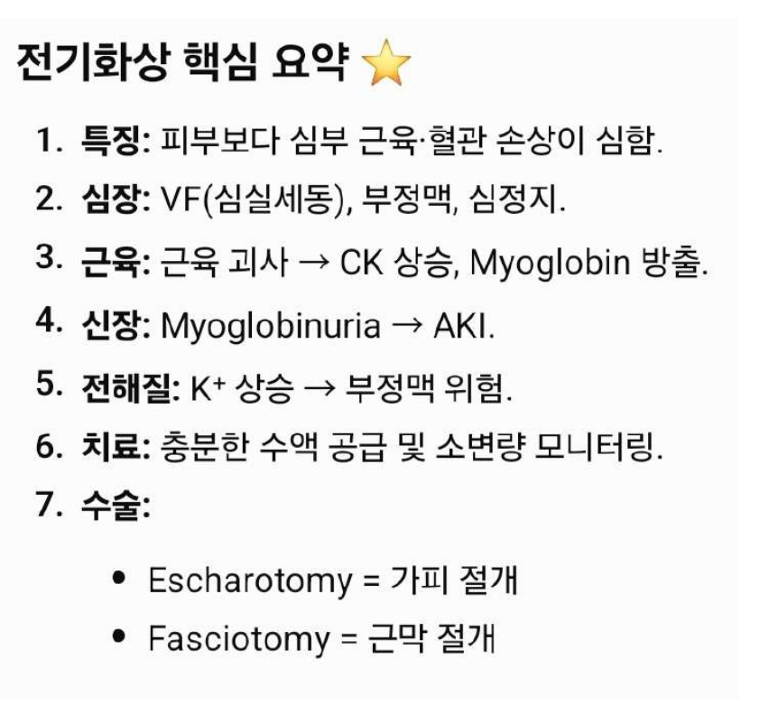{: style="width:62%"}

| | 내용 |
|---|---|
| 특징 | 피부보다 심부 근육·혈관 손상이 심함 |
| 심장 | 심실세동(VF), 부정맥, 심정지 → 심전도 필수 |
| 근육 | 근육 괴사 → CK 상승, 미오글로빈 방출 |
| 신장 | 미오글로빈뇨 → 급성신손상(AKI) |
| 전해질 | K 상승 → 부정맥 위험 |
| 치료 | 충분한 수액 + 소변량 모니터링(알칼리화, mannitol) |
| 수술 | Escharotomy(가피절개), Fasciotomy(근막절개) |

!!! exam "기출 포인트"
    - 4번(2025, 1,500 V): 정답 **④ 사지 말단 순환 감소 시 가피절개술·근막절개술**. 함정: 심전도가 필요 없다(①), 폐부종 때문에 수액 제한(②), **중심정맥압이 가장 중요한 지표**(③), 소변 **산성화**(⑤) — 모두 반대다.
    - 14번(2023, 1,500 V): 틀린 것 = **③ 수액요법의 중요한 지표는 중심정맥압**. 지표는 **소변량**이다. 심전도, 급성신부전을 염두에 둔 수액치료, 가피·근막절개, **지연성 신경 손상·백내장 설명**은 옳다.

# 4. 피부이식(Skin graft)

## 정의와 피부의 구조
피부이식은 피부가 결손된 부위를 덮기 위해 **혈류 공급이 차단된 상태**로 피부를 떼어(공여부) 다른 부분(수혜부)으로 옮기는 것이다. 이식편은 자기 혈관이 없으므로 수혜부 바닥에서 혈류를 받아 살아야 한다 — 이것이 생착 조건의 핵심이다.

- **표피(epidermis)**: 각질형성세포(keratinocyte)가 기저층에서 각질층으로 분화(basale → spinosum → granulosum → lucidum → corneum). 결손 시 basement membrane의 keratinocyte가 재생한다.
- **진피(dermis)**: 피부의 물리적 특성을 결정. 유두층(papillary dermis, 얇은 콜라겐·미세혈관, 표피와 맞물림)과 망상층(reticular dermis, 굵은 콜라겐)으로 나뉜다. 주된 콜라겐은 type I.
- 피부부속기: 모낭(hair follicle, bulge stem cell), 땀샘(sweat gland), 피지선(sebaceous gland) — 부분층 이식 후 공여부 상피는 이 부속기에서 재생한다.

## 피부이식의 종류

### 유전학적 분류
| 종류 | 정의 | 거부반응 |
|---|---|---|
| 자가이식(autograft) | 같은 사람 안에서 | 없음 |
| 동계이식(isograft) | 유전적으로 같은 개체(일란성 쌍둥이) | 없음 |
| 동종이식(allograft, homograft) | 같은 종의 다른 개체(사체 피부) | 있음 |
| 이종이식(xenograft, heterograft) | 다른 종(돼지 피부) | 강함 |

### 두께에 의한 분류
- **부분층 피부이식(split-thickness skin graft, STSG)**: 표피 + 진피 일부. 포함된 진피 양에 따라 얇은(thin) / 두꺼운(thick) STSG. 필기: thin = superficial, thick = dermis 절반.
- **전층 피부이식(full-thickness skin graft, FTSG)**: 표피 + 진피 **전층**.

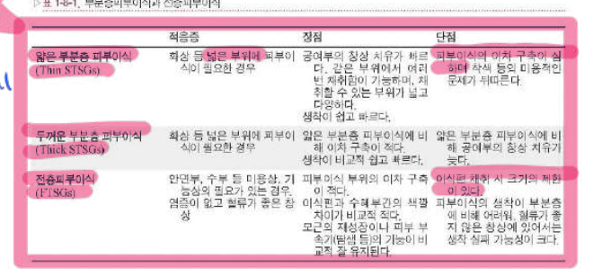{: style="width:80%"}

| | 적응증 | 장점 | 단점 |
|---|---|---|---|
| 얇은 STSG | 화상 등 **넓은 부위** | 공여부가 빨리 치유, 같은 부위에서 여러 번 채취, 채취 부위가 넓고 다양, **생착이 쉽고 빠름** | **이차 구축이 심하고** 착색 등 미용적 문제 |
| 두꺼운 STSG | 넓은 부위 | 얇은 STSG보다 이차 구축이 적음, 생착은 비교적 쉬움 | 얇은 것보다 공여부 치유가 늦음 |
| FTSG | **안면부, 수부 등 미용상·기능상 필요**, 염증 없고 혈류 좋은 창상 | **이차 구축이 적음**, 색깔 차이가 적음, 모근·땀샘 등 부속기 기능 유지 | **이식편 채취 시 크기의 제한**(공여부를 봉합해야 함), 생착이 어렵고 혈류 나쁜 창상에서 실패 가능성 큼 |

!!! exam "기출 포인트"
    - 19번(2021): "안면부·수부 등 미용·기능상 필요, **이차구축은 적으나 채취 크기에 제한**" → **전층피부이식(FTSG)**. 망상이식·동종이식은 이 설명과 무관.

## 임상적 적용
피부 결손을 방치하면 상피화와 수축으로 낫는 동안 감염에 취약하고, 반흔구축으로 기능·미용 결함이 생기며, 오래되면 **Marjolin's ulcer** 같은 피부암으로 변할 수 있다. 그래서 큰 창상은 피부이식으로 일찍 덮는다.

## 공여부의 선택, 채취 방법 및 처치

### 부분층 피부이식
- 얼굴을 제외한 모든 부위에서 채취 가능 — 흔히 **대퇴부, 둔부, 복부, 배부, 두피, 내측 상완부**. 수혜부에 가까울수록 색이 잘 맞는다.
- 도구: free knife(razor, Humby knife), 드럼형 피부절제기(Padgett dermatome), **powered dermatome**(전기·공기). 두께 0.1–1.0 mm 사이로 조절.
- 공여부는 에피네프린 거즈로 지혈 후 드레싱, 2–3주면 상피화된다.

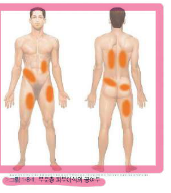{: style="width:46%"}

### 전층 피부이식
- 공여부는 일차봉합해야 하므로 여유가 있는 곳: **귀 뒤(postauricular), 쇄골 상부, 상안검, 서혜부, 주관절부, 손목 주름, hypothenar area, 회음부** 등. 얼굴에는 색·질감이 맞는 귀 뒤·쇄골 상부가 좋다.
- 형판(template)을 만들어 그 모양대로 채취하고 지방을 제거한다.

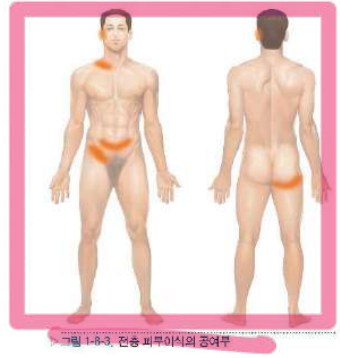{: style="width:46%"}

## 기타 이식 방법

### 망상 피부이식(Meshed skin graft)
부분층 이식편에 mesher로 일정한 구멍을 내어 1:1.5–1:9까지 늘린다. 공여부가 부족한 **넓은 화상**, 굴곡이 심하거나 출혈·삼출이 많은 부위에 쓴다(구멍으로 혈액·삼출액이 빠짐). 구멍 사이는 상피화로 메워져 그물 모양 흉터가 남고 구축이 커서 **얼굴·관절 부위에는 피한다**.

### 복합이식술(Composite graft)
**두 가지 이상의 조직층**을 포함하는 이식 — 피부와 연골, 전층 피부·지방 등을 함께 옮긴다. 필기: **혈관은 안 옮김**(피판과의 차이). 혈장흡수기에 영양분이 확산해야 하는 거리가 길어 생착률이 떨어지므로 **직경 1 cm 이하**가 이상적이다. 비첨부(nasal tip), 비익부(ala) 재건에 주로 쓰고 어린이에서 생존율이 높다.

## 성공적인 피부이식이 되기 위한 조건

### 수혜부의 조건
- 이식편의 재혈관화(revascularization)는 수혜부 상태로 결정된다 → **수혜부 바닥에는 혈류량이 좋은 혈관의 수와 분포가 많아야 한다.**
- 방사선 조사, 당뇨 등으로 혈류가 적은 조직은 생착이 어렵다 → 수술 전 처치로 **건강한 육아조직**을 만든다.
- **골막이 없는 뼈, 연골막이 없는 연골, 건초(paratenon)가 없는 건, 신경외막이 없는 신경**은 혈류가 없어 피부가 생착하지 않는다. 필기: periosteum(골막), perichondrium(연골막) → good blood supply이므로 **보존해야 한다**. 최근에는 진피대체물이나 음압창상치료(NPWT)로 육아조직을 만들어 이식하기도 한다.
- 수혜부의 **괴사조직은 혈관이 자라 들어가는 것을 방해**한다 → 제거.
- 만성 창상은 오염되어 있으므로 조직 1 g을 배양해 **세균이 10⁵개를 넘으면 수술을 연기**하고 soaking dressing·변연절제로 세균 수를 줄인다.

### 피부이식과 수혜부 간의 접착
- 이식편이 생착하려면 **수혜부와 잘 접촉(밀착)**해야 한다. 첫 72시간은 fibrin으로 붙어 있다가 이후 섬유조직·혈관이 자라 들어간다.
- 이 기간에 **수혜부와 이식편 사이에 움직임**이 있으면 생착이 어렵다(전단력).
- 필기: **seroma(장액종)가 있어도 잘 안 붙는다** — 혈종·장액종은 이식편을 바닥에서 들어 올린다.

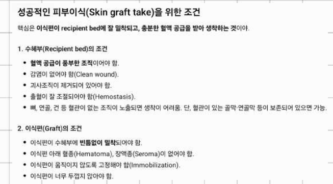{: style="width:80%"}

!!! memo "암기"
    **생착 조건** — 수혜부: 혈류 풍부 / 감염 없음(clean) / 괴사조직 제거 / 지혈 완벽 / 골막·연골막·건초·신경외막 보존
    이식편: 빈틈없이 **밀착** / 아래에 **혈종·장액종 없음** / 움직이지 않게 **고정** / 너무 두껍지 않게

!!! exam "기출 포인트"
    매년 같은 보기를 옳고 그름만 바꿔 낸다(1·6·16·20·25번).
    - 옳은 것: 혈류 좋은 혈관이 많아야 한다 / 수혜부와 잘 접촉 / 움직임이 있으면 생착이 어렵다 / 괴사조직은 혈관이 자라 들어가는 것을 **방해**한다 / 오염을 처치해 세균 수를 줄인다.
    - 틀린 것(함정): 혈종이 **있어야** 한다 / 수혜부와의 **간극이 필요**하다 / 움직임은 생착과 **관련 없어 조기 운동 가능** / 골막 없는 뼈·연골막 없는 연골에도 **생착된다** / 괴사조직이 혈관 성장을 **촉진**한다 / 건강한 육아조직이 **방해**된다 / 골막·연골막·건초·신경외막을 **모두 제거**해야 한다(6번, 2024).

## 피부이식편의 고정과 드레싱

### 고정 방법
이식편이 움직이지 않도록 너무 당기지도 느슨하지도 않게, 수혜부의 가장자리와 바닥에 **빈 공간 없이** 붙도록 봉합(세 지점 고정, three point fixation). 봉합 대신 스테이플러나 피부 접착제(sealant)를 쓰기도 한다.

### 드레싱 방법(Dressing)

1. **Tie-over(bolster) dressing — 봉합드레싱**: **비교적 작은 크기의 피부이식**에 적합하고 **얼굴이나 수부처럼 움직임이 많은 부위**에 특히 유용. 봉합사를 길게 남겨 이식편 위에 바셀린 거즈와 솜(또는 거즈)을 올리고 실을 서로 묶어 눌러 고정한다. 4–5일 후 첫 드레싱.
2. **Skin graft inlay**: 필기 **"깊은 공간"**. 볼고랑(buccal sulcus), 바깥귀길, 코 내측면, 질강(vagina)처럼 **깊숙이 들어간 곳**에 이식할 때, 미리 **Silastic이나 dental compound로 틀(mold)**을 만들어 이식편의 진피면이 바깥을 향하게 덮어 씌워 수용부에 고정한다. 이식편이 수축하지 않도록 틀을 **6개월간** 끼워 둔다(질 무형성증 치료 등).
3. **Skin graft outlay**: inlay에 대칭되는 방법 — tie-over 드레싱을 할 때 솜 대신 **dental compound로 만든 틀**을 쓴다. 결손 부위보다 **더 넓은 이식편**을 옮겨 나중에 수축되어도 면이 평평해지게 한다.
4. **개방 드레싱(open dressing)**: 넓은 개방상처를 이식편으로 덮은 뒤 드레싱 없이 그대로 두는 간편한 방법. 출혈·액체가 고이지 않고 환자가 협조적일 때. 장액종·혈종이 생기면 끝이 뾰족한 칼로 찔러(stab incision) 빼낸다.
5. **생리학적 드레싱(biologic dressings)**: 창상을 임시로 덮어 수분 손실·감염을 막는다. 동종(사체 피부, 양막) — 면역억제가 없으면 7–10일 후 거부반응, 이종(돼지 피부) — 생착 전에 거부. 실리콘 중합체 같은 합성 피부대체물도 있다.
- 필기: 여기에 **압박 드레싱(compressive dressing)**도 추가.

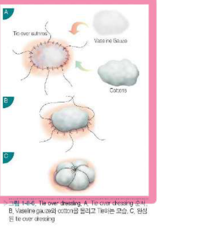{: style="width:46%"}

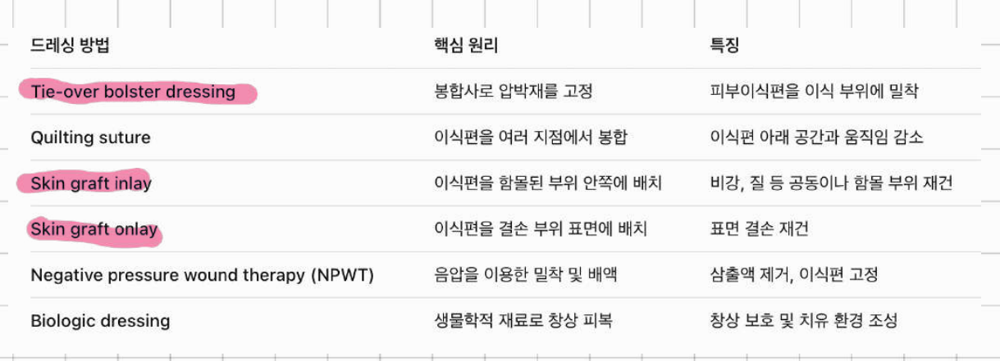{: style="width:80%"}

| 드레싱 | 핵심 원리 | 특징·적응 |
|---|---|---|
| Tie-over bolster | 봉합사로 압박재를 고정 | 작은 이식편, 얼굴·손 |
| Quilting suture | 이식편을 여러 지점에서 봉합 | 아래 공간과 움직임 감소 |
| Skin graft **inlay** | 함몰 부위 **안쪽**에 틀로 배치 | 비강·질 등 공동 재건 |
| Skin graft **outlay** | 결손 부위 **표면**에 배치 | 표면 결손 재건 |
| NPWT | 음압으로 밀착·배액 | 삼출액 제거, 고정 |
| Biologic dressing | 생물학적 재료로 피복 | 창상 보호, 치유 환경 |

!!! exam "기출 포인트"
    - 5번(2024)·24번(2020): "비교적 작은 이식, 얼굴·수부처럼 움직임 많은 부위" → **봉합드레싱(tie-over, bolster)**.
    - 15번(2022, 필기본 수록): "볼고랑·바깥귀길·코 내측·질강, Silastic/dental compound 틀" → **skin graft inlay**. inlay(안쪽, 깊은 공간)와 outlay(표면)를 바꿔 내는 함정에 주의.

## 수술 후 관리
- 수술 24시간 후 드레싱을 풀고 이식편 아래 혈종·액체가 고여 있으면 **찔러서(stab incision)** 빼낸다. 감염이 있거나 삼출이 많으면 개방하거나 24–48시간마다 드레싱 교환.
- 2–4일째 미열, 냄새, 주변 발적, 통증 → 감염. **A군 β용혈성 연쇄상구균**은 이식편을 녹이므로 전신 항생제, 녹농균은 국소 polymyxin.
- 구축 예방: 기능적 위치(functional position)에 두고 부목. 목 앞·입 안·코 안·질 안은 6개월, 어깨·손가락 굴곡면·무릎 뒤·팔꿈치 앞은 2–3개월. 다리 이식은 1–2주 걷지 않게 한다.

## 피부이식편의 생착 기전
1. **혈장 흡수기(phase of plasmatic imbibition)**: 혈관 재개통 전 **1–2일** 동안 이식편은 섬유소(fibrin)로 수혜부에 붙어 확산(diffusion)으로 혈장의 영양분과 산소를 받아 산다.
2. **혈관재개통(revascularization)**: 이식 후 **24–48시간 후부터** 시작. 세 가지 이론 — ① 수혜부와 이식편의 잘린 혈관이 만나 연결되는 **혈관 접합(inosculation)**, ② 수혜부에서 새 혈관이 자라 들어가는 **신생혈관화(neovascularization)**, ③ 이식편의 퇴화한 혈관의 기저판을 통해 내피세포가 자라 들어가는 것. 48시간 내 시작해 **4일째 혈액순환**, **1개월에 완성**. 림프배액은 4–5일.
이 시기에 혈종·액체가 고이면 재개통이 지연·실패하므로 앞서 말한 대로 제거한다.

## 이식된 피부의 특성
이식된 피부는 대개 **공여부의 특성을 유지**하지만, **감각과 발한은 수혜부의 특성**을 따른다.

- **수축**
  - **일차수축(primary contraction)**: 공여부에서 떼어 내자마자 진피의 탄력섬유 때문에 이식편 넓이가 줄어드는 것. **전층 피부(41%)가 얇은 부분층(9%)보다 더 심하다.**
  - **이차수축(secondary contraction)**: 수혜부 바닥의 **근섬유모세포(myofibroblast)**에 의한 수축으로, 이식 후 **10일째부터 6개월까지** 지속된다. **이식 피부가 두꺼울수록, 수혜부 바닥이 단단할수록, 생착이 잘 될수록 이차수축이 적다** → 전층·두꺼운 이식, 관절 부위는 4–6개월 부목.

!!! key "핵심"
    일차수축은 **전층 > 부분층**, 이차수축은 **부분층(얇을수록) > 전층**. 기출이 묻는 "이차구축이 적다"는 전층 피부이식의 장점이다.

- **색상**: 공여부의 색을 유지하지만 부분층 이식은 과색소침착이 잘 생긴다(멜라닌세포 자극). 햇빛을 6개월–1년 피한다. 얼굴은 귀 뒤·쇄골 상부처럼 가까운 부위의 피부가 색이 잘 맞는다.
- **상피부속기**: 모낭·땀샘은 전층 또는 두꺼운 부분층 이식에서 기능이 남는다(모발 8–10주 후).
- **감각**: 이식 후 4주 이후 주변과 바닥에서 신경이 자라 들어오며, **통각(pain)이 가장 먼저** 회복되고 촉각, 열·냉각, 두 점 식별 순. 3주–2년 사이 회복, 두꺼울수록 감각 회복은 좋으나 느리다.
- **내구성**: 두꺼울수록 좋다. **성장**: 소아의 전층 이식은 신체 성장과 함께 자라지만 부분층은 덜 자란다.

## 합병증

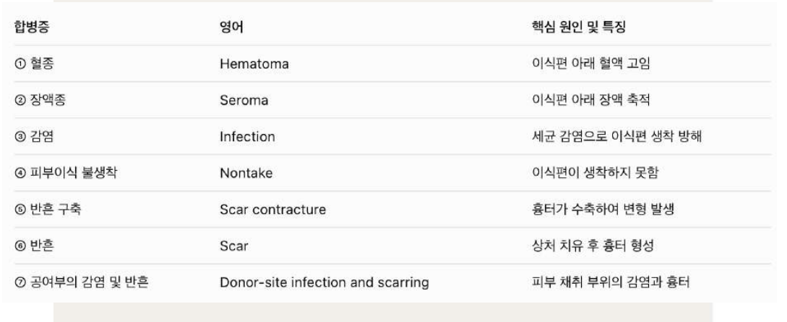{: style="width:80%"}

1. **혈종(Hematoma)**: **피부이식 후 발생할 수 있는 가장 흔한 합병증이며 피부이식 실패의 가장 흔한 원인.** 이식편을 바닥에서 들어 올려 혈관이 자라 들어가지 못하게 한다. 예방은 수술 중 철저한 지혈과 드레싱 시 확인, 생기면 slit incision이나 새 절개로 제거.
2. **장액종(Seroma)**: 혈장 흡수는 생착에 필수지만 과다한 혈장이 고이면 생착을 방해한다. 혈종보다 제거가 쉽다(slit incision).
3. **감염(Infection)**: 이식편이 녹아내리며 실패. 분비물 배양, 항생제 연고, 은 함유 드레싱, 드레싱 자주 교환.
4. **피부이식 탈락(Nontake)**: 영양부족, 혈관염, 전신 질환 등으로 혈관 재생이 방해되어 이식편이 괴사.
5. **반흔 구축(Scar contracture)**: 이차수축이 6개월 넘게 계속되어 관절 운동 제한 → 이완술.
6. **반흔(Scar)**: 색 차이, 구축, 높낮이 차이 → 공여부를 잘 고르고 진피를 고려.
7. **공여부의 감염 및 반흔**: 공여부 통증·삼출, 비후성 반흔.

!!! exam "기출 포인트"
    - 9번(2023): "가장 흔한 합병증이자 피부이식 실패의 가장 흔한 원인" → **혈종(hematoma)**. 장액종·감염과 헷갈리게 냈다.

# 5. 피판(Flap)

## 피판의 정의와 분류
피판은 **그 혈관 구조물을 이용할 수 있도록 구성된 조직**이다 — 피부이식과 달리 **자기 혈관(혈관경, pedicle)을 달고** 옮겨져 바닥의 혈류에 의존하지 않는다. 그래서 뼈·건·연골이 노출된 곳(피부이식이 생착하지 않는 곳)을 덮을 수 있다. 피부, 근막, 근육, 뼈 등 여러 조직을 포함할 수 있다.

### 혈관 형태에 따른 분류
- **무작위성 피판(random pattern flap)**: 이름 있는 혈관 없이 진피하 혈관총으로 산다 → 길이:너비 비율의 제한이 있다(Milton이 길이:너비 비율보다 혈관이 중요함을 보임). **전진피판(advancement, V–Y)**, **회전피판(rotation)**, 전위피판, 양경피판, keystone 피판.
- **축성 피판(axial pattern flap)**: 이름 있는 혈관줄기를 따라 설계해 길게 만들 수 있다.

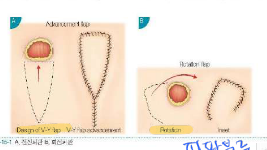{: style="width:62%"}

### 거리(이동)에 따른 분류
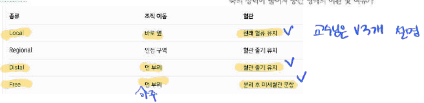{: style="width:62%"}

| 종류 | 조직 이동 | 혈관 |
|---|---|---|
| **Local(국소)** (설명) | 바로 옆 | 원래 혈류 유지 |
| Regional(구역) | 인접 구역 | 혈관 줄기 유지 |
| **Distal(원격)** (설명) | 먼 부위 | 혈관 줄기 유지 |
| **Free(유리)** (설명) | 먼 부위(아주 먼 곳도 가능) | **분리 후 미세혈관 문합** |

필기: 교수님은 local, distal, free 세 가지를 설명하셨다.

## 근육과 근육피부 피판 — Mathes–Nahai 분류
1981년 Mathes와 Nahai가 근육으로 들어가는 혈관줄기의 수와 우세성에 따라 다섯 가지로 분류했다.

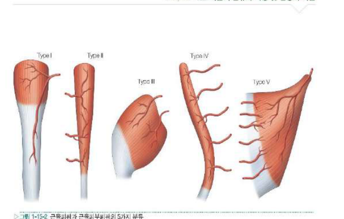{: style="width:62%"}

| Type | 혈관 | 예 |
|---|---|---|
| I | 한 개의 주된 혈관줄기 | gastrocnemius, tensor fascia lata, vastus lateralis |
| II | 우세 혈관줄기 + 작은 혈관줄기(가장 흔함) | gracilis, trapezius, soleus |
| III | 두 개의 우세 혈관줄기 | **rectus abdominis**, gluteus maximus, serratus anterior |
| IV | 분절성 혈관줄기 | sartorius, tibialis anterior |
| V | 한 개의 우세 + 분절성 보조 혈관 | **latissimus dorsi**, pectoralis major |

- 근육피부 피판의 장점: 혈관줄기가 명확, 결손 부위에 가까워 이동이 쉬움, 노출된 뼈·건·인공물을 채우는 부피, 세균 오염에 강함, 한 번에 수술 가능.
- 단점: **공여부의 기능 손실**, 부피가 커서 미용적으로 불리.

## 천공지 피판(Perforator flap)
근육피부 피판을 개량해 **근육을 공여부에 남기고** 피부·지방을 공급하는 **천공지(perforator) 혈관만** 근육 사이로 박리해 올리는 피판이다. 예: TRAM(근육 포함) → muscle-sparing TRAM → **DIEP(심부하복벽동맥 천공지 피판, 근육 없음)**.

- 정의: 천공지 피판은 피부 및/또는 피하지방을 포함하는 피판이며, 혈관은 고립된 천공지(근육이나 격막을 뚫고 나오는 혈관)다. 근육을 뚫고 나오면 근육 천공지, 격막 사이로 나오면 격막 천공지 피판. 피판 이름은 혈관 이름(예: DIEP, TAP, SGAP)이나 위치(ALT, 전외측대퇴)로 짓는다.
- 자유형(free-style) 접근: 도플러로 천공지를 찾아 그 위에 피판을 디자인할 수 있다 → 디자인이 자유롭다.

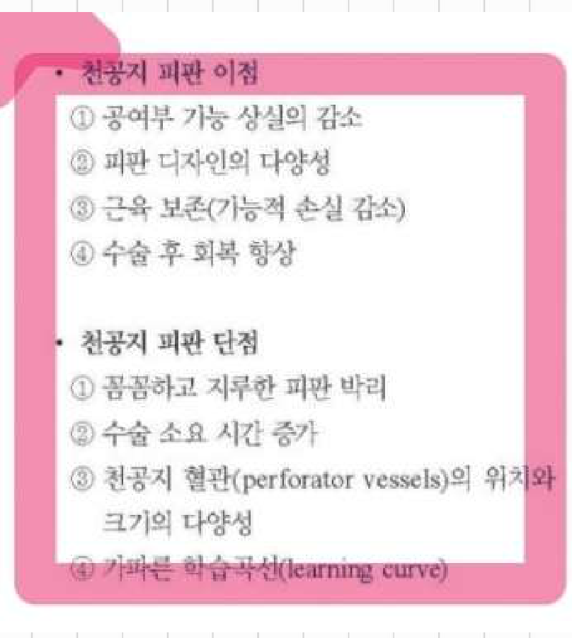{: style="width:62%"}

!!! memo "암기"
    **천공지 피판 이점**: ① 공여부 기능 상실의 감소 ② 피판 디자인의 다양성 ③ 근육 보존(기능적 손실 감소) ④ 수술 후 회복 향상
    **천공지 피판 단점**: ① 꼼꼼하고 지루한 피판 박리 ② 수술 소요 시간 증가 ③ 천공지 혈관(perforator vessels)의 위치와 크기의 다양성 ④ 가파른 학습곡선(learning curve)

헷갈리는 짝: **"피판 디자인의 다양성"은 장점**(어디서든 천공지를 찾아 디자인), **"천공지 혈관의 위치와 크기의 다양성"은 단점**(사람마다 달라 수술 전 CT 혈관조영·도플러가 필요하고 박리가 까다롭다). 둘 다 "다양성"이라 매년 함정이 된다.

!!! exam "기출 포인트"
    6년 연속 출제(2·7·10·17·22·26번).
    - "단점은?" → 가파른 학습곡선(2번, 10번), 꼼꼼하고 지루한 박리(17번).
    - "단점으로 보기 어려운 것은?" → **피판 디자인의 다양성**(7번, 22번).
    - "이점으로 보기 어려운 것은?" → **천공지 혈관의 위치와 크기의 다양성**(26번).

## 피판을 이용한 재건
- **수술 전 계획**: 결손의 위치·크기·구성 조직, 환자 전신 상태(흡연, 당뇨, 비만, 방사선 치료), 공여부 합병증을 고려해 가장 단순하면서 기능·형태를 살리는 방법을 고른다. 결손을 같은 조직으로 대체(like with like). **CT 혈관조영술**은 천공지의 위치·크기·주행을 보여 주는 표준검사.
- **피판 선택을 돕는 요소**(Tolhurst 분류): 순환(circulation), 구성(composition: 피부·근막·근육·뼈 등), 거리(contiguity: local·regional·distant), 구성 방식(construction: 경, 양경, 순행·역행 등), 조건화(conditioning: 지연·확장 등), 형태(conformation).
- **수술 중 기법**: 환자 자세, 이식 혈관 준비, 문합 전 혈관 박리 시 비틀림·긴장 없게, 배액관 거치.
- **수술 후 관리**: 피판 색·온도·모세혈관 재충전·핀프릭 출혈 관찰(초기 24–72시간이 가장 중요), 도플러. 피판이 눌리지 않게 자세, 하지는 서서히 dependent 훈련. 저체온·저혈량·통증(혈관수축) 피하기, 흡연 금지.
- **합병증**: 피판 부분·전체 괴사(주로 정맥 울혈이나 동맥 혈전), 혈종, 장액종, 감염, 공여부 손상. 혈관 문제는 빨리 재수술해야 살릴 수 있다.

!!! exam "기출 포인트"
    - 21번(2021): **유경 TRAM(pedicled TRAM)의 혈관경 = 상복벽동맥(superior epigastric)**. 유리(free) TRAM·DIEP는 우세한 **심부하복벽동맥(deep inferior epigastric)**을 미세문합한다. 복직근은 Mathes–Nahai **type III**(혈관줄기 2개)여서 위쪽 혈관만으로도 옮길 수 있다.

# 6. 조직공학(Tissue engineering)

## 정의
조직공학은 생명과학·의학·공학을 융합해, 조직의 기능을 회복·유지·향상시키는 생물학적 대체물을 개발하는 학문이다. 자가 조직 이식은 공여부 손상과 양의 한계가 있고, 동종이식은 거부반응이 있어 이를 극복하려는 것이다. 세포를 **스캐폴드(scaffold, 지지체)**에 심어 배양한 뒤 몸에 이식하면 세포가 증식·분화하며 원하는 조직을 만든다. 재생의학과 거의 같은 개념이다.

## 조직공학의 필수 구성요소

!!! memo "암기"
    **조직공학의 3요소** = ① **세포** ② **기질-세포지지체(= scaffold)** ③ **세포 생존을 위한 혈류(혈관 신생, 영양 공급)**
    (필기 그대로. 교과서에 따라 성장인자 등 신호물질을 넣기도 한다.)

### 세포
- 초기에는 각질형성세포, 섬유모세포, 연골세포 같은 **성체세포**를 썼지만 배양 중 성질이 바뀌고 증식에 한계가 있어, 최근에는 증식·분화 능력이 큰 **줄기세포**를 주로 쓴다.
- 골수 중간엽줄기세포는 처음 쓰였지만 얻기 어렵고 양이 적다. **지방줄기세포**는 지방흡입으로 쉽게 많이 얻고(지방 100 mL에서 2 × 10⁶–10⁷개), 지방을 콜라게나제로 처리한 **기질혈관분획(stromal vascular fraction, SVF)**에 들어 있다. 표지자 CD29, CD44, CD90, CD146(CD24가 특이적이라는 보고). 면역 표지(MHC class II)가 없어 동종 사용 가능성도 연구된다.
- 배아줄기세포는 윤리 문제, iPSC(유도만능줄기세포)는 종양화·바이러스 벡터의 안전성 문제가 남아 있다.

### 기질-세포지지체(Scaffold)
- 세포가 붙어 자라고 조직 모양을 유지하게 하는 3차원 구조물. 조건: **생체적합성**, 적절한 속도로 **생분해**, 세포가 붙고 이동할 **다공성**(세포·혈관이 들어올 수 있게 100–300 μm 이상의 구멍), 재생할 조직과 비슷한 **기계적 강도**.
- 재료: 천연(콜라겐, 피브린, 히알루론산, 키토산, 알지네이트, 무세포 진피) / 합성(PLA, PGA, PLGA, PCL — 분해 속도와 강도를 조절 가능하나 분해산물이 염증 유발).
- 기질의 강도가 줄기세포 분화 방향에 영향을 준다(부드러우면 신경, 중간이면 근육, 단단하면 뼈).

### 혈관 신생·영양 공급
- 대부분의 세포는 혈관에서 **150–200 μm** 이내에 있어야 산소·영양을 확산으로 받는다. 연골·각막처럼 얇거나 혈관 없는 조직 외에는, 두꺼운 조직을 만들려면 **혈관이 빨리 자라 들어와야** 이식된 세포가 산다.
- 방법: 혈관 성장인자(VEGF, bFGF 등) 방출 스캐폴드, 혈관을 미리 만들어 넣는 prevascularization, 내피세포·혈관내피전구세포 함께 이식, 혈관이 풍부한 곳에 먼저 묻었다가 옮기기.

!!! exam "기출 포인트"
    - 27번(2020): 조직공학 3요소가 **아닌** 것 = **외과적 지연처치(surgical delay)**. 지연처치는 유경 피판의 생존 길이를 늘리려고 미리 일부를 절개해 두는 **피판 수술 기법**(16장)이다. 세포, 기질-세포지지체, 세포 생존을 위한 혈류가 3요소.

## 조직공학으로 재생할 수 있는 조직(요약)
- **피부**: 가장 먼저 상용화. 배양 표피(Epicel), 진피 대체물(Dermagraft, Apligraf — 섬유모세포와 각질형성세포를 함께 배양), 무세포 진피(AlloDerm).
- **지방**: 지방줄기세포 + 스캐폴드로 연부조직 결손 재건. 이식 지방은 시간이 지나면 흡수되는 문제.
- **근육**: 근육위성세포·줄기세포 + 스캐폴드, 아직 연구 단계.
- **신경**: 신경도관(콜라겐 튜브 등)에 Schwann 세포·줄기세포·성장인자를 넣어 10 mm 이상 결손 재생 시도.
- **혈관**: 탈세포화 혈관, 합성 스캐폴드에 내피세포 배양.
- **뼈**: 골전도(hydroxyapatite, TCP) 스캐폴드 + 골형성단백(BMP)·줄기세포.
- **연골**: 자가 연골세포 이식, 하이드로젤 스캐폴드.
- **요로기계**: 방광 재건(자가 요로상피·평활근 세포를 스캐폴드에 배양).
- 요약: 1990년대 초 Vacanti 형제(쥐 등의 사람 귀 모양 연골)가 조직공학의 출발점. 줄기세포·3D 프린팅·생체재료의 발달로 임상 적용이 넓어지고 있다.

## 인공삽입물과 생체재료(Implants and biomaterials)
- 의료용 인공삽입물은 손상된 생체조직을 보강하거나 대체하기 위한 의료 기구(인공관절, 성형외과의 실리콘 보형물 등). 미국 NIH는 생체재료를 "조직이나 기능을 보강·대체할 목적으로 일시적·영구적으로 몸에 넣는 물질"로 정의한다.
- **이상적인 인공삽입물의 조건**: 염증·이물반응이 없을 것, 대체하는 조직과 비슷한 물리적 성질(강도·탄력), 화학적으로 안정, 발암성·알레르기 없음, 감염에 강함, 원하는 모양으로 쉽게 만들고 멸균 가능, 저렴.
- 종류
  - **금속(metals)**: 스테인리스강(골절 고정), 코발트-크롬, **티타늄**(가볍고 생체적합성·내부식성이 좋아 가장 널리 사용, CT·MRI 인공음영 적음), 금·백금(눈꺼풀 무게추).
  - **중합체(polymers)**: **실리콘**(PDMS, 유방·안면 보형물 — 피막구축 문제), **ePTFE(Gore-Tex)**(조직이 자라 들어와 고정), 폴리에스테르(Mersilene, Dacron 인공혈관), 폴리프로필렌(Prolene mesh), 고밀도 폴리에틸렌(Medpor — 다공성으로 조직이 자라 들어옴), 흡수성 PLA·PGA·PLGA(흡수성 고정판).
  - **세라믹(ceramics)**: hydroxyapatite, tricalcium phosphate — 골전도성, 부서지기 쉬워 하중 부위에는 부적합.
  - **접착제(adhesives and glues)**: 피브린 조직접착제, cyanoacrylate(빨리 굳고 강하나 염증 유발 가능).
  - **피부대체제(skin substitutes)**: Integra(소 콜라겐 + GAG + 실리콘층), Biobrane, 배양 표피, 진피 대체물.
  - **생체인공삽입물(bioprosthetics)**: 동물·사람 조직을 무세포화(돼지 진피, 소장 점막하층 등).

# 7. 줄기세포 재생의학(Stem cells and regenerative medicine)

## 줄기세포의 정의

!!! key "핵심"
    **줄기세포(stem cell)란 한 개의 세포에서 무수히 반복 증식하여 다량의 세포로 복제될 수 있는 세포로, 자가 재생능력을 가지고 있고, 스스로 또 다른 줄기세포를 만들 수 있는 클론 형성 능력을 보유하고 있어야 한다. 또한 다양한 인체 내의 세포로 분화될 수 있는 능력을 가진 세포를 말한다.**
    → 네 가지 특징: ① **무수한 반복 증식** ② **자가 재생능력(self-renewal)** ③ **클론 형성 능력** ④ **다분화능(differentiation)**. 그리고 ⑤ **역분화(리프로그래밍)로도 만들 수 있다**(iPSC).

- 일반 체세포는 일정 횟수 분열하면 노화(senescence)해 멈추거나 자멸(apoptosis)하지만, 줄기세포는 분열 후에도 줄기세포 상태를 유지하며 계속 증식한다.

!!! exam "기출 포인트"
    매번 정의 문장을 그대로 쓰고 한 보기만 비튼다(11·18·23번).
    - 11번(2023): "한 개의 세포에서 반복 증식 후 **노화의 과정을 거쳐 자멸(apoptosis)**한다" → 틀림(체세포의 특징).
    - 23번(2021): "**역분화로는 줄기세포 생성이 되지 않는다**" → 틀림(iPSC가 바로 역분화로 만든 줄기세포).
    - 18번(2022): "**자가 재생능력이 없어 증식이 어렵다**" → 틀림.

## 줄기세포의 중요성
성형외과는 자가 조직을 옮겨 재건하는 과라 줄기세포가 특히 중요하다. 지방·골수에서 얻은 줄기세포로 두개안면 재건(골 결손), 만성 창상, 종양 절제 후 결손, 유방 재건, 외상 등에 쓰인다. 골 형성에 BMP-2를 함께 쓰는 연구도 있다.

## 분화능에 따른 분류

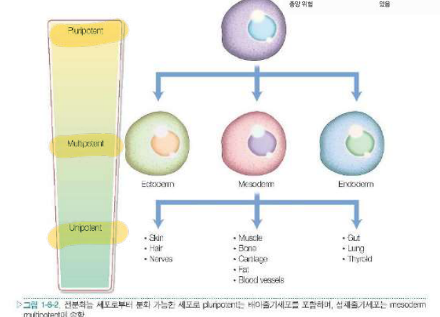{: style="width:62%"}

- **만능(pluripotent)**: 세 배엽(외배엽·중배엽·내배엽)의 모든 세포로 분화 — 배아줄기세포, iPSC.
- **다능(multipotent)**: 한 배엽 안의 여러 세포로 분화 — 중간엽줄기세포(지방·골수, 중배엽: 근육·뼈·연골·지방·혈관).
- **단능(unipotent)**: 한 종류 세포로만 분화.
- (전능 totipotent: 수정란처럼 태반까지 만드는 세포.)

## 배아줄기세포(Embryonic stem cells, ESC)
- 수정 후 배반포(blastocyst) 내부세포괴에서 얻는다. 장기간 미분화 상태로 자가 재생, **모든 세포로 분화(pluripotent)**.
- 임상 적용의 문제: **배아 파괴에 따른 윤리 문제**, 동종이라 **면역 거부반응**, 분화가 덜 된 세포가 남으면 **기형종(teratoma) 같은 종양 형성** 위험. 척수손상 환자에게 올리고덴드로사이트 전구세포를 이식한 임상시험(Geron) 등이 있었다.

## 지방줄기세포(Adipose stem cells, ASC)
- 필기: origin = **mesenchyme(중간엽)**, **pluripotent가 아니라 multipotent**.
- 지방흡입으로 얻은 지방을 세척·콜라게나제 처리 후 원심분리 → 아래에 가라앉은 **기질혈관분획(SVF)**에 지방줄기세포가 들어 있다(적혈구·내피세포·혈액세포도 섞임). 배양 플라스크에 붙는 세포를 키운다.
- 표지: 양성 **CD73, CD90, CD105**(+ CD29, CD44), 음성 CD45, CD34, CD14, CD11b, CD19, HLA-DR. FACS로 표면 항원을 이용해 원하는 세포만 골라낸다.
- 지방, 뼈, 연골, 근육, 혈관 등으로 분화. 쉽게 많이 얻을 수 있어 성형외과 임상에서 가장 활발히 쓰인다 — 두개골 결손 재건, 지방이식의 생착률 향상(세포보조 지방이식), 연부조직 재건.

## 골수줄기세포(Bone marrow stem cells)
- 골수의 중간엽줄기세포. 가장 먼저 연구된 성체줄기세포로 비교 기준이 된다. Ficoll 밀도 구배 원심분리로 단핵세포를 분리해 배양 플라스크에 붙는 세포를 키운다.
- 표지: 양성 CD73, CD90, CD105 / 음성 CD45, CD34, CD14, CD19, HLA-DR. **콜로니 형성 능력**(한 개 세포가 군집을 만듦)으로 줄기세포성을 확인한다.
- 골수 채취가 아프고 얻는 양이 적으며 나이가 들면 수와 분화능이 줄어든다. 임상: 골 결손, 척추 유합, 심근경색, 혈관 질환 등.

## 유도만능줄기세포(Induced pluripotent stem cell, iPSC)
- 성체 체세포(피부 섬유모세포 등)에 **Oct4, Sox2, Klf4, c-Myc** 네 가지 전사인자(Yamanaka 인자)를 넣어 **역분화(reprogramming)**시켜 배아줄기세포처럼 만든 만능줄기세포(2006 생쥐, 2007 사람).
- 배아를 파괴하지 않아 윤리 문제가 적고, 환자 자신의 세포라 거부반응이 적다. 다만 바이러스 벡터·c-Myc(암유전자) 때문에 **종양 형성** 위험이 있고 효율이 낮다(0.01% 정도) → 바이러스 없이 단백·mRNA로 만드는 연구.
- 지방줄기세포에서도 iPSC를 만들 수 있으며 섬유모세포보다 효율이 높다.

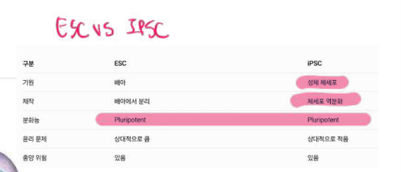{: style="width:62%"}

| 구분 | ESC | iPSC |
|---|---|---|
| 기원 | 배아 | **성체 체세포** |
| 제작 | 배아에서 분리 | **체세포 역분화** |
| 분화능 | Pluripotent | **Pluripotent** |
| 윤리 문제 | 상대적으로 큼 | 상대적으로 적음 |
| 종양 위험 | 있음 | 있음 |

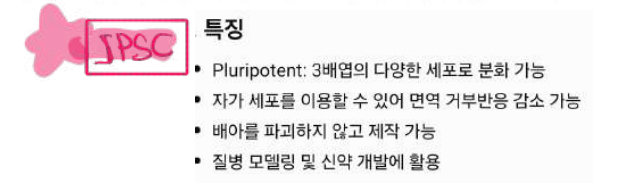{: style="width:55%"}

- iPSC 특징: **pluripotent**(3배엽의 다양한 세포로 분화), **자가 세포를 이용할 수 있어 면역 거부반응 감소**, **배아를 파괴하지 않고 제작**, **질병 모델링 및 신약 개발**에 활용.

## 다양한 조직 재생연구(요약)
- **조직 특이적 줄기세포**: 각 조직에 있는 성체줄기세포(피부·조혈·간엽·신경 줄기세포 등)는 그 조직 세포로 분화한다. iPSC는 바로 이식하면 기형종이 생길 수 있어 원하는 세포로 분화시킨 뒤(또는 직접 리프로그래밍) 이식한다.
- **피부 재생**: 표피 기저층·모낭 bulge의 줄기세포. 만성 창상에 지방·골수줄기세포 적용(Wnt/β-catenin, BMP, Notch, Hedgehog 신호).
- **골 재생**: 골수·지방줄기세포 + 스캐폴드 + BMP.
- **혈관 재생**: 혈관내피전구세포로 허혈성 질환 치료.
- **근육 재생**: 근위성세포, dystrophin 생성 연구.
- **말초신경 재생**: Schwann 세포 유사 세포로 분화시켜 신경도관에.
- **임상 적용**: 줄기세포 + 인공지지체(3차원 스캐폴드, 3D 프린팅), **유전자 치료**(성장인자 유전자를 넣은 줄기세포). 아직 안전성 문제가 남아 있어 표준화된 방법과 장기 추적이 필요하다.

# 8. 한눈에 정리

| 주제 | 꼭 기억할 것 |
|---|---|
| 화상 깊이 | 수포 + 선홍색 + 빠른 재충전 + 심한 통증 = **표재성 2도**, 3도는 무통·가죽 |
| 화상 크기 | 9의 법칙: 머리 9, 팔 9, 몸통 앞 18(가슴 9·배 9), 뒤 18, 다리 18, 회음 1 |
| 수액 | **Parkland 4 mL × kg × %TBSA**, 첫 8시간 1/2, LR, 소변 0.5–1.0 mL/kg/h |
| 흡입손상 | 검은 가래·쉰 목소리·stridor, COHb, 기관지내시경, 100% O₂, 조기 삽관 |
| 화학화상 | 즉시 다량의 **물** 세척, 중화 금지, 알칼리가 더 깊다 |
| 전기화상 | 심전도, 소변 75–100 mL/h, **알칼리화**·mannitol, 가피·근막절개, 지연성 신경손상·백내장 |
| 피부이식 | FTSG: 얼굴·손, 이차구축 적음, 크기 제한 / 생착 조건 / **혈종 = 가장 흔한 실패 원인** |
| 드레싱 | 작은 이식·얼굴·손 = **tie-over**, 깊은 공간 = **inlay** |
| 천공지 피판 | "디자인의 다양성" = 장점, "천공지 혈관의 다양성"·학습곡선·긴 박리·긴 수술 = 단점 |
| 조직공학 | 세포 + 기질-세포지지체(scaffold) + 혈류 (외과적 지연처치는 아님) |
| 줄기세포 | 반복 증식, 자가 재생, 클론 형성, 다분화, **역분화로 생성 가능** |
